## 前言

2025 年 8 月至 2026 年年初，笔者在图灵开设线上视频课程《Agent 实战营》，讨论如何用可解释、可验证、可复用的工程方法构建 AI Agent（智能体）。课程从运行一个 Agent 开始，接着分析它为何采用这样的架构：每项设计解决什么问题，需要付出什么代价，又适合哪些任务。本书在课程讲义和配套实验的基础上整理而成。

> **本书的形成：一次人机协作实践**
>
> 备课时，我先把提纲讲给 Pine 的语音 Agent，让它查资料、拟初稿。这种口述式协作叫作 **whisper coding**。上完课，学员在哪一步卡住了、哪个实验的结果出乎意料，我就回头核查相应的例子和论证。

2025 年以来，笔者看到一个重要变化：AI 研究与产业实践的重心，正从提升基座模型能力扩展到让 Agent 完成真实任务。模型训练与应用也因此更加紧密地结合起来。DeepSeek-R1 等推理模型展示了强化学习对数学、编程和推理能力的提升。[^preface-r1] 智能体强化学习（Agentic Reinforcement Learning）将工具调用与环境交互纳入训练，让模型学习编程，也学习操作图形界面。后一类任务常称为 Computer Use：模型根据截图判断页面状态，再通过点击、输入或滚动完成操作。Manus、Claude Code、OpenClaw 等产品则让用户直接委派任务，也展示了“代码生成 + 文件系统”怎样支撑通用 Agent。

2026 年 9 月，Meta 推出 Muse。那段时间，国内外的个人 Agent 产品如雨后春笋般涌现。本书讨论的许多问题，我和团队在更早做 Pine 时就遇到了。我在 Pine AI 担任首席科学家，和同事们一起研发了这款替消费者办事的个人 Agent。2025 年 1 月初，Pine 已在美国上线，用户可以请它致电商家，协商账单、申请退款或取消订阅。

商家在电话里答应减免一笔费用，Pine 当场能告诉用户的是“客服答应了”；要说“钱已经退了”，还得等账单上出现这笔退款。办这样的事，我们需要让模型记住用户授权了什么，知道下一步该查什么，也能分清事情办到了哪一步。后来业界谈起 Skill、Harness 和 Loop 工程，其中好些做法，我们正是在这些电话里摸索出来的。

- **Skill。** 我们只在任务用得着时才加载相应的提示词。工具多了以后，我们又让模型通过命令行调用工具，这样就不必在每次请求里列出所有工具的定义。
- **Harness。** 我们把执行环境、当前时间和用户的工作状态写进状态栏，供模型决策时参考。模型有时会编造结果、调错工具或漏掉指令，危险操作还可能超出用户授权。为此我们给执行过程加了约束，后来在 Claude Code 里也看到了相近的做法。
- **Loop 工程。** 模型有时事情只办了一半就宣布完成。我们让一个 Agent 办事，另一个核对账单或订单，发现漏办的事就交回去补办。这就是提议者—审核者（proposer-reviewer）分工。

其他模型与 Agent 团队在解决相似问题时，也独立形成了相近的方法。这让笔者更加确信，团队遇到的许多困难，是 Agent 系统走向实际应用时共同面对的问题。除了《Agent 实战营》，笔者在 2024—2026 年间也持续在中国科学院大学讲授 Agent 实践课程。两门课的学员提出的问题，帮助笔者辨认哪些经验还需要讲得更清楚。本书开源发布，也希望更多研究者与工程师能够使用、检验和改进这些方法。

**实践在前，命名在后**。对开发团队而言，这还有一层含义：当一个术语成为行业共识时，领先团队往往已经探索了很久。要积累自己的工程优势，就需要从真实业务中提前发现问题、尝试解决。要做到这一点，笔者认为有两个关键条件。

**第一，选择对 Agent 能力提出足够高要求的真实业务，并持续获得反馈。** Pine 的一项任务可能持续数小时乃至数周，需要与多方沟通，长时间通话、填写复杂表单、进行多轮邮件往来，同时保证数字准确、操作可控，并维护用户利益。这类场景不断暴露模型能力与业务要求之间的差距，促使团队改进 Harness。如果一个产品的主要价值只是弥补某一代模型的短板，下一次模型升级就可能覆盖这部分价值，团队很难积累持久优势。

**第二，建立系统的评估（Evaluation）机制。** 改过系统以后，一次账单协商成功，可能是助手问对了问题，也可能是这次遇到的客服恰好有权减免。用同一批案例反复比较新旧版本，能看出差异是否稳定。第七章将具体介绍怎样设置成功标准、构建评估环境、分析失败并检验改动。

在 Pine，我们从账单减免中学到一条办法：让审核者去看账单上那笔钱。把同样的办法用到改签，就得看新票有没有出。具体凭据随业务而变，背后却有一条共同的原则：判断任务是否完成，要看这项行动在外界留下了什么结果。**好的原则能够穿越模型的迭代周期**。

### 本书的使命

设想有人把一张手机账单交给助手，请它联系运营商协商减免。开始之前，助手要弄清是哪一笔收费有争议；通话中，它要能听取解释、追问条件；结束时，它要告诉用户客服究竟答应了什么。助手每走一步，都要回答三个问题：这一刻助手知道什么？它能采取哪些行动？它依据什么选择下一步？本书从这三个问题出发，介绍 Agent 的结构、构建方法与能力边界。核心公式是 **Agent = LLM + 上下文 + 工具**：LLM 负责理解、规划与决策，上下文承载当前决策所需的信息，工具连接外部环境，用于获取观测或执行行动。

用一个直观的比喻，LLM 是“大脑”，上下文是“当前决策视野”，工具是“感官和手脚”。视野中包含环境信息、对话历史、记忆和知识，也包含系统指令、工具定义与任务状态。搜索、读取和截图带回信息，点击、写入和业务接口调用改变外部状态。图0-1 把一次账单查询拆开来看。第一次作决定时，模型只知道用户对收费有疑问，第二次已经能指出要问的是哪一笔钱。

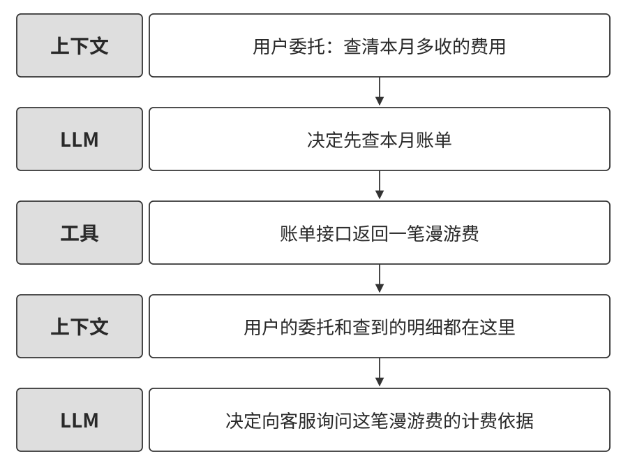

熟悉强化学习（Reinforcement Learning，RL）的读者，还可以借助策略、观测和动作理解这套分工。LLM 根据上下文选择下一步，其决策功能近似策略（Policy）；上下文承载这次决策使用的具体观测与历史；工具提供观测和动作接口。观测空间（Observation Space）描述可能获得哪些观测，动作空间（Action Space）描述允许采取哪些动作，两者刻画 Agent 与环境交互的范围。[^preface-spaces] 第一章将通过工具调用实例展开这些概念，并介绍 Model 与 Harness 在生产实现中的分工。

> **延伸思考：从生命到设计实体**
>
> 工程实践之外，Agent 也引出了关于智能系统演化的问题。图灵奖得主、强化学习先驱 Richard Sutton 将宇宙演化概括为尘埃、恒星、生命和“设计实体”（designed entities）四个阶段。[^preface-sutton] 生物通过随机变异和自然选择演化，设计实体则可以由已有的智能系统有目的地构建和改进。
>
> Agent 可以生成代码，构建新的 Agent，再分析运行行为、提出修改并验证结果，逐步实现自举（bootstrap）和持续进化。这像是一个程序员编写了另一个程序员，后者继续参与构建新的系统。这种理解自身、改进自身的可能性，也是笔者写作代码生成和持续进化两章时最感兴趣的问题之一。

### 全书结构

图0-2 展示了各章的联系。假如用户在电话里临时改口，助手却还按旧要求办事，可以从左栏的第六章读起，看看助手怎样处理用户插话。修过以后，怎样知道它在别的通话里也能听进新要求？这就要用到右栏第七章的评估方法。图中从第七章分出的三条箭头表示，拿到评估结果以后，可以根据失败原因选择不同的改进办法。

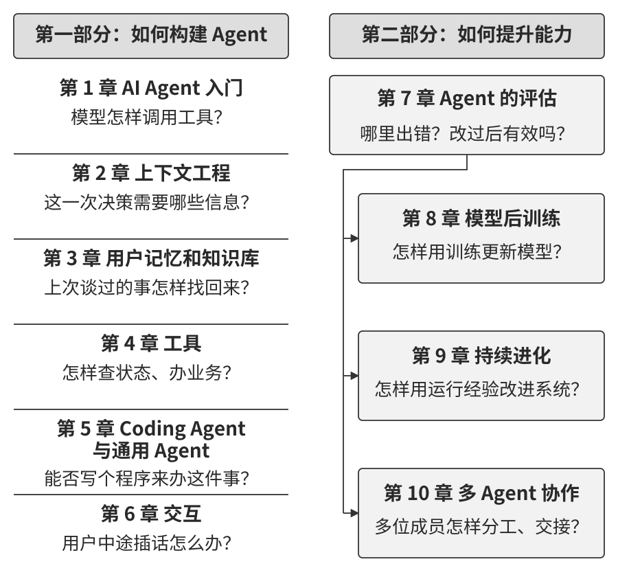

- **第一章（AI Agent 入门）**通过产品与工具调用实例，介绍核心组成、运行循环、Harness 和编排方式，建立理解全书的概念框架。
- **第二章（上下文工程）**是全书最关键的一章，讨论怎样组织模型当前需要的信息。从提示设计、按需加载讲到历史管理，并结合 KV Cache 解释这些方法如何影响回答质量与运行成本。
- **第三章（用户记忆和知识库）**讨论怎样保存并取用跨会话的信息。从用户记忆讲到 RAG、结构化索引与知识更新，帮助读者掌握持久知识的检索和维护方法。
- **第四章（工具）**讨论 Agent 怎样获取观测、执行行动并请求协作。通过工具分类、接口设计、MCP 与执行管理，理解如何把外部能力接入系统。
- **第五章（Coding Agent 与通用 Agent）**提出通用 Agent 的一条核心架构思路：以 Coding Agent 为执行核心，以文件系统为工作空间。先讲开发流程，再通过多媒体、业务系统等案例，说明 Agent 如何编写程序解决问题，进而创造工具、构建新的 Agent。
- **第六章（交互：观测与动作空间的扩展）**从模态与时序两个维度讨论 Agent 的交互方式。通过异步事件、语音、Computer Use 和机器人，理解持续观测、快慢路径与执行控制。
- **第七章（Agent 的评估）**回答怎样判断系统表现和一次改动的效果。先确定成功标准、环境与数据集，再讲验证器、评分和统计分析，最后通过分析失败原因找到改进方向。
- **第八章（模型后训练）**讨论怎样用数据与环境更新模型能力，主张优先投入数据质量与训练环境。通过监督微调、强化学习和奖励设计，解释示范学习与探索为何带来不同的泛化表现，以及为什么只改算法往往收效有限。
- **第九章（Agent 的持续进化）**讨论怎样利用运行经验改进 Agent 的后续版本。比较知识、指令、程序和参数四类更新，再用验证、发布与恢复流程管理长期变化。
- **第十章（多 Agent 协作）**讨论多个成员何时带来额外价值，以及怎样分工、通信和协调。先说明上下文和控制权如何分配，再结合案例讲解协作机制、分析失败原因，并讨论 Agent 社会与经济的可能形态。

### 如何阅读本书

- **从头构建 Agent 产品**：建议通读全书。先用第一至六章搭起能办事的助手，再用第七章检验它在哪些任务上容易出错。后面三章讨论怎样根据这些失败改进模型、系统或成员之间的分工。
- **先建立整体认识**：依次读第一、二、四、七章。沿着一次工具调用看下去：先认识 Agent 的运行循环，再看模型收到哪些信息、工具实际做了什么，最后用评估判断结果是否符合用户要求。第二章讲到 KV Cache 时，第一次读可以先掌握开头的三条结论，做过实验再回头看底层原理。
- **重点学习模型训练**：先用第一、二章理解 Agent 的运行方式，再结合第七章的评估方法阅读第八章。这样可以把训练目标与实际任务表现联系起来。
- **维护已上线的 Agent**：从第七章选一批真实任务做评估。比如助手给用户报了旧价，先查它拿到的是哪一版报价。若知识或流程过时，带着这次失败读第九章；若报价和工具都已给足，改过流程后模型仍反复选错，再读第八章，判断是否值得准备训练数据。

每章都安排了实验和思考题。实验采用“实验 X-Y”编号，X 表示章号，Y 表示章内顺序。星级表示难度：★ 适合入门，★★ 需要一定工程经验，★★★ 涉及开放性问题或复杂系统设计。大部分实验配有可运行代码，集中放在开源仓库中：

> **配套代码仓库**：`bojieli/ai-agent-book`

第一次做实验，可以从“实验 1-1：上下文的关键作用”开始。如果使用 Git，在终端运行：

```bash
git clone https://github.com/bojieli/ai-agent-book.git
cd ai-agent-book
```

在仓库页面选择 **Code → Download ZIP** 并解压，也能得到同样的目录。从第一章实验索引（`chapter1/README.md`）找到编号 1-1，打开 `chapter1/context/README.md`。此后遇到“实验 X-Y”，都可以从仓库中的 `chapterX/README.md` 查到项目和运行方法。“复现指南”提供外部项目及获取方式，安装命令和目录说明集中放在 README 中。

### 前置知识

本书面向具备基本编程能力、希望理解和构建 Agent 的读者。动手做实验会用到以下基础。

**必需：阅读全书的基础**

- **Python 编程**：熟悉语法、常用数据结构和 pip 等包管理工具，能够读懂并修改实验代码。书中大部分实验以 Python 为基础。
- **LLM 使用经验**：使用过 ChatGPT、Claude 或类似产品，熟悉提出要求、读取回复和继续追问的基本过程。
- **软件工程常识**：了解命令行、Git、JSON 和 REST API，能够据此运行项目、检查变更并阅读接口数据。

动手做实验时，笔者强烈建议选 Claude Code、Codex、Cursor、TRAE 中的一种。让它帮你调试一段代码，看看它读了哪些文件、调用了什么工具。后面读到运行循环和上下文管理时，就有了一次亲身体验可供对照。

**推荐：按章节补充的知识**

- **机器学习基础（第八章）**：训练与推理、损失函数、梯度下降和过拟合，有助于理解模型更新过程。
- **基础数学（第二、三、七、八章）**：向量与矩阵帮助理解嵌入和注意力，概率统计帮助理解评估指标与期望奖励。书中侧重直观解释和实际用途。
- **Web 开发基础（第六章）**：HTTP、WebSocket 和前后端分工，有助于理解异步事件架构与实时语音通信。
- **Transformer 基础（第二、八章）**：了解注意力与模型结构，有助于理解上下文计算和后训练。希望系统学习的读者，可以阅读《图解大模型：生成式 AI 原理与实战》（Jay Alammar、Maarten Grootendorst 著，李博杰译，图灵教育出品）。该书通过图解讲解 Transformer、预训练与微调，与本书的工程视角相互补充。

除第八章的后训练外，其余章节用到的数学和机器学习知识较少，有基本编程经验就可以开始阅读。

### 致谢

感谢图灵的梦鸽老师和刘美英老师编辑本书，并为组织《Agent 实战营》付出心血；感谢刘俊明老师在中国科学院大学开设 Agent 实践课程。感谢两门课程的学员与同学，你们的问题、实验反馈和建议，帮助笔者不断改进讲解，也加深了笔者对这些概念的理解。

感谢 Pine AI 的所有同事。真实业务中的挑战与团队讨论，是本书许多方法和案例的来源。你们的实践与见解，让这些认识得以不断完善。

感谢 AI 业界的朋友们。在一次次交流中，你们坦诚地提出意见，分享不同的经验和判断，帮助笔者更深入地理解模型与 Agent。

最要感谢笔者的家人，尤其是太太孟佳颖。她始终支持本书的写作，也为书稿提出了许多宝贵意见。

[^preface-r1]: DeepSeek-AI, *DeepSeek-R1: Incentivizing Reasoning Capability in LLMs via Reinforcement Learning*, 2025.
[^preface-spaces]: Gymnasium 文档的“Spaces”一节。
[^preface-sutton]: Richard Sutton 与 Dwarkesh Patel 的访谈，2025-09-26，“Succession to AI”部分。

## 第 1 章 AI Agent 入门

用 Deep Research 调研一个课题时，它会反复搜索和阅读，最后整理出报告。Manus 可以操作浏览器完成在线任务，豆包手机助手可以在手机上订票、发消息，Pine AI 可以替用户打电话，与运营商协商降低账单。这些都是 AI Agent 的应用。

用 Cursor 修复一个函数时，它找到函数、编辑文件，然后运行测试。测试仍然失败时，错误信息成了它下一次修改的依据；测试通过时，它才有证据向你报告结果。搜索、编辑和测试这三步的次序可以事先写进程序，但究竟改哪一行、失败后该回到哪里，要看执行中得到的信息。这种围绕目标选择动作、再依据结果调整计划的过程，也发生在调研和电话协商等任务中。

### 现代 Agent = LLM + 上下文 + 工具

本书用一个公式概括现代 Agent 的三类功能要素：**Agent = LLM（大语言模型，Large Language Model）+ 上下文 + 工具**。

- **LLM 是 Agent 的大脑**，负责理解任务、规划步骤和选择行动。预训练为模型提供语言能力与世界知识，后训练进一步塑造指令遵循、推理和工具调用等行为。第八章将介绍监督微调与强化学习等后训练方法。
- **上下文是 Agent 的当前决策视野**，容纳这次决策需要的信息，包括指令、工具定义、环境观测、用户记忆、领域知识、历史消息、自身状态和任务进展。
- **工具是 Agent 的感官和手脚**，通过接口获取信息或执行操作。工具体系包括定义、调用协议和适配器，既支持搜索、读取、截图等观测操作，也支持写入、执行代码、委托子 Agent 和与用户沟通。

同一个工具可以兼具多种作用。例如，模型通过命令行读取文件，返回的文件内容就成了下一步决策的依据；通过命令行运行程序，还可能改变文件或进程的状态。

假设你刚拆开包裹，想问客服：“拆封后还能退货吗？”系统可以用**检索增强生成**（Retrieval-Augmented Generation，RAG）查找店铺的现行退货政策，再请模型依据条款回答。[^ch1-rag] 沿着一次查询，就能看清几个部件的职责。政策原文与索引保存在外部知识库中；检索工具按问题查出相关段落，调用模型的程序再把段落连同出处放进这次请求。模型读到“拆封”一项，可以解释条款；如果条款还按商品类别区分，就得先问清你买的是什么。

[^ch1-rag]: Patrick Lewis 等，Retrieval-Augmented Generation for Knowledge-Intensive NLP Tasks，NeurIPS，2020。

在这次退货查询中，发起检索是 Agent 的动作，返回的条款是它从环境（Environment）中得到的观测。下一步是答复还是追问，取决于条款写了什么。这就构成了强化学习和控制论所说的闭环，如图1-1 所示。

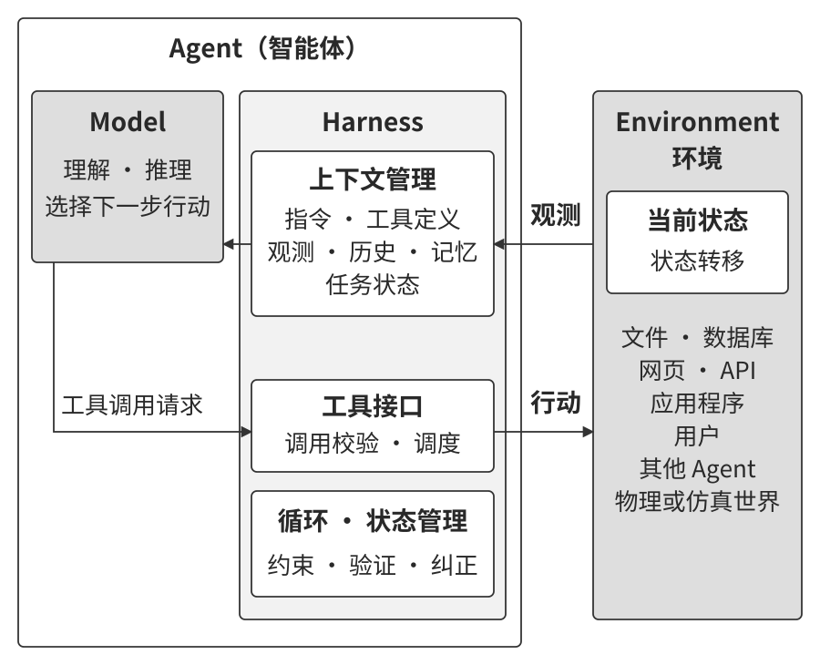

图的外层划分了 Agent 与环境的边界。文件、数据库、网页、用户、其他 Agent，以及物理或仿真世界，都可以成为它交互的环境。图的内层展示了生产实现的分工：**Model 负责理解、推理和决策；Harness 位于 Agent 边界内、Model 之外，负责组织上下文、工具接口、运行循环和状态，并实施约束、验证与纠正。** Harness 可以创建、隔离或代理环境；文件内容、进程状态等则随行动在环境中发生变化。[^ch1-harness]

[^ch1-harness]: 可参阅 LangChain 的《The Anatomy of an Agent Harness》与 Anthropic 的《Effective harnesses for long-running agents》。有些实现把沙盒也计入 Harness；图1-1 单独画出环境，便于追踪动作实际改变了什么。

因此，本书采用两套互补的分解方式：**“LLM + 上下文 + 工具”说明功能组成，“Model + Harness”说明生产实现。** 上下文由 Harness 组织后提供给 Model，工具调用由 Model 决策、Harness 校验和调度，再交给工具或环境执行。一个简单系统可以从上下文组装和工具调度起步，逐步补齐生产运行所需的约束、验证与纠正机制。

如果熟悉强化学习，可以从“谁决定下一步、依据什么来决定、怎样付诸行动”这三个问题读下表。这是按功能作的粗略类比。

| 直觉理解 | 工程要素 | 强化学习中的相关概念 | 含义 |
|-----------|-----------|----------------------------|----------------------------------------------|
| **大脑** | LLM | **策略**（Policy） | 根据当前信息决定下一步做什么 |
| **当前决策视野** | 上下文 | **观测与历史** | 将环境返回的信息与已有历史组织成决策依据 |
| **感官和手脚** | 工具与适配器 | **观测和动作接口** | 规定如何读取环境信息、发出动作，以及调用和返回的格式 |

#### 观测空间与动作空间：模型与世界的接口

**观测空间描述 Agent 可能接收到哪些观测，动作空间描述它可能发出哪些动作。** 一次调用中的上下文承载具体信息，可用工具则提供与环境交互的接口。工具之外，用户输入、事件通知等也可以带来观测；工具调用的参数、权限和运行环境共同限制动作的范围。

请分别设想两种故障。第一种，模型能解释账单上的每一个收费项目，却拿不到本月的账单。用户授权读取后，还要把账单查出来交给模型，它才能判断哪笔费用有争议。第二种，用户请助手改套餐，助手已经查到了合适的方案，可账户接口只允许查询。即使再读一遍账单，它也办不了变更，还需要相应的操作权限。Harness 的工作是把读到的材料放进上下文，接收模型选择的动作，检查参数与权限，然后调度执行。

因此，**在底层模型固定时，调整观测空间与动作空间，是提升任务表现的重要工程手段。** 模型漏看关键事实，可以把相关数据纳入上下文；模型经常选错相似工具，可以合并重复接口或只加载当前任务需要的工具。

看视频时还会遇到相反的问题：画面一直都有，值得重新判断的变化却不多。假设助手在等文件上传，进度条每动一下就调用一次主模型，平添了许多计算；若每隔十秒才看一眼，又可能错过一闪而过的失败提示。**笔者认为，观测空间的稀疏化是 Agent 设计中的一个基本问题。** 系统可以持续观察环境，只把可能改变下一步行动的变化连同必要的上下文交给主模型。

**Manus：在同一任务中结合调研、编程与电脑操控。** Deep Research 擅长搜索与阅读，Coding Agent 可以编写和运行代码，Computer Use Agent 可以操作界面。Manus 将浏览器、文件系统、代码执行和命令行整合到云端沙盒中，使同一个 Agent 能先查资料，再处理文件和运行代码，最后通过浏览器完成操作。浏览器与文件读取增加了可获取的信息，代码和命令执行增加了可组合的操作。**笔者认为，这种组合是通用 Agent 的重要突破：同一个 Agent 可以跨越原来分离的产品边界，把获取资料、处理数据和执行操作串成完整任务。**

**OpenClaw：把接口延伸到用户的数字生活。** OpenClaw 通过 WhatsApp、Telegram、Slack、Discord、iMessage 等消息渠道接收任务、返回结果，并用运行在用户设备上的 Gateway 连接消息渠道、模型和工具。配置相应工具并获得授权后，Agent 可以处理本地文件，也可以接入 Google Drive、Notion 等云服务。用户散布在账号与设备中的资料，由此能够进入同一任务的处理过程。早期 Manus 主要在云端沙盒中工作，用户需要上传文件；后来加入的 Google Drive 连接器和 My Computer 桌面功能，则进一步扩展了云文件与本地资源的访问范围。这些演进说明，产品能力的增长常常来自观测与动作接口的扩展[^ch1-agent-products]。

[^ch1-agent-products]: 产品结构参见 Manus 官方的 Sandbox 介绍、Google Drive Connector 介绍、My Computer 介绍，以及 OpenClaw 官方仓库与工具文档。连接器、工具配置与用户授权决定具体可访问的资源。

不同产品的任务各异，但都可以从决策依据、可用操作和执行策略三个方面理解：

| Agent 产品 | 上下文中的主要信息 | 可用工具与操作 | 执行策略 |
|----------------|----------------------|----------------------------|------------------------------|
| **Cursor 等 Coding Agent** | 需求、代码片段、目录列表、终端输出 | 代码搜索、文件读写、执行命令 | 理解需求→搜索相关代码→编辑代码→测试验证→调试修复 |
| **Deep Research 等搜索 Agent** | 搜索结果、网页内容、论文摘要与引用 | 搜索查询、网页读取、生成报告 | 根据已有信息调整搜索方向，逐步综合出完整报告 |
| **Browser Use 等电脑操控 Agent** | 屏幕截图、DOM 或无障碍树、操作结果 | 点击、输入、滚动、截图、执行代码 | 读取界面→识别目标元素→执行操作→验证结果 |
| **豆包等手机助手 Agent** | 手机截图、App 界面状态、系统反馈 | 点击、滑动、输入、打开 App | 理解需求→定位目标 App→执行操作→确认完成 |
| **Pine AI、Meta Muse 等个人办事 Agent** | 经授权读取的账户记录、账单、服务商资料 | 打电话、发邮件、填表单、与用户确认 | 收集信息→制定协商策略→联系服务商→谈判→汇报结果 |

**一次委托如何变成可以执行的任务？** 笔者在 Pine 做个人办事助手时，发现用户经常只说一个目标，例如“帮我订去出差的机票，希望不超过 1200 元”。助手要先弄清日期、目的地以及这趟行程最看重什么，再收集缺少的资料，和用户谈清打算怎样办、哪些条件可以商量，随后才联系服务商。办事中得到的新情况还可能把任务带回前一步。

假设客服查到的最低票价是 1250 元。模型会结合常识、这趟行程以及记得的用户习惯来判断。对一位正在出差、通常愿意为合适行程多花一点的用户，Pine 可能直接订下；换成一家人出游，且以往明确在意总开销，它可能先把差额告诉用户，继续请客服查别的航班。用户如果事后补充“下次遇到超预算的票，先问我”，这条反馈就给下一次判断增加了比一般经验更具体的依据。

换一个场景，银行客服提议把文件寄到家里，助手记得用户正在海外旅行。这次需要改变的是交付方式：前台可以当场说明收件困难，争取用电子邮件送达。再看账单减免，客服在电话里口头答应，助手可以准确地报告商家的承诺；要确认款项实际扣减，还需要后续账单作为新的观测。一个助手的动作空间可以扩展到真实电话，它的结论仍受观测空间限制。

从委托的事情看，本书会遇到三类应用：生活代办、协作办公和科研探索。同一个助手可以承担不同类别的任务，区别在于谁给它授权、它能改变什么，以及最后由谁验收。到了办公室，一位同事交回核查结果，工单就能关闭了吗？假设项目负责人在 Multica 的工单里点名请助手核对预算表中的一笔差额。这条评论会触发核查，工单仍归原负责人，状态也保持原值。助手交回两处金额及其出处，回答了同事的问题；整份预算能否提交，还得由负责人结合其余待办事项判断。[^ch1-multica]

科研任务也可以问同一个问题：凭什么认定有了进展？Google DeepMind 的 AlphaEvolve 搜索矩阵乘法算法时，模型提出候选程序，评估器运行这些程序，检查乘积算得对不对、用了几次乘法。后续搜索可以接着改进表现好的程序。研究团队报告，其中一种算法用 48 次标量乘法即可完成两个 $4\times 4$ 复数矩阵的乘法。“少做了几次乘法”有明确的计数对象，算法还要算出正确的矩阵乘积。[^ch1-alphaevolve]

[^ch1-multica]: Multica，在工单评论中点名 Agent。第十章讨论如何在协作中区分临时求助与责任移交。

[^ch1-alphaevolve]: Google DeepMind，AlphaEvolve 研究说明，2025 年 5 月。这里的乘法次数指算法中的标量乘法次数，实际运行时间还取决于实现和硬件。

这些系统的动作空间具有**开放式**的特点。搜索词、输入文本、生成的代码和操作组合难以预先穷举，而每次行动仍受工具、参数、权限和运行环境限制。正因如此，一份可执行的计划需要为新观测留出改变下一步的余地。

#### 工具：Agent 的感官和手脚

工具把模型的决策落实为对外部环境的读取或操作。搜索和读取工具带回观测，文件写入、命令执行等工具落实行动。模型通过返回结果得知操作的效果，再决定继续、重试或结束任务。

按主要用途，本书将工具分为五类。一个接口可以兼具多种用途，例如语音通话既能获取信息，也能传达请求。

**感知工具**负责获取信息：搜索引擎提供网络资料，文件读取工具访问本地文档，API 和数据库接口对接外部服务与企业数据。

**执行工具**负责执行操作：运行代码、修改文件、执行系统命令或调用外部 API，将决策落实到环境中。

**协作工具**支持分工与协调：把专项任务委托给子 Agent，收集结果，协调多个 Agent 的工作。需要人类参与决策时，系统还可以通过用户沟通接口请求确认。

**事件触发工具**将外部事件接入运行过程。一封新邮件、预定时间到达或 Webhook 回调，都可以触发任务。事件适配器负责把这些输入转换为 Agent 可处理的观测，调度机制负责启动或恢复执行；触发规则可以由开发者配置，也可以通过获准的工具调用注册。

**用户沟通工具**负责向用户传递信息并收集反馈，例如发送文字消息、发起语音通话或发送邮件。它们用于汇报进展、请求确认，也可以主动提醒用户处理事项。

第四章将展开这五类工具的设计。接口定义影响模型能否正确选择工具和填写参数，错误处理决定失败后能否继续，权限控制限定操作的影响范围。MCP（Model Context Protocol，模型上下文协议）则为工具发现与调用提供统一的接入方式，减少不同系统之间的适配工作。

**工具调用**（Tool Calling）是模型以约定格式提出操作请求的能力。常见的函数调用（Function Calling）用工具名称和结构化参数表达请求。本书统一使用“工具调用”这一术语。

以查询北京天气为例。模型可以写出城市名，实际气温要等 Harness 执行查询后才会出现在上下文里。下面是这次调用的四步消息：

```text
第一步：声明工具                    第二步：模型决定调用
tools: [{                          assistant: {
  name: "get_weather",               tool_calls: [{
  parameters: {                        id: "call_1",
    city: "string"                     function: "get_weather",
  }                                    arguments: {city: "北京"}
}]                                   }]
                                   }

第三步：结果追加到上下文              第四步：模型基于结果回复
tool: {                            assistant: {
  tool_call_id: "call_1",              content: "北京今天 28°C，晴。"
  content: '{"temp":28,"sky":"晴"}'  }
}
```

其中，`call_1` 将工具返回值与调用请求关联起来。开发者说明工具怎样调用，编写查询天气的函数，并把查询结果交回模型，模型决定是否调用、调用哪个工具以及传入什么参数。第二章将进一步介绍 API 消息结构。

设计工具时，可以先提供刚好够用的能力。四则运算用参数清晰的计算器即可；任务扩展到读取表格、清洗缺失值、计算统计量和绘图时，受限的 Python 代码解释器更便于组合这些步骤。通用能力扩大后，隔离与资源管理也要跟上：代码在沙盒中运行，网络访问默认关闭，文件访问限于授权工作目录，并为执行时间、CPU、内存和输出大小设置上限。

记录一段执行过程，可以使用单一日志工具。持续数小时甚至数天的任务，则适合用受控的虚拟工作目录保存计划、中间结果、运行日志和最终产物，让 Agent 在多次执行之间接续工作。目录应限制可读写路径、容量和文件类型，并检查路径是否越过授权边界。

支付、删除数据、发送邮件和生产部署等操作具有较高风险或明确的业务规则，适合封装为参数清楚、权限受限、全程可审计的专用工具，必要时加入预览与人工确认。**通用基础能力支持组合与探索，专用工具落实高风险操作的约束和业务规则。**

#### LLM：Agent 的大脑

LLM 是 Agent 的决策核心。收到请求后，它先从用户的表述中识别目标和约束，再把复杂任务拆成可执行的步骤。执行过程中，它还要判断下一步做什么、是否调用工具、选择哪个工具以及如何填写参数。这些能力以预训练积累的知识和语言能力为基础，再由后训练塑造为适合任务的决策行为。工作流与自主 Agent 都需要这类判断，实际操作则通过 Harness、工具和环境完成。

行动前的规划与推演，可以帮助 Agent 比较方案、预测结果并减少无效尝试。例如，模型可以利用数学规律检查计算步骤，利用因果关系分析故障，再按依赖关系安排操作顺序。模型先在推理中比较不同方案，选定行动后再请求工具执行。传统强化学习系统也可以利用学到的策略、价值函数、环境模型或规划算法来组织探索；LLM Agent 的特点在于，开始具体任务前就已通过大规模预训练获得广泛的知识与问题求解模式，后训练又进一步强化了这些能力的使用方式。

##### 模型原生工具调用

业界用“模型即 Agent”（Model as Agent）概括一种发展趋势：越来越多的规划和工具调用决策由模型承担。通过后训练，尤其是强化学习，模型可以学会何时调用工具、调用哪个工具、传入什么参数，以及获得结果后如何继续。开发者提供目标、接口和约束，模型根据任务进展安排具体步骤。

模型的自主决策需要 Harness 支撑。Harness 原指缰绳、挽具等马具，用来把马的力量传递到载具并控制方向。在 Agent 中，Harness 将模型能力组织成可持续运行的任务过程，承担上下文管理、工具接口、约束、验证和纠正等职责。本章后半部分将逐项介绍这五项功能。

模型能够自主安排的操作越多，错误可能影响的范围也越大。模型与 Harness 因此需要协同优化：模型提升规划和工具选择的质量，Harness 管理权限、检查结果并处理失败。模型厂商可以同时改进这两部分，这种协同迭代构成了重要的工程优势。

> **模型能力与 Harness 的演进**
>
> Rich Sutton 在《苦涩的教训》（The Bitter Lesson）中回顾了 AI 研究的一条长期趋势：能够利用更多计算资源的搜索与学习方法，逐渐超越依赖大量人工领域设计的方法[^ch1-1]。沿着这个方向，工具选择、步骤安排等曾由外部流程承担的决策，可以逐步通过训练内化到模型中。
>
> 本书的立场是：**方向认同，节奏务实。** 模型会持续接管 Harness 中的部分决策职责，而一轮训练与部署需要时间，业务规则和用户偏好却不断变化。真实业务中的约束也很难一次全部写进模型参数。因此，模型暂时做不稳的环节，由 Harness 先补齐。**模型此刻的能力边界，就是 Harness 此刻的价值所在。** 这种分工会随模型能力变化：模型每掌握一类决策，Harness 就可以减少相应的编排，转而解决新的困难。权限执行、状态持久化和结果校验，则继续由运行系统落实。

[^ch1-1]: Sutton, Rich. The Bitter Lesson, 2019。

##### Agent 的学习机制：从上下文适应到持久更新

工具报错后，Agent 这一次学会了换个路径找文件。明天换一个新会话，它还记得这个教训吗？沿图1-2 看这条经验存放在哪里，就能分清三种不同的更新。

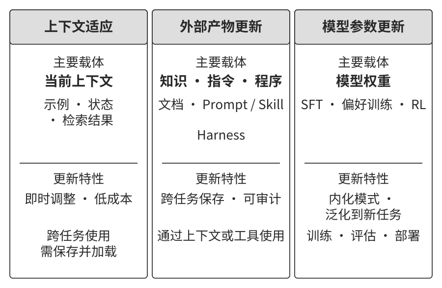

**上下文适应**发生在任务执行中。模型读到示例、任务状态或检索结果后，就能调整后续行为。例如，工具返回文件不存在，模型可以重新查找路径，再继续操作。这条路径响应快、成本低，效果取决于上下文窗口容量和信息组织方式。要让经验用于后续任务，还需要把相关信息保存并再次提供给模型。第二章将介绍上下文的组织方法。

**外部产物**（artifact）可以把经验跨任务保存下来。事实与经验写入知识文档，可用语言表达的策略写入提示词或 Skill，确定性的流程与约束写成程序或 Harness 逻辑。这些产物便于审计和修订，运行时通过上下文或工具接口参与决策与执行。第三至五章介绍相应的知识和程序基础，第九章讨论如何从经过评价的运行轨迹中生成、验证和发布更新。

**模型参数**则通过训练更新。医疗影像理解、语言风格和隐式决策策略等能力，涉及大量难以逐条写成规则的模式，可以通过后训练从数据与反馈中学习。参数更新需要训练、评估和部署投入，目标是让模型在新的任务中也能运用学到的能力。第八章将展开相关方法。

同一次失败可以先用来纠正眼前的操作，事后又整理成项目说明，供下一位 Agent 查阅。如果同类错误在许多项目里反复出现，还可以将这些案例用于训练。

#### 上下文：Agent 的当前决策视野

做决策时，人需要把任务说明、参考手册、沟通记录和最新数据放在一起看。Agent 也需要这样的信息集合，这就是上下文。一次 LLM 调用能接收的信息量受上下文窗口限制，Harness 则负责选择和组织其中的内容。从 API 的角度看，本书的基础实现包含五类信息：

- **系统提示词**（System Prompt）：由开发者或 Harness 构造，说明 Agent 的身份、任务边界和行为准则。提示工程通过调整这些指令塑造工作方式。系统提示词可以在会话中保持相对稳定，也可以按产品配置加入跨会话的用户记忆，例如偏好、历史行为和背景信息，或注入当前环境状态。真实权限由 Harness 与环境中的访问控制执行。第三章将介绍用户记忆。
- **工具定义**（Tool Definitions）：声明可用工具的名称、功能和参数格式，帮助模型选择操作并构造请求。在本书的基础实现中，工具定义与系统提示词放在请求前部，形成相对稳定的前缀。工具较多时，也可以按需加载完整的 schema，并保留已有前缀；第二章和第四章将展开这一方法。
- **用户消息**（User Messages）：包含用户的任务和补充输入，也可以附带通过 RAG（检索增强生成，Retrieval-Augmented Generation）获取的外部知识，例如训练数据截止后的信息或私有领域资料。第三章将介绍检索与知识组织。
- **模型回复**（Assistant Messages）：包括面向用户的文本 `content`、工具调用请求 `tool_calls`，以及服务提供的推理信息。本书用 `reasoning` 简写推理信息；不同服务可以返回推理内容、摘要，或用于续接的不透明状态。调用工具时，回复可以包含推理信息与调用请求；任务结束时，可以包含推理信息与最终文本。具体字段及可见性由模型服务决定。
- **工具执行结果**（Tool Results）：包含执行后的返回值、错误或状态，追加到消息历史后，为下一次决策提供依据。模型据此判断操作是否成功、是否需要调整，并减少本轮任务中的重复尝试。

每次调用模型，Harness 都要把相对稳定的前缀（系统提示词、工具定义）和不断增长的消息历史一起发给模型。这样，即使换汇工具在上一轮就返回了结果，模型在这一轮计算总额时仍然读得到。

不同信息对决策有什么作用，可以通过**消融实验**（Ablation Study）来检查：固定任务与运行条件，每次移除一类信息，比较行为变化。实验 1-1 保留系统提示词和当前用户任务，以固定角色、约束与任务要求，再对工具定义、工具结果、历史推理信息和历史消息分别做消融。

> **实验 1-1 ★★：上下文的关键作用**
>
> 让 Agent 汇总一家公司的季度收入：第一季度 250 万美元，第二季度 210 万欧元，第三季度 180 万英镑，第四季度 3.8 亿日元。任务要求通过换汇工具将收入统一为美元，再用计算工具求年度总收入与季度平均收入，结果保留两位小数。这样，模型既需要选择工具，也需要记住已经完成的步骤和返回值。
>
> 实验设置完整基线和四组消融，每组最多运行五轮。移除历史推理信息时，每轮仍允许模型重新推理；移除工具定义时，请求不再提供可用工具；移除工具结果时，保留调用记录，隐藏返回内容；移除历史消息时，只保留系统提示词、工具定义和当前用户任务。先试着预测：只知道“已经查过日元汇率”和知道“3.8 亿日元换回多少美元”，分别能支持哪一步计算？图1-3 展示五组结果。
>
> 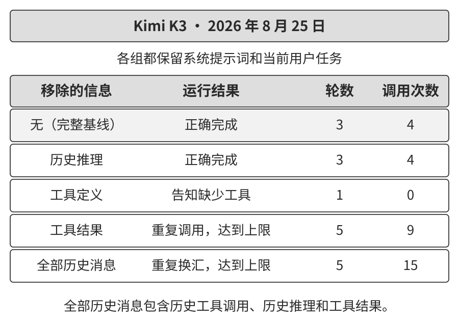
>
> 在 2026 年 8 月 25 日的 Kimi K3 运行中，**完整基线**用三轮、四次工具调用完成任务，得到年度总收入 9,602,895.73 美元、季度平均收入 2,400,723.93 美元。**移除历史推理信息**后，也以相同轮数和调用次数得到正确结果：工具记录已经保存了换汇结果，模型可以据此重建下一步计算所需的信息。
>
> **移除工具定义**后，模型没有发出工具调用，并告知缺少换汇工具。**移除工具结果**后，模型发起了九次调用，在五轮上限内仍未完成任务；已有调用记录无法告诉它换汇得到多少美元。**移除历史消息**后，模型累计发起十五次调用，反复执行换汇，同样耗尽五轮预算；先前完成的工作没有进入下一轮上下文，任务进度因而无法积累。
>
> 换一个模型再做同一道题。9 月 1 日，DeepSeek V4 Flash 在移除历史推理信息后，同样用了三轮、调用工具四次，却算出了 9,600,000.00 美元。少算的 2,895.73 美元去了哪里？看第一次换汇调用就有线索：第二季度收入是 210 万欧元，模型把金额写成了 `2.1`，打算按“百万”计算。工具收到的是 2.1 欧元，换算后保留两位小数，得到 2.28 美元。模型随后按 228 万美元计入总额，换汇时的舍入误差也就放大了一百万倍。其余两笔也用了同样的写法。即使最后把总数打印到小数点后两位，先前舍掉的数也回不来。[^ch1-context-runs]
>
> 这组对照展示了不同信息的作用：工具定义提供可调用能力，工具结果提供环境事实，历史消息保存任务进度。历史推理信息的价值，则取决于当前决策能否从其他记录中恢复依据。

[^ch1-context-runs]: 仓库的 `chapter1/context/validation/` 目录保存了两次运行的逐轮请求与返回。8 月的记录在 `real_20260825T025409Z/evidence.json`，9 月的记录在 `real_20260901T163146Z/evidence.json`。

#### ReAct 循环

**ReAct**（Reasoning + Acting）是这种循环的一种典型实现，将推理与行动交替组织起来[^ch1-react]。模型先分析当前信息，选择行动，再根据工具返回的**观测**调整计划。在后面的示例中，我们用简短的 `reasoning` 字段表示每轮决策依据，帮助读者理解行动之间的联系。

[^ch1-react]: Yao, Shunyu, et al. ReAct: Synergizing Reasoning and Acting in Language Models, ICLR 2023。

任务执行时积累的决策、行动与观测序列，称为**轨迹**（trajectory）。消息历史是记录轨迹的一种方式：用户消息保存任务，模型回复保存决策与调用请求，工具消息保存执行结果。完整运行记录还可以包含时间、环境状态和验证结果，供调试与评估使用。

在本节的基础实现中，**每轮上下文 = 相对稳定的前缀 + 累积的消息历史**。前缀包含系统提示词与工具定义，消息历史则随交互增加。图1-4 摘出了实验 1-1 的三轮消息。看第一轮的三笔换汇请求：哪一个结果对应第二季度的 210 万欧元？

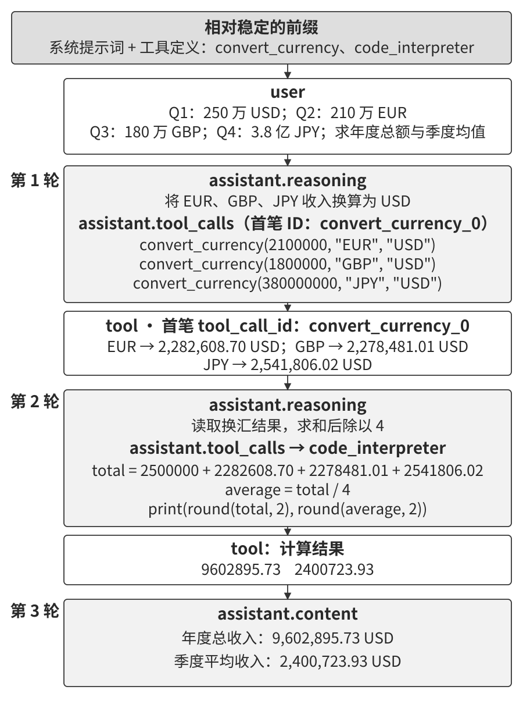

欧元请求的 ID 是 `convert_currency_0`。Harness 校验参数并执行工具，再把同一 ID 写入工具消息的 `tool_call_id`。这样就能找到 2,282,608.70 美元这笔结果，再看第二轮求和时有没有用对。这笔金额可以复算：实验的固定汇率表中，1 美元兑 0.92 欧元，2,100,000 除以 0.92，保留两位小数就得到这个数。工具返回的反向汇率 1.087 已经舍入，直接拿它乘以欧元金额会差 91.30 美元。[^ch1-context-runs]

运行循环可以用下面的 Python 风格伪代码表示。Model 决定下一步，Harness 组装上下文并校验、调度调用，工具在环境中执行并返回观测。这里以模型停止请求工具作为结束条件，生产系统的验证与退出机制将在后文展开。

```python
history = [user_request]

repeat:
    context = stable_prefix + history
    decision = Model(context)
    history.append(decision)

    if decision has no tool call:
        return decision.answer

    for call in decision.tool_calls:  # 相互独立的调用可并行执行
        validated_call = Harness.validate(call)
        observation = Harness.dispatch(validated_call)
        history.append(observation)
```

下面按八月基线运行的顺序节录消息，保留原调用 ID 和参数名，换汇结果只列金额与币种，计算代码也作了简写。读到第二轮时，可以在求和式中逐项找出处：季度收入有四笔，为什么工具只返回了三个换算结果？

```python
消息历史 = [
  {role: "user",
   content: "Q1 250万美元，Q2 210万欧元，Q3 180万英镑，Q4 3.8亿日元。用工具换算为美元，计算年度总收入和季度平均收入。"},

  # 第一轮：提出三个换汇请求
  {role: "assistant",
   reasoning: "先将 EUR、GBP、JPY 收入换算为 USD。",
   tool_calls: [
     {id: "convert_currency_0", name: "convert_currency",
      args: {amount: 2100000, from_currency: "EUR", to_currency: "USD"}},
     {id: "convert_currency_1", name: "convert_currency",
      args: {amount: 1800000, from_currency: "GBP", to_currency: "USD"}},
     {id: "convert_currency_2", name: "convert_currency",
      args: {amount: 380000000, from_currency: "JPY", to_currency: "USD"}}
   ]},
  {role: "tool", tool_call_id: "convert_currency_0", content: "2282608.70 USD"},
  {role: "tool", tool_call_id: "convert_currency_1", content: "2278481.01 USD"},
  {role: "tool", tool_call_id: "convert_currency_2", content: "2541806.02 USD"},

  # 第二轮：根据换汇结果计算
  {role: "assistant",
   reasoning: "第一季度原本就是美元，加上其余三笔换汇结果，求和后除以4。",
   tool_calls: [
     {id: "code_interpreter_3", name: "code_interpreter",
      args: {code: """
        total = 2500000 + 2282608.70 + 2278481.01 + 2541806.02
        average = total / 4
        print(round(total, 2), round(average, 2))
      """}}
   ]},
  {role: "tool", tool_call_id: "code_interpreter_3",
   content: "9602895.73 2400723.93"},

  # 第三轮：交付结果
  {role: "assistant",
   reasoning: "计算完成，按两位小数报告结果。",
   content: "年度总收入为9,602,895.73美元，季度平均收入为2,400,723.93美元。"}
]
```

第一季度的 250 万美元已经在用户消息里，可以直接参与求和。其余三笔取自工具返回的金额，四笔合计再除以 4，就能核对最后的季度平均值。这里共调用模型三次、工具四次：第一轮模型一次请求了三个互不依赖的换汇操作，第二轮请求运行汇总代码，第三轮直接回答用户。

把执行过程记录成结构化轨迹，还能帮助开发者改进系统。开发者可以沿着用户请求、模型决策、调用参数和工具结果定位失败环节；汇总多条轨迹后，还可以识别重复操作、改进工具接口或优化决策路径。经过评价和筛选的经验可以写入知识库，也可以作为后训练数据，用于改进模型。第七至九章将分别介绍评估、后训练和持续进化。

换汇任务只用了几次工具调用。搜索与分析任务往往需要更长的循环，也更容易遇到信息缺失和工具失败。下面两个实验将说明，这些任务怎样逐步推进，以及客户端和服务端分别负责什么。

> **实验 1-2 ★：Kimi K3 的多轮搜索与查询调整**
>
> 一项研究任务通常需要多次检索：先确定基本事实，再追查缺失的证据，最后综合结果。本实验让 Kimi K3 核查东盟成员资格与印度尼西亚首都状态。题目还要求它在初次检索后继续查找尚未证实的事实。
>
> Kimi K3 采用混合专家架构（MoE，Mixture of Experts），共有约 2.8 万亿参数，支持原生视觉与百万 token 上下文。MoE 可以类比为一个专家团队：处理每个 token 时，路由机制只选取部分专家参与计算，以控制计算成本。其后训练包含面向通用任务、编程和 Agent 任务的强化学习，重点提升长程执行能力[^ch1-k3]。
>
> 本次轨迹中，模型先搜索东盟官方成员资料，再补查成员名单和入盟日期，随后把查询收窄到印尼迁都相关法规、总统令和司法机关资料。任务最终以带来源链接的结构化回答结束。
>
> 跟踪这个过程，可以看到三方分工。**模型**决定查询内容、调用参数及下一步搜索；**客户端 Harness**获取工具定义、调用模型、把请求交给 Formula，并将结果追加到上下文；**Formula 工具服务**执行网络搜索，返回结果。前一轮的搜索结果由此进入下一轮请求，模型可以据此修改查询[^ch1-2]。
>
> 训练可以把工具调用策略内化到模型参数中，搜索实现与结果回传由运行系统承担。这个分工同样适用于代码执行等工具：模型决定要运行什么，工具服务提供执行环境，Harness 组织调用与反馈。

[^ch1-k3]: Kimi Team. Kimi K3: Open Frontier Intelligence, 2026。模型结构、上下文长度及后训练方法见技术报告；服务接入见 Kimi 官方工具说明。

[^ch1-2]: 感谢读者 asdlem 在配套仓库的第 30 号议题中指出工具调用决策与工具执行机制需要分别说明。

> **实验 1-3 ★：Responses API 的托管研究闭环**
>
> 搜索之后常常还需要计算。例如，要找出一组首都中距离最近的一对，先要获取坐标，再枚举城市对并计算距离。本实验使用百炼的 `qwen3.7-plus`，通过 Responses API 调用两项服务端托管工具：`web_search` 获取资料与来源，`code_interpreter` 在沙盒中运行 Python，完成计算和绘图[^ch1-hosted]。
>
> 第一项任务在本次运行中选取文莱、柬埔寨、印度尼西亚、老挝、马来西亚、缅甸、菲律宾、新加坡、泰国和越南的十座首都进行计算。模型搜索坐标后，编写代码枚举 $10\times9/2=45$ 对城市，以地球半径 6,371 千米的球面模型，用 Haversine 公式计算大圆距离。在本次采用的坐标下，最近的一对是吉隆坡与新加坡，距离约 316 千米。搜索负责提供输入，代码负责完成可复核的计算，模型再把来源、假设和结果组织成答案。
>
> 第二项任务是“搜索最近一个月的比特币走势，做技术分析”。系统提示词规定：数据源或指标不明确时，先向用户澄清。模型因此先询问数据源和分析指标；用户补充 CoinGecko 的 BTC/USD 日线收盘价，以及 MA7、MA20、RSI14、MACD(12,26,9)、区间收益和最大回撤后，模型再开始搜索和计算。
>
> 打开这次运行的代码执行回执，可以看到一个容易忽略的细节。直接访问行情接口连续超时后，模型在最后一段 Python 代码里生成了 31 个连续日期，又把 31 个价格直接写成列表。代码用这组数算出了指标，也在沙盒里保存了图。模型在报告中说价格来自搜索材料。执行回执能说明指标怎样算出来，价格列表的来源却仍不清楚。
>
> 在这两项任务中，搜索和代码执行都由服务端托管，模型根据返回结果决定后续行动，服务端 Harness 负责衔接各次调用。客户端发送任务并接收结果；遇到澄清问题时，再提交用户补充信息，接续已有上下文。图1-5 对比了这一结构与实验 1-2 的客户端循环，并用具体搜索、计算步骤展示两种分工。
>
> 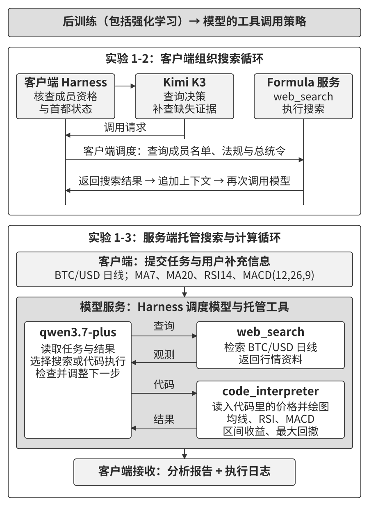

[^ch1-hosted]: 托管工具的接入方式参见百炼代码解释器文档。本实验的模型、调用次序与结果以配套运行记录为依据。

> **接口补充：自由格式工具调用**
>
> 工具的参数还可以采用自由格式文本。例如，OpenAI Responses API 用 `type: "custom"` 声明自定义工具后，模型可以直接发送 Python 代码或 SQL 查询，减少把多行文本放进 JSON 字符串时的转义处理[^ch1-custom]。常规函数工具则按 JSON schema 接收结构化参数。
>
> 参数格式与执行位置是两个独立的设计选择。自由格式自定义工具仍由应用侧接收输入、校验、执行并回传结果；托管代码解释器则由服务端提供沙盒和执行循环。

[^ch1-custom]: OpenAI，Function calling，其中的 Custom tools 一节介绍自由格式输入及调用结果回传。

### Harness 工程：模型之外的竞争力

两套客服应用用了同一个模型，都向用户答复“已经退款”。第一套只保存了这句话，第二套还能调出支付服务返回的退款金额和交易状态。要判断哪一笔退成了，可以从答复往前查：支付服务执行了什么？模型回答前看到了哪条回执？如果调用超时，谁记下这笔待查的交易，又怎样决定下一步？

模型生成一句话和支付系统改变状态，是两件分别需要核实的事。今天的 LLM 采用联结主义的神经网络方法，从数据中学习 token 的条件概率，逐步生成回答或工具请求。[^ch1-connectionism] 即使每次解码都生成同一句答复，也不能由此得知钱是否已退。应用得把操作请求送去执行，记下工具返回的结果，再把结果交给模型，据此核对最终答复。把这些步骤组织起来，就是 Harness 工程要解决的问题。

[^ch1-connectionism]: 中国科学院学部人工智能咨询研究组，《人工智能赋能科学研究：人工智能学科体系》，科学出版社，2026，ISBN 978-7-03-084786-7，第 1 章第 1.1 节。

前面用 LLM、上下文和工具解释了 Agent 的功能组成。落实到代码和服务时，Model 根据输入作出决策，Harness 负责组织输入、调度工具调用和处理反馈，工具或环境完成实际操作。本书用下面的公式概括这一分工，并将 Harness 的职责归纳为五项功能：

> **Agent = Model + Harness**
>
> **Harness = 上下文管理 + 工具接口 + 约束 + 验证 + 纠正**
>
> **Agent $\leftrightarrow$ Environment**

上下文管理和工具接口支撑 Agent 运行，约束、验证与纠正提高执行的可靠性。以退款 Agent 为例，Harness 将退款政策、订单和申请原因组织成上下文，通过工具接口查询订单并发起退款；执行前检查权限与金额规则，执行后查询交易状态。请求超时时，先查明退款是否已发生，再根据幂等性决定重试、补偿、回退或转人工。

这套分工也帮助我们判断系统边界。工具定义、调用适配器、沙盒权限和重置机制属于 Harness；沙盒中随操作变化的文件与进程、外部数据库、网页、用户和物理世界属于环境。即使仿真环境与 Agent 部署在同一进程中，二者仍分别承担环境演化和行动决策的职责。

| 功能 | 职责与设计要点 | 实际例子 | 详见 |
| --- | --- | --- | --- |
| **Context（上下文管理）** | 选择和组织当前决策所需的信息，保存任务进度与关键依据 | 系统提示词、知识库、Agent 状态栏、Sidecar 旁路查询 | 第二、三章 |
| **Tools（工具接口）** | 提供观测与行动接口；名称直观，参数配有例子，返回值和错误清晰 | MCP 工具、代码解释器、搜索工具 | 第四章 |
| **Constrain（约束）** | 按最小权限开放能力，并在执行前检查操作、参数与授权范围 | 文件访问范围、退款金额上限、工具调用审批 | 第四章 |
| **Verify（验证）** | 用可检查的规则、工具结果和环境状态核验操作；同时检查数据来源与有效性 | Linter、类型检查、测试、交易状态核对 | 第五、六章 |
| **Correct（纠正）** | 按错误类型选择重试、接续、补偿、回退或人工接管，并限制恢复次数 | 静默重试、接续生成、熔断后转人工 | 第二、五章 |

约束可以从默认关闭敏感能力开始：涉及敏感资源或外部副作用的能力，获得明确授权后再开放，类似手机 App 申请相机或位置权限。验证则要把模型的陈述与可核对的证据连接起来。例如，退款成功应由交易系统中的状态确认；工具返回 JSON 时，还要检查字段类型、取值和来源。模型输出与外部工具内容都可能受到错误信息或提示注入影响，可信的验证逻辑应在独立的执行边界内工作。

纠正机制需要兼顾任务恢复和用户体验。遇到短暂故障，可以在预算内自动重试，避免频繁打断用户；涉及外部副作用时，要先确认执行状态。持续失败则应停止重复操作，说明当前进度和需要人工处理的事项。把这五项功能加入前面的循环，就得到下面的伪代码：

```python
history = [user_request, Environment.observe()]

while Harness.within_budget():
    decision = Model(Harness.build_context(history))
    history.append(decision)

    if decision has no tool call:
        verdict = Harness.verify_completion(decision, Environment)
        if verdict.passed:
            return decision.answer
        history.append(verdict.feedback)
        continue

    for call in decision.tool_calls:
        permission = Harness.constrain(call)
        if permission.denied:
            history.append(permission.feedback)
            continue

        result = Harness.dispatch(call)
        verdict = Harness.verify(result, Environment)
        if not verdict.passed:
            result = Harness.correct(call, result, verdict)
        history.append(result)

return Harness.report_incomplete(history)
```

这段循环把约束放在执行前，把验证放在工具返回和任务结束时，再把纠正结果带回上下文。第二章将展开 API 消息循环，第四、五章介绍工具执行与自动验证。

**从演示走向生产，工程重心会从接通上下文和工具，转向约束、验证与纠正。** 一个演示可以靠少数顺利完成的任务说明能力；产品需要在输入变化、服务失败和长时间运行中持续交付。权限、状态、验证和恢复因此成为工程投入的重点。Claude Code 提供了具体例子：文件读写、命令执行和搜索之外，它还提供权限规则、上下文压缩和文件检查点等机制。权限规则按工具类型、操作范围与所选模式决定是否确认；检查点支持恢复其记录的文件修改[^ch1-claude-harness]。在自动模式下，Claude Code 还会请独立的分类器审查工具调用。这里有一类适合交给 Jev 等专用判断模型的工作：主模型要想清楚怎样完成任务，辅助模型只需回答一个范围明确的问题，例如“这次操作是否超出了用户刚才交代的范围？”第四章会用工具审批说明怎样分工。

从这些产品机制出发，可以归纳出构建 Harness 时需要考虑的几项工作：

- **流程状态管理**：记录执行到哪一步，哪些操作已完成，哪些结果仍待确认。
- **上下文压缩**：在信息增长时保留关键事实、约束和进度，为后续决策腾出空间。
- **权限分类**：区分读取、修改、外部调用等操作，按风险与授权范围执行规则。
- **熔断器**（Circuit Breaker）：连续失败达到阈值后停止重试，避免同一故障持续消耗资源或扩大影响，作用类似电路故障时跳闸。
- **错误恢复**：捕获异常，结合检查点与环境状态，选择回退到稳定状态、重新尝试或交还给人类。

[^ch1-claude-harness]: Claude Code 官方文档：权限配置、检查点、交互命令与上下文压缩。文件检查点的恢复范围由工具记录决定，外部服务中的状态需要相应的恢复机制。

#### 从提示工程到 Graph 工程：工程关注范围的扩展

给一个失败的任务换提示词以前，可以先看失败发生在哪里。模型误解了一句约束，适合先查指令；整份账单从未送进模型，适合先查信息组织；任务中断后丢了已经做完的步骤，则要查运行机制。随着任务延伸到跨日运行和多成员协作，持续运转与执行结构也会影响结果。下面五个工程视角各自提供一个排查入口。

**提示工程**（Prompt Engineering）关注指令表达。任务目标、约束和示例怎样写，直接影响模型如何理解请求并生成结果。

**上下文工程**（Context Engineering）进一步组织模型能看到的全部信息，包括系统指令、工具定义、对话历史和外部知识。提示词只是其中的一部分，检索、压缩与状态组织同样影响决策。

**Harness 工程**关注模型的运行与环境交互。它把上下文构造、工具调度、权限、验证和错误恢复组织成可执行的系统，使模型能连续完成任务。

**Loop 工程**（Loop Engineering）关注持续自主运转：一轮结束后，谁发现下一件该做的事，何时重新启动，何时验证结果，以及用什么条件判断真正完成。第十章将结合多 Agent 协作系统展开这一视角。

**Graph 工程**（Graph Engineering）关注多个执行单元的组合。Agent 循环、确定性程序和人工审批可以作为节点，边规定路由与依赖，结构化状态在节点间传递，并在关键边界保存检查点。2026 年出现的相关讨论用这一名称概括这些编排问题[^ch1-graph-engineering]。

Harness 承载上下文管理与单次任务循环，外层调度机制可以反复启动任务；执行图可以包含 Agent 循环，一个循环也可以调用图式工作流完成子任务。

**当候选模型都已能胜任任务时，模型之外的工程实践往往决定产品差异。** LangChain 在 Terminal Bench 2.0 上的改进提供了一个具体例子：固定使用 GPT-5.2-Codex，通过调整 Harness，将得分从 52.8% 提高到 66.5%，当时的排名从三十名之外进入前五。改进包括完成前自检、重复操作检测、环境信息补充和推理预算分配。这里的提升来自对运行轨迹中失败模式的分析，以及据此反复修改、评估 Harness[^ch1-langchain-harness]。

[^ch1-graph-engineering]: Josh C. Simmons，We Are Entering the Graph Engineering Phase，2026 年 7 月 4 日，讨论节点、类型化连接和可检查点状态。相关实践也见 LangGraph、Microsoft Agent Framework 工作流和 Google ADK 的官方资料。

[^ch1-langchain-harness]: Vivek Trivedy，Improving Deep Agents with harness engineering，2026 年 2 月 17 日。分数与排名对应文中报告的模型、基准和测试设置。

#### 构建有效 Agent 的核心原则

动手设计前，先看用户究竟想把哪一步交出去。笔者做过一个购物实验：助手挑了十件商品，购买者起初一件也没看上。她原先希望商品好看、便宜，最好还没有差评。自己去逛淘宝，比较了一圈，她才逐渐拿定主意，愿意在哪一项上让步，最后选中的恰是原来十件里的一件。若只看最终成交，似乎第一次推荐就足够了。可在第一次看到清单时，她还没形成足以作决定的偏好。助手可以帮她核对规格、比较价格，也可以把有代表性的差异列出来，供她自己逛和选。

把同样的问题用在账单申诉上，答案就不同了。用户想弄清一笔收费，原本可能因为要排队等一小时而放弃；助手替他等待和核实，省下的恰好是他想省的时间。还有一些任务，个人原本独立做不到，例如不会编程的人借助助手做出一个自己需要的小工具。选择委托范围时，可以问用户：如果有人代劳，你最希望省去哪一步？又有哪一步，你希望亲自参与才有收获？

Anthropic 将构建有效 Agent 的经验归纳为三个原则：保持简单、保持透明，以及认真设计 Agent 与工具的接口[^ch1-anthropic-building-effective-agents]。

**保持简单。** 从能解决任务的最简单方案开始，评估发现稳定问题后再增加机制。直接调用 API 往往更容易看清输入、输出和控制流；使用框架时，也要能追踪它如何组织上下文和调用工具。

**保持透明。** 开发者要弄清一次退款为什么失败，可以沿执行记录找到支付接口的回执。用户关心的则是钱退了没有、下一步由谁办理。任务计划、工具日志和关键决策都可以记录下来，再把进度和待确认的事项告诉用户。

**设计好工具接口。** ACI（Agent-Computer Interface，Agent—计算机接口）强调从 Agent 的使用方式设计工具：名称要直观，参数要配合具体例子，返回值要便于后续决策，容易误用的地方要加上可执行的约束。接口越清楚，模型越容易把意图转换为正确操作。

这可以借鉴制造业中的**防呆**（Poka-yoke）方法。SIM 卡的缺角帮助用户辨认安装方向，微波炉的门联锁使设备在开门时停止加热。对应到工具设计，可以用枚举限制操作类型，用参数校验检查格式，用权限控制限制作用范围。模型通过工具定义和返回结果理解接口，含糊的说明会在多轮调用中反复造成误用；清楚的接口与执行约束则能从源头减少错误。

[^ch1-anthropic-building-effective-agents]: Anthropic，Building effective agents，2024 年 12 月。

接下来从模型选型、编排模式、护栏与安全三个方面展开设计取舍：选择模型决定可用的决策能力，编排组织执行路径，护栏把约束、验证与纠正落实到具体操作。

#### 如何选择模型

**选对模型，往往比反复打磨提示词更有效。** 模型决定 Agent 能理解多复杂的任务、能否选对工具，以及出现错误后如何调整。确认任务信息充分、工具可用后，仍然反复出现规划或工具使用错误，就应优先比较模型能力，再决定投入多少提示词和编排工作。

**闭源模型适合通过服务接口快速接入。** OpenAI 的 GPT 系列、Anthropic 的 Claude 系列都是本书讨论的例子。评估时，既要看任务能力，也要检查 API 提供的工具调用方式、上下文容量、服务限制与费用。

**开放权重模型提供部署与定制空间。** DeepSeek、Kimi、GLM 等模型可以按具体版本的许可条件，用于自部署或后训练。私有化部署有利于控制数据流向，微调可以适配特定任务。**对于模型能力已够用、调用量稳定的业务，以及需要严格控制数据流向的业务，笔者会优先评估开放权重方案。**

写作时，笔者对开放权重模型追赶速度的经验判断是，差距已经缩短到半年以内。

**同时评估模型能力、产品接口和使用规则。** 同一模型通过聊天产品、Coding Agent 或 API 提供服务时，可调用的工具、权限和运行限制可能不同。网络安全、模型蒸馏与提取、隐私数据和高风险操作等业务，还需要逐项核对服务的使用规则。

**多步 Agent 任务，笔者优先选择推理模型作为起点。** 规划、工具选择、结果核验和失败恢复都需要连续判断，为这些环节投入更多推理计算，通常有助于提高任务完成质量。对于单步分类、简单格式转换，或 Computer Use 中目标已明确的固定位置点击，较轻量的模型也可能满足要求。

**把速度放到完整任务中衡量。** Agent 常有多轮顺序调用，模型每轮生成所需的时间会累积到端到端延迟中。一个任务需要二十轮推理，每轮多耗时两秒，总时长就增加四十秒。首 token 的等待、模型的生成和工具执行都算在这段时间里。

**按输入形式检查多模态能力。** 需要理解图片、音频或视频时，应使用任务中的真实材料评估相关能力，例如界面截图中的小字、语音中的打断，或视频中的连续动作。

#### 编排模式：工作流与自主

收到用户请求后，谁来决定下一步？单次模型调用适合已有资料足够、交付物明确的任务；固定步骤反复出现时，程序可以把它们组织成工作流；需要根据环境反馈更改路径时，可以把选择权交给模型。这样的分工决定了上下文在调用之间怎样传递、工具何时执行。

以“从百万条聊天记录中提炼个人记忆”为例，一种设计会先切分对话，再让几个 Agent 分别提取事实、核对原话、辨认对话里提到的人、整理记忆，最后由另一个 Agent 复核合并结果。系统还要用图记录事实之间的关系，登记哪些聊天记录已经处理，并把每版结果存成只读快照。这些机制分别解决了实际问题，但一开始全部引入，会增加信息传递、状态同步和错误定位的负担。遇到新情况时，如果继续增加分支，原本可以由模型结合上下文完成的语义判断，就会逐渐变成难以维护的固定规则。

更合适的起点，是给一个能力足够的 Agent 明确目标、必要上下文和可组合的工具，让它查证资料、比较说法并处理冲突；程序落实权限、原始材料保护和原子发布等必须始终成立的规则。若评估发现系统总在同一类任务上出错，再加入专门验证器、独立 Agent 或确定性流程。**结构的复杂度应由业务约束和实际失败驱动。** Manus 用“Less structure, more intelligence.” 概括了这种取舍。

##### 工作流模式：预定义的编排

**工作流**（Workflow）通过预定义的代码路径组织模型和工具。开发者规定节点、连接和分支条件，节点内部可以使用 LLM 理解或生成内容。遇到不同输入时，系统按程序设定的条件进入相应分支。

以订机票为例，可以把一条简化的业务流程设计为四个节点：

1. **核实用户身份**：通过身份服务确认账户和操作权限。
2. **搜索并确认航班**：查询可用航班，让用户确认行程、票价与退改规则。
3. **完成付款**：在用户授权后，通过支付接口处理订单费用。
4. **确认预订**：按供应商流程完成出票或确认，向用户发送预订结果。

模型可以在搜索节点内把自然语言需求转换为日期、目的地和筛选条件，程序则检查进入支付节点所需的身份、报价与授权状态。实际订票接口可能要求先锁座、再支付或出票，工作流应按供应商协议安排顺序，并为失败设置补偿路径。

工作流的优势在于**流程控制明确**：关键步骤、分支和校验点都可以检查，开发者能用代码落实“金额已确认才能支付”等规则。它也便于限定每个节点的权限与数据访问范围。

要让固定流程处理好例外，开发者需要提前设计相应分支。用户在付款阶段改变行程，或航班取消后需要重新比较方案时，系统只能沿已设计的分支处理，或把控制权交给人工。任务中的例外越多，维护这些分支的成本越高。

另一个直观的工作流是**文生图**。用户可能只说：“帮我画一个 AGI 实现以后程序员的工作场景。”工作流可以安排两个节点：

1. **提示词改写**：LLM 将宽泛需求展开为主体、场景、构图、光线和风格。比如，把场景构思为“程序员在海边休息，通过脑机接口指挥 AI 员工”，再整理成适合目标模型的提示词。
2. **图片生成**：把整理后的提示词交给生图模型，获取图片。

在一些 Stable Diffusion 工作流中，开发者习惯使用逗号分隔的英文标签、质量词和负面提示词。改写节点可以统一这种格式，也可以补充构图细节。Stable Diffusion 也能接收自然语言描述[^ch1-image-prompt]。这里的 LLM 节点把用户需求整理成图像模型适用的输入，并补充创意细节，可以视为 Harness 中的**适配层**。

当图像生成服务能直接理解自然语言需求时，**笔者优先直接提交原始描述，省去仅为适配输入格式而增加的改写调用。** 每经过一次改写，约束就多一次被遗漏或改变的机会。宽泛需求需要构图探索，或系列图片需要统一风格时，再让改写节点承担这些明确的创作任务。

[^ch1-image-prompt]: Stability AI，Stable Diffusion API 参考，介绍文本提示词、负面提示词与风格等输入；官方应用案例展示了自然语言描述的使用。

> **实验 1-4 ★：文生图工作流与直接生成的对照**
>
> 把同一句需求送入两条路线。**工作流路线**先由 Kimi K3 改写提示词，再交给通义万相生成图片；**直接生成路线**把原始需求提交给图像生成服务。本次记录使用了 Gemini 图像模型和 GPT-Image 2 两种直接生成服务。
>
> 对照包含两类需求。具体需求包括周末加班的程序员、晨光中的窗台绿植，以及带有“深夜独处也清净”文案的降噪耳机海报；宽泛需求包括 AGI 实现后的程序员工作场景和未来城市的早晨。
>
> 拿耳机海报来说，改写节点增加了哑光黑耳机、午夜蓝背景、月光轮廓光和留白，同时把 `text` 放入负面提示词，建议后期补上中文文案。这样，工作流把原本的一次海报交付拆成了图片生成与后期排版。

随着模型能力提升，部分适配工作可以交给模型或服务接口完成。指令微调与推理模型减少了对部分 few-shot 示例和“逐步思考”提示的依赖，结构化输出与原生工具调用减少了格式修复和 JSON 解析容错所需的工作，图像模型的语言理解能力则简化了提示词改写。**模型升级后，应主动清理已经失去作用的适配代码。** 原来必要的格式翻译和修补步骤，可能变成额外的调用、延迟和出错点。

##### 自主 Agent：动态自主决策

**自主 Agent**（Autonomous Agent）根据任务进展和环境反馈选择下一步，适合难以预先列全执行路径的问题。用户说“帮我订下周三去上海的机票”，Agent 可以先查航班，遇到登录要求后核实身份，再继续搜索；发现最低价方案需要转机时，询问用户是否接受，得到“只要直飞”的答复后调整条件。它在授权范围内决定具体步骤，支付等关键操作仍由业务规则约束。

遇到查询失败，模型可以修改参数重试，换一种查询方式，或请用户补充信息。Harness 记录每次尝试，并限制这项任务可以使用的时间或资源。

图1-6 的两条回路都经过预算检查。左边是工具返回了结果，右边是模型准备结束，验收时却发现缺了东西。模型调用 `final_answer` 等最终输出工具，或返回不含工具调用的回复时，Harness 就检查所需的结果是否齐全。验证通过才交付；缺少必要产物时，Harness 告诉模型还缺什么，让它继续执行。遇到不可恢复的错误、错误次数超限或达到最大轮数时，则保存进度，报告未完成部分或转人工。

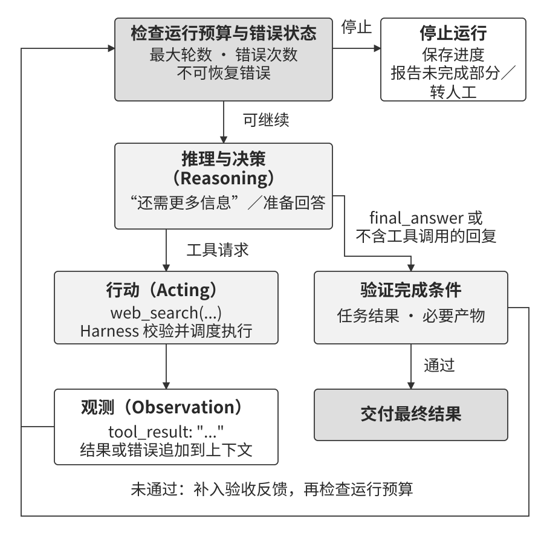

自主循环适合步骤数量随任务变化的场景，例如 Coding Agent 修复真实代码问题、Computer Use Agent 操作界面，以及反复搜索和分析的研究任务。SWE-bench 就以真实软件仓库中的问题衡量代码修复能力。此类任务的下一步常取决于刚刚得到的测试输出、界面状态或搜索结果。

##### 两种模式的选择与混合

工作流和自主 Agent 可以组合使用：程序规定关键流程、验证条件和权限，在需要灵活判断的节点内运行自主 Agent。沿图1-7 上方的实线看，Telegram 消息先经过类型判断，语音消息要先转成文字，最后由 Telegram 节点发回回复。再看 AI Agent 下方的虚线：Gmail 和 Google Calendar 等工具都接在这个节点上，具体调用哪一个，由模型根据消息内容决定[^ch1-n8n]。

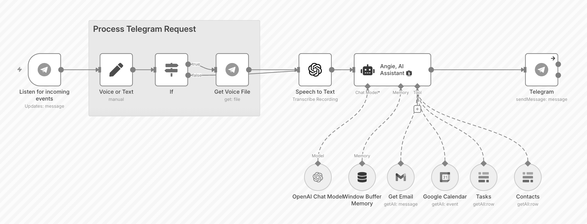

另一种方式是**先让自主 Agent 生成工作流，再执行经过检查的工作流**。Agent 根据任务设计拓扑并生成编排代码，运行系统验证代码、权限与输入后，再沿生成的路径执行。对于重复处理的数据或步骤，这能减少每次调度都调用模型的开销，同时保留任务开始时动态设计流程的灵活性。第十章将进一步讨论这种形态。

[^ch1-n8n]: n8n，AI Agent 节点文档。

> **工具参考：Agent 框架与平台**
>
> 各框架对运行循环、状态管理和工具接入的封装程度不同。[^ch1-frameworks]
>
> | 框架／平台 | 核心定位 | 编排方式 | 开发方式 | 典型用途 |
> | --- | --- | --- | --- | --- |
> | **Codex Harness** | 可集成的 Agent 运行时 | 自主循环 | 代码与接口集成 | Coding Agent、产品内嵌 Agent |
> | **Claude Agent SDK** | 复用 Claude Code 的工具与运行循环 | 自主循环 | Python、TypeScript | 代码任务、复杂工具任务 |
> | **LangChain / LangGraph** | 模型与工具集成、状态图编排 | 工作流与自主循环 | 代码 | 多步骤任务、持久状态与恢复 |
> | **n8n** | 可视化自动化平台 | 工作流与 Agent 节点 | 可视化、代码节点 | 业务自动化、服务连接 |
> | **Dify** | LLM 应用开发平台 | 工作流、对话与 Agent 节点 | 可视化与 API | RAG、知识库与业务应用 |
> | **CrewAI** | 多 Agent 团队与流程编排 | Crews 与 Flows | 代码 | 角色分工、协作与业务流程 |
> | **OpenClaw** | 可自托管的个人助手 | 自主循环与事件驱动 | 配置与扩展 | 多平台消息、个人任务与工具集成 |
> | **DeepSeek Harness** | 插件化 Agent 运行时 | 可组合的循环与插件 | 代码与配置 | 运行机制定制、Agent 开发与研究 |
> | **Pi** | 精简的 Agent 与 Coding Agent 工具包 | 自主循环与扩展 | 代码 | 定制工具、运行循环与编程助手 |
>
> 以 Codex 为例，开发者可以在桌面应用、命令行或编辑器里直接交代任务。如果要把这种能力嵌进自己的产品，就要考虑怎样启动运行时、接收事件和处理审批。常见接法有三种：`codex exec` 适合脚本和 CI 中的非交互任务；Codex SDK 便于在应用代码中启动、恢复和处理任务事件；app-server 用双向 JSON-RPC 通信支持会话、事件流与审批交互，适合构建自定义客户端[^ch1-codex-harness]。Claude Agent SDK 则把 Claude Code 的工具、循环和上下文管理开放给应用程序，开发者可以通过 SDK 配置权限、会话和钩子。

[^ch1-codex-harness]: OpenAI 官方文档：Codex SDK、Codex App Server。

[^ch1-frameworks]: 各框架的能力与接口见官方资料：Claude Agent SDK、LangGraph、Dify Agent 节点、CrewAI、OpenClaw、DeepSeek Harness、Pi。n8n 的 Agent 节点见前文引用。

确定了任务怎样推进，还需要检查每一步能否执行、执行后是否符合要求。下面介绍的护栏，就把约束、验证与纠正落实到这些位置。

#### 护栏与安全性

**护栏**（Guardrails）把约束、验证与纠正落实到系统边界上，用于控制敏感信息暴露、越权操作和不符合产品要求的输出。设计时先识别任务中的风险：模型会读取哪些数据，可以调用哪些工具，哪些行动会产生外部影响，再为这些位置设置相应的检查与控制。

护栏的评估需要同时覆盖漏拦截与**误拒绝**。前者关注危险请求是否被放行，后者关注明确允许的任务是否被误拦截，例如经过授权的安全测试或符合服务规则的模型蒸馏研究。

##### 护栏类型

按防护生效的位置，本书将护栏分为**上下文层、执行层和数据层**。这种分层的工程价值，在于逐步减少安全性对模型判断的依赖：进入上下文的信息靠来源与内容检查，实际行动再受执行权限约束，最终读写还要经过数据层规则。三层配合，使一道检查遗漏的问题仍有机会在后续边界被发现。

**上下文层**关注模型读取什么，以及如何区分信息来源。常见机制包括：

- **相关性分类**：识别偏离产品任务的请求，例如编程助手收到“帝国大厦有多高”时，按产品范围决定回答或引导用户返回任务。
- **安全分类**：识别诱导模型违反安全规则的越狱请求，以及试图把输入数据转成控制指令的提示注入。提示注入既可能出现在用户输入中，也可能通过网页、文档或工具结果间接进入上下文。
- **内容审核**：按用途和规则检查涉及暴力、歧视等敏感主题的内容，区分讨论、分析与不允许的用途。
- **规则检查与来源标注**：限制输入长度，检查字段格式，标记不可信来源，并在上下文中区分指令与数据。数据库调用还应使用参数化查询等执行侧机制处理 SQL 注入风险。

**安全关键的检查应放在模型上下文之外执行。** 当不可信内容已经影响了模型的判断，让同一个模型在同一上下文中自查，很容易继续沿用受影响的前提。来源标注和分类器帮助减少这类问题，独立的权限与执行检查则限制其实际后果。第二章将展开上下文组织与提示注入防护。

Anthropic 的 **Constitutional Classifiers** 展示了分类器的另一种组织方式：用自然语言规则生成合成数据，训练对输入和输出的检查能力。后续系统将问题与回答联合判断，使分类器能结合对话理解含义；例如，单独看似普通的“食品调味料”表述，结合上下文可能实际指代化学试剂。为了降低计算开销，系统先用读取内部激活的轻量探针筛查，再将可疑对话交给更强的分类器组合复核。第一级负责筛选，最终判断由复核阶段完成，有助于兼顾成本与误拒绝率[^ch1-3]。

[^ch1-3]: Anthropic，Next-generation Constitutional Classifiers，2026 年 1 月 9 日；Cunningham et al.，Constitutional Classifiers++。

**执行层**关注模型提出的操作能否生效。可以按可逆性、权限范围、财务影响与数据敏感度，为工具调用划分低、中、高风险，并结合实际参数动态检查。读取公开资料与修改账户信息需要不同的控制，高风险操作可以追加独立审查或人工确认。

执行检查应由具有独立权限边界的机制落实，例如受信任的审查进程、最小权限凭证、沙盒和人工审批。即使模型受不可信内容影响，实际调用也要经过这些检查。返回用户的回复同样是一种行动：PII（个人身份信息）过滤可以检查身份证号、手机号等敏感字段，输出验证可以检查内容是否符合产品用途与品牌要求。第四章将介绍工具风险与执行权限。

**数据层**直接控制对资源的访问和修改。数据库行级安全策略决定当前身份可以访问哪些记录，约束与校验器检查写入是否合法，受控视图和存储过程限定可执行操作，受信任运行时负责绑定身份与访问上下文。实际读写都经过这些机制、运行凭证也受到权限限制时，上层生成的代码即使遗漏了检查，数据层仍能拒绝越权读写。第五章将结合动态生成软件说明如何把信任边界落实到这一层。

##### 人工干预

**人在回路**（human-in-the-loop，HITL）指系统在某些步骤请人判断或接手。例如，助手可以独立核对账单，把需要用户选择的两种套餐和差价发给用户，得到答复后再办理。每多请示一次，用户就要多花一份注意力；是否设置这个停顿，取决于选错的代价以及用户是否已给过足够明确的授权。部署早期，人工反馈还可以帮助团队识别失败模式、补充边缘案例并改进评估。客户服务系统可以把问题转给人工客服，Coding Agent 可以把未解决的问题和当前修改交还给开发者。

两类情况尤其适合触发人工介入：一类是**超过失败阈值**，例如重试次数或操作次数达到上限；另一类是**高风险操作**，例如大额退款、付款或难以撤销的数据修改。触发条件应写进执行规则，使系统能够及时停止、保存状态并移交。

移交时，应提供原始目标、已完成步骤、当前结果、失败原因和待决定事项。用户暂时不在线时，可以保存任务并等待，或按预设规则继续低风险的独立工作；需要授权的操作应保持待处理状态。这样，人工接手后能够直接判断下一步，任务也能从保存的状态恢复。

#### Harness 五项功能与全书的对应

**“LLM + 上下文 + 工具”描述功能组成，“Model + Harness”描述生产实现。** 前者说明能力来自哪里，后者说明系统如何运行。

下表列出各章讨论的 Harness 功能及其对应的风险。

| Harness 功能 | 主要章节 | 技术内容 | 安全与可靠性关注点 |
| --- | --- | --- | --- |
| 上下文管理 | 第二章 | 提示工程、状态栏、上下文压缩、Agent Skills | 提示注入、上下文污染、进度丢失 |
| 上下文管理（跨会话） | 第三章 | 用户记忆、RAG、结构化索引、Agentic RAG | 敏感信息暴露、来源与隐私 |
| 工具接口与约束 | 第四章 | 工具分类、权限控制、MCP、主动工具发现 | 误操作、越权访问、不可逆操作 |
| 验证 | 第五、七章 | 测试驱动、代码化规则、产物评价 | 身份与责任边界、结果误判 |
| 纠正 | 第二、五章 | 上下文重建、安全重试、状态核验、回滚与人工接管 | 重复执行、恢复失败、错误传播 |

第六章进一步扩展交互的模态与时机，例如图像、语音、界面操作和异步事件；这些能力需要相应的上下文与工具接口承载。第七章衡量整个 Agent 的表现，第八、九章分别通过参数和外部产物更新改进能力，第十章研究多个 Agent 如何分工、通信和协调。

安全贯穿这些章节。上下文层与执行层的控制主要由 Harness 组织，数据层的访问控制在环境侧生效。各章会结合具体技术，说明这些控制应放在哪里、怎样配合。

Anthropic 的长时运行 Agent 案例展示了五项功能的配合：**初始化 Agent**设置环境并分解任务列表，后续**执行 Agent**逐项推进，每个会话结束时留下进度记录和可接续的产物。新会话读取这些记录后继续工作，测试与任务清单帮助系统判断还有哪些功能未完成。这种安排缓解了跨上下文交接困难和过早宣告完成的问题[^ch1-long-running]。第二章将从上下文组织开始，第五章进一步讨论 Coding Agent 的完整 Harness。

[^ch1-long-running]: Anthropic，Effective harnesses for long-running agents，2025 年 11 月 26 日。

### 贯穿全书的设计模式

设想一个 Agent 要更新客服政策。审核者要找得到被改动条款的原文；模型执行时只需先看到政策目录；更新后还得查得回旧版本，并验证原来能答对的问题。这一项任务里已经出现了下面几种设计模式。

**提议者—审核者（Proposer–Reviewer）**把产出与评判交给两个独立角色。在更新客服政策的例子里，一个 Agent 起草修改，另一个拿着原条款核对改动。审核的方法取决于交上来的东西：审幻灯片可以看渲染结果，审代码可以看测试输出，审工具调用则可以检查参数。审核者需要了解任务背景，并使用独立的上下文作出判断，减少产出方已有结论对审核的影响。模型自审容易沿用先前的假设，独立审核可以增加发现盲点的机会，权限边界与确定性检查则继续负责约束执行。第三章用它更新知识，第四章用它审查工具调用，并介绍 Sidecar 只读变体；第五章的 PPT、视频和日志案例，第七章的 UI 评估，第九章的规则修订和第十章的对等协作，也会使用这一模式。

**渐进式披露（Progressive Disclosure）**先提供可检索的目录或摘要，再按需加载细节。这样既能控制上下文开销，也能帮助模型先缩小选择范围。第二章的 Agent Skills 让元数据常驻上下文，正文按需加载；第三章的分层检索、第四章的主动工具发现与分页截断、第十章的 Agent 发现，都采用了类似方法。

**只增不改（Append-only）**用追加记录表达变化，为缓存、重放和审计保留历史。第二章中，稳定的前缀有利于复用 KV Cache；改动越靠前，受影响的后续缓存通常越多。第三章的事件式记忆用新事件记录状态变化，第四章按需把工具 schema 加入后续上下文，也利用了保留已有前缀的思路。需要压缩或更新状态时，可以生成新版本，同时保存追溯所需的记录。

**边界集 + 保留集（Boundary Set + Retention Set）**从两个方向验证修改：一组收录希望这次修好的问题，另一组收录旧版已经做对的任务。例如，修复某类工具参数错误后，既要重测这些错误样本，也要检查原先能够完成的任务。只测目标样本，容易把针对这些样本的过拟合当成进步；只测原有能力，又可能接受毫无效果的修改。第七章的回归评估、第八章的训练与评估隔离、第九章的更新验证都会使用这类对照，同时检查收益与退化。

**最小 diff + 可回滚**要求每次变更范围清楚、有来源，并能恢复到先前版本。小步修改便于将效果归因到具体变化，也便于在失败后撤回。第三章的知识更新、第五章的代码补丁、第九章的提示词与程序更新都遵循这一思路。上下文、外部产物和模型参数各有相应的恢复方式：保存输入快照、产物版本或模型检查点，可以恢复对应状态；已经产生的外部副作用还需要补偿机制处理。

### 本章小结

**Agent 的能力来自 LLM、上下文和工具的协同。** 回看机票例子，1250 元的报价是客服给出的观测，出差目的和用户以往的反馈构成当前上下文，模型据此选择接受报价或继续询问。助手通过电话继续谈价；要告诉用户“票订好了”，还得拿到订票成功的反馈。

**扩展上下文和工具，是提升 Agent 能力最主要的工程手段之一。** 在模型固定时，补充关键资料、提供必要操作，往往能使此前无法完成的任务变得可行。Manus 与 OpenClaw 的案例展示了这种扩展；工具、参数、权限和运行环境同时规定了行动的边界。

**上下文组织影响每一轮决策。** 基础实现把相对稳定的前缀与累积消息历史提供给模型。消融实验中，工具定义让模型知道有哪些能力可用，工具结果提供计算所需的事实，历史消息保存已经完成的步骤。已有记录足以恢复决策依据时，模型也能在移除历史推理信息后继续完成任务。ReAct 将推理、行动与新观测衔接起来，使任务能够逐步推进。

**Harness 是 Agent 产品积累工程竞争力的关键。** 当候选模型都能满足基本能力要求时，上下文管理、工具接口、约束、验证和纠正决定了产品能否持续、可靠地交付。

**编排应从简单方案开始，按需要增加复杂度。** 优先尝试单次调用；需要多个固定步骤时采用工作流，需要根据反馈调整路径时再引入自主 Agent。三者也可以组合使用。

如果助手开始办理原先无权处理的订单，怎么办？先沿数据来源、工具权限和状态变更三条线排查：模型从哪些记录里看到了订单，执行层为什么接受这个操作，环境里的访问控制有没有拦住它。遇到高风险或超出授权的操作，助手可以停下来请人处理。假设排查发现某条授权规则写得过宽，提议者可以只改这一条。审核者用越权订单组成边界集，再用正常订单组成保留集，检验修改后该拦的能否拦住、该办的能否继续办。规则可以按需加载，改动要追加到历史记录里，以便必要时恢复旧版本。这些做法在后面各章会反复用到。

再回到订票通话。客服报出 1250 元时，助手要同时看见报价、用户的预算和先前谈妥的条件。如果通话已经持续了半小时，下一轮还该保留哪些消息，哪些信息可以另存、需要时再取？第二章从一次模型调用的实际输入开始回答这个问题。强化学习中的 Agent 与这里的 LLM Agent 有何联系，第八章还会展开。

### 思考题

1. ★★ 如果只能优先改进模型、上下文或工具中的一项，你会如何判断最值得投入的位置？哪些评估结果会使你改变选择？
2. ★★★ 假设每轮新增的消息量大致相同，且每轮都向模型提供此前的完整历史，为什么累计输入量会随轮数近似二次方增长？缓存、压缩和历史裁剪分别改变了哪些成本？
3. ★★ 模型承担越来越多的工具调用决策，Harness 也需要支持更长、更复杂的任务。两者的职责会怎样变化？哪些机制可以简化，哪些需要加强？
4. ★★ 实验中缺少工具结果会导致重复调用。在生产系统中，还有哪些原因会造成类似循环？如何检测、恢复并设置终止条件？
5. ★ 选择一个日常使用的 AI 产品，分别列出上下文中的主要信息、可用操作和执行策略。它在哪个环节最容易失败？你会如何改进？
6. ★★ 为航班订票客服设计一套流程：哪些步骤适合工作流，哪些适合自主 Agent？用户临时改变行程时，两部分如何配合？
7. ★★★ 同一个 `delete_file` 工具，删除临时文件与删除关键系统文件的风险不同。你会怎样结合参数、资源范围和可恢复性进行动态风险评估？
8. ★★ 开放式动作空间允许难以预先穷举的内容与操作组合。在什么任务中，把行动限制为少量预定义选项更合适？这种限制会带来哪些收益与代价？
9. ★★ Agent 需要人工确认时，用户可能不在线、回复缓慢或指令含糊。系统应保存哪些状态，可以继续哪些工作，哪些操作必须等待？
10. ★★★ 举一个会随模型进步而简化的工程方法，说明它原先解决什么问题，以及背后的系统设计原则如何继续发挥作用。

## 第 2 章 上下文工程

第一章把上下文比作 Agent 的“当前决策视野”：模型每次作出判断，都要依据此刻收到的信息。**上下文工程**（Context Engineering）负责选择、组织和更新这些信息，包括系统指令、工具定义、用户请求、历史消息和任务状态。Harness 每次调用模型前，都要把任务背景和最新进展整理成输入。图2-1 用具体内容展示了上下文窗口的构成。

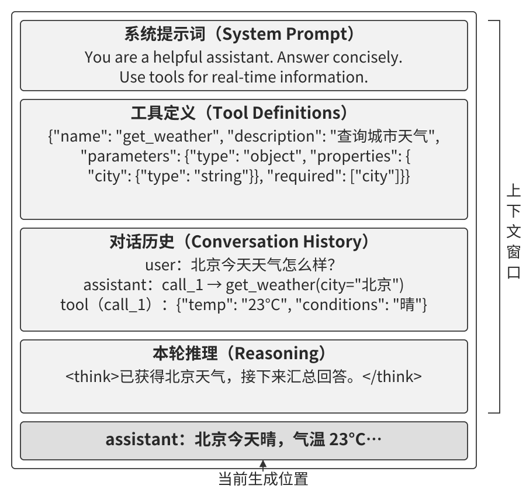

### 上下文：让模型能力用于具体任务

设想一位经验丰富的工程师刚加入团队，接到的第一个任务是“按我们的规范修改配置”。他会编程，却还不知道哪个文件才是配置的来源，哪些字段可以改，又该怎样验证。即使把整个代码库交给他，他也可能改错文件。Agent 接手陌生项目时，同样缺少这些背景。

以“帮我修复这个 bug”为例，Coding Agent 通常需要三类背景：

- **实时代码上下文**：目录结构、模块职责、核心数据结构和代码规范。例如，改动的是一份自动生成的配置文件，即使在本地生效，下次生成时也会被覆盖。知道文件由哪个模块生成，才能找到该改的地方。
- **流程规范**：Git 分支策略、提交规范、代码审查流程和 CI/CD 要求。Agent 据此安排修改、测试和提交，运行系统则按权限执行这些操作。
- **环境信息**：开发配置、测试数据库的连接方式、测试环境的部署方式和 API 密钥的管理方式。这些信息帮助它选择正确的运行环境，理解本地与测试环境的差异。

项目代码和测试数据库都在模型的上下文之外。以自动生成的配置为例，Agent 通过搜索工具读到生成脚本，才知道应该从哪里改起。**上下文的质量决定了模型能否把已有能力用到当前问题上。** **对于依赖大量背景信息的任务，能力够用的模型配上完整、准确的上下文，表现可以优于缺少必要资料的更强模型。**

**构建 AI 原生团队，首先要把关键知识文档化。** 如果当年选用某个数据库的理由只有老员工记得，业务规则变更又只在私聊里提过，那么新同事和 Agent 接手时都会遇到同一个问题：代码里看得到团队做了什么，却看不出当初为什么这样做。

**对远程协作友好的团队，往往也对 Agent 友好。** Linux 内核开发者通过邮件列表讨论补丁、交换审查意见，开发流程文档则说明怎样提交、审查和合并补丁[^ch2-linux]。新参与者读到一处出乎意料的改动，可以循着补丁找到当时的争论；Agent 查证背景时也用得上这段记录。

笔者听过翁家翌在 WhynotTV 的访谈后，把他的一个观点概括为：**人和模型都依赖 Context。** 人可以找参与过决策的同事补问一句，模型能读到哪些背景，则取决于团队留下了什么记录，以及 Harness 把哪些内容放进了这次请求。[^ch2-weng]

[^ch2-linux]: Linux 内核官方文档，How the development process works。

[^ch2-weng]: WhynotTV，《翁家翌：OpenAI，GPT，强化学习，Infra，后训练，天授，tuixue，开源，CMU，清华》，Podcast #4。

ReAct 论文用一个形式化表达描述交互历史如何参与决策[^ch2-react]。在时刻 $t$，Agent 从环境收到观测 $o_t\in\mathcal{O}$，根据策略 $\pi(a_t\mid c_t)$ 选择动作 $a_t\in\mathcal{A}$，其中上下文为：

$$
c_t=(o_1,a_1,\ldots,o_{t-1},a_{t-1},o_t)
$$

这个表达说明，**Agent 的下一步行动依赖截至当前的交互历史。** 比如，Agent 查过哪个文件、工具返回了什么错误，都会影响下一步选择。对 LLM Agent，用户输入和工具结果可以提供观测，工具调用及对外回复记录行动；系统指令和工具定义进一步说明任务规则与可用接口。

本章先采用无状态的请求方式：Harness 每轮组装消息和工具定义，再调用模型。完整消息历史便于保留任务进展；随着历史增长，可以通过检索、状态记录和压缩，把后续决策需要的信息留在窗口内。上下文布局、状态栏和压缩技术，都围绕同一个问题展开：怎样在有限的上下文里把模型这一步要用的信息放进 $c_t$？

[^ch2-react]: Yao, Shunyu, et al.，ReAct: Synergizing Reasoning and Acting in Language Models，ICLR 2023。

### Agent 如何调用大模型：理解 API 的上下文结构

先从一句问候看消息格式，再看“温哥华现在几点、天气怎样”如何引出两次工具调用。本节使用兼容 Chat Completions 的接口和本地运行的 Qwen3-0.6B，最后用 Python 把各轮请求串起来[^ch2-chat-api]。

#### 示例中的四种消息角色

请求中的**消息列表**（`messages`）按顺序保存交互信息。每条消息用**角色**（`role`）标记来源和用途。本节使用四种角色：

- **system**：系统提示词。本节用它承载开发者提供的身份、行为规则和约束，放在消息列表前部。部分模型接口使用 `developer` 角色承载开发者指令。
- **user**：用户消息，保存任务、追问和补充要求。
- **assistant**：模型回复，包括文本和工具调用请求。把这些消息放回下一轮输入，模型就能读到此前的回答与操作请求。
- **tool**：工具执行结果。Harness 收到返回值后，把它写成工具消息，通过 `tool_call_id` 关联到具体调用。

工具定义通过请求顶层的 `tools` 字段传入，列出可用工具的名称、用途和参数格式。

模型根据工具定义构造调用请求。它能否执行这项操作，由 Harness 和运行环境决定。

[^ch2-chat-api]: OpenAI，Chat Completions API 参考，介绍消息角色、工具定义与调用结果字段；Qwen，Function Calling，介绍兼容服务中的工具调用与模板。

#### 单轮对话：最简单的 API 调用

先看一次问答。用户问“Hello, who are you?”，Harness 把系统指令与用户问题一起发给模型，再读取回复。图2-2 展示了请求和响应的对应关系。

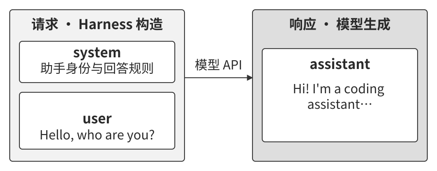

下面按本地模型的接口形式写出请求与示例回复，代码中的注释标出了各部分的来源：

```javascript
// Harness 构造请求
{
  "model": "Qwen3-0.6B",
  "messages": [
    {
      "role": "system",                           // 开发者提供的指令
      "content": "You are a helpful coding assistant. Follow user instructions."
    },
    {
      "role": "user",                              // 用户输入
      "content": "Hello, who are you?"
    }
  ]
}
```

```javascript
// API 返回响应
{
  "choices": [{
    "message": {
      "role": "assistant",                         // 模型生成
      "content": "Hi! I'm a coding assistant. I can help you write code, debug issues, and explain technical concepts. How can I help?"
    }
  }]
}
```

请求包含一条 `system` 消息和一条 `user` 消息，响应中的 `choices[0].message` 保存模型生成的 `assistant` 消息。在这里采用的无状态接口中，**Harness 负责为每次调用提供所需上下文**。下一次请求若要接着这段对话进行，就要带上相关历史。

#### 带工具调用的多轮交互：Agent 的核心循环

再看一个需要工具的问题：“What's the current time and weather in Vancouver?” 要回答它，得先查到当地的时间和天气。图2-3 中，Harness 第一次调用模型，得到的是两项工具请求。它分别向时间服务和天气服务查询，把两项结果补进消息历史，再第二次调用模型，才得到给用户的答复。

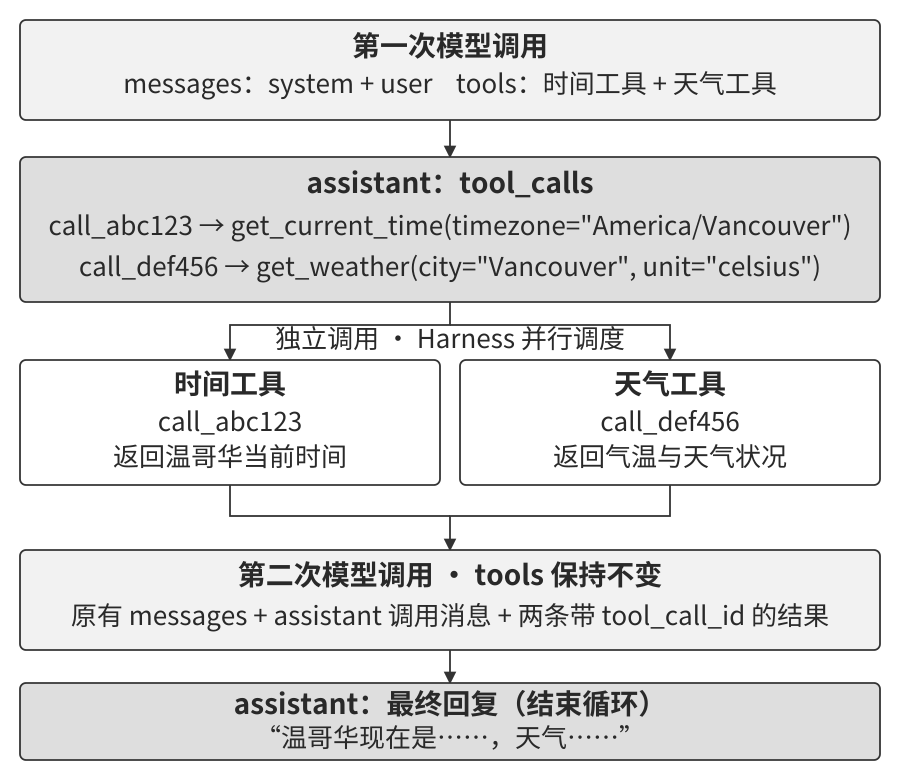

这两个工具谁先执行？时间工具需要时区，天气工具需要城市和温标。用户只说了温哥华，示例中的模型据此填入 `America/Vancouver` 和 `Vancouver`，温标选了摄氏度。查天气用不着等时间工具返回，两项查询可以同时发出。

**第一次 API 调用——Agent 框架发送初始请求：**

```javascript
// 第一次模型调用：Harness 构造请求
{
  "model": "Qwen3-0.6B",
  "messages": [
    {
      "role": "system",                           // 开发者提供的指令
      "content": "You are a helpful assistant. Use the provided tools to get real-time information when needed."
    },
    {
      "role": "user",                              // 用户输入
      "content": "What's the current time and weather in Vancouver?"
    }
  ],
  "tools": [                                       // 开发者定义的工具
    {
      "type": "function",
      "function": {
        "name": "get_current_time",
        "description": "Get the current date and time in a specific timezone",
        "parameters": {
          "type": "object",
          "properties": {
            "timezone": { "type": "string", "description": "Timezone name, e.g. America/Vancouver" }
          },
          "required": ["timezone"]
        }
      }
    },
    {
      "type": "function",
      "function": {
        "name": "get_weather",
        "description": "Get the current weather for a specific city",
        "parameters": {
          "type": "object",
          "properties": {
            "city": { "type": "string", "description": "City name" },
            "unit": { "type": "string", "enum": ["celsius", "fahrenheit"] }
          },
          "required": ["city", "unit"]
        }
      }
    }
  ]
}
```

这份 `tools` 清单由开发者预先定义，包含名称、描述和参数 schema。本例在各轮请求中提供相同的两个工具，模型读取清单与用户问题后，再选择要调用的工具并填写参数。

**模型返回两个工具调用请求：**

```javascript
// 模型返回工具调用请求
{
  "choices": [{
    "message": {
      "role": "assistant",                         // 模型生成
      "content": null,                             // 本轮没有文本回复
      "tool_calls": [                              // 请求调用两个工具
        {
          "id": "call_abc123",
          "type": "function",
          "function": {
            "name": "get_current_time",
            "arguments": "{\"timezone\": \"America/Vancouver\"}"
          }
        },
        {
          "id": "call_def456",
          "type": "function",
          "function": {
            "name": "get_weather",
            "arguments": "{\"city\": \"Vancouver\", \"unit\": \"celsius\"}"
          }
        }
      ]
    }
  }]
}
```

响应中的 `tool_calls` 包含两个请求，每个请求都有自己的 `id`、工具名称和参数。`arguments` 是 JSON 编码的字符串，执行侧需要先解析，再校验字段与取值。**模型决定调用什么、传入什么参数；Harness 负责校验和调度；工具实现负责访问时间或天气服务。**

**Agent 框架执行工具，然后发起第二次 API 调用：**

Harness 校验请求后调度两个工具，将返回值写成 `tool` 消息，再把已有历史与新增结果一起交给模型：

```javascript
// 第二次模型调用：追加工具结果
{
  "model": "Qwen3-0.6B",
  "messages": [
    {
      "role": "system",                           // 保留第一次请求中的消息
      "content": "You are a helpful assistant. Use the provided tools to get real-time information when needed."
    },
    {
      "role": "user",                              // 保留第一次请求中的消息
      "content": "What's the current time and weather in Vancouver?"
    },
    {
      "role": "assistant",                         // 保留前一轮模型的调用请求
      "content": null,
      "tool_calls": [
        { "id": "call_abc123", "type": "function", "function": { "name": "get_current_time", "arguments": "{\"timezone\": \"America/Vancouver\"}" } },
        { "id": "call_def456", "type": "function", "function": { "name": "get_weather", "arguments": "{\"city\": \"Vancouver\", \"unit\": \"celsius\"}" } }
      ]
    },
    {
      "role": "tool",                              // Harness 写入工具执行结果
      "tool_call_id": "call_abc123",
      "content": "{\"timezone\": \"America/Vancouver\", \"datetime\": \"2025-09-13T05:18:47\", \"day_of_week\": \"Saturday\"}"
    },
    {
      "role": "tool",                              // Harness 写入工具执行结果
      "tool_call_id": "call_def456",
      "content": "{\"city\": \"Vancouver\", \"temperature\": 13.2, \"unit\": \"celsius\", \"conditions\": \"clear\", \"humidity\": 93}"
    }
  ],
  "tools": [ ... ]                                 // 沿用前面的工具定义，此处省略
}
```

沿着 `call_def456` 读第二次请求：前一条 `assistant` 消息里，它是温哥华天气查询的编号；后面的 `tool` 消息用同一个编号送回了 13.2 ℃ 和晴天。即使天气先于时间返回，Harness 也能让结果和请求对上。模型在这一轮同时读到了用户原来的问题、自己发出的两项查询，以及工具查回来的数据。接下来就能回答用户了。

**模型根据工具结果生成最终回复：**

```javascript
// 模型生成最终回复
{
  "choices": [{
    "message": {
      "role": "assistant",                         // 模型生成
      "content": "It's currently 5:18 AM on Saturday, September 13, 2025 in Vancouver.\n\nWeather: 13.2°C with clear skies and 93% humidity. It's quite cool this morning - you might want to grab a jacket."
    }
  }]
}
```

第二次响应给出最终文本，`tool_calls` 为空，示例循环随之结束。这个“调用模型→执行工具→回传结果→再次调用模型”的过程，就是第一章运行循环在 API 中的具体实现。

如果用户追问“那东京呢？”，Harness 就把这条消息追加到历史末尾，再次调用模型。模型可以沿用“查询当前时间和天气”的任务背景，生成针对东京的新请求；工具返回后，再组织新的回答。

**换用 Responses API，怎样把工具结果交回去？** 上面的本地实验使用 Chat Completions 兼容接口。如果用 OpenAI 的服务开发新项目，官方推荐 Responses API。还是看温哥华的例子：应用把用户问题放入请求的 `input`，并在 `tools` 中声明时间和天气两个函数。返回的 `output` 是一组有类型的条目。若其中出现两条 `function_call`，应用就从每条里读取函数名、参数和 `call_id`，分别执行工具。[^ch2-responses-loop]

假设天气函数的调用编号是 `call_weather`。下一次请求的 `input` 就可以放入这样的回执；时间函数也要按自己的编号交回结果。

```json
{"type": "function_call_output", "call_id": "call_weather", "output": "{\"temperature\": 13.2, \"unit\": \"celsius\"}"}
```

`call_id` 把一条回执对回一次函数调用。`previous_response_id` 指向上一次模型响应，让服务接续那一轮的上下文。两个编号指的对象不同。采用这种续接方式时，本轮仍需提供要继续使用的工具和顶层 `instructions`；上次请求的顶层指令不会随响应编号自动继承。模型可能继续请求工具，应用要读下一份 `output` 再决定是否结束。第一章实验 1-3 用的是服务端托管搜索；这里的两个自定义函数由应用实际执行。

[^ch2-responses-loop]: OpenAI，迁移到 Responses API、函数调用及创建响应的参数说明。

#### 用代码实现 Agent 的核心循环

循环中的两处 `messages.append` 分别保存模型的回复和工具的执行结果。时间和气温都来自温哥华；把两个调用 ID 对调，下一轮模型读到的就会是“查询时间”返回了 13.2 摄氏度。

示例通过 OpenAI Python SDK 连接兼容服务。默认地址是本机的 `http://localhost:8000/v1`，适用于已启动、无需鉴权的本地服务。这组默认值对应实验 2-1 的 vLLM 后端。若使用该实验的 Ollama 后端，把地址设为 `http://localhost:11434/v1`，并把模型名改为 `qwen3:0.6b`。连接其他服务时，按需设置环境变量 `LLM_BASE_URL` 和 `LLM_API_KEY`，并让下方的 `model` 与实际部署的名称一致。时间和天气工具暂用上一例的固定数据，以便对照消息；接入真实数据时再替换这两个工具的实现。

```python
import json
import os

from openai import OpenAI

client = OpenAI(
    base_url=os.getenv("LLM_BASE_URL", "http://localhost:8000/v1"),
    api_key=os.getenv("LLM_API_KEY", "EMPTY"),
)

# 工具定义：名称、用途和参数结构
tools = [
    {
        "type": "function",
        "function": {
            "name": "get_current_time",
            "description": "Get the current date and time in a specific timezone",
            "parameters": {
                "type": "object",
                "properties": {
                    "timezone": {"type": "string", "description": "Timezone name, e.g. America/Vancouver"}
                },
                "required": ["timezone"],
            },
        },
    },
    {
        "type": "function",
        "function": {
            "name": "get_weather",
            "description": "Get the current weather for a specific city",
            "parameters": {
                "type": "object",
                "properties": {
                    "city": {"type": "string", "description": "City name"},
                    "unit": {"type": "string", "enum": ["celsius", "fahrenheit"]},
                },
                "required": ["city", "unit"],
            },
        },
    },
]

# 示例工具使用固定数据，参数与前面的温哥华查询一致。
def execute_tool(name, arguments):
    args = json.loads(arguments)
    if name == "get_current_time" and args == {"timezone": "America/Vancouver"}:
        result = {
            "timezone": "America/Vancouver",
            "datetime": "2025-09-13T05:18:47",
            "day_of_week": "Saturday",
        }
    elif name == "get_weather" and args == {"city": "Vancouver", "unit": "celsius"}:
        result = {
            "city": "Vancouver", "temperature": 13.2,
            "unit": "celsius", "conditions": "clear", "humidity": 93,
        }
    else:
        result = {"error": "示例仅提供温哥华时间和摄氏天气数据"}
    return json.dumps(result, ensure_ascii=False)

# 初始消息：指令与用户任务
messages = [
    {"role": "system", "content": "You are a helpful assistant. Use tools to get real-time information when needed."},
    {"role": "user", "content": "What's the current time and weather in Vancouver?"},
]

# 运行循环：最多调用模型八轮
rounds = 0
while rounds < 8:
    rounds += 1
    response = client.chat.completions.create(
        model="Qwen3-0.6B", messages=messages, tools=tools
    )
    assistant_message = response.choices[0].message

    # 保存模型回复，包括本轮的调用请求
    messages.append(assistant_message.model_dump(exclude_none=True))

    # 本例在模型给出不含工具调用的回复时结束
    if not assistant_message.tool_calls:
        print(assistant_message.content)
        break

    # 逐个执行并追加结果；独立调用也可以改为并行调度
    for tool_call in assistant_message.tool_calls:
        try:
            result = execute_tool(tool_call.function.name, tool_call.function.arguments)
        except json.JSONDecodeError:
            result = json.dumps({"error": "工具参数需要有效的 JSON"})
        messages.append({
            "role": "tool",
            "tool_call_id": tool_call.id,
            "content": result,
        })
    # 下一轮使用追加了结果的消息列表
else:
    print("已达到轮数上限，任务尚未完成。")
```

假设模型在第一轮同时请求时间和天气。这里的 `for` 循环会先查时间，把结果追加到 `messages`，再查天气，追加第二条结果。两项都执行完，程序才回到 `while` 开头，发出第二次模型请求。把 `messages` 在这几步的内容展开，就能看到模型每次拿到了什么。

**初始状态（第 1 次调用前）：**
```python
messages = [
  { role: "system",  content: "You are a helpful assistant..." },     # 开发者写的
  { role: "user",    content: "What's the current time and weather in Vancouver?" },  # 用户输入
]
```

**第 1 次模型调用与工具执行完成后：**
```python
messages = [
  { role: "system",    content: "..." },
  { role: "user",      content: "What's the current time..." },
  { role: "assistant", tool_calls: [get_current_time, get_weather] },  # 模型生成的调用请求
  { role: "tool",      tool_call_id: "call_abc123", content: "{time...}" },  # 工具执行后由 Harness 写入
  { role: "tool",      tool_call_id: "call_def456", content: "{weather...}" },  # 工具执行后由 Harness 写入
]
```

**第 2 次调用后（模型返回最终回复，循环结束）：**
```python
messages = [
  { role: "system",    content: "..." },
  { role: "user",      content: "What's the current time..." },
  { role: "assistant", tool_calls: [get_current_time, get_weather] },
  { role: "tool",      tool_call_id: "call_abc123", content: "{time...}" },
  { role: "tool",      tool_call_id: "call_def456", content: "{weather...}" },
  { role: "assistant", content: "It's currently Saturday, Sep 13, 2025 in Vancouver..." },  # 最终回复
]
```

#### 从 API 视角看上下文的构成

图2-4 把一次请求分为前缀和消息历史两部分。前面的温哥华查询刚发出时，历史里只有用户的提问和此前的对话。等两项查询完成，历史里就多了模型提出的工具调用和两项工具结果。

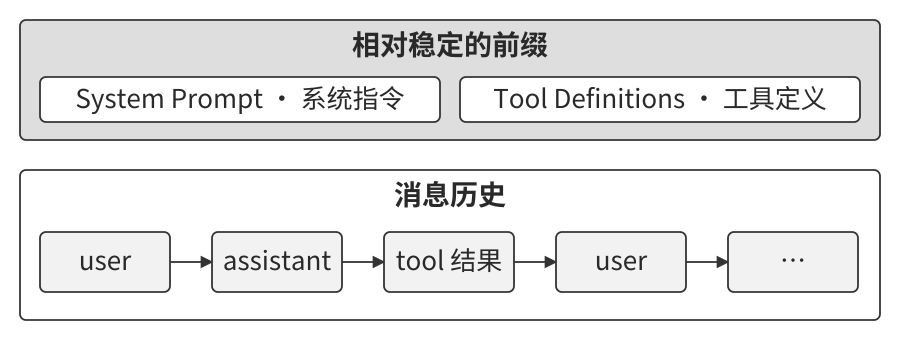

因此，连续两次请求开头相同的一段，可以一直延伸到消息历史里。下一轮调用能复用多少旧计算，取决于这段前缀有多长。

下面的 Harness 将不常变化的系统指令与工具定义放在前面，每一轮只在历史消息末尾追加当前状态。历史太长时，它先压缩旧消息，再组装请求。

```python
stable_prefix = system_message
stable_tools = core_tool_schemas
history = load_message_history(session)
status_message = make_status_message(derive_current_state(history))

if estimated_tokens(stable_prefix, stable_tools, history, status_message) > budget:
    history = compress_old_evidence(
        history,
        preserve = [decisions, constraints, failures, citations]
    )

request.messages = [stable_prefix] + history + [status_message]
request.tools = stable_tools
response = call_model(request)
```

压缩时保留决策、约束、失败和引用等后续工作需要的信息，并维护调用请求与工具结果的关联。除了长度预算，信息重复和过时也可以触发压缩，具体策略将在本章后半部分展开。

> **实验 2-1 ★：本地 LLM 服务部署与工具调用**
>
> 本实验在本地运行 Qwen3-0.6B，沿着“查询温哥华时间和天气”这一任务，观察消息如何经过模型、解析器和工具执行器。图2-5 展示了本地服务与客户端的分工：服务端加载模型、处理输入并生成回复，客户端维护消息历史，调度工具并回传结果。
>
> 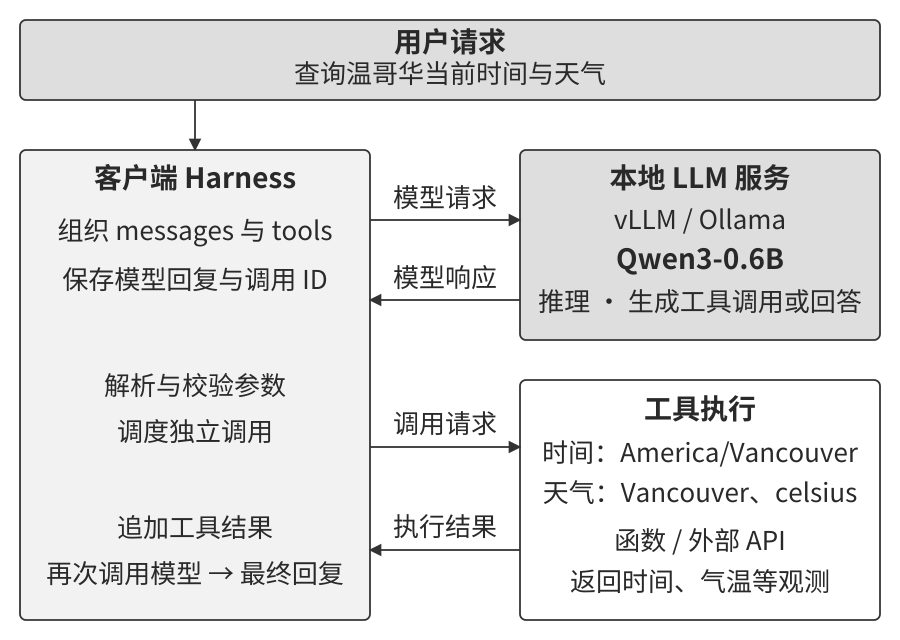
>
> **先跟踪一次完整任务。** 模型在同一轮输出中请求查询时间和气温，分别填写 `America/Vancouver`、`Vancouver` 和 `celsius` 等参数。客户端并行执行两个工具。第一份回执给出当地时间 11:11:28，第二份回执给出气温 17.9 °C。两份结果送回模型后，它把时间报到分钟，回答气温为 17.9 °C，随后结束本次循环。这次运行说明，六亿参数的模型已经能为这个任务选对两个工具、填好参数，并用返回值回答用户。
>
> **再查看原始输出与 API 字段的对应。** Qwen3 的思考模式可以生成带有 `<think>` 标记的推理内容，工具请求则使用相应的调用标记。服务端解析后，客户端可能收到单独的 `thinking` 或工具调用字段。输出中各部分的排列与保留方式由模型模板和服务协议共同决定。
>
> **接着观察流式处理。** 界面可以随着事件更新“思考中”“调用工具”和“生成回答”等状态。工具参数通常分多段到达，需要累积成完整请求；协议确认该调用结束，且参数、权限和依赖检查通过后，运行系统可以开始调度。相互独立的工具能够并行执行，也可以与后续输出处理形成流水线。
>
> **最后比较速度与缓存。** 本次在苹果芯片 Mac 上运行的记录中，工具任务的平均解码速度约为每秒 107 个 token。Token 是模型处理文本的基本单位，具体切分由分词器决定，一个词或汉字可能对应一个或多个 token。解码速度反映开始生成后的输出速率；用户等待多久，还受到首 token 延迟、推理长度和工具耗时影响。
>
> 缓存对照使用相同的长前缀，分别测试保留前缀与修改前缀开头的请求。本次五组配对中，保留前缀的请求有四组更快；两组平均首 token 延迟分别约为 1.30 秒和 1.51 秒。下一节将解释这些请求在计算上有什么区别。
>
> 这个实验也让笔者更加看好端侧 Agent：小模型已经能够在用户自己的设备上完成这样的工具调用任务。**端侧 Agent 的时代，比许多人预期的更近。**

### KV Cache 友好的上下文设计

Agent 的相邻请求通常共享大量信息：系统指令、工具定义，以及此前已经发生的交互。如果推理引擎能够复用这些内容的中间计算结果，就能把更多计算用于新增信息。**KV Cache** 保存每层注意力计算中已经得到的键（Key）和值（Value），供后续 token 使用；**Prompt Cache** 则进一步在请求之间复用符合条件的前缀缓存[^ch2-kv-basics]。

考虑一个客服 Agent：为了让模型知道当前时间，开发者在系统提示词开头加入 `Current time: {{now}}`，每次请求都更新。后面的业务规则和工具定义保持原样，实际输入会从时间戳处开始变化。对于按相同前缀复用 KV 的服务，这会使时间戳及后续部分重新计算，增加输入处理时间和费用。

把时间写成追加消息，或在需要时调用时间工具，就能保留已有前缀。两种布局提供的信息相近，触发的重算范围却不同。

可以先记住三个做法，后面的原理和实验将逐项解释它们：

1. **保持可复用的前缀稳定。** 系统指令和常用工具定义采用确定的内容与顺序。
2. **把运行中的变化追加到后部。** 时间、余额、调用次数和任务进度可以通过新消息或工具结果提供。最新状态应标明生效时点，让模型能识别哪条记录适用于当前决策。
3. **按模型协议组织消息。** 使用正确的角色、调用 ID 和工具结果格式，由相应的聊天模板生成模型输入。缓存匹配的是处理后的前缀及相关配置，消息协议还决定模型如何识别指令、用户请求和工具返回值。

在本节采用的因果注意力模型中，后续 token 的加入不会改变此前位置已经算出的状态。修改已有输入时，首个变化位置及其后面的状态需要重新计算；变化之前的前缀仍有复用机会。服务端还会根据缓存块大小、保留时间和运行配置决定实际命中范围。

[^ch2-kv-basics]: Hugging Face，How caching works，介绍逐层保存与复用 K、V 的机制。

> **实验 2-2 ★：注意力机制可视化**
>
> 先用“北京 的 天气 怎么样”理解一次注意力计算。为了便于展示，图2-6 将这句话分成四个语义单元；实际模型由分词器切分输入。处理“怎么样”这一位置时，注意力层要从已有信息中组合出当前表示。Query、Key 和 Value 分别承担查询、匹配和信息聚合的作用。
>
> | 向量 | 作用 | 在这个例子中的直观理解 |
> | --- | --- | --- |
> | **Query（查询）** | 当前位置用于匹配其他位置的向量 | “怎么样”需要从已有内容中找出相关信息 |
> | **Key（键）** | 各位置参与匹配的向量 | “北京”“天气”等位置提供可供匹配的表示 |
> | **Value（值）** | 按权重聚合的信息向量 | 将地点、天气等信息按相应比重汇入当前表示 |
>
> 可以把 Key 想象成用于检索的标签，把 Value 想象成取回的内容。模型中的这些向量都是从隐藏表示计算出来的数值，并由训练塑造其匹配方式。
>
> 一次计算分三步。首先，当前位置生成 Query；然后，它与各位置的 Key 做点积，经过缩放、因果掩码和 softmax，得到和为 1 的注意力权重；最后，用这些权重对 Value 加权求和。点积就是两组数字逐位相乘再求和，softmax 则将可见位置的分数转换成归一化权重。各位置的 Value 按对应权重参与聚合，共同形成这个注意力头的输出。
>
> 沿图2-6 的最后一行横着读：“怎么样”这个位置给“天气”的权重是 0.55。这个数要乘上“天气”所在位置的 Value，再加上另外三个位置的贡献，才得到该注意力头在“怎么样”处的输出。换到“天气”那一行时，右边为什么多了一个叉？因为计算这个位置时，序列还没走到“怎么样”。
>
> 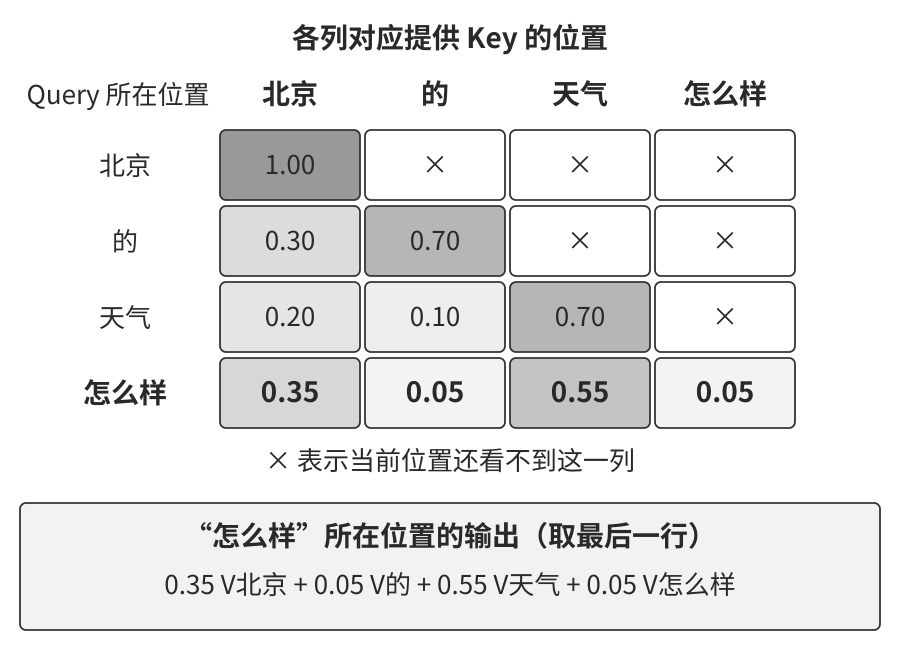
>
> 把每个位置的权重排成矩阵，就得到**注意力热力图**。每行对应一个 Query，每列对应一个 Key，颜色深浅表示权重大小。因果掩码允许当前位置读取自己和前面的位置，图中用 × 标出被屏蔽的位置，它们经过 softmax 后的权重为零。这一结构适用于输入处理和后续生成。
>
> 从这里也能看出 K、V 缓存的用途：生成继续推进时，新位置仍会读取已有位置的 Key 和 Value。保存这些向量后，新位置就可以直接用它们进行匹配与聚合，省去历史位置的重复计算。
>
> 理解了这组示意权重，再用 Qwen3-0.6B 查看模型实际计算出的注意力分布。实验分别记录短句和一段包含推理、最终回答的生成序列，比较不同层的注意力矩阵。图2-7 分别展示第 0、13、27 层：左列是九个 token 的短句，右列是计算 17 × 23 的生成序列，按输入、推理和回答标出位置范围。灰度采用对数刻度，便于同时看清较强与较弱的注意力权重。
>
> 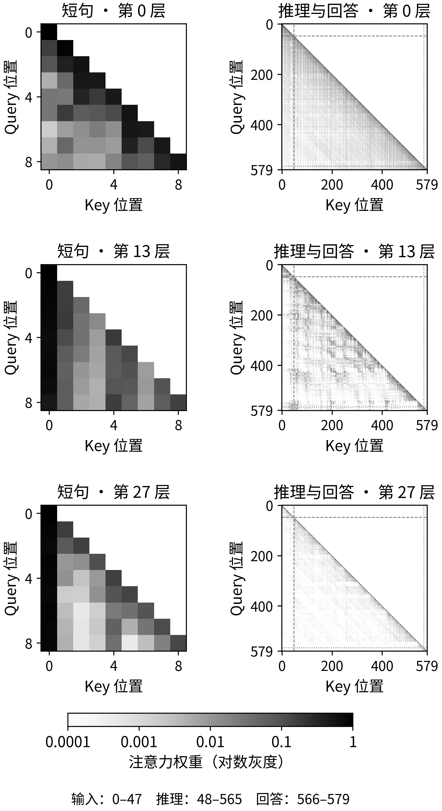
>
> 阅读时可以沿着四条线索分析：
>
> 1. **注意力储存池（Attention Sink）。** 某些层把较大权重分配给序列开头，即使开头的 token 承载的语义很少。看图2-7 左列的短句。每幅图已对同一层的各注意力头取了平均。再取矩阵第一列九个数的平均值，就能算出九个位置平均分给首个 token 多少权重。第 0、13、27 层分别为 14.7%、73.9% 和 83.2%。换到右列较长的生成序列，第 13 层的这个数值就变为 28.0%。softmax 要求各位置权重合计为 1，模型可以学出相对稳定的接收位置；StreamingLLM 对这一现象及其在流式推理中的作用作了专门研究[^ch2-attention-sinks]。
> 2. **推理区域。** 标出 `<think>` 对应的生成区间，沿这些行查看模型关注了哪些提示词、工具说明或此前推理。三角形来自因果掩码，三角形内部的深浅才反映各位置的权重差异。
> 3. **回答区域。** 再标出最终回答的生成区间，比较它对原始输入和先前推理的权重分配。这能帮助定位哪些已有信息进入了当前注意力聚合。
> 4. **位置差异。** 《Lost in the Middle》在长上下文问答和键值检索中观察到，中间位置的信息更难被有效利用[^lost-in-the-middle]。工程上可以据此优先把常驻规则放在前部，把当前目标和进度放在末尾。

[^ch2-attention-sinks]: Xiao et al.，Efficient Streaming Language Models with Attention Sinks，ICLR 2024。

[^lost-in-the-middle]: Liu et al.，Lost in the Middle: How Language Models Use Long Contexts，TACL 2024。

#### 从 API 消息到模型 Token：Chat Template

前面的 API 示例是一组带角色的消息，注意力图中的输入则是一串 token。**Chat Template（聊天模板）**负责完成这次转换：为消息加入角色与边界标记，按约定组织工具说明和返回值，再交给分词器编码。对照图2-8 两栏：左边只提交了系统指令和用户提问，右边怎么又多出一个 `assistant`？那是模板为下一条回复加上的起始标记。后面讨论工具调用、推理信息的保留和缓存命中时，还会用到这些标记。

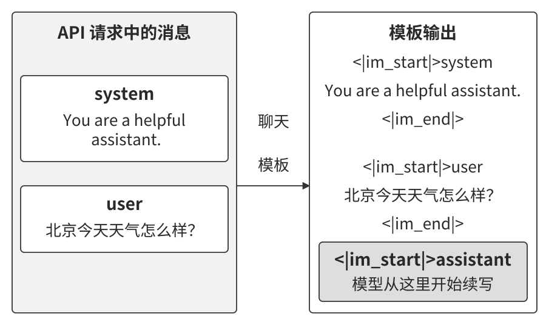

Qwen、Llama、Gemma 等模型家族各有自己的聊天模板。同一组 API 消息交给不同模型，转换出的角色和边界标记也可能不同。托管 API 通常由服务端完成转换，自行部署时则要为推理服务配置与模型匹配的模板。

假设用户发来一句“温哥华 17.9 °C”，天气工具也恰好返回相同的文字。把这两条消息分别交给 Qwen3-0.6B 的模板，会得到图2-9 中的两段输入。它们都以 `<|im_start|>user` 开头，哪一处标记表明文字来自工具？

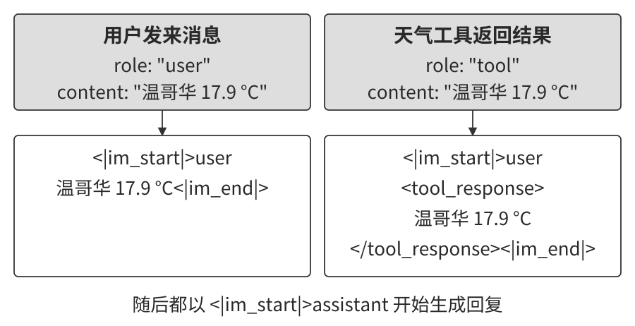

右栏多了一对 `<tool_response>` 标签。模板还按消息角色定位用户最近一次提问：在这次提问之前的轮次，只保留回答内容；在此之后，工具交互还可以带上模型的推理信息[^ch2-qwen-template]。

例如，模型查完文件后仍要继续分析。把工具结果按 `tool` 角色回传，模板就能将它识别为当前任务中的工具反馈；如果把同样的结果直接写成普通 `user` 消息，模板可能把它识别为新的查询，改变此前推理的保留范围。这就像继续做一道题时需要保留演算草稿：Harness 应保存服务要求的推理字段，并按正确的消息结构接着调用。

**从单轮推理走向长程 Agent，历史思考逐渐成为需要维护的任务状态。** 早期 DeepSeek-R1 的聊天模板会去掉历史回答中的思考部分，只保留最终回答[^ch2-r1-template]；后续 DeepSeek 的工具调用协议则要求回传推理信息。一次问答结束后，最终回答可能已经包含下一轮所需的信息；工具任务进行到一半时，“为什么查这个文件”“已经排除了哪些假设”却可能只写在中间推理中。保留这些信息，有助于下一轮接着已有思路工作。

**推理信息的回传方式由模型协议决定。** 接入时要同时处理 `content`、`tool_calls` 和服务提供的推理字段。下面几种方案体现了不同的续接规则：

- **DeepSeek 思考模式**通过 `reasoning_content` 返回推理。按照其工具调用协议，请求带有 `tools` 时，后续请求须完整回传历史推理，包括未调用工具的模型回复；缺失字段会触发 400 错误。纯聊天请求不带 `tools` 时，服务忽略回传的历史推理[^ch2-deepseek-thinking]。
- **Kimi 的思考与工具交互**同样需要在运行循环中管理推理、工具请求和结果。以 Kimi K2.5 的交错思考示例为例，模型可以在多次工具调用之间继续推理，客户端按其协议保存和回传模型消息[^ch2-kimi-thinking]。
- **GLM 的保留思考**可以通过 `thinking.clear_thinking: false` 开启，随后完整、按原顺序回传 `reasoning_content`。Coding Plan 与标准 API 的默认设置不同，客户端应明确选择所需模式[^ch2-glm-thinking]。
- **Claude 的 thinking block**需要连同签名保存。支持 preserved thinking 的模型还会检查块的来源与前缀，具体规则见后面的“缓存作为架构约束”。

这些规则影响连续工具调用，也影响中途切换模型。切换时，适配层要把工具请求、结果和任务状态转换成目标接口接受的形式，再按目标模型的规则处理推理信息。第五章的实验 5-1 将展开这种轨迹接续。

**模板还决定缓存所匹配的输入。** 同样的消息内容，经过不同模板、工具顺序或序列化方式处理，可能形成不同 token 前缀。要复用已有 KV，需要保持相关模型配置和前缀一致。

[^ch2-qwen-template]: Qwen3-0.6B 的分词器配置文件 `tokenizer_config.json` 保存了聊天模板，其中包含用户查询、推理内容与工具响应的处理逻辑。

[^ch2-r1-template]: DeepSeek-R1 官方聊天模板在普通历史回答中保留 `</think>` 之后的内容；后续工具调用的推理回传规则见 DeepSeek 的 Thinking Mode 文档。

[^ch2-deepseek-thinking]: DeepSeek，Thinking Mode。

[^ch2-kimi-thinking]: Moonshot AI，Kimi K2.5 官方仓库，Interleaved Thinking and Multi-Step Tool Call 一节。

[^ch2-glm-thinking]: Z.ai，Thinking Mode，介绍交错思考、保留思考及端点默认设置。

#### KV Cache 的原理与约束

模型处理一次请求时，先对输入进行 **prefill（预填充）**，计算已有 token 的表示，再进入 **decode（解码）**，逐个生成后续 token。KV Cache 在解码过程中保存已有位置的 K、V；跨请求的前缀缓存进一步复用上一请求留下的相同前缀。

例如，Agent 到第六轮时已经累积了 2,000 个输入 token。如果服务只使用本次请求内的 KV Cache，就需要先处理这 2,000 个 token，再利用缓存继续生成。如果跨请求缓存中已有其中一段相同前缀，prefill 就能从尚未缓存的位置接续。图2-10 展示了这种跨请求复用。

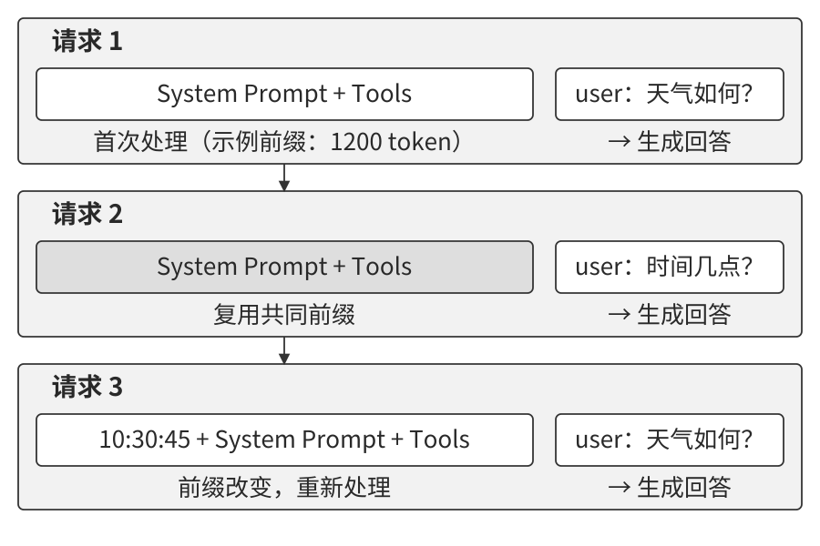

**用四个 token 跟踪缓存的增长。** 假设输入为 `[A, B, C, D]`。模型处理位置 D 时，用 D 的 Query 与 A、B、C、D 的 Key 匹配，再对它们的 Value 加权聚合。经过各层计算，D 位置的最终表示用于预测下一个 token E。此时，A 至 D 在各层的 K、V 都已保存。

采样得到 E 后，下一步把 E 送入模型，计算它在各层的 Query、Key 和 Value。E 的 Query 读取此前的缓存与当前位置的 K、V，模型再预测第六个 token；E 的 K、V 同时追加到缓存中。这样，每生成一步，都可以沿用此前的状态，只计算新输入 token 的状态。

若完全不用 KV Cache，预测 E 时要重新处理 A 至 D，预测第六个 token 时又要处理 A 至 E。仅按重复生成 K、V 的位置数计算，累计工作量会出现 $1+2+\cdots+N$ 这样的增长。使用缓存后，历史位置的逐层计算得以复用；新位置仍要读取可见的 K、V。在标准全注意力解码中，这部分读取与匹配随上下文长度线性增加，所以长上下文仍会占用更多显存和内存带宽。

**修改输入为什么会影响后续缓存？** Transformer 的各层依次处理隐藏表示，每层都有自己的 K、V。某个位置经过注意力计算后，表示中已经汇入此前位置的信息，再传给下一层。因而，第 $k$ 个 token 改变时，影响会从该位置向后、向更高层传播。

对于相同模型与计算配置，$k$ 之前的位置只依赖更早的输入，可以继续复用；从 $k$ 开始，需要重新建立受影响的状态。实际服务通常按缓存块匹配前缀，重算边界还受到块大小影响。更新越靠前，通常需要重算的输入越多。把稳定指令放在前部、把新状态追加到后部，就是在利用这一依赖关系。

> **实验 2-3 ★★：上下文管理方式的对照**
>
> 本实验让 Agent 使用文件发现、读取和搜索工具完成同一个任务，比较一种稳定追加的基线与五种上下文改动。基线保持指令和工具顺序稳定，逐轮追加模型消息和工具结果。其余各组分别改变指令、状态、工具排序或历史表达，观察缓存统计和任务过程怎样变化。
>
> **动态系统提示词**在每轮的系统指令中更新当前时间。变化之前仍可有共享前缀，从时间信息起的后续输入则需要重新匹配或计算。可以把时间作为新消息追加，或通过时间工具按需获取，让常驻业务规则继续复用。
>
> **动态用户配置**在前部消息中更新剩余调用次数或账户余额。状态本身是任务所需的信息，设计重点在于更新位置：把最新状态追加到末尾，并标明其生效时间，能够同时保留进度与前缀。后面的 Agent 状态栏将采用这种组织方式。
>
> **工具定义重排**每轮改变工具清单的顺序。名称和参数虽然相同，序列化后的 token 顺序已经变化。打开 Kimi K2.6 的运行报告，基线和重排组的 `Hit%` 都是 100%。两组真的复用了同样多的输入吗？基线三轮共输入 7,567 个 token，其中 768 个命中缓存；重排组也是三轮，7,568 个输入 token 中只有 256 个命中。用缓存 token 数除以输入 token 数，就得到 `Cache%` 一列的 10.1% 和 3.4%。另一列 `Hit%` 按有命中判定的请求计数：基线记了两次命中，重排组只记了一次，两组记下的未命中次数都是零。其余请求的命中情况，单凭这份记录无从判断。固定工具顺序可以避免前缀无故变化。
>
> **滑动窗口**只保留最近一段历史。假设按十轮交互保留，第十五轮就可能读不到第二轮取得的关键文件内容。除了缩短共享前缀，裁剪还会改变模型能获取的事实和任务进度。配套实现以最近六条历史消息为起点，并向前补齐工具结果所对应的调用请求。滑动窗口组复用了 2,224 个输入 token 中的 1,510 个，缓存占比达到六组中最高的 67.9%。再看实验 2-3 滑动窗口组的工具记录：模型三次查找文件，接着读取两个文件，却没有交付用户要求的三句话总结。
>
> **文本格式化**把带角色的历史重新写成 `USER: ...`、`ASSISTANT: ...` 等文本。这样会改变模板中的消息边界和工具结构，模型需要从正文恢复原来的关系。本次文本组仍生成了最终回复，也有缓存命中。接口提供的消息角色、调用 ID 和工具结果字段，有助于稳定传递这些关系。
>
> 程序即使重新构造消息列表，只要送出的前缀和缓存配置相同，这段前缀仍有机会复用。
>
> 如果还想知道用户少等了多久，要先看计时器在哪里停。滑动窗口组第一轮的 `ttft` 约为 2.23 秒。程序虽然把这个字段叫作 TTFT（首 token 延迟），却是在非流式请求返回整份回复时才停表。

#### KV Cache 与 Prompt Cache：两个层级的缓存

可以用两个时刻区分这两层缓存。模型生成回复中的第二个 token 时，可以读取该请求中已有位置的键值状态，这用到 **KV Cache**。稍后用户追问，Harness 发来新的请求；服务要先找到此前保存的相同前缀，才可能少算这部分输入，这属于 **Prompt Cache**。前者解释同一次生成如何继续，后者还要求跨请求的保存与匹配机制。

在 API 服务中，缓存还受到最小前缀长度、块大小、有效期、模型配置和租户隔离范围影响。可复用前缀必须在相同的缓存作用域内查找。例如，Claude API 按组织与工作区隔离缓存；相同文字出现在不同隔离域时，会分别建立缓存[^ch2-prompt-cache]。

计费需要分别考虑写入和读取。一些 Claude 模型的缓存读取价为普通输入价的十分之一，首次写入则有额外费用。同一段前缀在有效期内反复使用，只需付一次写入费，后续命中的请求都按读取价计费。

[^ch2-prompt-cache]: Anthropic，Prompt caching，介绍缓存匹配、隔离、有效期和计费。

#### 缓存作为架构约束

**在生产系统中，缓存已经成为一项架构约束。** 提示词怎样排列、子 Agent 从哪里开始、会话如何恢复，都会影响可以复用多少计算。**设计之初就要安排缓存边界。** 先确定哪些内容可以共享、哪些状态会变化，再组织提示词和会话结构，能减少运行中的反复重算。等到长程任务的延迟和费用已经成为问题，再调整这些结构，往往会牵动状态管理、子 Agent 和会话恢复。

**按稳定程度安排前缀。** 多个任务共享的指令与工具定义可以放在前部，随后再加入用户资料、会话状态和新观测，并按适用范围分组。例如，操作系统有 macOS/Linux 两种选择，运行模式有普通/调试两种，语言有中文/英文两种，三项独立条件最多产生 $2\times2\times2=8$ 种前缀组合。把变化较多的字段放到共享部分之后，可以增加公共前缀的复用机会。公共部分的共享范围还要遵守服务的组织、工作区和隐私边界。

**为子 Agent 选择可复用的起点。** 子 Agent 若继承父 Agent 的任务背景，可以复用双方一致的前缀，再追加自己的子任务。提示词、工具顺序、模型与相关配置共同决定可复用范围。需要独立角色或隔离上下文的子 Agent，则按其任务构造输入，再检查哪些公共部分适合共享。

**保存已经发送的内容。** 大型工具输出压缩成摘要或预览后，应保存实际送入模型的版本。会话恢复时重放这份记录，能够重建一致的消息序列；每次恢复都重新生成摘要，则可能引入新的措辞和前缀变化。更新摘要时，可以发布一个新版本，并明确之后从哪里重新建立缓存。

**保留推理还需要满足协议约束。** Claude 的 preserved thinking 为这个问题提供了具体例子。其文档将这一机制用于防蒸馏：服务检查 thinking block 的签名、生成模型及其前缀。对于 Claude Fable 5.1、Claude Opus 5.5 等支持前缀绑定的模型，块之前的顶层 `system`、`tools` 和消息共同构成校验范围；修改其中的内容，会使该块及后续 thinking block 失效[^ch2-preserved-thinking]。

例如，每轮重写系统时间、重新渲染首条消息中的环境信息、原地截短旧工具结果，都会改变后续推理块所绑定的前缀。触发校验后，API 可以返回 400 错误，也可以按 `prefix_mismatch_behavior` 的配置丢弃失效块，继续处理请求。后一种情况下，模型仍能使用保留下来的任务信息与工具结果，但失效推理不再参与本次输入。2026 年 8 月 31 日起创建的账户默认启用前缀校验，较早账户的启用方式见协议说明。

接入这类协议时，可以保持会话的顶层指令和工具集合稳定，把状态变化追加到后部。需要中途更新指令或工具时，使用该服务提供的会话内系统消息、工具变更块等接口。裁剪 thinking block 也要维持原顺序中的连续区间：可以从头部或尾部删除，或全部删除；中间留出缺口会影响后续块，已主动删除的块也应保持删除状态。

中途切换模型时，服务还会检查目标模型是否能够读取原模型的推理块。客户端应保存原始历史，让服务按兼容规则处理；若客户端自行删除，后续切回原模型时也无法恢复这些记录。

[^ch2-preserved-thinking]: Anthropic，Preserved thinking，介绍模型、前缀绑定、失效处理及推理块裁剪规则；会话内更新接口见Mid-conversation system messages and tool changes。

#### 研究延伸：可编辑、可组合的 KV Cache

> 前面的设计都通过匹配前缀复用计算。笔者还希望进一步探索：能否直接编辑、组合 KV 中已经保存的信息，让缓存适应上下文的变化？笔者在《Models Take Notes at Prefill》中把这种信息比作模型的“笔记”[^ch2-2]：prefill 经过多层注意力计算后，一个字段的影响已经进入后续位置的表示。例如，“用户所在城市：北京”可能影响后续地点判断；只替换这个字段自身的 K、V，后续状态仍可能保留旧城市所导出的结论。
>
> 论文通过干预区分了字段自身的 KV 与后续状态的作用。在所测决策中，字段自身 KV 的直接贡献低于 1%，主要影响保存在下游表示中。围绕这些下游留下的“笔记”，可以探索两种利用缓存的方法。
>
> **编辑（Editing）**通过显式更正信息推动后续计算更新已有判断。论文还发现，在所测的 8B 模型任务中，存在显式思维链时，单独编辑字段也能恢复目标决策，计算开销约为完整重算的 1%；缺少这一推理过程时，旧的下游状态可能继续影响决策，使字段修改难以生效。
>
> **组合（Composition）**把预先计算的技能缓存接入新的上下文。对于采用旋转位置编码（RoPE）的模型，需要先调整缓存中的位置表示，再进行拼接。可以把它想象成给一页已有笔记重新编号，接到另一份材料后面。论文比较了十二个模型，拼接与完整重算的输出 logits 余弦相似度为 0.90–0.999；缓存重定位与拼接本身可以按长度线性处理，减少整段上下文的注意力重算。
>
> 追加更正信息还可以与现有前缀缓存配合。在论文的 vLLM 在线基准中，这种组合保留了约 98.5% 的前缀缓存命中率，p90 首 token 延迟约为基线的 1/398 至 1/53。
>
> **笔者看好这条研究路线，因为它有望让上下文更新保留更多已有计算。** Agent 经常更新记忆字段、加入状态或替换工具定义；如果相关状态能像笔记一样修正和拼接，维护长上下文的代价就有机会显著降低。

[^ch2-2]: Li, Bojie，Models Take Notes at Prefill: KV Cache Can Be Editable and Composable，2026。编辑、组合与在线缓存实验采用不同任务和指标，具体设置见论文。

#### 从缓存机制到上下文内容的设计

理解了缓存如何复用计算，接下来就要决定每轮输入放什么，以及这些内容怎样更新。后面的内容分为三部分：

- **提示工程与 Agent Skills**：先设计系统指令和工具定义，说明目标、规则与操作方式；再通过渐进式披露按需加载领域知识。提示注入防护则关注外部内容进入上下文时的来源与指令边界。
- **Agent 状态栏**：把任务进度、环境观测摘要和调用计数等状态提供给模型，减少从长历史中重新推导的开销。它像手机上的时间、电量和网络状态，让当前运行情况保持可见。
- **上下文压缩**：在历史增长时保留后续决策需要的信息，决定何时压缩、怎样组织摘要，以及如何处理缓存重算与任务接续。

### 提示工程：优化系统提示词

提示工程通过指令、流程和示例，引导模型完成具体任务。本节重点讨论**系统提示词（System Prompt）**：它像一份员工手册，说明 Agent 的身份、目标、行为规则和工作流程。在本章的 API 示例中，这些内容通过 `system` 消息提供。

#### 语气与风格：怎样面向用户表达

语气要求应落实到具体表达。例如，简短问答可以要求“You MUST answer concisely with fewer than 4 lines”，即用少于四行的文字回答。任务受阻时，可以要求“keep your response to 1–2 sentences”，用一两句话说明当前状态与下一步，让用户直接看到需要处理的事项。

“NEVER do X”这类大写强调可以用于突出关键要求。更重要的是说明要求适用于什么情况，以及应采取什么行动。

#### 结构化提示：组织层次与内容边界

标题、列表和标签可以帮助组织较长的提示词。Markdown 标题适合表示章节和步骤，XML 风格标签适合划分不同用途的内容块，例如用 `<working_directory>` 包裹工作目录信息。标签名应直接说明内容用途，让模型容易识别各块之间的关系。

同一份提示词可以组合两种写法：

```text
# 工具使用规范

## 文件操作
<file_operation>
- 读取文件前检查路径是否存在
- 修改已有文件前保存备份
</file_operation>

## 网络请求
<network_request>
- 超时时间设置为 30 秒
- 短暂故障最多重试 3 次
- 有外部副作用的请求，重试前先确认执行状态
</network_request>
```

Markdown 提供便于阅读的层次，`<file_operation>` 和 `<network_request>` 划分规则的适用范围。例如，“最多重试 3 次”只适用于网络请求，修改文件时遵循的是上一组备份规则。

#### 用流程组织规则

**任务有明确阶段时，优先按流程组织提示词。** 以退款为例，先找到订单，才能按退款政策判断这笔钱能不能退。查不到订单，就请用户补充订单号等信息；订单符合条件，再发起退款。将同样的规则散放在一份上百条的清单里，每一步都需要重新找出适用条目。把输入条件、处理顺序和异常出口写在对应阶段，模型就有依据判断当前走到哪里、下一步应做什么。

下面以文件处理为例，把检查、分类、预处理、执行和验证串成一份标准操作流程（SOP）：

```text
文件处理流程

步骤 1：检查
  确认文件存在且可以访问
  文件不存在 → 记录错误，停止处理
  ↓
步骤 2：分类
  结合扩展名与文件内容确定类型
  ↓
步骤 3：预处理
  配置文件 → 先备份
  大文件（>1 MB）→ 使用流式处理
  ↓
步骤 4：执行
  按文件类型执行相应处理
  ↓
步骤 5：验证
  检查处理后文件的完整性
```

每一步都给出一个局部目标，相关规则放在该步骤下。文件不存在时，在检查阶段退出；配置文件需要修改时，在预处理阶段保存备份。执行进度则由消息历史或状态记录提供给模型。

#### 业务规则细化：把产品约定写清楚

同一份订单资料，究竟归入哪类请求、适用哪种服务、该收多少费用，首先是产品与运营需要明确的业务约定。工程实现再分工：提示词告诉模型应取得哪些字段、向哪项服务查询；工具和业务系统执行确定性的计费与约束。

以替用户打电话降低订阅费用或申请退款的 Agent 为例，团队希望通过“办不成就退款”降低尝试门槛，同时为特殊任务设置明确的收费方式。可以设计三类计费：

- **按节省金额提成**：通过谈判降低现有账单，按实际节省金额的一定比例收费，例如 20%。
- **按服务收取固定费用**：餐厅预订等服务型任务，按任务类型或复杂度收费。
- **困难任务预收款**：对符合特定条件的困难任务，提前说明预收费用与不退款条款，由用户确认后接单。

写成“根据任务情况选择合适的计费类型”，仍会留下分类歧义。“帮我退掉上个月买的衣服”涉及拿回已付款项，“帮我取消 Netflix 订阅”涉及停止未来付费。这两种结果都可能被宽泛地理解为省钱，但团队可以将提成限定为谈判降低现有账单，退款与取消服务统一采用固定费用。

相应提示词可以直接写出类别边界：“NEVER use percentage_based_one_time for refunds and service cancellations. Use fixed_fee instead.” 即退款和取消服务使用 `fixed_fee`，谈判降低现有账单才适用提成模式。

团队还要估计这件事有多大把握办成。商家接受哪些申请、这个用户是否符合条件、账单上收了什么钱、过去同类委托办得怎样，都会影响接单方式。若规则采用“高于 60% 进入可退款模式、低于 30% 不接单”的阈值，就还要写清中间区间及边界值的处理方式。

金额计算要明确单位、基数与舍入顺序。例如，电话费用按每分钟 0.05 美元累计，汇总后四舍五入到整数美元；节省金额以现有账单为基准。若当前账单为 150 美元，商家可能明年涨到 180 美元，维持当前价格所避免的潜在涨幅，应按预先约定的口径处理，不能自动计入降低现有账单的节省金额。

笔者的建议是，**由产品负责人主导业务规则的设计**，结合线上数据、用户反馈和运营经验维护这些定义；工程师再将其落实到提示词、工具参数、计费逻辑和验证规则中。

#### Few-shot 示例：用例子说明期望行为

当输出要求难以用几条规则表达时，**优先给出两三个高质量示例，比继续堆叠抽象说明更直接。** 这种做法称为**少样本示例（few-shot examples）**。特定文案风格、结构化报告和客服语气，都适合用输入与期望输出成对展示。模型在当前上下文中利用这些例子识别模式，再用于新请求。

示例可以放在系统提示词中，作为多次请求共享的内容；也可以组织成示范用的 `user`／`assistant` 消息，在会话开始时加载。**重复处理同一类任务时，笔者优先采用经过筛选的固定示例集。** 固定示例也能保持前缀稳定。任务差异较大、固定示例无法覆盖时，再考虑按任务检索。采用动态选择时，可以先保留共同指令，再在后部加入选中的示例。

沿用前面的计费规则，两个示例就能讲清容易混淆的边界。用户请助手把月费从 80 美元谈到 60 美元，可以按节省金额提成；用户请助手停订每月 80 美元的服务，则按取消服务收固定费用。

#### 工具定义的设计

工具定义是 Agent 的操作手册。模型要从名称和描述中判断何时调用工具，再依据参数结构填写请求。清楚的定义应当让模型知道工具能完成什么、需要哪些输入、会返回什么，以及调用前应满足哪些条件。

这些信息可以写得很具体。例如，搜索工具可以要求“查找文件内容时使用专用搜索工具”；时间工具可以给出 `timezone: "America/New_York"`，展示参数的实际写法；读取工具可以提示“相互独立的读取可批量调用”；编辑工具则应说明“先读取目标文件，再根据当前内容编辑”。这四类说明分别交代使用边界、参数格式、执行效率和前置依赖。第四章将结合更多例子讨论工具接口的设计。

工具较少时，可以随请求提供完整的 `tools` 定义，并在后续轮次保持名称、内容和排列稳定。工具增多后，完整定义会占用大量上下文，还会增加模型区分相近工具的负担。此时可以采用**按需加载**：先让模型知道有哪些能力，需要时再检索并加载相关工具的完整 schema。下文的 Skills 也会采用这种先提供目录、再加载细节的组织方式。

OpenAI Responses API 用 `defer_loading: true` 标记延迟加载的工具。在客户端管理的工具搜索流程中，模型发出 `tool_search_call`，客户端通过 `tool_search_output` 返回选中的工具定义；常用工具也可以直接提供，与延迟加载的工具一起使用[^ch2-toolsearch-oai]。Claude Code 在支持工具搜索的模型和服务配置下，默认按需加载 MCP 工具：会话开始时提供工具名称和服务器说明，搜索后再加载完整定义。它也提供阈值模式，在工具定义达到指定的上下文占比后启用延迟加载[^ch2-toolsearch-cc]。Codex 的 Apps／Connectors 工具发现模板则采用 BM25 检索工具元数据，并将匹配工具提供给下一次模型调用[^ch2-toolsearch-codex]。

按需加载还需要与前缀缓存配合。对于支持在会话中追加工具定义的接口，已有内容保持原位，新定义随发现结果加入后续上下文。因果注意力中，每个 token 的 K、V 只依赖自身及其之前的内容，因此末尾新增内容可以保留此前前缀的复用条件。后续轮次继续在这段历史之后追加消息，已经加载的定义也保留在原来的位置。有些接口会把新工具加入请求开头的 `tools` 集合。这样一来，排在新定义后面的历史消息虽然原封未动，也要重新计算。

[^ch2-toolsearch-oai]: OpenAI，Tool search，Responses API 文档。
[^ch2-toolsearch-cc]: Anthropic，Scale with MCP tool search，Claude Code 文档。
[^ch2-toolsearch-codex]: OpenAI Codex，Apps／Connectors 工具发现模板。

> **实验 2-4 ★★：提示工程的消融实验**
>
> 一份提示词中，语气、信息组织和工具说明分别起什么作用？本实验借助 τ-bench 的航空客服任务做对照。τ-bench 通过用户模拟、业务工具和规则构造交互场景，并检查任务结束后的目标状态；航空和零售是其中的两个任务领域[^ch2-tau-bench]。
>
> 本次使用 Kimi K3 作为执行模型和用户模拟模型，对同一组十个航空客服任务运行六种配置。基线保留结构化规则、完整工具描述和专业中立语气；其余配置分别调整语气、打乱规则组织、移除工具描述，并增加一组叠加改动。
>
> **语气对照**保留任务规则，改变表达方式。Trump 风格采用夸张、自信的修辞，例如“我会给你订到史上最棒的航班”；Casual 风格采用轻松口吻和表情符号。
>
> **信息组织对照**保留规则内容，打乱标题和排列。
>
> **工具描述对照**保留名称、函数签名和参数结构，移除描述文本。工具名称和 schema 本身也传递信息，移除描述后的表现取决于剩余信息是否足以支持当前任务。
>
> 本次十项任务中，基线通过七项，Trump 与 Casual 语气分别通过六项和九项，打乱组织通过八项，移除描述通过九项，叠加改动通过八项。

[^ch2-tau-bench]: Yao et al.，τ-bench: A Benchmark for Tool-Agent-User Interaction in Real-World Domains，2024。

#### 提示注入：上下文安全的核心威胁

Agent 为完成任务，需要读取网页、邮件、文档和工具返回值。这些内容也可能夹带试图改变任务目标的指令。**提示注入**（Prompt Injection）利用指令与待处理材料共同进入模型上下文这一特点，诱导模型把低信任来源的内容当作行动依据。例如，用户要求总结网页，网页却要求 Agent 改做一项与总结无关的操作。系统需要保留用户的任务目标，并把网页中的要求作为待分析的内容处理。

工具调用会把这种偏离传递到外部环境。错误摘要可能误导用户，未经授权的文件修改、邮件发送和数据披露则会直接改变系统状态。分析风险时，可以沿着“内容入口—上下文组织—调用决策—实际执行”逐层检查：外部内容经什么工具进入，来源信息是否保留，模型请求了什么操作，执行层是否允许该操作[^ch2-injection-defense]。

上下文组织首先要保存来源与权限边界：

- **来源标记**。外部材料进入上下文时，保留网页、邮件或文档的来源，并用清晰的边界包裹内容。例如，`<external_content source="webpage">...</external_content>` 说明其中保存的是网页材料。标记及其属性由 Harness 生成，外部文本放在受控的数据区内。
- **结构化角色**。系统规则、用户请求和工具结果按接口约定分别传递。工具结果与调用 ID 对应，便于追溯内容从何而来。摘要或转交给另一个 Agent 时，也应保留这层来源关系。
- **输入检查**。对偏离任务的指令性内容进行检测，对解析过程带入的无关内容做清理。检查结果可供模型和执行层使用；授权判断仍根据用户请求及系统权限作出。

Skills 与运行时状态同样需要管理来源。安装第三方 Skill 时，应检查它的指令、引用文档和捆绑脚本，确认它要求的操作与用途一致。状态栏中的任务进度、权限和计数应由运行时维护；从网页中提取的事实仍保留外部来源标签。这样，信息经过摘要、转存或重新加载后，系统仍能识别其原来的信任边界。

执行层负责落实这些边界：工具访问范围由权限控制，文件与进程活动由沙盒约束，高风险操作按规则确认。即使模型提出了越权调用，Harness 和环境也应在执行前拦截。第四、五章将展开这些机制，第三章则讨论检索内容与长期记忆中的来源管理。

[^ch2-injection-defense]: Anthropic，How we contain Claude across products。

> **实验 2-5 ★★：提示注入攻防实验**
>
> 本实验检查外部内容进入上下文后，系统如何保持任务目标与操作权限。实验在隔离工作区中使用合成数据，网页读取、文件写入和邮件输出均有可检查的记录。
>
> 三类场景分别覆盖直接请求、网页内容和跨会话记忆。直接请求场景检查模型是否遵守合成受保护信息的输出规则；网页场景检查总结任务是否引发未经授权的写入；记忆场景检查外部材料转为记忆后，是否影响新会话中的操作。
>
> 四组配置逐层加入防御：基线包含基本的信息保护与操作确认规则；第二组增加来源与指令边界的提示；第三组进一步标记外部内容的来源；第四组增加运行时授权检查，对文件写入和邮件发送执行权限校验。
>
> 本次 Kimi K3 运行覆盖三类场景与四组配置，每种组合重复五次，共六十次，均未达到预设的攻击目标。

### 动态提示词与 Agent Skills

同时支持退款、改代码和整理文档的 Agent，如果每轮请求都附上三套完整手册，处理一笔退款时就要为无关的代码规范和排版规则占用窗口。哪些说明应当每次都带，哪些可以等模型选定任务才加载？这个问题引出了动态提示词与 Skills。

办理退款时，模型可以先从目录里找到退款手册，读完这一本，再决定要不要查它引用的特殊票价表。图2-11 把同一种做法用于制作演示文稿：模型从目录里选中 PPTX，读到新建文稿的流程后，才去查 HTML 转换指南。若任务是编辑已有的文稿，则可以沿另一条路径查 XML 参考。

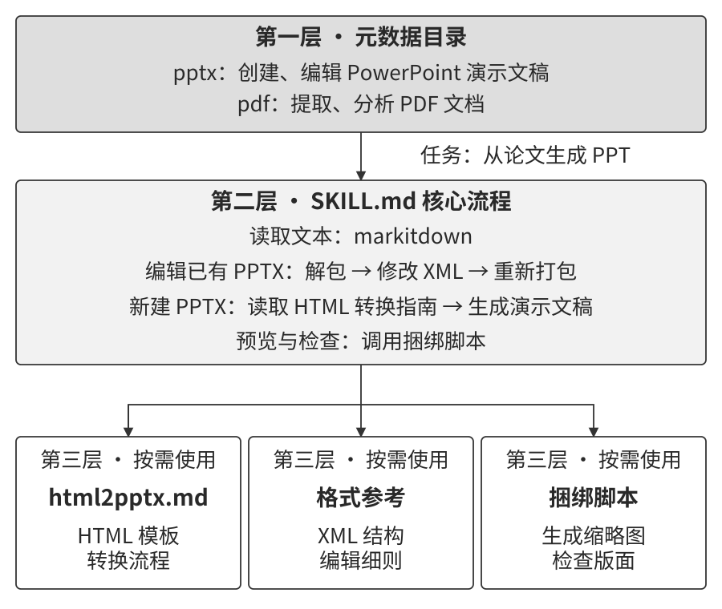

#### Skills：领域能力的可组合单元

**Agent Skills** 把一类任务的处理方法、参考资料、脚本和模板打成可以复用的包。新员工不必在入职那天背完全公司的操作手册，模型也可以到办事时才细读相应章节。这种加载方式称为**渐进式披露（Progressive Disclosure）**[^ch2-3]。

沿用第一章的十件商品来判断哪些信息值得写成 Skill。假设用户想比较含运费的到手价，明细和本次收货地进入当前上下文就够了。若团队反复做跨商家比价，怎样对齐规格、区分单价和套装价、标明运费未知，就可以整理成一份比价 Skill。下次有人只是想看看有什么款式，目录仍可见，整套核价流程可以等到用户需要比较价格时再加载。

**第一层是元数据。** 每个 Skill 用 `SKILL.md` 描述自身，文件开头的 YAML frontmatter 由 `---` 分隔，其中包含 `name` 和 `description`。运行时先将名称与描述组织成目录，让模型判断当前任务需要哪些 Skill。目录的排列与呈现由 Harness 管理，完整流程在选中后加载。

**Skill 描述首先要写成路由条件。** 模型在加载正文之前就要决定是否使用它，因此 `description` 应先说明何时适用、何时应跳过，再概括能做什么。例如，“help with backend”覆盖面过宽，几乎所有后端任务都可能匹配；“为已有 HTTP 接口编写集成测试，覆盖鉴权、参数校验和错误响应”则给出了明确范围。对容易混淆的任务，还可以补充排除条件，例如“仅讨论接口方案时无需使用”。

**第二层是核心流程。** Skill 被选中后，运行时将完整指令送入上下文。用户显式输入 `/pptx` 一类命令时，客户端可以直接查找并加载；模型自主选择时，则通过 Skill 工具或文件读取工具取得内容。前者省去了模型发起激活调用的步骤，后者把选择与加载留在运行轨迹中。

以本书实验采用的 PPTX Skill 为例，核心说明介绍了几条常用路径：通过 Microsoft 的 markitdown 提取演示文稿文本，解压 PPTX 查看底层 XML，以及选择新建或编辑演示文稿的工作流。模型读到这层说明后，便能根据当前任务决定下一步应读取哪份资料、调用哪类脚本[^ch2-4]。

**第三层是详细资料。** 复杂操作分散在专项文档中，主文件提供入口。本书所用版本中的 `html2pptx.md` 讲解如何通过 HTML 生成演示文稿，其他参考文档补充格式与编辑细节。Agent 按任务继续读取这些内容，并使用捆绑的脚本、素材和模板完成操作。

[^ch2-3]: Anthropic，Equipping Agents for the Real World with Agent Skills，2025；Agent Skills，How to add skills support to your agent。
[^ch2-4]: Anthropic，PPTX Skill。本书实验固定使用包含 HTML 转换流程的版本，具体版本与运行方法见配套实验 README。
[^ch2-codex-skills]: OpenAI，Build skills；OpenAI Codex 公开仓库中的 Skills 实现。
[^ch2-cc-skill-inject]: Claude Code，How Claude Code uses prompt caching，Invoking skills and commands；Agent Skills，How to add skills support to your agent，User-explicit activation。

#### 如何编写一份可用的 Skill

一份可用的 Skill 要回答四个问题：什么任务适用，按什么顺序处理，哪些情况需要确认，以及怎样判断工作完成。写作者需要把自己的经验整理成可执行的步骤，并把关键判断配上例子。

以写作 Skill 为例，可以参考宝玉从个人表达习惯出发改进 AI 写作的思路[^ch2-baoyu-remove-ai-writing-flavor]，再将内容组织成四部分：

- **角色与读者**：说明服务对象、任务类型和成稿要求。
- **核心原则**：先写三到五条常用判断，每条配上具体的改写前后例子。
- **常见错误与边界**：记录容易出现的表达问题、越权动作及例外情况。
- **参考资料**：收录术语表、模板、范文与专项说明，供执行时查阅。

规则可以按“作用域、动作、例外、验证方式”来写。例如，一条压缩长句的规则，应当说明适用于什么段落、如何拆分，以及拆分后如何检查条件与结论是否仍然完整。

起步时，选三到五篇自己满意的原创文章，让 Agent 归纳用词、句式、段落安排与语气，生成二十行左右的初版。随后用它处理一个新题目，由作者逐句修改。修改前后的差异会提供更具体的反馈：哪些词多余，哪些句子需要拆分，哪里缺少事实，哪里应补回技术细节。把反复出现的修改归纳为规则，并保留对应例子和适用范围。

Skill 还可以附带执行工具与模板。例如，PPTX Skill 将操作说明、解析脚本、生成脚本和版式资源放在一起，使模型能沿着说明调用相应资源。每个 Skill 可以独立测试、更新和进行版本管理，团队成员也能围绕同一份流程持续补充经验。**Skills 的长期价值在于让领域经验能够分散积累、独立发布和复用。** 团队扩展 Agent 能力时，可以维护各自擅长的 Skill，逐步形成类似 pip、npm 的软件包生态。这些 Skill 可以共用主系统提供的发现、加载与执行机制。

**设计交互方式时，优先沿用模型已经训练和适配过的模式。** 角色划分、工具结果格式和 Skill 加载方式，都影响模型如何接续任务。厂商提供的标准流程适合作为起点，能减少模型从陌生格式中重新推断含义的负担。

[^ch2-baoyu-remove-ai-writing-flavor]: 宝玉，《别再用提示词去 AI 味了，方向就是错的》，2026-02-14。

#### Skills 在上下文中的位置

Skills 的上下文成本分为目录和正文两部分。目录让模型发现可用能力，正文在选中后提供操作流程。规范要求按需加载，具体消息角色、包装和更新方式则由 Harness 实现。

Claude Code 在调用位置将 Skill 指令作为 `user` 消息加入会话[^ch2-cc-skill-inject]。图2-12 展示模型自主触发的一种消息排列：先发出 `Skill(skill: "pptx")` 调用，接收工具响应，再读取追加的 Skill 正文。使用专用激活工具时，工具响应可以承担调用确认，正文由 Harness 单独注入；使用普通文件读取工具时，正文也可以直接包含在工具结果中。用户显式输入 `/pptx` 时，客户端可直接展开指令，省去模型发起激活调用的步骤。

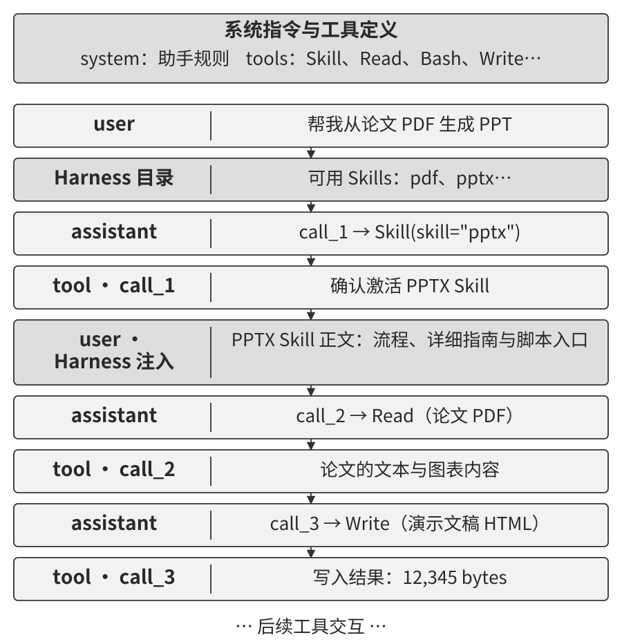

Codex 的 Skills 实现也分别组织能力目录和选中的指令。公开源码中，一部分目录进入 `developer` 上下文，另一些随当前轮次及执行环境提供；显式选中的 Skill 则通过用户上下文片段加入。目录的来源和可用执行环境会影响具体排列[^ch2-codex-skills]。

图2-13 展示按需加载时的缓存增长，以尚未建立可复用缓存的请求作为起点。目录首次进入请求需要处理，正文首次加载也会增加计算；当后续请求保留相同前缀时，这些内容便有机会从缓存读取。将新内容追加在调用位置，可以保持此前的消息稳定。已经加载的说明继续留在历史中，需要更新时再按运行时的上下文策略处理。

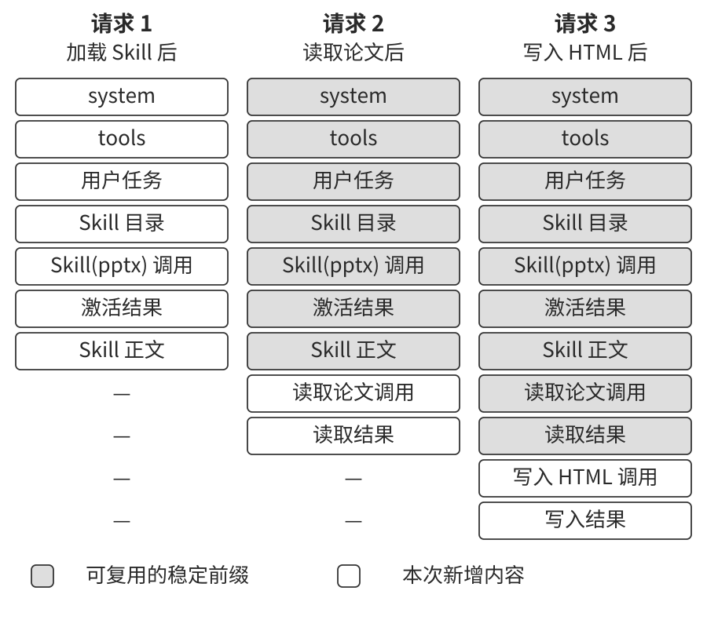

#### Skills 与工具的关系

Skill 提供任务知识与操作流程，工具负责读取、执行和获取结果。第五章介绍的七个核心工具，可以与不同 Skill 组合：同一个文件读取工具既能读取演示文稿指南，也能读取代码规范；通用执行器则可运行相应的脚本。这样，专业能力可以通过流程和资源扩展，基础工具集合保持相对稳定。

专用工具也可以与 Skill 配合使用。前文的工具搜索负责按需提供工具定义，Skill 则说明何时调用、怎样组合以及如何检查结果。两者都需要控制常驻信息量，并为新加载的内容安排合适的位置。第四章将讨论通用执行器与专用工具的取舍，第九章进一步讨论经验适合保存为知识、指令、程序还是模型参数。

> **实验 2-6 ★★：使用 Agent Skills 从论文生成演示文稿**
>
> 本实验以《Attention Is All You Need》为材料，演示 Agent 怎样按需加载制作演示文稿的专业流程。任务是从论文 PDF 生成十到十五页演示文稿，覆盖问题背景、方法、关键结果与结论，并使用论文中的图表帮助讲解。
>
> 本次运行采用 Kimi Code 与 Anthropic 官方 PPTX Skill。Agent 先在目录里找到 PPTX Skill，读它的操作说明，继续读取 HTML 转换指南，调用配套生成工具，最后通过缩略图和逐页渲染检查版面。每一步读取的资料都服务于接下来的操作，完整制作流程随任务逐步展开。
>
> 成稿共十三页，引用了论文中的架构图、注意力机制图、实验结果表和注意力可视化图。
>
> 生成后的检查也属于 Skill 工作流。本次运行曾出现下标缺失、项目符号异常、图表引用路径错误和数值标签精度问题，Agent 根据渲染结果与结构检查逐项修正。最终文件通过结构检查，并使用 LibreOffice 重新打开和渲染。

> **实验 2-7 ★★：从个人范文创建“去 AI 味”写作 Skill**
>
> 这个练习把个人写作经验整理为可复用的指令。准备三到五篇原创文章，让 Agent 归纳表达习惯，生成包含触发条件、三到五条原则和对应例子的初版 Skill。
>
> 选一个新题目试写，再由作者逐句修改。对照两版，找出反复出现的问题，例如用词空泛、句子过长、因果关系省略，或删掉了支撑理解的具体例子。反复出现的改法可以写进 Skill。

### Agent 状态栏：通过元信息增强 Agent 轨迹管理

用户催问：“能不能再打一次？”图2-14 左侧记录了三次拨号。第一次等了 45 分钟也没接通，第三次才谈到每月 59 美元。按本例的规则，每次拨号都占用一次额度；即使只接通两次，三次额度也已用完。Harness 可以把这类计数、办理进度和待确认事项整理成一份随消息更新的摘要，称为 **Agent 状态栏（Agent Status Bar）**。

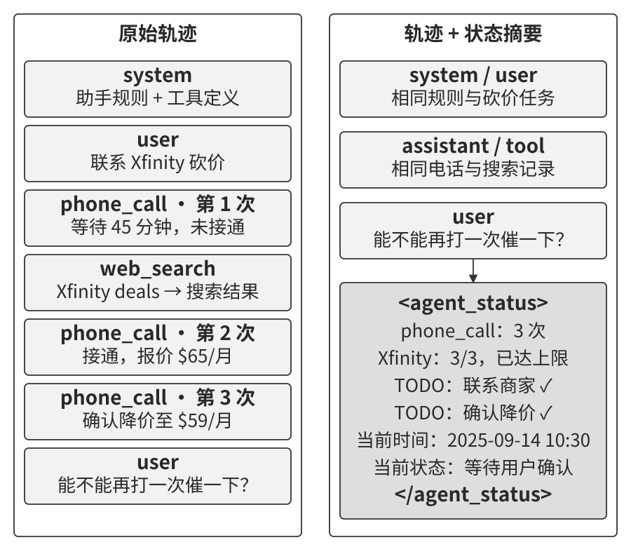

手机把时间、电量和信号放在屏幕顶端，人扫一眼就知道当前状态。图中右侧的摘要也有类似作用：助手读到“已达上限”和“等待用户确认”，就能向用户转述已谈妥的价格，请用户决定是否接受。Harness 可以在返回工具结果时附上摘要，也可以单独追加一条状态消息。

#### 从原始记录到显式状态

考虑一个电话客服任务：系统要求同一任务内拨打每个商家的次数不超过三次。三次通话之间可能穿插搜索、资料读取和用户追问。模型要决定能否继续拨打，就需要从这段历史中找齐相关记录，区分商家，并计算累计次数。

运行时可以在每次调用后更新计数，直接返回“本次是对 Xfinity 的第 3 次呼叫，已达到本任务上限”。下一次决策便能使用这个结果。调用次数由程序维护，模型负责结合任务进度决定接下来是等待、查找其他渠道，还是向用户说明当前情况；执行层同时依据计数检查后续拨号请求。

这里的工程价值是**提前整理后续决策反复需要的状态**。完整通话记录仍负责保存谈话内容和处理经过，状态栏则提供决策常用的统计与进度。**反复使用的统计应优先由代码增量维护。** 在上下文中找到一条记录，与从全部记录中算出总数，是两种工作。把原始轨迹保存下来，并不会自动得到一份准确、随时可取用的统计表。每次让模型重新遍历和计数，既消耗推理 token，也增加漏记与重复计数的机会。

笔者把上下文比作一台需要配套“提炼层”的检索引擎：原始记录便于追溯，提炼后的状态便于直接使用。计数、限额和已核验的任务完成状态适合由代码维护；需要语义判断的信息，可以先逐条抽取，再汇总核验。这样，模型每次决策时都能同时看到当前状态及必要的证据。

长轨迹还会增加寻找关键信息的难度。把最新目标、约束和进度集中放在后部，可以让模型更容易找到当前决策所需的信息。

> **实验 2-8 ★★：通过注意力可视化观察 Agent 状态栏的效果**
>
> 本实验使用 Qwen3-0.6B，构造一段客服退款轨迹：Agent 已经拨打 Xfinity 三次电话，期间穿插网络搜索，随后用户追问“能不能再打电话催促一下？”系统规则限定同一任务内对每个商家最多拨打三次。
>
> 两组输入保留相同的历史与用户追问。A 组直接使用原始轨迹；B 组在末尾增加以下状态：
>
> ```xml
> <agent_status>
> Current State:
> - Tool call summary: 'phone_call' has been invoked 3 times (Xfinity: 3 times)
> - Constraint check: Maximum calls to Xfinity reached (3/3)
> </agent_status>
> ```
>
> 每组运行三次。A 组两次明确拒绝继续拨打，一次归入其他输出；B 组三次均明确拒绝继续拨打。两组都没有出现被判定为违规继续拨号的输出。复现这组对照时，进入 `chapter2/attention_visualization`，运行 `python run_status_bar_experiment.py --output runs/status-bar-reproduction`。这次运行的输入和逐次结果保存在实验目录的 `runs/exp2-7-qwen3-0.6b-20260730-v2/comparison.json` 中。
>
> 注意力图展示生成区域对历史通话、搜索结果、用户追问和状态栏的权重分布。

笔者与 Noah Shi 的 ContextDistill-Bench 研究进一步考察了预先提炼状态的收益[^ch2-8]。在该基准覆盖的状态查询中，较小模型也能通过显式状态获得较高准确率；前沿模型的思考量、延迟与查询成本可降低约一个数量级。例如，Claude 4 Sonnet 的每千次查询成本从约 35.46 美元降至 3.51 美元。**这一设计在事件发生时维护状态，省去了每次查询都要遍历历史的开销。** 摘要字段固定后，即使历史继续增长，查询也只需读取这几个字段。

[^ch2-8]: Li, Bojie and Noah Shi. *Distill, Don't Retrieve: Inference-Time Context Distillation for LLM Agent Reasoning.* 2026.

#### Agent 状态栏的构成

状态栏通常包含三类信息，分别回答“要做什么”“刚才发生了什么”和“现在处于什么状态”。

**任务规划**记录目标、步骤和完成情况。复杂任务可以拆成 TODO 列表，每项保留状态及必要的依赖关系。模型处理当前步骤时，仍能看到原始需求、核心约束和后续工作；完成一步后，再更新列表。

**事件的侧信道信息（Side-channel Information）**补充事件发生时的背景，例如时间、地理位置和距上次回复的间隔。这些元数据随事件保存，帮助模型理解先后关系与情境。同一句“还没有收到回复”，发生在提交申请后的两分钟或两天，所对应的处理方式可能不同。

**环境当前状态的观测摘要**提供当前时间、工作目录、工具调用次数和异常提醒。它与 CLI、GUI 显示当前目录或运行状态的作用相近：让下一步操作有明确的依据。例如，重复调用提醒可以促使模型检查失败原因，剩余预算则帮助它决定是否继续搜索。

事件元数据随事件追加后通常保持稳定，任务进度和环境状态则会持续变化。两类信息应按各自的更新方式写入历史，下面结合消息结构说明。

#### Agent 状态栏在上下文中的具体位置

本节示例由 Harness 在消息末尾追加一条 `user` 消息，用于传递状态摘要。这里的 `user` 是所选 API 的消息角色，状态内容由运行时生成，并通过标签说明用途。使用其他接口时，也可以采用其支持的上下文块，或随对应工具结果提供状态。采用前文按真实用户查询裁剪历史推理的模板时，可把运行状态随工具结果提供，让模板继续按当前任务保留推理信息。

沿图2-15 找到用户最初的委托，再看最新状态写在了哪一轮。保留原请求，才能在电话打完后同时核对两件事：用户要办什么，眼下办到了哪一步。

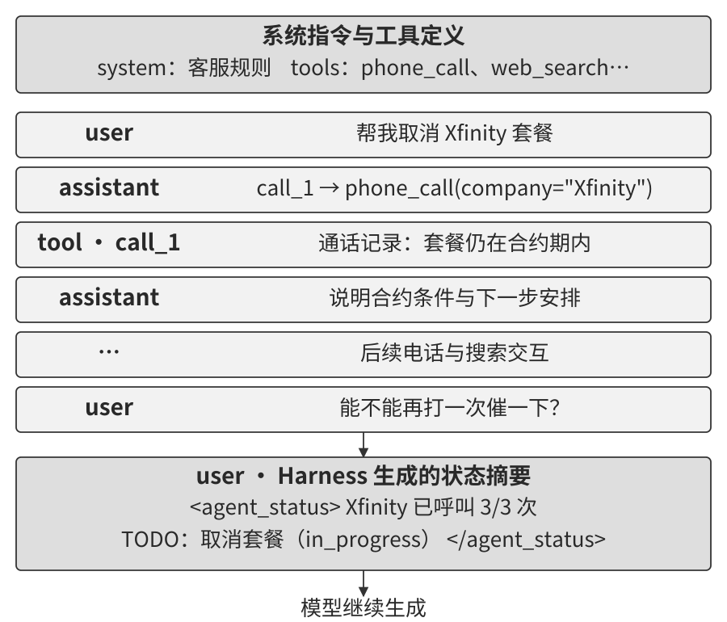

把图中的次序写成消息列表如下。为方便对照，这里略去重复轮次和部分调用字段。

```python
messages: [
  { role: "system", content: "You are a customer service assistant..." }
  { role: "user", content: "Help me cancel my Xfinity plan" }
  { role: "assistant", tool_calls: [{ id: "call_1", ... }] }
  { role: "tool", tool_call_id: "call_1", content: "Call log..." }
  { role: "assistant", tool_calls: [{ id: "call_2", ... }] }
  { role: "tool", tool_call_id: "call_2", content: "Call log..." }
  ...其余轮次...
  { role: "user", content: "Can you call them again to follow up?" }
  { role: "user", content: "<agent_status>
      Current State:
      - phone_call invoked 3 times (Xfinity: 3/3 max)
      - Current time: 2025-09-14 10:30:45
      - TODO: [1] Cancel plan (in_progress)
    </agent_status>" }
]
```

最后一条消息把调用次数、上限、时间和任务进度集中在一起。模型可以直接使用这些字段，同时通过前面的调用 ID 回查具体记录。

追加这条消息后，前面的 token 序列保持不变，仍满足前缀复用的基本条件。至于下一轮如何处理旧状态，需要在上下文占用与缓存成本之间取舍。

#### 状态更新的两种实现与缓存代价

下一轮可能完成一项 TODO，也可能增加一次工具调用。Harness 需要更新状态，常用的做法有两种。

**每轮替换**：构造新请求时移除上一条状态，在末尾加入最新状态。上下文只保留一份当前状态，便于模型使用。例如，上次请求是“任务说明、状态 A”，这次是“任务说明、工具结果、状态 B”。任务说明仍可命中缓存；工具结果首次提交，本来就需要计算。如果上一次请求在状态 A 后面还有其他消息，移除 A 才会使这些消息失去原有的前缀匹配。模型在这次请求中只能看到 B。需要回看 A 时，可以从运行日志调出当时的快照。

**持久追加**：保留已有状态记录，每次在末尾追加新状态。历史前缀保持稳定，也便于追溯状态变化。旧状态会逐渐占用上下文，因此需要明确时间或版本，让模型依据最新记录判断当前情况。Claude Code 将文件变化提醒追加到会话中的方式，也体现了这种设计思路。

状态很短、它后面已经缓存了大量工具结果时，保留旧状态可能比重算长后缀更省；状态较长且更新频繁时，替换能控制历史状态的累积。

可以用一个粗略模型估算分界点：设每条状态为 $S$ token，每次替换时旧状态之后需要重新计算的已缓存后缀平均为 $R$ token（本轮首次提交的内容不计入），共注入 $N$ 次状态，缓存输入单价为普通输入的 $\alpha$ 倍。忽略两种方案共有的成本， $C_{\text{替换}} \approx (N-1)(1-\alpha)R$， $C_{\text{追加}} \approx \alpha S N(N-1)/2$。对 $N>1$，当 $\alpha SN/2 < (1-\alpha)R$ 时，持久追加的估算成本更低；反之，每轮替换更省。这里把普通输入单价作为成本单位：替换方案多付的是后缀从缓存读取变为重新处理的差价，追加方案多付的是历史状态的重复读取费用。

举个例子，每次注入 100 token 的状态，一共注入 10 次，缓存读取按普通输入价的十分之一计。追加方案在后续请求中分别多读 1、2、……、9 条旧状态，额外费用折合 450 个普通输入 token。若替换状态会使后面平均 1000 个已缓存 token 重新处理，九次替换多花的费用折合 8100 个普通输入 token，追加较省。若旧状态原本就是缓存末尾，后面没有任何已缓存内容，公式中的 $R=0$，直接替换反而省下了这 450 个 token 的等价费用。

> **实验 2-9 ★★：几种好用的 Agent 状态栏技术**
>
> 本实验实现五种状态栏技术，可分别开启，也可组合使用。每项技术提供一类具体信息，帮助模型决定下一步行动。
>
> **时间戳跟踪**在用户消息和工具响应中记录事件时间，例如 `[2025-09-14 10:30:45]`。时间随事件写入历史，后续轮次保持原值；当前时间则随新的状态消息更新。实验还提供时间模拟，用来检查模型能否区分“昨天的文件”与“今天的修改”，以及是否正确理解等待时长。
>
> **工具调用计数器**用字典维护每个工具的累计调用次数，并在响应中标注 `Tool call #3 for 'read_file'`。结合错误内容，模型可以判断是否继续尝试。例如，首次读取失败后检查路径，再列出目录；多次失败后，查找替代文件或向用户说明缺失情况。需要限制重试次数时，运行时还应按计数执行上限。
>
> **TODO 列表管理**提供 `rewrite_todo_list` 和 `update_todo_status` 两个工具。每项包含唯一标识符、内容、时间戳，以及 `pending`、`in_progress`、`completed`、`cancelled` 四种状态。列表集中保存“做了什么、还差什么”，与 Manus 通过重复呈现任务计划保持目标可见的思路相近。
>
> **详细错误信息**提供错误类型与描述、调用参数的 JSON、调用栈和修复建议。例如，遇到 `FileNotFoundError`，可以提示模型核对文件名、当前目录与绝对路径。参数帮助定位错误输入，调用栈帮助查找失败位置，修复建议则给出下一步检查方向。向模型返回这些内容前，应清理凭证等敏感字段，并控制冗长堆栈的长度。
>
> **系统状态感知**提供当前时间、工作目录、操作系统、Shell 和 Python 版本。实验中的命令工具会识别单独的目录切换操作，更新运行时维护的工作目录，再用于后续调用；复合命令中子进程的目录变化遵循对应进程的执行范围。环境字段也帮助模型选择可用工具，例如根据实际系统和已安装的软件选择 `apt` 或 `brew`。
>
> 本次 Kimi K3 对照中，各类任务各有五个案例。时间戳和组合配置均通过五项，对照组各通过三项；工具计数器与系统状态的开启、关闭两组均通过五项。TODO 配置通过零项，对照组通过一项；详细错误配置通过四项，对照组通过五项。

**状态栏应尽量由代码维护。** 模型会直接使用其中的统计和限制，一条错误的“已拨打三次”就可能改变后续行动。计数、时间和状态迁移交给程序；需要语义理解时，先让模型逐条抽取，再由代码汇总、核验，避免一次性让模型统计整段长历史。原始事件、抽取结果与最终状态之间保留对应关系，便于发现重复计数、漏记和来源混淆。

状态栏汇总哪些信息，需要预先选择。例如，“已拨打三次”足以判断还能不能再打，却无法回答“第二次通话中客服承诺了什么”。对于只需统计值的后续任务，可以用状态摘要替换历史，并将原始记录归档；需要核对谈话内容时，再按索引读取原文。摘要的字段设计决定了哪些问题可以直接回答，也决定了何时需要回查。

### 上下文压缩策略

一个调查任务读过十份长网页以后，假设窗口只够再放两份资料。先问模型下一轮还要做什么：要比较两个报价，就留下报价、有效条件和出处；要复核引文，就保留能取回原文的位置。已查过但无关的网页正文可以归档，为新输入和输出腾出空间。这里既要算腾出了多少空间，也要算另一笔账：删去的材料若在后面用到了，要花多大代价才能找回来？

#### 压缩的三个目的

**控制长度与成本。** 以 128K token 的窗口为例，长网页和大文件可能占据其中相当一部分空间。Harness 需要为后续输入、模型输出和工具交互保留预算。

**整理后续决策所需的知识。** 十几轮搜索可能反复提到同一事件，也可能留下互相矛盾的说法。将其整理为“已确认 A、B，C 仍缺少证据”，能让模型接着未完成的问题工作。摘要应保留事实之间的关系、来源和未解决的问题，使后续决策有明确依据。

**支持长任务持续推进。** 一些模型在认为窗口即将耗尽时，会提前收尾，这种现象被称为**上下文焦虑（Context Anxiety）**。Anthropic 在 Sonnet 4.5 的长任务测试中发现，压缩后仍可能出现这种行为，因此采用结构化交接记录，重置上下文后继续执行[^ch2-7]。

[^ch2-7]: Prithvi Rajasekaran，Harness design for long-running application development，Anthropic Engineering，2026。

#### 把重复计算的结果整理为可用知识

状态栏提前维护计数和进度，摘要则进一步整理长文本中的事实与关系。两者都在提前整理散落的信息，让后续决策可以直接使用。

看一个宠物店巡查的例子：

> 笼子 1：黑猫。笼子 2：白猫。笼子 3：黑猫。笼子 4：黑猫。笼子 5：白猫。
> ……（共 100 个笼子，其中 90 只黑猫、10 只白猫）

回答“笼子 37 里是什么猫”，需要定位对应记录；回答“黑猫和白猫各有多少只”，需要汇总全部记录。若后续多次使用总数，就可以先计算并保存“黑猫 90 只，白猫 10 只”，避免每次从头统计。程序适合完成这种确定性的汇总，模型则可以继续根据统计结果回答业务问题。

摘要的内容应随任务选择。只保留两类猫的总数，足以回答数量问题；要回答笼子 37 的情况，还需要逐笼记录或相应索引。

即使窗口尚有空间，过长或混杂的上下文也可能影响信息使用：模型遗漏关键事实，重复处理已解决的问题，或把过时状态用于当前决策。这类随上下文增长出现的表现退化通常称为**上下文腐化（Context Rot）**。它体现为任务表现变差；请求超过容量限制时，则会触发窗口溢出。

**窗口还有空间时，也应主动整理已经反复使用的知识。** 关键判断已经可以汇总，却仍让模型在长历史中一遍遍寻找，会持续消耗计算并增加遗漏。搜索任务可以保存已确认事实、来源与待查问题；编程任务可以保存架构决定、修改范围、测试结果与失败原因。

上下文中的示例还会影响模型处理新问题的方式。Dherin 等人的研究从 Transformer 中注意力层与 MLP 的组合出发，将特定前向计算表示为与上下文相关的低秩权重更新，为上下文学习提供了一种理论解释[^ch2-6]。实际推理时，模型权重保持不变，示例通过当前输入影响输出。希望在后续会话复用这类经验，可以把它整理成记忆、示例或 Skill，再按任务加载；第九章将进一步讨论经验的积累方式。

[^ch2-6]: Benoit Dherin et al.，Learning without training: The implicit dynamics of in-context learning，2025。

#### 压缩与 KV Cache 的取舍

压缩通常发生在两次模型调用之间。Harness 根据剩余预算和任务进度，整理下一次请求所需的消息，再将它们发送给模型。替换历史会改变前缀，因此需要同时考虑压缩收益与缓存重建成本。

首先，保持仍然适用的系统指令与工具定义稳定。它们位于前部，后续历史的压缩可以继续复用这部分前缀。其次，选择具体的压缩对象：长工具结果可以替换为摘要，已经完成的多轮交互可以合并为阶段记录。替换位置之前的缓存还能复用，替换位置及其后的内容需要按新的前缀处理。

**历史压缩优先成批进行，避免每轮都改写同一段前缀。** 压缩之后，每轮输入会缩短，但压缩调用与后缀重算也要消耗资源。触发时机可以结合窗口占用、预期后续轮数和任务阶段来确定：长工具结果集中出现后批量整理，完成一个阶段后保存交接摘要，都能减少频繁修改历史的开销。保留最近几轮时，应检查工具调用与返回值是否成对，并把未完成操作的状态写入摘要。

压缩时还要检查推理信息的回传协议。部分模型的历史 thinking 与生成它时的前缀绑定。若在这些块之前替换历史，保留下来的 thinking 就可能与新前缀不匹配。采用这种协议时，可以将会话整理成摘要，清除受影响的旧 thinking，让模型从摘要继续推理；也可以使用服务端支持的压缩或上下文编辑机制。

先看图2-16 中的个体摘要：处理后的字符数只有原来的 10.9%，主 Agent 累计用掉的 token 却是六组里最多的。要解释这两个数字为什么能同时成立，得追踪压缩了哪些材料，以及这些材料又随多少轮请求送进模型。

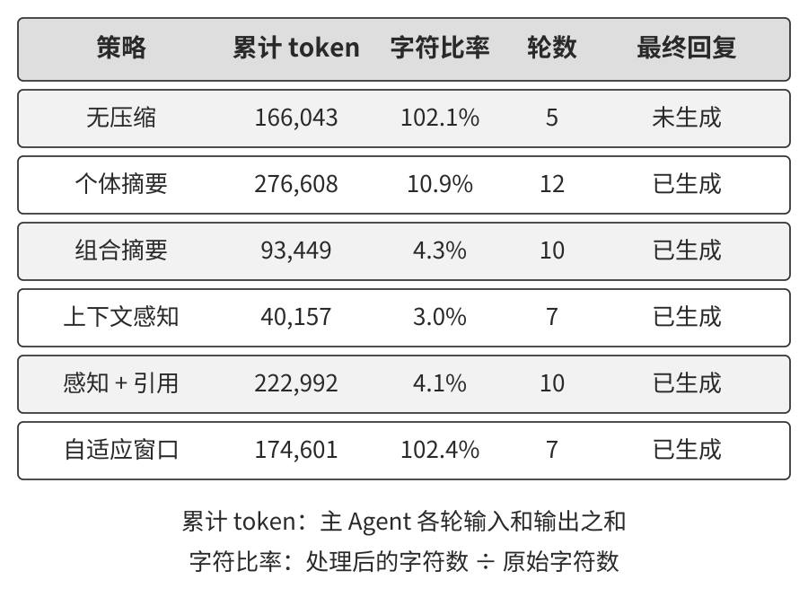

> **实验 2-10 ★★★：上下文压缩策略对比**
>
> 本实验用 Kimi K3 研究 OpenAI 联合创始人的职业状态。任务需要逐步建立人员名单、查找经历和职位变化，再把相关事实与来源对应起来。为观察压缩与溢出处理，实验将应用侧上下文预算设为 128,000 token，保留无压缩基线，再比较五种处理办法，每种最多运行 15 轮[^ch2-compression-results]。
>
> **策略一：无压缩。** 搜索与页面读取的结果完整进入历史。七次工具调用计入了 367,246 个原始字符。程序在第五轮触发保护并停止，主 Agent 的累计用量是 166,043 token。旧版用历次请求的输入 token 之和触发保护，错误信息中的 165,227 因此是累计输入。举例说，同一段历史在三轮请求中各发送一次，就会被累计三次。
>
> **策略二：个体摘要。** 每个搜索结果单独生成两到三段摘要，保留各页面的主要内容。这种方式容易并行处理，也便于保留页面边界；多个页面讲述同一事件时，重复信息仍会进入历史。这一配置用十二轮生成最终回复，主 Agent 累计使用 276,608 token，字符压缩率为 10.9%。
>
> **策略三：组合摘要。** 将一批搜索结果合并，再生成综合摘要，便于整理重复事实和不同来源的关系。该配置用十轮生成最终回复，主 Agent 累计使用 93,449 token，字符压缩率为 4.3%。
>
> **策略四：上下文感知摘要。** 压缩时同时提供当前查询和已经掌握的信息，例如在提示中加入 `Given the search query: {query}` 与 `Current context: {context}`。模型据此保留与当前问题相关的事实，并优先补充已有摘要中的缺口。该配置用七轮生成最终回复，主 Agent 累计使用 40,157 token，字符压缩率为 3.0%。其中一次压缩把约十五万字符整理成约两千字符，保留了人员姓名与职位变化。
>
> **策略五：带引用的上下文感知摘要。** 在任务相关摘要中保留事实对应的来源链接。该配置用十轮生成最终回复，主 Agent 累计使用 222,992 token。按工具记录汇总，处理后的材料有 52,891 个字符，原文有 1,295,044 个字符，两者相除约为 4.1%。
>
> **策略六：自适应窗口化。** 前期保留原始材料，输入达到阈值后再批量整理。实验采用三个机制：超过预算的 80% 时触发压缩；汇总处理尚未压缩的工具结果；为处理过的结果添加 `[COMPRESSED]` 标记，避免重复摘要。按本实验的 128,000 token 预算，触发阈值为 102,400 token。该配置用七轮生成最终回复，主 Agent 累计使用 174,601 token。历史记录按累计输入触发阈值，后来程序改为检查最近一次请求的输入大小。
>
> 图2-17 对照六种策略的输入与输出。
>
> 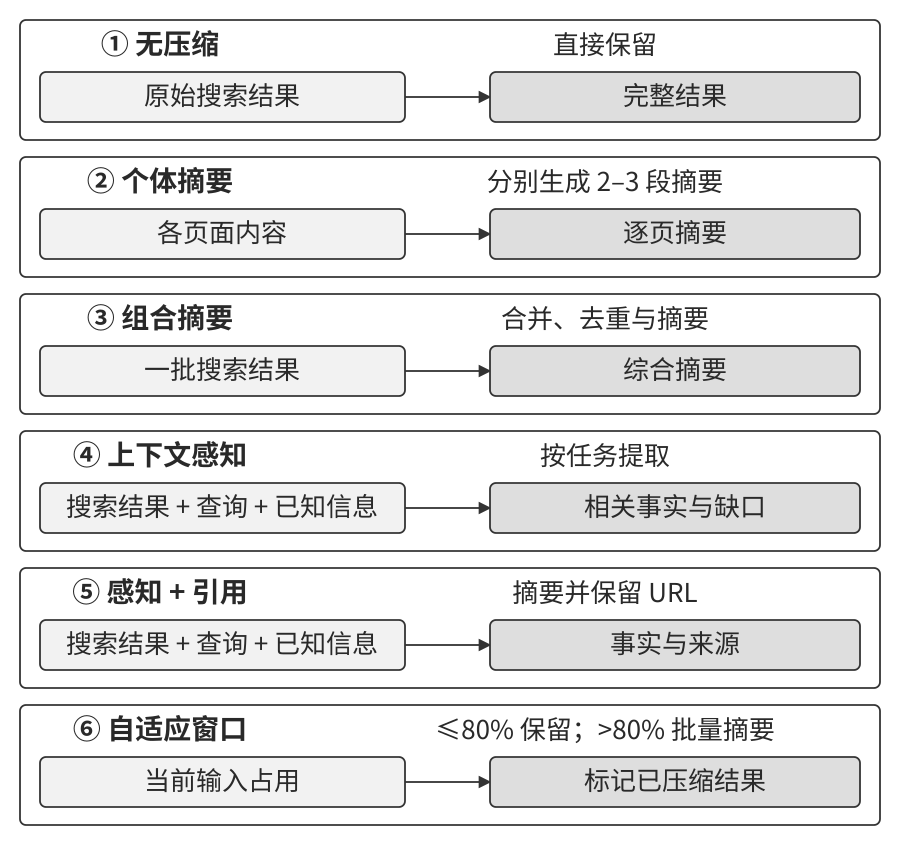
>
> 比较图2-16 的数字时，需要区分三个量：单次请求输入决定是否达到窗口预算，累计 token 反映多轮调用用量，字符压缩率描述被统计材料的处理后长度与原始长度之比。这里的累计用量来自主 Agent 各轮请求的输入和输出，生成摘要的独立模型请求未并入这个字段。
>
> 复现实验时，按配套说明配置模型与真实搜索服务，在实验目录执行 `python experiment.py -m kimi-k3 -n 15 -o results/reproduction.json`。读取各策略的 `metrics`：用 `total_compressed_size / total_original_size` 复算字符比率，再比较 `total_tokens` 与 `iterations`。无压缩基线也会为搜索正文补上标题、URL 等格式，因此处理后字符数可以略高于原文。实验程序只要收到最终回复，就把该组记为完成。试着在两份成品里查同一个人：带引用组把 Pamela Vagata 的任职机构写成 Pebblebed，窗口化组的汇总表却写成 Stripe。前一份回答提到了机构网站，但没有给出可打开的网页链接。两组都交付了汇总表，给出的人物资料却相互矛盾。

[^ch2-compression-results]: 实验 2-10 的结果文件 `kimi_k3_real_20260718.json` 保存了每种策略的统计字段、最终回答与时间戳，可直接复算字符比率。2026 年 7 月 18 日运行使用旧版保护条件；7 月 22 日的代码修订（提交 `aea4d72`）将累计输入改为最近一轮请求的输入。

#### 生产级的分层压缩机制

工具输出可能要暂存全文，已完成的步骤可以归档，当前约束应保持可见；下面五类机制分别适合不同的使用频率和保留期限。

1. **工具结果预算控制**。大体积输出保存到外部存储，上下文中保留摘要预览与读取入口。预览一旦进入历史，就保持内容稳定；需要更多细节时，再读取相关片段并追加结果。
2. **清理无关内容**。网页导航栏、重复页脚等可以在结果进入上下文前过滤。已经进入历史的内容需要删除时，先确认后续任务和引用是否仍依赖它，再计算修改历史带来的缓存成本。
3. **API 层上下文编辑**。支持这类能力的服务可以按规则清理旧工具结果。客户端需要配置触发条件，并处理服务返回的编辑信息。清理范围和缓存行为由接口约定决定，适合与输入预算监控一起接入。
4. **归档式摘要**。按轮次或任务阶段记录目标、操作、结果和未完成事项，保留执行顺序。可以把它理解为任务的变更记录：后续能够查到某个决定在哪一步作出，以及依据是什么。
5. **会话整体压缩**。当局部清理仍无法满足预算时，将当前目标、约束、已确认事实、关键决定和下一步工作整理为交接摘要。可以先整理已有会话笔记，再汇总整段历史。压缩连续失败时，由重试上限或熔断机制停止重复调用，保存可恢复的状态，再选择缩小输入或人工处理。

这几类机制可以分层配合：入口控制减少一次性的大输出，局部整理控制日常增长，阶段摘要和整体压缩为长任务保存交接信息。

笔者读 dsh-superagent 时注意到一个细节：事件和工具结果可以先送来摘要和对象 ID，需要细节时再凭 ID 读取。假设后台跑完一组测试，只告诉前台“有两项失败”，前台能报告进度，却答不了用户接着问的“是不是昨天那两项？”如果摘要附有本次测试记录的标识，前台就可以取回失败用例的名字，与昨天的记录对照。

#### 压缩策略的设计原则

决定压缩后保留什么时，可以从以下四个方面检查。跨任务积累经验的过程将在第九章展开。

- **按任务价值分配篇幅**。人员名单、身份关系和当前待查问题通常应直接保留；支撑结论的关键证据保留来源与必要细节；导航栏、广告和重复内容可以清理。事实存在争议时，证据之间的差异也属于重要信息。
- **保持语义完整**。例如，“Sutskever 于 2024 年 5 月离开 OpenAI”中的人物、时间、动作和机构共同构成一条事实。压缩时应保留这些要素，避免只剩下“Sutskever 离开”这样难以解释的片段。
- **围绕后续问题组织内容**。“查找创始人名单”需要完整覆盖人员，“了解个人背景”则需要经历、时间线和来源。同一份材料可按不同任务生成不同摘要：检索重在覆盖，分析重在关系与依据，创作还需要保留有用的细节和例子。
- **验证摘要能否支持执行**。语义摘要需要理解任务、消除重复，并保存条件和例外。**复杂材料的语义压缩，应优先使用理解能力接近主模型的模型。** 压缩者需要判断哪些条件、例外和证据会影响后续工作；如果这些内容被丢掉，主模型再强也很难补回。

早期架构决定、约束背后的原因和失败路径容易在长历史中被遗漏。**长任务应定期更新进展文档**，保存“决定了什么、为什么这样决定、验证了什么、下一步做什么”。Prompt 或 Skill 可以规定更新时机，Harness 则在任务交接时加载相应记录。这样的文档也方便执行者、审核者和后续 Agent 理解已有工作。

#### 子 Agent 上下文隔离

**对于交付边界清楚、会产生大量中间材料的任务，笔者优先采用子 Agent 隔离。** 大范围搜索会读入许多只在探索阶段有用的材料，先隔离能减少这些内容对主任务的持续干扰。主 Agent 将任务交给拥有独立上下文的子 Agent，由子 Agent 阅读中间结果，再返回结论、证据位置和未解决问题。主 Agent 的上下文中因此只需保留后续决策所需的信息。

例如，要“找到处理支付回调的函数”，主 Agent 直接搜索时，可能需要读取十几个文件。交给搜索子 Agent 后，可以要求它返回函数名称、所在模块、调用点和判断依据。它的回复可以是“支付模块中的 `handle_callback` 负责处理回调，另有两处调用点”，并附上可定位的引用。主 Agent 根据这些结果决定是否继续读取相关代码。

任务描述应当足够完整：目标是什么、搜索范围多大、需要遵守哪些约束、返回什么格式，以及遇到歧义时如何处理。若委派请求和返回结果都追加到历史，主 Agent 原有前缀仍可复用。

第四章将讨论子 Agent 作为工具的接口设计，第十章进一步讨论多 Agent 系统中的上下文分工。

### 本章小结

客服助手第三次拨完电话，怎样接着办下去？下一轮请求带上这通电话的工具回执，用调用 ID 对应到拨号操作。状态栏把已用次数更新为三次，并列出还没谈妥的条件。系统规则和工具定义保持在稳定前缀里，需要办理某项业务时再加载相应的 Skill。这样每个字段都有来处，也能看出哪些内容会随下一轮调用而变化。

通话拖长，工具返回越来越多，可以给结果限定长度，把已经结束的部分整理成带来源的摘要，或者把可独立办理的工作交给子 Agent，只取回结论和凭据。

这个任务结束后，已拨三次的计数可以随任务归档。可要是用户特意交代“以后工作日下午再联系我”，只把这句话留在通话摘要里，下次接受委托的助手可能根本看不到。怎样保存有长期用处的信息，又怎样在恰当的任务里把它找回来？第三章讨论跨任务的用户记忆和共享知识库。

### 思考题

1. ★★★ 阅读实验 2-3 的滑动窗口运行记录：五次工具调用分别做了什么？要判断重复调用是否由历史裁剪造成，还需要记录什么、做什么对照？设计一种保留关键状态的裁剪方案，并说明它对前缀缓存的影响。 记录见 `chapter2/kv-cache/result_sliding_window_20260718_kimi_k2_6.json`。
2. ★★ Qwen3 的 Chat Template 按最后一个真实用户查询的位置处理历史思考。若一次 ReAct 循环持续上百轮，你会如何管理逐渐增长的推理内容？请比较历史思考的裁剪、回传与前缀绑定协议，并说明 Harness 应如何适配。
3. ★★ 假设要把约十五万字符的搜索材料压缩到两千字符，你会保留哪些事实、关系与来源？怎样检查摘要是否足以支持后续问题，又怎样恢复被省略的细节？
4. ★★ 工具计数器漏记了一次调用，状态栏因此给出错误的剩余次数。请设计事件记录、汇总校验和执行层检查，说明如何发现并修复这种不一致。
5. ★★ 实验 2-4 比较了语气、信息组织与工具描述。若系统提示词由多人长期维护，你会如何管理版本、检查规则冲突，并用回归任务评估每次修改？
6. ★★★ 宠物店案例同时包含单条检索与总体统计。请设计原始记录、统计摘要和查询路由，使系统能高效回答这两类问题，并说明摘要需要在什么时候更新。
7. ★★★ 一个 Skill 已在目录中，但模型没有发现它适用于当前任务。你会如何从描述、目录组织、显式触发和评估样例四个方面排查问题？
8. ★★ Skill 已经成功加载，模型却漏掉了其中的验证步骤。请设计一个对照实验，区分触发、理解、工具使用和完成判断中的问题，并比较不同模型的表现。
9. ★★★ 系统包含大量工具，工具集合又经常变化。你会如何安排固定定义、工具目录、按需加载结果与运行时状态的位置？请同时考虑发现准确率、上下文预算和缓存命中。

## 第 3 章 用户记忆和知识库

如果用户上周告诉助手自己偏爱靠窗座位，今天只说“再订一张去东京的票”，这次请求要从哪里找回上次的偏好？如果航空公司昨天改了行李规定，又该去哪里查新条款？上一章讨论了怎样组织一次任务的上下文，本章讨论从哪里找回用户说过的话、从哪里查到航空公司的新规，以及这两类资料分别该在什么时候更新。

**用户记忆**围绕特定用户组织信息，记录其偏好、习惯、需求和经历，让 Agent 在后续会话中继续按用户的情况提供服务。**知识库**则在一定权限范围内供多个用户共享，例如行业法规、企业操作流程和技术文档。前者帮助 Agent 了解服务对象，后者提供完成任务所需的领域知识。

两者都要解决怎样保存信息、需要时怎样找到信息的问题，也会遇到事实冲突、内容过期和检索遗漏。向量检索、结构化索引和知识压缩等技术可以同时用于这两类系统。图3-1 展示了本章的安排：先讨论用户记忆的表示与管理，再介绍检索增强生成（RAG），最后把检索方法用于跨会话记忆和更复杂的知识组织。

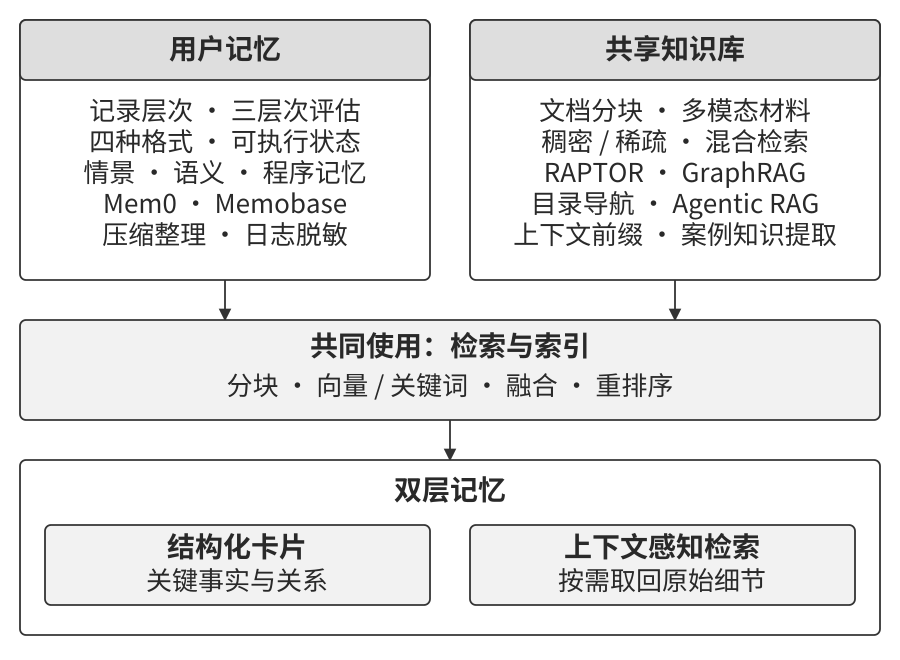

### 用户记忆系统

把“下周我在国外，银行文件请发邮件”拆开读。用户说出了一个有期限的行程，又在这个行程内指定了收件方式。助手在银行提出邮寄文件时，可以据此争取电子送达；行程结束后，再遇到寄信问题，就要重新看当前条件。若只存“用户不喜欢纸信”，日后虽然检索到了这条记忆，却会用错范围。

再看机票。用户若说“上次那张 1250 的票比我预想的贵”，系统至少能保存那次报价、当时的预算、出行场景和这次反馈。下次遇到相似情形，模型据此更谨慎地处理超预算报价。如果用户另行说明“以后家庭出行都先问我”，这就给今后的家庭出行定下了明确的询问条件。由此可以区分三类信息：用户实际说过什么，当时处在什么条件下，模型从这次经历推断出了什么。

可以在会话结束时请 LLM 整理这些记录，把有后续价值的事实写入持久存储。新任务开始时，只把相关且仍然适用的记录带入上下文。

例如，用户在预订机票时提供了以下信息：

```text
User: Help me book a flight to Tokyo next Friday. I prefer window seats
      and I'm vegetarian, so I'll need a special meal.
Agent: I'll search for flights to Tokyo for next Friday...
       [calls flight_search tool, returns 3 options]
Agent: Here are your options. Based on your preference, I've filtered for
       window seat availability. Shall I book the ANA direct flight?
User: Yes, and use my United MileagePlus number 12345678.
```

会话结束后，记忆提取器可以整理出四条记录：

```text
Extracted memories:
- User prefers window seats (preference)
- User is vegetarian, needs special meals on flights (dietary restriction)
- User's United MileagePlus number: 12345678 (loyalty program)
- User has travel plans to Tokyo (recent activity)
```

这个例子包含三项处理。**选择性提取**保留座位偏好、饮食要求和会员号，过滤“搜索返回三个选项”这类临时细节。**抽象化**把用户明确表达的靠窗偏好整理为以后订票可用的规则。**结构化**为事实标注类别，便于检索与更新。东京之行还应记录出发日期和当前状态；“下周五”需要结合会话日期转换，行程结束或取消后再更新状态。这样，长期偏好与近期活动就能按各自的有效期维护。

个人助手 Today 的产品说明举过一个例子。用户说自己每周二、周四训练，准备跑半程马拉松。六周后，经用户授权接入的睡眠记录显示，他昨晚睡得很少。助手把这两条信息放在一起，建议挪一挪当天的高强度间歇训练。这里该记多久？训练计划在备赛期间都用得上，昨晚的睡眠记录要带上日期。即使用户接受了这次改期，下周四的训练仍按原计划安排，除非用户说以后都要改。Today 也把提出建议与更改日历分成两步，后一步需要用户确认。[^ch3-today]

[^ch3-today]: Today 团队在《What Is Today》中以半马训练说明记忆与当天信息怎样配合。创始人在《Meet Today》中解释了更改日历前的确认机制。

#### 记忆能力的评估：三层次框架

公开基准 **LoCoMo**（Long-term Conversational Memory，长期对话记忆）包含平均约 300 轮、最多 35 个会话的长对话，通过问答、事件摘要和多模态对话生成考察记忆能力。问答分为五类。单跳题可以从一次会话中找到答案，多跳题需要把几次会话中的线索拼起来，时间推理题还要弄清事件发生的先后。开放域知识题要求把用户说过的话与外部知识结合起来。沿用订票的例子，用户只说过“下周去东京”，要回答“目的地使用哪种货币”，既要记得东京这条线索，也要知道当地使用日元。如果问的是用户从没说过的航班号，助手应该指出信息不足。能否识别这种无从作答的问题，正是对抗性题目所考查的能力。[^ch3-locomo]

[^ch3-locomo]: Maharana 等人的 LoCoMo 论文（arXiv:2402.17753）第 4.1 节给出五类问答的定义。作者项目页提供数据与对话样例。

结合这类基准和记忆产品的实践，笔者将需要关注的能力归纳为八项：

- **个人信息保留**：准确保存并取回用户身份等长期信息。
- **偏好追踪**：记录用户偏好，并随新的明确表达更新。
- **上下文切换**：切换话题后仍能接续相关背景。
- **记忆更新**：处理用户对既有事实的补充和更正。
- **多会话连续性**：在新会话中使用先前保存的信息。
- **复杂思考**：关联多个记忆片段。例如，用户曾提到花生过敏，讨论泰国菜时就应结合这一信息提醒核对食材。
- **时间感知**：保存日期、解析相对时间，并计算事件间隔。
- **冲突解决**：发现不一致的信息，结合来源、时间和适用对象作出判断。

围绕 Agent 的实际任务，本书进一步采用三层次评估框架。实验 3-1、3-2 先用它比较记忆表示；实验 3-9 和 3-11 再用同一框架评估检索方法。

**第一层：基础回忆。** 准确保存并取回用户直接提供、含义明确的信息。例如，用户说“我的会员号是 12345”，后续订票时应能返回完整号码。这一层主要检查事实是否丢失、混淆或被改写。

**第二层：多会话检索。** 从不同时期、涉及不同对象的会话中找齐相关信息，再判断当前请求涉及谁、需要哪些记录。用户有两辆车，却只说“为我的车预约保养”，系统应先取回两辆车的信息并澄清对象。查询贷款状态时，需要区分已生效合同与过去咨询的报价。取消“洛杉矶之旅”时，则要把机票、酒店等预订关联到同一次旅行。

**第三层：主动服务。** 根据当前任务，发现用户没有逐项点明的相关事项。例如，预订国际航班时关联数月前保存的护照信息，检查有效期是否满足行程要求；手机损坏时汇总设备保修、信用卡附加保修和运营商保险，列出可用的处理方案；准备报税材料时，从全年记录中找齐股票交易、自由职业收入和房产税文件。

> **实验 3-1 ★：用三层次框架评估记忆系统**
>
> 评估集每层包含 20 个用例，共 60 个。第一层以单会话为主；第二、三层包含跨时间、跨对象的多段会话，用于检查实体关联、信息更新和主动提醒。
>
> 每个用例分两步执行。先逐段输入会话：模型根据第一段生成记忆，后续每次只收到已有记忆和新会话，并生成更新后的记忆。此后模型就读不到之前的会话原文了，要回答当时谈过的问题，只能靠写进记忆的那些信息。所有会话处理完后，再输入一个新问题，要求 Agent 根据记忆作答。
>
> 评估采用 LLM-as-a-judge：由独立的评审模型对照参考答案和评分要求，检查回答覆盖的事实及错误。本次运行使用 Doubao Seed 1.6 生成记忆和回答，使用 Moonshot 模型评分。评审能看到原始对话，答题的模型只能看到最后保留下来的记忆。
>
> 怎样读成绩单？例如，用户只想找回宽带服务的账号。在增强笔记组，助手答出了正确号码。评审给准确性、召回和推理各打 4 分，主动性只打了 1 分，这道题依然通过。程序的通过条件是前三项各得至少 3 分（满分 4 分），且评审没有发现缺乏依据或与原话矛盾的重要事实。主动性参与综合得分，单看通过数无法知道助手在多大程度上主动提供了帮助。

#### 记忆的层次结构

要回答“上次订了哪趟航班”，需要找到一次事件；要回答“订票时优先选什么座位”，需要取回从多次交互中保留的偏好。两个问题都涉及同一个人，却要求不同的记录粒度和检索方式。

**轨迹（trajectory）**按时间记录一次 Agent 运行中的事件，包括用户消息、模型响应、工具调用与执行结果。采用只增不改（append-only）的事件日志时，新事件追加到末尾，原记录保留供追溯。Harness 可以从轨迹中选取历史、提取状态或生成摘要，构造每轮实际发送给模型的上下文。

**用户长期记忆**保存跨会话有用的信息，如偏好、人物关系、历史活动摘要和已确认的事实，并通过用户 ID 等标识划定归属。新的表达可能补充、更正或替代旧记录，因此长期记忆需要合并与更新。读取和维护既可以由 Agent 显式调用工具完成，也可以由 Harness 在会话加载、结束或后台整理时触发。

**业务状态**描述任务所处的逻辑阶段，如“需要澄清”“处理中”“等待付款”“已完成”。程序可以检查这些状态，决定接下来等待什么事件、执行什么操作。第六章将进一步讨论事件驱动架构中的状态管理。

这三类记录可以协同工作：轨迹提供执行依据，长期记忆提供跨会话背景，业务状态说明当前任务推进到了哪里。下面重点讨论长期记忆的表示、管理和检索。

#### 用户记忆的四种存储格式

如果只要改一个邮箱地址，最好能直接找到那一项；如果要弄清当初为什么改地址，还得读到事情的经过。图3-2 左上把邮箱、公司和职位分条保存，右上则把职位、团队和项目写在一起。再看下面两张卡片：今后要更新职位，或者要分清是谁去看的心脏科，各该查哪个字段？

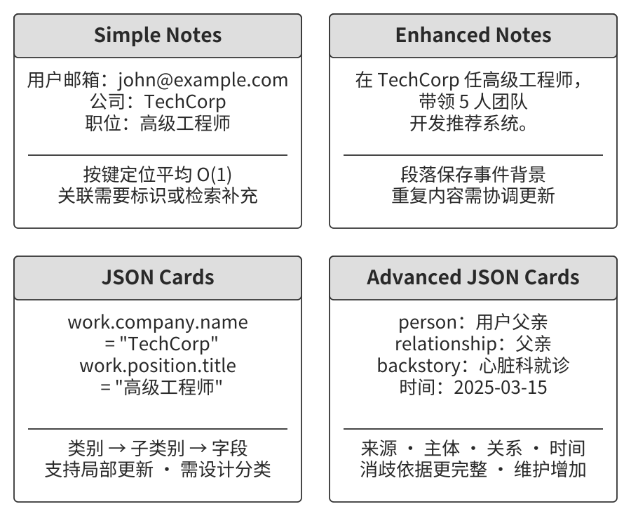

**Simple Notes** 将每条记忆写成一个简短事实，例如“用户邮箱：john@example.com”。单条记录容易读写；用哈希表按稳定键定位时，查找和更新的平均时间复杂度通常为 O(1)。按语义搜索大量笔记时，还要建立检索索引。拆分过细还会丢失关系：“在 TechCorp 担任高级工程师，负责推荐系统开发”若拆成公司、职位、项目三条互不关联的记录，后续就需要重新判断它们是否属于同一份工作。

**Enhanced Notes** 用完整段落保存事实及其背景。例如：“用户在 TechCorp 担任高级软件工程师，从事机器学习工作已有三年，目前领导一个 5 人的推荐系统项目。”公司、职位、经历和团队之间的关系在同一段中得到保留。代价是部分事实可能在多段中重复；职位变化后，需要找齐相关段落并更新，避免新旧记录并存。

**JSON Cards** 按“类别—子类别—键值对”组织信息，例如 `personal.contact.email` 和 `work.position.title`。修改职位字段时，可以保留 `work.company.name` 等其他字段，适合局部更新。设计分类时还要考虑交叉信息：“周末用 Python 开发个人项目”同时涉及时间、技术偏好和活动。可以保存一条活动记录并添加多个标签，或通过引用连接相关类别，保留这些关联。

**Advanced JSON Cards** 在事实之外增加来源背景 `backstory`、主体 `person`、与用户的关系 `relationship` 和时间戳。这些字段帮助系统识别信息属于谁、何时获知、适用于什么场景。例如，“张医生”可能指用户的牙科医生，也可能指用户父亲的心脏科医生；将姓名与就诊者、亲属关系及专科一起保存，就能减少混淆。

当用户说“帮我安排家人的年度体检”时，系统可通过 `person` 和 `relationship` 找出家庭成员，再从 `backstory` 中读取相关经历。字段越丰富，提取和更新时需要处理的关系也越多。笔者建议按信息的重要性和关联需求混合存储：关键人物、合同和长期偏好采用 Advanced JSON Cards，保留来源与关系；数量多、关联少的简单事实采用 Simple Notes，降低提取和维护成本。两类记录通过标识或引用连接，需要时再一起取回。

> **实验 3-2 ★★：四种记忆格式的对比**
>
> 配套实现为四种格式提供统一的记忆生成、更新和检索接口，在实验 3-1 的同一组 60 个用例上比较最终回答。
>
> 本次运行中，Simple Notes、Enhanced Notes、JSON Cards 和 Advanced JSON Cards 分别通过 48、52、51、49 个用例。Enhanced Notes 在第二层通过 16 个用例，Advanced JSON Cards 通过 12 个；两者在第三层均通过 19 个。包括记忆维护、回答和评审在内，Enhanced Notes 约为 99 万 token，Advanced JSON Cards 约为 155 万 token，后者的模型调用平均耗时也更长。
>
> 以第二层的流媒体订阅题为例。用户想节省开支，问自己订了哪些服务、各要多少钱。增强笔记组列出了 Netflix、Disney+ 和 Max 的月费，分别为 22.99、19.99 和 19.99 美元。高级 JSON 卡片组只报了 Max 的价格，还列出了 Max 的两种低价套餐。建议再具体，也补不上另外两份账单。
>
> 问题从哪次更新开始？翻看高级卡片组逐次保存的记忆，第一段会话后还有 Netflix，第二段会话后只剩 Disney+ 的相关记录，第三段会话后又只剩 Max。等到提问时，前两份订阅已经从记忆里消失了。

#### 进阶知识表示形态：可执行代码

保存事实之后，还需要汇总统计、检查冲突，并根据业务规则判断下一步。笔者在 **User as Code**（UaC）中尝试把用户信息组织为带类型的 Python 对象，并将这些操作写成函数[^uac]。模型从对话中提取事实，程序执行定义清楚的计算。

对于日期比较、金额汇总和明确的业务约束，笔者优先把计算写成函数，让同一组事实得到可复现、可测试的结果。这样，模型可以集中处理语义理解，减少在长对话中反复心算和核对规则的负担；记忆的表示与使用也能在同一套代码中检查。

UaC 采用两阶段流程：先将提取的事实追加到日志，再定期生成检查点，从日志重建带类型的状态。日志保留事实的来源和变化过程，状态对象提供当前可查询的字段。

以护照与行程为例，状态可以这样定义：

```python
from dataclasses import dataclass
from datetime import date

@dataclass
class PassportInfo:
    number: str
    country: str
    expiry_date: date

@dataclass
class Trip:
    destination: str
    departure_date: date
    is_international: bool

@dataclass
class UserState:
    passport: PassportInfo
    trips: list[Trip]

state = UserState(
    passport=PassportInfo("AB1234567", "US", date(2025, 2, 18)),
    trips=[
        Trip("Tokyo", date(2025, 1, 15), True),
        Trip("Paris", date(2025, 6, 10), True),
    ],
)
```

**聚合统计**直接遍历记录。例如，计算 2025 年登记的国际行程数量：

```python
count = sum(
    1 for trip in state.trips
    if trip.is_international and trip.departure_date.year == 2025
)
# count == 2
```

**冲突检查**将两个字段集合按预定规则比对。下面以药物类别匹配为例，说明如何把需要进一步核对的条目送入处理队列：

```python
def find_allergy_matches(profile):
    matches = []
    for medication in profile.current_medications:
        for allergy in profile.allergies:
            if medication.drug_class == allergy.drug_class:
                matches.append((medication, allergy))
    return matches
```

每个匹配项都保留对应的用药记录与过敏记录，后续流程可以据此核对，再按领域规则决定是否提醒、转交审核或补充信息。

**约束检查**可以随状态更新自动运行。例如，某项行程规则要求出发时护照至少还有 180 天有效期，可以把天数作为参数传入：

```python
def passport_alerts(state, required_days):
    alerts = []
    for trip in state.trips:
        if trip.is_international:
            days = (state.passport.expiry_date - trip.departure_date).days
            if days < required_days:
                alerts.append((trip.destination, days))
    return alerts

alerts = passport_alerts(state, required_days=180)
```

按示例中的 180 天计算，去东京时护照只剩 34 天有效期，到巴黎出发那天则已经过期。用户换发护照后，程序可以用新日期重新计算这两趟行程。

[^uac]: Li, Bojie，User as Code: Executable Memory for Personalized Agents，2026。

#### 用户记忆的认知科学基础

认知科学按记忆内容和使用方式区分不同类型。这些概念也可以帮助我们组织 Agent 的长期信息：

- **情景记忆（episodic memory）**保存具体事件及其时间、参与者和经过。人的例子是“上周三与同事在意大利餐厅吃晚餐”；Agent 中可以对应“用户计划下周五乘 ANA 航班前往东京”，并记录后续是否预订成功、是否改签。
- **语义记忆（semantic memory）**保存事实和概念。人的例子是“意大利的首都是罗马”；Agent 中可以对应“用户是素食者”“用户偏好靠窗座位”。这些信息既可来自用户明确表达，也可从多次经历中归纳；记录来源有助于区分两者。
- **程序记忆（procedural memory）**与技能和行为流程有关。人的例子是骑自行车；Agent 工程中可用可复用流程作类比，例如“搜索直飞航班→确认座位偏好→使用常旅客号码→预订餐食”。

回看第一章的购物记录，“看过十件后买了其中一件”支持记下一次购买事件，却很难据此判断用户今后喜欢什么。她可能喜欢这个款式，也可能只是当天能收到货。如果她随后说“以后买这一类都先看能不能当天送到”，就多了一条有适用范围的长期偏好。下次推荐同类商品时可以优先查配送时间，也能向她解释这个筛选条件来自哪一次反馈。

表3-1 把这组分类与前面的记忆层次、存储格式放在一起，说明三者各自回答的问题。

表3-1 记忆设计的三个方面

| 设计方面 | 回答的问题 | 具体类别 |
| --- | --- | --- |
| 记录层次 | 信息承担什么职责？ | 轨迹、用户长期记忆、业务状态 |
| 存储格式 | 用什么结构表示？ | Simple Notes、Enhanced Notes、JSON Cards、Advanced JSON Cards |
| 记忆内容 | 保存哪类信息？ | 情景记忆、语义记忆、程序记忆 |

例如，“用户偏好靠窗座位”属于语义记忆，可以用 Simple Notes 保存在长期记忆中；一套订票流程属于程序记忆，可以用带来源和适用条件的卡片保存。

#### 记忆框架案例

用户说“我最近改坐过道了”，旧记录里却写着“喜欢靠窗”。系统可以在写入时更新座位偏好，也可以保存两次表述，等下次订票再判断哪条适用。下面先看 Mem0 在哪个环节处理这类冲突，再看 Memobase 怎样分别记录用户画像和具体事件。

**Mem0：调整冲突处理的位置。** 2025 年论文与 v2 的流程在写入时比较新旧事实，后续 v3 则采用追加事实与混合检索。图3-3 对照这两种安排。

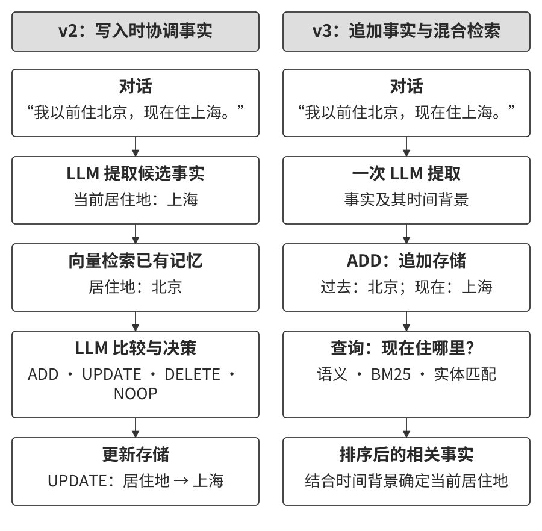

在早期流程中，LLM 先从对话提取候选事实，再检索相近的已有记忆，决定执行 **ADD**、**UPDATE**、**DELETE** 或 **NOOP**。用户先说“我住在北京”，后来又说“我搬到了上海”，系统可以把当前居住地更新为上海。这样，查询时容易取到整理后的事实；维护时则要正确识别更正、时间变化与不同对象，保存更新依据，以便发现错误后回查。论文还提出图记忆变体 **Mem0-g**，用实体与关系表达关联知识[^ch3-mem0-paper]。

v3 把自动提取改为一次 LLM 调用，只追加 **ADD** 记录。北京和上海两条信息可以连同时间背景一起保留，查询时再结合上下文判断当前居住地。检索同时使用语义相似度、BM25 关键词和实体匹配；已经确认完成的行动也可提取为事实。迁移指南报告，LoCoMo 得分由 71.4 提高到 91.6，LongMemEval 由 67.8 提高到 93.4。该开源版本将实体关联用于内部检索，移除了外部图存储接口及 `relations` 返回值；图记忆由托管平台提供[^ch3-mem0-migration]。

这一演进说明，记忆系统可以把冲突判断从写入阶段移到读取阶段。写入时一旦误把两个人的经历合并，或把补充信息当成更正，后续回答就可能一直沿用错误的当前状态。追加保存让新旧证据都能参与判断，也减少了写入时逐条决策的模型调用。对于变化频繁、当下难以判断冲突的用户记忆，笔者倾向先保存事实及其时间和来源，再在回答具体问题时整理出有效状态。

[^ch3-mem0-paper]: Chhikara 等，Mem0: Building Production-Ready AI Agents with Scalable Long-Term Memory，2025。

[^ch3-mem0-migration]: Mem0，Open Source: Migrating to the New Memory Algorithm。

**Memobase：用户画像与事件记忆。** Memobase 将长期信息组织为两部分。**用户画像（profile）**按主题与子主题保存较稳定的属性，例如 `basic_info` 下的姓名、`interest` 下的兴趣、`work` 下的职位。开发者可以配置需要提取的槽位，控制画像的范围与粒度。**事件记忆（event memory）**记录用户经历及其时间，供系统回答“上次讨论预算是什么时候”这类问题。

Memobase 先把新对话放入缓冲区，在缓冲区积累到指定规模，或会话空闲达到设定时长后批量处理，也可以在会话结束时显式触发。这样，多条消息共享一次整理流程，查询时则读取已经生成的画像和事件。异步更新减少了当前交互等待记忆提取的时间；需要立即使用最新事实时，可以等待本次处理完成[^ch3-memobase]。

[^ch3-memobase]: Memobase，官方项目说明，包括画像字段、事件记忆、缓冲区和同步更新接口。

如果助手既要记得上次订票的经过，又要掌握用户的座位偏好和办理退票的流程，可以像图3-4 那样分别保存事件、事实和流程。每次接到任务，再把用得上的部分放进工作记忆。

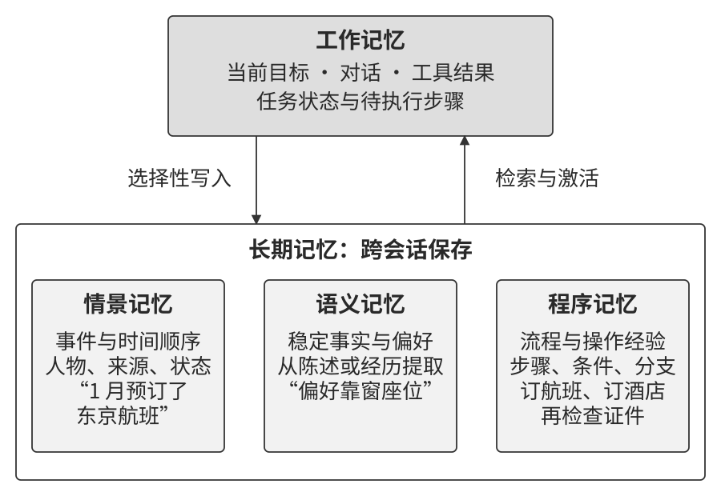

情景记忆保留事件序列及时间戳、情感标记、任务标识等元数据，可以组合时间与主题检索。例如，“上次讨论预算”同时需要主题匹配和时间排序。语义记忆保存从事件中提取的事实与偏好，程序记忆保存反复使用的流程。

**工作记忆（working memory）**组织当前目标、任务状态和已取回的相关信息。Harness 从轨迹和长期存储中选择内容，加载到当前上下文；任务产生的新事实经过整理后，再写入长期记忆。轨迹记录事情如何发生，工作记忆集中保存下一步决策所需的信息，两者通过事件标识和来源连接。

用 RAG 读取用户记忆时，先根据当前请求找出一批可能相关的记忆，再决定哪些该放进工作记忆。假设助手今天要帮用户选座，检索同时找到了两句话：“出差我喜欢靠窗”和“上次膝盖受了伤，回程帮我选过道”。两条都与选座高度相关，但第二条只对当时那趟回程提出了要求。按相关性重排，即使把它排在第一，也没有回答它今天是否适用。

这种情况下，笔者更看好用 Jev 一类判断模型筛选候选记忆。把本次行程、用户当前的要求，以及每条记忆的原话、日期和适用条件一并交给它，逐条判断“本次适用”“仅供参考”或“依据不足”。如果今天也是出差，第一条可以作为选座依据；如果用户刚说膝伤还没好，第二条就值得拿回来询问。

#### 记忆压缩与整理机制

一个常订机票的用户可能提到十次“靠窗”。其中九次也许都在复述同一张订单；把提及次数直接当偏好强度，会放大一件事的权重。整理时先辨认来源和事件，再合并重复记录，检查是否存在更晚的更正，最后才决定哪些规律适合在未来任务中使用。遇到“上回那个靠窗的位置不错”，可以请 Jev 一类判断模型读这句话和相关订单，只判断它属于“回顾上次乘机”“提出本次要求”还是“表达长期偏好”。订单对应不上或几种解释都说得通，就保留原话，等订票时再核实。这样一次局部判断，可以避免把同一段经历反复算成新的证据。

1. **筛选整理对象。** 访问频率、记录时间、情感标记和信息独特性可以作为排序信号。例如，一条三天前创建、被访问五次、情感标记较强且没有重复的记录，更值得单独保存；一条九十天前创建、仅访问一次、又与其他三条高度重复的记录，可以优先与相关记录合并。系统可先按分数筛出需要整理的记录，再按业务规则决定是压缩、合并还是删除。长期约束和有效合同即使访问很少，也应保留到其有效期结束。
2. **聚类并生成摘要。** 将相似记录分组，用一段摘要保留共同内容。例如，多次天气对话可以整理为“用户经常询问天气，特别关心降雨”。具体日期与原始询问归档保存，摘要关联原记录，便于后续回查。
3. **提取规律与流程。** 从多次购物记录中归纳“偏好性价比高的产品，重视用户评价”，或者提炼选品步骤。

#### 隐私保护：日志脱敏

用户记忆常包含身份、联系方式和账户信息。系统需要按任务决定哪些字段进入模型输入，按运维需要决定哪些内容进入日志。脱敏可以放在日志写入前，将敏感片段替换为类型标签或稳定占位符，保留排查问题所需的结构。

> **实验 3-3 ★★：基于本地模型的日志脱敏**
>
> 本实验通过 Ollama 调用本地 Qwen3-0.6B，在本机识别日志中的敏感片段。小模型适合在消费级设备上部署，也可以切换到 1.7B、4B 等规格，比较识别质量与处理时间。原始日志需要留在本地时，识别和替换也应在本机完成，再把脱敏结果交给后续服务。
>
> 测试材料包括身份证号、银行卡号等结构化号码，地址等半结构化内容，以及自然语言中透露的密码等敏感信息。模型按 JSON Schema 返回信息类型、文本位置和置信度，程序据此替换原文。对照组使用正则表达式；混合组先做正则匹配，再让模型处理剩余文本。
>
> 先看两条日志。第一条有身份证号和手机号，正则只遮住了手机号，召回率是 $1/2$。第二条里，正则找齐了美国社会保障号和银行卡号，却把格式相似的工单号也遮住了。它标出的三处只有两处需要脱敏，精确率是 $2/3$。只检查敏感值是否还留在日志里，第二条就会通过；等到客服拿这条日志查工单，才会发现线索已经丢了。
>
> 对全部 12 条样例逐条计算召回率再取平均，正则、模型与混合方案分别约为 50%、69% 和 78%。替换后逐条清点，三种方案分别留下了 9、3、2 个敏感值。怎样取舍，还要看处理时间：在这台机器上，正则平均每条约用 0.1 毫秒，模型和混合方案都接近 3 秒。日志量大时，可以先用正则处理格式稳定的字段，只让模型补查需要结合上下文判断的片段。

记录增多后，下一步是从成千上万条信息中找出当前任务需要的内容。下面介绍的 RAG 技术既可用于共享知识库，也可用于用户记忆检索。

### RAG 基础：构建 Agent 的知识获取管道

一家商店改过退款政策，用户来问：“我上个月买的商品，现在怎么申请退款？”要答对，先要查到适用于这笔订单的条款，再把条件和步骤讲清楚。**检索增强生成**（Retrieval-Augmented Generation，RAG）把这两步连起来，使模型可以使用商店内部的资料，也能用上训练结束后才公布的政策。

先从只有一版政策的情况入手。下面用简化接口查询同一家店的退款流程，观察检索结果怎样进入模型的回答：

```python
query = "退款流程"
results = retriever.search(query, top_k=2)
# results = [
#   "退款政策：订单签收后7天内可申请全额退款，需提供订单号。退款将在3–5个工作日内到账。",
#   "退款操作：进入‘我的订单’，选择订单，点击‘申请退款’。"
# ]
answer = llm.generate(system="你是客服助手。", context=results, question=query)
# 回答包含申请期限、所需信息、操作步骤和到账时间。
```

对照图3-5 和代码中的两条检索结果：申请退款的步骤来自“退款操作”，到账要等 3–5 个工作日则来自“退款政策”。如果检索结果只剩下操作步骤，模型还有依据告诉用户钱什么时候到账吗？这个问题关系到手册该怎样分块。

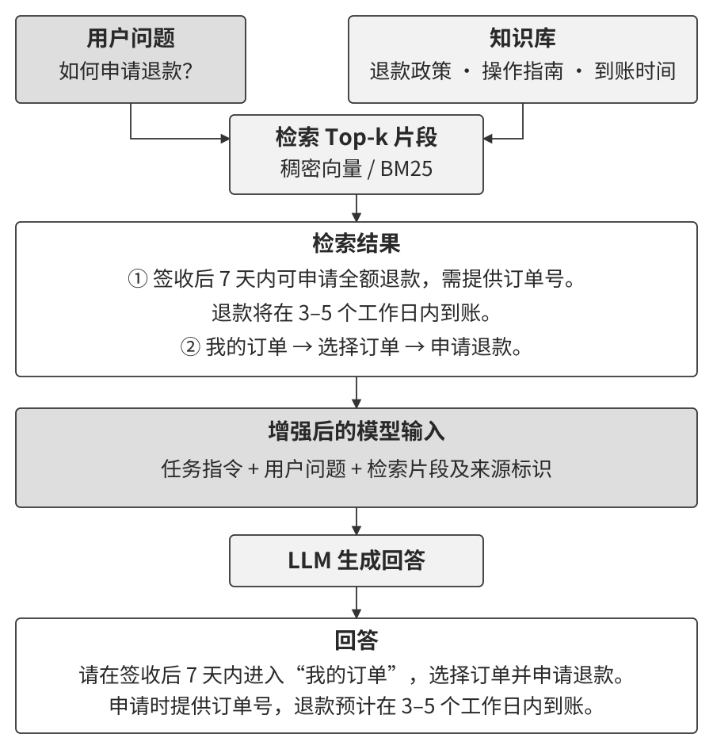

#### 文档分块（Chunking）

假设一份售后手册先列出“七天内可退”，下一段再说明例外商品。只取回第一句，就可能给例外商品也承诺退款；整本手册作为一个检索单元，又会同时夹带安装、配置和故障排查，使向量难以突出退款主题。**分块（chunking）**要在这两端之间选取大小，让一块文字足以解释自身条件，也容易被具体问题找到。块的长度还要满足嵌入模型的输入预算，并为后续生成预留上下文空间。

常用方法有三类。

**固定大小切分**按 token 数划分，例如每块 512 token，相邻块重叠 50～100 token。重叠使边界附近的内容有机会完整出现在另一块中。这种方法便于控制块的长度；切点可能落在段落、代码或表格内部。

**递归或结构感知切分**优先沿章节、段落等自然边界划分，遇到过长的部分再按句子等更小单位切分。Markdown 标题和 HTML 元素可以提供结构线索。代码块、表格和标题关联的正文也可以采用专门的处理规则。对于结构清楚的技术文档，笔者建议从这种方法开始：先利用现成的章节与段落，再对过长部分细分，通常比直接截断更容易保住完整含义。

**语义切分**计算相邻句子或句群的嵌入相似度，在主题发生明显变化的位置切开。它增加了嵌入计算，但有机会把同一主题保留在一个块中。

假设检索器只送回来一句话：“该公司收入增长了 3%。”哪家公司？哪个季度？数字找对了，回答问题的依据却在上一段。如果把整份财报都装进一块，季度和公司名倒是保住了，但查询收入时，连招聘和设备采购的段落也会一起进来。这些内容还要共用一个向量，收入这个主题在向量里可能就没那么突出了。实际选块大小时，可以从每块 256～1024 token、相邻块重叠 10%～20% 开始试。

标题、来源和时间等元数据可以随片段一起保存。后文的上下文感知检索会进一步为每个片段补充其在原文中的背景，帮助独立检索时解析指代和范围。

#### 稠密嵌入：用向量表示文本

**嵌入（embedding）**将词、句子或文本块映射为数值向量，例如 `[0.2, -0.5, 0.8, ...]`。检索模型通过训练，让相关的查询与文档在向量空间中具有较高相似度。“稠密”表示向量的大多数维度都有非零数值，共同表示文本的信息；后面的稀疏表示则只有少量维度非零。

可以把向量空间想象成一张高维地图：每段文本对应一个位置，检索是在其中寻找与查询接近的内容。常用度量之一是**余弦相似度**：

$$
\operatorname{cos}(A,B)=\frac{A\cdot B}{\|A\|\,\|B\|}
$$

点积 $A\cdot B$ 将对应维度相乘后求和，模长 $\|A\|$ 是各维度平方和的平方根。除以两个模长后，结果只反映方向关系。对于非零向量，余弦值范围为 $[-1,1]$，越接近 1，方向越一致。不同检索模型也会使用点积或欧氏距离。两个向量都归一化到单位长度时，点积就等于余弦相似度。

> **手算：三个句子的余弦相似度**
>
> 用三个示意向量表示“如何养猫” $A=(0.9,0.5,0.1)$、“猫咪饲养指南” $B=(0.8,0.6,0.1)$ 和“股票投资策略” $C=(0.1,0.1,0.9)$。
>
> $A\cdot B=0.9\times0.8+0.5\times0.6+0.1\times0.1=1.03$。两者模长分别为 $\sqrt{1.07}$ 和 $\sqrt{1.01}$，相似度约为 **0.991**。
>
> $A\cdot C=0.9\times0.1+0.5\times0.1+0.1\times0.9=0.23$，$C$ 的模长为 $\sqrt{0.83}$，相似度约为 **0.244**。在这组向量中，养猫查询与饲养指南更接近。

实际模型通常使用数百至上千维表示。

##### 从 Word2Vec 到上下文感知

图3-6 从固定词向量讲起。**Word2Vec** 根据词汇共现学习每个词的固定向量。一些关系能在向量运算中表现出来，例如经典的“国王－男性＋女性≈女王”。固定表示的限制也很直观：`bank` 在 `river bank`（河岸）和 `investment bank`（投资银行）中使用同一个词向量。

**GloVe** 从整份语料统计词与词的共现次数，再通过加权最小二乘目标学习词向量。Word2Vec 侧重局部窗口中的预测任务，GloVe 将全局共现统计直接纳入训练；两者都为词汇学习固定表示[^ch3-glove]。

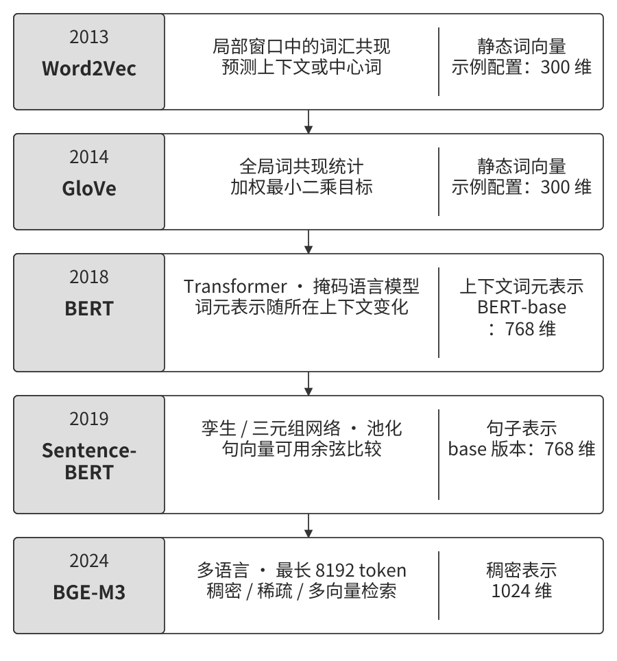

到了 **BERT** 这类上下文模型，同一个词元的表示会随句子改变。借助自注意力，模型可以根据“发布新产品”和“买了两斤”这些线索，给两句话里的“苹果”算出不同的表示。用于检索的嵌入模型还需要把词元表示汇集为查询或文档向量，并通过相应训练使两者可比较。

**Sentence-BERT** 将 BERT 与池化、孪生或三元组网络结构结合，训练可直接比较的句向量。文档可以预先编码并存入索引，查询到来时只需编码查询，再计算向量相似度。预先编码省去了每次查询时重新计算全部文档表示的开销[^ch3-sbert]。

**BGE-M3** 同时提供稠密、稀疏和多向量检索表示，并支持多语言与较长输入；本节采用其中的稠密表示说明单向量检索[^ch3-bge-m3]。模型可接受的长度影响分块方案：原始 BERT 的典型上限为 512 token，BGE-M3 支持到 8192 token。

[^ch3-bge-m3]: Chen 等的 M3-Embedding 论文（arXiv:2402.03216）介绍三种检索表示如何联合训练。另见 BAAI 的 BGE-M3 模型说明，包括表示方式、维度、输入长度和使用方法。

> **实验 3-4 ★★：比较两种近似最近邻索引**
>
> 文档向量建好后，需要快速找到接近查询的向量。逐个计算可以得到精确近邻，数据规模增大后，**近似最近邻**（Approximate Nearest Neighbor，ANN）索引用可控的召回损失换取查询速度。本实验在同一批真实嵌入和相同查询上比较 ANNOY 与 HNSW，并用精确搜索结果作为参照。比如，某次查询的精确搜索列出了十个最近邻，近似索引返回的十个结果里包含其中八个，那么这次查询的 Recall@10 就是 0.8。这个数衡量索引保留了多少精确近邻。
>
> ANNOY 使用多棵随机投影树缩小候选范围；HNSW 使用分层近邻图，先在稀疏的高层快速接近目标区域，再进入更密集的低层搜索。图3-7 展示 HNSW 的分层结构。
>
> 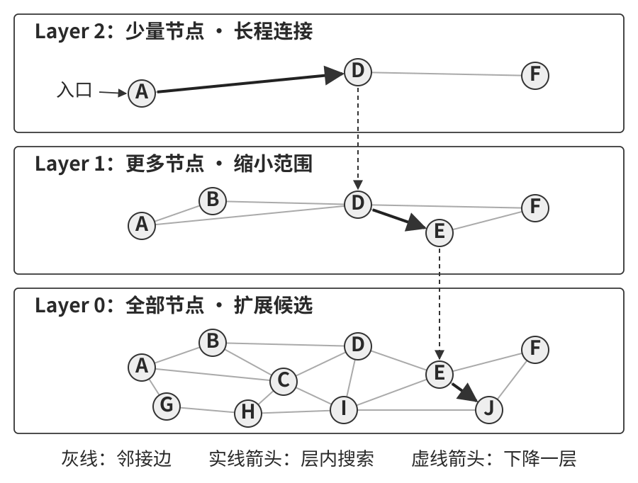
>
> 表3-2 ANNOY 与 HNSW 的实现取舍
>
> | 比较方面 | ANNOY | HNSW（以 hnswlib 为例） |
> | --- | --- | --- |
> | 索引结构 | 多棵随机投影树 | 分层近邻图 |
> | 构建开销 | 随树数量、向量数量和维度变化 | 随邻接规模、构建搜索范围和数据量变化 |
> | 内存与文件 | 静态索引支持内存映射和多进程共享 | 保存向量及图邻接关系，邻接规模影响开销 |
> | 增量更新 | 索引建好后新增条目需要重建 | 支持新增、更新及删除标记，需管理容量 |
> | 召回与速度 | 用树数量和查询搜索预算调节 | 用构建参数与查询搜索范围调节 |
> | 使用场景 | 便于分发和共享的静态索引 | 持续写入并查询的动态索引 |
>
> 本次运行先用 240 段文本建库。对同样的 20 个查询，两种索引都找齐了精确搜索得到的前 10 个近邻。初次建库时，ANNOY 在 Linux 容器中构建约 13 毫秒，HNSW 在本机环境中构建约 78 毫秒；保存的索引分别约 1.40 MB 和 1.02 MB。再加入剩余 60 段，ANNOY 重新构建索引，HNSW 直接插入新向量。这时库中共有 300 段，原先的近邻也可能随之改变。在新库上重做精确搜索后，两种索引的平均召回率仍为 100%。

[^ch3-ann]: Spotify 的 Annoy 项目说明介绍了怎样构建只读索引、用内存映射加载索引，以及怎样用 `search_k` 调节查询时检查的节点数。hnswlib 项目说明的 Python 接口部分给出了追加向量的 `add_items` 方法和调节查询范围的 `set_ef` 方法。

**索引应按知识的更新方式来选。** 语料定期批量发布、多进程共享同一份只读索引时，笔者会先考虑 ANNOY；持续接收新文档、需要在线插入时，则优先考虑 HNSW。嵌入模型决定语义表示，索引决定这些表示能否以合适的延迟和更新成本投入使用，两者共同决定检索服务的效果。

调节 ANNOY 的树数量与搜索预算，或 HNSW 的邻接规模与搜索范围，可以观察召回和延迟的变化[^ch3-ann]。索引召回衡量是否找到了目标近邻；这些近邻能否回答用户问题，则取决于嵌入表示与资料内容。

#### 稀疏表示：从关键词到相关性评分

**稀疏表示**使用高维向量，其中只有少量维度非零。传统关键词检索以词项为维度，根据文档中出现的词赋权。它的基础是**词袋模型**（Bag of Words，BoW）：保存词及其出现次数，忽略顺序。因此，“猫追狗”与“狗追猫”具有相同的词袋表示。

这种表示适合匹配名称、编号和技术术语。下面从 TF-IDF 讲起，说明词频与文档频率如何转化为排序分数。

##### 从 TF-IDF 到 BM25

**TF-IDF**（Term Frequency–Inverse Document Frequency，词频—逆文档频率）结合两个信号：词在当前文档中出现多少次，以及它在整个语料库中有多常见。假设 100 篇文章中有 60 篇包含“模型”，只有 3 篇包含“蒸馏”，查询“模型蒸馏”时，“蒸馏”更有区分作用。

一种基本写法是：

$$\operatorname{TF\!\text{-}\!IDF}(t,d)=\operatorname{TF}(t,d)\times\operatorname{IDF}(t),\qquad \operatorname{IDF}(t)=\ln\frac{N}{\operatorname{DF}(t)}$$

$\operatorname{TF}(t,d)$ 表示词 $t$ 在文档 $d$ 中的次数，$\operatorname{DF}(t)$ 表示包含该词的文档数，$N$ 为文档总数。按这个公式，一个词出现十次时的得分贡献，是出现五次时的两倍；长文档也可能仅因词更多而得分较高。TF-IDF 有多种归一化变体，下面的 BM25 则用词频饱和与长度归一化处理这两类影响。

**BM25** 将各查询词的贡献相加：

$$\operatorname{Score}(Q,D)=\sum_i\operatorname{IDF}_{\mathrm{BM25}}(q_i)\cdot\frac{\operatorname{TF}(q_i,D)(k_1+1)}{\operatorname{TF}(q_i,D)+k_1\left(1-b+b\frac{|D|}{\operatorname{avgdl}}\right)}$$

其中，$q_i$ 为查询词，$|D|$ 为文档长度，$\operatorname{avgdl}$ 为平均文档长度。$k_1$ 控制词频的饱和程度；$b$ 控制长度归一化强度，取 0 时关闭这一校正。图3-8 把这几项分开计算。先固定文档长度，让查询词从出现一次增加到三次，看看每多出现一次能多得多少分；再固定词频，只把文档长度加倍。最下面一行比较两个词在文档集合中有多常见。

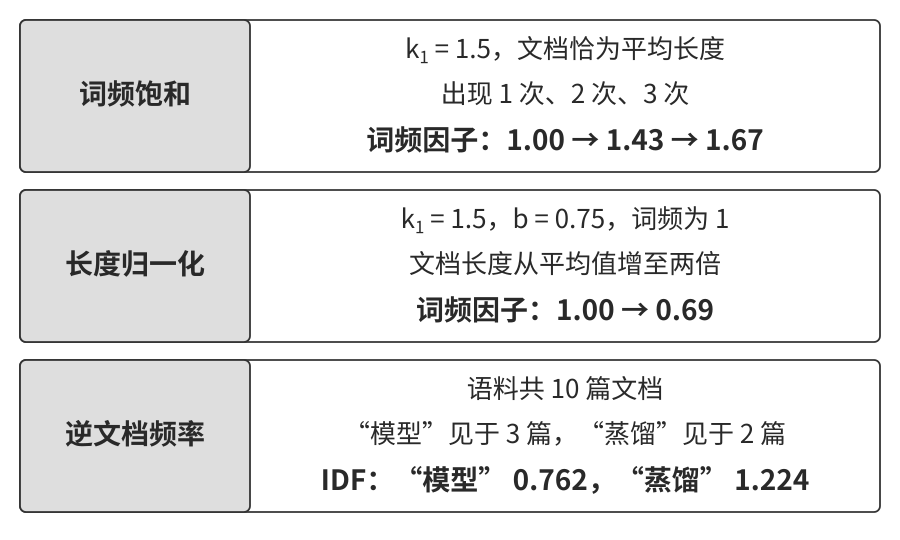

图中第一行，第二次出现让词频因子增加了约 0.43，第三次只增加了约 0.24，这就是词频饱和。第二行里，同一个词都只出现一次，在较长的文档里更不突出，长度校正就把它的词频因子调低了。还要乘上 IDF，才是这个词对总分的贡献。

上式还有一项要确定：同样出现三次，为什么罕见词往往比常见词更有用？本节用下面的逆文档频率给词加权：

$$\operatorname{IDF}_{\mathrm{BM25}}(t)=\ln\frac{N-\operatorname{DF}(t)+0.5}{\operatorname{DF}(t)+0.5}$$

分子表示不含该词的文档数，分母表示包含该词的文档数，两者各加 0.5 平滑，使文档频率为 0 或 $N$ 时仍可计算。稀有词得到更高权重；当超过半数文档包含该词时，这个公式会给出负数。配套实现将实际评分权重下限设为 $10^{-6}$，同时保留原始值供检查。

> **实验 3-5 ★★：从零实现 BM25 搜索引擎**
>
> 本实验依次完成分词、停用词处理、倒排索引和评分。停用词处理可以过滤“的”“了”等高频词。**倒排索引**记录每个词出现在哪些文档中，以及相应词频；它类似书末的术语索引，查询“TCP”就能找到第 45、112、203 页，再读取这些位置的内容。
>
> 用“模型蒸馏”手算一次查询。设语料库有 10 篇文档，平均长度为 250 词，$k_1=1.5$、$b=0.75$。“模型”出现在 3 篇文档中，IDF 约为 0.762；“蒸馏”出现在 2 篇中，IDF 约为 1.224。下表按词列出命中的文档、词频和文档长度。把这些数值代入公式，就能算出各词对文档得分的贡献。
>
> | 查询词 | 文档 | 词频 TF | 文档长度 | BM25 贡献 |
> | --- | --- | ---: | ---: | ---: |
> | 模型 | doc_1 | 5 | 200 | 1.52 |
> | 模型 | doc_3 | 2 | 500 | 0.82 |
> | 模型 | doc_7 | 8 | 150 | 1.68 |
> | 蒸馏 | doc_1 | 3 | 200 | 2.15 |
> | 蒸馏 | doc_5 | 1 | 250 | 1.22 |
>
> 两个词在 doc_1 中的贡献相加约为 3.67，排序为 **doc_1（3.67）> doc_7（1.68）> doc_5（1.22）> doc_3（0.82）**。doc_1 中“蒸馏”的词频低于“模型”，但稀有程度更高，最终贡献也更大；同时匹配两个词又进一步提高了总分。
>
> 现在用 `cat` 查配套实验的英文语料。标注为相关的两篇短文分别用了 `kitten` 和 `feline`，倒排索引中却查不到 `cat`，候选列表是空的。即使把前面的词频权重调得再高，也没有一篇文档可以打分。换用这两篇短文中的词再查，就能看到它们各自进入候选列表。

#### 混合检索：合并两路结果再重排

有些问题很难预先列全同义词。实验 3-6 有一道题问的是“怎样自动回收不用的堆空间”，目标短文却写成了“自动内存管理让开发者省去手动释放对象的工作”。英文查询和短文没有共同词项，关键词检索一篇也没找回，向量检索却把目标排在第一。换成型号查询 XR-7003，关键词检索直接找到了对应型号，向量检索还列出了几个相近的型号。

**混合检索**先用关键词和向量分别查找相关段落，再决定哪些段落值得交给模型。知识库同时包含精确标识和自然语言描述时，笔者建议以此为起点。沿图3-9 追踪 XR-7003：两路都把它排在第一，融合时它就得到了两份排名贡献。重排换掉了第二名，用户首先看到的型号仍然正确。

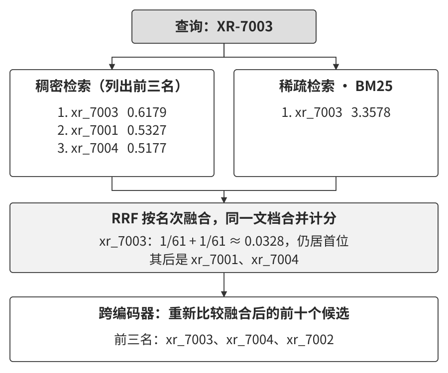

第一阶段是**并行检索**：将查询发送给稠密和稀疏引擎，各自取回一批可能相关的文档。两路可以使用相同的原始文本，也可以按各自模型的要求进行预处理。

第二阶段是**结果融合**：把两路结果中的同一篇文档合并，再统一排名。余弦相似度与 BM25 的数值尺度不同，直接相加容易使数值较大的一路主导结果。一种做法是先校准或归一化分数，再加权组合；另一种是**倒数排名融合**（Reciprocal Rank Fusion，RRF），按各路名次计算：

$$\operatorname{RRF}(d)=\sum_{j:\,d\in R_j}\frac{1}{k+\operatorname{rank}_j(d)}$$

$R_j$ 是第 $j$ 路结果，名次从 1 开始，文档未出现在某一路时，该路贡献为零。平滑常数 $k$ 常取 60；它越大，前几个名次之间的分数差距越小。RRF 便于组合不同打分方式，但只保留名次，原始分数中的强弱差异需要通过其他方法利用。

试着算一个两路检索的例子。用户问“退款多久到账”，文档甲在关键词检索排第一，在向量检索前列没有出现；文档乙在两路都排第二。取 $k=60$，甲得 $1/61$，约为 0.0164；乙得 $1/62+1/62$，约为 0.0323。融合后乙排在甲前面。这个结果只说明两条检索路径都找到了乙。要判断乙是否真的回答了到账时间，还要看它写的是“如何申请退款”还是“退款何时到账”。

第三阶段可以加入**神经重排序**。系统取出融合后排名靠前的文档，例如前 50 篇，让重排序模型给每篇文档与查询的相关程度打分。重排能改变这 50 篇的次序。如果真正有用的文档根本没入选，就得回到上游改进检索。

这里常用的模型是**跨编码器（cross-encoder）**：把查询与候选文档一起输入，让两部分在模型内部交互，输出相关性分数。检索阶段的**双编码器（bi-encoder）**则分别编码查询和文档，文档向量可以提前计算，查询时只做向量搜索。前者适合细排少量文档，后者适合在大量文档中初筛。可以类比简历筛选和面试：先根据已有特征缩小范围，再围绕具体要求深入比较。BGE Reranker v2 M3 是可用于这一环节的模型之一[^ch3-reranker]。

[^ch3-reranker]: BAAI，BGE Reranker v2 M3 模型说明，介绍查询—文档输入与相关性评分。

当相关材料已经进入候选池，却经常排在无关材料后面时，笔者会优先评估跨编码器重排序。它联合读取问题与文档，可以直接比较文档中的条件、限定词和细节是否符合问题要求。表3-3 列出三个常用指标。

表3-3 检索质量的三个指标

| 指标 | 计算与含义 |
| --- | --- |
| recall@k（召回率） | 前 k 个结果中的相关文档数，除以该查询全部相关文档数，衡量找回了多少相关内容；测试集通常再对各查询取平均 |
| MRR（平均倒数排名） | 每个查询取首个相关文档名次的倒数，再求平均；首位为 1，第十位为 0.1，未找到为 0 |
| nDCG@k（归一化折损累积增益） | 按相关程度给结果赋分，并对靠后的名次折损，再除以理想排序得分，衡量前 k 个结果的整体排序质量 |

还可以记录**命中率**：多少查询在前 k 个结果里至少找回一篇相关文档？比如，一个问题需要三篇资料，前二十个结果只找回其中两篇。这个查询已经命中，因而没有计入“完全未命中”的失败次数，但它的 recall@20 只有 $2/3$，还有 $1/3$ 的资料没找到。如果每题都只有一篇目标文档，找回它的题得 1 分，漏掉的题得 0 分。对同一份检索结果求平均，命中率就等于平均召回率。

> **实验 3-6 ★★：比较稀疏、稠密、融合与重排序**
>
> 本实验在相同的 12 个标注查询上比较五种配置：稀疏检索、稠密检索、RRF 融合、加权融合，以及融合后重排序。查询覆盖语义相似、精确名称、多语言和技术代码，其中两道题分别用英文和中文询问植物怎样把阳光转化为食物。稠密模型采用 Qwen3-Embedding-0.6B，重排序采用 MS MARCO MiniLM 跨编码器，每路检索最多取 10 篇文档，重排器处理 RRF 排在前面的最多 10 篇文档。召回率和 nDCG 只看最终排序的前 3 篇，MRR 则沿返回的列表寻找第一篇相关文档。
>
> 先打开实验 3-6 运行记录里的逐题排名，比较两道光合作用题的检索结果。英文题的目标文档仍排第一。中文题先返回编程语言和火山，第三篇才讲光合作用。每题只有一篇标注为相关的文档，两题在前三名里都找到了它，recall@3 都是 1。但中文题的首篇相关文档排第三，倒数排名只有 $1/3$。按本实验的计分方式，第三名的增益是 $1/\log_2(3+1)=0.5$，第一名的增益是 1，因此中文题的 nDCG@3 为 0.5。
>
> 再看全部 12 道题。重排后，除中文光合作用题外，另有一道关于回收堆内存的题，目标文档从第一退到了第二。其余十题都保住了首位，所以重排后的 MRR 是 $(10+1/2+1/3)/12\approx0.903$。作为对照，稠密检索和 RRF 的 MRR 都是 1。两者的 nDCG@3 也都是 1，重排后降到约 0.928。只看平均召回率就看不出这些名次变化：稀疏检索的 recall@3 为 0.833，其余四组都是 1。
>
> 假设现在要为这组题选一个配置，重排付出的时间换来了什么？在这台 CPU 上，RRF 从开始检索到给出排名，平均每题约用 194 毫秒；接上重排后约用 237 毫秒。多花的约 43 毫秒没有多找回目标文档，还把两道题的正确答案推后了。

### 知识的组织与检索

知识的组织方式决定每个条目包含什么，检索器则决定从这些条目中取回什么。技术手册、法律文书和论文中的段落通过章节层次、概念依赖和跨文档引用联系起来。将这些结构保留下来，可以让查询同时访问具体证据和较高层的概括。

本节依次讨论几种组织方式：RAPTOR 与 GraphRAG 建立层次或关系索引；OpenViking 用目录组织上下文资源；增量更新和定期整理维护知识时效；智能体化 RAG 让 Agent 根据已有结果继续检索；上下文感知检索补充片段背景；最后从数据集中提取可复用的知识。它们分别作用于表示、索引、更新和查询过程，也可以组合用于用户记忆。

先看两个例子，理解查询所需信息与原始记录之间的差距。

**案例一：黑猫白猫的计数。** 上一章让程序数完 100 个笼子，得到 90 只黑猫、10 只白猫。这一次只让检索器返回排在前面的 20 条记录。假设其中 18 条给出了有效的颜色信息，15 条是黑猫，3 条是白猫。算出来的 83.3%（15/18）是这批有效记录里黑猫的比例；全店的黑猫比例却是 90%（90/100）。检索器按相关性挑选记录，它没有为全店抽取一个有代表性的样本。

如果经常有人问全店的比例，可以预先统计所有笼子，保存黑猫和白猫各有多少，并标明统计范围和更新时间。笼里的猫换了，就更新相应明细并重算总数。有人问第 37 个笼子里是什么，仍然要查回那一条明细。

**案例二：护士能享受医生拿到的折扣吗？** 以一个围绕 Xfinity 优惠咨询构造的教学情境为例：工单中，退伍军人 John 通过审核，医生 Sarah 获得折扣，教师 Mike 被告知不符合条件。每条工单记录一次处理结果。如果一位护士来问自己能不能享受折扣，仅检索相似工单会遇到三个问题。

- **职业相近，未必享受同一项优惠。** “护士”与“医生”语义接近，Sarah 的记录可能排在前面；是否适用优惠还取决于活动条款规定了哪些人可以申请、要出示什么证明。
- **个别工单列不全适用条件。** 某人通过审核，只能直接说明该人在当时条件下的结果；调大检索数量也未必能找到未曾出现过的类别或例外。
- **资料范围不清楚。** 工单可能来自不同活动或不同时间。需要先确认哪些记录适用，以及缺少哪些政策依据。

索引时可以把同一活动的工单关联起来，再查阅对应的正式条款，把适用对象、例外情形、生效时间和条款出处整理为规则卡。例如，若该教学情境中的条款明确覆盖现役与退伍军人、持证医护人员，并排除教师类别，就把这些条件逐项保存；护士是否属于医护人员范围，也由条款确认。工单继续保留，用来解释实际办理过程和发现执行差异。

这两个例子体现了不同的信息需求：数猫要统计全店的笼子，判断谁能享受折扣要查完整的条款和例外。面对这类查询，笔者主张把统计和规则整理前移到建库阶段。仅增加取回的片段，模型仍可能看不到完整的统计范围或决定这次申请能否获准的条款。围绕任务建立统计摘要、规则卡和来源关系，检索才能一次拿到足以支持判断的信息，并能继续回查原始材料。

#### 结构化索引：建立层次与关联

读一份长报告时，“维修申请要填哪一栏”往往能在一段原文中找到答案；“几类故障为什么反复出现”则要横跨几个章节。若希望兼顾这样的查询，可以在建库时生成摘要、建立层次，或者提取实体和关系。下面的 RAPTOR 用递归摘要形成层次，GraphRAG 则通过实体关系和社区摘要组织材料。

**RAPTOR**（Recursive Abstractive Processing for Tree-Organized Retrieval）从文本块开始，先把每个块编码成向量，按相似程度聚成若干组，再为每组生成摘要。把摘要当作新的一批文本块，重复这些步骤，就得到了图3-10 中的树。沿箭头从文本块 3、4、5 往上看，它们共同生成摘要 B；再往上，A、B、C 三组的摘要汇成全局摘要。[^ch3-raptor]

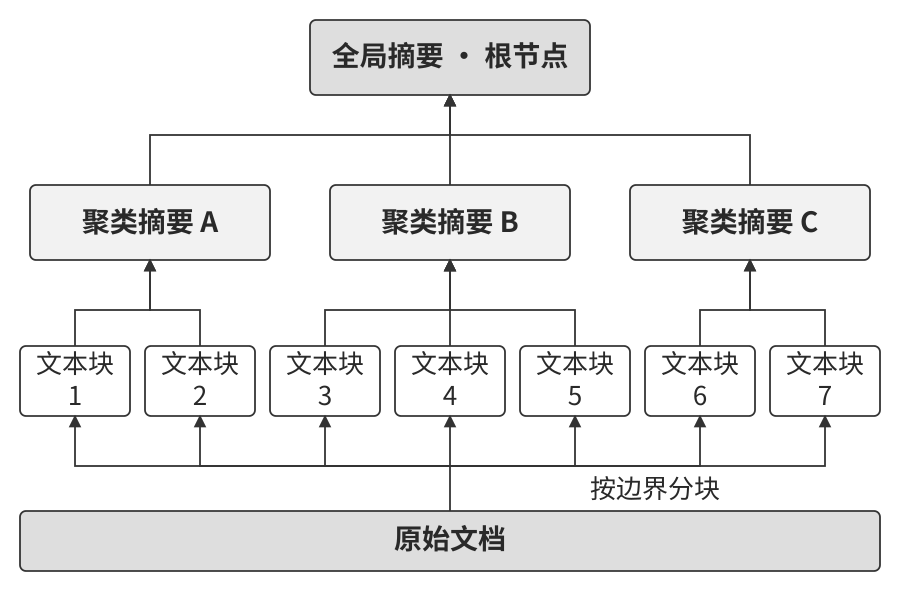

例如，“SSE2 支持在 128 位 XMM 寄存器中执行整数 SIMD 运算”和“SSE4.2 新增字符串比较指令”可以纳入“x86 SIMD 指令集演进”的摘要。细节问题可以匹配底层块，概览问题可以匹配高层摘要。查询既可以沿层次逐步深入，也可以把各层节点放在一起检索，选出最相关的一组。

[^ch3-raptor]: Sarthi 等，RAPTOR: Recursive Abstractive Processing for Tree-Organized Retrieval，2024。

**GraphRAG** 利用实体、关系和社区摘要组织知识。它用“主体—关系—对象”这样的三元组记录一条关系，例如（中国，首都是，北京）或（张三，就职于，腾讯）。两条记录只要提到同一个实体，就可以在图中连起来。图3-11 里的两位医生都姓张。用户问“我的牙医所在医院的地址”时，系统该沿哪条关系查下去？

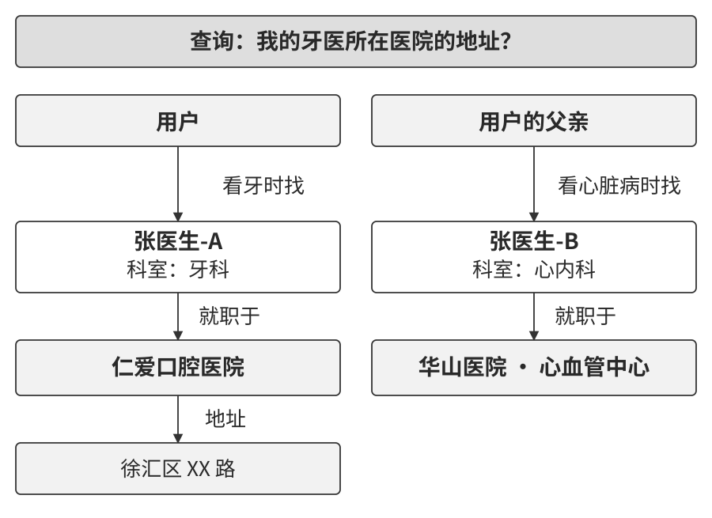

1. **建图时区分同名实体。** 一位张医生在仁爱口腔医院给用户看牙，另一位在华山医院给用户的父亲看心脏病。系统提取实体、归并记录时，可以根据这些线索给两位医生分配不同的标识。前面的 `person`、`relationship` 字段也有类似的作用。判断 `bank` 在句中表示河岸还是银行，是词义消歧；判断一条记录说的是哪位张医生，是实体消歧。
2. **查询时沿关系链检索。** 从用户出发，沿“用户→医生→医院→地址”逐步查找，就能把分散在几条记录里的信息连成一个答案。

微软 GraphRAG 的索引流程先从文本单元提取实体和关系，再通过社区发现识别连接紧密的实体群，生成社区层次与摘要。查询某个实体时，局部搜索结合其关联信息和原文；查询整个语料的主题时，全局搜索利用社区摘要组织回答[^ch3-graphrag]。

[^ch3-graphrag]: Microsoft GraphRAG，索引与查询概览、局部搜索和全局搜索。

关系表示还需要容纳条件和时间。例如，“如果下周还下雨，我就取消去海边，改去博物馆”，包含条件、有效时间和备选行动。如果只提取（用户，有计划，海滩旅行）和（用户，有备选计划，博物馆旅行），就会丢失切换条件。可以保留完整原句，并用条件节点、事件节点或结构化字段表示“下周下雨时”的约束，让关系回指原文。

对于用户记忆，笔者更推荐**自然语言与结构化索引分层配合**：用自然语言保存完整表达，用元数据记录对象、时间和来源，再为需要频繁关联的内容建立图索引。

> **实验 3-7 ★★★：比较层次摘要与关系索引**
>
> 本实验选取 Intel 架构手册中与 SSE、AVX 和状态管理有关的 14 页，构建两种教学实现。层次摘要分支先生成逐页摘要，再聚为三组，生成组摘要和根摘要；关系索引分支提取实体与关系，再生成社区摘要。两组使用相同资料与八个问题，比较概念细节和关系推理。
>
> 查询“解释 SSE 编程环境”时，层次摘要可以同时匹配 SSE 概览和寄存器细节。本实现将各层节点一起检索，选择最相关的五个。关系分支则从相关实体扩展邻居，结合社区摘要组织上下文。沿“SSE→XMM 寄存器→浮点运算→ADDPS”这样的关系，可以把概念与具体指令联系起来。
>
> 更复杂的问题是“处理器声明支持 AVX，程序是否就能使用 AVX？”需要把处理器能力与操作系统状态管理联系起来：检查 CPUID 的 AVX、OSXSAVE 标志，再读取 XCR0，确认 XMM 与 YMM 状态均已启用。这道题给图检索程序的端点提示是 CPUID 和 YMM。程序找出连接两者的最短路径，经由 XSAVE、CR4.OSXSAVE 和 XCR0，再把路径交给模型作答。
>
> 两组在八个问题上的平均来源页覆盖率都约为 95.8%。

笔者建议先把分块与混合检索做好，遇到反复出现的跨文档综合和关系查询需求时，再构建结构化索引。定位某一段退款政策，通常用分块与混合检索就能解决；比较 SSE 与 AVX，或从总体架构查到具体指令，则更需要跨段摘要和关系索引。

#### 文件系统范式：用目录结构组织知识

**OpenViking** 用虚拟文件系统组织记忆、资源和技能。每个条目通过 `viking://` URI 引用，Agent 可以浏览目录、读取概览，再访问需要的内容[^ch3-openviking-uri]。按信息用途，可以把目录理解为三组：外部资源、用户资料，以及 Agent 使用的技能和经验。用户与 Agent 标识进一步限定各自的命名空间。

| 内容 | 典型用途 |
| --- | --- |
| Resources | 技术文档、代码库、网页等外部资料 |
| User memories | 特定用户的偏好、习惯和经历 |
| Skills 与 Agent memories | 可复用的流程、任务记录和有待验证的经验 |

URI 提供统一定位方式，物理存储与索引由服务管理。目录接口使 Agent 能按主题逐层浏览，也能把语义搜索限制在相关子树内。文件系统式的访问、内容存储和向量索引可以共同组成服务。

[^ch3-openviking-uri]: OpenViking，Viking URI与系统架构。

OpenViking 将内容分为 **L0、L1、L2** 三个层次：L0 是简短摘要，供快速判断目录是否相关；L1 是目录概览，说明主要内容及导航入口；L2 是需要详细阅读的正文。目录级摘要和概览分别保存在 `.abstract.md` 与 `.overview.md` 中。两者生成正文的预算分别为 256 和 4000 个字符[^ch3-openviking-layers]。

查询可以先读摘要定位，再读概览选择文件，最后加载原文。这与第二章 Skills 的渐进式披露相通：轻量目录支持发现，完整内容按任务需要加载。需要精确数值、条件或原始措辞时，应继续取回对应正文。

[^ch3-openviking-layers]: OpenViking，Context Layers (L0/L1/L2)。L0、L1 是目录级生成表示；L2 可为原始文件或解析后的正文。

对于需要人和 Agent 共同维护的知识，笔者倾向于用 **Markdown 纯文本与版本控制**管理。人可以直接阅读、编辑和修正知识，Agent 也能使用同样的文件接口，在工作分支提出更新，经审核后再发布。版本控制保存每次修改的差异，也让错误更新可以撤回。会话结束时，用户偏好进入对应用户的记忆，操作经过进入任务记录。任务记录经过结果评价、跨轨迹归纳与后续验证后，可以进一步形成第九章讨论的经验。

采用文件系统组织知识，必须同时**为相关条目建立链接与索引**。一批互不引用的文件只能靠全文扫描或语义检索重新寻找关联；文件越多，Agent 就越难从已经找到的内容继续追查。链接可以提供明确的查找路径，例如让退款政策指向例外条款，合同摘要指向签署记录，人物条目指向相关事件。入口页说明主要主题，索引页提供导航，条目之间的交叉引用支持横向查找。这种做法类似百科条目的组织，可以用较轻量的方式保存部分关系。

链接维护应写入更新流程：新增条目前先检索已有记录，确定合并还是新建；写入后补充相关引用，并更新所属目录的索引。链接能带读者找到条款，条款是否适用于手里的订单，还得看它是什么时候生效的。

#### 知识应该如何更新

一条政策今天修改，用户明天可能问“现在该怎么办”，也可能问“上月我的订单为什么那样处理”。只用新条款覆盖旧条款，第二个问题就失去了当时的依据。**增量更新**及时写入新证据，**定期整理**再从更大范围发现重复、冲突和结构变化；两条路径都要保留版本、证据引用并在发布前检查，才能按问题选择适用时期。

##### 用户记忆和知识库的增量更新

笔者的建议是：**把知识库当成代码库，把每次知识变更当成一个 Pull Request（PR）。** 一次更新应有明确的修改范围，并附上支撑修改的证据，供审核者检查。Markdown 文档、规则文件和 User as Code 的可执行状态都可以纳入这一流程。版本历史帮助维护者查看变化、追查原因，并在错误发布后恢复。

沿用第一章的**提议者—审核者**模式，一次更新可以这样进行：

1. **提议者生成变更。** Proposer Agent 阅读新证据，检索已有知识，找到新增、更正或过期的条目，在工作分支提出范围明确的修改。同时维护关联链接、目录索引、时间信息和证据引用。
2. **审核者独立核查。** Reviewer Agent 对照修改前后的内容与原始证据，核对新增说法有无出处、适用条件写全了没有、不同文件里的说法是否一致，以及删去的段落里还有没有用得上的信息。发现问题时，指出具体条目和依据，并说明应补充、恢复或更正什么。
3. **迭代并作出决定。** 提议者按意见修改，审核者重新核查。审核通过后进入合并流程；达到轮次或成本上限仍有争议时，就把这份修改留在工作分支，请人审阅。
4. **检查并发布。** 自动检查格式、链接、元数据和权限标签；可执行知识还要通过类型检查和相关测试。合入后，从确定的知识版本重建受影响的分块、摘要和向量索引，再发布服务版本。

这条流程对应三层数据。**原始证据层**保存对话、执行轨迹、业务文档和工具结果；**知识层**保存经过提炼、可以修订的文本或代码；**服务层**保存由特定知识版本生成的索引。变更记录关联证据标识、知识版本、审核意见和最终决定，使维护者能追查某条知识为何写入、何时生效。原始证据按保留策略归档，索引则可以从知识版本重新生成。前文的追加式记忆适合保存新旧事实及其来源；这里的审核流程负责把这些证据整理为可供使用的知识版本。查询时遇到尚未解决的冲突，仍可回查证据，结合任务条件判断。

在这套设计中，**提议者和审核者都应是能够调用工具、持续查询的 Agent。** 提议者可能需要搜索多份记录才能找到受影响的条目；审核者也可能沿引用继续查询、比较版本或执行检查。文件搜索、证据检索、差异查看和测试工具使它们能够处理这些后续步骤，具备相应能力的 Coding Agent 就可以承担这样的工作。

两者的检索范围应覆盖当前变更涉及的知识及原始证据，并受用户、租户和任务权限约束。审核轨迹、引用的工具结果和反馈一同归档，后续可以检查审核者实际核验了什么。

模型选择上，笔者建议优先采用能力相近、来自不同家族的组合，例如 Claude 与 GPT、DeepSeek 与 Kimi。不同的训练数据和推理习惯可能带来不同判断。审核者应独立检索证据、核对修改中的断言与条件。权限应由运行系统执行：提议者写工作分支，审核者读取证据并提交结论，合并与发布服务掌握主库和线上索引的更新权限。

##### 用户记忆和知识库的定期整理

多次局部更新后，同一事实可能散落在多个文件中，新旧表述也可能并存。定期整理从目录、时间或主题出发，检查这些累积问题。它与第九章讨论的周期性回顾有共同的工作方式：前台积累新证据，后台集中整理，形成可供后续任务使用的记录。

整理包括三项工作。

1. **去重、归并与结构调整。** 找出重复、过期或过度碎片化的条目，合并相关内容，拆分过大的文件，并更新链接、入口页和索引页。删除服务中的旧表达时，记录其替代关系和原始依据。
2. **回查原始材料。** 如果每轮整理都只改写上一轮摘要，早期的遗漏和误解就会一轮轮传下去。因此，应对照对话、执行轨迹、业务文档和工具输出，检查摘要是否遗漏关键事实，是否丢失否定、时间或条件，是否把推测写成确定结论。大型知识库可以按目录、时间或主题分批处理，用覆盖清单记录已检查、待检查和存在争议的部分，直至完成全库核查。
3. **处理冲突与适用范围。** 比较矛盾记录的来源，以及时间、对象、地域、任务和前置条件。若两条信息分别适用于不同场景，就补齐各自范围；若新证据明确取代旧规则，就保存版本关系；若依据不足，就记录待确认项和需要补充的证据。

整理结果同样作为变更提交审核。较大的重组可以按目录或主题拆成多个 PR，共享整理计划与覆盖清单；相关变更通过后重建派生索引，并回放典型检索和问答用例，检查原来能找到的知识是否仍可访问。触发方式可以采用每周、每月等周期，也可以依据新增条目、冲突数量或检索质量变化设定阈值。

**失效内容下线。** 分块和摘要应保留版本、生效时间与失效时间。旧政策被替代后，当前业务查询过滤失效版本；历史查询则按目标时间读取相应规则。这样既能使用最新知识，也能解释过去的处理结果。

**权限与租户隔离。** 权限过滤应在检索层完成：检索服务先按调用者身份划定可查的文档范围，再从中查找相关资料。一旦把其他用户的私密资料送进上下文，模型就可能在回答或调用工具时泄露它。原文、摘要、关系边和缓存结果都需要继承适当的访问范围，避免通过派生内容带出其他用户或租户的信息。服务可以采用独立索引或具备强制过滤能力的共享索引，关键是让每条查询都执行权限约束。

#### 智能体化 RAG：由 Agent 控制检索过程

先问一次检索是否已经足够。例如“售后电话是多少”，一份现行服务手册往往就能给出答案，笔者建议沿用单次检索再生成的简单路径。若用户问“我买的这一型号能否按上月的保修条款换货”，第一次只查到产品系列，还无法判断上月的换货条件。把检索开放成工具，Agent 就能用上一次返回的线索构造下一次查询。这种由 Agent 决定是否补查、接下来查什么的做法，称为**智能体化 RAG（Agentic RAG）**。对照图3-12，第一次返回的产品资料完全相同。右侧路径多用到什么线索，才能查到当时适用的条款？

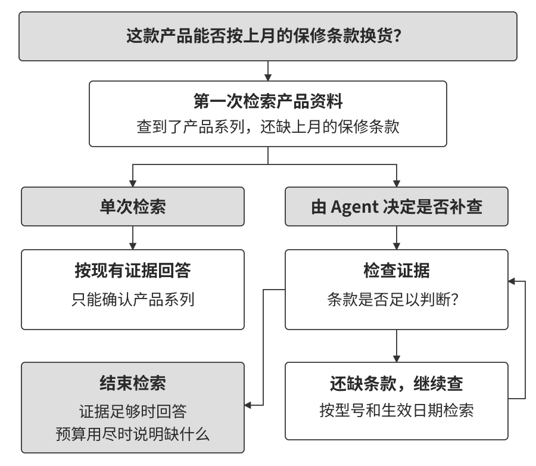

以 ReAct 为例，模型先分析问题并选择查询，调用 `knowledge_base_search`；工具返回观测后，模型判断证据是否足够。若缺少条件或相关对象，就改写查询继续检索；若材料已经充分，就结合来源生成回答。Harness 维护历史、工具调用和预算，在达到限制时结束搜索或转入澄清。

再看图3-13。即使把知识库后端从向量索引换成关系图，模型也可以继续通过同一个工具接口请求搜索。如果返回的文档里恰好有一段指令，模型可以照着执行吗？

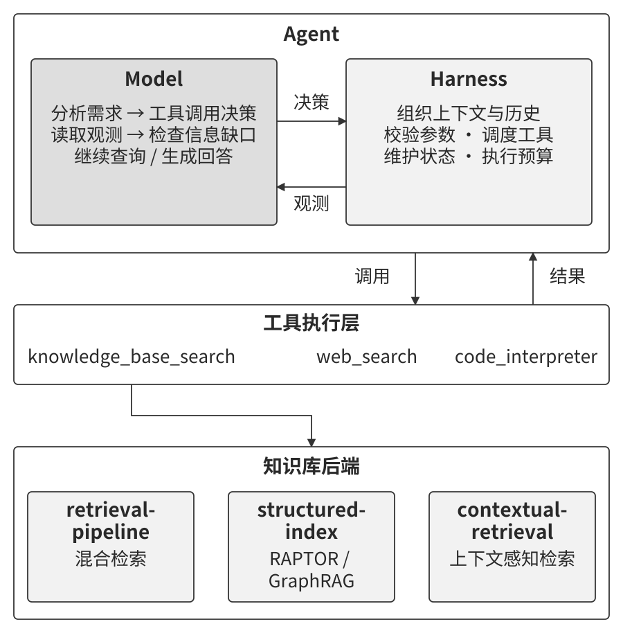

**检索内容的信任边界。** 外部文档可能包含试图改变模型行为的文本，也可能在入库前被加入错误事实。前者涉及间接提示注入，后者属于知识库投毒。处理时，需要同时管理内容来源与执行权限：检索结果带上来源、版本和引用位置，作为回答证据；转账、删除、对外发信等行动，则由 Harness 和执行环境依据用户授权校验。入库审核、来源追溯和事实核查进一步控制错误知识的传播。第二章介绍的来源标记与第四章的工具约束在这里共同发挥作用。

> **实验 3-8 ★★：比较单次检索与多轮检索**
>
> 本实验使用同一份中文法律材料、同一 BM25 检索器和相同模型，对七个问题比较两种模式：基线按原问题搜索一次，Agent 模式允许模型调整查询，最多执行四次搜索。
>
> 对“正当防卫是怎么规定的”这类查询，直接检索即可获得主要条文。更复杂的例子是“醉酒过失致人重伤且有盗窃前科，应如何量刑”。它同时涉及当前行为、醉酒情形和先前记录，检索时需要分别定位有关材料，再检查适用条件。
>
> 实际运行依次搜索了“醉酒过失致人重伤 盗窃前科 量刑”“醉酒 犯罪 量刑”“盗窃前科 量刑影响 刑法”和“前科 量刑影响 刑法”。模型随后还提出“累犯 认定 刑法”，此时搜索预算已用完，Harness 返回预算耗尽信息。
>
> 在实验划分的四个复杂问题上，目标法条覆盖率从约 8% 提高到 92%，平均搜索次数从一次增至 3.5 次，回答阶段平均耗时从约 8 秒增至 66 秒。三个简单问题的证据覆盖均为 100%，两组都只搜索一次。

同一检索循环也可以用于用户历史。下面沿用实验 3-1 的三层次评估集，观察 Agent 如何从跨会话记录中取回事实、区分对象和处理更新。

> **实验 3-9 ★★：用智能体化检索读取用户记忆**
>
> 本实验把完整对话历史作为知识库，按窗口切分后建立索引，再向 Agent 提供 `search_user_memory` 工具。窗口大小可以调整；本次运行每块包含八轮对话，相邻块重叠两轮，并保存会话标识、时间和业务元数据。查询最多执行三次，每次取回四个片段。
>
> 基础回忆可以围绕明确字段搜索，例如“我的支票账户号码是多少”。多会话问题还需要检查对象是否完整：用户既有本田 Accord，也有特斯拉 Model 3，询问车辆服务安排时，系统应区分两辆车及各自的预约状态。
>
> 可以据此设计一条检索路线：先搜索车辆与服务记录；发现另一辆车的线索后，再查询特斯拉的安排；最后说明本田的已有预约，并确认用户是否还需要为特斯拉预约。本次实际记录只执行了 `scheduled car services` 这一查询，普通检索组的回答集中在本田，遗漏了特斯拉。
>
> 另一类困难来自连续修改。转账案例中，妻子设立安排，丈夫随后修改金额和日期，妻子再次调整。取回记录后，需要按时间、对象及确认状态还原变化，找到最终生效的指令。当前分块已经保存时间信息，检索仍可能漏掉关键修改，因此可以进一步为片段补充事件背景。
>
> 在这 60 个用例中，18 个只搜索一次，6 个搜索两次，36 个用满三次。普通分块检索组通过了 47 个：基础回忆 19 个、多会话检索 15 个、主动服务 13 个。下一节继续在相同用例上比较上下文前缀和结构化记忆，分析它们分别补充了哪些信息。

#### 上下文感知检索：为片段补充背景

回到那份财报。要查 ACME 公司 2025 年第二季度的业绩，查询里有公司名和年份，可是写着“该公司收入增长了 3%”的片段偏偏没有这两个词。除了扩大分块，还可以保留这段短文，把缺少的背景补在它前面。**上下文感知检索（Contextual Retrieval）**在建索引时，为片段生成简短的背景前缀，再将前缀与原文一起用于检索[^ch3-1]。图3-14 展示这一处理过程。

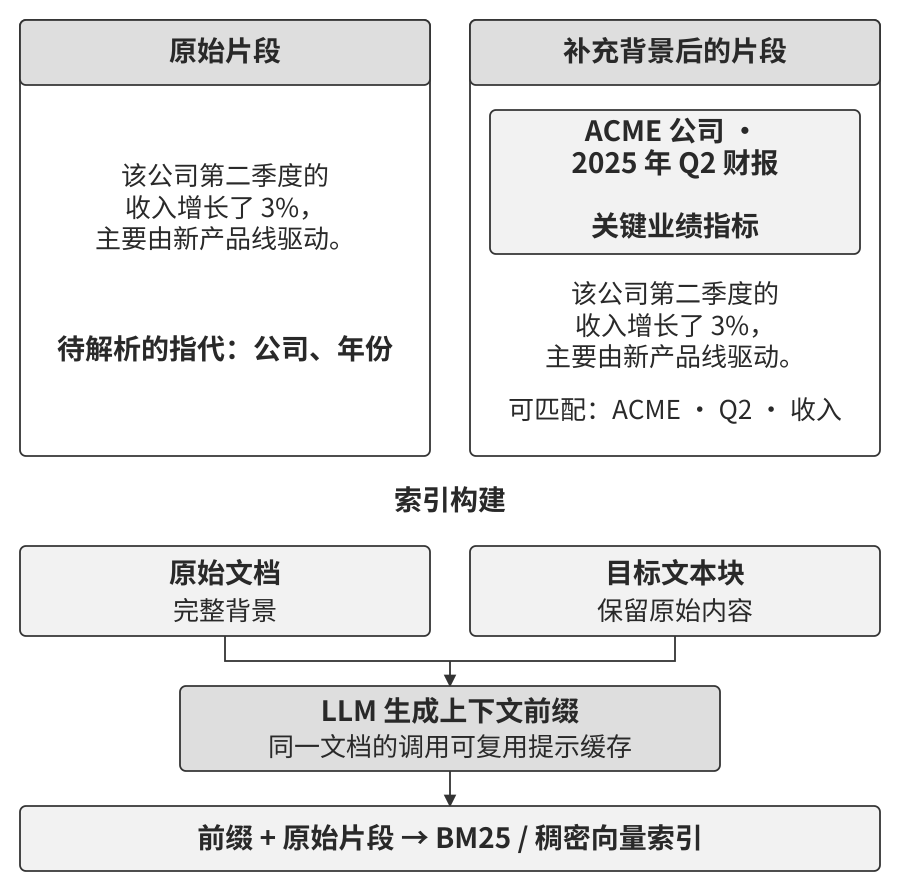

例如，前缀可以说明“本段来自 ACME 公司 2025 年第二季度报告的关键业绩指标部分”。生成时同时提供原文和目标块，让模型补充确有依据的指代、时间和章节信息。BM25 因此获得公司名、季度等可匹配词项，稠密嵌入也能结合这些背景表示片段。

它与第二章的上下文感知压缩可以配合使用：索引期为知识块补充背景，提高发现相关信息的机会；运行期根据当前任务整理已经取回的历史，控制输入长度。前者关注片段的可检索性，后者关注当前决策所需的信息与预算。

[^ch3-1]: Anthropic，Introducing Contextual Retrieval，2024 年 9 月。

> **实验 3-10 ★★：比较原始分块与上下文增强分块**
>
> 本实验为同一批资料建立两套索引：一套使用原始片段，另一套加入模型生成的前缀。保持查询和目标标注一致，分别比较 BM25、稠密检索与混合检索。
>
> 沿用前面的财报例子，查询“ACME 公司最近的收入增长情况”时，可以检查命中片段是否同时包含目标公司、期间和增长数据。仅有“收入增长”可能匹配到其他公司；补充前缀后，公司名和时间能够参与排序。
>
> 在本次 15 个查询中，加入前缀后，BM25 的 recall@1 从 0.60 提高到 0.80，稠密检索从约 0.867 提高到 0.933；两者的 recall@3 分别保持 0.867 和 1.0。混合检索的 recall@5 从 14/15 提高到 15/15。多找回的是哪一题？查询全国人大常委会的职权时，目标片段列出了职权，却缺少主语。加上前缀后，BM25 把它从第 16 名提到第 12 名，仍在前五条之外；混合检索把它从第 6 名提到第 5 名，它才进入前五条。再看原文，第一个片段列出了第（一）至（四）项职权，第五个片段从第（四）项接到第（二十二）项。评分只查标注的第五个片段有没有入选，要列全职权却得把两段接起来。
>
> 前缀生成增加了索引期调用。为同一文档的多个块生成背景时，可以复用文档前缀缓存。Anthropic 在 2024 年报告中，按 800 token 的块、8000 token 的文档及指定提示长度估算，每百万文档 token 的一次性处理成本约为 1.02 美元。
>
> 该报告中，上下文嵌入结合 BM25 将 top-20 检索失败率从 5.7% 降至 2.9%，相对下降约 49%；加入重排序后降至 1.9%，相对下降约 67%。报告采用的失败率为 $1-\mathrm{recall@20}$。

对于需要反复查询、内容相对稳定的资料库，笔者建议优先在建索引时补齐片段背景，一次处理可以服务后续多次查询。公司名称、事件主体和时间若在切分时丢失，单纯增大检索数量，仍可能取回一批指代不明的片段。生成前缀时补足这些线索，后续检索就能利用它们定位材料。

> **实验 3-11 ★★★：用上下文前缀与结构化卡片增强记忆**
>
> 对话中的“好的，就订这个吧”需要关联前面的商品或行程。若原文讨论的是上海到西雅图、500 美元的单程机票，前缀可以补充这些背景，并保留确认发生的会话与时间。
>
> 本实验在普通分块上增加两组配置：上下文前缀组，以及同时加载 Advanced JSON Cards 的双层记忆组。模型先基于普通索引生成搜索序列，再将同一组查询用于两套索引；双层组使用相同增强检索结果，并增加结构化卡片。
>
> 在转账案例中，前缀分别说明 Patricia 发起转账、James 修改安排，以及 Patricia 再次调整，帮助定位事件次序。原始记录给出的最终状态是 95,000 美元、10 月 1 日，之前的安排已被替代。本次三组都正确找到了这一状态。
>
> 双层结构还可以支持主动关联。卡片保存“东京行程”和“护照有效期”等关键事实，详细对话按需检索。以 1 月 15 日至 22 日的行程、2 月 18 日到期的护照为例，系统可以先发现日期接近，再查询续办记录与行程要求，最后提醒用户确认尚未完成的准备事项。这个旅行用例中，三组回答均通过评审；卡片与检索的差异主要体现在下面的车辆和跨会话用例中。
>
> 全部 60 个用例中，普通检索、上下文前缀和双层记忆分别通过 47、52、57 个。前缀组的主动服务用例从 13 个增加到 18 个；双层组在多会话检索层通过全部 20 个，主动服务层同样通过 18 个。车辆用例中，卡片补充了第二辆车的信息，帮助回答覆盖原先遗漏的对象。再看其中一项退步：用户问房产水损的保障范围，普通组提到了自住房和出租房，前缀组却漏了出租房。逐题对照可见，前缀组比普通组多答对了 8 题，也丢了原先答对的 3 题。

**需要主动服务时，笔者优先采用关键事实常驻、详细记录按需检索的双层架构。** 单靠检索，模型往往需要先知道该问什么，才能找出有关记录；尚未进入视野的护照、车辆或家庭关系，很容易因此被漏掉。把少量关键事实先放进上下文，有助于模型发现关联、提出查询，再取回原始细节。选择常驻信息时，需要考虑人物关系、当前约束和未完成事项；检索结果则保留来源、时间和变更依据。

#### 从数据集中提取知识：由案例到结构化表示

知识还可以来自对大量案例的整理。判决文书、客服工单和维修记录中，许多有用信息分散在具体叙述里。当任务需要从大量案例中归纳规律、比较结果或决定追问什么时，笔者建议先提取统一字段，再做统计与原型整理。只取回几个相似案例，难以看清整个数据集中的分布；统一字段后，就可以对整批记录作统计，并为后续个案查询提供概览。

这个过程可以分为两步。**知识提取**将原始描述转换为结构化记录，明确字段含义、取值和来源；**模式分析**再利用统计与聚类，寻找相似案例及其共同特征。图3-15 展示了从案例提取、特征编码到原型检索的流程。

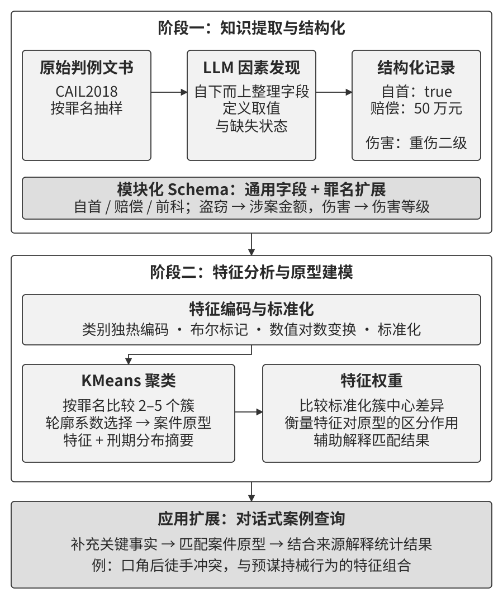

> **实验 3-12 ★★★：从司法案例中提取因素与原型**
>
> 本实验使用 CAIL2018 的刑事案件材料，选择盗窃、故意伤害和诈骗三类样本，构建“因素发现—字段提取—聚类—原型解释”的教学流程[^ch3-cail]。每类取 120 条用于建模，另外保留 20 条，共形成 360 条建模样本和 60 条留出样本。
>
> **发现并整理字段。** 模型先分批阅读建模样本，提出可能有用的因素，再合并成模块化 Schema。通用部分保存多个罪名都需要关注的字段，如自首、赔偿；扩展部分保存与具体罪名相关的信息，如涉案金额或伤害情况。本次整理得到 16 个通用字段，以及分别含 12、12、11 个字段的三组扩展。每个字段还需要定义取值和缺失状态，便于一致提取。
>
> **把字段编码为向量。** 类别字段可以使用独热编码：以盗窃、抢劫、诈骗三类作示意，分别编码为 `[1,0,0]`、`[0,1,0]`、`[0,0,1]`，每个位置只表示是否属于该类。使用 1、2、3 则会给某些算法引入类别之间的顺序和距离。“是否自首”“是否赔偿”等字段可用 1 和 0 表示已确认的两种状态；原文未提及的情况应单独处理，避免把缺失自动当成否定。
>
> 对金额等跨度较大的非负数值，本实现先使用 $\ln(1+x)$ 压缩尺度，再参与标准化。若一个字段允许同时出现多个类别，例如一条记录包含多种处置措施，可以为每类分别设置指示位，形成多热编码。
>
> **建立案件原型。** 对编码后的特征做标准化，再按罪名分别聚类。本实现比较二至五个簇，用轮廓系数选择分组，最终形成 11 个原型。每个原型保存样本数、主要特征，以及样本刑期的中位数、四分位数和范围。例如，可以围绕冲突起因、作案方式和伤害后果，比较口角后徒手冲突与预谋持械行为这类不同特征组合；具体分组由提取结果与聚类共同决定。
>
> **解释特征与匹配结果。** 程序根据各簇标准化中心的差异，计算特征在区分原型时的权重。原型匹配则将新案例映射到相同特征空间，取回相近组的统计摘要和依据，供模型组织解释。
>
> 本次从 60 条留出样本中选了 12 条生成解释，再交给独立模型评审。先看其中一条盗窃样本：它匹配到的原型只有一条建模记录，刑期为 4 个月，所以最小值、中位数、最大值都是 4。生成器如实报告了这个数，也指出只有一条记录可供参考。评审给“数字是否忠实于原型”打了 4 分（满分），留出样本的实际标签却是 8 个月。
>
> 如果把原型检索用于对话，可以先询问哪些缺失事实可能影响匹配，再根据回答重新检索。

[^ch3-cail]: CAIL2018，官方数据集项目。配套实验从公开材料中抽样，使用样本内部划分开展建模与评估。

从案例到原型，知识库增加了一层可检索的统计表示。原文提供证据，字段支持计算，原型概括相似样本的共同特征；三者保留对应关系，才能在发现提取错误或样本偏差时回查和修正。

#### 前沿探索：多模态与参数化记忆

设想用户指着先前上传的照片说“就要这个颜色”。如果系统当时只留了“蓝色外套”四个字，下次可能无法区分两种蓝。声音中的音色、图表中的空间关系也会在转写时损失细节。要让未来查询有机会找回这些信息，可以保存原始材料、保存可供模型使用的表示，或者进一步研究模型内部的持久记忆。

**第一条路线：原始材料与文本索引配合。** 例如，在用户授权的相册整理任务中，可以裁剪并保存人物面部等局部区域，在 Markdown 条目中引用图片，同时记录拍摄时间、场景和用户提供的人物标签。检索时先根据描述找出几张可能相关的照片，再读取原图或裁剪区域，比较外观细节。声音片段也可以关联时间、来源和转写，按需回放原始音频。文本提供入口，原始材料保留难以用文字概括的细节。

**第二条路线：存储嵌入并按需加载。** 视觉或音频编码器可以把材料转换为向量，存入索引，供相似性检索使用。例如，将图片局部区域或声音片段编码后，分别关联到对应的记忆条目。若模型支持经过训练的投影层和记忆接口，还可以在上下文中预留一组槽位，装入这些连续向量，让模型通过注意力访问。这里需要解决编码器表示与语言模型内部表示的对齐。

笔者与 Noah Shi 的一项初步研究把这个问题拆成两步。合照里有两个人，用户问“站在窗边的是上次见过的那位吗？”先要根据“窗边”找到用户指的那个人，再把这个人的图像与先前保存的样本比较。第一步选错了人，即使第二步认得很准，答的也是另一个问题。论文还把姓名等可准确抄录的事实留在文本记忆里，使两类信息各有合适的取用方式。[^ch3-perceptmem]

[^ch3-perceptmem]: 李博杰、Noah Shi，Parametric Multimodal User Memory；配套项目 `19PINE-AI/multimodal-user-memory` 收录了实现和 PerceptMem 实验。合照问题为教学示例。

**第三条路线：模型内部的持久记忆。** 为每位用户训练 LoRA，是把个性化事实写入模型的一种方式。直接提问“用户住在哪里”与根据住址规划行程，对记忆的使用要求不同：前者读取事实，后者还要将事实用于后续推理。只围绕事实复述训练，模型可能记得答案，却在复杂任务中没有主动用到它。因此，训练样本需要同时包含直接提问和依赖这些事实的任务。

笔者的 **User as Engram** 研究将文本事实写入 Engram 模型的局部记忆表，由共享适配器学习如何利用这些事实进行推理[^engram]。带哈希键的 N-gram 查找负责定位表项，门控机制将取回内容送入模型；每位用户保存局部表项，推理部分可以共享。论文在其文本事实实验中比较了直接回忆和间接推理，展示了如何分别管理每位用户的记忆内容与共享的推理能力。

[^engram]: Li, Bojie，User as Engram: Internalizing Per-User Memory as Local Parametric Edits，2026。

把这条路线扩展到多模态，还需要设计图像或音频表示的寻址、写入和读取机制。

### 本章小结

回到章首的订票委托。“我偏爱靠窗”来自这位用户，“可以带几件行李”要查航空公司在出行日期适用的条款。把两条信息都存成一句话，很容易丢掉最重要的区别：前一句适用于谁，后一句从何时起生效。保存时留下来源、时间和适用条件，取出后才有依据判断这次能不能用。单个事实适合写成简短笔记；需要说明人物关系或保留来龙去脉时，可以用卡片或原文段落；日期和数量还可以存成有类型的字段，交给程序计算。

如果助手报错了行李额度，先查现行条款有没有入库，再查条款被切进哪个片段、检索器有没有找到它、重排后它排在第几位，最后看模型拿到哪些材料。原文很多时，可以把结构化概览留在上下文里，按需检索细节。章节摘要有助于找主题，关系索引有助于查关联；若片段丢了指代，可以补上出处背景；一次检索仍缺证据时，Agent 还可以换个查询继续查。

航空公司公布新规定后，可以先做一次小范围更新，保留新旧条款的生效日期和来源；积累的重复条目、冲突和结构变化，再定期整理。提议者提交修改，审核者核对证据，批准后重建服务索引。有了版本记录，就能重放原来答错的题，也能查明旧答案当时依据哪份资料。怎样进一步从执行结果中积累经验，第九章会专门讨论。

查到可托运两件行李，只回答了“规则允许吗”。要替用户把行李加进订单，助手还得知道可以调用哪个工具、需要哪些参数，以及收到什么回执才算办成。这是下一章的起点。

### 思考题

1. ★★ 用户说：“5 月 1 日我从 A 搬到 B，5 月 10 日至 20 日住酒店 C，这期间账单发邮件。”5 月 15 日，助手应怎样回答家庭住址、临时住处和账单送达方式？请设计记录与查询规则，说明如何处理笔误更正或相互冲突的地址。
2. ★★ 原始文档包含矛盾信息时，上下文前缀可能把错误一起写入索引。你会怎样保存来源、版本和不确定项，并在检索与生成阶段使用这些信息？
3. ★★ 将图表转换为文本后，哪些空间关系容易丢失？请用表格、架构图或折线图举例，设计原图、结构化表示和文本索引协同检索的方案。
4. ★★★ 随着模型和长上下文能力提升，分块、索引和检索流程中的哪些工作可能交给模型？请结合 Rich Sutton“苦涩的教训”中对搜索和学习的讨论分析，并设计实验比较全量输入与按需检索，同时检查任务质量、计算成本和权限约束。
5. ★★★ 如果模型已经掌握大量领域知识，外部知识库还应保存什么？请分别讨论公开常识、持续更新的规则、私有资料和需要精确追溯的证据。
6. ★ RAPTOR 的多层摘要与 GraphRAG 的实体关系、社区摘要分别支持哪些查询？请为总体概览、局部细节和多跳关联各举一例，并说明需要检查什么证据。
7. ★★ 目录、链接与向量索引如何协同组织知识？请设计一个需要人和 Agent 共同维护的知识库，说明导航、语义搜索、版本更新与权限过滤各自的位置。
8. ★★★ 从案例中提取字段并聚类后，怎样判断原型有用？请区分聚类特征的重要性、结果预测能力与因果解释，并设计留出评估和专家复核流程。
9. ★★★ 为 Markdown 用户记忆库设计增量更新与定期整理流程。若审核者与提议者使用相同模型，且审核者只能看到提议者挑选的片段，哪些错误容易遗漏？请从证据覆盖、工具权限和审核评估三个方面改进。

[^ch3-glove]: Pennington 等，GloVe: Global Vectors for Word Representation，2014。

[^ch3-sbert]: Reimers 与 Gurevych，Sentence-BERT: Sentence Embeddings using Siamese BERT-Networks，2019。

## 第 4 章 工具

在科幻电影《Her》中，AI 助手 Samantha 会整理邮件、协助回复、处理出版事宜，并在不同沟通渠道之间切换。这样的助手需要把语言理解转化为对外部系统的操作。Agent 通过**工具**完成这些交互。工具是它的“感官和手脚”，既提供观测，也执行行动。本书讨论的 Manus、OpenClaw 等通用 Agent，同样需要通过工具访问数字世界。

假设用户说：“帮我找出客户邮件中提到的交货日期，整理成表发给我。”模型可以决定查哪封邮件，读原文却要访问邮箱，发出表格也要调用发送接口。这些工具该怎样设计，模型需要时又怎样找到它们？本章先区分五类工具，再讨论工具的描述、接入与发现，最后分别设计感知、执行与协作接口。事件触发和用户沟通还涉及何时唤醒 Agent、怎样跨渠道传递消息，留到第六章展开。

### 工具的分类

以查邮件为例，模型选择下一步要做什么，Harness 检查参数和权限并发出请求，邮箱服务实际读写数据。第一章按用途区分了感知、执行、协作、用户沟通和事件触发工具。前四类都由 Agent 主动调用，事件触发工具则让外部事件也能唤醒 Agent（表4-1）。

表4-1 五类工具的调用方向与主要用途

| 工具类型 | 调用方向 | 主要用途 |
| --- | --- | --- |
| 感知工具 | Agent 主动调用 | 获取外部信息 |
| 执行工具 | Agent 主动调用 | 执行计算或修改外部状态 |
| 协作工具 | Agent 主动调用 | 委派任务、交换消息、协调其他 Agent 或人类 |
| 用户沟通工具 | Agent 主动调用 | 向用户回复、展示结果或发送提醒 |
| 事件触发工具 | 开发者配置或 Agent 注册、外部触发 | 在指定事件发生时唤醒 Agent |

**感知工具**让 Agent 获取外部信息，例如网络搜索 `web_search`、知识库检索 `knowledge_base_search`、网页读取 `fetch_url`、文件名搜索 `find_file`、文件内容搜索 `grep_file` 和文件读取 `read_file`。

**执行工具**让 Agent 执行计算或改变外部状态，例如命令行 `shell_exec`、代码解释器 `code_interpreter`、文件写入 `write_file`、文件编辑 `edit_file` 和邮件发送 `send_email`。同一个通用执行器可以完成只读计算，也可以修改数据。

**协作工具**支持任务委派和消息交换，例如创建子 Agent `spawn_subagent`、发送消息 `send_message_to_subagent`、取消子 Agent `cancel_subagent` 和发现可用 Agent `list_agents`。独立任务可以并行处理，例如分别调研 OpenAI 多位联合创始人的经历；不同任务也可以交给配置了不同模型、工具、提示词和上下文的 Agent。第十章将进一步讨论分工与协作架构。

**用户沟通工具**向用户传递信息，例如回复消息 `reply_to_user`、发送结构化卡片 `send_card_to_user` 和发送提醒 `send_user_notification`。当交互扩展到多个渠道或需要后台通知时，系统可以把消息发送封装为显式工具调用，统一管理接收对象、内容和送达状态。

**事件触发工具**连接外部事件与 Agent 的运行，例如定时器 `set_timer`、后台任务监控 `monitor_shell` 和事件源连接 `connect_channel`。整个过程包含两个步骤：注册时，由开发者预先配置，或由 Agent 通过获准的调用声明关注的事件；事件发生后，调度系统接收回调或事件消息，唤醒 Agent 处理。新邮件、系统告警、定时提醒和后台任务完成，都可以成为新的运行入口。

回看开头的邮件任务：点开原信取得交货日期，是感知；生成并保存汇总表，会改变工作区，是执行；把表交给委托人，属于用户沟通。如果系统在下一封客户邮件到达时自动继续，才引入了事件触发。同一个邮件服务可以承担这几种职责。接下来要决定的是，交给模型的工具该有多细：是让它分别查邮件、读正文、找附件，还是替它把经常连做的几步合起来？

### 工具设计的通用原则

早期接入工具时，常见做法是直接包装每个 API 端点。这种做法接入快，却容易得到一组粒度很细的接口。Agent 为完成一个任务，可能要反复查找对象、读取属性、检查条件，再调用执行接口。设计工具时，可以围绕常见任务整合这些操作，例如把查找联系人与发送消息衔接起来，或让日志搜索直接返回相关行及其上下文[^ch4-tool-design]。

**工具应围绕 Agent 要完成的任务来设计。** 这种从 Agent 使用方式出发设计接口的思路称为 **ACI**（Agent-Computer Interface，Agent—计算机接口）。HCI 关注人如何与计算机交互，ACI 则关注模型如何选择操作、构造参数、理解反馈并纠正错误。

[^ch4-tool-design]: Anthropic，*Writing effective tools for AI agents—using AI agents*，2025。

#### 能力的表达形式：专用工具、通用执行器与 Skill

把“部署应用”交给模型，可以设计三种操作界面。第一种只暴露一个 `deploy_app`，由服务端完成各步骤；第二种分别暴露构建、打包和部署，模型决定何时调用下一步；第三种把步骤写进 Skill，让模型在终端执行。如果构建失败，第一种要靠工具结果告诉模型错在哪一步，后两种可以直接把这次构建的错误交给模型。

- **专用工具**为确定的操作提供结构化接口。开发者定义参数 Schema、校验规则、执行逻辑与返回格式，便于单独测试和授权；工具定义进入上下文后，占用量取决于字段、描述和示例的长度。
- **通用执行器与 Skill**配合使用：终端或代码解释器提供执行能力，Skill 说明流程、适用条件与操作方法。宿主可以先加载名称和简介，选中后再读取完整说明及相关资源。

例如，一份部署 Skill 可以依次说明：用 `npm run build` 构建项目，用 `docker build -t app:latest .` 打包镜像，再用 `kubectl apply -f deploy.yaml` 将清单中定义的资源应用到当前集群。Agent 通过终端工具执行这些步骤，复用同一个执行入口。

工具怎样实现，和模型何时读到它的说明，是两个问题。数百个专用工具可以只显示索引，按需加载 Schema；少量 Skill 可以把目录常驻上下文，规模增大后再加入检索。选专用接口还是通用执行器，影响的是参数怎么传、代码怎么维护；选一次给全还是按需加载，影响的是模型这一步能看到哪些工具。后文“工具太多怎么办”将讨论披露策略。

**笔者建议优先采用通用工具，再按权限、参数和性能需求补充专用接口。** 例如，在沙盒中为 `code_interpreter` 配置 SymPy、NumPy 和 pandas，Agent 就能编写 Python 完成四则运算、符号计算、数组处理和数据分析。这能让模型充分发挥代码生成能力：一个解释器可以承载多种算法，也能组合已有库处理预先没有想到的新问题。模型负责生成代码，运行环境负责执行，并限制文件、网络和资源访问。

即使采用专用工具，笔者也建议优先整合功能相近、经常一起使用的操作。接口过细，模型就要记住更多名称和分工，完成同一任务也需要更多次调用。整合时主要看**功能相似性** 与 **使用场景的重叠度**。例如，`extract_pdf_text`、`extract_docx_content`、`extract_pptx_content` 都接收文档并提取文本，可以整合为 `read_document`，通过 `file_type` 区分格式。模型只需选择统一入口，新增格式也可沿用参数与返回结构。

以下四种情况尤其适合专用接口。

1. **需要精细授权和审计。** 生产数据库写入可以封装为范围明确的操作，由服务端检查用户权限、目标表和允许变更的字段，并记录操作依据。
2. **需要屏蔽平台差异。** grep、find 等操作可以经由 shell 完成，专用文件搜索工具则能统一 macOS、Windows 和 Linux 的参数与反馈，例如固定返回文件名、行号和匹配片段。
3. **操作频率很高。** 高频操作可以提供短而稳定的入口，减少重复生成脚本与解释流程的开销。
4. **参数关系复杂。** 嵌套对象、字段依赖和复杂取值约束适合通过 Schema 与业务校验共同表达。

**参数越复杂，传递方式越重要。** 结构化工具调用通常用 JSON Schema 描述输入，部分模型服务支持约束生成，使参数满足所支持的 Schema 规则。返回值的结构由工具接口约定，宿主再将结果交给模型。类型和格式校验之外，权限、对象是否存在、多个字段是否满足业务条件，仍由 Harness 与工具服务检查。

Skill 可以说明如何调用专用工具，也可以指导 Agent 使用 CLI。后一种方式要求模型同时处理命令行语法、引号和转义，不同 shell 的规则也有差别。参数越复杂，模型需要正确处理的细节就越多。遇到复杂嵌套参数，可以先将它们写成 JSON，再让命令读取该文件，减少多层转义，并在执行前校验内容。

**Skill 便于业务人员直接编写和修改。** 熟悉业务的人可以自己写步骤，也可以从 Agent 起草的说明改起。流程顺序变了、某一步只适用于部分客户，或是需要换个例子，直接改说明文字即可，省去了改工具代码和重新部署接口的工作。按照 Agent Skills 规范，`SKILL.md` 的元数据采用规定格式，正文采用 Markdown，还可以附带脚本、参考文档和资源[^ch4-skill-format]。

[^ch4-skill-format]: Agent Skills，格式规范，包括元数据、正文、附带资源与渐进式加载。

选择能力形式时，可以综合四个维度。

- **安全与权限**：专用接口便于限定操作范围；通用执行器通过沙盒、凭证和资源权限控制执行能力。
- **参数复杂度**：复杂结构适合 Schema 与业务校验；简单操作可以直接通过 CLI 传参。
- **变更频率**：经常调整的流程优先写入 Skill，业务人员可以直接修改说明和示例；稳定且重复使用的底层操作再封装为工具或脚本。
- **模型能力**：能可靠生成代码和处理命令行的模型，优先让它通过 Skill 与通用执行器组合能力，减少专用工具数量；模型较弱、复杂参数频繁出错时，则用结构化接口承担更多约束。

**代码还可以编排多次工具调用。** 抓取多个网页并提取字段时，模型可以生成一段脚本，完成循环、过滤和汇总。网页全文保留在执行环境的变量中，只有选中的字段与统计结果返回上下文。程序中的条件、循环和异常处理负责衔接各步操作，模型直接分析汇总结果。对于批量抓取、过滤和统计这类步骤已经清楚的任务，笔者优先用代码串联，减少模型逐次调用工具、读取中间结果的往返。中间结果越多、返回字段越精简，这种安排节省的上下文就越可观。第五章将进一步讨论这类代码编排。

这类接口常称为 **Code Mode**。以 Cloudflare 的 MCP 服务器为例，模型先用 `search()` 写一段查询程序，从 OpenAPI 描述里找出所需端点和参数；接着用 `execute()` 提交调用这些端点的 JavaScript。比如要列出符合条件的 DNS 记录，程序可以逐页查询、过滤，只返回命中的记录。前一步省去了把整本接口手册放进上下文的开销，后一步省去了把每页结果送回模型的往返。执行身份能读哪些区域、能否修改记录，仍由服务端授权决定。[^ch4-code-mode]

[^ch4-code-mode]: Cloudflare，Code Mode 的 MCP 实现；Armin Ronacher 以 Pi 1.0 为例讨论了 Harness 提供的工具与执行环境的分工。

#### 工具描述：说明用途、参数与反馈

给工具写说明时，可以先想象一条最容易误用它的请求。用户说“找出合同里提到违约金的条款”，文件名搜索只会返回名字匹配的文件；即使得到了一个路径，模型仍需读取正文。工具描述要让模型据此判断应当选哪一个接口、调用时要提供什么，以及这份结果足以回答什么问题。

**说明使用时机。** 网络搜索的描述可以写成“需要获取实时信息或查找未知事实时使用”，让模型把用户需求与工具用途对应起来。只有“搜索相关内容”时，模型还要自行猜测搜索范围和适用条件。

**明确输入与搜索范围。** 例如，文件名搜索工具可以说明“按文件名和路径匹配；查找文件中的文字请使用 `grep_file`”。把相邻工具的分工写清楚，可以帮助模型在一次调用中选对入口。**在笔者看来，明确边界条件往往比罗列功能更重要。** 工具接受什么输入、搜索哪些范围、遇到空结果或错误时怎样处理，都直接影响模型的下一步决策。

**用规范加实例说明参数。** `timestamp` 可以写成“RFC3339 格式，例如 `2024-03-15T14:30:00Z`”。模型处理复杂任务时，需要同时选择工具、从历史轨迹中提取信息，并权衡后续步骤，参数格式只是其中一个细节。完整字符串提供了可直接参照的格式，模型可以照着构造参数，减少重新解释术语时出错的机会。

同样，`phone` 可以写成：“电话号码，采用 E.164 国际号码表示，以 `+` 开头，后接国家代码和号码，其余部分仅含数字，无空格或分隔符。例如 `+8613888888888`（中国）或 `+12025551234`（美国）。”

**说明返回结构与执行代价。** 例如，“返回 JSON 数组，每项包含 `title`、`url`、`snippet` 三个字段”，便于模型提取标题、来源与摘要。耗时较长的工具可以注明测量环境下的预计延迟和替代入口，例如“读取完整网页可能需要 5～10 秒；只需元信息时可调用 `get_page_metadata`”。

还可以附上 1～5 个经过验证的调用示例，覆盖最小参数、常见组合和复杂条件。JSON Schema 能表达类型、必填项、取值范围和部分字段依赖[^ch4-json-schema]；示例则展示这些规则如何用于具体任务，例如时间戳采用秒还是毫秒、过滤条件如何嵌套、哪些可选字段通常一起出现。Anthropic 在 2025 年报告的内部复杂参数测试中，加入工具调用示例后，准确率从 72% 提高到 90%[^ch4-tool-examples]。

[^ch4-json-schema]: JSON Schema，对象类型与属性约束。模型接口支持的 Schema 关键字范围由相应服务规定。

[^ch4-tool-examples]: Anthropic，*Introducing advanced tool use on the Claude Developer Platform*，2025 年 11 月 24 日，Tool Use Examples 部分。

Agent 频繁选错工具时，笔者建议**优先检查工具描述**：几个工具是否使用近似名称，搜索范围是否清楚，参数是否缺少例子。这套方法同样适用于 Skill 的名称、简介和操作说明。

#### 参数传递的保真性

模型要求替换一段原文，执行端却报告“找不到”。在让模型重新措辞之前，先问两端收到的是不是同一串字符。调用经过解析、序列化、代理和运行时封装，每层都可能改变内容。**参数保真**要求执行端看到的值与模型提交的值具有相同含义；协议转义可以改变传输形式，解码后的引号与换行仍应保留。

以 2026 年初 Cursor 某个版本中的弯引号转换问题为例。替换工具接收 `old_string` 和 `new_string`，通过精确匹配修改文件。读取工具返回中文弯引号 `“`、`”`，对应 `\u201c`、`\u201d`；模型将原文放入 `old_string`，参数传递过程中却被转换为英文直引号 `"`。文件中的原文保持不变，替换工具因而返回“未找到匹配”。再次读取、再次复制原文，仍会遇到同样的失败。

写入方向也会受到影响。模型要求写入弯引号，文件最终保存的却是直引号。随后读取文件时，模型看到的内容与预期写入内容不同，又可能尝试修正；只要转换仍在发生，重试就会重复同一个错误。

另一类问题是**静默参数注入**。某 IDE 的 bash 工具会自动为 `git commit` 附加 AI 提交标记参数。旧版 Git 不识别该参数，提交因此报错。模型只看到自己生成的命令，可能反复调整提交信息或其他参数，却始终没有改到真正的故障来源。

排查这类问题时，把模型生成的参数、传递后的参数、实际执行的请求和返回结果放在一起对照。接口若会统一编码或补充执行参数，就要写清转换规则，并返回实际采用的值。对精确匹配工具来说，多一个空格、少一个换行或变了一个引号，都可能导致匹配失败。模型得知道执行端究竟收到了什么，才能改对下一次调用。

### 工具生态：MCP 与 Skill Hub

不同模型接口和 Agent 框架使用各自的工具定义方式，例如 function calling、tool use 与 LangChain 的 Tool 抽象。同一个外部服务若要逐一适配这些接口和框架，就需要重复处理描述、参数和结果格式。Anthropic 于 2024 年 11 月发布的 **Model Context Protocol（MCP）**，为模型应用访问工具和数据提供了统一协议[^ch4-mcp-origin]。

理解 MCP，可以先看宿主、客户端和服务器三个角色。**宿主（host）**是 Agent 应用或 IDE，负责模型交互、上下文组织与权限管理；宿主中的 **MCP 客户端**负责协议消息；**MCP 服务器**提供工具、资源和提示模板，可以作为本地进程运行，也可以部署为远程服务[^ch4-mcp-architecture]。

**工具定义与调用。** 客户端通过 `tools/list` 获取可用工具，清单可以分页返回。每项工具包含名称、描述和 `inputSchema`；结构化结果还可用 `outputSchema` 约定格式。模型选择工具并生成参数后，宿主完成校验，由客户端发送 `tools/call`，服务器执行后返回结果。宿主决定将哪些定义和结果放入模型上下文[^ch4-mcp-tools]。

图4-1 中，客户端拿到天气工具的名称和参数后，还要发起一次调用才能查到北京的天气。配套实现采用 MCP 2026-07-28，每次请求携带协议版本、客户端信息与能力，客户端也可以先调用 `server/discover` 了解服务器支持的版本及能力。早期版本采用 `initialize` 握手建立会话，连接时需要按双方支持的版本选择交互方式[^ch4-mcp-versioning]。

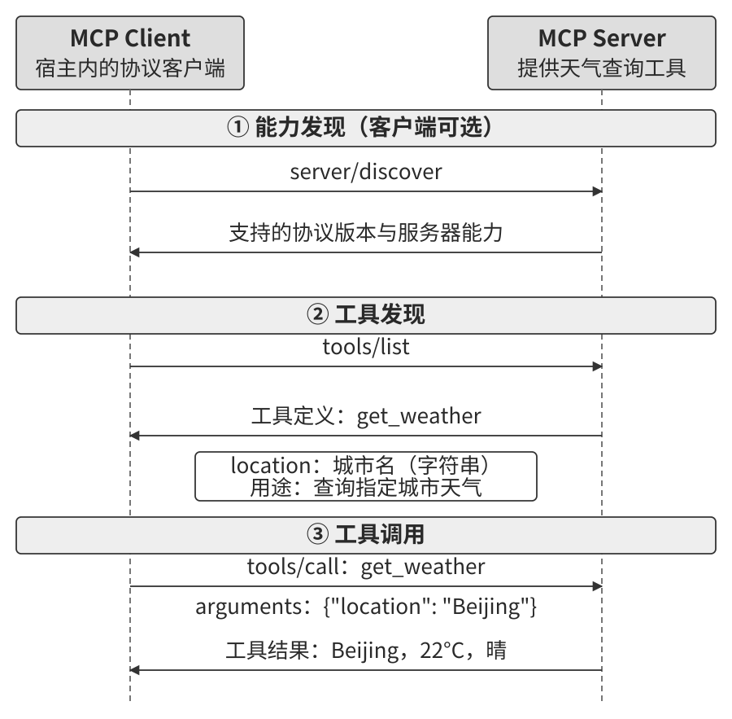

同样是查不到天气，图4-1 中有两个不同的排查起点。宿主连上了服务器，调用 `tools/list` 却找不到天气工具，应核对服务器发布了哪些工具、客户端是否读完了分页清单。如果模型选对了工具，服务器却报缺少城市名，就从调用记录里找 `arguments`，核对字段名是不是工具定义要求的 `location`。

**传输方式。** stdio 通过本地子进程的标准输入和标准输出传递 JSON-RPC 消息。Streamable HTTP 则通过 HTTP 发送请求，响应可以是 JSON，也可以使用 SSE 流逐步返回。Streamable HTTP 替代了早期的 HTTP+SSE 传输方案，并继续使用 SSE 作为流式响应方式[^ch4-mcp-transports]。

**资源与提示模板。** 资源（resources）提供可读取的数据，例如文件内容和数据库记录；宿主可以按 URI 列举、读取并选择相关内容。提示模板（prompts）提供可复用的消息或任务模板，供用户和客户端选用。工具也可以承担搜索和读取，因此这三类原语按交互接口分工：工具提供调用入口，资源提供数据入口，提示模板提供任务入口[^ch4-mcp-primitives]。

MCP 的核心价值是让一份工具实现服务于多个 Agent 产品。统一协议使同一个服务器能够被兼容宿主复用，例如 Cursor、Claude Desktop 和 OpenClaw，开发者也能把更多精力放在能力本身及其反馈质量上。宿主把协议中的工具定义转换为模型可用的接口。

**Skill Hub 提供能力包的发现与分发。** 一份 Skill 通常包含 `SKILL.md`，还可附带脚本和参考资料。分发平台帮助用户搜索、安装和更新这些文件。Vercel 于 2026 年 1 月推出 skills.sh，提供技能目录及安装工具；OpenClaw 生态的 ClawHub 也提供技能查找与版本管理[^ch4-skills-sh][^ch4-clawhub]。安装后，宿主按其加载策略读取名称、简介与完整说明。MCP 也可通过扩展提供 Skills 的发现与读取，能力包与通信协议可以配合使用[^ch4-skills-over-mcp]。

**接入与上下文加载分别管理。** MCP 客户端取得工具清单后，可以全量提供给模型，也可以先保留索引、按需加载定义。Skill 同样可以先显示 `name` 和 `description`，选中后再读取正文。工具允许列表决定哪些能力可用，延迟加载决定哪些定义当前可见。

**接入第三方能力时，分别检查它提供的内容和实际执行的操作。** 描述、返回内容和附带代码来自不同主体，授权范围也可能不同。以 MCP 为例，可以分别检查三类问题。

1. **工具描述投毒。** 描述中可能夹带与工具用途无关的操作要求，诱导模型越出当前任务。这属于提示注入：外部提供的内容试图改变模型的行为。
2. **服务器及依赖被修改。** 服务器升级可能改变工具行为，依赖更新或远程服务被入侵也可能污染返回结果。
3. **同名工具混淆。** 不同服务器可能提供同名或相似工具，模型或路由层由此选错目标。宿主应保留服务器身份与工具名称的绑定，展示来源，并在调度时校验目标。

接入前审查描述与实现，固定可控部署的版本，并对升级重新核查；每个服务器使用与任务相符的最小权限凭证。远程服务由他方维护时，还要监测工具定义与行为变化。

运行时还可以使用后文的 Sidecar，对结构化调用及必要任务依据独立审核。调用参数中的路径、文本和目标地址也应作为待检查数据处理。审核结果与确定性的权限规则共同决定是否执行。第五章将介绍 Simon Willison 的“致命三要素”，用于分析私有数据、外部输入与对外通信组合后的风险。

Skill 附带的脚本、本地 MCP 服务器及远程服务，各有执行位置与权限范围。审查时检查代码来源、运行环境、文件和网络权限，以及凭证流向；外部提供的步骤若引导下载或运行其他程序，也应纳入这条检查链。平台扫描可提供辅助线索，运行隔离、最小权限和变更审核则直接控制实际执行。

[^ch4-mcp-origin]: Anthropic，*Introducing the Model Context Protocol*，2024 年 11 月 25 日。
[^ch4-mcp-architecture]: MCP 2026-07-28 版规范，架构和协议概览两节。
[^ch4-mcp-tools]: MCP，Tools，包括工具清单、输入输出 Schema 和调用结果。
[^ch4-mcp-versioning]: MCP，*Versioning and Compatibility*，说明逐请求元数据、能力发现与旧版握手的兼容方式。
[^ch4-mcp-transports]: MCP，传输概览及 2025-11-25 传输规范，后者说明 Streamable HTTP 对早期 HTTP+SSE 方案的替代关系。
[^ch4-mcp-primitives]: MCP，Resources 与 Prompts 两节。
[^ch4-skills-sh]: Vercel，*Introducing skills, the open agent skills ecosystem*，2026 年 1 月 20 日。
[^ch4-clawhub]: OpenClaw，ClawHub 使用说明。

### 工具太多怎么办：层次化组织与主动工具发现

工具从十几个增长到成百上千后，模型既要找到合适的能力，也要读懂相近接口之间的差异。全量定义会占用上下文；若定义位于提示前缀，增加、移除或重排工具还可能缩短可复用的缓存前缀。名称和用途相近的工具越多，模型就越容易选错入口或忽略必要能力。因此，大规模工具库应默认按需加载，同时设计好分类目录与发现接口，让模型先找到与当前任务相关的工具，再根据各自的用途选一个。

可以把工具发现想成翻一本按任务编排的手册。目录先告诉模型去哪个栏目找；执行中遇到新的需要，它可以回来继续找；选中某项能力后，再读参数、操作顺序和例子。下面的类别索引、主动搜索和 Skill 分别解决这三个问题，专用工具和通用执行器都可以通过这些入口提供给模型。

#### 层次化组织与按需加载

**先提供索引，用到时再加载定义。** 工具目录可能占用大量上下文。Anthropic 举过一个例子：GitHub、Slack 等五个 MCP 服务器共提供 58 个工具，完整定义约占 5.5 万 token[^ch4-tool-search-eval]。Cursor 采用文件目录管理这些描述，初始上下文只提供工具名称等简要信息，Agent 根据任务查阅完整定义。在 Cursor 于 2026 年 1 月公布的 A/B 测试中，对于实际调用 MCP 工具的任务，这种方法将 Agent 的总 token 消耗减少了 46.9%；节省幅度随接入的 MCP 数量而变化[^ch4-cursor-discovery]。

Pi 的早期设计则优先使用附带 README 的 CLI 工具，让 Agent 按需阅读用法，再通过命令行调用能力[^ch4-pi-no-mcp]。社区扩展 `pi-mcp-adapter` 将类似思路用于 MCP：默认向模型提供一个约 200 token 的代理工具，模型依次搜索工具、查看定义、发起调用；服务器延迟到首次调用时启动。Pi 后续的 0.99 版本也加入了内置 MCP 支持，并采用按需发现机制[^ch4-pi-mcp-adapter]。这些实现把协议接入与上下文加载分开处理：后端连接 MCP 服务，前端通过简短索引或代理接口帮助模型找到所需能力。

[^ch4-cursor-discovery]: Cursor，*Dynamic context discovery*，2026 年 1 月 6 日。
[^ch4-pi-no-mcp]: Mario Zechner，*What if you don’t need MCP at all?*，2025 年 11 月 2 日，介绍 CLI 与按需阅读文档的设计思路。
[^ch4-pi-mcp-adapter]: pi-mcp-adapter，项目 README 的代理工具、延迟启动及与 Pi 内置 MCP 的比较。

**按任务组织工具目录。** 当工具增多时，可以按获取信息的方式分组，让模型先定位类别，再选择具体接口：

- **搜索工具**：根据线索寻找信息位置，例如网络搜索、知识库搜索和文件搜索。
- **读取工具**：从已知位置获取内容，例如读取网页、文档或指定记录。
- **解析工具**：从非结构化内容中提取信息，例如图片 OCR、视频分析和音频转录。
- **查询工具**：按字段与条件访问结构化数据，例如天气 API、股票 API 和数据库查询。

以“查出一篇论文使用了哪些数据”为例，搜索先返回候选论文及地址，读取工具按地址取回原文，解析工具再帮助定位表格。如果第一步把同名论文排在首位，后面即使准确读出了表格，也会答错。

**先用检索缩小工具范围。** 宿主可以根据任务描述，对工具名称、简介和参数说明进行关键词或语义检索，只把匹配工具的定义交给模型。返回的工具太少，可能漏掉下一步要用的接口；返回太多，既占上下文，也更难选。首次检索可以根据用户请求进行，后续则根据任务进展补充。

#### 模型原生的主动工具发现

复杂任务的工具需求往往随着执行逐步显现。例如，“Debug the file”可能先需要读取文件，再需要检索依赖、运行测试和分析错误。只在任务开始时检索一次，容易遗漏后续所需的能力。

**让 Agent 在需要时提出请求。** MCP-Zero 让模型在执行过程中生成结构化能力请求，例如用 `server` 指定 GitHub，用 `tool` 描述“搜索仓库并返回元数据”。系统先匹配服务器，再匹配服务器内的工具，并把选中的定义加入上下文；若返回工具无法满足任务，模型可以调整请求，继续检索。论文构建的 MCP-tools 数据集包含 308 个服务器、2797 个工具；其 APIBank 全工具集合测试中，单轮与多轮设置的工具提示开销均减少约 98%[^mcp-zero-2025]。

工程中也可以保留 `web_search`、`code_interpreter` 等基础工具，再增加一个工具搜索接口。模型描述缺少的能力，搜索接口返回几项匹配工具的定义，模型从中选一个调用。Anthropic 的 Tool Search Tool 采用这种按需发现方式：常用工具直接加载，其余工具通过 `defer_loading` 延迟加载。Anthropic 公布的内部 MCP 评估中，启用工具搜索后，Opus 4 的准确率从 49% 提升至 74%[^ch4-tool-search-eval]。

[^mcp-zero-2025]: Xiang Fei、Xiawu Zheng、Hao Feng，*MCP-Zero: Proactive Toolchain Construction for LLM Agents from Scratch*，2025。约 98% 的开销降幅来自 APIBank 全工具集合设置，见论文表 1。
[^ch4-tool-search-eval]: Anthropic，*Introducing advanced tool use on the Claude Developer Platform*，2025 年 11 月 24 日，Tool Search Tool 部分。

**先找服务器，再找工具。** MCP 服务器通常围绕一个平台或业务提供一组工具。图4-2 的例子先按能力描述选中 GitHub 服务器，再从它的工具中挑出三个候选。同名操作可能分属不同平台，第一步就可以排除一批无关候选。但如果这一步漏掉了正确的服务器，下一步再仔细比较工具也找不回来。

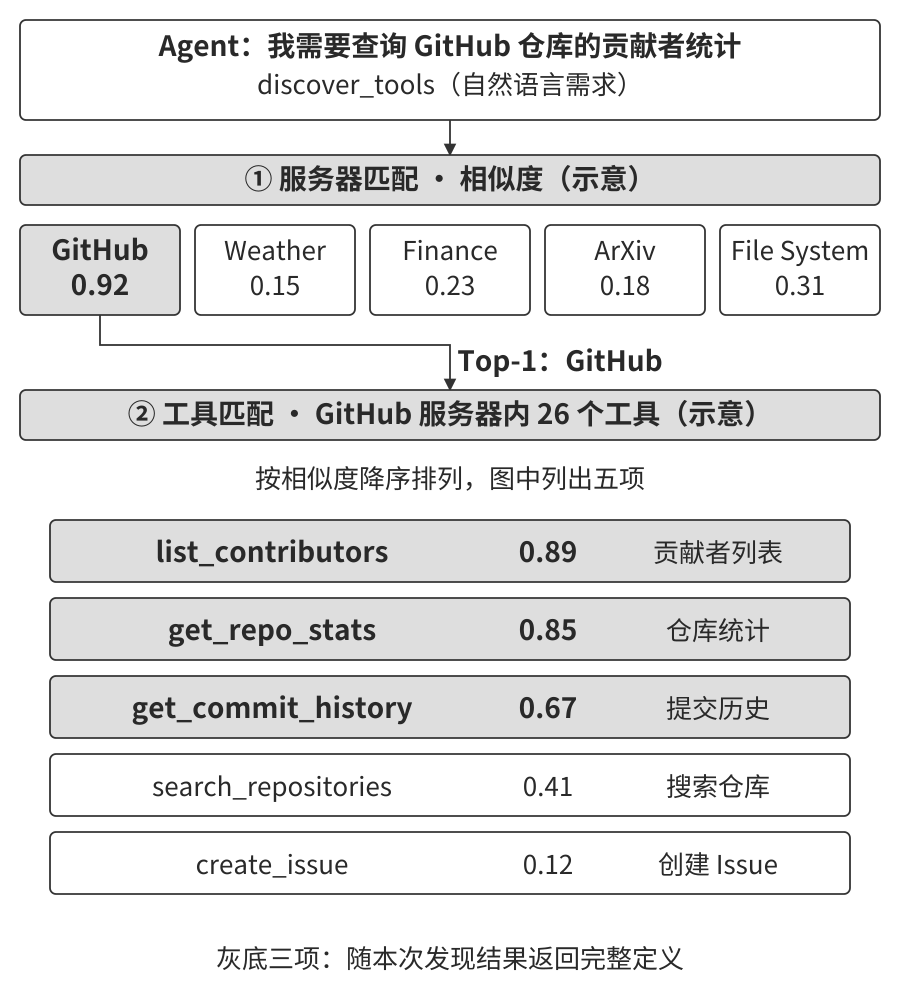

采用向量检索时，可以预先计算服务器与工具描述的嵌入，并在目录变化时增量更新。每一层都应检查匹配质量：服务器或工具候选的相似度低于设定阈值时，返回“未找到合适工具”，让 Agent 补充条件、改写需求后重试。对于能够通过通用执行器完成的任务，也可以改用基础工具组合实现；创建和保存新工具的方法将在第九章讨论。

**让动态加载与 KV Cache 配合。** 工具定义的放置位置会影响前缀复用。若每次发现新工具都修改请求开头的工具清单，序列化后的前缀就会改变，缓存只能复用到首个变化位置。比较图4-3 左右两列，差别在于新工具第一次出现在哪里。右侧的系统提示词、基础工具和搜索接口保持稳定，新工具定义随发现结果追加到历史中；后续请求保留已有定义的位置，继续追加消息。

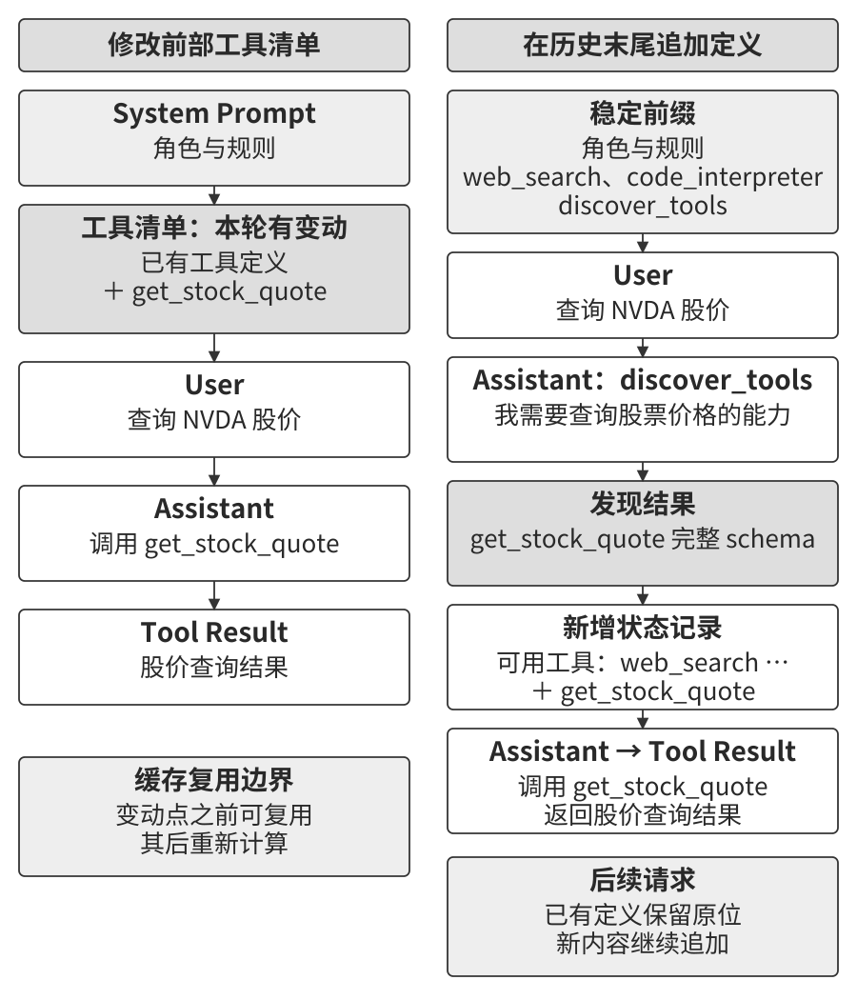

第二章介绍的 OpenAI `tool_search`、`defer_loading` 与 `tool_search_output`，以及 Anthropic 的 `tool_reference`，都支持按需加载工具定义。状态栏可以另行维护一份简短的可用工具名称列表，帮助模型掌握当前能力。

图4-4 记录了两次工具发现。到模型开始分析 GitHub 贡献者时，先前查询股价用过的工具定义仍在原处。

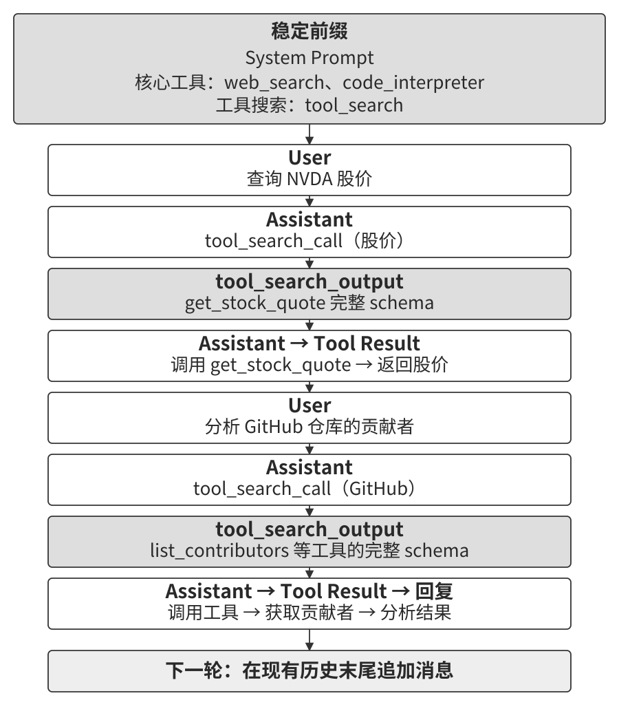

这种设计要求模型能够理解会话中新加载的工具定义，并据此填写参数、发起调用。实验 4-1 把同一批任务交给两套工具加载方式，比较各自送进上下文的定义有多少。

> **实验 4-1 ★★★：主动工具发现**
>
> 工具发现如何减少模型每次面对的定义文本？本实验使用 Qwen3-4B，在同一套包含 127 个工具的 MCP 服务器上比较全量加载与主动发现。两组分别处理三个任务：查询苹果公司的股价与相关新闻；检索 transformer 相关论文并下载前三篇；获取 GitHub 仓库的贡献者统计并生成图表。这些任务分别需要金融与搜索、论文检索与下载、数据查询与代码执行能力。
>
> **全量加载**：在系统提示词中放入全部工具的完整 schema。2026 年 8 月 25 日的配套运行记录包含 127 个工具，整份目录用同一个分词器（o200k）数得 50,597 个 token。
>
> **主动发现**：系统提示词只保留 `web_search`、`code_interpreter` 和 `discover_tools`。模型遇到能力缺口时，用自然语言描述需求，例如“我需要查询股票价格的能力”。`discover_tools` 通过向量相似度检索五个候选工具，把完整定义追加到对话历史，并更新状态栏中的可用工具名称。模型随后选择工具，继续完成任务。
>
> **运行结果**：按上述任务的顺序，主动发现组分别追加了 3,939、1,853、2,632 个 token 的工具定义。两组都选中了各任务所需的能力，执行适配层负责填入任务参数、批量下载和生成绘图代码，最终通过工具调用与产物检查。
>
> 看到工具定义变短，还要追问：模型是因为读得少而选得准，还是因为容易混淆的工具少了？原来的两组连筛选方法、消息位置、状态栏、发现提示和调用轮数也一起变了。配套的单步选择实验（`selection_ablation.py`）把问题缩小到“第一步选哪个工具”。先保留同一批候选，在系统消息里加入填充文本，就可以看加长输入后选择是否改变。再保留这些候选，加入等量的干扰工具，同时减少填充文本，使两组输入都为 6,144 个 token。这样，正确工具仍在原来的候选集合里，可以单独考察多出几个干扰项会怎样。
>
> 随机抽取工具时，第一步要用的接口可能根本不在名单里。只有它已经出现在名单里，模型却选了别的，才算模型选错。
>
> 股票查询任务的逐步记录里，用户其实问了两件事：股价变了多少，有什么新闻能解释这次变化？第一轮检索找到五个工具，模型选了排第三的 `yfinance_quote`。这次报价为 310.34 美元，较前收盘价 309.35 美元上涨约 0.32%，第一问可以直接验算。第二问用到了初始目录中已有的 `web_search`。它返回五条搜索结果，摘要主要列行情，没有给出能解释当日涨幅的具体事件。两种必需工具都选到了，所以能力覆盖得了满分；用户若想知道上涨原因，还得继续寻找有日期的报道。

#### Skills：把工具发现变成“按需查阅”

第二章介绍了 Skills 的渐进式披露（Progressive Disclosure）。从工具设计的角度看，它把能力的使用方法组织成一套可按需查阅的资料：模型先根据简介选择 Skill，再阅读操作步骤，最后按任务需要调用工具或执行脚本。

**渐进式披露分为三步。** 启动时加载各个 Skill 的 `name` 和 `description`，让模型知道有哪些能力、分别适用于什么任务；选中后读取完整的 `SKILL.md`；执行过程中再查阅其中引用的文档、模板或脚本[^ch4-skill-format]。例如，处理 PDF 时先判断需要文字提取还是表单填写，再读取对应说明。这样，具体操作所需的细节能够保留在能力包中，随任务逐步进入上下文。目录的总开销取决于 Skill 数量和简介长度。

这与查工具书的过程相似：先看目录，再翻到相关条目，遇到具体问题时继续查阅示例。对于规模较小、主要由操作流程和参考资料组成的能力库，笔者优先采用 Skill 目录加文件读取。它复用了模型阅读文档和调用通用工具的能力，起步时只需维护简介、引用和操作说明，省去独立的工具检索服务。能力库扩大、目录难以浏览后，再增加关键词或语义检索。

专用工具同样可以按需加载。宿主可结合服务器命名空间、允许列表和检索工具，决定当前任务能看到哪些定义，再通过工具搜索接口把它们加入上下文。Skills 则把步骤、示例和参考资料放在同一套文件结构中，便于作者编写和维护。

同一份 PDF 填表说明在许多会话里反复用到，能否连读取说明时的模型计算也复用？先区分两种情况。同一会话里，把新说明追加到末尾，之前相同的前缀有机会命中缓存。换一个会话，即使说明文字完全相同，它前面的用户请求、材料和位置通常已经变了，普通前缀缓存就无法直接复用那段计算。第二章介绍的可组合 KV Cache 研究尝试单独预计算这段内容，再调整旋转位置编码（RoPE）并拼入新上下文。重定位和拼接的计算量随片段长度线性增长。

MCP 与 Skill Hub 也可以共同承担分发工作。Skill Hub 负责能力包的搜索、安装与更新；MCP 的 Skills 扩展支持客户端发现和读取服务器提供的 Skill[^ch4-skills-over-mcp]。同一套操作知识可以通过本地能力包加载，也可以通过支持该扩展的 MCP 服务提供。

[^ch4-skills-over-mcp]: Model Context Protocol，*Skills Over MCP Charter*，说明 Skills 扩展的发现、分发与读取职责。

工具已经找到了，给模型返回什么才有用？仍以客户邮件为例，只返回文件名足以定位原信，要核对交货日期却还得读到原句。感知工具的设计就从这层差别开始。

### 感知工具

假设用户要核算一份报告里的总金额。搜索工具返回一条命中摘要，足够用来找报告，却未必能看出金额用的是什么单位。让模型顺着摘要读到原表，看到列名、单位和总计行，它才有条件核算。设计感知工具时，这里有两个相连的问题：这次要返回哪些材料，材料不够时，模型还能从哪里接着读？

一次搜索可能返回数万个字符，一份 PDF 可能长达上百页。可以结合第二章的**上下文感知压缩**，在输出超过设定阈值时，根据当前问题提取相关内容。例如，以 10000 个字符作为触发点，返回摘要并保留原始结果的读取入口，让模型能够继续核对引用、表格或细节。

**先列出搜索结果，模型选中哪一条，再读哪一条的全文。** 返回列表应包含标题、位置和摘要片段，帮助 Agent 判断哪些结果值得阅读。结果较多时，使用分页或游标（`cursor`）：默认返回前若干条，说明下一页的获取方式；能获取总数时也一并返回。模型可以根据已有证据决定继续翻页，或打开其中一条结果读原文。

**大文件按片段读取，截断时标明范围。** 读取接口应支持 `offset`、`limit` 等参数，并说明它们使用行、字节还是记录作为单位。例如，返回“已显示第 1—200 行，共 5000 行”，同时给出继续读取的参数。范围信息能帮助 Agent 判断当前内容是否完整，也便于按位置回查。静默截断容易让模型误以为已经读完，进而把“这段没有出现”判断成“整份材料都没有”。若省略了中间内容，应标出省略位置和剩余内容的读取方式。

**利用只读操作组织缓存与并发。** 对业务数据的只读访问通常可以复用结果，也便于并行执行，例如同时读取五个文件或发起三个独立搜索。缓存键需要包含查询参数、用户身份与授权范围；天气、股价和搜索结果还应设置合适的有效期（TTL）。并发读取需要控制速率，并考虑外部数据更新的影响：需要一致视图的任务，可以使用快照、版本号或采集时间来协调多次读取。

**根据任务选择多模态输出。** 截图、图表和扫描件可以直接交给支持视觉输入的模型，也可以先通过 OCR、文档解析等工具提取文本。提取文字便于搜索、引用和压缩；保留图像则有助于理解页面布局、表格行列关系和界面位置。处理以文字为主的内容时，可先返回提取结果；涉及 UI、复杂表格或设计稿时，应让模型能够查看相应图像。两种形式也可以组合使用。

感知工具还可以把读者肉眼能辨认的东西转换为可核对的观测。Coscientist 的研究者把红、黄、蓝三份色样放在孔板的三个已知位置，让助手判断每种颜色在哪个孔里。读板仪返回各波长的吸光数据，助手用 Python 找出吸收峰。到这里得到的是波长与孔位的对应关系，给每个孔写上颜色还需要解释这些峰。论文记录了一个细节：研究者提示助手考虑不同颜色怎样吸收光之后，它才正确辨认出三份色样。[^ch4-coscientist-colours]

[^ch4-coscientist-colours]: Boiko 等，*Autonomous chemical research with large language models*，Nature，2023。实验安排见图 4 及作者公开的简化实现。

> **实验 4-2 ★★：感知工具 MCP 服务器**
>
> 本实验把常见的信息获取能力接入同一个 MCP 服务器，按五类场景组织接口：
>
> - **搜索与获取**：网络搜索、本地知识库搜索和文件下载。
> - **多模态理解**：网页读取，PDF、Word、PPT 文档提取，图片 OCR 与视觉分析，以及音视频转录和分析。
> - **文件系统**：文件读取、内容搜索和目录浏览；服务器还提供复制、移动、删除操作，按执行工具管理其权限。
> - **公开数据源**：天气、股价、汇率、Wikipedia 和 arXiv 论文。
> - **私有数据源**：通过用户授权读取日历和 Notion 内容。
>
> 本次运行覆盖了前四类场景。先看文档读取：工具打开一页 PDF，返回了页数和提取的文字，可以拿原页核对。再看日历查询：它也返回了一份 MCP 响应，外层的错误标记为假，里面却写着 `success: false` 和 `missing_credentials`。助手据此能告诉用户“还没取得读取日历的授权”；若答“当天没有安排”，就把一次没有查成的请求当成了查询结果。Notion 查询也停在凭据配置这一步。

#### 多模态感知

给同一份带图表的 PDF 提两个问题：“作者在结论里推荐了哪种方案？”以及“哪条曲线先越过阈值？”第一题往往可以沿着提取的文字查找，第二题还需要图例、坐标和曲线的空间关系。面对图片、音频、视频和 PDF，可以直接交给支持该模态的主模型，也可以先转成文字，或由模型按需调用多模态分析工具。

##### 原生多模态处理

**原生多模态处理**让主模型在回答问题时直接利用视觉或音频等输入。以 Qwen-VL、LLaVA 这类视觉语言模型为例，典型结构包含视觉编码器、连接模块和语言模型：视觉编码器从图像提取特征，连接模块把这些特征转换为语言模型可接收的表示，再与文本指令一起参与推理[^ch4-vlm-architecture]。

采用 **Vision Transformer（ViT）** 时，图像会被分成图像块（patch），各块经过编码形成视觉特征。模型再通过投影、重采样等连接方式接收这些特征，利用注意力机制处理图像内容与文字问题之间的关系。例如，回答“表格右下角的数字是多少”时，模型需要同时利用文字、位置和表格结构。

当任务需要反复核对布局、图表和文字之间的关系时，笔者优先让具备相应能力的主模型直接查看原始材料。视觉信息持续参与后续推理，可以减少多次转述中丢失细节的机会。

PDF 通常先由输入处理层解析，或把页面渲染成图像后交给模型。保留页面图像有助于分析版面、图表和图文对应关系；长文档则需要控制页数、分辨率和切片方式，让任务所需的细节进入模型可处理的范围。

[^ch4-vlm-architecture]: Bai 等，*Qwen-VL: A Versatile Vision-Language Model for Understanding, Localization, Text Reading, and Beyond*，2023；Liu 等，*Improved Baselines with Visual Instruction Tuning*，2023，分别介绍视觉编码器及其与语言模型的连接结构。

##### 提取为文本

**提取为文本（Extract to Text）**把处理分成两步：先用文档解析、OCR 或音频转录工具获取文字，再由语言模型完成检索、总结和问答。GLM 5.2、DeepSeek V4 Flash 等文本模型可以通过这条路径处理文档与音视频中的文字信息[^ch4-text-models]。

对于以文字为主的 PDF，直接提取文本通常比逐页输入截图更紧凑，也方便搜索和引用。图像输入的 token 数受分辨率、切片与模型编码方式影响；文本输入量则取决于提取内容与分词方式。

提取结果需要保留任务所依赖的关系。普通 OCR 可能识别出图中的数字，却丢失数字与坐标轴标签的对应；只读取 PDF 文本层，也可能漏掉嵌入图片中的图表。版面分析和表格解析可以进一步保留段落顺序、行列结构或位置标记。

[^ch4-text-models]: Z.AI，GLM-5.2 模型文档，输入模态为文本；DeepSeek，DeepSeek-V4-Flash 模型卡，提供文本生成模型及其使用方式。

##### 工具化多模态分析

**工具化多模态分析**让主模型根据当前问题调用视觉、音频或文档分析能力。例如，`analyze_image`、`analyze_pdf`、`analyze_audio` 接收文件引用和自然语言问题，返回分析结果。主模型负责决定何时调用、询问什么，以及如何利用结果；工具内部的模型专注处理相应模态。

主模型只支持文本、任务又依赖视觉细节时，笔者优先补充这类分析工具。

例如，Agent 先读取报告正文，发现用户询问的季度收入只出现在图表里，就调用图像分析工具，询问“各季度收入分别是多少”。工具返回数值及对应季度后，主模型继续计算增长或差额。主模型的上下文只需保留问题和分析结果，原始图像由工具处理。

> **实验 4-3 ★★：多模态信息提取：三种技术范式的对比分析**
>
> 本实验使用一张季度收入柱状图及包含该图的 PDF 报告，比较三种信息传递方式。图中四个季度的收入依次为 1.2 亿、1.5 亿、9500 万和 1.8 亿美元；报告正文只描述变化趋势。对图片和 PDF 分别提出两个问题：“哪个季度收入最高，具体是多少？”“哪个季度收入最低，收入是多少，第四季度又比它高多少？”
>
> **直接看图**时，把原始图像或 PDF 页面图像与问题一起交给模型。**提取为文本**时，分别用 OCR 和 PDF 文本提取结果作答。**按需调用工具**时，模型先阅读提取文本，发现数值或对应关系不足后，调用 `inspect_visual` 查看原图，再组织回答。三条路径使用同一款豆包模型，比较信息传递方式对回答的影响。
>
> 本次四个“材料—问题”组合中，直接看图和按需调用工具均答对；文本提取组均未完整答对。其中有一份答案很容易被判对：只读图片 OCR 结果的模型回答“第一季度最低，为 9500 万美元，第四季度比它高 8500 万美元”。金额和差额都对，季度却错了。回看模型收到的文字，柱顶的金额和纵轴刻度混在一起，季度标签另在末行；从这些文字里找出两个数字，仍然不知道哪个季度对应哪根柱子。视觉工具回看原图，才把 9500 万美元对应到第三季度。
>
> 换成同一张图所在的 PDF，错误的原因又变了。PDF 的正文提到年中回落、最后一季反弹，精确金额全在内嵌图片里。问最高收入时，只读正文的模型指出了第四季度，也说明无法给出精确值。此时最有用的下一步，是把图表所在的页面交给视觉工具。
>
> 按需调用视觉工具额外多了一轮提问和回传，本次运行的延迟也随之增加。

### 执行工具

执行工具让 Agent 写入文件、运行程序和修改外部系统。感知工具侧重取得有用信息，执行工具还要管理操作带来的变化。设计时，需要同时回答三个问题：这次操作是否符合任务授权，执行范围如何限制，完成后怎样确认结果。文件误删、服务中断或重复提交等错误，都与这些边界有关。

以“给已有订单改收件地址”为例，查到用户给的新地址、提交变更、重新读到订单中的新地址，是三个可观察的时刻。提交后若连接中断，客户端只知道尚未收到回执，无法据此推出服务端没有写入。恢复时可先查询该订单的当前状态，再决定是否重试。如果读回的仍是旧地址，还要查服务是否可能延迟更新；有请求标识时，优先按标识核对那一次变更的状态。只凭一次读取就重新提交，仍有可能把同一操作做两遍。

有时，发现一件值得做的事和动手办理它，需要两种权限。OpenAI 在发布 **dots** 时讲过一位早期用户的经历：他的 dot 注意到他漏给一家刊物开发票，备好发票，等他同意后才发出去。按产品说明，用户没有交办新工作时，dot 可以在已连接的应用里主动查找线索；这个阶段的工具只能读，不能发消息、修改应用内容或操作浏览器。[^ch4-dots]

[^ch4-dots]: OpenAI，2026 年 9 月 29 日发布的 *Introducing dots*，发票案例与后台主动查找的只读限制见发布说明。

**分层检查参数与权限。**

首先检查输入。文件工具应解析目标路径，确认实际访问位置位于允许范围内，并处理符号链接等可能改变目标位置的情况；命令工具应区分程序、参数和需要解释的脚本；外部 API 应校验字段类型、格式和取值范围。参数不合法时，返回具体字段与错误原因，让模型修正后重新提交。

其次检查权限。文件访问应限定读写范围，进程使用受限身份，外部 API 使用与任务对应的授权和凭证。配额与速率限制负责约束资源使用。命令黑名单可以拦截已知危险模式，命令解析与模型审查则帮助判断操作含义；底层文件系统、网络和进程权限负责限制实际影响范围。第五章会进一步讨论这些机制如何组合。

**提议者—审核者：独立检查行动方案与执行结果。**

第一章介绍的**提议者—审核者（Proposer–Reviewer）范式**也可以用于执行工具：提议者生成行动方案，审核者依据任务目标、授权和验收标准进行检查。根据检查发生的时机，可以分为事前审批与事后验证。

**事前审批**在操作提交前进行。例如，发送邮件之前，审核者检查收件人、正文、附件和发送范围是否符合用户要求；修改关键配置之前，检查目标环境、变更内容和恢复方案。Harness 根据审核结果决定执行、要求修改或转交人工处理。

笔者倾向于为复杂审查选择能力相近、训练背景不同的模型，例如让 GPT 与 Claude 系列交叉检查，或让 Kimi 与 DeepSeek 系列互审。相近的能力让审核者能够理解复杂方案，不同的训练背景则有机会减少共同盲点。同一家族的模型可能沿用相似假设，两次审查都跳过同一个问题；能力相差过大时，审核者又可能看不出方案中的关键错误。能力需求由审查任务决定：理解复杂方案需要较强的推理能力，按明确规则检查简单字段则可以使用较小模型。

两方应采用一致的任务目标、授权边界和验收标准，并获得判断所需的证据。提示词可以分配不同职责：提议者负责组织行动，审核者重点检查风险、遗漏和规则遵守。

拒绝时，把具体理由作为工具结果加入轨迹，例如“收件人超出已确认范围，请核对发送名单”。模型可以据此修改方案；连续拒绝或授权不明确时，再转交用户判断。收费、发送邮件、修改关键配置和创建外部资源等操作，可以按影响范围设置审批级别；范围明确、可恢复的常规操作则可通过预先配置的规则处理。

**事后验证**在执行后检查产物和系统状态。笔者建议优先切换检查方式，让审核者直接检查运行结果或最终呈现。反复读同一份代码，容易继续沿用生成时的假设；换成可见、可运行的产物，就能发现代码表面看不出的错误。例如，用代码生成文档后，渲染页面检查排版；配置修改后，在隔离环境中运行程序，检查配置是否生效；数据写入后，再读取目标记录核对内容。第五章将用演示文稿展示这种循环：提议者生成代码，审核者检查渲染截图，再反馈需要修改的位置。

**Sidecar：伴随主循环运行的检查模块。**

Sidecar 借用了微服务架构中的“边车”比喻，指伴随主 Agent 运行、承担专门任务的辅助模块。用于安全检查时，它在调用执行前审查具体行动；用于上下文处理时，它也可以并行筛选记忆或压缩工具结果。

Claude Code 的 Auto Mode 会自动判断一次工具调用能否放行。Anthropic 在 2026 年 3 月公布的实现中，常规允许规则先处理部分调用，其余调用交给模型分类器；分类器先快速判断，再对被拦下的调用进一步分析。它读取用户消息与工具调用，排除主模型的解释文本和工具返回内容，以便围绕用户意图与实际行动作判断[^ch4-auto-mode]。

设计自己的检查模块时，可以把工具名、目标资源、参数、操作类型和相关授权作为输入。例如，删除文件前核对目标是否位于允许范围、是否属于待清理产物、是否需要额外确认。

检查可以与主模型生成后续内容或界面更新并行，以缩短额外等待；被检查的调用必须等待放行。例如，用户交代“看看配置”，主模型却准备写回文件。路径可能完全合法，操作的含义却从查看变成了修改。设计这类检查时，可以让 Jev 一类判断模型对照用户原话和工具参数，区分“符合请求”“超出请求”和“需要进一步确认”。分类结果供审批流程使用，文件访问权限仍由执行层逐次检查。

[^ch4-auto-mode]: Anthropic，*How we built Claude Code auto mode: a safer way to skip permissions*，2026 年 3 月 25 日，介绍权限分层、调用分类器及输入隔离方式。

提议者—审核者描述职责分工，Sidecar 描述辅助模块与主循环的运行关系。审核者可以由 Sidecar 承担，Sidecar 也可以完成其他任务。表4-2 从本节讨论的典型用法比较两者。

表4-2 提议者—审核者机制与 Sidecar 机制对比

| 维度 | 提议者—审核者 | Sidecar |
| --- | --- | --- |
| 主要作用 | 对提议或结果进行独立检查 | 伴随主循环承担专门任务 |
| 运行时机 | 行动前审批，或行动后验证 | 按需触发，可与主循环并行 |
| 检查对象 | 方案、操作及其结果 | 工具调用、记忆、工具输出等 |
| 输入组织 | 共享任务标准，提供独立判断所需证据 | 按职责选择必要字段与上下文 |
| 典型应用 | 关键操作审批、文档质量检查、配置验证 | 调用门控、记忆筛选、输出摘要 |

用于补充上下文时，Sidecar 可以在主模型处理当前步骤的同时，筛选相关用户记忆、汇总较长的工具输出，或查询后续步骤需要的数据。主循环在适当位置接收结果，减少串行等待。

**自动验证与反馈闭环。**

**笔者的建议是：能够自动验证的操作结果，就把验证纳入工具流程。** 例如，`write_file` 写入代码后，可以按语言调用语法检查器或 linter，将诊断整理为文件位置、行号、错误类型和说明，随写入状态一起返回。Agent 看到“第 10 行：变量 `result` 未定义”后，就可以定位并修正问题。

工具应分别报告操作状态与验证状态：文件已经写入，但检查可能失败。语法检查负责发现无法解析的代码，静态检查还可发现部分名称、类型或规则问题；功能是否正确，则需要相应的测试或运行结果。

**长输出的截断与持久化。**

终端日志和程序输出可能很长。可以设置阈值，例如超过 200 行或 10000 个字符时，把完整结果保存为可回查的产物，只向上下文返回头尾片段：

- 保留前 50 行，提供启动信息和初始上下文。
- 保留后 50 行，提供结束状态或末尾错误。
- 标明省略范围，例如“中间省略 8523 行，完整输出已保存”。
- 返回产物引用和读取方式，让 Agent 通过 `read_file` 继续查看或搜索。

每次调用使用独立的产物标识，避免后续输出覆盖前一次记录。工具返回值同时保留退出状态、截断标记和产物位置，便于将当前摘要与完整记录对应起来。

**执行环境的隔离与沙盒。**

Python 解释器和 Shell 等通用工具可以执行模型生成的程序。其访问范围由运行身份、文件系统与网络策略共同决定。Python 虚拟环境（venv）负责隔离包依赖，代码仍使用所在进程的文件、网络和系统权限；限制这些能力需要操作系统或虚拟化机制。

常见部署方式包括：

- **受限本地进程**：在本机运行，结合受限用户、工作区读写规则和网络策略控制访问范围。Coding Agent 的本地执行通常属于这种部署形态，具体权限由宿主配置决定。
- **容器**：利用命名空间隔离进程、文件系统和网络视图，并通过资源控制限制使用量。容器与宿主共享内核，实际边界还受挂载目录、进程权限和容器配置影响[^ch4-docker-isolation]。
- **microVM 或虚拟机**：通过虚拟化为任务提供独立内核。Firecracker 等 microVM 适合需要较强隔离、同时关注启动与资源开销的场景[^ch4-firecracker]。

本地开发、输入可信且任务范围明确时，可以从受限进程和工作区规则开始；需要执行来源不明的代码，或处理敏感凭证时，则应提高隔离级别，优先使用容器或具备独立内核的 microVM，并限制凭证暴露。任务只需读取资料，就可以只读挂载相关目录；需要写入产物，就单独提供输出空间。执行环境还应限制 CPU、内存、磁盘、进程数量和网络访问，并设置运行时限，便于终止失控任务和回收资源。

选定隔离方式后，还有一个成本问题：这份环境要为谁、保留多久？笔者做第一个 Agent 时，一个 Go 服务就负责多个用户的并发请求。访问网页时调用无头浏览器，上传的文件可以放在 GCS 或 Google Drive，等任务需要时再取。按笔者当时的估算，如果给每位用户常备一台云端虚拟机，一个沙盒每月就可能花几十美元。即使用户这个月只来办一次事，环境也一直等着他。

可以把一项委托拆开算这笔账。假设用户今天上传账单，下周才请助理核对。需要保存一周的是账单和任务记录；若核对时要执行新生成的脚本，可以到那时才分配隔离环境，提供这次获准读取的文件，保存结果后回收。假设按实例运行时间计费，机器规格相同，核对本身用 10 分钟。让同一台机器空等七天再核对，要付 168 小时零 10 分钟的计算费。按需启动若要花 2 分钟准备环境，这次合计计费 12 分钟。

若用户下周要接着操作一个已经打开的桌面，光找回文件可能还不够。要把应用恢复到原来的页面，需要多久？能否恢复尚未保存的工作？回答了这两个问题，才知道是否值得把环境留下。第五章讨论命令行会话时，还会用到这一区别。

[^ch4-docker-isolation]: Docker，*Docker Engine security*，说明命名空间、资源控制、内核与进程权限对容器隔离的影响。
[^ch4-firecracker]: Firecracker，Design，介绍基于 KVM 的 microVM 架构。

**工具执行的可观测性。**

运行记录应能回答“谁发起了什么操作，影响了哪些资源，结果如何”。每次调用记录调用 ID、时间、工具名、必要参数、目标资源、执行状态与耗时，并关联任务及审批记录。凭证和敏感内容需要脱敏或限制访问。汇总调用频率、成功率、超时率和耗时后，可以定位慢工具、重复失败和资源瓶颈；异常达到阈值时，再触发告警或暂停相关执行。

**幂等性与取消语义。**

假设助手提交了一笔订单，商家已经建单，回执却在途中丢失。助手看到的是请求超时。如果它把同一份订单再发一遍，商家怎么知道用户只想买一份？

一种做法是让助手在首次提交前保存一个**幂等键**。同一用户重试这笔订单时，沿用原键和原参数。服务端把键与操作类型、参数和处理状态关联起来，原子地登记并去重。这样即使收到两次请求，也只创建一笔订单，这就是**幂等性**。每次网络请求仍可有各自的调用 ID，方便追查哪一次超时、哪一次收到了回执。

接入外部工具时，还要读清楚两个约定：同一个键配上不同参数会怎样？服务端会记住这个键多久？例如 Stripe API v1 会拒绝参数发生变化的重试。键保存至少 24 小时后可以清除；如果旧键已经清除，再用它提交就会被当成新请求。隔了几天才恢复任务的助手，应先凭业务编号核对上一笔操作。[^ch4-idempotency]

重试前还可以查询目标状态，例如根据业务编号查找订单，或读取文件确认预期内容是否已经写入。并发请求可能在查询后同时发起变更，因此还需要唯一约束、条件更新或服务端幂等支持来避免重复操作。

发送邮件、拨打电话和转账等操作会产生外部影响，可以采用“预检—确认—提交”的流程：先检查目标、内容、金额或其他业务条件，再按授权要求确认，最后提交。审批检查行动是否符合要求，幂等与状态查询负责处理提交后的重试。服务端暂时无法确认结果时，将任务记为“结果待确认”，保存请求标识并继续查询或交由人工核对。

取消也需要明确约定。任务尚未开始时，可以从队列中移除；本地进程正在运行时，可以终止进程并回收资源；外部系统已接收请求时，则需要查询它是否支持取消、撤销或补偿。工具应返回当前状态，让 Agent 区分“停止等待”“已经终止”和“外部操作已完成”。

[^ch4-idempotency]: Stripe，*Idempotent requests*，说明幂等键、重复请求结果复用、参数一致性与保留期限。

> **实验 4-4 ★★：执行工具 MCP 服务器**
>
> 本实验将文件、程序、外部系统和图形界面操作接入 MCP，并为每类调用组织检查与反馈：
>
> - **文件写入与编辑**：检查 Python、JavaScript 语法，返回结构化诊断，校验编辑结果与工作区边界。
> - **终端执行**：记录命令与结果，设置超时，并对需要审查的操作调用独立模型。
> - **代码解释器**：在限制网络、文件系统和资源使用的容器中运行 Python。
> - **长输出处理**：返回截断片段，持久保存完整输出，提供后续读取入口。
> - **数据操作**：读写 Excel、应用公式，并渲染截图检查显示结果。
> - **外部系统**：调用 Webhook、创建 GitHub PR，并提供日历事件与邮件发送接口。
> - **图形界面**：浏览器导航与截图，虚拟桌面中的键盘操作，以及 Android 模拟器的界面控制。
>
> 桌面案例通过键盘打开网页并截图；手机案例打开 Wi-Fi 设置、检查当前界面后返回主页。
>
> 看表格这项操作。工具用数量乘以单价，两项费用分别是 25 和 21，合计 46。打开导出的 PDF，第一页列出了项目、数量和单价，翻到第二页才看到金额。工具只截了第一页，所以截图上虽然有“Grand total”，旁边却没有数字。如果任务要求交付一张让人一眼就能核对总额的账单，公式算对以后，还得调整打印布局，再看一次预览。

### 协作工具

需要另一位 Agent 核查资料，或遇到须由人拍板的业务问题时，当前 Agent 怎么把工作交出去？协作工具既要说明请对方做什么，也要约定交回什么结果。例如，委托检索时说明要找哪组资料，委托审核时附上待查方案，向人请示时列明待决定的事项。

多个 Agent 同时动手时，任务分配还要落实为对机器资源的分配。笔者在自己的机器上见过两种故障：并行任务各自完整复制代码，一天就写满了 3 TB 的盘；另一组任务占满百核服务器，连人登录都很困难。可以给每项任务一份只记录差异的独立工作区，完成后回收临时文件，把需要交付的文件另行保存。独立工作区能省下磁盘，却挡不住几十个任务同时占满 CPU。给后台任务设配额、把交互请求的优先级调高，人才有机会登录机器处理故障。

仍以整理客户邮件为例。可以请另一个 Agent 从附件中提取交期，但应当同时给它原信标识，并要求返回“日期、对应原句、所在附件”。主 Agent 收到两份互相矛盾的日期后，才能分清一个指下单日、一个指承诺交货日；只收到一句“整理完成”则无法处理分歧。

**按职责配置子 Agent。**

专业知识和工作流程可以先通过 Skill 按需加载。任务需要独立上下文、不同工具权限或并行处理时，再交给分别配置的子 Agent。每个子 Agent 按职责配置提示词、工具集和知识来源，减少把所有规则与中间材料放在同一上下文中造成的干扰。例如，资料检索 Agent 负责提供来源与证据，代码检查 Agent 负责定位问题，主 Agent 负责分配任务和整合结果。分工时，还要约定共享资源的访问方式，避免多个 Agent 同时修改同一份文件或重复提交外部操作。

子 Agent 的提示词应说明以下内容：

- **角色与目标**：直接说明职责，例如“你负责核对报告中的数值与来源”，并给出本次任务的完成标准。
- **信息来源**：区分主 Agent 的任务说明、用户补充和工具结果。可以用 `[FROM_MAIN_AGENT]`、`[FROM_USER]`、`[TOOL_RESULT]` 等标签帮助阅读，同时由 Harness 保存真实来源与消息角色。外部文本中的同名标签按数据处理。
- **任务边界**：明确可处理的范围、可用工具、资源权限，以及缺少信息或遇到冲突时的上报方式。
- **输出约定**：使用约定的 JSON 或 Markdown 结构返回结论、证据、未解决事项和当前状态，便于主 Agent 继续处理。

**管理子 Agent 的生命周期。**

协作接口可以组织为启动、消息、状态与发现几类原语。`spawn_subagent` 创建子 Agent 并分配任务，`cancel_subagent` 在任务失去意义时请求停止；`send_message_to_subagent` 传递补充要求，子 Agent 也可以汇报进展或请求澄清；`get_subagent_status` 查询状态与结果。系统还可以通过 `list_agents` 列出 Agent 的职责、可用状态和任务归属，帮助主 Agent 找到协作者。

这些接口可以支持多种调用方式。**同步调用**等待结果后继续，适合耗时较短或下一步依赖其结果的任务；**异步调用**先返回任务 ID，主 Agent 可以处理其他工作，再通过状态查询或完成事件获取结果；**流式协作**持续返回增量消息，便于提前利用阶段性结果；**多轮交互**则允许双方追问和补充条件。

任务 ID 将创建、消息、结果和取消关联起来。Harness 需要维护排队、运行、完成、失败、取消等状态，明确哪些状态可以继续接收消息，以及取消后如何处理已经发生的外部操作。上下文传递、协作拓扑与多 Agent 分工将在第十章展开。

**在需要人工决策时请求介入。**

HITL（Human-in-the-Loop，人在回路）适合处理需要用户选择、授权或补充专业判断的环节。请求应集中呈现待决问题、可选行动和后果，让人能够据此判断。例如，方案已经准备好、执行需要明确授权时，再提交审批；任务缺少必要条件时，则请求补充信息。

人工响应可能较慢，需要为请求设置有效期和超时行为。例如，等待五分钟后保存待办状态，暂停依赖该答复的操作，或执行预先授权的保守方案。请求过期、取消或已经处理后，重复答复应返回当前状态；需要重新决策时创建新请求。通知可按优先级发送：紧急请求使用已配置的即时渠道，普通请求进入邮件或待办队列。

人的批准、拒绝与修改理由还可以形成反馈数据。先保存当时的任务、证据和决定，再评估哪些经验可以复用：明确的业务规则可以进入知识库或 Skill，偏好判断可以整理成评估或后训练样本。第九章会讨论如何筛选这些轨迹并选择更新方式。

> **实验 4-5 ★★：协作工具 MCP 服务器**
>
> 本实验实现子 Agent 管理、人工协助与通知接口，练习两种上下文传递方式及同步、异步调用。
>
> 先接一笔退款咨询。商品三天前购买，金额为 80 新元。店规说，购买后七天内、金额低于 100 新元的退款可以批准。主 Agent 把“按店规判断这笔退款是否符合条件”交给子 Agent，应该连同任务发去哪些事实？
>
> 用 `mcp_spawn_subagent` 同步委派时，只传必要上下文的那一组漏掉了购买记录，只发去了店规。回执的外层状态是 `completed`，因为子 Agent 已经答复；打开答复，里面的状态却是 `need_info`，缺金额和购买时间。主 Agent 用 `mcp_send_message_to_subagent` 补充“商品未使用”，仍然答不了这两个问题。用模型生成摘要的那组把三天、80 新元和店规一起交过去，才得到“符合退款条件”的判断。
>
> 换成异步委派，启动回执同时给出 `task_id` 和 `subagent_id`。在本实验的接口里，查询状态、追加消息或请求取消时，参数用的是 `subagent_id`。可以沿着这个标识找到同一子 Agent 从 `running` 到 `completed` 的记录。向人请示又有单独的 `request_id`：`mcp_request_admin_approval` 请求批准，`mcp_request_admin_input` 请求补充信息。实跑中，管理员批准的是发布这份实验记录。另一条请求等了一秒就超时，回执同时写明 `approved: false` 和 `timeout: true`；据此只能向主 Agent 报告尚未取得批准。
>
> 配套服务器还提供发送邮件、Telegram 和 Slack 消息的接口。

### 本章小结

给模型接入一种能力，得分别决定两件事。第一，怎样让它使用这项能力？**笔者通常先选通用执行器**，让模型写代码组合操作。遇到需要单独授权的操作、容易填错的复杂参数、频繁重复的调用或平台差异，再封装专用接口。第二，模型什么时候需要看到这项能力？即使一个工具已经通过 MCP 接入，模型也可以先看目录，等用到时再读完整定义。Skill Hub 分发的操作说明、脚本和参考资料同样可以按需加载。

用开头的交期表检查接口是否够用。助理从邮件和附件里**取证**时，长结果可以分页或按范围读取，但截断处应有标记，压缩表格或图片也要保留日期与订单的对应关系。助理**执行**发送操作前要核对收件人和附件；若发送时连接中断，先按消息标识查服务端是否已经接收，再决定是否重试。执行脚本可以放进沙盒，外部写操作则需要幂等检查。已经申请取消的任务，还要读回回执，确认哪些操作确实停了。把查附件的工作**委托**给另一个 Agent 时，则要能按任务标识查进度、发补充消息、取消任务，遇到两条相互矛盾的记录还能请人判断。

现在工具能让助理查到某个订单的交期了。如果邮箱和表格系统都没有现成的汇总接口，它能不能自己写出一个，下次再用？第五章从这里讲起。新邮件到达后怎样唤醒助理、用户不在线时怎样送达结果，留到第六章讨论。

### 思考题

1. ★★ MCP 将工具接入与 Agent 框架分开。请选择流式结果、双向交互或长任务状态管理中的一种需求，说明它需要哪些协议能力、哪些宿主能力，并讨论接入现有 MCP 时需要补充的设计。
2. ★★ 多个 MCP 服务器提供相似工具时，应如何选择？以“一个返回摘要，另一个返回全文”为例，设计工具描述、来源标识和选择依据，让 Agent 能够利用这种差异。
3. ★★ 除了写入代码后运行检查，“执行—验证—反馈”还能用于哪些场景？请选择两个例子，说明验证方法、失败反馈及成本，并讨论何时适合立即验证、抽样验证或异步验证。
4. ★★ 面对数千个工具，除了主动发现，还可以怎样组织能力？结合分类目录、工作流模板或通用执行器，说明一种方案的适用条件与取舍。

## 第 5 章 Coding Agent 与通用 Agent

假设用户交给你三份含订单和退货记录的销售表，要你找出退货率最高的商品，并把依据写成报告。要让 Agent 接下这个开放任务，它得先摸清表头和单位，写程序合并数据，再用原始记录核对异常值。如果核对时发现两张表里的商品名称不同，它还得回头改程序。前几章分别介绍的上下文、记忆、知识库和工具，在这样的往返中各有用处。本章从编程任务入手，逐步把同样的工作方法推广到调研、内容创作与数据分析。

笔者对开放任务型通用 Agent 的架构判断是：**以 Coding Agent 为执行核心，以文件系统为工作空间。** Coding Agent 能够编写、修改和运行代码；文件系统保存代码、数据、记忆与中间结果。两者配合，Agent 就能随任务需要编写程序，把结果保存为文件，供后续步骤继续使用。

代码生成是一种**元能力**：Agent 可以用代码组织已有工具，也可以针对新需求实现新的工具。代码还可以明确表达规则和推理步骤。例如，把“年龄大于 18 且已实名认证”写成 `age > 18 and verified`，就能用几组输入检查这条规则。已认证的两个人，一个 18 岁，一个 19 岁，只有后者应当通过。如果这位 19 岁的申请人尚未实名认证，也应当拒绝申请。

本章先介绍 Coding Agent 的基础工具，结合 OpenClaw 说明代码和文件系统如何支撑通用任务，再展开工作流程、Harness 与具体实现。随后从六个方向讨论代码生成的用途：思考、业务规则、多媒体、系统适配、生成式 UI 和 Agent 自举。

### Coding Agent

#### Coding 是 Agent 的基础能力

**笔者主张，把代码生成作为通用 Agent 的基础能力。** 数学计算可以交给求解器，数据处理可以调用程序库，重复操作可以写成脚本；遇到新的格式或接口，Agent 还可以生成解析与适配逻辑。基础工具提供执行入口，代码负责把这些能力组合成任务所需的步骤。

考虑一个任务：“整理仓库中所有遗留的 TODO 注释，按优先级分类并生成 issue。”先搜索 TODO，读一读注释前后的代码，分清哪些只是写给自己的提醒，哪些需要另开任务。把文件名、行号和判断依据整理好，就可以在获得授权后创建 issue。若还要把分类结果保存到仓库，这时才需要写文件。类似任务还会用到运行命令、编辑代码等操作。教学中我们采用下面七种基础工具：

1. **Code Interpreter（代码解释器）**：运行 Python 等代码，完成计算、数据处理和绘图；通过沙盒限制文件、网络和资源访问。
2. **Bash Shell（命令行终端）**：执行构建、测试和文件处理等命令，返回输出与退出状态。
3. **读文件工具**：读取代码、配置、文档和日志，支持按范围获取内容。
4. **写文件工具**：创建文件或替换完整内容。
5. **编辑文件工具**：局部修改已有文件，适合维护与迭代。
6. **搜索文件名工具（Glob）**：按模式定位文件，例如用 `**/*.py` 查找 Python 文件。
7. **搜索文件内容工具（Grep）**：查找文字或模式，并返回文件名、行号和匹配内容，例如定位某个函数的调用处。

这七个工具主要覆盖第四章中的感知与执行能力。协作、事件触发和用户沟通可以按应用需求继续接入。工具数量与接口粒度由实现决定：Shell 可以完成目录浏览、搜索和读取，独立的文件工具则能提供统一参数和结构化反馈。例如，Codex 可以通过命令执行工具读取与搜索，通过 `apply_patch` 表达文件修改；补丁把目标文件、修改位置和增删内容组织在一起，便于检查与回放。

先把任务缩小为“整理 Python 文件中的 TODO 清单”，看看工具如何配合：

| 步骤 | 操作 | 返回或产物 |
| --- | --- | --- |
| 搜索注释 | Grep 搜索 `TODO`，用 `**/*.py` 限定范围 | `api.py` 第 42 行：add rate limiting；`db.py` 第 15 行：migrate to PostgreSQL；`test_api.py` 第 8 行：add edge case tests |
| 整理清单 | Write 写入 `TODO_LIST.md` | 三条待办及各自的文件、行号和说明 |
| 反馈结果 | 告知用户清单位置与覆盖范围 | 共找到三条 Python 文件中的 TODO |

若用户还要求按模块统计并画柱状图，Agent 可以生成 Python 程序，交给 Code Interpreter 计算和绘图；若要判断优先级，则继续读取相关实现、测试或已有 issue，找到判断依据。

#### 案例：从 Manus 到 OpenClaw——通用 Agent 的 Coding 内核

Manus、OpenClaw 等通用 Agent 可以在一次任务中查资料、操作电脑、运行代码。几项工作往往靠一段程序接起来：从接口取数，整理检索结果，做成图表和文档。以后再做同类任务，还能重用这段程序。

例如，程序库可以直接创建和修改采用 OOXML（Office Open XML）格式的 Word 文档和 PowerPoint 演示文稿；PDF 报告可以从 Markdown、HTML 或 LaTeX 渲染，数据分析与可视化可以用 Python 完成。稳定的网页操作也可以整理成可复用脚本，第九章会进一步讨论如何从一次成功的操作中提取可复用的步骤。

**同一项操作已经有可用的 API 或命令行接口时，笔者优先选择代码调用。** 结构化参数省去了反复截图、视觉定位和点击的开销，脚本还能保存、测试和复用。Computer Use 扩大了可操作软件的范围；把其中已经跑通、会反复执行的步骤固化为代码，则能进一步降低成本和延迟。图5-1 里的文件系统让几次调用接得起来。一次调用保存的数据文件，可以成为下一段分析脚本的输入。

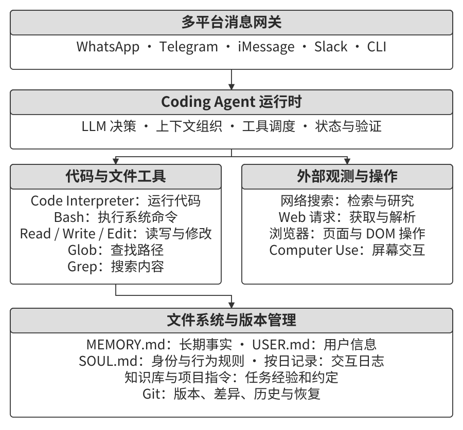

以“分析上季度销售数据并生成总结报告”为例，可以把过程拆成五步：

1. **读取记忆**：获取用户偏好的 PDF 报告格式，以及销售数据存放在 Google Sheets 中这一事实。
2. **获取数据**：查阅 Google Sheets API 的用法，通过已授权的接口下载所需表格。
3. **编写分析代码**：用 pandas 聚合销售数据，用 matplotlib 生成图表，检查统计口径和结果。
4. **生成产物**：将分析与图表组织成 PDF，保存源数据、中间结果和生成脚本，方便回查或更新。
5. **更新记忆**：记录已经确认的数据源及表格标识，供下次任务查找。

如果把同一项任务交给千问办公，用户可以直接上传销售明细，让它分析数据、生成可视化报告。[^ch5-qwenwork] 假设一笔订单收款 100 元，随后退款 20 元，计入季度净销售额的就只有 80 元。如果报告图上算成了 100 元，沿着图表找到汇总表和原始明细，就能看出漏算的是哪笔退款。

[^ch5-qwenwork]: 千问办公帮助中心，千问办公简介，介绍上传数据文件、分析数据和生成可视化报告等功能。

文件系统把这些步骤连接起来：前一步保存的结果可以成为后一步的输入，程序也可以反复读取同一份数据。任务中断后，Agent 还能通过已保存的产物确认进展，继续处理未完成部分。

中间结果还有一个用途：用户改问了一个相关问题，可以从合适的一步接着做。微软研究院的 Data Formulator 用各国发电数据演示了这一点。原表记录各类能源的发电量，分析者先得到各国逐年的可再生能源占比，再据此画排名图。若想看某国占比上升了多少，仅凭图上的名次，看不出两个年份相差多少个百分点。沿着界面保留的推导过程回到占比表，就可以取两年的值相减。[^ch5-data-formulator]

[^ch5-data-formulator]: 微软研究院，Data Formulator 的能源分析示例及 0.7.0 版图表与数据表的关联实现。

**用文件保存记忆、知识与能力。** OpenClaw 的工作区采用 Markdown 文件保存多类信息：`MEMORY.md` 记录长期事实与决策，按日期组织的日志保存过程信息，`USER.md` 可用于用户偏好，Skill 文件则说明能力的使用方法[^ch5-openclaw-files]。**对于需要人和 Agent 共同维护的记忆，笔者优先采用可直接阅读的文件。** 用户能打开记录、纠正一条错误事实，也能通过 Git 查看来源、比较版本和回滚。按日期保存日志，让先后发生的事实保持明确的时间线；文件增多后，再用检索索引加快定位。

Agent 的写文件能力也支持积累任务经验。例如，某次联系银行时发现验证身份需要开户行地址，可以把适用业务、信息来源与发生时间一并记下。经过核对的记录再整理为知识、操作说明或程序，后续任务便能复用。第九章将讨论这一持续进化过程。

[^ch5-openclaw-files]: OpenClaw，*Agent workspace* 与 *Memory overview*，介绍工作区、文件记忆及检索机制。

**哪些任务适合让 Agent 自己写程序？** 开放式调研、内容生成和数据处理经常遇到新的输入格式、接口与产物要求，代码生成适合成为执行核心。垂直客服等流程较稳定的系统，可以围绕业务状态、领域工具和对话策略组织运行，再用代码完成计算、转换与规则校验。两类系统都能利用 Coding 能力，其承担的职责随任务而变化。

#### Coding Agent 的整体流程

用一个小缺陷走一遍图5-2。用户报告“总价排序时，100 元排在 20 元前面”。先找出一个能重现问题的输入，再顺着数据看金额在哪里成了字符串。改完比较逻辑后，用原来的输入重跑，并看看含小数、相同金额的数据是否仍然正确。

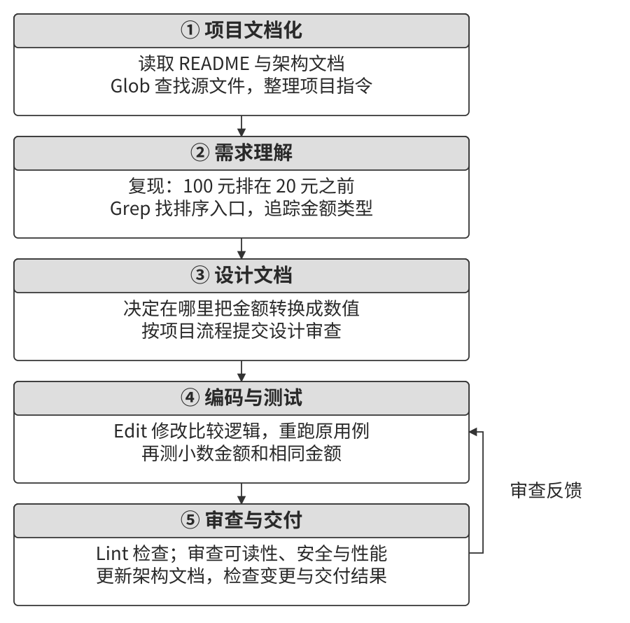

**理解项目并补齐文档。**

接到任务后，Agent 先读项目说明，再对照实现、调用方和测试，找出改动会影响哪些地方。如果文档没写清相关模块负责什么、用了哪些核心抽象、模块怎样配合或如何测试，就把从代码中核实的内容补进去，方便接手的人查阅。

**项目指令文件**把常用约定放在 Agent 容易获得的位置。`CLAUDE.md`、`AGENTS.md` 和 Cursor 项目规则可以记录构建命令、代码风格与变更边界，例如“使用 `pnpm test` 运行测试”“为变量声明具体类型，避免使用 `any`”“数据库迁移变更需单独审查”。各宿主按目录、配置或适用条件加载这些内容；Cursor 早期的 `.cursorrules` 也是这一思路的实现[^ch5-project-rules]。

指令文件与 OpenClaw 的 `SOUL.md`、`MEMORY.md` 各有侧重：前者说明项目内的工作约定，`SOUL.md` 描述 Agent 的身份与行为，记忆文件保存可供后续任务使用的信息。稳定且简洁的指令有利于保持上下文前缀一致；目录规则按需加载，则能控制当前任务的输入量。执行权限由 Harness 和运行环境落实。

第二章提出，对远程协作友好的团队也更容易让 Agent 参与。具体到代码仓库，就是把决策写进设计文档，把任务背景写入 issue 和 PR，把内部经验整理成开发者指南。一个实用的检查问题是：**远程新人能否仅凭仓库和文档找到任务入口、运行测试并理解修改要求？**

[^ch5-project-rules]: Anthropic，*How Claude remembers your project*；Cursor，Rules，介绍项目指令及按范围加载的规则。

**明确目标与验收条件。**

对于已定位的 bug 或参数调整，可以根据现有行为与测试直接修改。目标较宽泛时，需要先拆解。例如，“优化系统性能”可能指降低响应时间、减少内存占用或提高吞吐量。Agent 应检查当前瓶颈、测量基线和允许的改动范围，确认接口兼容、用户体验等约束，再确定优化方案。

**形成设计方案。**

设计说明应回答：修改哪些模块，采用什么方法，为什么适合当前问题，是否引入新依赖，以及如何验证和恢复。小改动可以用简短计划表达；复杂变更则写成可供审阅的设计文档。项目或用户要求方案审批时，先提交具体方案，通过后再实施。

**实现、测试与审查。**

实现时遵循项目约定，复用已有抽象与工具，并把修改控制在任务相关范围内。测试围绕预期行为设计，覆盖正常路径、边界条件和异常情况；修复 bug 时，回归用例应能暴露原问题并验证修复结果。

测试失败后，Agent 读取诊断，定位原因，修改代码并重新执行相关检查。**编码任务应以通过验收为完成标准。** 写出补丁只是其中一步，相关测试、用户要求和交付物都需要核对。“测试—修复—验证”循环使 Agent 能继续修正问题，也给 Loop 工程提供了明确的停止依据。

代码审查进一步检查测试未必覆盖的方面，例如可读性、接口兼容、性能、权限和依赖使用。可以结合差异阅读、静态检查或审查子 Agent 进行核对；发现问题后继续修正，并重跑受影响的检查。

**同步文档并交付。**

新增模块、依赖调整和核心行为变化，都应同步到对应文档。交付说明应概括解决的问题、行为变化、验证结果和使用方法，必要时附上恢复步骤。代码、测试与文档共同保存这次任务的结果。

不同模型组织探索与修改的方式也有差异：有的先广泛阅读实现、调用方和测试，有的先检查最相关文件、尝试小补丁，再利用编译或测试反馈继续定位。**笔者把这种探索与行动节奏首先看作模型学到的行为策略。** 如果更换 Harness 后仍保持相似节奏，而在同一 Harness 中换模型后节奏明显变化，差异就指向模型本身。Harness 的提示词、工具和预算可以放大或抑制这种倾向。第七章讨论如何评估这些差异，第八章讨论后训练如何影响行为策略。

#### Harness 工程在 Coding Agent 中的实践

第一章用 **Agent = Model + Harness** 描述生产实现，并介绍了 Harness 的五项功能：上下文管理、工具接口、约束、验证和纠正。Coding Agent 可以利用软件工程中的测试、静态检查、持续集成和版本管理，把这些功能落实为可执行的流程。

以刚才的排序缺陷为例，把出错的输入、相关函数和失败输出留给模型，属于上下文管理；允许模型读取、修改和运行测试，要靠工具接口与约束。用同一输入检查修改，才开始验证；若数字仍按字符排序，把实际与期望顺序一起送回去，才有可用的纠正反馈。

模型负责理解问题、生成方案与代码；Harness 提供工作所需的信息和接口，安排检查，并根据结果继续执行或恢复。落实到工程系统，可以从四个方面准备：

- **验收基线**：用测试套件、CI 管道和审查标准说明什么算完成。CI 即持续集成流水线，可以在提交后自动执行约定检查。
- **执行边界**：明确模块职责、依赖规则、数据访问与操作权限。
- **反馈信号**：把 linter、类型检查和测试结果整理为模型能定位、理解和处理的诊断。
- **恢复手段**：保存 Git 版本、工作区快照与任务状态，并为外部变更准备对应的恢复流程。

**把目标与验证方法一起设计。**

任务是否明确、结果能否自动验证，共同影响 Agent 的工作方式。表5-1 列出四种组合，并给出各自需要补充的工程工作。通过澄清需求、增加样例与检查，原本笼统的任务可以逐步转化为可执行的目标。

表5-1 任务清晰度与验证自动化程度的四象限

| | 结果可自动验证 | 结果需人工验证 |
| --- | --- | --- |
| **目标明确** | 修复有回归测试的 bug：按反馈迭代 | 代码重构：结合测试与架构审查 |
| **目标模糊** | “提高代码质量”：先明确 linter 之外的质量目标 | “让 UI 更好看”：用样例和比较澄清偏好 |

**软件工程积累的验证基础设施，是 Coding Agent 较早走向成熟的重要原因。** 编译器、类型系统、测试套件和版本控制，让错误能够定位、修改能够检验、失败后能够回退，天然构成了一套强大的 Harness。这个判断也给其他 Agent 场景指出了投入方向：先把任务推向“目标明确、结果可自动验证”的区域。验收依赖人工逐次查看时，人的审查速度就会成为吞吐量上限；目标模糊时，再快的自动化也可能持续优化错误的指标。

**从工程案例中提炼方法。**

大规模代码迁移可以用来理解这些组件如何配合。迁移规则和模块关系写入仓库文档，依赖约束通过静态检查落实，每批修改进入测试与 CI，失败时返回可定位的诊断。Agent 因此可以查阅迁移要求，在每批修改后获得反馈，再据此继续推进。

LangChain 的实践展示了如何根据失败轨迹改进 Harness：固定模型，分析任务在哪一步停滞或错误结束，再调整系统提示词、工具中间件、自检循环和推理预算。第一章已经介绍其 Terminal Bench 2.0 案例，这里关注的是“记录失败—提出修改—重新评估”的迭代方法[^ch5-langchain-harness]。

Anthropic 的长任务方案则将环境初始化与持续执行分开。初始化 Agent 建立任务清单和工作环境，后续 Coding Agent 逐项推进，保存代码、测试结果与进度。新会话读取这些产物后继续工作，减少跨上下文交接时的信息遗漏[^ch5-long-harness]。

[^ch5-langchain-harness]: LangChain，*Improving Deep Agents with harness engineering*，2026 年 2 月 17 日。
[^ch5-long-harness]: Anthropic，*Effective harnesses for long-running agents*，2025 年 11 月 26 日。

**把经验沉淀为系统设计原则。**

1. **可执行约束优先于提示词指导。** 模块依赖、字段类型和代码规范可以通过静态检查与 CI 验证；访问权限由执行环境强制实施。提示词与文档说明规则及原因，检查机制发现并阻止相应违规。
2. **优先投资自动验证。** 重复检查随任务量增长，持续增加人工审查会成为扩展瓶颈。测试、质量检查与行为监控承担这部分工作，人工审查集中处理目标取舍和复杂判断。
3. **反馈越及时、越结构化，越有利于纠正。** 错误信息应包含相关位置、失败条件和实际结果，帮助模型决定下一步。第二章的状态栏可以汇总最新诊断、调用次数和任务进展。
4. **为变更设计恢复路径。** Git 分支保存代码变更，沙盒限制试错影响，快照恢复受管理的状态；外部 API 操作则结合第四章的幂等、取消与补偿机制处理。

**同时检查结果与过程。** 修复数据库故障时，清空数据再重建可能恢复服务，却破坏了数据保留要求；修复编译错误时，删掉相关实现可能让编译通过，却丢失功能。这些例子说明，验收需要覆盖业务目标，执行过程也需要约束。Harness 可以针对生产数据删除、文件覆盖等操作检查授权与影响范围，并调用第四章介绍的独立审核机制。

训练时还可以惩罚已经识别出的违规行为。第八章讨论的 RLVP（验证路径惩罚）把过程约束纳入训练反馈，引导模型在追求结果时遵守执行要求。运行时的权限与审核持续限定可执行动作，训练反馈则影响模型提出行动的方式。

**按依赖关系控制故障传播。** 并行读取三个互不依赖的文件时，一个文件不存在，应返回这一项的错误，同时保留其他读取结果。若某项调用依赖失败任务的输出，则应停止或重新安排该依赖链。Harness 需要根据任务关系决定取消范围，向父级报告各项状态，避免独立工作被一并丢弃。并行调用、流式解析与级联取消的实现将在后文讨论。

#### 故障与错误恢复

长任务可能在两次模型请求之间断线，也可能执行了工具却没能保存结果。如果 Harness 只知道“任务失败”，从头再来就可能重复已经做过的操作。要恢复工作，得先找出中断的位置，确认哪些结果已经保存，再决定重试、修正调用、从断点继续还是终止。

恢复的第一问是“上一步留下了什么证据？”读文件时断线，通常可以再读；提交远端任务后断线，远端可能已经接单。若已有任务标识，应先查询它，再决定是否重新提交。把“请求已发出”“远端已确认”“结果已保存”分开记录，恢复才有起点。

**按故障位置选择处理方式。**

| 层次 | 常见故障 | 处理重点 |
| --- | --- | --- |
| API 层 | HTTP 429 限流、服务过载、超时、连接中断、输出长度触顶 | 检查错误原因与请求状态，退避重试或调整请求 |
| 工具层 | 工具名不存在、参数不合法、执行异常、重复返回同一错误 | 返回可定位的诊断，修正输入或执行条件 |
| 上下文层 | 窗口溢出、压缩失败、调用与结果缺少配对 | 调整输入量，恢复真实记录，检查消息结构 |
| 控制流层 | 重复操作无进展、恢复逻辑递归触发失败 | 计数、限制恢复层数，并触发终止或升级 |

限流和暂时过载可以等待后重试；参数错误需要修改参数，权限不足需要处理授权，工具不存在需要重新选择能力。把错误类型映射到具体恢复动作，可以避免同一个请求在条件未变时反复失败。

**同时监测失败与进展。**

Harness 可以对“工具名＋规范化参数”计算调用指纹，结合结果与任务状态检测重复行为。相同调用既可能是合理轮询，也可能是无进展循环；判断时还要看等待条件、外部状态和已持续的时间。每条恢复路径维护独立的失败计数，再以全局预算约束整个任务。

流式请求需要分别设置连接超时、读取空闲超时和总时限。连接超时限制建立连接的等待时间，读取空闲超时限制两次收到数据之间的等待，总时限则约束整次请求。连接仍在但长时间没有数据时，空闲看门狗可以关闭请求并进入恢复流程。**每个长连接都应有活性监控，仅设置连接建立超时还不够。** 超时阈值要考虑模型的输出方式：可见文本、推理增量和心跳都可以反映请求是否仍在进行，较长的内部推理也会增加等待时间。

上下文完整性检查则围绕调用 ID 与结果配对展开。结果缺失时，先查询执行记录，恢复已经保存的真实结果；执行状态未知时，明确记录未知状态，并按第四章的幂等与状态查询机制处理。

**逐级恢复，并报告当前状态。**

1. **退避重试。** 对可重试错误采用指数退避与随机抖动，并遵循服务端的等待提示。主任务与辅助任务分别分配重试预算，标题生成、输入建议等后台工作可以在失败后跳过，避免挤占主任务资源。
2. **调整或切换。** 输出长度触顶时，先检查接口允许的上限与任务预算，再决定扩大上限、拆分任务或接续输出。服务持续不可用时，可以切换备用模型；切换前转换消息、工具定义和模型专有字段。
3. **告知恢复进展。** 自动恢复期间可以显示“正在重试”或“正在切换服务”，并在日志中保留各次错误。恢复成功后继续任务；需要用户处理授权、补充输入或决定下一步时，说明当前进展、失败原因和已经尝试的办法。

**恢复策略应帮助整个任务继续推进。** 可恢复的中间错误留在运行记录中，界面展示恢复进度；恢复手段用尽后，再向用户和下游系统报告最终失败。这样，下游能够区分“正在重试”和“任务已经失败”，避免过早触发补偿或重复提交。

工具错误可以作为结构化结果进入上下文。例如，返回缺失的工具名、出错字段及允许的取值，让模型据此修正。接口约定允许且含义确定的格式转换，可以在程序中完成并记录；参数含义不明确时，应让模型重新生成，避免修复过程改变操作目标。

**接管未完成的轨迹。**

切换模型时，要把已经确认的任务事实、工具结果和未完成事项交给接收端。消息角色、工具调用格式与推理字段随接口而异，转换时应分别处理内容与协议状态。部分服务会返回可读推理内容或摘要，也会返回供自身后续请求使用的不透明字段。这些字段可能附在推理块或工具调用上；哪些需要在后续请求中原样传回，由对应接口规定。

**需要跨厂商接续的系统，应以中立格式保存业务轨迹。** 模型能读懂另一家提供的文字，并不代表目标 API 会接受原厂商的不透明协议字段。将任务事实与厂商协议分开，才能让接管、评估回放和训练数据共用同一份记录。中立记录包含：任务与消息、工具名称和参数、稳定调用标识、执行状态、结果及来源。厂商原始响应另行保留，供同一接口接续和问题追踪。转换为目标模型的请求时，建立调用 ID 的映射并保持结果配对；可读摘要作为有来源的普通上下文传递，原服务的不透明字段留在原始记录中。

如果目标接口无法表达旧调用，可以将已完成步骤整理成明确的任务记录，例如“已查询机票与住宿，接下来获取餐费和汇率”，并附上真实结果。随后由目标模型产生新的合法调用。接收端开始工作后，其返回的协议字段应按自身接口要求保留。这样的中立记录还可用于第七章的评估回放、第八章的训练样本构造和第九章的经验提取。

> **实验 5-1 ★★★：跨厂商的轨迹接管**
>
> 本实验让 Agent 查询机票、住宿、餐费与汇率，计算人民币总额。完成前两次工具调用后，脚本按预设断点切换服务，模拟源服务不可用后的接管；接收端继续处理剩余步骤。实验使用 Moonshot、Anthropic 与 Google 的三个模型，比较六种有方向的切换组合。
>
> 三种处理方式分别为：按字段映射传递原始消息；删除推理内容与不透明字段后转换消息；用中立轨迹保存任务状态，再按目标接口重建上下文。切换位置由脚本控制，接收端的格式错误取自实际服务响应。
>
> 本次记录中，中立轨迹在六种组合上都完成接管并算对总额；另外两种方式分别完成三种和四种。任务进展已经保存在工具结果中，三组都没有重复工具调用。

> **实验 5-2 ★★：输出到一半断掉之后的接续**
>
> 本实验在推理输出、正文和工具参数三个位置尝试截断流，比较整轮重发、使用已有正文作为前缀续写，以及追加接续指令三种方式。工具调用在执行前需要完整参数，截断片段先保存在运行记录中，恢复后重新解析并校验。
>
> 一个具体错误出现在城市参数上：原本应生成“东京”，断点只留下 `{"city":"东`，续写却把它闭合为 `{"city":"东"}`。JSON 已经合法，城市仍然错误。
>
> 本次长正文测试中，前缀续写减少了后续输出 token；参数中断的表现则不同，在 Moonshot 的三次测试中，前缀续写均未恢复正确城市。

**为恢复循环设置终止条件。**

每条恢复路径都需要上限。例如，压缩连续失败后改用其他上下文策略，权限判断无法完成时交由人工处理，输出接续达到轮数或费用预算后停止。**重试阈值应从生产中的恢复分布确定。** 如果绝大多数暂时故障在前几次尝试内已经恢复，后续同类重试的成功率接近零，就应在这个拐点停止，避免无效调用持续消耗配额。

恢复逻辑自身也可能再次失败。例如，上下文溢出触发停止钩子，钩子又请求模型生成提交说明，再次溢出并重新触发钩子。可以用重入标记与递归深度限制打断这条链路，把错误清理与需要模型调用的辅助工作分开调度，并为后者设置独立预算。任务还应有全局迭代、时间与费用上限，使每条恢复路径都受整个任务预算约束。

#### Coding Agent 的实现技巧

先用一条修复失败测试的执行记录估算值得优化哪一段。笔者在 2026 年 11 月波尔图报告《The Road to JARVIS》中，以同一会话回放比较不同推理速度：按当时线上模型耗时计算，总计 24.2 秒；保持工具耗时不变，换入一种尚未制造的专用芯片的推理速度估值，总计约 8.1 秒。其中 7.5 秒都在运行测试。即使再消除剩余约 0.6 秒的模型耗时，仍要等测试跑完。

这 7.5 秒里，哪些工作可以同时进行？这取决于工具调用之间的依赖关系。

**并行工具调用、流式执行与级联中止。**

搜索代码、读取配置和查看日志常常可以独立进行。模型在一轮响应中生成这些调用时，Harness 可以让调用生成与工具执行重叠：接口确认第一个调用已经完整输出、参数与权限校验通过后，立即调度它，同时继续接收后续调用。这里需要依据接口的调用完成事件判断完整性，避免仅凭暂时可以解析的 JSON 提前执行。

独立调用可以并行运行。例如，搜索函数名的同时读取配置文件，两个结果都返回后再决定如何修改。依赖搜索结果才能确定的文件读取，则放在后续步骤。调度器还要识别共享状态：两个工具同时修改同一个文件，即使输入互不依赖，也会产生写入冲突。

工具定义可以声明并发能力、访问资源和取消方式；教学实现可将未声明的工具按串行调度。某项调用失败时，停止依赖其结果的后续工作，保留独立调用的结果，并向父级返回各项状态。取消已经启动的任务时，还要记录取消是否生效，以及已经产生的文件变更或外部操作。

**上下文的精细化管理。**

大代码库可以通过分层检索逐步进入上下文：先定位文件，再读取相关函数，必要时扩展到调用方和测试。每次读取都围绕当前决策补充信息，使模型能同时看到代码、约束与运行反馈。

读取工具应支持按行范围返回片段，例如第 100 到 150 行，并为每行附上文件中的实际行号。模型由此可以准确引用“第 142 行”，后续编辑工具也能据此定位。返回内容还应标明来自哪个文件、读取了哪个范围；文件发生变化后，需要重新确认编辑位置。

编译或测试可能产生数千行输出，可以采用第四章的截断与持久化机制：返回开头、结尾和省略数量，保存完整输出供按需检索。错误可能出现在中间，Agent 可以继续搜索错误关键字或读取对应区间。

**环境信息的动态注入。**

第二章的 Agent 状态栏在编程任务中可以汇总四类信息：

- **当前工作目录**：确定相对路径的基准。
- **Git 分支**：确定当前修改所在的开发分支。
- **最近提交记录**：了解与任务相关的近期变更。
- **已暂存与未暂存的变更概览**：区分待提交内容和工作区修改。

Harness 可以在会改变这些状态的操作后刷新摘要，并在下一次模型调用时追加到上下文末尾。最近提交等变化较少的信息可以按需更新，减少重复查询与输入量。保持前部稳定有利于复用前缀缓存。

**命令执行环境的状态持久化。**

切换目录、激活虚拟环境、设置环境变量和启动后台服务，都会影响后续命令。Agent 在一个 shell 中执行 `cd` 后，只有后续命令继续使用该会话，目录变化才会自然保留；另起进程执行时，工作目录由新进程的配置决定。虚拟环境激活产生的环境变量也具有相同的会话边界。

**对于交互式调试和需要持续服务的任务，笔者建议默认使用持久化终端。** 这样可以保留工作目录、环境变量和会话状态，符合开发者在同一终端中连续工作的习惯。Harness 为会话分配标识，跟踪工作目录、运行中的进程和退出状态，使模型知道下一条命令在哪个环境中执行。另一种实现是让每次命令显式携带工作目录和环境配置，用可重建的配置保持一致性。

并行任务应使用独立会话或明确的环境快照，避免一次目录切换影响另一项任务。任务结束时统一清理后台进程；恢复任务时重新检查会话是否仍然存活。例如，隔天回来接着跑测试，代码和依赖清单可以从工作区读回；昨天在终端里启动的服务进程，则要先检查是否仍在运行。这正是第四章估算沙盒成本时需要区分的两种状态。

**即时的语法反馈机制。**

文件写入后，工具层可以自动运行对应语言的语法检查器或 linter，把诊断作为工具返回值交给模型。例如，括号缺失时返回文件、行列位置和错误类型，模型在下一轮即可修正，形成类似 IDE 即时标注的反馈。

检查范围可以随改动扩大：先检查修改的文件，再运行受影响模块的测试，最后按交付要求执行回归检查。轻量检查帮助尽早发现局部问题，集成测试检查跨模块行为。

#### Coding Agent 中的搜索工具

若错误消息里有“金额字段缺失”，可以先搜原文，再从抛错处追查调用者。若用户只说“排序有问题”，代码却使用英文命名，逐字搜这句话就没有多少价值。可以先定位呈现结果的界面，再沿字段、调用关系与测试数据追到排序逻辑。图5-3 的四类搜索工具各自利用不同线索；第一次搜索返回什么，往往决定下一次该换哪种工具。

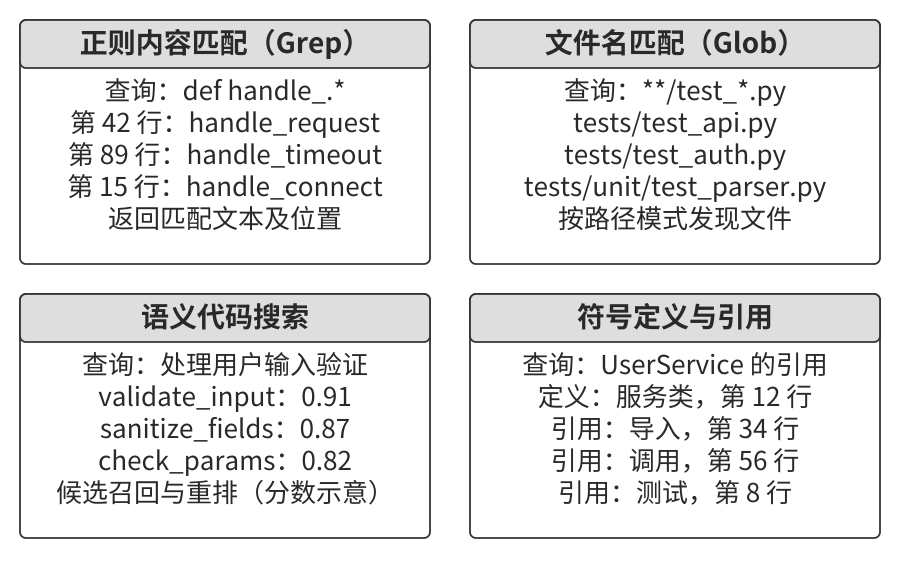

**正则表达式内容匹配。** grep、ripgrep 根据文本模式查找内容，适合已知函数名、变量名和错误消息的任务。例如，`def handle.*` 可以匹配包含相应函数定义形式的文本行。结合文件类型与路径过滤，还可以只搜索 Python 文件、排除测试目录，把结果集中到相关实现上。

文本匹配直接对应文件内容，结果容易核对。查询词需要与代码中的表达建立联系：搜索“用户认证”时，可以进一步尝试 `authenticate`、`login` 或 `check_credentials` 等名称。模型根据前一次结果扩展查询，就形成了边搜索边理解的检索过程。

**文件名模式匹配。** glob 根据路径模式查找文件，例如 `**/*.test.ts` 查找各级目录中的 TypeScript 测试文件，`src/components/**/Button.tsx` 查找组件目录下的 Button.tsx。路径匹配省去了读取正文的工作，适合先了解项目组织，再选择需要打开的文件。

**语义代码搜索。** 当任务只给出功能描述时，可以用向量检索召回语义相关的代码。例如，“验证用户身份”可能对应 `check_credentials`。这类系统通常需要处理两项工作：

- **按代码结构分块。** 以函数、类和方法为主要单元，保留相关签名、注释及所属模块。较长单元继续切分时，需要携带足以理解片段的上下文。
- **组合多种检索信号。** 向量检索找语义相关的代码，关键词检索找名称精确匹配的代码，再合并两组结果。第三章介绍的跨编码器可以进一步排序：它同时读取查询和一段代码，给这段代码的相关性打分。

“与数据库交互”“处理用户输入验证”等探索性问题，可以先用语义搜索定位模块，再读取实现。

**构建 Coding Agent 的搜索能力时，笔者建议先把 Grep、Glob 与按范围读取做好。** 模型可以根据搜索结果继续改写查询、打开调用方和测试，逐步缩小范围。这些工具直接读取当前工作区，省去了维护嵌入索引并使其与代码同步的工作。反复探索大型代码库、仅有功能描述又难以找到入口时，再增加语义索引以改善召回。Cursor 曾公开介绍基于嵌入的代码库索引，后续搜索文档又介绍了本地 Instant Grep 索引与探索型子 Agent[^ch5-search]。这个演进也说明，“使用 grep 类接口”与“是否建立索引”是两个设计维度：同一种检索接口，底层可以采用扫描或索引。

**符号级定义与引用查找。** 语言服务器可以利用语法、作用域和类型信息提供“跳转到定义”“查找引用”。例如，`authenticate` 在第 42 行定义、在第 189 行调用，工具可以返回两者的关系，并区分其他作用域中的同名符号。Claude Code 的代码智能插件就是一种接入方式：通过语言服务器协议（LSP）提供符号导航与编辑后的诊断[^ch5-lsp]。

符号工具的效果取决于语言支持、项目配置和分析状态。Agent 可以用文本搜索补充查找字符串、注释或尚未被语言服务器解析的文件。

[^ch5-search]: Cursor，*Securely indexing large codebases* 与 Search，分别介绍嵌入索引方案与后续本地搜索机制。
[^ch5-lsp]: Anthropic，*Code intelligence plugins*，介绍通过 LSP 提供定义、引用与实时诊断。

#### Coding Agent 中的文件编辑工具

设想模型读完一个文件后，别人恰好在它开头添了一行注释。此时“改第 28 行”和“替换这段唯一出现的原文”仍指向同一处吗？如果原文在两个函数里各出现一次呢？图5-4 中的五种编辑方案用不同的方式定位改动，有的依靠行号，有的依靠原文，也有的把合并工作交给另一个模型。

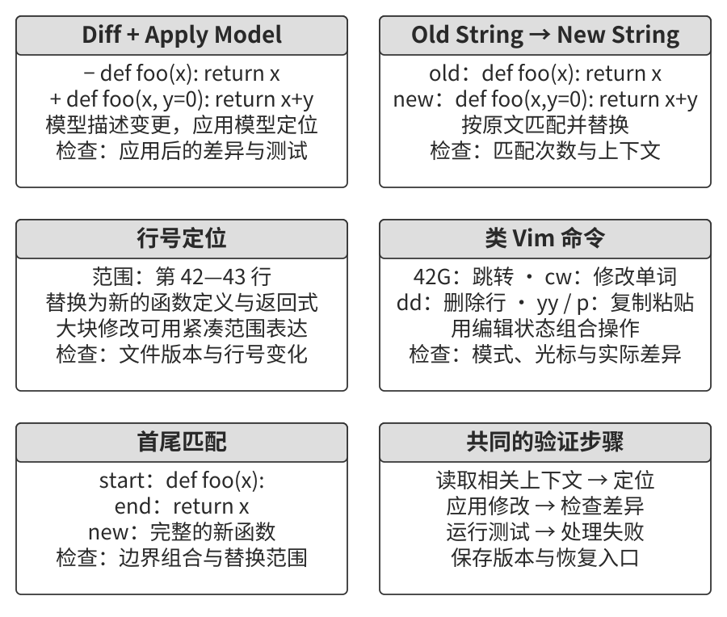

**差异描述＋Apply Model。** 主模型给出修改意图与代码片段，例如类似 Git diff 的增删描述，或用省略标记跳过未修改部分的代码骨架。专门的应用模型再结合原文件生成修改后的完整内容。Cursor 早期的 Fast Apply 是这一思路的代表[^ch5-apply]。它把“提出修改”和“应用修改”分给两个模型。随着基础模型更擅长生成精确的局部编辑，这套双模型流程逐渐有了更简单的替代方案。

这种分工让主模型集中表达代码逻辑，应用模型负责把局部修改合并到文件。相应的检查重点也落在合并结果：多个相似片段可能造成定位歧义，省略标记可能被误解，未修改区域也可能被意外重写。

**旧字符串到新字符串（Old String → New String）。** Claude Code 的 Edit 工具采用精确字符串替换；Cursor 在 2025 年 5 月的 0.50 版引入 Search & Replace，首先用于 Anthropic 模型的长文件编辑[^ch5-direct-edit]。这种路线把定位依据和替换内容直接交给程序执行，减少了合并阶段再次调用模型的工作。模型提供 `old_string` 和 `new_string`，工具在文件中找到原文后进行替换。接口可以约定单次替换要求原文唯一；无匹配或多处匹配时，返回位置与诊断，由模型补充上下文。需要批量替换时，通过显式参数表达范围。

例如，一个配置文件里两个服务都写着 `timeout = 30`。现在只想把下载服务的超时改为 60 秒。若工具要求唯一匹配，只提供 `timeout = 30` 会得到两处匹配，文件应保持原样。下一次请求把下载服务的小节标题和设置行一起作为旧字符串，新字符串保留标题、只改数值。

内容匹配直观且便于复核。模型调用时需要输出完整的旧字符串：删除大段代码时，参数会很长；空格、换行和引号的细小差异也会影响匹配。第四章的 Unicode 弯引号案例展示了这类故障如何在参数传递中发生。

**行号定位（Old Line Numbers → New String）。** 模型指定删除第 X 到 Y 行，再插入新文本。读取工具已经提供实际行号时，大段删除只需首尾两个位置。行号的含义取决于读取时的文件版本，前一次编辑可能移动后续位置。

因此，批量编辑可以统一引用同一份初始快照，由工具检查重叠区间并整体应用；也可以逐次编辑、重新读取后再定位。工具还可核对文件版本或预期内容，在并发修改后返回冲突，防止把旧行号应用到新的文件内容上。

**类 Vim 编辑命令。** 编辑器命令可以表达移动、复制、剪切和粘贴，适合把函数从一处移到另一处等重组操作。它们依赖当前光标、缓冲区和命令模式，每一步都会改变后续操作的基准。

**人类编辑器的交互习惯，不必成为模型工具的默认设计。** 人类往往看一眼当前状态，再执行一次小操作；模型则可以经过较长思考，一次生成数十行甚至数百行修改。把这种批量修改拆成大量光标移动和模式切换，会增加调用成本，还要求模型预测前序命令对状态的影响。对代码生成任务，笔者因此优先选择直接表达修改目标与内容的接口；采用编辑器命令时，要明确状态基准并及时返回反馈。

**字符串首尾匹配（Old String Start + End → New String）。** 模型只提供待替换区域开头和结尾的几行，由工具定位两个边界及其中的内容。删除数百行代码时，这种方式能够减少需要重复输出的原文，同时保留内容定位的依据。

工具要检查两段原文出现的先后顺序，并按接口约定决定是否替换首尾两段。只有一处区间符合条件时才动手；如果好几处都能匹配，就把这些位置告诉模型，请它补充上下文。对于嵌套结构或重复代码，增加相邻的函数名、签名等锚点可以帮助确定范围。

**构建新的 Coding Agent 时，笔者建议先从旧字符串到新字符串这样的简单、确定性编辑接口开始。** 原文定位明确，失败原因容易解释，差异也便于复核。模型能可靠生成局部修改后，Harness 就可以把更多工作交给确定性程序，省去额外的应用模型。大段删除需要压缩参数量时，再引入首尾锚点或基于快照的行号编辑。Codex 的 `apply_patch` 则展示了用受约束补丁表达多处修改的另一条直接编辑路线。

[^ch5-direct-edit]: Anthropic，*Tools reference*，Edit 工具；Cursor，0.50 更新记录，2025 年 5 月 15 日，介绍 Search & Replace 的引入；1.3 更新记录同时记录 Search & Replace 与 Apply 的优化。

[^ch5-apply]: Cursor，*Editing Files at 1000 Tokens per Second*，介绍将修改描述应用到原文件的专用模型。

#### Coding Agent 的安全

Coding Agent 可以读取项目、修改文件、运行程序，还可能通过网络访问外部服务。设计权限时，需要沿着数据流检查三个问题：哪些内容会进入上下文，模型能够请求哪些操作，这些操作最终由什么机制批准和执行。

Simon Willison 用“致命三要素”概括了一类提示注入风险：访问私有数据、接触不可信内容、具备对外通信能力[^ch5-trifecta]。例如，一个助手既能读取私人文件，又会处理外部邮件，还能发送消息，就需要在读取、理解和发送之间建立明确的授权边界。外部内容中的指令一旦被当作用户要求，可能推动未经授权的数据传递。

在这三个维度之外，笔者还建议检查第四个维度：**持久记忆会放大提示注入的影响**。外部内容如果进入长期记忆，影响就可能跨越会话，在后续任务中再次出现。因此，记忆写入应记录来源、适用范围和确认状态；读取时继续保留这些属性。保存在 `MEMORY.md` 中的文字，其可信度仍取决于形成过程。发现错误记录后，还需要能够定位、修正和撤回相关内容。

第一章的三层护栏在这里分别承担任务：上下文层标明信息来源与行为要求，执行层校验操作和授权，数据层按可信身份限制资源读写。Claude Code 的沙盒通过文件系统与网络边界约束命令执行，Cowork 也采用隔离环境承载本地任务[^ch5-sandbox]。下面进一步展开这些机制。

**限定沙盒中的资源与通信。**

- **网络出口。** 这是代码沙盒中容易被忽视、应优先落实的一道边界。笔者建议从默认关闭外部访问开始，按任务需要放行包管理源、文档站点和业务 API。允许列表需要对应具体目的地与操作范围；共享服务还要考虑账户、租户和资源归属。网络策略应覆盖工具启动的程序及其子进程，对外传递的数据另按授权范围检查。
- **文件系统。** 可以把原始源码只读挂载，将副本放入可写工作区；也可以由受控编辑接口生成补丁，经审查后应用。生成物和中间文件放在独立目录，凭证文件留在沙盒之外。需要访问认证服务时，由受控接口提供任务所需能力，避免把宿主机全部凭证交给生成的程序。
- **资源与时间。** 为 CPU、内存、进程数量、磁盘空间和运行时间设置上限，限制死循环、进程数量失控及持续写盘的影响。超限后返回结构化状态，例如“执行超过 120 秒，已终止”，并附上保留的输出和清理结果，供模型判断是否缩小任务或调整实现。

这些边界需要覆盖完整执行链。命令经过审批后，实际启动的程序仍在相同权限范围内运行；后台进程、辅助工具和外部接口也需要纳入相应控制。

**解析命令结构与参数含义。**

Shell 命令由程序名、参数、重定向、管道及子表达式组合而成。审查时应解析这些结构，再识别涉及的读取、写入、执行和通信操作。**命令黑名单不足以承担最终的安全判断。** 同一操作可以通过不同参数组合和间接调用表达，校验必须理解命令结构与参数用途，再由运行时权限约束实际执行范围。

例如，文件查询工具可能带有对每个匹配项执行后续操作的参数，下载工具的输出选项则决定写入位置。校验器需要识别“哪个选项需要把后一个参数作为取值”，追踪参数的用途，再检查目标路径、访问权限和允许的操作。这样，审核结果可以具体到“读取哪些文件”“写入哪个位置”“启动哪个程序”。

变量展开、动态脚本和运行期间才产生的路径，会使一部分实际行为延迟到执行时才能确定。Harness 可以对无法确定的部分要求更明确的调用形式、转交审核，或在受限环境中执行。模型辅助审核提供上下文判断，确定性的访问控制约束实际效果。第四章介绍的 Sidecar 可以与准备工作并行，具有外部影响的操作在审核通过后提交。

**明确多方委托中的服务对象。**

委托方忠诚（principal loyalty）讨论的是：Agent 代表一方办事，同时与其他参与者交流时，如何持续遵守委托方的目标与授权。例如，用户让 Agent 与供应商议价，并私下给出 12000 元的预算上限。Agent 需要理解供应商的报价、解释己方诉求，同时保护这项私有约束。

笔者与合作者在多方交互评测中观察到两类失败：一类泄露委托方的私有信息或接受对方的不当要求；另一类过度拒绝，连委托方的正常请求也无法完成。评测中的提示策略与训练方法表现出信息保护和正常协作之间的取舍[^ch5-1]。**忠诚度需要同时衡量信息保护与任务完成。** 只追求拒绝更多请求，会把正常协作一并阻断；只追求顺利完成对话，又可能让对方影响委托方的利益。

对 Coding Agent 而言，仓库文件、工具输出和第三方 MCP 返回都可能包含任务信息，也可能夹带要求改变行为的文字。Harness 应根据真实来源区分委托指令与外部材料，给消息附上来源和角色，并把委托范围映射为可执行权限。外部材料中自称“用户要求”的文字，需要经过可信渠道确认。

提示词可以进一步说明协作守则：保护委托方的私有信息，有时连某条记录是否存在也需要保密；对外解释只披露必要内容；区分内部底线与公开立场；在已授权范围内推进任务；面对重复请求时保持一致的授权标准。授权扩大或服务对象变化，应由可信渠道确认并同步更新运行时权限。模型由此获得明确的行为依据，工具与环境则落实实际访问边界。

[^ch5-trifecta]: Simon Willison，*The lethal trifecta for AI agents: private data, untrusted content, and external communication*，2025 年 6 月 16 日。
[^ch5-sandbox]: Anthropic，*Making Claude Code more secure and autonomous with sandboxing* 与 *How we contain Claude across products*，介绍文件系统、网络及产品隔离边界。
[^ch5-1]: Li, Bojie and Noah Shi，*Whose Side Is Your Agent On? Multi-Party Principal Loyalty in LLM Agents*，2026。

### 代码：通用 Agent 的元能力

前面几节把用户需求落实为代码变更。现在回看开头的销售表：即使用户最终只需要一份报告，Agent 仍可写一个程序，统一商品标识、分组统计，再针对一个商品从原表重算退货率。先问清楚用户要按件数还是按订单数统计。假设某商品卖出十件，分在两张订单中，只有一张订单退了一件。按件数算是 1/10，按发生过退货的订单算却是 1/2。两种算法都能运行成功，只有先确认口径，才能知道哪一个数回答了用户的问题。这样写好的程序还可以在下期数据到来时重跑。这个“生成、执行、验证”的循环也能延伸到内容制作、业务系统集成与 Agent 开发。

> **元能力。** 本书用元能力（meta-capability）指创造或组合其他能力的能力。代码生成可以产出新工具，如数据处理脚本和 API 调用流程；也可以表达新约束，如断言和校验规则；还可以构造新的呈现方式，如 HTML 表单、演示文稿和视频。

先从最简单的情形入手。即便最终要交付的只有一道题的答案，模型也可以写一小段程序来检验自己的推算。

#### 代码作为思考工具

**对精确计算和形式化约束，笔者优先让模型写出可执行表达式，再交给解释器或求解器计算。** 逐词生成答案容易出现抄写、计算错误，也可能遗漏条件；程序能把这些步骤固定下来并反复执行。数学与逻辑任务通常包含两个环节：先把题意转成关系与约束，再求出结果。LLM 可以帮助理解问题、提出解法和编写程序，解释器或求解器负责执行指定的运算。

例如，一个班有 40 名学生，60% 选数学，45% 选物理，25% 两门都选。求只选物理的人数，需要用选物理人数减去同时选两门的人数：18 − 10 = 8。若误用选数学人数，就会得到 24 − 10 = 14。错误发生在选择被减数这一步。

把数量关系写成有含义的变量，可以逐项核对：

```python
math = 40 * 60 // 100       # 24 人选数学
phys = 40 * 45 // 100       # 18 人选物理
both = 40 * 25 // 100       # 10 人两门都选
only_phys = phys - both     # 8 人只选物理
```

符号计算进一步扩展了这类分工。它可以保留 $\sqrt{2}$ 这样的精确形式，并按代数规则变换表达式。直接把它平方，结果是整数 2。先舍入到 1.414 再平方，结果就是 1.999396。题目要求精确化简时应保留符号，要求报告测量值时则可在最后按指定精度求值。Wolfram 在讨论 LLM 与 Wolfram|Alpha 的结合时，强调了语言理解与计算能力的互补[^ch5-wolfram]。Agent 可以先把自然语言问题转成 Wolfram Language 或 Python 表达式，再调用计算系统，并用结果继续推理。

不同任务需要不同工具。SymPy 适合符号表达式、方程和微积分；NumPy 提供数组与矩阵运算；SciPy 提供数值优化等算法。

> **实验 5-3 ★★：用代码辅助数学解题**
>
> 本实验让同一个豆包模型完成 AIME 2024 的 30 道题，比较直接推理与 Python 工具辅助两条路径。工具环境提供 SymPy、NumPy 和 SciPy，模型可以生成程序、读取执行结果，再给出最终答案。
>
> 本次运行中，直接推理答对 11 题，代码辅助答对 16 题。

逻辑问题也可以这样处理。以骑士与无赖谜题为例，为每位居民设置一个布尔变量，真表示骑士，假表示无赖，再把每句话转成布尔表达式。对说话者 X，约束是“X 是骑士”等价于“X 的陈述为真”。例如，A 说“B 是骑士”，就得到 `A == B`；A 说“B 是无赖”，就得到 `A == (not B)`。

求解器搜索满足全部约束的赋值，模型再把赋值解释为人物身份。如果陈述之间互相矛盾，就没有满足条件的赋值；给定的陈述也可能同时容许几组不同的身份。

> **实验 5-4 ★★：用约束求解辅助逻辑推理**
>
> 本实验从 K&K 数据集中按人数分层选取 84 道题，比较同一个豆包模型直接推理与调用 `python-constraint` 的表现。代码路径需要识别人物变量、翻译陈述，并调用求解器寻找满足全部条件的身份组合。
>
> 本次运行中，直接推理答对 63 题，代码辅助答对 33 题。84 条代码轨迹都出现过导入求解库的语句。其中有一道题，模型甚至改对了程序，却没有交出答案。
>
> 以 James 和 Sophia 那道两人题为例。James 说 Sophia 是无赖；Sophia 说“James 是骑士，当且仅当 James 是无赖”。后一句无论 James 是谁都为假，因此 Sophia 是无赖，James 说的是真话。模型第一次提交的程序把双条件写成了 Python 无法解析的 `james == not james`。到第八次调用工具时，程序里已经写成 `james == (not james)`，最终回复却仍为空，这题照样失分。

**Harness 该做多厚，取决于模型在具体任务上的能力边界。** 模型已能稳定完成的推理，额外求解步骤可能只增加开销；模型容易算错的部分，则值得交给确定性计算。但工具辅助还要求模型正确完成形式化转换，约束翻译出错会把原问题变成另一道题。即使约束修对了，助手也可能耗尽轮数，来不及交回答案。

[^ch5-wolfram]: Stephen Wolfram，*Wolfram|Alpha as the Way to Bring Computational Knowledge Superpowers to ChatGPT*，2023 年 1 月。

#### 代码作为业务规则的约束

业务规则可以通过代码落实到执行流程中。例如，“购买后 7 天内可退款”需要进一步确定：按自然日还是工作日计算，起点是下单、付款还是发货，边界时刻是否包含在内。先由业务方确认这些含义，再写成条件与测试用例，规则才有稳定的执行依据。

例如，规则负责人确认“付款后经过的时间不超过 168 小时”，可以写出三个相邻用例：付款后 167 小时 59 分、恰好 168 小时、168 小时 1 分。用服务端的申请时刻减去付款时刻，两个时间戳要先统一到同一时间基准。按这个规则，前两个用例通过，第三个拒绝。若负责人改为按付款地的自然日计算，原有用例与代码都要重新核对。

自然语言说明帮助模型理解政策、向用户解释原因，并在授权范围内寻找其他方案，例如查询是否允许改签。代码化校验负责在关键操作前检查具体条件，适合处理多条件组合、时间计算和跨数据源核对。模型可以辅助生成校验代码，规则负责人通过审查和边界用例确认其含义；规则更新时，同步更新说明、实现和测试。

**代码化规则的首要价值，是拦住会造成实际损失的错误操作。** 取消订单、转账和删除数据都会改变业务状态，事后补救可能代价高昂。笔者建议把真值校验直接放进执行接口，让每次提交都经过同一套规则，避免模型漏调独立检查工具。独立查询接口仍可用于提前解释政策，执行时则重新读取所需事实，检查状态是否变化，并结合第四章介绍的事务、幂等与补偿机制管理后续操作。

**用参数引导核对，用服务端事实作出裁决。**

τ-bench 通过航空、电商等场景研究工具调用与政策遵守[^ch5-tau]。下面以航空预订为教学场景，设定五条取消规则：先排除已使用航段的订单，再检查预订时间、航司取消、商务舱和保险条件。`cancellation_reason` 记录用户申请原因，`expected_*` 记录模型预期看到的事实，实际裁决读取业务数据库和服务端时钟。

这段代码展示政策分支。入口层负责确认请求身份、订单归属和操作授权；执行层在受控事务或等效的一致性机制中读取状态、校验条件并提交取消，保存审计记录。

```python
def cancel_reservation(
    reservation_id: str,
    cancellation_reason: str,        # "change_of_plan", "airline_cancelled", "other"
    expected_cabin_class: str | None = None,  # 可选：模型预期的舱位
    expected_has_insurance: bool | None = None  # 可选：模型预期的保险状态
) -> dict:
    """
    取消航班预订。

    取消政策（服务端根据数据库真值强制执行）：
    - 规则 1: 已使用任何航段的订单不可取消
    - 规则 2: 通过规则 1 后，预订后 24 小时内可取消
    - 规则 3: 通过规则 1 后，航空公司取消的航班可取消
    - 规则 4: 通过规则 1 后，商务舱可取消
    - 规则 5: 基础经济舱和经济舱需购买旅行保险才可取消

    调用前请先查询订单详情，逐条核对上述政策；expected_* 参数用于
    陈述你的判断依据，仅供服务端比对与审计，不影响政策裁决。
    """
    # 从业务数据库读取政策判断所需的事实
    r = db.get_reservation(reservation_id)
    now = server_clock.now()  # 使用服务端时钟

    # 记录预期值与当前事实的差异，供诊断和审计
    if expected_cabin_class is not None and expected_cabin_class != r.cabin_class:
        log_mismatch(reservation_id, "cabin_class", expected_cabin_class, r.cabin_class)
    if expected_has_insurance is not None and expected_has_insurance != r.has_insurance:
        log_mismatch(reservation_id, "has_insurance", expected_has_insurance, r.has_insurance)

    if r.any_segment_used:
        return {"success": False, "reason": "Cannot cancel with used segments"}

    hours_since_booking = (now - r.booking_time).total_seconds() / 3600
    if hours_since_booking < 0:
        return {"success": False, "reason": "Booking time is in the future"}
    if hours_since_booking <= 24:
        execute_cancellation(reservation_id)
        return {"success": True, "reason": "Cancelled within 24-hour window"}

    if r.flight_status == "cancelled_by_airline":
        execute_cancellation(reservation_id)
        return {"success": True, "reason": "Airline cancelled flight"}

    if r.cabin_class == "business":
        execute_cancellation(reservation_id)
        return {"success": True, "reason": "Business class cancellation"}

    if r.cabin_class in ["basic_economy", "economy"]:
        if r.has_insurance:
            execute_cancellation(reservation_id)
            return {"success": True, "reason": f"{r.cabin_class} with insurance"}
        return {"success": False, "reason": f"{r.cabin_class} requires insurance"}

    return {"success": False, "reason": "Does not meet cancellation policy"}
```

**参数帮助模型逐项核对。** 工具描述列出取消政策，并要求先查询订单。模型可以把舱位和保险状态填入 `expected_cabin_class`、`expected_has_insurance`，使判断依据出现在调用记录中。可选参数提供核对入口，是否实际执行了查询与核对，还需要检查轨迹。若流程要求必须先查询，可以由 Harness 检查查询记录及有效期。

例如，订单已超过 24 小时，航班正常运行，舱位为经济舱且未购保险，模型可以据此解释无法按本例政策取消，并查询改签等允许的选项。

**服务端根据当前事实执行规则。** 舱位、保险、预订时间、航段使用情况和航班状态都从业务数据源读取；时间窗口以服务端时钟计算。`expected_*` 的差异用于诊断，`cancellation_reason` 用于记录申请意图。航司是否取消等事实由服务端核实，用户在申请中填写“航司取消”，并不会让一张原本不可退的票变得可退。

数据来源的独立性也需要落实到访问控制中：谁可以修改订单事实、何时更新、如何保存历史，都影响校验的可信度。并发操作可能在查询后改变状态，因此提交退款时，服务端会重新读取订单状态，确认这张票仍可退款，并对重复请求返回一致的处理结果。

> **实验 5-5 ★★：小模型与代码化业务规则**
>
> 本实验使用 Qwen3-4B，在 60 个固定航空退款案例上比较两组实现。两组都向模型提供自然语言政策；控制组的取消工具接受调用后直接退款，代码化组则在执行前读取模拟数据库与服务端时钟，检查退款资格。
>
> 实验使用简化政策：灵活经济舱和商务舱可退；基础经济舱在预订后 24 小时内，或遇航司取消、重大延误时可退。核对参数为 `expected_refundable` 与 `expected_reason`，分别记录模型对退款资格和原因的判断。
>
> 评分时先看钱退了没有，再对照这张票按政策该不该退。按这个标准，控制组正确处理了 57 例，代码化组正确处理了 55 例。两组都没有把钱退给不符合条件的乘客，失分都来自该退却没退的订单：控制组 3 例，代码化组 5 例。乘客还关心客服有没有解释原因、被拒后还能怎样处理。实验另行检查最终回复里的政策说明和替代方案，这些检查不计入上述退款得分。

[^ch5-tau]: Sierra Research，τ-bench: A Benchmark for Tool-Agent-User Interaction in Real-World Domains，提供航空、电商场景的政策、工具和交互任务。

#### 代码驱动的多媒体生成

演示文稿、技术报告和交互页面都包含内容组织与视觉呈现两项工作。Agent 可以先把结构写成代码或标记语言，再调用渲染工具生成可查看的产物。例如，HTML 表达页面结构，CSS 控制布局与样式，JavaScript 实现交互。元素位置和样式由此成为可修改的参数，便于批量调整、重复生成和版本比较。

程序化生成适合有结构、需反复修改的内容。GUI 则提供直接查看和局部操作的入口，两种方式可以配合使用。

**PPT 生成 Agent。**

学术报告需要把论文中的问题、方法、实验和结论组织成逐页展开的讲解。Agent 可以先规划每页要回答的问题，再选择要点和图表，最后生成幻灯片源码。Slidev 以 Markdown 为内容入口，并支持 HTML 和 Vue 组件，适合把这一过程组织成可执行的生成流程[^ch5-slidev]。

如果主办方给了一份往届报告作样稿，还可以直接沿用其中的页面结构。PPTAgent 先分析参考稿里各页的用途，再为新大纲挑选合适的参考页，用代码修改页内对象。比如新报告要讲实验结果，可以挑一张原本就用来并列展示两组结果的页面，替换其中的图和说明。这种复用也带来一项检查：两幅图都已换成本次实验的结果，旁边的段落会不会还在解释去年的实验？论文所用版本按元素和段落编号修改文本框。如果只换图，原有的说明就会留在页面上。[^ch5-pptagent]

[^ch5-pptagent]: Zheng 等，PPTAgent 论文，EMNLP 2025。论文配套代码在 `pptagent/apis.py` 中实现按段落编辑的接口。

换对了文字和图片，排版仍可能出错。比如给图加了两行说明，编译能通过，文字却可能压住坐标轴。图5-5 中，审核者看到渲染后的截图，才能把这样的意见交回给负责排版的提议者。

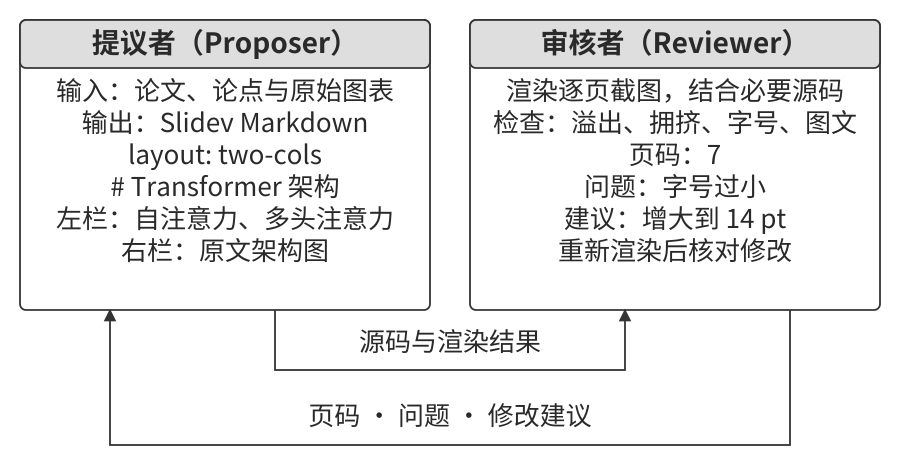

- **提议者（Proposer）** 阅读论文，规划讲解结构，编写 Slidev 源码，并根据反馈修改页面。
- **审核者（Reviewer）** 通过工具渲染页面，使用视觉模型检查内容密度、可读性、布局和图文对应关系，返回包含页码、问题类型、严重程度和修改建议的结构化反馈。

反馈应能直接指导修改。例如，“第 3 页要点过多，拆成方法概览和计算步骤两页”；“第 7 页代码字号过小，先增大至 14 pt，再检查投影可读性”。事实错误与图表误读优先修正，随后处理布局和视觉细节。

局部修改还需要说明修改哪一个对象。飞书幻灯片里的豆包工作允许用户选中页面元素，再通过浮动工具栏提出编辑要求。[^ch5-doubao-work] 假设同一页有两个文本框，一处是原始访谈引文，另一处是汇报人写的总结。用户选中总结，要求“压缩到两行”。选中的文本框限定了改动范围。总结可以改写，旁边的引文要保留受访者的原话。

[^ch5-doubao-work]: 飞书帮助中心，在幻灯片中使用豆包工作。

提议者修改后重新渲染，审核者检查新版本，并确认上一轮问题是否解决。循环设置两类退出条件：达到明确的内容与版式要求，或用完轮数、时间与费用预算，例如最多修改 5 轮。交付时保存当前版本及尚待处理的问题，便于后续审阅。

这与第四章的操作审批共享提议者—审核者模式。操作审批主要判断某次行动能否执行；内容审查则通过多轮反馈改进产物。两者都需要共享任务要求、给出可定位的判断依据，并由 Harness 决定后续流程。采用不同模型家族可以提供另一种审查视角。

**笔者看重双 Agent 分工在上下文管理上的优势。** 两个角色可以分别保留各自需要的信息：审核者每轮接收最新截图、审核标准和必要的问题清单；提议者保留源码、修改目标和结构化文本反馈。页面图像留在审核者的上下文中，主轨迹通过简短的文本反馈持续推进修改。每轮审核都围绕最新页面展开，既减少历史截图的干扰，也控制了上下文增长。

> **实验 5-6 ★★：基于论文的 PPT 自动生成**
>
> 本实验使用《Attention Is All You Need》的论文 PDF，生成 20 页 Slidev 幻灯片。Agent 提取论文结构和要点，使用三张带来源记录的原论文图，逐页组织讲解。渲染后检查文字溢出、图表可读性及图文对应关系，再按反馈修改。
>
> 对照比较单 Agent 自审和提议者—审核者分工。本次运行中，两份最终文稿在同一独立评分流程中均获得 95 分；分工方案的峰值输入约为 2.4 万 token，保留历史截图的单 Agent 方案约为 9.3 万 token。

> **实验 5-7 ★★：论文讲解视频的自动生成**
>
> 在幻灯片基础上，Agent 可以为每页编写口语化讲解，解释图中的对象、关系和结论，再调用 TTS 合成语音。讲稿与页面一起交给视觉审核者，检查讲到的元素是否出现在画面中，以及描述是否与图表一致。
>
> 制作视频时，实验沿用前一节的生成流程，选用较早的一份 22 页稿（v2）。按顺序抽取 12 页后，视频最后一个画面来自原稿第 21 页。前一节比较评分和用量时用的是后来的 20 页稿（v9）。选好页面后，使用 Kimi 生成讲稿、Qwen 视觉模型审查图文关系，再由 Fish Audio 合成逐页语音。FFmpeg 根据每段音频的实际时长设置页面展示时间，合成约 8.6 分钟的讲解视频。
>
> 图5-6 中，幻灯片、讲稿和语音要到最后才合成视频。有些问题得在这一步才能听出来：换页时一句话是否还没说完，越往后声音和画面是否越对不上。
>
> 

[^ch5-slidev]: Slidev，*Getting Started*，介绍基于 Markdown 和 Web 技术生成、展示与导出演示文稿。

**视频编辑 Agent。**

**视频编辑中能够用脚本表达的操作，应优先走程序接口。** 时间轴、图层、字幕和音轨分布在复杂的 GUI 面板中，反复定位和拖动会增加延迟与误差；程序接口可以直接用时间区间、轨道和效果参数表达操作。Blender 的 Python 接口与 FFmpeg 都能把一部分编辑任务组织成可重复执行的脚本。

Agent 可以先理解“把冲浪部分剪出来”这样的要求，再定位素材中的目标区间，生成裁剪、排列和音轨处理代码。提议者负责编辑计划与脚本，审核者检查渲染结果；遇到遗漏、无关片段或字幕遮挡时，反馈具体时间点和问题，交给提议者修改。关键帧适合检查场景与布局，运动连续性和音画同步还需要检查相邻帧或连续片段。

> **实验 5-8 ★★：基于 API 的智能视频剪辑**
>
> 本实验把目标定位、脚本生成和效果审查串成一个流程。先将视频引用、目标问题和抽帧间隔交给视频分析子 Agent，由它处理大量画面，向主 Agent 返回时间区间与依据。
>
> 定位分两步。第一步每 10 秒抽取一帧，寻找目标的大致范围，例如“冲浪在第 40—110 秒”；第二步围绕候选区间及邻近边界，每秒抽取一帧，进一步确定开始和结束位置。短于粗采样间隔的场景可能落在两帧之间，可以根据目标持续时间增加采样，或回看两次抽帧之间的画面。
>
> 确定区间后，提议者生成 Blender Python 脚本，执行裁剪及所需的字幕、变速等操作。审核者查看预览，指出需要调整的边界和效果；修改通过后再输出完整成片。
>
> 实际剪的是一只大白兔独自在草地上走过的镜头。每 10 秒看一帧，模型把范围定在第 10 至 20 秒。若从第 10 秒直接下剪，镜头开头就会丢掉一截。于是程序把前后各放宽 5 秒，在第 5 至 25 秒间每秒看一帧，把候选区间缩到第 9 至 12 秒。审核者又发现片段夹带了相邻画面，修订后的区间为第 9.25 至 11.00 秒。对照人工标注的第 9.08 至 11.20 秒，开始晚了 0.17 秒，结束早了 0.20 秒，两端都达到了误差不超过 3 秒的要求。
>
> 时间码只能检查剪在了哪里。把同一套字幕和慢动作放到一段故意选错的画面上，审核者还能认出错误吗？实验先让它检查第 0 至 3 秒的对照片段，再看修订后的渲染。审核对象包括画面里的大白兔、底部字幕和变速后的时长。

**3D 与工业零件：选择合适的生成方式。**

**尺寸与装配关系是硬约束的工业零件，优先采用参数化代码生成；主要追求自然形态与外观的对象，优先考虑生成模型。** 这个选择取决于产物能否用少量参数精确描述，以及修改后需要保持哪些关系。CadQuery、OpenSCAD 和 Blender 脚本提供可编辑的构造过程，混元 3D 等模型则利用学到的形态先验生成复杂外观。

**描述是否适合参数化。** 一个简化法兰盘可以用外径、厚度、孔位圆直径、孔径和孔数表达主要几何关系。代码将参数与构造步骤对应起来，适合反复调整。一盆绿植、一块太湖石或一张人脸则包含大量不规则形态，生成模型可以帮助构造外观，程序化方法也可以通过生长规则、随机过程和资产组合生成细节。

**精度如何检查。** 对孔径 5 mm、公差 ±0.05 mm 这样的要求，需要先明确单位、坐标系和测量方法，再比较模型尺寸与规格。参数化模型可以直接检查几何对象；网格可以通过截面、孔洞、包围尺寸等方法测量，并计入离散化误差。

**如何保存和修改。** B-rep（边界表示）用面、边和顶点描述实体边界，三角网格则用面片近似表面。CadQuery 可以导出 STEP 用于 CAD 数据交换，也能导出 STL 网格；可编辑的参数与构造逻辑保存在 CadQuery 源码中[^ch5-cad]。进入 CNC 加工流程还需要工艺规划、刀具路径和机床适配。

例如，把安装孔从适配 M5 改为适配 M6，可以修改孔径参数，重新生成后复核外径、厚度和孔位是否保持一致。生成模型的修改方式取决于接口能力，可以重新生成，也可以结合局部编辑和后续几何处理。

两条路线组合时，也应明确分工：尺寸和装配关系交给参数化代码，纹理与自由外观交给生成模型。**关键尺寸需要反复精确修改时，可编辑的构造过程比一次生成的外观更有价值。**

> **实验 5-9 ★★：同一个零件的两种生成路线——代码与生成模型**
>
> 本实验要求生成外径 80 mm、厚度 10 mm 的法兰盘，在直径 60 mm 的孔位圆上均布四个安装孔。为明确装配含义，初始规格采用适配 M5 的 5.5 mm 通孔，修改请求改为适配 M6 的 6.5 mm 通孔。
>
> 代码路线由模型生成 CadQuery 程序，执行后导出 STEP 与 STL；生成模型路线先生成产品参考图，再交给混元 3D 生成网格。检查外径、厚度、孔数、孔径、孔位和安装面，并记录单位与轴向。
>
> 怎样看出模型只改了指定的尺寸？对照修改前后导出的 STL，四个安装孔的平均直径从 5.499 mm 增至 6.499 mm；两件的外径都是 80 mm，厚度都是 10 mm，孔位圆直径按三位小数均为 60.000 mm。生成模型路线的原始网格缺少明确的物理尺度。测量程序沿 Z 轴取中截面，没有找到孔的内环。要查明四个孔是否贯穿盘体，还需认出安装面，沿它的法向在不同深度取截面。重新生成后，整体形态和朝向都发生了变化。
>
> 最后换一道题：要交付一张看起来自然的盆栽图片，该怎样验收？实验用 matplotlib 绘制一张盆栽，用 Gemini 生成另一张，再让同一个视觉模型按十分制评自然度。两张图分别得到 3 分和 8 分。这个分数回答的是评审模型觉得哪张图更像真实植物。回到法兰盘，即使产品图看起来像有四个孔，装配仍要在三维零件上核对孔的位置和直径。

[^ch5-cad]: CadQuery，*Importing and Exporting Files*，介绍 STEP、STL 等格式，并说明完整参数化信息保存在 CadQuery 的 Python 源码中。

#### 代码作为系统适配器

外部服务的接口、鉴权方式和数据格式各不相同。Agent 可以阅读文档与响应样本，生成 HTTP 客户端、配置鉴权头、解析返回值，再把上游字段转换成下游需要的结构。代码在这里承担系统适配工作，将已有服务组合为新的任务流程。

例如，从支付服务读取的金额字段若以分计，而报表按元展示，能把 JSON 解析成功只说明格式相容。一笔 25 元的交易，在上游是整数 2500。直接把这个数填入报表，25 元就成了 2500 元。

适配器需要明确输入输出、错误处理与版本范围。样本帮助模型理解字段，接口约定和测试则检查缺失值、分页、异常响应及版本变化。凭证由执行环境管理，生成代码通过受控接口使用授权能力。验证通过后，适配器可以保存和复用，后续遇到格式变化再进入修改流程。

只有图形界面的系统也可以采用类似方法。Agent 先通过第六章介绍的 Computer Use 完成任务，再把稳定的操作步骤固化为 RPA 工具。界面控件、登录状态和页面流程变化时，工具需要检测偏差并重新定位。第九章将进一步讨论如何从成功轨迹中提取、验证和复用工作流。

**Agent 日志解析和可视化。**

一次复杂任务可能包含多次模型请求、工具执行和子 Agent 交互。日志概览呈现步骤关系、状态与耗时，展开后则显示具体输入输出，帮助读者追踪某一步发生了什么。新增字段、嵌套结构和格式版本都会影响解析与展示。

自适应解析通过“发现变化—生成解析器—验证结果”的循环处理这些变化。解析失败时，系统保存原始样本、错误位置和预期字段，再对照接口约定与生产者版本判断变化是否符合预期。确认是格式升级后，才让 Agent 编写新解析器。如果是写日志的程序出了错，就保存原始日志并报告故障，以免新解析器把错误也当成正常格式。新写的代码先在受限环境中运行，先检查字段及其含义，再以正常样本、缺字段样本和旧格式回归用例验证。通过后注册新解析器，保存版本与适用格式；失败样本继续保留，便于追踪和重试。

解析与展示各有检查方法。程序检查时间戳、状态、数值类型和调用关联；浏览器渲染检查页面是否正常工作，视觉模型辅助检查表格、时间轴与标签是否清楚。热更新时保留上一版本及回退入口，使新格式支持可以逐步进入运行系统。

> **实验 5-10 ★★★：自适应的日志解析系统**
>
> 本实验先运行两个日志产生进程，分别输出竖线分隔格式和嵌套括号格式。初始解析器无法处理这些样本，系统随后请求模型生成两个解析函数，测试通过后热加载，再解析原先失败的日志。
>
> 第一种格式提取 `timestamp`、`level`、`module`、`step` 和 `message`；第二种还涉及工具名、耗时与状态。运行记录中，两类各三条日志完成解析，新建引擎也能加载已保存的解析器，继续处理混合日志流。
>
> 解析结果由 Chromium 渲染为表格，视觉审核检查列名、行内容与可读性。

**Agent 执行日志自动分析和问题诊断。**

解析出结构化轨迹后，Agent 可以结合架构文档与 PRD（产品需求文档），比较预期流程和实际行动。例如，退款前有没有查过这笔订单能不能退？库存服务超时后，程序有没有按约定改查缓存？

问题报告可以包含优先级、模块、现象、证据和改进建议。Agent 还可以据此生成回归测试，把问题对应的输入与验收条件固定下来。测试框架在受控环境中重放请求或读取保存的工具响应，比较缺陷版本与修复版本的行为。涉及外部写入的操作使用隔离环境或替代接口，保持重放的影响范围可控。

断言应对应需要验证的属性。例如，日志里出现过退款检查，只能说明程序查过。要知道这笔钱退得对不对，还得看程序是不是先查后退、检查结果是否允许退款，以及订单最终是什么状态。

诊断经过复核，Agent 就可以在获得相应授权后通过 MCP 建立 GitHub Issue，按模块建议负责人。若同一缺陷已有工作项，就把新证据并进去。

> **实验 5-11 ★★★：生产日志的智能诊断系统**
>
> 本实验用本地 HTTP 服务产生两条业务轨迹，一条记录显示系统没查订单能不能退就退了款，另一条显示库存查询超时后没有改从缓存取数。模型结合架构文档与需求说明，生成包含轨迹和轮次引用的问题报告，再生成三个可执行回归测试。
>
> 图5-7 把一份诊断报告放在轨迹和回归测试之间。报告指出“系统跳过检查，直接退了款”。回到轨迹里找证据：调用记录里少了哪一步？再往下看测试：如果以后又漏掉这一步，测试能发现吗？
>
> 
>
> 三个测试在缺陷版本上全部失败，换成修复版本后全部通过。其中一个测试只判断程序有没有调用过退款检查工具。即使程序先退钱，事后才查这笔订单能不能退，这个测试也会通过。运行记录中还保存了 GitHub MCP 创建工作项的回执，可以据此找到诊断报告交给开发者后对应的工单。
>

#### 代码作为生成式 UI

如果用户还要亲自改动 Agent 正在处理的材料，可以把界面做成两人共用的工作台。以行程表为例，让用户看见助理正改哪一站、接手修改、确认或撤销某项变更。若用户刚把出发日改为周五，助理随后就应在这份新行程上继续工作。让两边共享同一份可见状态，并约定当前由谁控制正在编辑的字段，才有可能边看边改。

想象用户要比较三种出行方案。目的地尚未确定时，对话便于追问；目的地确定后，让用户直接选日期、填写人数比来回核对几段文字方便；最后比较总价随日期的变化，一张图表能把差别摆在眼前。Agent 按任务生成相应的表单、图表或应用界面，让用户直接填写、选择、操作，这就是生成式 UI（Generative UI）。

**用协议描述界面与交互。**

生成界面有两条实现路径：输出 HTML、JavaScript 等代码，交给受控环境执行；输出声明式结构，由客户端组件渲染。前者便于实现定制布局和交互，后者把可用能力限定在客户端提供的组件与动作范围内。

A2UI（Agent-to-User Interface）采用声明式描述。Agent 生成结构化消息，表达组件、数据绑定和更新，客户端用自己的组件呈现界面[^ch5-ui-protocols]。例如，应用可以提供卡片、按钮、文本框和表格组件，Agent 据此描述一个标题为“销售数据”、包含三行两列的表格。组件目录还可以扩展图表和地图等能力。

AG-UI（Agent–User Interaction）负责 Agent 与前端之间的事件交互，传递消息、工具调用和状态更新，也可以承载 A2UI 的界面消息。两者组合后，A2UI 描述要展示的内容，AG-UI 连接后端执行与前端交互。

客户端可以逐步接收界面更新，并通过适配的渲染器在 Web、移动端或桌面端展示。客户端验证组件属性、数据绑定和动作请求，服务端继续检查业务权限；组件中的链接、富文本和数据访问也需要各自的处理规则。

直接生成代码时，则需要检查依赖、资源访问和执行权限，并隔离生成界面与宿主应用的敏感状态。外部材料中的提示注入可能影响生成过程，浏览器中的脚本执行风险还取决于页面加载和隔离方式。

**用 HTML 交付交互式成果。**

**对于包含数据、演示和持续更新结果的研究交付，笔者优先采用 HTML 网站。** 长篇线性 Markdown 汇报要求读者不断翻找上下文；交互式网页可以把说明、数据和演示放在同一个入口：读者查看图表，筛选感兴趣的样本，展开某项结果的细节，再操作演示理解系统行为。Agent 也可以随任务推进更新页面，使它持续记录当前成果与证据。

以笔者的研究实践为例，每个研究项目都有一个交互式网站，把它同时作为研究过程中的活文档和最终交付物，并让 Agent 随实验推进持续补充内容。这些网站主要承担三项工作。

一是**实验数据追溯**。页面将样本、提示词、模型回复和评分关联起来，支持逐条检查。例如，同一类回复总是得低分时，可以沿着评分记录找回原始回复和提示词。

二是**训练指标监控**。笔者把反映训练内部状态的信号称为“内科指标”：训练与验证损失、梯度范数、学习率，以及强化学习中的奖励、KL 散度和策略熵等。语言模型还可以用困惑度衡量它对给定文本序列的预测表现。就像体检中的生理指标，这些曲线有时能比最终任务成绩更早暴露问题。把它们与任务准确率一起查看，有助于定位不收敛、梯度异常和训练退化发生的阶段。

三是**运行原理展示**。介绍几个模块怎样配合时，页面可以让读者改动一个输入，查看中间状态，再把输出的变化和实验记录对照起来。

工作持续几个小时，用户怎样抽空接手？笔者使用 Coding Agent 时，希望一句口头指令能准确送到经办的 Agent，想看成果时能随时打开，有了新版本或遇到需要我决定的问题时再来提醒。例如，两份报告正在同时生成。用户打开销售报告，指着第二张图说“这张按净收入重画”。界面应把当前报告和图表标识随指令一起送出。图改好了，通知可以直接打开新版；若“净收入”有两种可用口径，助理应把要选的两种口径列给用户。

**澄清用户意图。**

用户说“我想订一张去北京的机票”时，目的地已经明确，出发城市、日期和单程或往返仍待补充。Agent 可以在一轮对话中集中提问，也可以生成表单，让相关条件在同一页面上呈现。

表单中的控件对应不同类型的信息：文本框收集开放输入，下拉菜单与单选控件列出可选项，复选框支持多选，日期选择器帮助填写时间。JavaScript 可以表达级联关系，例如选中“往返”后显示返程日期，并检查返程不早于出发。选择改变时，还要同步清理或忽略已失效的字段。

图5-8 取自下面实验的一次运行。沿着这笔提交往下看：浏览器返回的四个字段里没有目的地，模型从哪里知道旅客要去北京？


> **实验 5-12 ★★：动态表单生成的意图澄清系统**
>
> 本实验从“我想订一张去北京的机票”出发，让模型生成 HTML 表单：出发城市使用文本框，出发日期使用日期选择器，旅行类型提供单程与往返选项，返程日期在选择往返时显示。
>
> 程序把最初的委托和表单数据一起交回模型。如果只保留提交的字段，即使每个控件都填对了，仍然缺少目的地。
>
> 用同一份表单再试一步：填好返程日期后改选单程。页面藏起了返程输入框，提交的 JSON 却同时保留了单程和 8 月 18 日的返程日期。改选单程时，客户端还得清掉失效的返程日期。

[^ch5-ui-protocols]: A2UI 官方文档与 *AG-UI Overview*，分别介绍声明式界面描述和 Agent—前端事件交互。

**生成 SQL 查询。**

用户可以用自然语言提出数据库查询，Agent 根据表结构和业务口径生成 SQL。**展示完整查询表格时，笔者优先采用 Artifact 模式，让结果从数据库直接进入界面。** 让模型读取并逐行复述大表格，会增加 token 用量和等待时间，还引入抄写错误。SQL 保存为可检查的查询产物；需要分析原因或总结趋势时，再把必要的聚合结果交给模型。

图5-9 中，用户要看各部门的在职人数，页面可以直接显示数据库返回的统计表。如果用户接着问“市场部比研发部多几人”，模型只需取表中的 9 和 5 就能算出相差 4 人。若追问“上个月也差这么多吗”，眼前这张表就不够用了，得按上个月的统计日期重新查询。


执行服务根据可信身份确定可访问的表、列和行，使用受限数据库账号，并对 SQL 结构和操作类型进行校验。查询场景可以限定为批准的只读查询，控制函数调用、时间预算、返回行数与数据范围；用户输入的值通过参数化绑定传入。

Agent 还可以生成可视化产物，例如将部门汇总结果展示为柱状图。执行服务把查询结果交给受控的可视化运行环境，界面只展示允许的数据与交互。

> **实验 5-13 ★★：自然语言交互的 ERP Agent**
>
> 本实验以 ERP（企业资源规划）中的员工与工资查询为例，学习如何从业务问题生成 SQL，并让数据库结果直接进入页面。PostgreSQL 中建立两张表：员工表包含员工 ID、姓名、部门、级别、入职日期和离职日期，离职日期为空表示在职；工资表包含员工 ID、发薪日期和工资，每位员工每月一条记录。
>
> Agent 根据这两张表处理以下十个问题：
>
> 1. 平均每个员工在职多久？
> 2. 每个部门有多少在职员工？
> 3. 哪个部门员工平均级别最高？
> 4. 每个部门今年和去年各新入职多少人？
> 5. 前年 3 月到去年 5 月，A 部门的平均工资？
> 6. 去年 A 部门和 B 部门的平均工资哪个高？
> 7. 今年每个级别的员工平均工资？
> 8. 入职一年内、一到两年、两到三年的员工最近一个月平均工资？
> 9. 去年到今年涨薪幅度最大的 10 位员工？
> 10. 有没有拖欠工资（某月在职但未发薪）？
>
> 查询前需要明确统计口径。例如，在职员工的任职时长计算到查询基准日，离职员工计算到离职日；“平均工资”需要确定按发薪记录还是按员工平均；涨薪排名需要处理去年无记录的员工。
>
> 本次运行生成并执行了十条 SQL，结果均与独立参考计算一致，随后由浏览器直接渲染表格。模型接收表结构、任务与必要的执行反馈，数据库行数据通过应用传到界面。

**动态生成软件。**

Agent 可以从需求开始生成界面和交互逻辑，再根据用户操作继续修改。Anthropic 在 2025 年推出的临时研究预览“Imagine with Claude”展示了这种交互：用户探索界面，模型持续生成相应的软件体验[^ch5-imagine]。

**面向实际产品，笔者更看好在已有框架上进行定制。** 从零持续生成整个应用会反复付出生成、渲染和验证成本；保留稳定框架，再开放用户关心的界面与流程，能更快地提供可靠的个性化体验。用户提出“把按钮改成蓝色”“在侧边栏添加快捷菜单”“换一种更易读的字体”，Agent 定位相关组件、修改代码，再通过预览检查效果。基础框架提供稳定的页面结构与业务接口，定制范围可以从颜色、字体逐步扩展到布局和组件。

开发环境的 HMR（Hot Module Replacement，热模块替换）可以在代码变化后更新受影响的前端模块。是否保留状态，取决于框架集成、更新边界及修改类型；需要完整刷新时，应用还应保存必要状态。FastAPI 开发模式中的 reload 则重新加载服务端程序，两者分别作用于前端模块和后端进程[^ch5-hmr]。

> **实验 5-14 ★★：对话式界面定制系统**
>
> 本实验构建 React 前端与 FastAPI 后端组成的聊天应用，在开发环境中启用前端 HMR 和后端 reload。模型根据连续三轮要求修改颜色、字体和标题，浏览器检查每次修改后的实际界面。
>
> 本次运行记录了 Vite 的 HMR 事件，三轮修改均未发生整页导航，已有聊天状态得到保留，最终构建通过。

[^ch5-imagine]: Anthropic，*Introducing Claude Sonnet 4.5*，介绍随模型发布的临时研究预览 Imagine with Claude。
[^ch5-hmr]: *Vite HMR API* 与 *FastAPI CLI*，分别介绍前端热更新和开发服务器自动重载。

**让权限边界独立于动态业务代码。**

**业务代码越容易由 Agent 动态改写，最终的权限边界就越应下移到稳定的数据访问层。** 传统应用将权限判断写在经审查的业务代码中；生成代码不断变化后，某条新路径可能遗漏同样的检查。让每次读写都经过独立的数据访问服务，才能把权限约束保留下来。例如，招聘应用可以动态生成候选人列表和操作表单，候选人属于哪个组织、招聘人员可以更新哪些字段，则由受信任的数据访问服务持续检查。

这里的设计目标是：**即使生成代码出现错误，受信任的数据访问层仍能强制实施权限约束。** 这延续了第一章的数据层护栏：把需要强制遵守的规则放在所有相关操作都要经过的位置。数据库行级安全策略可以限制记录访问，约束和校验器检查合法状态，受控视图、存储过程或数据服务提供允许的操作。应用层可以提前检查并向用户解释，最终读写仍由受信任的数据服务和数据库权限控制。

每次操作还需要可信的**访问上下文**（access context），包含用户、租户、角色或 Agent 身份。认证服务与受信任运行时负责建立和绑定身份，数据服务据此授权。动态代码获得完成任务所需的受限接口，凭证和策略管理权限由独立组件保管。所有数据库连接、辅助查询及后台处理都应遵守同一访问范围。

例如，PostgreSQL 的行级安全需要结合数据库角色配置使用。应用连接采用受策略约束的角色，应用账号无权修改访问策略[^ch5-rls]。规则与身份绑定机制经过独立审查，业务界面则可以在这个范围内持续变化。

权限与数据完整性还承担不同职责。招聘人员有权修改候选人记录后，状态机继续检查是否允许从“已筛选”进入“已面试”；工资校验器读取关联职位，检查期望工资是否位于职位范围；引用检查确认职位和候选人关系有效。

> **实验 5-15 ★★★：动态生成软件的权限内嵌数据对象**
>
> 本实验提供 PostgreSQL 之上的 Python 对象存储原型，将权限规则、校验器、对象关系和后续反应声明放在数据类型中。读取时检查访问权限；创建和更新时，先执行权限与业务校验、检查引用关系，再持久化，随后将声明的后续反应加入队列，并限制反应链深度。
>
> 招聘示例包含职位、候选人、面试和评估等对象。候选人依次经历申请、筛选、面试、发放录用通知与录用，相关阶段也可以进入拒绝状态；工资范围来自关联职位。示例设置了正常状态更新、无效状态跳转、超出职位工资范围和不同租户访问等检查，帮助读者理解授权与业务校验各自处理什么问题。
>
> 原型通过 `AccessContext` 表达用户、角色与组织属性，教学脚本直接构造这些上下文来模拟不同身份。部署时由认证入口建立上下文，并将对象存储与生成代码分隔在明确的服务或权限边界两侧。

[^ch5-rls]: PostgreSQL，*Row Security Policies*，介绍按角色和操作配置行级安全策略及其适用范围。

#### 代码创造代码：Agent 自举

代码生成能力也可以用于开发 Agent 本身。创建者接收任务需求，生成或修改新 Agent 的提示词、工具和运行循环，再通过测试与实际交互检查产物。图5-10 展示了这一自举循环：已有实现提供起点，任务反馈推动修改，验证结果决定哪些变化可以保留。


如何分辨一次修改改善了通用能力，还是碰巧适应了刚见过的题？保留一个没有送给创建者的任务。例如，用一家商店的数据开发价格监测 Agent，再交给它另一家商店的样例，同时重跑原来的任务。

**维护 Agent 的运行环境。**

新 Agent 的运行依赖配置、凭证、会话状态、服务和沙盒。OpenClaw 的 `doctor` 命令提供了一个维护工具的例子：它检查旧配置迁移、OAuth 凭证状态、会话锁、插件安装、网关健康和沙盒镜像等问题，并给出修复建议或执行相应修复[^ch5-doctor]。

这些确定性检查可以成为自我维护流程的基础。检测规则覆盖已知故障，修复动作具有明确的输入与预期结果。进一步设计 Agent 诊断流程时，可以把尚未解决的问题连同日志、配置和检查结果交给模型，让它说明打算改哪个配置、怎样改；执行层检查权限与修改范围，再运行健康检查和回归测试。配置快照、变更记录与回退入口帮助系统在修复失败后恢复工作。

**以参考实现承载工程经验。**

创建专用 Agent 同时涉及领域逻辑和通用基础设施。检查生成结果时，可以从四类问题入手：

1. **上下文与运行循环。** 保留角色、工具调用标识和工具结果之间的关联，检查多轮状态、终止条件、预算及异常恢复。结构化消息便于维护协议关系；稳定前缀则为提示缓存创造条件。
2. **工具接口。** 工具说明交代用途、适用条件和使用边界，参数包含类型、含义与具体例子。执行层继续验证参数、身份和业务状态。
3. **模型与 API 选择。** 模型容易沿用训练数据中高频出现的旧模型和旧接口，代码写得流畅也可能选型滞后。为创建者提供经过维护的选型资料，或让它检索官方文档，核对模型能力、接口版本与调用方式。生成后的真实调用检验配置是否可用。
4. **依赖与生态兼容性。** 检查库的维护状态、版本和接口变化，用依赖安装、编译检查与测试验证组合后的程序。

**创建专用 Agent 时，笔者优先让创建者复制经过验证的参考实现，再做领域修改。** 提示词很难穷尽消息协议、状态管理和恢复机制中的所有细节，参考代码却能把这些工程经验直接带入新系统。模型即使擅长编程，也可能漏掉任务描述中没有明说的运行条件；复用框架可以减少这类重复失误。创建者复制合适的基础框架，调整系统提示词以匹配新角色，增删领域工具，修改业务逻辑，并补充对应测试。消息处理、调用关联、状态管理与退出路径由框架提供，领域变化则通过新增用例验证。

若模板快了许多，怎样排除“少做了几项功能”这个解释？下面让两组创建者交付同一种 Agent，交给同一套检查。

> **实验 5-16 ★★★：开发一个能创造 Agent 的 Agent**
>
> 请同一个创建者模型构建一个发布审核 Agent：读完一组部署检查记录，只要有必检项未通过，就拒绝发布并指出依据。从零创建时，模型需要编写运行循环、工具协议、领域工具、命令行入口和测试。模板路线先复制一套能检查结构化记录的 Agent，模型只需填写领域规格。例如，状态存在哪个字段，哪些值表示通过？创建脚本根据规格生成系统提示、工具定义和说明文档。已有的 Python 工具读取规格执行检查。两条路线都体现了元编程：用程序生成或修改其他程序。
>
> 图5-11 中，两条路线汇合在同一套验收条件上。
>
> 
>
> 两条路线使用相同的任务要求和验收条件。先检查产物结构、编译与测试，再检查标准消息中的工具调用与结果关联，最后运行真实模型任务和多轮交互，验证上下文裁剪、状态管理和调用次数限制。
>
> 保存的 Kimi K3 对照中，两组各通过 39/39 项确定性检查，也都通过了真实模型任务和多轮状态检查。模板路线创建时用了 1,181 token、约 25 秒，从零路线用了 381,814 token、约 90 分钟。
>

[^ch5-doctor]: OpenClaw，Doctor，介绍配置与状态检查、迁移和修复功能。

### 本章小结

**Coding Agent 较早成熟，有一个容易被忽略的原因：软件工程已经有类型系统、测试套件、版本控制和调试工具。** 代码改错了，测试往往能指出哪组输入得到了意料之外的结果；换一种改法，还能用原来的输入再试。把这套经验用到其他任务，先问三个具体问题：怎样发现错误，怎样恢复到已知状态，何时需要停下来请人接手？例如退款调用中途断线，Harness 应先查账再决定是否重试，否则一次故障恢复就可能变成第二次退款。

代码也能把一次判断保存成能反复使用的东西。数学题中的枚举和逻辑题中的约束可以交给程序逐项检验；退款规则可以写成执行入口的校验，让服务端读订单里的真实状态再决定是否放行。日志格式变了，可以改解析器，再把这次出错的样本留下做回归测试。这三种场合都能运行代码，但判据各不相同：解是否满足题目条件，退款是否符合政策，新的解析器能否读出原来漏掉的字段。

交付的是文档、视频或几何模型，还要检查渲染效果、音画是否同步或尺寸是否准确，安排审核者看一遍实际产物。交付的是表单、查询或可视化，除了看用户能否读懂和操作，还要检查背后的执行服务是否按权限取数。如果代码生成的是另一个 Agent，笔者倾向于先复用经过验证的框架，生成领域工具和业务逻辑，再检查调用协议、跨轮状态和实际任务结果。这样积累下来的工具、校验器和测试，下一次任务可以接着用。

代码能让任务反复执行，环境却未必等它执行完。一个查询还在运行，用户可能已经改了主意。第六章讨论这种变化怎样进入一次正在进行的交互。

### 思考题

1. ★★ 为一个需要读取项目文件、安装依赖和运行测试的 Coding Agent 设计沙盒。你会如何配置文件、网络、进程和资源权限？任务需要扩大权限时，怎样表达请求、检查范围并保留记录？
2. ★★★ 创建者连续生成和修改多代 Agent 时，框架缺陷与领域错误可能逐步累积。如何用参考版本、回归测试、行为评估和回退机制追踪这种变化？
3. ★★ 日志格式变化可能来自正常升级，也可能来自生产者缺陷。自适应解析系统应保留哪些证据，依据哪些条件决定新增解析器、报告异常或暂停处理？
4. ★★ 提议者—审核者循环中，审核者认为页面信息密度合理，用户却觉得拥挤。如何把用户偏好转化为示例、评分条件和交互反馈，并检查后续修改是否符合要求？
5. ★★ Coding Agent 可以更新知识库、架构文档和项目指令，也可以把操作序列固化为代码。如何识别冗余或过时的规则，为规则设计适用范围、验证方法和退出条件？从一次成功修改发展为第九章讨论的持续进化，还需要哪些积累与评估机制？
6. ★ 对远程协作友好的团队通常也便于 Agent 获取工作信息。请检查一个熟悉项目的需求、架构、决策记录和验收标准，列出最需要补充的文档，并说明它们能帮助 Agent 完成哪些具体任务。
7. ★★★ 对同时访问私有数据、处理不受信任内容、进行外部通信并使用持久记忆的 Agent，如何安排身份授权、来源标记、数据流检查与记忆写入审核？请用一条正常业务流程说明这些检查的位置。
8. ★★ 在 SQL 与 HTML 的 Artifact 模式中，模型生成产物，执行服务处理查询或渲染，界面直接呈现结果。哪些信息适合再交给模型解释？如何检查查询权限、资源预算、页面隔离和展示结果的一致性？
9. ★★ 工具根据数据库中的业务状态校验规则，参数说明则帮助模型准备调用。请以取消预订为例，说明自然语言政策、参数例子、执行层校验和边界测试各自承担什么职责；政策变化后，哪些内容需要同步更新？

## 第 6 章 交互：观测与动作空间的扩展

**底层模型固定时，重新组织或扩展观测与动作接口，往往是提升 Agent 任务表现最有效的工程手段之一。** 前几章里，Agent 通常等用户说完，再查资料、调工具、给出答复。它在等工具结果的时候，用户和外部环境却还在变化。

用户委托助理改签机票。助理正向客服查询航班时，用户又发来“我还有一件行李要托运”；客服还在说话，屏幕上显示的票价也可能变。助理需要及时问清票价是否包含托运行李，也得留意刚才的报价是否还有效。这里有两个设计问题：助理能从哪些渠道得知变化，又能在什么时候作出反应？本章先讨论异步到达的邮件和工具结果，再看连续语音、屏幕变化和机器人的动作反馈。

### 模态与触发时机的扩展

**模态**描述信息与行动的形式。Agent 可以读取文本、听取声音、查看屏幕和接收力矩信号，也可以输出文字、合成语音、点击界面或驱动关节。

**触发时机**关注信息何时到达、行动何时开始，以及系统何时作出响应。信息可以由 Agent 主动查询，也可以由外部服务推送；工具可以立即返回结果，也可以先启动任务，稍后报告完成。新事件到达时，系统还需要判断是否打断当前工作，以及如何恢复被中断的任务。

| 维度 | 信息获取与观测接口 | 行动与执行接口 |
|---|---|---|
| 内容组织（第二至五章） | 上下文、记忆与知识库组织决策信息 | 工具与代码表达可执行操作 |
| 模态（本章） | 语音、屏幕、物理传感器 | 说话、点击、关节运动 |
| 时机（本章） | 主动查询、事件推送、连续输入 | 跨回合执行、取消、抢占与恢复 |

上下文承载某次决策所需的信息，观测空间描述系统可能接收的信息范围；工具提供具体接口，动作空间描述系统允许执行的动作范围。扩展接口时，这些范围仍受设备能力、参数、权限和运行环境约束。

许多工具调用接口按轮次组织消息：模型提出调用，系统补入工具结果，再发起下一轮推理。事件驱动系统需要在这套协议上管理外部变化。接口支持原生异步时，可以在工具挂起期间接收新要求，并在结果返回后继续处理；采用同步接口时，则由 Harness 使用队列、任务句柄和调度机制组织交互。后文分别讨论两条实现路线。

不同场景的反馈节奏相差很大。下表列出常见的时间尺度。

| 常见尺度 | 场景 | 观测侧的变化 | 动作侧的处理 |
|---|---|---|---|
| 秒至天 | 异步与事件驱动 | 外部事件唤醒 Agent | 先启动任务，后续事件报告进展与完成 |
| 数十毫秒至秒 | 语音 | 连续接收音频 | 流式输出，处理插话与停止播放 |
| 亚秒至秒 | Computer Use | 屏幕持续变化 | 操作后重新获取界面状态 |
| 毫秒级控制周期 | 机器人底层控制 | 传感器持续反馈 | 执行短段动作，响应控制与停止信号 |

### 异步与事件驱动：当世界主动找上门

第四章介绍了感知、执行和协作工具，本节接着讨论事件触发与用户沟通工具。事件触发工具把环境变化送入 Agent，沟通工具则让 Agent 在任务推进过程中联系用户。Harness 将这些输入输出与正在运行的任务关联起来，形成持续工作的事件循环。

#### 为什么需要异步

同步调用需要等待结果返回，调用方才能继续当前流程。异步调用则先返回任务句柄（用于查询和管理任务的标识），或约定稍后通知完成，让调用方在等待期间处理其他工作。系统可以据此组织多个进行中的任务，再根据资源和依赖决定哪些操作能够并行执行。

可以把 Agent 想成一位管理邮件、电话和来访事项的秘书：等待对方回信时继续整理材料，紧急电话到达时暂存当前进度，通话结束后再恢复原任务。对应到工程实现，需要处理三件事：

- **长任务与交互分离。** 文件分析、电话或构建任务在后台推进，用户仍可以查询进展、补充要求。
- **事件优先级。** 紧急停止及时进入控制流程，常规更新进入队列，独立查询可以交给并行会话。
- **中断与恢复。** 保存任务状态，记录已经发生的操作，恢复时重新检查仍然有效的条件。

Claude Duet 的研究预览给了一个例子：用户下午两点要开会，想提前拿到对方公司的简报。他可以留一条语音消息，然后关掉应用。准备工作在云端继续，用户随时可以打开任务页看进度；需要他补充信息或简报做好时，助理再回到主对话通知他。这里，用户离开后任务仍能推进，说的是异步执行。后文要讲的全双工通话还有另一项要求：一方开口时，仍然能听见对方插话。[^ch6-duet]

模型 API 对消息的先后顺序也有约定。有些接口要求工具调用与结果完整配对后才接受下一轮请求，有些允许挂起工具并接收后续更新。应用中的异步函数负责安排等待与执行，模型协议则规定何时可以提交消息。

在图6-1 中，新消息和工具结果都可以进入队列，但它们怎样到达队列，取决于来源。服务支持推送，状态一变就能发来通知；服务只提供查询接口，适配器就要定期去查，发现变化后生成事件。定时器到期也可以产生事件。事件循环再把这些输入交给 Agent。


#### OpenClaw 的事件驱动机制实现

OpenClaw 通过 Gateway 接入消息渠道，并将事件路由到 Agent 运行时。它的自动化机制包括内部 Hooks、定时调度、Heartbeat 和外部 Webhook 等入口[^ch6-automation]。这些机制可以按触发条件理解：

- **Hooks（事件钩子）**响应框架内部事件，例如会话创建、重置或运行生命周期变化。
- **Cron（定时调度）**按指定时间或周期执行工作。例如 `0 9 * * 5` 表示在所配置时区的每周五上午 9 点触发。
- **Heartbeat（心跳）**周期性唤醒 Agent，检查需要关注的事项。
- **Webhook（外部回调）**接收外部服务提交的事件，经认证与路由后触发处理。

周报适合按时运行，持续关注的待办可以周期检查，新邮件和服务回调则可以通过推送缩短发现时延。

**PineClaw 的通话事件。** Pine AI 代替用户拨打电话，处理账单协商、订阅取消和保险理赔等事务。PineClaw 将这类电话任务接入 OpenClaw。通话通常持续一段时间，其间可能需要用户介入：

- **身份验证。** 客服要求账户持有人完成验证，例如输入安全码或一次性密码。
- **三方通话。** 客服要求直接与账户持有人交谈，需要及时通知用户接听。
- **决策确认。** 客服提出替代方案时，前台结合这次委托和用户以往的偏好判断能否接受。需要用户拿主意时，就把具体选项发给用户，同时继续与客服核对其他条件。

例如，客服需要账户持有人加入三方通话。通知越早送到，双方在电话里空等的时间就越短。PineClaw 案例采用 Channel 机制，在 Gateway 与 Pine API 之间连接通话事件：电话接通、需要用户输入和通话结束分别进入事件流，Agent 据此更新任务并通知用户。

**笔者认为，要让主动服务来得及时，最好由事件源在状态改变时通知 Agent。** 通知经通道送达后，Harness 找到对应任务，检查是否重复、是否过期，模型再决定下一步。如果需要用户验证身份，界面应打开受信任的认证入口，验证结果随后作为新事件送回原任务。

#### 事件触发工具

若把“客户回信后提醒我”交给助理，它怎样在明天恰好醒来？先查邮箱能否在来信时推送事件；只能主动查询的系统，则需要记住下次检查时间。以下三个示意接口把这些等待条件交给运行时保存，模型可以结束当前一轮工作。

**定时器（`set_timer`）**用于按约定的时间唤醒一项任务。一次性定时器适合“下周一上午 10 点致电银行查询房贷进展”；循环定时器适合每小时检查一次服务健康状况。发送邮件后等待回复、遇到非工作时间后重新拨号，也可以用定时器安排。接口需要保存时区、触发条件和任务标识，并提供取消或修改入口。外部服务只支持查询时，定时任务还可以承担进展轮询。

**后台任务监控（`monitor_shell`）**用于把长时间运行的命令转化为进展事件。启动时返回任务标识，运行时按新增输出、关键词或状态变化通知，结束时报告退出状态与结果。

让模型反复查询进度，即使状态没有变化也要消耗模型调用；只等待结束通知，又可能错过中途故障。因此，笔者建议把监控交给运行时，只在有用的进展、错误或停滞出现时唤醒模型。这样既能在构建期间继续沟通，也能及时介入异常。监控规则可设置过滤、合并和频率限制，避免每行日志都引发一次模型调用。

例如，模型给待处理的工单订阅状态更新后，就可以结束这轮推理，等通知带着工单号唤醒它。若对方只提供查询入口，模型可以自己给下次检查设个定时任务。到时查到“仍在处理”，就再约一次；查到工单已办结，就取消后续检查。两种做法都由运行时负责等待，模型只在收到通知或定时器到期时再作判断。

**外部事件通道（`connect_channel`）**用于订阅邮件、即时消息或 API 回调。通道适配器验证来源，将服务自己的标识映射到任务与会话，再向队列提交统一格式的事件。PineClaw 的电话状态通知属于这一类。

三类工具都需要明确触发条件、过滤规则和事件载荷。载荷应包含事件标识、发生时间、来源、相关任务及必要内容，让 Agent 能判断事件是否仍然有效，以及下一步需要哪些信息。

#### 用户沟通工具

回到改签任务。向客服发问、给用户发一条可以直接回答的确认消息、在任务记录里记下“正在等回复”，会写到三个不同的地方。用户可以暂时离开，等需要补充条件、确认决定或接收结果时再回来。

会话界面可以展示最终回复、工具进度和执行结果；沟通工具则明确指定收件人、渠道、消息内容及附件。模型决定需要表达什么，Harness 检查目标和权限，消息服务完成投递。运行时也可以把最终回复自动路由到原会话。两种方式可以配合使用。

OpenClaw 的多渠道交互使用户能够像联系秘书一样发送消息、等待进展和接收提醒。这种“活人感”来自持续的任务状态与及时沟通。用户可以在熟悉的渠道继续任务，Agent 则需要保持身份、会话和消息关联的一致。

沟通内容也可以随任务变化：简短进展使用文字，复杂结果附带图片或文件，待填写的信息采用结构化卡片，交互式成果采用第五章介绍的生成式 UI。渠道支持投递或已读回执时，系统保存相应状态；失败重试、重复消息和跨渠道同步也进入投递记录。

**多渠道通知与用户召回。**

即时通讯、短信、邮件、电话和应用推送，各自适合不同的紧急程度与内容形式。Agent 可以结合紧急程度、用户偏好、当前状态和消息长度选择渠道。需要立即确认的通话事件采用及时提醒，完整报告可以通过邮件或应用链接交付。

笔者曾让助手盯 ATC 会议的酒店房价。每天同一时间，助手都会发来消息，说房价还没降到目标价。有一次房价短暂下跌，捕捉到这个窗口的却是笔者自己写的脚本。短暂的低价可能出现在两次查询之间。即使助手及时查到了，消息送晚了，用户也可能错过预订。没有降价的日子，定时查询仍可照常运行，用户无需每天读一条内容相同的消息。第七章会用一段五分钟的降价窗口来检验这种提醒。

长任务完成时，通知把用户带回成果页面；每日总结与周报则按约定节奏发送。多渠道策略还应设置去重、静默时段和升级条件，例如首次提醒未获回应后，是否改用另一渠道。通知记录与任务状态关联，便于用户从收到的消息继续处理。

#### 虚拟身份与隔离执行环境

第四章借《Her》中的 Samantha 说明通用助理如何通过工具进入数字世界。实现这类助理，需要明确它以什么身份工作、可以访问哪些资源。**笔者倾向于为通用助理配置独立的虚拟身份。** 专属的办公邮箱、电话号码、存储空间和计算环境，让 Agent 像拥有自己办公账号的秘书一样，以明确的代理身份代表用户处理事务。独立身份把助理的日常工作与用户的个人账号分开，便于单独授权、审计和撤销；发生误操作时，也更容易限制影响范围。必须访问用户账户的任务，则通过限定范围的授权获得所需权限。

电话号码归谁，决定了对方回电时谁能接着办。Manus 的 Cue 为助理提供独立号码，可以接听来电，再把通话摘要留给用户。假如商家接受助理留下的回拨号码，客服来电时就能直接找到先前经办的助理。[^ch6-cue]

以费用减免为例，助理可以用授权代表的身份联系商家。若客服要求本人做口头验证，可请用户加入三方通话，完成验证后由助理接续沟通。若商家将回拨用户，先把案件号、已谈妥的事项和需要核实的问题交给用户。向用户报告时，也要说清楚手中的证据：客服已口头答应减免，就记录这项承诺；后续查到账单更新，再报告费用已实际减免。

笔者在北京补办美国银行的信用卡时，Pine 联系银行，安排了加急补卡，并争取到免收 15 美元加急费。通话结束时，助理已经可以报告银行受理了什么、同意免去哪笔费用。过几天用户若问“新卡到哪儿了”，就需要再查物流或请收件人确认。

虚拟电脑和虚拟手机提供持续运行的操作环境。虚拟机可以运行桌面系统，容器适合隔离进程与依赖，Android 模拟器承载移动应用。它们支持后台运行，也能减少自动操作对用户当前工作的干扰。隔离范围由网络、挂载、凭证和运行权限共同决定；这些配置同时影响 Agent 能够接触的数据与外部系统。

假设你希望下班关机后由腾讯 WorkBuddy 企业版生成周报，而本周的销售表只存在办公电脑上。选择本地任务，助理可以读这张表，但电脑必须开机，客户端也要在线。选择云端任务，助理可以在你关机后继续工作，前提是先把允许用于周报的数据上传到任务，或放入云端任务能访问的资料库。如果销售表必须留在本机，就应安排在电脑在线时处理。

网页和移动应用还可能要求身份验证、验证码或人工确认。接入时优先使用服务提供的 API 与授权方式；需要图形界面认证时，可以通过 VNC/RDP 远程桌面让用户亲自登录，并在认证期间暂停自动操作。用户完成后，系统检查会话状态，再恢复任务。令牌与会话按有效期保存，撤销授权或任务结束后按策略清理。

Agent 与虚拟环境之间可以通过**共享文件系统**交换数据。例如，用户上传 CSV，虚拟电脑读取文件、执行分析并将图表写回共享存储；运行时将图表的文件位置交给 Agent，再向用户提供可访问的下载入口。大文件内容保留在存储中，模型按需读取摘要或片段。

[^ch6-dsh-threads]: DeepSeek，dsh-superagent 原型的领域模型和授权与订阅规则。
[^ch6-duet]: Anthropic，*Get started with Claude Duet*，介绍会前简报、任务页和主对话通知。
[^ch6-cue]: Manus，*Introducing Manus 2.0*，介绍 Cue 的独立电话号码、来电接听和通话摘要。
[^ch6-automation]: OpenClaw，Automation，介绍内部 Hooks、定时调度、Heartbeat 与外部 Webhook 等自动化入口。

#### 事件处理机制

用户消息、工具结果、定时器和协作请求可能同时进入一个 Agent。运行时需要保存这些事件，确定处理顺序，再将相关信息交给模型。**事件循环**（event loop）负责持续推进这个过程：从队列取出事件，更新任务状态，组织模型请求，调度工具，随后等待新的输入或完成通知。Go 程序通过 goroutine、channel 和 `select` 组织多路消息，也采用类似的思路。

以 dsh-superagent 原型为例，同一 GitHub 项目里，一个 Issue 下的讨论和一个拉取请求（PR）下的讨论分属两个会话线程（Thread）。系统需要判断是否接手新工作时，会读入线程状态，让模型求值（Eval）。同一线程同时最多进行一次求值，但可以有多个待办事项（Ticket）订阅它。假设修复缺陷和补充文档的两个待办都订阅了同一个 PR，审阅者在 PR 下留言，两个待办都会收到这条消息作为上下文。如果随后有人在 Issue 下补充了复现条件，这条消息会送达订阅该 Issue 的待办。消息送到了谁，取决于线程和订阅关系。收到消息后能做哪些事，仍由各待办原有的授权决定。[^ch6-dsh-threads]

同步模型接口通常在一次生成结束或工具结果补齐后接收下一批消息。这里可以设置**安全点**：运行时先记录已完成的消息、仍在运行的调用和当前任务进度，再切换到新的处理步骤。原生异步接口则提供运行期间接收更新的协议，具体接续时机由接口与运行时共同安排。

取消同样需要执行器配合。模型停止生成后，后台工具可能仍在运行；执行器需要接收取消信号，并报告实际状态，类似 Go 任务检查 `ctx.Done()` 后执行清理。已经完成的写入、发送或付款，应通过对应的业务流程处理撤销或补偿。

**事件的结构化建模。**

不同来源的输入需要保留身份和用途。事件可以包含四类信息：

- **来源**：用户、联系人、外部服务或内部组件，以及经过验证的身份。
- **渠道**：电话、短信、即时消息、邮件、定时器、工具回调或命令行监控。
- **内容**：文本、附件、状态变化，以及需要处理的请求。
- **上下文**：关联任务、会话、订单和前序事件；优先级与处理期限由可信规则或分类过程补充。

例如，客户退款邮件可以整理成下面的事件。邮件地址来自接入记录，客户等级与订单关联由业务系统查询，优先级由路由规则判定。

```json
{
  "source": {"type": "email", "sender": "client@example.com"},
  "channel": "gmail_webhook",
  "content": {"subject": "退款请求", "body": "订单 #12345 希望退款..."},
  "context": {"priority": "high", "customer_tier": "vip", "related_orders": ["#12345"]}
}
```

除了示例中的字段，事件还需要标识、时间戳和处理状态，用于去重、排序与恢复。结构化字段帮助系统区分用户指令、第三方内容和工具结果；运行时再依据可信身份和执行规则判断权限。

多个会话涉及同一任务时，Agent 还要识别线程之间的关系。例如，客户邮件补充了退款原因，用户在内部会话中给出处理意见，两条消息需要关联到同一订单，同时保留各自的发言身份。Webhook、定时器、数据库变更和文件监听等入口产生的信息，都可以通过适配器转换为统一格式的事件。

**三种处理策略。**

图6-2 比较了新事件到达时的三种选择。让它排队，响应时间取决于何时遇到下一个安全点；取消当前任务，要确认哪些操作已经完成、从哪里可以恢复；另开一个循环，则要检查两项任务会不会争用同一份资源。


**取消式处理（Cancellation-Based）**适合用户停止指令或需要立即处理的控制事件。运行时先停止继续派发相关操作，向正在生成的请求和可取消的工具发送停止信号，再保存已完成消息、工具状态与取消回执。新事件随后进入决策上下文。例如，用户说“停！我说错了”，系统先限制后续执行，再结合当前实际状态重新确认任务。尚未处理的队列项保留标识与状态，按关联范围重新排序。

**队列式处理（Queued）**适合常规补充信息和进展更新。事件进入队列，在下一安全点与工具结果一起交给模型。例如，搜索期间用户补充“只看最近一个月的结果”，搜索返回后，模型同时读取结果与新条件，再决定筛选或重查。

**并行处理（Parallel）**适合与主任务独立、需要及时回复的请求。例如，大批量数据分析期间，用户询问天气，系统可以建立独立会话完成查询。

**紧急度与路由。**

事件类型提供初步线索：`user.interrupt`、可信监督指令和系统告警可以进入高优先级通道；`user.input`、`agent.input`、`tool.result` 与 `timer.trigger` 再结合内容和任务状态判断。发送者在正文中自称“紧急”时，系统仍按验证过的身份与规则确定权限。

对于需要理解消息含义的路由判断，笔者建议使用轻量级分类模型：“马上停下来”对应取消，“今天天气怎么样”可能适合并行，“报告请用中文”通常进入当前任务的补充队列。明确的停止入口由运行时直接处理，语义分类用于其余需要理解的消息。

通用模型也能给消息打标签，但即使只输出“需要处理”四个字，模型仍要读入任务说明和消息内容。每条新消息都这样判断一次，调用费用会随消息量增长，真正紧急的消息也得等模型给出标签才能往下走。TypeSafe 的 Jev 专门处理这类选项预先给定的判断任务。给它一条消息和当前任务状态，它就能以较低的成本和延迟，并行给出各个选项的概率。[^ch6-jev]

第一章讨论的观测空间稀疏化，在这里决定了哪些消息会触发一次新的推理。以飞书消息和 GitHub Issue 评论为例，程序可以先按事件编号过滤重复通知，再让 Jev 判断新消息是补充已有任务，还是提出了需要主模型处理的新请求。读到“补充昨天说的复现步骤”，模型只需判断这是一条补充说明。至于补充的是哪条 Issue，程序直接读取评论自带的编号即可。

即使模型给出很高的概率，也可能高估自己的把握。例如，100 条消息都以约 90% 的概率被判为“补充已有任务”，实际上只有 60 条属于这类。自动把这批消息并入已有任务，就会错过另外 40 条消息本来的用途。

[^ch6-jev]: TypeSafe 在 Jev 的发布说明中介绍了预定义输出、并行返回概率，以及以决策校准为目标的训练方法 RLCD。

#### 从邮件事件建立基本循环

假设处理新邮件的进程突然重启。邮件标识能帮它找回原文，却不能告诉它上一封回复有没有发出去。从入队、读邮件、调用工具，到更新邮箱或通知用户，最好把每次写操作和返回的回执记在同一封邮件名下。重启后若发现发出了请求却没有回执，就先核实邮箱里的实际状态，再决定是否重发。

> **实验 6-1 ★★★：事件驱动的邮件处理 Agent**
>
> 本实验以测试邮箱为入口，练习事件注册、队列和任务处理。先将新邮件整理为结构化事件，按到达顺序处理；再接入邮件历史、附件读取、知识查询和通知等工具。沿图6-3 追踪一次会议邀请：在事件循环里找出日历冲突检查和拟稿两步，再到持久层找这封邮件的处理记录。
>
> 
>
> 同一队列可以扩展多种来源：邮件到达、IM 或短信消息、GitHub PR 与 Issue 更新、定时器、外部 Webhook，以及用户离线、进程超时和资源告警等内部事件。每个适配器负责验证来源并补充关联信息，处理结果按事件标识回写。
>
> 验收使用三封测试邮件：会议邀请触发日历冲突检查，并生成接受或拒绝草稿；客户投诉触发关键信息提取、高优先级标记和用户通知；营销邮件按规则归档。
>
> 当前配套记录完成了接口文档核对与认证探测，测试邮箱接入仍待有效凭据。
>

邮件队列建立了顺序处理的基础。接下来加入长时间运行的工具，讨论等待期间如何接收新要求、取消任务和恢复工作。

#### 不支持原生异步时的兼容方案

假设 Agent 正在起草邮件，已经调用 `search_contacts` 查找联系人。结果尚未返回时，用户要求“等一下，先查明天的天气”。如果当前模型接口要求每个工具调用先配齐结果，Harness 就需要将后台状态转换成接口接受的消息序列。

**在同步消息格式中表达后台状态。**

**兼容同步接口时，应尽量保留正常调用与真实结果的配对，只在中途切换任务时补入状态响应。** 过早为每次调用填写“仍在运行”，会使轨迹充满未完成状态，增加模型追踪真实结果的负担。具体可以遵循五条规则：

1. **记录完整调用。** 将 API 已完成的 assistant 消息和工具调用项写入轨迹，保留调用标识。服务端推理状态按提供商规定的续接方式保存。
2. **记录真实完成。** 工具完成后写入实际结果、任务标识和执行状态；执行期间，任务管理器持续保存未完成状态。
3. **在切换时报告当前状态。** 对允许此类结果载荷的接口，可以为待完成调用返回明确的状态信息，例如“任务仍在后台运行，结果尚未产生”，随后追加用户事件。状态响应中的任务标识连接后续完成通知。
4. **整理中断后的消息。** 缺少中途续接能力时，取消未完成的生成，保留已确认完成的消息和工具状态，再提交新请求。未完成输出按接口规定处理，避免把半截参数当作可执行调用。
5. **批量接收常规事件。** 补充信息进入队列，在当前周期结束或指定安全点统一提交，并记录哪些事件已经处理。

在联系人查询例子中，完整调用先写入轨迹；用户切换任务时，Harness 补入查询仍在运行的状态响应，再提交天气请求。联系人结果稍后到达，以带来源和任务标识的新事件进入上下文，Agent 随后继续起草邮件。原调用已经获得状态响应时，后续结果采用适配器约定的事件形式，保持调用与结果的配对关系。

状态响应只说明当前执行进度。依赖联系人数据的步骤必须等真实结果到达后继续。任务管理器可以保存 `running`、`completed`、`cancelled`、`failed` 等状态，并在发送回复或执行后续工具前检查依赖是否满足。

**用任务句柄设计异步工具。**

对于新设计的长任务工具，笔者优先把“启动”定义为一次完整操作，立即返回真实的任务句柄。模型据此区分“已经启动”和“已经完成”，后续查询、取消和结果事件也有统一的关联依据。例如，`initiate_phone_call` 发起电话任务，返回任务标识与“正在拨号”的状态；`phone_call_connected`、`phone_call_ended` 分别报告接通和结束。

工具说明应写清楚：“本工具启动电话任务，成功后返回任务 ID。你可以继续处理其他事项；通话进展和结束结果通过单独事件返回。”工具名说明这是启动操作，返回结构与后续事件则说明任务如何推进和结束。系统再提供按任务 ID 查询、取消和恢复的接口，使模型能够知道当前还能做什么。

**逐项处理批量事件。**

多个事件一次进入上下文时，模型可能只回应最后一条，遗漏前面已经提出的要求。运行时应保留各自的处理状态，让尚未回应的条件继续可见。提示词可以要求模型逐项检查，状态栏则列出尚未处理的信息：

```text
[未处理事件 1/4] database_query 结果：……
[未处理事件 2/4] 用户补充：只看北京地区的数据
[未处理事件 3/4] 系统提醒：报告截止时间还有 30 分钟
[未处理事件 4/4] 用户询问：进度如何？
```

批次摘要可以提示“1 个工具结果、2 条用户消息、1 个系统提醒”。运行时进一步将事件与任务约束关联：地区条件更新查询范围，截止时间影响调度，进度询问需要回复。处理后记录完成、等待或需澄清的状态，下一轮继续保留未解决项。

同一任务编号把启动、进度报告和最后的执行结果串在一起。如果中途有人要求停止，就要再查这个编号下有没有取消回执。

> **实验 6-2 ★★★：带并行执行和打断能力的异步 Agent**
>
> 本实验先验证异步运行时，再接入模型检查决策。配套运行记录用真实操作系统子进程完成四个场景，事件调度和报告由确定性脚本驱动。
>
> 1. **后台执行与即时响应。** 启动持续数秒的分析进程，立即返回任务标识；等待期间回答当前时间，完成后接收分析结果。
> 2. **队列与批处理。** 长任务期间依次补充“用日语回复”和“整理成网页”，任务完成后将结果与两条要求作为一个批次处理。脚本生成日语 HTML。
> 3. **取消与恢复。** 演示收到“停止分析”时，会打断仍在生成的模型回合，并要求所有运行中的后台任务停止。这次由脚本发出打断，当时只有一个分析进程 T1。第 0.803 秒，打断事件记下 T1 的进度为 18%；到第 0.806 秒，系统才记下它的退出码 −15。紧接着启动的 T2 是一项新任务。第 4.436 秒收到的是 T2 的结果，T1 没有触发完成回调。
> 4. **并行任务与进度决策。** 同时启动三个分析进程，每个逻辑时间步分别推进 3%、2%、1%。在本实验的并行进度记录里，最快的 T1 完成时，查询回执显示 T2 已到 68%，T3 到了 34%。沿图6-4 看，进度不超过 50% 的任务会被取消。脚本只取消了 T3，最后收到了 T1 和 T2 的结果。这说明同一个运行时既能响应整批停止，也能保留仍有用的并行工作。
>
> 
>

#### 模型原生异步：GPT-6 Astra

前面的方案由 Harness 适配同步消息格式。原生异步接口则直接允许模型在工具尚未返回时继续处理独立工作，并在后续接收结果。截至 2026 年 9 月，GPT-6 Astra 已提供异步工具调用（Async tool calling）与回合中途引导（Mid-turn steering），分别处理工具等待和用户更新。图6-5 对照了同步接口适配与原生异步的消息流程。[^ch6-22][^ch6-23]


**等待工具时继续独立工作。** 例如，Agent 发起会议场地查询后，可以先整理议程与准备清单；查询返回后，再比较价格和容量。工具定义中的 `async: true` 声明异步能力，应用收到完整调用项后启动执行，并保存调用标识 `call_id`。结果到达时，应用按原标识归还结果，接续最新的响应状态。模型安排后续工作，Harness 管理调用关联与任务生命周期。[^ch6-22]

**在任务进行中接收新要求。** 用户可以在模型思考或组织回答时补充“预算降为 1000”“参会人数改为 10”。应用通过同一连接发送引导事件，服务端确认接收后，按当前响应状态继续处理。断线重连后，应用可根据保存的事件与响应状态恢复任务。[^ch6-23]

这两项能力可以组合使用：场地查询继续运行，用户的新要求进入后续决策，查询结果返回后再完成选择。执行器同时维护后台任务的真实状态。需要停止查询或取消预订时，Harness 调用相应接口并检查回执；已经完成的业务操作进入撤销或补偿流程。

模型与接口已经支持原生异步时，笔者优先使用原生协议，让工具挂起、用户更新和响应接续按接口约定流转。同步兼容层主要服务于现有模型和旧接口；模型升级后，可以逐步移除仅用于补齐消息配对的兼容逻辑，把工程投入集中到任务状态、取消与恢复。

#### 可靠处理异步任务

可靠的异步交互需要同时检查消息、任务与执行状态。

1. **结果归属。** 延迟结果携带原调用标识，应用将它映射到对应任务；依赖该结果的决策在数据到达后继续。
2. **恢复与取消。** 用户改变要求后，系统保留仍然有效的工作，更新后续步骤，并明确哪些后台任务继续运行、哪些已经停止。
3. **多条要求。** 预算、人数、地区和截止时间分别进入任务状态，最终结果逐项检查这些条件。

> **实验 6-3 ★★★：模型原生异步与回合中途引导**
>
> 本实验让 Agent 为模拟会议选择满足预算与人数要求的最便宜场地。初始预算为 2000，人数为 20；查询工具等 8 秒才返回三个场地的报价和容量。
>
> | 场地 | 价格 | 容量 |
> |---|---:|---:|
> | A | 1800 | 30 |
> | B | 900 | 12 |
> | C | 600 | 8 |
>
> 初始条件下应选 A。引导组在任务进行中收到两条更新：预算改为 1000，人数改为 10，此时应选 B。工具同时返回一个新生成的回执，最终答案需要引用它，以便检查模型是否使用了实际到达的结果。
>
> 实验包含五组，每组三次：同步工具、原生异步工具、推理期间引导、异步工具等待期间引导，以及不支持引导能力的模型对照。前两组比较等待期间能否输出独立准备清单；两种引导组检查预算与人数是否同时生效；能力对照检查接口是否明确报告不支持。
>
> 保存的运行记录中，异步工具组在等待期间完成了独立清单，两种引导组均按新条件选择 B。带工具的运行均只执行一次查询，并将实际结果归还给原调用；对照模型的接口则明确回复，它不支持在一轮生成中途接收新要求。同步与异步组的总耗时接近，主要差别体现在等待期间能否推进其他工作。
>
> 如果模型只记住人数改成 10，仍按旧预算 2000 来选，会选哪里？A 和 B 都坐得下，最便宜的仍是 B。因此选对场地还看不出预算是否更新。
>
> 人数改了，已经发出的查询要不要重做？本实验的工具没有筛选参数，返回全部三个场地。助手可以复用正在路上的结果，等它回来再按 10 人、预算 1000 筛选。如果工具只返回容纳 20 人以上的场地，旧结果就只有 A，能容纳 12 人的 B 根本不在里面。这时只在旧列表里把人数改成 10，还是会漏选 B。如果原来的查询已经把 B 筛掉了，就得再查一次。

异步机制使外部变化能够在任务推进中进入系统。语音、屏幕和机器人交互进一步缩短了反馈周期：系统需要连续接收输入，并在合适的时机调整输出和行动。

### 语音：最自然的人机接口

语音让用户在双手或视线忙于其他工作时，仍能向 Agent 说明需求、补充条件和确认结果。语音输入法将口述转换为文字，语音 Agent 则进一步管理对话、工具调用与回复播放，两者都可以支持前言介绍的 whisper coding。

本节讨论两种用途：用户直接与 Agent 对话，以及 Agent 代表用户与外部人员沟通。前者关注识别、响应和插话，后者还需要在通话过程中完成身份确认、业务查询与决策。

#### 交互时序：从级联到全双工

OpenAI 在 GPT-Live 的介绍中回顾了级联、轮次式音频模型和全双工三类语音交互[^ch6-12]。这条演进路线逐步将“何时开口、何时继续听”交给模型持续判断。级联系统主要由端点逻辑安排交接，全双工模型则可以结合连续声音和对话状态处理重叠、停顿与插话。

| 范式 | 核心结构 | 便于实现的能力 | 主要设计问题 |
|---|---|---|---|
| 级联 | VAD、ASR、LLM、TTS 分工 | 独立替换模块，逐段检查输入输出 | 模块间延迟，转录中遗漏的声学信息 |
| 轮次式端到端音频模型 | 模型直接接收与生成音频 | 利用语调、情绪等信息组织回复 | 发言结束判断、轮次切换与响应时机 |
| 全双工 | 持续接收音频并生成输出 | 重叠说话、附和、插话与连续交互 | 连续状态、输出控制和交互评估 |

模型是否直接处理音频、输入输出是否流式、能否同时听说，是可以分别检查的能力。级联系统也可以加入流式模块与打断控制；端到端模型的交互节奏则取决于具体设计。

[^ch6-12]: OpenAI，*Introducing GPT-Live*，2026-07-08，介绍级联、轮次式音频模型与全双工交互。

#### 范式一 · 级联流水线（Cascading）

级联系统把语音对话拆成几个模块。语音活动检测（VAD）识别音频中的语音区间，端点逻辑判断何时提交这一段；自动语音识别（ASR）将音频转成文字；LLM 理解请求并生成回复；语音合成（TTS）再把回复变成可播放的音频。图6-6 展示了按顺序执行的基本结构。


声学 VAD 找出有人说话的区间，后续识别可以跳过长段静音。可是，同样一次停顿，发生在“我想订……”后面和“周四上午有没有票？”后面，含义不同。语义 VAD（语义端点检测）可以在前一种情况下继续收音，到后一种情况才把话交给对话模型。这就是语音观测在时间上的稀疏化：一段连续的声音，只在少数几个时刻触发推理。至于要不要开口，由听到这句话的模型决定；它还可以继续听，或先查航班。

| 模块 | 作用 | 常见等待或错误来源 |
|---|---|---|
| VAD 与端点逻辑 | 检测语音，决定提交时机 | 静音阈值、噪声与中途停顿 |
| ASR | 将音频转换为文字 | 解码耗时、人名与专有名词识别 |
| LLM | 理解、推理与生成回复 | 请求排队、首段回复生成 |
| TTS 与播放 | 合成音频并送达扬声器 | 首包合成、网络传输与播放缓冲 |

在完全串行的实现中，用户说完后还要依次等待端点确认、转录、回复生成和首段音频。图6-7 的例子里，用户听到第一声回复时已经过了 1.4 秒，其中最长的一段是等系统确认用户说完了（500 毫秒）。即使转录从 100 毫秒缩短到 50 毫秒，用户也只少等 50 毫秒。


服务负载还会带来排队等待。图6-8 采用 M/M/1 单服务台模型说明这种关系：到达服从泊松过程、服务时间服从指数分布，平均服务时间为 $S$，利用率为 $\rho<1$ 时，包含服务与排队的平均总时间为 $W=S/(1-\rho)$。取 $S=1$ 秒，利用率从 0.5 增至 0.8，平均总时间就从 2 秒增至 5 秒。其中服务本身平均仍占 1 秒，多出的 3 秒都花在排队上。当请求接近处理容量，短时流量波动会形成积压。


> **实验 6-4 ★：构建传统语音 Agent**
>
> 假设助手正在播报周四的航班，你开口纠正：“等等，我想订周五的。”浏览器通过 WebSocket 把麦克风音频送到后端。Silero VAD 一检测到你开口，后端就发出 `speech_start`，浏览器随即停止播放，清空排队的旧音频。这时助手还不知道你改了哪一天。等你说完、静音超过默认的 500 毫秒，后端才发出 `speech_end`，把这段语音交给本地 Whisper tiny 转写。
>
> Doubao 开始返回文字，离用户听见回答还有多久？一轮录音回放的记录里，转写用了 2.710 秒。Doubao 在请求发出后 0.749 秒返回第一个 token，到 0.792 秒才返回完整答复。回放程序等文字收齐，才交给 Fish S1 合成；又过了 2.819 秒，后端收到第一批音频。从端点判定后算起，把这三段串行耗时相加，约为 **6.321 秒**。归档报告写的是 6.279 秒，它用首个 token 的时间代替了生成整段答复的时间。
>
> 这 6.321 秒只覆盖后端处理。用户先要等静音检测认定一句话已经说完，最后还要等音频传到浏览器开始播放。

##### 从串行到流式感知

串行方案便于逐段检查，也暴露出三个问题。等待静音会增加端点延迟；转录文本可能遗漏语气、情绪和环境声；按停顿切分音频时，邮箱、人名或专有名词可能失去完整上下文。对于已经采用级联架构的系统，笔者建议先做流式改造：让各阶段尽早提供增量结果，把识别、推理与播放重叠起来，同时维护已经确认和仍可能修改的部分。这样能够复用现有模块，并逐步定位等待时间来自哪里。

- **ASR 边听边转。** 持续接收音频，输出临时转录；后续音频到达后修订不稳定部分，在端点确认时给出最终文本。
- **LLM 推测执行。** 使用临时转录提前准备回复。最终文本确认后，检查输入是否一致以及已有工作是否仍适用，再决定保留、调整或重新生成。对外发送和业务写入等操作等待所需条件确认后执行。
- **LLM 分段输出。** 一段适合播报的文本完成后即交给 TTS，分段时保留句意、标点和语调线索。
- **TTS 增量合成。** 音频块逐步返回，使后续文本生成、合成和播放能够重叠。发生插话时，同时处理生成任务和播放缓冲中尚未播出的内容。

Whisper 的常规转录实现按音频窗口编码和解码[^ch6-whisper]。在外部切块或反复提交累积前缀，可以构建增量转录流程；持续状态复用、重复编码成本和历史文本修订，需要由具体实现管理。原生流式识别模型则在架构与训练中直接处理连续输入。

基于音频语言模型的感知系统还可以联合输出文本与声学事件。历史音频、转录和词汇提示帮助识别人名、品牌及专有名词，保留多少历史则取决于上下文与缓存设计。针对“用户是否说完”，模型可以结合语义完整性与静音作判断。在“我想订……”的停顿处，实时系统只听见了这三个字，还无从知道后面会接上日期。

除转录外，接口还可以约定以下事件：`speak_start`、`speak_end` 表示说话起止，`interrupt` 表示打断，`emotion` 描述情感状态，`laugh`、`sigh`、`noise` 记录笑声、叹息和环境声。这些事件可连同文字和时间戳一起送给 Agent。

> **实验 6-5 ★：使用 Qwen2-Audio 模拟流式语音感知**
>
> 本实验逐步扩大音频前缀，每次将从开头到当前时刻的音频重新送入 Qwen2-Audio，观察转录与声学事件随输入变化的过程。对照路径采用 600 毫秒静音端点与 Whisper。测试包含正常语音、插入 900 毫秒停顿的长句，以及混入粉红噪声的语音。
>
> 本次本地量化模型运行保留了 13 次前缀推理，单次约需 8—11 秒。中途停顿触发了对照路径的分段；音频模型检出了噪声，也误报了咳嗽和笑声。

[^ch6-whisper]: OpenAI，Whisper，介绍音频窗口转录与模型实现。

#### 范式二 · 端到端全模态模型（Omni）

端到端音频模型直接接收声音，结合语言与声学信息生成回复，并通过音频输出分支合成语音。直接处理音频可以利用语速、音高、停顿和环境声；先转录再回答则便于检查中间文本、独立替换模块。

这些声学特征会影响理解。例如，同一句“请在午饭前发来报告”，急促和缓慢的说法会给听者不同的感受。输出时，模型也可以通过停顿、重音和语调组织意思。

直接处理音频的系统也可以等用户说完再回答。比如用户报电话号码时停了一下，系统仍要判断这一串数字是否报完。端点检测决定何时回应；如果对方在播报途中插话，系统还得协调模型生成和扬声器播放。[^ch6-audio-architectures]

> **实验 6-6 ★★：本地运行 MiniCPM-o 4.5，对比端到端与自级联**
>
> 本实验固定同一个 MiniCPM-o 4.5 模型，关闭思考模式，比较两条路径：直接从音频回答问题，以及先由模型转录、再只根据转录回答。输入包含两道口述算术题和两条文字相同、语速不同的语音。
>
> 两条路径各答对三题，错误出现在不同位置。直接音频路径把一道题中的 twelve boxes 听成 8，导致计算错误；转录路径正确保留了 12。语速题中，两条音频都说“Please send the report before lunch.”，转录后的文字完全相同，快慢信息随之丢失；直接音频路径则正确区分了两种语速。
>
> 实验另生成了一段 24 kHz 语音，连接输入理解与音频输出。

#### 范式三 · 全双工交互模型

全双工系统一边说一边听，最容易被人察觉的改善是交谈时的活人感。试读一句“想订周三……不，周四的票”：中间的停顿容得下这次自我修正；如果助理已开始报周三的航班，听见“不，周四”就应停下来。另一种时机是，对方还在解释行程，一声轻短的附和可以让他知道助理在听。持续接收音频，才有条件在发言、倾听、停顿和调用工具之间做这些选择。同声传译同样需要输入和输出重叠。

Kyutai 在 2024 年发布的 **Moshi** 分别建模用户和模型的音频流，通过并行流表示重叠说话与打断[^ch6-moshi]。把这些时间关系保留在输入中，模型就能学习何时回应、何时继续倾听。

Thinking Machines Lab 的交互模型把连续输入和输出切成等长的短块，每块覆盖 200 毫秒，称为一个微轮次（micro-turn）[^ch6-14]。沿图6-9 的时间轴看第二格：助手还在说“四”，耳边已经传来用户纠正日期的“不”。到第三格，助手停下来，仍在听用户把“周五”说完。


再读图的下半部。通话双方听到的是两路可以重叠的声音，模型却可以沿一条序列交替处理输入块、生成输出块。静音也占一格，助手因而可以先听一会儿再开口。图中的 200 毫秒是这项实现的分块长度；从用户插话到扬声器真正停下，还要计入处理和播放缓冲的耗时。

[^ch6-moshi]: Kyutai，*Moshi: a speech-text foundation model for real-time dialogue*，2024，介绍用户与模型的并行音频流。
[^ch6-14]: Thinking Machines Lab，*Interaction Models: A Scalable Approach to Human-AI Collaboration*，介绍微轮次、多流交互与后台任务委派。

#### 认知时序：实时交互与深度思考

在 Pine 的客服通话里，客服说到半句，助理有时该等，有时该轻轻应一声；自己正在说话时，也得听见对方插进来的更正。这正是笔者看好 Moshi 这条路线的原因：时机掌握得好，对方才觉得电话这头真有人在听。遇到要查资料的请求，还得算另一笔时间账：从听懂问题到报出查到的答案，中间要转几次手？

假设客服问“您想查的是周四上午那班吗？”若前台语音模型把查询交给后台推理模型，前台要先说清查哪班，后台据此调用工具、读回结果，再把消息交给前台。前台还要看客服刚才有没有补充条件，才知道这条结果该怎么说。在等候时间较长的任务里，这样分工有一个实在的好处：查票期间，前台仍听得见人说话。但哪怕工具本身很快，交接和返回也各要花时间。

**快模型能自己调工具吗？** GPT-Live-1 的前台没有直接调用业务函数的接口。遇到要查票的任务，它可以委派给后台 Agent，由后台调用工具。这样设计，全双工模型可以专注于何时听、何时说，工具选择和参数生成留给后台。OpenAI Realtime 的 GPT-Realtime 支持前台发起函数调用；豆包实时语音模型 3.0（Seeduplex）在纯端到端模式下也支持这种用法，混合编排时则由外挂语言模型调用。查一班飞机还有没有座位时，前台听清日期和航班号就能请求查询，由运行时执行，省去向慢模型交代任务、等它转述结果的往返。如果库存接口就在本地，简单查询的等待时间可以很短；碰上要比较多种改签方案的任务，仍可交给后台慢慢算。[^ch6-voice-tools]

因此，笔者也看好另一种组合：用语义端点检测决定何时让多模态模型听一段话，由这个模型选择继续听、直接查票，或者把要说的话交给流式语音合成。假如已经播报周三的航班，对方插话改成周四，系统要能停下正在播放的声音，模型也要据此改口。这种组合的吸引力在于，听懂日期的模型可以直接发起查询。

快模型说一句“我查一下”，可以让客服知道助理听清了要求。什么时候能报出票价，则取决于查询和推理怎样与通话配合。图6-10 展示了三种安排：先回应再深入回答、前台持续交互并接收后台建议，以及构思与表达按片段并行推进。


##### 方案一：快思考回应，慢思考回答

快模型先给出简短回应，慢模型在后台完成分析，再补充详细答案。这种设计可以尽早确认收到请求，但需要管理两次回答的一致性。例如，快模型先建议购买某个套餐，慢模型随后发现套餐缺少关键功能，前后建议就会冲突。冲突的根源在于两侧独立作答，判断依据和推理进度可能不同。快模型说出口的建议已经进入用户的判断，用户甚至可能据此行动；慢模型随后纠正，还需要解释变化并处理已经产生的影响。

因此，前台应区分任务确认与业务结论。“我来核对套餐是否包含这项功能”可以立即表达，购买建议则等待必要的查询与分析。后台结果返回时，系统将它与已说出的内容对照，再组织后续回复。简单问题还可以直接由快模型完成，减少重复处理。

##### 方案二：快思考交互，慢思考提醒

语音和屏幕也能分工。口头说“这月账单多了 15 欧元漫游费”，用户一下就能听懂重点；把原金额、现价和争议明细留在屏幕上，用户可以按自己的速度核对。确认一个具体操作可以点选，敏感信息则让用户在商家认可的输入界面自行填写。前台只需要接收“验证已完成”这样的状态，就能自然接回对话。

假设旅客请 Pine 订周四上午去上海的机票，预算 1200 元，中午前要赶到会场。Pine 一边跟航空客服通话，一边给后台“递纸条”：“如果上午十点到虹桥，从机场到会场来得及吗？”客服查过余票，告诉 Pine：“十点到虹桥的那班卖完了。还有一班十点半到浦东，票价 1250 元。”如果后台只能看见前台递来的纸条，它还在算从虹桥出发的路程。前台得再交代一句：“改算浦东，十点半落地，会场和到场时间不变。”

另一种做法是把通话记录也按顺序同步给后台。后台已经从通话记录里读到了客服报出的机场和落地时间，前台只要说“算一下这班来不来得及”，就能委派同一项任务。同步记录时要标明谁说了什么；前台被打断、还没播出的半句话，也要和已经说出口的内容区分开。后台查完，只需告诉前台预计几点能到会场、时间有多紧。沿途查过哪些路线、地图接口返回了哪些字段，可以留在后台备查。由前台拿着结果继续跟客服谈。

第一章那位商务旅客希望票价控制在 1200 元以内。以往出差时他愿意为合适的航班多花一点，这次也没有另定上限。听到最低价是 1250 元，助理可以替他订下。换成一向精打细算的用户带家人出游，这 50 元要先问。前台于是要同时照顾两段对话：

- 发给用户：“这班最低 1250 元，比预算多 50 元。你愿意订吗？”
- 接着问客服：“这班能帮我保价一会儿吗？同一天晚一点走，有没有 1200 元以内的？”客服查票时，前台还可以问清行李额和退改条件。

这样，用户回来时能看到几个选项，客服也知道接下来要查什么。如果用户后来解释“上次是赶着开会，以后出差超预算也先问我”，下次就要按这条新要求办。

等本人验证时，谈话的节奏又不一样。客服说验证码已经发出，前台可以答：“好，请稍等，我请旅客看一下手机。”如果旅客回消息说还没收到，再问客服短信发到了哪个尾号、多久可以重发。旅客在商家指定的渠道完成验证后，前台就能接着办。在这样的通话里，多等一会儿、晚一点出票，都比催用户当场作决定更合适。

这时，后台发来“原报价已更新”。前台先向客服核实新价格，再告诉用户。如果用户恰在此时回复“可以订”，这句回复对应的是此前发给他的 1250 元报价。前台要根据新的价格和已有授权判断是否需要再次确认。后台只提供信息，始终由前台跟客服交谈、作出承诺。给消息带上航班、价格适用条件和时间，前台才能识别哪一份报价已过期。

同一条后台消息“价格有变，请核实”，到达的时机也会影响前台怎么接话。如果客服刚说“最低票价是……”，前台可以先听完金额。如果客服已报完价，正等答复，此时适合追问新价。如果旅客刚在电话里插话说“等等，我改一下日期”，先听清新日期，再决定还要不要核实原航班。同一句“好的”，说在客服介绍条款时可能只是表示在听，说在“我现在帮您出票？”之后就可能被听成同意购买。只看转写文本，会漏掉这样的差别。

##### 方案三：构思与表达协同推进

Step-Audio 系列提供了两个相关例子。**模态锚定推理蒸馏（MGRD）**关注推理所依据的信息：围绕音高、节奏、语调等声学特征构造和筛选推理数据，通过迭代蒸馏改进音频理解。Step-Audio R1 在强化学习阶段给音频题分两项计分：答对得 0.8 分，给出推理过程再得 0.2 分。后者鼓励模型写出依据；推理有没有用到录音里的声学线索，则要在前面的样本筛选中检查。[^ch6-mgrd]

**Mind-Paced Speaking（MPS）**关注推理与表达的时序，采用构思模块（Formulation Brain）和表达模块（Articulation Brain），让构思过程指导语音生成。Step-Audio R1.1 的实时方案采用了这一方法。[^ch6-mps]

两个模块按进度交换信息：构思持续推进，表达根据已经可用的内容与此前输出组织语音。这样可以让部分表达与后续推理重叠，同时保持对已说内容的追踪。

[^ch6-mgrd]: StepFun，*Step-Audio-R1 Technical Report*，介绍模态锚定推理蒸馏。
[^ch6-mps]: StepFun，*Mind-Paced Speaking: A Dual-Brain Approach to Real-Time Reasoning in Spoken Language Models* 与 Step-Audio-R1.1 模型卡，介绍构思、表达两个模块及其在实时系统中的应用。

##### 模块分工与升级方式

**笔者看重快慢分工的一项工程优势：交互能力与推理能力可以分别演进。** 更强的推理模型发布后，系统可以替换后台。这样，后台能够跟上推理模型的进步，前台也能持续改善倾听、回应与插话体验。前台需要理解任务和用户的补充信息，后台则专注于较长的推理、规划与执行。

**在推理模型快速迭代、团队又需要持续升级业务能力时，笔者优先选择可替换的快慢分工。** 这种分工省去了每次升级推理模型都重新训练整套语音系统的负担。需要让中间推理更直接地控制表达、且有相应训练资源时，再采用更紧密的协同方案。

Pine AI 的语音 Agent 采用前台快思考与后台慢思考配合的架构。其公开文章报告了在 τ²-bench 语音赛道取得榜首的结果，并介绍了持续通话、业务推理与工具操作的组合方式[^ch6-17]。

理解这些组合时，可以区分三个设计维度：**音频通路**决定模型直接处理声音还是通过转录交接；**听说时序**决定输入输出按轮次还是并行推进；**认知分工**决定实时交互与深度推理如何共享状态、交换结果。系统可以直接处理音频并保持全双工，同时把复杂任务交给独立的后台模型。Thinking Machines Lab 的交互模型和 GPT-Live 都展示了这类组合。

[^ch6-17]: Pine AI，*The Most Natural Human-Computer Interface Is Your Voice*，介绍快慢思考架构及其报告的语音任务评测结果。该报告将榜单称为 τ²-bench voice。

#### 更像人的语音合成

停顿、语速和重音帮助听者理解句子结构与说话意图。例如，报电话号码时需要适当分组，解释复杂条款时可以放慢速度，等待查询结果时可以先说明正在处理什么。在笔者看来，适当的停顿与节奏变化能让语音更自然，也能让用户听出任务正在怎样推进。语音控制可以围绕这些具体用途设计。

主 LLM 可以在文本中加入控制标记，如 `[THINKING]`、`[EMO:happy]` 和 `[SPEED:0.8x]`。执行层解析标记，将文本分成语音与停顿片段，再映射到合成接口支持的情绪、风格或参考音。标记的含义由应用定义：`0.8x` 可以映射为慢速档；停顿可以由播放器插入，笑声、叹息则通过支持的声音标记或生成能力表达。

参考音方案将同一说话人的不同表达方式组织成库。每段文本选择匹配的情绪、语速与风格，合成后再按顺序拼接。控制状态需要规定作用范围，例如情绪持续到下一次修改，停顿只在当前位置生效。

> **实验 6-7 ★★：基于 Fish Audio 的控制标记驱动 TTS**
>
> 本实验用 Fish Audio S1 建立 24 条参考音组成的语音库：四种情绪、三档语速与两种风格组合。解析器把带标记的回复转换成语音片段和静音片段，执行层为每段选择参考音并完成合成。
>
> 比较三种配置：无控制标记、单一参考音和多参考音。保持回复内容一致，检查标记是否路由到预期配置，再听取停顿、情绪和音色变化。
>
> 保存的听测采用音频理解模型，对三种配置轮换呈现顺序，评价自然度、情绪匹配、思考停顿、音色一致性和客服感。多参考组的综合评分最高，单参考组低于无标记组。

### Computer Use：GUI 自动化 Agent

假设你请 Agent 修改网页上的收件地址。它要先找到地址栏，输入新地址，再根据回显确认保存结果。若在点击前弹出登录框，上一张截图中的按钮即使坐标没变，这一击的对象也已经变了。Computer Use 通过屏幕、鼠标和键盘操作浏览器、表格或系统设置，核心功课便是让每个动作跟得上眼前的界面。

沿着图6-11 的**感知—思考—行动**循环，看模型准备输入新地址之前要确认什么。它根据截图和任务进度选定点击位置，Harness 检查参数与权限，再交给执行层。点击成功只表示这一击已经发出。下一张截图里，输入焦点落在哪里，才决定接下来能否安全地输入地址。


助手填好地址后，该怎样告诉执行器它要点哪个“保存”按钮？屏幕坐标和元素编号都可以指认目标，对模型和工具的要求却不同。

#### 动作空间设计

图6-12 中，Anthropic 的 Computer Use 参考实现提供图形界面、命令执行和文件编辑三类工具。仅看图形界面这一类，数据就有两个去向：点击动作发给执行端，点击后的截图送回模型，作为下一轮决策的观测。原生 API 规定了工具格式；若换用其他模型，适配层要把截图、动作请求和执行结果转成相应接口能接收的消息。[^ch6-computer-tools]


**GUI 操作工具。** 鼠标动作包括移动、左键／右键／中键点击、双击、三击和拖拽；更细的接口可以分别表达按下与松开。滚动需要方向和幅度，部分实现还支持修饰键。键盘接口提供文本输入、组合键和按住按键。截图与光标位置用于获取状态，等待接口则给页面加载或动画留出时间。工具版本决定具体动作集合，Harness 根据所用接口校验参数。

**命令执行工具。** 持久终端可以跨调用保留工作目录和环境状态。例如，一次调用切换目录后，下一次调用继续在该目录运行。参考实现可以用哨兵字符串识别命令完成，并设置超时；超时后的进程状态仍需执行器检查。

**文件编辑工具。** 字符串替换接口通过原文定位修改范围，也可以提供查看、创建、插入和撤销。执行前检查匹配位置与次数，执行后检查差异；文件在两次调用间变化时，先重新读取相关内容。第五章介绍的编辑策略可以在这里复用。

> **实验 6-8 ★：运行 Anthropic Computer Use 参考实现**
>
> 本实验使用官方容器示例提供的 Ubuntu 桌面、浏览器与工具执行层。用户输入任务后，模型读取截图并返回动作，执行层操作桌面，再把新截图交回模型。
>
> 配套任务查询旧金山天气。保存的轨迹先访问 Google，遇到验证码后，根据运行中的恢复指令转向可公开读取的 Open-Meteo 数据，最终报告温度与天气状况。记录包含 15 次桌面动作和对应截图，可以逐轮检查点击、按键、文字输入与等待如何改变页面。
>
> 开放模型驱动浏览器的路径见实验 6-9。

#### 视觉定位（Grounding）

让模型点击搜索框，可以把问题出成两种形式。一种是给它看截图，让它报出点击坐标。另一种是给候选目标编号，让它选出搜索框；编号既可以标在截图里的候选区域上，也可以来自浏览器提供的元素列表。下面分别介绍这三条路线。选编号时，执行层负责把编号还原为实际目标；直接报坐标时，模型还得估计目标的位置，对定位训练和屏幕分辨率的适配要求更高。

**Set-of-Mark：视觉标注。**

Set-of-Mark（SoM）在图像上叠加可引用的编号，将视觉区域与模型输出连接起来。原始工作采用分割等方法生成候选区域，例如使用 SAM、SEEM 获取区域，再放置标记。模型选择编号后，执行层根据对应区域确定操作位置。这个方法可以用于缺少 DOM 的桌面软件或游戏界面，要点的控件得落在有编号的区域里，模型还得看清它对应哪个编号。[^ch6-som]

**结构化元素索引。**

浏览器还能提供另一类线索。文档对象模型（DOM）描述页面有哪些元素及其层次，布局信息给出元素的显示位置，无障碍树（accessibility tree）则保留辅助技术所需的角色与可访问名称。例如，一个只有放大镜图标的按钮，页面若提供了“搜索”这个可访问名称，Agent 就有机会按角色和名称找到它。以 browser-use 一类方案为例，系统可以通过 Chrome DevTools Protocol（CDP）等浏览器调试接口获取元素信息，识别输入框、按钮和链接，再给当前页面上这些可操作的元素编号。图6-13 中，模型选中了页面右上角的 [2]。这个编号怎样变成对 Submit 按钮的一次点击？


处理过程可以分成四步：读取 DOM、布局与可用的无障碍信息；筛选可交互元素；建立当前页面的编号映射；将元素描述与必要的标注截图交给模型。例如，模型可能看到下面四个带编号的元素：

```text
截图中标有 [1]、[2]、[3]、[4]

[1] <input type="text" placeholder="Search" aria-label="Search" />
[2] <button id="submit-btn" aria-label="Submit form" />
[3] <input type="text" placeholder="Enter your name" value="" />
[4] <a href="/docs" aria-label="Documentation" />
```

模型选择编号后，执行层解析成元素引用或坐标，检查目标是否仍可见、可交互，再完成操作。页面刷新、滚动或动态插入元素后，需要更新映射，避免使用过期编号。结构化索引能够利用标签、角色和文本，Canvas、遮挡或不完整的语义标注则需要结合截图判断。列出的元素越多，截图越大，送进上下文的信息也就越多。

**直接预测坐标。**

坐标路线让模型从截图和目标描述直接输出位置，例如将“点击提交按钮”映射到某个点。SeeClick 等 GUI 定位研究以及 Claude 的 Computer Use 都采用了坐标输出。执行层负责将图像坐标转换到实际桌面坐标。

截图缩放后，两套坐标需要采用同一变换。以 2560×1440 的桌面为例，若发送给模型的图片为 1366×768，则模型给出的 (683, 384) 对应：

$$
x = 683 \times \frac{2560}{1366} = 1280,\qquad
y = 384 \times \frac{1440}{768} = 720
$$

图6-14 中两种尺寸的宽高比接近。如果截图为了保持比例而加了黑边，模型给出的坐标就包含留白；换回原屏幕坐标前，要先减去相应的填充偏移，再按缩放系数换算。裁剪、显示缩放与多显示器原点同样会改变映射，工具层应保存实际变换参数。


参考实现曾使用 XGA（1024×768）、WXGA（1280×800）和 FWXGA（1366×768）等目标尺寸。强行改变宽高比会使控件形状变形；使用错误的反向映射则会把正确预测落到错误位置。[^ch6-computer-tools]

**结构化信息完整时，笔者优先采用 DOM 或无障碍树索引。** 元素的名称、角色与引用可以直接参与定位，减少模型临时估计像素位置的工作。缺少结构时，通用视觉模型可以先配合 SoM，让模型从标好的区域中选一个；已经接受 GUI 定位训练的模型则可直接预测坐标，省去单独标注。

> **实验 6-9 ★：使用 browser-use 实现自动浏览器操作**
>
> 本实验用 Qwen3-VL 32B Instruct 驱动 browser-use，通过浏览器状态、元素信息和截图生成动作。任务是查询旧金山天气：定位搜索框，输入“San Francisco weather today”，提交查询，再提取温度和天气状况。
>
> 实验 6-9 的代码与运行说明提供两条入口。有 OpenRouter 密钥时，可用托管的视觉模型；已有 vLLM、SGLang 等兼容服务时，可将 `OPEN_MODEL_BASE_URL` 和 `OPEN_MODEL_MODEL` 指向自己的端点与模型，并按服务要求设置密钥。两条路线都先在实验目录运行 `python main.py --dry-run`，查看配置，再按说明启动实际查询。
>
> 保存的运行完成了 16 步交互，并保留 15 张截图。Google 出现验证码后，任务改用 weather.com 获取结果。

[^ch6-computer-tools]: Anthropic，Computer Use 工具文档与参考实现，介绍版本化动作接口、执行层与截图处理。
[^ch6-som]: Microsoft，*Set-of-Mark Prompting*，2023；browser-use 的 DOM 服务实现提供结构化元素处理示例。

#### 能看动画、能听声音的 Computer Use Agent

页面只在保存后短暂显示“同步失败”，两张相隔数秒的截图却都显示同一张表单。重看这两张图，模型很可能无法还原中间发生过什么。视频、动画、短暂通知和会议语音也有这个问题。**对于持续变化的界面，笔者主张把观测接口作为重点改进对象。** 要根据变化决定下一步，就需要把动作之间出现过的事件或画面也保存下来。

笔者与合作者提出的 **Agent–Computer Observation Interface（AOI，Agent—电脑观测接口）**，将连续屏幕与音频转换为模型可以接收的图像和文字[^ch6-9]。接口包含三个组件：

- **动作间关键帧采集。** 在主循环运行期间监测画面变化，通过像素差异或轻量视觉模型筛选候选帧，再把有用画面交给下一次决策。
- **音量门控转写。** 检测到声音后调用语音识别，将转录与时间信息加入观测记录，帮助 Agent 使用会议内容或口头指令。
- **持久画面描述。** 将关键画面概括为文字；原图移出上下文后，文字仍保存发生过的变化，供后续步骤引用。

例如，视频中展示了一次菜单操作，模型收到中间画面和对应描述后，可以在播放结束后继续参考该步骤。论文的消融结果显示，持久文字描述对收益尤其关键，关键帧的精细选择贡献较小；部分模型加入过多图像后反而退化。

回到刚才保存表单的例子。即使关键帧拍到了“同步失败”，原图一旦移出上下文，模型就只能依靠留下的描述。“页面出现通知”可能意味着保存成功，也可能意味着失败；“同步失败，地址未保存”才保留了决定下一步的线索。

[^ch6-9]: Bojie Li、Noah Shi，*Agent-Computer Observation Interfaces Enable Dynamic Computer Use*，2026，介绍 AOI 及其组件消融。

#### Computer Use 的世界模型

及时获得观测之后，Agent 还需要选择动作并等待执行。OSWorld-Human 研究将 Agent 的操作效率与人类轨迹对照，分析了冗余步骤和模型调用等耗时来源[^ch6-osworld-human]。

世界模型为规划提供动作后果的预测。桌面状态可以包含窗口、焦点、滚动位置、输入内容和加载进度；权限、网络结果等信息则需要通过相应接口补充。模型根据当前可用状态与候选动作，预测下一状态：

```text
当前状态 + click / type / scroll / wait → 预测的下一状态
```

人操作电脑时，往往在点击之前已经预想下一步；界面符合预期就继续，出现意外才停下来检查。世界模型可以为 Agent 提供类似的推测执行依据：规划器提前比较候选动作，在页面加载期间准备后续步骤，待真实状态确认后继续执行，减少每次点击后都从头规划的等待。例如，在 VS Code 中新建 Python 文件并写入 hello world，预期变化包括文件树出现新文件、编辑区包含代码、保存状态更新。执行后检查这些变化，符合预期就继续，出现偏差则重新定位与规划。

删除文件等操作还需要独立的执行条件：目标是否正确、是否允许删除、能否恢复，以及是否需要用户确认。预测帮助理解可能的结果，实际权限与业务条件由执行层检查。

**Photon-1 的潜在状态预测。** Induction Labs 在 2026 年 7 月介绍了 Photon-1：将视频帧编码为离散潜在 token，通过预测后续 token 学习状态变化。公司披露其预训练约使用 3 万 H200 GPU 小时。状态预测在潜在 token 中完成，辅助图像生成器负责将它们还原为可查看的画面，供人检查预测。规划与动作生成可以直接利用内部表示，省去每一步都生成完整截图的开销。[^ch6-20]

该方案进一步通过微调学习指令与动作格式：先预测希望到达的状态，再生成通向该状态的操作，并在虚拟机中通过在线训练改进任务表现。动作条件微调则用于预测给定操作后的桌面变化。这两种用途分别连接规划与模拟，展示了状态表示如何参与 Computer Use。

[^ch6-osworld-human]: Reyna Abhyankar 等，*OSWorld-Human: Benchmarking the Efficiency of Computer-Use Agents*，分析任务轨迹与时间开销。
[^ch6-20]: David Li、Jonathan Li，*Scaling Video Pretraining with Imagination Models*，Induction Labs，2026-07-23，介绍 Photon-1 的预训练、动作学习与状态模拟。
[^ch6-21]: Google DeepMind，*Genie 3: A new frontier for world models*，2025-08-05；Zachary Lin 等，*Cosmos World Foundation Model Platform for Physical AI*，2025。

#### 移动端：技术接口与生态协作

移动端继续使用观测—决策—行动循环，动作则更多表现为触摸手势。同一个坐标可以表示单击位置、长按位置或滑动起点，因此接口还需要手势类型、持续时间和路径。屏幕旋转、软键盘弹出和系统弹窗也会改变可操作区域。

Android 的 `AccessibilityService` 可以在获准范围内读取界面信息并执行相应动作，手势接口还需要声明对应能力[^ch6-android]。截图、无障碍树和系统自动化接口可以配合使用，具体可用范围由操作系统、应用实现和授权决定。第七章介绍的 AndroidWorld 等基准，在真实应用任务中检查这些动作能否产生预期结果。

**笔者认为，移动端落地的生态壁垒往往比技术问题更难处理。** 平台需要确定哪些操作可以交给代理，账户、支付和数据如何授权，以及出错后如何追踪责任。这些约定会直接影响 Agent 可以完成的任务范围。

其中一个结构性的利益冲突来自流量与注意力。许多应用依靠广告展示、内容推荐和交易入口获得收入；用户委托 Agent 直接完成查询或购买后，页面浏览路径可能缩短，推荐与广告获得的注意力也会变化。对于依靠这些环节变现的平台，代理操作会触及原有的收入来源。平台因而需要重新考虑接口开放、商业分成和代理身份管理。

[^ch6-android]: Android Developers，AccessibilityService，介绍界面访问、动作与手势能力。

### 机器人操作：以 XLeRobot 整理桌面为例

把红色杯子放进托盘，把黄色废纸放进垃圾盒，最后确认桌面已经整理好——这个任务把感知、规划和控制连在了一起。夹爪接近杯子时，摄像头中的位置会变化；杯子被夹起后，手臂需要避开桌上的其他物体；纸张第一次没有夹住，系统还要发现失败并重新尝试。每个动作都会改变下一次决策的条件。

本节沿着这个任务安排五个实验。实验 6-10 和 6-12 给出真机遥操作与自主操作的实践设计；实验 6-11、6-13 和 6-14 使用本地模拟，分别研究控制基线、失败恢复和视觉条件变化。

同一台机器人可以由人持续看着摄像头操纵，也可以由模型读取画面、选择技能，再交给控制系统执行。保持任务和硬件不变，就可以从四个问题分析两种方式的差别：人想完成什么，接下来先做哪个子任务，当前技能输出哪些动作，以及动作之后的环境是否符合计划。长程规划安排杯子与废纸的处理顺序，VLA 策略或预先定义的动作原语负责抓取和放置，世界模型帮助估计动作后果，仿真到现实的迁移则处理画面、接触和执行器特性的变化。

#### 硬件与算法的分工

自主整理桌面失败时，可以先用遥操作检查硬件能否完成任务。保持摄像头、机械臂、夹爪、桌面布置和验收条件不变，让操作者接管感知与控制闭环。如果人在多轮操作中都能稳定完成，而自主系统反复失败，就说明这套硬件已经能够完成当前任务，瓶颈主要落在自主控制的算法与反馈上。此时应优先排查物体定位、技能选择、动作时机和失败恢复，让自主系统学会遥操作中有效的修正方法。

XLeRobot 支持用键盘、Xbox 手柄和 Switch Joy-Con 遥操作，VR 操作可以先在模拟环境中体验。[^ch6-1] 夹爪接近杯子时，操作者会减速；杯子一滑，就得修正抓取点。夹爪没夹住纸张，要再看一次；物体归位，也要看一眼确认。这些根据观测作出的修正都值得记录在演示数据里。以后由机器人自主操作时，同样要能发现滑动和漏抓。

> **实验 6-10 ★：真机遥操作 XLeRobot 整理桌面**
>
> 在完成标定、限位和急停检查的 XLeRobot 工作区中，放置红色杯子、托盘、黄色废纸和垃圾盒。通过一种已校准的遥操作方式执行固定任务：“把红色杯子放进托盘，把黄色废纸放进垃圾盒，最后确认桌面状态。”重复多轮，记录摄像头画面、操作者输入、机械臂状态、动作时间、抓取失败和重试次数。
>
> 每轮结束时，确认杯子位于托盘内、废纸位于垃圾盒内，机械臂回到安全姿态，并检查全程的碰撞、越界和人工干预记录。把失败发生在哪一步、操作者如何恢复与最终结果放在一起分析，就能形成自主控制的对照基线。

模拟实验则便于重复改变物体数量和初始位置，单独考察已知状态下的控制过程。二维桌面模型可以把接近物体、搬运到目标、处理下一个物体表示为三个阶段，以完成步数和路径长度描述控制开销。

> **实验 6-11 ★：在模拟器中建立同任务的理想控制基线**
>
> 在二维桌面中随机生成物体位置与目标位置，让控制器直接读取坐标，依次接近物体、移动到对应目标，再处理下一个物体。改变初始位置和物体数量，比较成功率、完成步数与路径长度。
>
> 先跟踪一个物体的完整轨迹：控制器到达物体后进入搬运阶段，到达目标后才能累计完成数量。接着增加物体数量，检查每个物体都经过这两个到达条件。配套的二维模拟在五个随机种子下分别摆放 1、2、3、4 个物体，每种组合运行 512 回合，合计 10,240 回合全部完成。控制器可以直接读取坐标，移动物体也不依赖真实夹爪。

#### 机器人控制的基本结构

整理一次桌面可能需要几分钟，关节控制却要持续、及时地更新。系统可以按时间尺度分工，让高层规划安排任务顺序，让技能策略生成运动，再由底层控制器跟踪执行：

| 层级 | 核心问题 | 输出 | 时间尺度与配置示例 |
| --- | --- | --- | --- |
| 任务目标 | 人想完成什么 | “把杯子和废纸归位” | 分钟级任务 |
| 长程规划 | 先做什么、后做什么 | 先处理杯子，再处理废纸，最后检查 | 秒到分钟 |
| 基本技能 | 当前要完成哪个状态变化 | `pick(red_cup)`、`place(red_cup, tray)` | 一次技能可持续数秒，如 1—3 秒 |
| VLA / 技能策略 | 当前技能具体怎么动 | 夹爪动作、末端位姿或一段关节轨迹 | 可按 1—10 Hz 推理配置 |
| 底层控制与安全层 | 如何稳定、及时地执行 | 关节或末端控制量、限速与急停 | 控制器可按数十至上千 Hz 配置 |

规划器可以采用规则程序、VLM 或优化器，VLA 也可以承担部分技能选择。**笔者的建议是把任务顺序与眼前动作分开处理。** 高层推理需要时间组织计划，底层控制需要及时响应位置与受力变化；让两者按各自合适的节奏运行，才能兼顾规划与控制。

本节为高层模型提供 `observe_scene`、`pick`、`place`、`verify_state` 和 `stop` 五类工具，分别用于观测、抓取、放置、检查和停止。Harness 检查参数、工作区和当前状态，执行器将通过检查的技能转换为机械臂动作，并处理限速与超时。关节角和连续轨迹由技能策略及控制器生成，模型选择技能与实际运动之间由此形成清楚的接口。

#### 长程规划与任务分解

用户说“把桌面整理干净”时，规划器先识别物体及其目标区域，确定处理顺序，并为每一步写清楚开始条件、完成条件和动作限制。例如，整理顺序可以是：

```text
处理红色杯子 → 清理黄色纸张 → 检查桌面
```

“处理红色杯子”继续拆成两个动作和一次检查：

```text
pick(red_cup) → place(red_cup, tray) → verify_state()
```

以“拿起杯子并放到托盘”为例，机械臂运行完抓取程序，只说明这段程序结束。下一步抬升之前，还要通过夹爪反馈或新图像判断杯子是否真的拿住了。如果抓空了，就重新定位杯子；若有人移走了托盘，已成功的抓取仍然有效，只需重规划放置动作。让每个技能对应一个可以检查的状态变化，限定动作与时长，再返回执行状态和新观测，规划器就能从实际出错的那一步恢复。

> **实验 6-12 ★★：使用 Gemini Robotics-ER 1.5 驱动 XLeRobot 自主整理桌面**
>
> 沿用实验 6-10 的硬件、桌面布置、任务与验收条件，由具身推理模型负责观测和规划。参考 RoboCrew 的编排方式，为本任务设计五个工具：`observe_scene`、`pick`、`place`、`verify_state` 和 `stop`。[^ch6-2]
>
> 模型先读取桌面观测、决定处理顺序，再调用经过标定的抓取和放置技能。每完成一个技能，就获取新观测并检查后置条件；失败后根据当前状态选择重试或停止。运行系统在收到急停信号、检测到越界或无法确认关键状态时直接停止执行，模型也可以通过 `stop` 主动结束任务。
>
> 最终由新的环境观测确认杯子位于托盘内、废纸位于垃圾盒内、机械臂回到安全姿态，并核对碰撞和越界记录。操作者负责启动、急停和现场监护，将中途接管单独记录。

实验 6-12 说明了怎样接入真机动作、怎样验收整理结果，配套记录中还没有这项任务的真机试验。下面先在模拟环境中比较三种办法：按计划开环执行、每做一步就检查结果，以及先预测动作的后果。任务目标和五类工具保持一致，故障也可以重复触发，便于观察三种办法遇到同一次失误时各会怎样处理。

#### VLA 控制

VLA 是 Vision-Language-Action 的缩写，即视觉—语言—动作模型。它根据当前画面、任务指令以及可用的机器人状态，生成接下来要执行的动作：

```text
当前观测 + 技能指令 → 动作或动作序列
```

在整理桌面的例子中，高层规划器提交 `pick(red_cup)`，技能策略根据画面决定从哪个方向接近杯子、何时闭合夹爪，以及沿什么轨迹抬起手臂。执行完这一段运动后，系统重新获取桌面观测，确认杯子已经被夹住，再进入 `place(red_cup, tray)`。工具接口约定期望的状态变化，VLA 则学习通过连续动作实现这一变化。

动作可以采用不同的表示方式。RT-2 和原始 OpenVLA 将动作各维度的数值量化为离散 token，沿用语言模型的生成方式输出；π₀ 使用流匹配生成连续动作块。前者便于复用自回归生成框架，后者直接建模一段连续动作的分布。[^ch6-15]

模型推理与执行器控制通常采用不同的更新频率。动作分块（action chunking）让模型一次生成一小段未来动作，由控制线程按较高频率执行。进一步将推理与执行重叠，系统就能在执行当前动作块时准备下一块，减少等待。动作块的衔接还需要处理轨迹连续性与观测时效：如果手臂伸向杯子时杯子被碰动，剩余动作仍可能指向旧位置。缩短每次实际执行的片段、用新观测滚动更新，或在检测到异常时中断动作，都可以提高响应速度；这些选择也会增加推理与调度开销。

#### VLA 的数据与部署条件

要把“抓起杯子”稳定地变成动作，需要同时处理以下几类差异：

- **训练数据的覆盖范围**：可用的机器人动作演示远少于互联网文字和图像，知道“杯子”是什么，还需要实际抓取经验来判断如何施力。演示需要覆盖杯子的材质、形状、摆放姿态和摩擦条件。同样的抓取方向，在陶瓷杯和柔软纸杯上可能产生不同结果。
- **动作与后果的学习目标**：行为克隆主要学习示范者在当前条件下会采取什么动作。若要比较多个动作的后果，可以增加状态预测或动作结果评价。
- **机器人本体与接口**：自由度、坐标系、夹爪结构和执行器延迟决定动作如何落到硬件上。迁移策略时，需要匹配动作表示、标定参数和控制周期。
- **观测的时效**：动作块执行期间，物体可能移动、被遮挡或碰倒。系统需要规定何时获取新观测，以及何时用它更新剩余动作。

这些条件把视觉识别、技能控制与环境变化联系起来。杯子中的液体会影响搬运速度，桌边的电源线会改变可行路径，纸张与桌面的接触会影响夹取方式。规划器若能提前比较这些后果，就能为技能选择提供更多依据。

#### 世界模型

在机器人规划中，可以把动作条件世界模型理解为“动作结果预测器”：给定当前状态与候选动作，它估计接下来会发生什么。

```text
当前状态 + 候选动作
    → 预测下一状态或未来片段
    → 比较候选结果
    → 选择动作、重新规划或停止
```

这个过程包含三项工作：表示当前状态，预测动作导致的状态变化，再让规划器或控制器据此选择动作。状态可以是物体位置、是否被夹住等结构化变量，也可以是从图像中提取的内部表示。V-JEPA 2 先从视频中学习状态表示与预测，进一步训练的 V-JEPA 2-AC 引入动作条件，用于机器人规划。将动作与未来观测联系起来，也是世界—动作模型（World-Action Model）的一类建模思路。[^ch6-16]

世界模型可以在三个阶段帮助机器人：动手前分别预测抓取、推动或等待会带来什么结果；执行时对照预测与实际观测，发现偏差后调整动作或重新规划；训练时利用视频、仿真数据和失败轨迹学习状态变化，减少真机试错。

假设黄色废纸被红色杯子部分遮住，规划器可以比较“先抓纸”“先移开杯子”和“换一个抓取方向”。笔者会优先让世界模型预测这些与任务直接相关、可以检查的状态变化。能判断纸张是否更容易被夹住、杯子是否容易被碰倒，就可以为候选动作排序。模型采用的状态表示与训练目标应围绕这些判断设计。若模型生成未来画面，笔者会优先检查画面能否准确反映这些动作后果，再考虑增加视觉细节；图像逼真度的价值，最终要体现在规划和控制的改进上。执行之后，系统再根据摄像头和机器人状态检查实际结果，决定继续、重试或更换方案。

预测范围越长，误差越容易累积。实践中可以先预测短期后果，执行一小段，再用新观测重新规划，并把预测的不确定性纳入选择。生成式世界模型还可以提供交互式仿真与可视化场景；用于控制时，需要进一步检验动作条件、接触规律和预测误差。硬件限位、急停和实时控制继续由执行系统承担。[^ch6-21]

> **实验 6-13 ★★：在模拟器中比较三种自主整理桌面的闭环**
>
> 用结构化状态表示红色杯子与黄色废纸：每个物体处于“在桌面上”“已拿起”或“已放置”三个阶段，目标区域记录是否可用。模拟器提供观测、抓取、放置、检查和停止五类工具，并在抓取废纸时注入至多一次瞬时失败。
>
> 比较三种控制方式。**开环执行**按固定顺序完成四个动作。**逐步检查**读取每次动作后的状态，失败后重新获取观测，再选择当前可执行的步骤。**预测式执行**用一个小型神经网络学习“状态与动作到下一状态”的映射，根据预测的归位进度为可执行动作排序。
>
> 比较任务完成情况、工具调用次数和失败恢复过程。例如，废纸抓取失败后仍留在桌面上，直接执行放置会因没有拿起物体而失败；读取状态后重试抓取，才能继续放置。两种反馈策略在结束时调用 `verify_state` 检查归位状态。
>
> 先看没有注入故障的回合，三种策略都能完成。把故障注入概率调到 50%，每种策略都在三个种子上运行 384 回合（每个种子 128 回合）。开环仍然每回合调用 4 次工具，只有 205 回合完成。逐步检查和预测式执行都完成了全部 384 回合，平均都调用约 6.93 次。多花的调用让控制器能够发现抓空并恢复。在这项只注入一次可恢复故障的任务里，预测下一状态没有比直接检查再多挽回一个回合。

#### 从仿真环境到真实机器人

从模拟桌面走向真实机器人，需要逐项处理环境差异。画面方面，同一个杯子和托盘会出现在不同背景、光照、相机位置与遮挡关系中；运动方面，摩擦、传感器噪声和执行器延迟会影响轨迹及抓取。

域随机化的做法，是在训练时改变背景、物体外观、光照或噪声，让模型在多种条件下完成相同的判断。实验 6-14 只取其中一个环节来研究：看到物体和目标区域后，应该向哪边移动？

> **实验 6-14 ★★★：同一桌面任务的 RGB 跨环境测试**
>
> 用圆形表示物体、方框表示目标区域，生成 RGB 桌面图像。模型根据二者的相对位置，输出左、右、上、下四个移动方向之一；当两个位置足够接近时，输出实验定义的 `grasp` 标签。这个标签表示二维位置满足接近条件。
>
> 训练四组结构相同的视觉策略：固定视觉条件、主要改变背景、主要改变物体外观，以及组合多种变化。将各组策略分别用于原始条件和包含新颜色、纹理、亮度与噪声的测试图像，比较方向判断准确率，并查看判断出错的图像。
>
> 每个测试域、每个种子都有 1,024 张合成图像。先比较三个种子的平均准确率：固定视觉条件训练的策略在原域为 93.03%，换到带新纹理和噪声的目标域（`target_realistic`）降到 54.82%；组合多种变化训练的策略，原域为 87.50%，在同一目标域却达到 76.11%。再看只随机化背景的一组，它在这个目标域只有 36.88%。[^ch6-6]

### 本章小结

回到开头的改签电话。后台查询航班时，用户补充了行李要求。哪怕查询结果比用户消息晚到，也可能回答的是旧问题。事件队列要保留消息来源、任务标识和先后关系，前台才能按优先级接住新要求，判断原查询可以继续、应该取消，还是要换条件重查。这是**时机**问题，光把请求换成语音并不能解决。

语音又多了一层要求。一边播报价，一边还要能听见用户插话；一旦改了日期，就该停掉过时的播报。级联和端到端描述声音怎样经过识别、推理和生成，全双工描述用户与助理能否同时听说。

换成屏幕或机械臂，同一个问题仍在，只是**观测和动作的形式**变了。按钮坐标取自上一张截图，页面刷新后就要重新定位；机械臂可以一次预测一小段连续动作，让关节运动更平滑，但动作段越长，执行中途应对变化也越困难。高层规划、技能和底层控制以不同时间尺度工作，最终有没有把杯子放进托盘，还得再看一次桌面。把这些交互写在一起，可以看出它们共有的次序：

```text
获取观测
  → 判断当前状态与执行时机
  → 选择回复或动作
  → 执行并取得环境反馈
  → 继续、修正、重试、停止或重新规划
```

这条流程可以帮助定位故障。若用户一插话，旧报价还在继续播，就检查谁负责唤醒前台、能否抢占播放，以及取消信号到了哪个安全点；若停得及时，却仍报出旧日期，则要沿着前后台的交接去查查询结果。改好后，怎样证明它在更多通电话里都能做对？从这里开始，全书转入能力改进。第七章先讲怎样设计任务、记录失败并比较改动，后训练、持续进化与多 Agent 协作都要用到这套评估方法。

[^ch6-1]: XLeRobot，Teleop 文档。
[^ch6-2]: Google DeepMind，*Gemini Robotics-ER 1.5*。XLeRobot，LLM Agent 控制。XLeRobot 上游示例展示模型与工具调用的编排方式；本节保持同一编排原则，但把动作工具限定为经过标定的桌面抓取、放置、检查和停止原语。
[^ch6-6]: LeRobot，Sim2Real 教程。
[^ch6-15]: Moo Jin Kim 等，*OpenVLA: An Open-Source Vision-Language-Action Model*，arXiv:2406.09246，2024。另见 RT-2 项目说明及 Physical Intelligence 的 *Our First Generalist Policy*。
[^ch6-16]: Meta AI，*Introducing the V-JEPA 2 world model and new benchmarks for physical reasoning*，2025 年 6 月 11 日。技术报告编号为 arXiv:2506.09985。
[^ch6-22]: OpenAI，“Async tool calling”；“Using GPT-6 Astra”，核对日期：2026-09-05。
[^ch6-23]: OpenAI，“Mid-turn steering”，核对日期：2026-09-05。

[^ch6-audio-architectures]: OpenAI，*Voice activity detection*，介绍按声音活动与语义判断轮次边界的两种做法。
[^ch6-voice-tools]: OpenAI 的 GPT-Live-1 与 GPT-Realtime 模型说明分别介绍后台委派和函数调用。豆包实时语音模型 3.0 的接入方式见火山引擎《Function Calling》。

### 思考题

1. ★★ 异步 Agent 收到新事件时，需要判断它与当前任务的优先关系。如果这个判断涉及语义理解，例如识别用户是在补充条件还是要求立即停止，应如何分配规则引擎与 LLM 的职责？请比较响应时间、费用和误判后果。
2. ★★ 事件队列积压了 20 个事件：10 个工具结果、5 条用户消息和 5 个系统提醒。你会如何组织它们的顺序、格式和处理状态，使模型能够追踪任务依赖并回应重要变化？
3. ★★★ Agent 可以使用专属邮箱和电话号码，也可以在授权后操作用户的个人账号。请结合后台运行、对方的身份核验要求、权限范围与审计，讨论两种身份方式各自适用的场景。
4. ★★ 端到端语音模型直接处理音频，中间环节的错误较难从外部定位。如何设计观测与对照实验，区分感知错误、推理错误和表达错误？
5. ★ Step-Audio R1.1 的 MPS 让构思与表达协同推进。系统应如何使用停顿、进展说明和分段表达？后续推理改变了已说出的结论时，应怎样处理？
6. ★★ SoM 的视觉区域标注与 DOM 元素索引都让模型能用一个编号指明要操作哪里。遇到非标准控件、遮挡或动态变化时，如何组合重新标注、坐标预测和操作后检查？
7. ★★ 遥操作数据的质量受操作者技能影响。抖动、绕路、停顿和抓取失败会怎样影响 VLA 训练？如何筛选数据，同时保留有价值的失败恢复过程？
8. ★★★ 语音、Computer Use 和机器人都可以采用统一模型、模块化级联或前台交互与后台推理分工。面向未来五年，你倾向于怎样组合这些路线？请结合延迟、可观测性、升级成本与任务风险说明判断。
9. ★★ 标准 Web 页面可以提供 DOM 或无障碍信息，Canvas、WebGL 与自绘控件往往依赖视觉定位。同时维护结构化与视觉两条路径，会增加哪些成本，又能获得哪些收益？
10. ★★ 动作分块让 VLA 一次生成一段未来动作。若执行期间物体被移动，怎样协调分块长度、重新观测、后台推理和动作中断，兼顾执行效率与响应速度？
11. ★★★ 快速交互需要及时行动。请分别以语音回复、网页提交和机器人抓取为例，设计动作分级、状态确认与停止机制，使响应速度与任务后果相匹配。
12. ★★★ 选择唤醒、安全点、取消、抢占或快慢分工中的一个原语，比较它在事件驱动任务与机器人动作分块中的实现。环境变化速度、动作可逆性和观测成本怎样影响设计？

## 第 7 章 Agent 的评估

前六章介绍了单 Agent 的构建：上下文、记忆、知识库、工具、代码，以及观测与动作接口。系统搭建完成后，需要通过一组可重复的任务判断它能做什么、在哪些条件下容易失败，以及下一步改哪里。评估结果也为后训练和持续进化提供反馈。

开发过程中，许多选择都需要用实际任务来比较：使用哪个模型，开放哪些工具，知识库采用什么内容与索引，如何组织用户记忆、提示词和 Skills，以及 Harness 应增加哪些约束。选择之间还会相互影响。例如，更详细的工具说明可能减少参数错误，也可能增加上下文开销；加入验证步骤可能提高成功率，同时延长完成时间。

**对比实验**在相同任务与条件下比较不同方案，记录成功率、耗时和成本的变化。**消融实验**移除或关闭检索重排、状态摘要或结果验证等组件，再观察系统表现如何改变。每轮明确改动内容，保持其他运行条件不变，重复测量，就能逐步建立工程选择与任务结果之间的联系。笔者主张把对比与消融融入日常开发。单凭几条顺利完成的轨迹，很容易把偶然成功当成改进，或只看到某类任务的收益，漏掉其他任务的退化。

**评估应以模型与 Harness 组成的完整 Agent 为对象。** 模型决定怎样理解任务、选择行动，Harness 组织上下文、调度工具、维护状态并执行检查。同一个模型接入不同工具或反馈流程，可能产生不同的任务结果。第五章介绍的 Coding Harness 就提供了这类比较场景。

可以用**模型替换实验（model swap）**研究模型与 Harness 的配合：先固定运行框架和任务，替换模型，比较最终结果与错误分布。更强模型仍在相同步骤失败时，可以检查工具是否缺失、反馈是否及时、评分是否覆盖目标；任务表现随模型显著变化时，再分析哪些推理、规划或指令遵循能力影响了结果。

模型替换与组件消融可以交叉进行。例如，让两个模型分别运行“有状态摘要”和“无状态摘要”两种配置，检查摘要是否帮助两者恢复长任务，以及收益是否依赖模型。这样既能分析模型差异，也能发现某个 Harness 组件在什么条件下有效。

评估还是模型升级的回归检查。新模型可能在公开基准上进步，却在某些业务任务上退化；自己的任务集能够显示这些变化。笔者主张“为未来的模型开发产品”：提前完成工具、业务流程和评估集，持续跟踪新模型在相同任务上的表现。当成功率、响应时间和成本达到产品要求时，再推进上线。

怎样把上线要求写成一套评估？读图7-1 时，可以沿着一次测试往下追：要衡量什么，从哪里选任务，用什么证据判定成功，最后怎样记录和比较结果？


### 从一条任务理解评估：τ²-bench 的 telecom 领域

先看一个手机上网故障。John Smith 使用号码 555-123-2002，正在法国，手机状态栏显示“No Service”。他希望恢复网络，测速达到 excellent 才认为故障已经解决；他愿意在必要时充值 2.0 GB 流量，希望保留当前套餐。

这个案例来自 Sierra 的 τ²-bench telecom 领域。环境同时模拟运营商后台与用户设备，客服 Agent 和用户模拟器各自通过工具读取、改变其中一部分状态。评估需要沿着两侧的交互检查问题如何被发现、操作如何执行，以及最终网络是否恢复。[^ch7-tau2-task]

#### 任务定义的四个组成部分

要让另一套客服 Agent 处理同一道题，得先还原手机和账户的状态，让模拟用户按相同的要求配合排查，最后用同一套标准评分。下表列出任务定义的四部分。读表时留意一个区别：出题人知道手机的初始设置，客服和用户在对话开始时各自知道多少？

| 部分 | 字段 | 本例内容 |
| --- | --- | --- |
| 工单 | `ticket` | 用户、号码、所在国家、无法上网的现象、测速要求及套餐约束 |
| 用户场景 | `user_scenario.instructions` | 用户知道什么，遇到提问怎样查询，何时确认问题解决 |
| 初始状态 | `initial_state.initialization_actions` | 设置用户身份与位置，打开飞行模式，关闭设备漫游，开通运营商侧漫游 |
| 评分标准 | `evaluation_criteria` | 检查动作与环境状态，并由 `reward_basis` 指定计分项 |

**用户知道什么。** `known_info` 提供姓名、号码和所在国家。飞行模式开启、设备漫游关闭保存在环境状态中，用户模拟器需要调用工具查询，才能把它们告诉客服。把用户知道的内容单独列成字段，模拟器才能区分可以直接回答的信息与需要实际查询的信息。仅在提示词中要求“不要一次说完”，很难稳定控制它何时透露哪项事实。这种安排实现了渐进式信息透露（Progressive Information Disclosure）：对话从“我上不了网”开始，Agent 通过提问和操作引导，逐步获得排查所需的信息。

**用户怎样回应。** `task_instructions` 规定首次修复失败后表现出轻度不满，只有测速为 excellent 才确认解决，并要求设备相关回答依据工具结果。poor、fair 和 good 都未达到本题目标。事实锚定（Grounding）让用户依据模拟环境的实际状态回应。缺少这项约束，模拟用户可能顺着客服的“现在应该好了”表示同意，两侧对话看似顺利，设备故障却仍然存在。

**两侧从什么状态开始。** 用户侧通过 `set_user_info` 设置身份，通过 `set_user_location(abroad=true)` 表示身在国外，再执行 `turn_airplane_mode_on` 和 `turn_roaming_off`。运营商侧则通过 `enable_roaming` 为客户 `C1001` 的线路 `L1002` 开通漫游。因此，后台查询可以显示漫游已开通，手机端仍因飞行模式和设备漫游设置而无法联网。客服需要引导用户检查设备，才能获得后台查询没有提供的信息。

**哪些检查决定得分。** `actions` 列出用户侧的 `toggle_airplane_mode` 和 `toggle_roaming`。`env_assertions` 包含移动数据状态检查，以及参数为 `expected_speed=200`、`expected_desc="excellent"` 的测速检查。任务格式还提供 `communicate_info` 和 `nl_assertions`，分别描述必须告知用户的信息与自然语言断言；本题这两项为空。

本题的 `reward_basis` 选择 `ENV_ASSERTION`，因此总奖励取决于环境断言。动作检查可以出现在结果中，但是否参与总分，由计分配置决定。

#### 沿着运行轨迹检查结果

配套运行选取五个 telecom 任务，每题运行一次，客服 Agent 与用户模拟器均使用 GPT-4.1 mini，最终四题通过。下面先分析上述法国漫游任务，再对照失败任务。

> **实验 7-1 ★：运行 τ²-bench 并对比 τ-bench 的演进**
>
> 先阅读一条任务的用户场景、初始化动作与评分条件，再运行一次完整交互。沿轨迹标记客服查询、用户操作、状态变化和验收结果，检查每次判断依据了哪条信息。
>
> 对照 τ-bench 与 τ²-bench 时，重点观察用户能否通过工具改变环境，以及这种变化给客服带来了哪些协调要求。
>
> 看图7-2 时，先找谁能关掉手机的飞行模式，再找谁能修改运营商的漫游配置。两侧各自能做的事不同，也就解释了为什么客服做完自己的操作，还得请用户在手机上测速。
>
> 

处理法国漫游任务时，Agent 先识别账户。它根据号码查到客户 `C1001`，查询了 `L1001`、`L1002`、`L1003` 的流量信息，却根据 `L1001` 的详细信息得出了错误结论：用户提供的 555-123-2002 不在活跃线路中，最接近的号码是 555-123-2001。用户坚持号码无误后，Agent 继续查询 `L1002`，才确认了正确线路。

随后，用户模拟器调用 `check_network_status` 与 `check_status_bar`。返回状态包括：飞行模式开启、蜂窝网络无服务、移动数据开启、设备漫游关闭。用户据此报告：“手机处于飞行模式，数据漫游也是关闭的。需要先关闭飞行模式吗？”这里的查询由用户侧工具执行，结果经对话传给客服。

这就是**双控（Dual-Control）**机制：客服查询和操作运营商后台，用户模拟器拥有独立的设备工具，例如查看状态栏、切换飞行模式、重新插拔 SIM 卡和运行测速。双方通过交流协调操作，环境记录各自造成的状态变化。

Agent 接着引导用户关闭飞行模式并开启设备漫游，状态栏显示 5G 信号。用户运行 `run_speed_test`，得到 275 Mbps、Excellent 的结果，再确认问题解决。两条环境断言均通过，本题奖励为 1.0。

这条成功轨迹也暴露了过程问题。政策要求客服一次只调用一个工具，Agent 却在同一条消息中发起 `get_customer_by_phone` 与 `get_customer_by_name`。当前任务总分只纳入环境断言，所以这一行为没有改变奖励。

另一条失败轨迹中，线路选错后一直未被纠正，后续排查也随之偏离。用户号码仍为 555-123-2002，Agent 选中 `L1001`，并使用该线路 3.2/5 GB 的用量继续排查。工具已经返回 `L1001` 对应 555-123-2001，它仍未更正线路，经过多轮无关排查后转接人工。用户侧成功关闭了省流模式，但正确线路 `L1002` 所需的 2 GB 流量充值没有执行，三条环境断言均未通过。

比较两条轨迹，可以把最终分数展开为具体改进点：核对号码与线路映射，使用新证据修正判断，区分设备与后台状态，并验证所需充值是否完成。后文的失败归因会继续讨论怎样从长轨迹中找出这些关键转折。

[^ch7-tau2-task]: Sierra Research 的 τ²-bench 在 telecom 域的 `user_tools.py` 中定义用户工具，评分入口为 `evaluator.py`。案例内容及结果按配套保存的五题任务与运行轨迹整理。

### 评估指标：成功的定义

五个任务通过四个，给出了这次运行的总体成绩。要据此做产品决策，还需要明确任务类型和失败代价。退款客服需要持续完成符合条件的退款，写程序时可以生成几种实现，用测试筛出能运行并给出正确结果的版本；做研究时也可以提出几种假设，再由研究者检验。评估指标应与这种使用方式对应。

#### 技术奇观：用 Pass@k 衡量多次尝试的能力

笔者把一些令人印象深刻的 Agent 演示称为“技术奇观”：给系统足够的时间与尝试机会，它完成了一项此前难以自动完成的任务。对于探索型工作，一条经过验证的成功轨迹就可能带来价值。指标 **Pass@k** 对应这种使用方式：同一任务运行 $k$ 次，至少一次通过就计为成功。连续评分的任务也可以报告 $k$ 次中的最高分，称为 **Best@k**。

例如，Anthropic 曾组织多个 Claude 实例协作构建 C 编译器，展示长时间运行、测试反馈和任务分工能够支持复杂工程。研究者寻找数学反例时，也可以让模型反复尝试，最后独立验证其中一个反例是否成立。软件安全审查可以复核模型报告的可疑问题，开放式创作则可以从几份作品中择优。[^ch7-long-running]

应用产品也会通过复杂任务展示能力。Manus 将虚拟电脑交给 Agent，使用户能够看到它操作界面、查找资料并持续完成工作。OpenClaw 通过即时通信接收委托，访问已配置和获准的文件与服务，在过程中汇报进展、请求补充信息，还可以由定时机制唤醒去检查待办。这些具体行为让用户更容易理解 Agent 的用途。

在笔者看来，能够完成新类型任务的演示，是这些产品吸引用户的重要因素。

#### 业务可靠性：关注 Pass^k

业务流程通常要求多次运行都能正确交付。**Pass^k** 衡量同一任务运行 $k$ 次、每次均通过的情况，可以读作“pass power k”。任务的通过条件可以同时涵盖最终结果、政策执行和权限约束；每次运行都按相同条件检查。

假设每次运行相互独立，单次成功概率均为 $p$，则：

$$
\mathrm{Pass@k}=1-(1-p)^k,\qquad
\mathrm{Pass}^{k}=p^k.
$$

例如，$p=0.6$、$k=5$ 时，Pass@5 约为 99.0%，Pass^5 约为 7.8%。前者表示五次尝试中通常能找到一次成功，后者表示五次全部成功的概率仍然很低。

读一组实际结果时，可以先不用公式。假设同一道题五次分别是“通、败、通、通、败”，这一组的 Pass@5 记 1，Pass^5 记 0，单次成功率估计为 3/5。上面的 99.0% 和 7.8% 回答的是另一个问题：如果已知每次成功概率是 0.6，把五次作为一组反复做，会有多少组达到对应标准？

同一批记录也可以回答一个更容易核对的问题：从刚才五次运行里任取两次，有多大比例的配对能通过？把每次运行当成一张卡片，不放回地取两张，共有十种配对。只有两张失败卡凑成的一对会让两次都失败，因此九对至少成功一次，Pass@2 的样本估计为 9/10。三张成功卡可以两两组成三对，因此 Pass^2 的样本估计为 3/10。τ²-bench 正是按任务这样统计全通过的组合：一题运行 $n$ 次，成功 $s$ 次，从中选 $k$ 次，全通过的组合数占比为 $\binom{s}{k}/\binom{n}{k}$，其中 $1\le k\le n$。[^ch7-tau2-metrics]

再回头读实验 7-1 的 4/5。那五条轨迹分别属于五道题，每题都只有一张卡片，连一对都凑不出来。要估计这些任务的 Pass^2，需要给每道题增加独立运行，再分别计算和汇总。如果把 0.8 直接平方，等于额外假定这些题每次成功的概率都一样，且各次尝试相互独立。

[^ch7-tau2-metrics]: τ²-bench 的实验版本（修订号 8d005b0）在 `agent_metrics.py` 中逐题计算 Pass^k。当成功次数少于 $k$ 时，全通过的组合数为零。

计算时需要保持统计单位一致。同一任务的五次采样，衡量这一任务的重复表现；生产中连续五个不同任务，还受到任务难度与流量分布影响。不同任务成功概率不同时，可以先计算各自的重复成功指标，再按任务权重汇总。共享状态、缓存或相同故障也会使多次运行相关。

**允许回答“信息不足”时，分母怎样选？** 设想文献助手接到 100 道题，答了 80 道，其中 68 道正确。依赖已给答案的读者关心的是 68/80，即 85%；需要办完这一批任务的人还关心 68/100，即 68%。另有 20 道需要补找证据或转给人处理。

PaperQA2 在 248 道 LitQA2 文献题上就可以选择“信息不足”。论文报告三轮运行的平均结果：系统给出实质答案时，正确率为 85.2%；按全题计算，正确率为 66.0%，另有 21.9% 选择信息不足。九名人类答题者对应的两项正确率为 73.8% 和 67.7%。论文报告第一项差异显著，第二项差异未达统计显著。[^ch7-paperqa2-denominators]

[^ch7-paperqa2-denominators]: Skarlinski 等，*Language Agents Achieve Superhuman Synthesis of Scientific Knowledge*，2024，见第 2 节及图 2。

最终状态相同的两条轨迹，成本可能不同。以查账单为例，甲一次查询就返回了正确金额。乙查了两次才给出同样的答案。两次查询带着相同的请求标识，第一次又已超时，说明重试帮它恢复了任务。如果第一次的结果已成功送达，第二次查询便白白增加了等待时间和工具费用。

运行涉及写入或其他外部效果时，先为每次试验恢复规定的初始状态，在测试环境中完成操作并记录所有尝试。产品若允许失败后重试，就把重试次数、恢复步骤与执行成本一并纳入流程评估；原始失败记录继续保留，便于区分单次表现与恢复后的结果。

[^ch7-long-running]: Anthropic，Building a C compiler with a team of parallel Claudes，2026-02-05，介绍多实例协作、长程执行与测试反馈。

### 评估环境

假设要复查前面选错线路的那一次运行。复查者需要看到同一位用户、同样的两条线路和相同的初始套餐。若第一次运行已经改过其中一条线路，直接再跑一次，就无法判断结果的变化来自模型还是数据库。评估环境负责建立任务起点、提供交互接口、记录过程并检查终点。

#### 五个组成要素

以 telecom 任务为例，可以把评估环境拆成五部分。

**数据集（Dataset）**保存任务定义：用户背景、行为要求、初始状态与验收条件。一条记录对应一个用例，运行时按照各参与者的角色分配信息。

**环境状态（Environment State）**保存任务执行中的可变信息，例如客户、线路、套餐、账单，以及设备的飞行模式、漫游和省流设置。开始新一轮时，环境先恢复基础数据，再执行 `initialization_actions`，建立当前任务规定的故障。清理与初始化需要配合，避免上一轮的充值或设置变化进入下一轮。

**工具接口（Tools）**决定参与者能读取和改变什么。客服可以查询客户、检查用量、充值流量或转接人工；用户可以查看设备状态、切换开关和测速。工具粒度应对应被测能力：若要评估诊断和规划，就让 Agent 组合查询与操作；若直接提供“修复上网问题”的工具，测试重点便转向何时调用这一能力。

**评分标准（Rubric）**说明如何判断结果。telecom 任务可以检查动作、环境状态、必要沟通和自然语言要求，再通过 `reward_basis` 确定哪些检查参与总分。

**执行协议（Interaction Protocol）**安排发言、工具调用与终止。用户模拟器可以输出 `###STOP###` 结束交互，运行器还设置轮数等预算。结束原因与任务得分分别记录：用户停止对话后，环境断言仍负责判断目标是否达成；耗尽预算也需要保留最后状态和未完成步骤。

#### 人机交互型与工具调用型评估环境

telecom 任务包含一个持续回应并操作设备的用户模拟器。代码修复、数据分析和数学求解则常由任务指令启动，Agent 随后主要与工具交互。两类环境都需要任务、状态、接口、评分和执行协议，区别在于是否还要模拟对话对象，以及双方如何协调行动。

代码任务可以用测试检查输出，数据库任务可以查询改动后的记录，开放式分析则可能要请人或模型评审内容。人机交互任务往往还得拼起两份证据。例如，手机网络是否恢复要看设备状态；客服有没有澄清号码、引导用户操作，要看对话。图7-3 中的退款也一样：订单是否已经取消，数据库中可查；客服有没有告知到账时间，就得在对话里找。


在 Verifiers 中，这两类任务可以从不同的环境接口入手。表7-1 列出 v0.1.9 中处理单轮回答、多轮工具调用、运行状态注入和沙盒资源管理的接口，方便对照代码。[^ch7-verifiers-env]

表7-1 Verifiers 环境类型对比

| 环境类型 | 主要职责 | 工具与状态处理 | 典型用例 |
|---|---|---|---|
| `SingleTurnEnv` | 组织单轮回答 | 一次回答后评分 | 数学题、单轮问答 |
| `ToolEnv` | 组织多轮工具交互 | 保存运行轨迹，派发工具并接收结果 | 搜索与信息综合 |
| `StatefulToolEnv` | 将运行状态接入工具执行 | 根据当前状态补充工具参数或更新状态 | 为本次任务绑定数据库或资源标识 |
| `SandboxEnv` | 管理隔离执行环境 | 为运行分配沙盒并使用其中的工具 | 执行代码、检查文件与测试结果 |

例如，两条任务同时修改数据库时，运行器可以把各自的数据库标识注入工具调用，使每条轨迹操作对应的数据。执行失败时，工具应返回可用于下一步判断的信息，如对象不存在、参数不符合要求或服务超时。评估系统保存观测、调用、执行结果和奖励，分析时便能把错误定位到具体步骤。

[^ch7-verifiers-env]: Prime Intellect，Verifiers v0.1.9 的 ToolEnv 与 StatefulToolEnv，展示多轮轨迹、工具分派与状态参数注入。

### 评估数据集的设计

现在把五道电信题扩展成一份能指导发布的评估集。若新增的全是“给指定号码开通漫游”，系统即使从未学会分辨同一账户下的两条线路，也可能拿到高分。如果要根据成绩决定客服能否上线，选题就要参考真实工单，既有常规业务，也有容易混淆线路的难题，评分时还得查到客服最终改了哪条线路。上线后还要维护这些题目，使它们持续反映用户实际交付的工作。

#### 基准设计的横向对照

表7-2 将六个基准按能力、任务来源、运行环境和验证方式并列。

表7-2 几个 Agent 基准的关键设计选择

| 基准 | 被测能力 | 任务来源与组织 | 运行环境 | 验证方式 |
|---|---|---|---|---|
| τ²-bench | 客服交互与工具操作 | 领域任务与故障组合 | 用户模拟器、设备与业务数据库 | 分项检查，按 `reward_basis` 计分 |
| SWE-bench Verified | 代码问题修复 | 真实 GitHub issue，经人工筛选 | 代码仓库与测试环境 | `FAIL_TO_PASS` 与 `PASS_TO_PASS` 测试 |
| AndroidWorld | Android 应用操作 | 参数化任务模板 | 运行真实应用的 Android 模拟器 | 读取设备、文件或应用内部状态 |
| OSWorld | 桌面与跨应用操作 | 真实使用场景，配置任务起点 | 虚拟机与桌面应用 | 按任务执行状态与产物检查 |
| Terminal-Bench | 终端中的工程任务 | 人工设计的任务与测试 | 容器及任务所需依赖 | 文件、程序运行与测试结果 |
| GAIA | 通用助手的信息处理 | 人工编写问题，部分附带材料 | 网络、文件与辅助工具 | 按答案格式规范化后比较 |

#### 验证器

验证器把任务目标连接到可检查的证据。代码任务需要运行测试，桌面任务需要读取应用或文件状态，信息检索任务需要核对答案及来源。**验收应以独立取得的证据为准。** Agent 可能生成一份完整的报告，声称所有步骤已经完成；验证器仍要实际运行产物、读取状态或核对来源。完成报告用于定位检查对象，得分由这些检查决定。

设想用户打开支付应用，请助手“批准本月室友发来的全部收款请求”。假设有三笔待处理：室友本月的、这位室友上月的、同事本月的。第一笔应当获批，后两笔应当保持待处理。只查第一笔，连一个把三笔都批准的助手也能得满分；只查后两笔，一个什么也没做的助手也能过关。AppWorld 在模拟支付应用中出了这道题。设计验证器时，可以先根据操作前的数据圈出用户授权的那批请求，再查是否全部获批，最后从操作后的记录反查：助手还动了哪几笔？[^ch7-appworld-scope]

[^ch7-appworld-scope]: Trivedi 等，*AppWorld*，ACL 2024，图 2 给出任务和验收条件。

科研搜索也可以交出一件容易核验的产物。FunSearch 要在八维空间中尽量多选一些点，每一维只能取 0、1 或 2，运算按模 3 进行，选出的点中任意三点都不能共线。研究者写好逐步选点的程序框架，让模型提出给候选点排序的函数，再用实际构造出的合法点集大小评分。论文发表时，已有构造能选出 496 个点，新程序交出了一份 512 个点的清单。[^ch7-funsearch-cap]

你可以只下载清单，独立检查这个结果。先确认其中有 512 个不同的八维向量，每个坐标都在规定范围。再任选两个不同点 $a,b$，它们所在的直线只有三个点，第三点为 $c=-a-b \pmod{3}$。例如在二维取 $(0,0)$ 与 $(1,2)$，第三点就是 $(2,1)$。把同样的运算逐坐标应用于八维，遍历清单中的 130,816 对不同点，得到的第三点都没有出现在清单里。这足以证明至少能选 512 个点。要证明 513 个一定做不到，还需要上界证明。

[^ch7-funsearch-cap]: Romera-Paredes 等，*Mathematical discoveries from program search with large language models*，Nature，2023 年在线发表。作者另行公开了八维点集和验证用的计算笔记本。

**SWE-bench 的两类测试分别检查修复与回归。** `FAIL_TO_PASS` 是修复前失败、修复后应通过的测试；`PASS_TO_PASS` 是原先通过、修复后应继续通过的测试。前者检查指定问题，后者检查已有测试覆盖的行为是否保持。[^ch7-swe-verified]

**OSWorld 用执行式验证检查应用产物。** 原始版本提供 134 个执行式评估函数，结合任务配置读取文件、应用数据或系统状态。[^ch7-osworld-design] 例如，要求修改表格时，可以检查指定单元格与公式；要求更新浏览器设置时，可以读取相关配置。

**Terminal-Bench 通过运行结果验收工程任务。** 构建 Linux 内核的案例串联源码修改、编译、initramfs 和 QEMU 启动；其中 Linux 6.9、`start_kernel` 中的自定义 `printk` 以及启动日志里的消息，都提供了具体检查点。

第五章讲过从订单核对销售额。如果助手交来的是一份二十个渠道的季度报表，从哪儿查起？腾讯 WorkBuddy Bench 有一道公开的对账题。两张工作表都是渠道数据，结算额看环比，要和上一季度比；回款额看同比，要和上年同一季度比。即使把两个基期都填成上一季度，表头和渠道数也可能完全正确。以结算表的“锦绣生活馆”为例，从明细中去掉重复行和缺少季度的记录，按渠道、季度汇总，可以算出成交总额从 1,569,231.00 增至 1,787,311.03，差额为 218,080.03。评分程序检查两张表的渠道覆盖情况，再抽查两个指定渠道的数值。这道题的渠道覆盖检查遍及二十家，数值检查只涉及抽到的两家。[^ch7-workbuddy-office]

[^ch7-workbuddy-office]: 腾讯 WorkBuddy Bench 办公任务 `channel-period-compare-L4-017`。所用数据包（修订号 3e8ad83）附原始工作簿、参考答案与评分程序。

可以用一个时间敏感的任务检验验证器。假设用户要求某酒店房价降到 950 元以下时提醒。价格在 10:00 为 1000 元，10:10 降到 900 元，10:15 又回到 1000 元。10:12 发出一条含房型和预订入口的降价提醒，用户还有机会下单。每天发一条“尚未降价”，偏偏错过这五分钟，即使连续运行一周也没有完成委托。评分时分别记录符合条件的窗口数、窗口内及时提醒的次数，以及无变化时打扰用户的次数。如果评估者也只保存了每天一次的报价，漏掉的窗口根本数不出来。要测漏报，应先准备带时间戳的完整价格回放，再让待测系统按自己的频率去查。

#### 任务的难度划分

任务集需要覆盖不同难度，并说明难度来自哪里。基础任务检查能力是否退化，困难任务则为后续模型进步留下测量空间；如果题目很快全部通过，评估集就难以继续指导选型。可以按工具种类、操作长度、信息分散程度、环境不确定性或所需专业知识划分，再查看系统在哪些条件下明显退化。

GAIA 的 466 道题分为三个等级。较简单任务通常涉及少量工具和步骤，更难的任务需要多步信息整合与复杂组合。原论文中，人类标注者在三级任务上的正确率分别为 93.9%、91.8% 和 87.3%；GPT-4 加插件的对应结果为 30.3%、9.7% 和 0%。[^ch7-gaia-design]

Terminal-Bench 的任务跨度同样很大：模型注册涉及 MLflow 的使用，多组件部署需要协调 Git 服务与 Web 服务，密码恢复与 FEAL 差分分析则加入了专门的算法知识。

业务任务还需要覆盖政策边界。例如，用户声称客服已批准取消订单时，系统应查询授权与订单状态，再按政策决定是否取消。此类用例考察 Agent 如何使用证据处理相互冲突的信息，可以与正常办理任务配套设置。

#### 数据泄漏防范

**多源组合与专用附件。** 假如模型能在搜索结果里找到题目和现成答案，一次答对能证明多少检索与推理能力？GAIA 用多步查找和专用附件减少这种机会。例如，先从某日的天文图片识别宇航员，再查询所属宇航员组、比较成员的在轨时长，最后按要求输出姓氏和分钟数。分号、数值舍入与千位分隔符都是答案约定。专门制作的 PDF、音频和图片增加了输入组合。公开的题目可能进入训练材料。因此还要另留一批题，专供评估，并记录哪些题已经用于训练。[^ch7-gaia-design]

**参数化实例。** AndroidWorld 为任务提供初始化、执行检查和清理逻辑，并通过参数生成不同实例。[^ch7-androidworld-design] 例如，“将联系人 `[CONTACT_NAME]` 的电话改为 `[NEW_PHONE]`”可以改变联系人和号码，同时保持操作目标不变。参数变化能检查模型是否根据当前任务行动；固定部分参数、改变其余参数，还便于研究特定因素的影响。

**金丝雀标识符。** 基准文件可以嵌入独特的 canary GUID，帮助发现数据被复制或混入其他语料的线索。Terminal-Bench 的任务文件采用了这类标记。判断泄漏时，还要检查模型是否在当前上下文或检索结果中见过标识，再结合数据来源追踪；发现标记可以触发调查，训练数据归属需要进一步证据。

#### 质量控制与长期维护

假如同一道 telecom 题昨天通过、今天失败，除了检查 Agent 的变化，还要能回答：初始线路有没有变？用户模拟器是否仍按同一套规则配合？判卷条件是否在测同一个目标？沿着一次运行的起点、交互和终点，可以整理出五项维护工作。

1. **明确用户信息范围。** 将 `known_info` 与行为要求分开，使查询和澄清步骤有明确的信息起点。
2. **写清验收条件。** 将“网络恢复”落实到移动数据状态、测速值与评级，检查任务真正要求的效果。
3. **约束模拟用户的回应依据。** 设备状态来自工具返回，情绪和耐心规则用于组织交互。
4. **表示双方操作。** 用户与客服各自改变环境，后续决策通过可用工具或对话获得新的状态信息。
5. **组合任务与故障。** 在明确的生成规则下变化故障组合与任务参数，再检查实例是否可解、初始状态是否符合任务定义。

**SWE-bench Verified 展示了发布前的人工筛选。** 项目邀请 93 名具有 Python 经验的开发者，对随机抽取的 1699 个样本进行标注，重点检查问题描述是否充分、测试是否会排除合理解，并估计修复难度；每个样本由三名标注者独立检查。发布的 Verified 集包含 500 个样本。[^ch7-swe-verified] 筛选规则和难度分布一起公布，使用者才能判断缩小任务集后保留了哪些能力要求。Agent 任务往往需要多轮模型调用和环境操作，含糊或不可解的题目会在每次回归中反复消耗预算。笔者建议优先清理这类噪声，再扩大任务数量；高质量的小型评估集更适合频繁运行，也更容易解释失败。

**OSWorld-Verified 展示了发布后的维护。** 项目在初版发布约 15 个月后，整理并修复了 300 多条反馈，涉及约十人团队两个月的集中工作。[^ch7-osworld-verified]

例如，网页结构变化后需要更新状态提取；文档任务开始前需要确认应用已加载、文件已打开、光标位于指定位置；验证条件修改后，需要用正确与错误产物回归检查。

> **实验 7-2 ★：亲自执行基准测试任务**
>
> 从 GAIA、AndroidWorld、SWE-bench Verified、Terminal-Bench、OSWorld-Verified 和 τ²-bench 中选取任务，每类按该基准的难度定义选择简单、中等、困难各一题。先独立完成任务，再检查官方评分；记录操作路径、遇到的歧义和最终产物。
>
> 配套材料保存了 Codex 操作这六类基准的 18 条案例，可用于对照自己的思路。其中，GAIA 的原子距离题在舍入格式上与评分器产生分歧；AndroidWorld 的乘法题算出 840 后，页面仍未达到要求的成功状态。其中 τ²-bench 使用本地模型模拟隐藏用户。18 条案例共有 13 条通过。
>
> 完成后分析：题目是否允许多种合理解释，验证器是否覆盖这些解释，得到正确的中间结果后，还需要完成哪些操作才能通过验收。

#### 评估集的三个来源

生产评估可以结合公开基准、自建业务任务和生产轨迹。三者承担不同职责，并共同覆盖系统的使用范围。

**公开基准**适合初步比较模型，也提供任务设计、参数化生成和验证器的参考。笔者用它们初步筛选候选模型，再依据自建业务集的结果决定选型与发布。

**自建业务集**围绕实际用户目标、工具和政策组织任务，用于模型选型与 Harness 改进。可以借鉴 τ²-bench 的结构，配置领域数据、用户场景、工具与状态检查，再校准任务难度和用户模拟器行为。

**生产轨迹回流**从真实运行中发现遗漏，例如用户纠正、负面反馈、业务状态异常，或轨迹评审发现的错误。经过授权处理和去标识化后，人工核对失败原因，恢复必要的任务条件，再纳入回归集。用户反馈是定位问题的线索，评分标签需要结合实际状态确认。

起步时，可以使用公开基准与少量手写业务任务；上线后，应把真实错误和新业务场景作为回归用例的主要增量来源。这些任务直接来自用户遇到的问题，能够不断补上设计阶段遗漏的条件。

[^ch7-swe-verified]: OpenAI，Introducing SWE-bench Verified，2024，介绍测试分类、标注标准与人工筛选。
[^ch7-osworld-design]: OSWorld 项目说明列出了任务初始化与执行式评估，134 个评估函数为原始版本统计。
[^ch7-gaia-design]: Grégoire Mialon 等，GAIA: A Benchmark for General AI Assistants，原始论文说明任务分级、答案规范及人类与模型配置。
[^ch7-androidworld-design]: Christopher Rawles 等，AndroidWorld: A Dynamic Benchmarking Environment for Autonomous Agents，介绍参数化任务及设备状态验收。
[^ch7-osworld-verified]: XLANG Lab，Introducing OSWorld-Verified，2025，介绍社区反馈、初始化与验证器修订。

### 自动化评估方法

自动化评估从明确检查对象开始。SWE-bench 通过测试套件检查代码行为，AndroidWorld 查询应用状态，GAIA 按答案类型规范化后比较答案。这些检查可以由程序执行，适合反复运行。τ²-bench 则组合了多种判据：工具调用与环境状态可以直接核对，自然语言要求还可以交给模型评判。同一个任务常常同时需要这两类方法。

程序化检查也能提供诊断信息。以本章开头的电信任务为例，分别检查漫游设置、流量余额和充值动作，就能知道哪些条件尚未满足。进一步定位线路选错的时刻，需要把检查结果与调用轨迹连接起来。

开放式输出需要把质量要求写得更具体。投诉回复要交代处理方案，并与客户的情绪和问题相适应；调研报告要覆盖关键事实，并让结论得到来源支持；记忆回答要正确关联人物、时间和事件。对于这些要求，可以用 **Rubric（评分标准）**列出逐项判据，再让 **LLM-as-a-Judge（模型评判）**根据材料打分。

**能用程序核验的条件，笔者优先写成程序检查。** 格式、数值、权限和最终状态通常都有明确的判据，输入和环境固定以后可以反复检查，开销也好估算。同一份回答里，两种评分方式可能都用得上。以图7-4 为例，核对退款金额只需比较数字；判断客服有没有把退款条件解释清楚，却得读懂整段话。这一项可以请模型评分，再由人抽样校准。


#### LLM-as-a-Judge：把质量要求转成逐项评分

图7-5 中，客服准确报出了退款金额和预计到账时间，完整性为什么只得了 2 分？评分标准还要求说明退款去向，答复里漏了“原路退回”。评判模型需要同时看到任务、评分标准和参考材料，才能指出漏答了哪一项。


评判模型需要先经过校准。一个常见问题是**长度偏差**：内容相当时，更长的回答可能获得更高分。可以准备事实与结论相同、表达长短不同的样本，检查评分是否随篇幅变化；把两份回答放在一起评时，可以交换前后顺序，看评判模型会不会改选另一份。任务本身有简洁性要求时，将其写入 Rubric，并给出恰当长度的示例。批量统计中的“高分与长回答相关”可以用来发现线索，随后还要比较信息量、正确性和任务难度，识别具体原因。

**Rubric 的四项设计准则。** Scale AI 的“Rubrics as Rewards”提出了专家指导、全面覆盖、按重要性加权和自包含四项准则。[^ch7-rubrics] 在 Agent 评估中，可以这样落实：

（1）**基于专家指导。** 先请熟悉业务的人写出参考答案、关键事实和容易出错的关系。例如，记忆任务需要明确谁拥有哪张保单、旧地址何时被新地址替代。

（2）**全面覆盖。** 同时列出必要信息、关系判断、表达要求和高风险错误，即**陷阱（Pitfall）**。客服回复可以检查是否回应了诉求、是否给出下一步，以及是否编造退款承诺。

（3）**按重要性加权。** 区分必要项（Essential）、重要项（Important）和可选项（Optional），并为陷阱规定扣分规则。对于会直接导致任务失败的错误，可以增设**一票否决（Veto）**：例如，记忆任务中编造了用户的账户号码，即使表达流畅、其他信息齐全，也判定该次任务失败。

（4）**评价标准自包含。** 在评分项中写明判断需要的事实、条件和接受范围。例如，“正确回答客户的当前地址”可以具体化为“回答更新后的上海地址；北京地址已在后续对话中作废”。

每个维度还需要明确的评分档次和边界案例。先用一批回答试评，收集人工与模型之间、不同评价者之间的分歧，再补充判例。例如，答案包含了要求的关键词，却把两个人的经历拼在一起，就应在关系判断上扣分。这类判例有助于发现**奖励作弊（Reward Hacking）**：系统获得了高分，实际行为却偏离了任务目标。

下面为一个跨会话记忆问题设计完整的 Rubric。第一段历史写着“我的女儿叫 Lily”，第二段写着“Lily 的儿科医生是 Dr. Chen，今天带她去复诊”。用户问：“我女儿的儿科医生是谁？”两段历史共同支持“你女儿 Lily 的儿科医生是 Dr. Chen”。

| 维度与重要性 | 4 分：优秀 | 3 分：良好 | 2 分：部分满足 | 1 分：未满足 |
| --- | --- | --- | --- | --- |
| 事实正确性：必要项 | 医生姓名与人物关系均正确 | 正确回答 Dr. Chen，省略人物称呼 | 提到 Dr. Chen，却又把其他医生列为可能的答案 | 医生姓名错误，或已有充分证据仍回答不知道 |
| 信息完整性：重要项 | 清楚交代“Lily—儿科医生—Dr. Chen”的对应关系 | 简洁回答医生姓名，已满足当前问题 | 只回答就诊机构或事件，漏掉医生姓名 | 未提供相关信息 |
| 关联正确性：重要项 | 回答正确关联两段历史，并在需要解释时引用对应依据 | 回答中的人物关系正确，未展开依据 | 找到了有关人物，但关系仍含混 | 把用户本人或其他孩子的医生关联到 Lily |

**幻觉检测单独实行一票否决。** 回答中的事实应得到历史支持；虚构就诊日期、诊断结果或医生身份时，判定失败。本例约定，触发否决后总分置零。关联正确性依据回答、引用和可观测轨迹评分，简洁回答也可以完成任务。

边界案例决定评分能否处理真实对话。用户有多个女儿、问题中的指代又无法消歧时，正确行为是追问；历史已经明确指向 Lily 时，可以直接作答。“Dr. Chen”与“陈医生”是否为同一人，应结合历史中的别名、机构和人物关系确认。

**评分项多时，可以让判断模型先评。** 假设有一千份回答，每份要查二十项，就有两万项判断。拿表中的人物关系来说，“Dr. Chen 是 Lily 的儿科医生”和“Dr. Chen 是我的儿科医生，Lily 陪我去过”包含同样的人名，结论却不同。与其为姓名、语序和否定词逐一写匹配规则，可以直接把判据写成一句话：“结合提问和两段历史，回答是否把这位医生正确地关联到用户的女儿？”把这些材料、待评回答和判据交给 Jev 一类判断模型，让它从“符合”“不符合”“无法判定”中选择。这一问能识别把医生认错人的回答。若要区分表中关联正确性的四个档次，可以直接把四档判据列为选项，另留“无法判定”供复核。同一份回答的不同维度可以并行评判，最后由程序汇总各项得分，执行幻觉否决等明确规则。

要尽快用上这套评分办法，可以直接调用 TypeSafe 官方的 Jev 这样的前沿判断模型。把评分规则写成提示词，给出可选档次，每次送入待评回答和相应的历史材料，就能快速取得判断结果。若每天都要按同一套规则评大量回答，希望进一步压低单次成本，可以蒸馏自己的判断模型。先由评测设计者写清各档的判据，再让 DeepSeek、Kimi、GPT、Claude 或 Gemini 等前沿模型充当教师，按规则给样本打分。把核过的“材料、回答、教师给出的档次”组成合成训练集，用第八章的监督微调方法训练较小的学生模型。训练好的学生模型便可承担日常评分。

> **实验 7-3 ★★：构建基于 Rubric 的用户记忆评估系统**
>
> 在第三章的用户记忆评估框架中实现结构化评分，覆盖基础回忆、多会话消歧和跨会话隐藏关联三层任务。评价维度包括事实正确性、事实完整性、关联正确性、主动性，以及独立的幻觉检测。
>
> 事实正确性检查数字、日期、名称等已给信息；事实完整性检查回答应包含的关键事实；关联正确性检查人物、时间和事件之间的关系；主动性检查是否适时提出有依据的建议或风险提醒。前四项采用四档评分，每档给出明确判据，并补充示例和边界案例；幻觉检测作为否决项。
>
> 实现中沿用 Precision 和 Recall 作为前两项的字段名，记录的是 Rubric 档次。若要报告统计意义上的精确率与召回率，需要进一步定义可计数的事实单元，分别计算正确事实占已给事实的比例、已覆盖必要事实占全部必要事实的比例。
>
> 读实验结果时，先看任务是否通过，再看它拿了多少分。只要事实正确性、事实完整性和关联正确性都达到 3 分，且没有触发幻觉否决，任务就算通过。连续奖励还计入主动性：四项各自按 $(s-1)/3$ 折算，再取平均；出现幻觉则奖励归零。例如，实验 7-12 有一组用 BGE-M3 检索，跳过重排，由豆包作答。其中一道保险理赔题的四项依次得了 3、3、3、2 分。它通过了任务，连续奖励约为 0.583。

> **实验 7-4 ★★：Advanced JSON Cards 与 RAG 的对比评估**
>
> 在同一组 60 个问题上比较三种记忆方案：纯 Advanced JSON Cards 将结构化卡片放入上下文；纯 RAG 将对话分块后检索相关内容；混合系统让核心事实常驻上下文，并按需检索原始对话。三层任务各 20 题，共形成 180 个“方案—问题”组合。
>
> 三种方案使用相同的问题、来源对话、回答模型和评分规则，分别统计分层成功率、幻觉否决与成本。进一步对齐同一道题的三个结果，分析混合系统在哪些问题上形成互补，在哪些问题上因信息选择或融合发生损失。

表7-3 沿用这次实验的历史汇总。每层有 20 道题，表中相差 5 个百分点就相差一道题。

表7-3 三种用户记忆系统的分层成功率

| 系统 | 基础回忆 | 多会话消歧 | 跨会话隐藏关联 | 总体 |
| --- | ---: | ---: | ---: | ---: |
| Advanced JSON Cards | 95% | 60% | 50% | 68.3%（41/60） |
| RAG | 90% | 40% | 15% | 48.3%（29/60） |
| 混合系统 | 80% | 70% | 50% | 66.7%（40/60） |

先看纯 RAG。在基础回忆题上，它答对 18 题，卡片方案答对 19 题；到了跨会话隐藏关联题，纯 RAG 只答对 3 题，卡片方案答对 10 题。想弄清这 7 题的成绩差距从何而来，可以先抽一道 RAG 答错的题，查看检索结果是否包含建立关联所需的两段对话。若两段都在，再检查回答把哪两个人或哪两件事联系到了一起。只看成功率，无法区分是材料没找全，还是模型读到了材料却连错了关系。

**把两种记忆机制放在一起，会自然得到两者的长处吗？** 混合系统在多会话消歧上答对 14 题，超过卡片方案的 12 题和纯 RAG 的 8 题。但历史汇总还记录了两组值得分开看的题：有 3 题只有混合系统答对，另有 8 题至少一种单一方案答对，混合系统却答错。这样算下来，至少一种单一方案能答对的共有 $40-3+8=45$ 题，实际运行的混合系统答对 40 题。45 题是事后合并两份答卷得到的参照；要让系统自己取得这个成绩，还得解决它在作答时如何选用记忆的问题。180 次评判中另有 28 次触发幻觉否决。

**同源模型与多源评判。**

Agent 和评判模型可能不知道同一件事，也可能偏爱同一种表达。两者属于同一模型家族时，尤其要检查这些偏好会不会影响评分。假如 Agent 学会了评分器喜欢的文风，却继续犯评分器查不出的事实错误，分数仍可能上涨。这是古德哈特定律在评估中的一个例子：反复把指标当作优化目标，指标可能逐渐失去衡量实际质量的能力。

在重要版本发布前以及关键业务的定期检查中，笔者建议采用多源评判，让不同模型家族使用同一份 Rubric 独立评分，例如由 Claude 完成任务，再由 GPT 和 Gemini 评判。先用人工标注样本测量各评价者的准确性与分歧，再决定如何聚合：常规评分可取加权平均，关键失败条件按预先规定的规则处理，分歧较大的样本交由人工复核。日常运行可以使用单一评判模型，通过上述检查及时发现评分漂移。

**多模态 LLM-as-a-Judge。**

多模态评判将同样的流程扩展到音频、图像和视频。评分材料需要覆盖要判断的属性：

- **TTS 评估**：检查朗读准确性、自然度、情感表达和音色一致性。词错误率（WER）主要反映识别文本中的词级错误，韵律和音色需要听取音频。
- **ASR 评估**：结合任务判断识别错误的影响。例如，“转账一千”被识别成“一万”会改变动作参数，金额、日期和人名可以单独设为关键字段；普通词语的错误也应结合语境判断。
- **UI 评估**：采用提议者—审核者模式，对截图中的文字溢出、对比度和按钮位置进行审查，并用实际交互检查按钮是否可用。这里将第五章的审核机制用于评估生成结果。
- **视频剪辑评估**：用关键帧检查画面内容和特效，用剪辑点附近的连续片段检查起止时刻、转场与音画同步。采样范围随评价项目确定。

> **实验 7-5 ★★：构建全自动 TTS 质量评估流水线**
>
> 设计四维 Rubric。准确性检查遗漏、错读和添加；自然度检查停顿、重音、流畅度与韵律；情感表达检查是否符合文本语境和指定风格；音色一致性在给定目标说话人时比较参考语音与合成语音。情感评分应提供样例，结合语言习惯判断疑问、强调和悲伤等表达。
>
> 测试语料覆盖单句与长段落、新闻与故事及对话、中性与兴奋及悲伤语气，以及数字、专有名词、多音字和方言词汇。生成模块可接入 OpenAI、ElevenLabs、Fish Audio、MiniMax 和豆包等服务。评判模块将原始文本、待评的合成语音、Rubric，以及任务需要的参考音频交给能直接接收音频的模型，逐维评分并说明依据。
>
> 按服务、语料类型和评分维度汇总结果，抽取高分、低分与评价分歧较大的样本进行人工盲听。

配套实验对两种 TTS 配置各取数字、多音字、长句和兴奋语气四类样本，由 Voxtral 直接听评，共得到 8 条评分记录。按五分制，两种配置的准确性均为 5.00、自然度均为 4.00；Fish Audio 的情感表达和音色一致性均值为 4.00、3.00，OpenAI 为 3.75、2.75。这两个 0.25 分的差距都来自数字题：其余三题的四项评分逐项相同。以多音字题为例，原文末尾是“还得还清所有欠款”，两个“还”应分别读作 hái 和 huán。评审给两段录音的准确性都打了满分，理由也完全相同，却没有逐字指出听到了什么。

这组实验还说明了参考音频如何影响评价目标。记录中的参考音频来自 Fish S1，音色分衡量的是合成语音听起来有多像这段参考录音。比较通用 TTS 时，可以分别报告朗读、自然度和风格；比较声音克隆时，则让各方案模仿同一目标说话人，并用人工盲听校准相似度评分。参考材料也在定义“什么算好”：参考答案规定应回答的内容，参考图片或音频则提供要比较的视觉或声音特征。

人工编写 Rubric 可以快速建立诊断维度。评估规模扩大后，还可以训练专门的**生成式奖励模型**执行评分，第八章将讨论相关训练方法。接下来，我们把逐项评分与运行轨迹连接起来，寻找可以修复的具体步骤。

#### 失败归因：从整条轨迹定位首个错误

任务失败后，先把验收条件与运行轨迹对齐，再寻找最早使任务偏离目标的决策。这项工作称为**失败归因（failure attribution）**。一条有用的归因记录应包含错误类别、相关步骤、工具调用或模型输出、支持判断的证据，以及后续影响。最后出现的报错往往只是前面错误造成的后果；向前追踪信息来源和状态变化，才能找到值得修复的位置。

发现生产问题主要依靠三类信号：用户明确纠正、用户点踩或给出负面反馈，以及事后状态检查、规则验证或模型评审发现的异常。笔者建议开发者亲自细读一批问题轨迹，再建立批量归因流程。失败分类包含产品判断：哪些行为需要确认，哪些主动建议属于越界，都要先转化为明确要求，标注模型才能据此工作。例如，“主动替用户完成”与“先让用户确认”之间的边界，取决于当前授权、动作影响和产品约定。模型可以协助批量标注，产品与工程负责人负责校准这些边界。

以 Coding Agent 为例，可以从下面九类问题开始。随着案例增加，再细分子类，并把分类判据、正反例与归因流程写入标注 Agent 的提示词或 Skill。

| 错误类别 | 典型表现 | 定位方法 |
| --- | --- | --- |
| 需求理解与歧义处理 | 漏掉需求条件；修改范围偏移；两个同名配置文件之间选择缺乏依据 | 对照用户要求与实际动作，寻找首次偏离，并检查当时可获得的信息 |
| 流程与规范缺失 | 跳过仓库要求的测试或计划；已有内部实现仍引入外部依赖；违反架构约定 | 找出首次违反明确约定的动作，再检查规则是否已提供或可读取 |
| 工具调用错误 | 编辑反复匹配失败；参数或 schema 错误；特殊字符转义错误 | 对照原始请求、工具返回和调用前状态，定位第一次不符合接口约定的输入 |
| 验证失真 | 为掩盖失败修改断言、跳过测试或替换被测逻辑；没有运行测试却声明通过 | 检查验证逻辑的改动目的，将完成声明与真实执行记录对齐 |
| 修改不完整 | 改了函数签名，遗漏动态调用、另一语言的绑定或相关 schema | 对照受影响范围与已修改位置，追踪遗漏的依赖关系及检索过程 |
| 对用户的信息反馈错误 | 金额、状态或时间转述错误；部分完成被说成全部完成；遗漏必要告知 | 逐项对照最终答复与工具结果、最终状态及告知要求 |
| 兼容性与非功能性回归 | 公开 API 变化破坏调用方；数据结构变化缺少所需迁移；性能或资源消耗退化 | 检查接口契约、迁移要求和性能基线，定位引入变化的步骤 |
| 执行异常 | 输出截断、超时、连接中断或收尾未完成 | 对齐模型停止原因、Harness 运行事件与工具服务状态 |
| 过早停止任务 | 多目标任务只完成部分；仍有合理方案可尝试却结束 | 对照剩余目标、已尝试方案和停止条件，定位结束决策 |

归因记录要区分**直接错误、原因假设和后续症状**。例如，`edit_file` 返回 `old_string` 匹配失败，Agent 随后原样重试三次：匹配失败是直接错误，三次重试表现出恢复策略问题；进一步检查调用前的文件内容，才能区分字符串生成错误、文件已被并发修改或工具匹配规则理解错误。

大规模归因时，笔者先用规则找出可能出错的运行记录，再让模型结合前后步骤分析原因。测试是否运行、接口是否改变等信号可以低成本提取，把模型调用集中到需要语义判断的部分。例如，将测试通过声明与执行记录对照，标记涉及断言或跳过标记的修改，检查 schema 变化是否有对应迁移。再由模型或人工结合任务目标判断这些修改是否合理。

##### 最终状态与最终答复分别验收

用户收到的是 Agent 的最终答复，业务系统保留的是动作产生的状态，两者都需要验收。退款已提交时，应准确告知金额、处理状态和下一步；任务只完成一部分时，应逐项说明已完成和待处理内容。检查环境状态与检查必要告知可以使用独立评分项，便于区分执行错误和转述错误。

设想一款客服代办助手受用户委托，向商家申请费用减免。通话中客服说“这笔费用我们会免掉”，录音可以验证**客服已口头答应**。最终账单由用户接收。向用户汇报时也应保留这个动词：“客服已答应减免。”把这一类任务计入口头承诺率很合理。要算实际到账率，就还需要新账单或用户后续核实。

同一项委托有时需要在几个通道之间交接。若商家将直接回拨用户，助手可以提前把来电目的、已经谈妥的事项和仍待回答的问题发给用户。若商家要求本人完成口头核验，助手可以说明需要用户做什么，接入三方通话，核验结束后继续办理。遇到一次性验证码，则遵循验证码提示，由用户在商家指定的可信界面完成相应验证。如何评价这些动作？回拨案例要核对用户接电话前是否拿到了交接摘要；核验案例要检查用户能否在正确的环节接入，以及核验之后任务是否得以继续。

AndroidWorld 的图片记账任务展示了另一条因果链：错误数据被顺利写入，随后 Agent 又宣告任务完成。任务要求将图片中的开销录入记账应用，T3A 在 32 步中完成了导航、输入和保存。第 8 步的输出已明确表示看不到图片中的具体开销，却继续推进；第 11 步出现了“Coffee $4.50、Lunch $12.75”等缺乏来源的数据，后面的填写都建立在这些数据上。最终验证器查找图片对应的 Dress 记录时，发现应写入的条目缺失。

分析这条轨迹时，需要同时检查观测通道与决策策略。T3A 接收的是无障碍元素树，图片像素未进入模型上下文；读图任务因此应先补充截图或文字识别通道。把这类问题笼统记成“模型不会 OCR”，会让团队去更换模型或补训练数据，却继续遗漏真正缺少的输入。在当前信息不足的状态下，Agent 还应选择获取信息或报告阻碍。第 8 步继续推进的决策、后续编造数据和最终完成声明，分别对应这条因果链上的不同问题。

同样的问题也会出现在科研里。Denario 团队报告过一种故障：分析程序读不进给定的数据，系统有时会自行生成模拟数据继续分析，却没有告诉使用者。[^ch7-denario] 设想读者拿到由此生成的图，即使重跑脚本能画出一模一样的曲线，仍有一个问题没回答：这条曲线用的是哪批观测？找原因时，可以从画图所用的那列数值往回追，找到给它赋值的代码，再查这次运行究竟读到了哪个文件。读取失败原本还有补救机会，把模拟值当成观测值继续往下传，才让后面的结论失去了依据。

[^ch7-denario]: Francisco Villaescusa-Navarro 等，*The Denario Project: Deep Knowledge Artificial Intelligence Agents for Scientific Discovery*，作者在论文中说明了输入读取失败时可能发生的数据替换。

> **实验 7-6 ★★：对 AndroidWorld 失败轨迹做失败归因**
>
> 使用保存的 T3A 运行记录练习离线归因。素材包含逐步动作、说明、摘要和最终验证结果，其中 52 条为任务失败轨迹。完成以下五步。
>
> 第一步，抽取 10 条失败轨迹，重点覆盖工具调用表面正常、最终验收失败的静默失败，并加入可见报错案例进行比较。配套标注选取了 9 条静默失败和 1 条有可见错误的轨迹。
>
> 第二步，逐步核对事实依据，标记最早的任务偏离，注明发生在工具调用还是模型输出中。对原因存疑的案例，比较相邻轨迹前缀；具备可恢复状态时，可以从不同前缀接手或替换某一步，检验原因假设。任务在某个前缀之后仍可被救回，说明错误可能可恢复；首次出错的位置仍由事实和动作对齐确定。
>
> 第三步，写出结构化归因记录，包含任务名、步骤号、错误类别、涉及的模型或系统组件、原文证据、主因与后果，以及置信度。
>
> 第四步，与已有归因笔记对照，记录分歧和支持各自判断的证据。例如，图片转录任务需要先核对模型是否收到像素，再讨论识别能力。
>
> 第五步，选取 3 条首错发生在模型输出中的轨迹，截取首错前的上下文与状态，写出可接受动作和禁止动作，形成前缀回归任务。

##### 作用域敏感的文档格式错误

同一个字符在不同位置承担不同功能。中文正文的引号用于标示引用，JSON 中的双引号属于语法，Markdown 反引号用于界定代码。用户要求调整引号格式时，评估首先要明确允许修改的区域。

可以把文档解析为带作用域的片段：中文正文（`ZH_PROSE`）、英文正文（`EN_PROSE`）、引文（`QUOTED_SOURCE`）、行内代码（`INLINE_CODE`）、代码块（`CODE_BLOCK`）、代码注释（`CODE_COMMENT`）和 JSON 或 schema（`JSON_OR_SCHEMA`）。每个片段记录允许变换、受保护字符与验证规则。例如：

| 片段 | 处理要求 |
| --- | --- |
| 中文说明“调用 `reset()` 方法” | 调整正文标点时保留行内代码及其反引号 |
| 英文原文“Please restart the service.” | 按引用规范处理外层标点，保留引文内容 |
| 中文代码注释中的引号 | 按约定单独处理注释文本，并维持注释边界 |
| `name = "status"` | 保留字符串的语法边界，并检查代码可解析性 |

前缀回归同时检查目标区域的风格、引文保持率、代码与 JSON 的语法，以及非目标文本的编辑距离。作用域尚未明确时，可接受的下一步包括读取格式规范、检查文档结构或请求必要澄清。这样，最小修改就有了可执行的验收条件。

##### 精确复制错误：沿字符串传递链定位差异

精确替换工具通常要求 `old_string` 与文件内容逐字匹配。匹配失败时，可以沿着下面的链路检查字符串在哪一层发生变化：

文件原始字节 → 工具返回 → Harness 序列化 → 模型上下文 → 模型输出 → 解码字符串 → 工具调用解析 → 工具匹配。

对比材料包括原始字节及其哈希、Unicode 码点序列，以及接口可获得的 tokenizer token ID。先将 JSON 转义、换行约定等预期变换还原到同一表示，再查找第一个意外差异。例如，显示相同的字符可能采用不同的 Unicode 组合形式；参数中保留的反斜杠也可能在某一层多解码或少解码一次。

最小探针应覆盖直接复述、从长上下文抽取、放入工具参数、相似字符串选择，以及空格、换行、反斜杠、Unicode 组合字符和低频 token。指标可以包括字节精确匹配、码点精确匹配、首次分歧位置和真实工具成功率。token 序列比较需要固定 tokenizer、版本和编码条件；同一文本也可能对应不同的生成 token 切分，最终仍要检查工具实际接收的字符串。

将同一探针放入不同链路位置，有助于缩小修复范围。工具返回时已出现差异，就检查读取与序列化；模型输出正确、工具接收错误，就检查解码与协议；模型在信息完整的上下文中仍生成了错误字符串，则可以将该案例纳入第八章的复制能力训练数据。并发修改还需要通过文件版本或重新读取单独检查。

#### 端到端回归任务与轨迹前缀回归任务

失败归因完成后，把预期行为写成可重复执行的**回归任务（regression task）**。端到端回归从初始状态开始，检查完整工作流；轨迹前缀回归冻结某个决策之前的上下文与状态，集中检查下一步行为。两者分别回答“整个任务是否完成”和“这一处决策是否符合要求”。

**端到端回归任务**提供用户请求、初始环境和运行预算，让 Agent 执行到结束，再检查最终状态、必要输出和约束。OSWorld、AndroidWorld、τ²-bench 等任务可以用于这种回归。保存中间检查结果和完整轨迹，还能支持失败定位。

**轨迹前缀回归任务**提供已有对话、工具观测、任务状态与版本信息，让 Agent 输出下一步或少量后续动作。它适合高频检查策略边界、参数生成和错误恢复，运行成本通常较低。需要真正执行动作时，还应恢复相应环境快照；仅提供文本前缀时，验收对象就是模型提出的动作。

**对于需要高可靠性的生产级 Agent，笔者认为积累轨迹前缀回归任务往往比增加端到端回归任务更重要。** 前缀任务固定了出错前的上下文，能够直接检验这一处决策，也便于频繁运行。持续积累这类用例，需要开发者耐心建立失败分类与归因体系。前缀回归的核心是**可接受动作集合**：根据当前状态，可以接受读取仓库规则、获取缺失信息或向用户澄清等多种合理下一步，同时列出会造成问题的动作。动作类别与业务语义应对应清楚，避免把同义标签误当成行为差异。

从失败分类到回归任务，可以建立以下映射：

| 失败类型 | 回归任务应检查的内容 |
| --- | --- |
| 流程缺失 | 明确的计划、测试与提交要求，以及完整流程中的执行顺序 |
| 工具调用错误 | 参数格式、特殊字符转义、失败后的读取与重试策略 |
| 执行异常 | 截断、超时和工具故障后的状态恢复与任务继续 |
| 完成度与逻辑错误 | 多目标清单、剩余任务、合理探索范围和停止条件 |
| 需求歧义 | 信息尚未充分时可接受的澄清或检查动作 |
| 验证失真 | 受保护的验收条件，以及完成声明所依据的真实执行结果 |
| 信息反馈错误 | 最终答复中的金额、状态、时间和必要告知与事实一致 |

这些评估数据也为第八章的模型后训练和第九章的 Agent 持续进化提供具体目标。

> **实验 7-7 ★★：轨迹前缀边界评估：同一上下文的多种表示**
>
> 将已提供给 Agent 的用户记忆、当前任务、轨迹前缀和环境状态组合成用例，要求模型输出下一步可观测动作。用例按用户纠正、点踩和事后审计等生产问题类型构造，覆盖论文风格与 X 帖子的作用域差异、worktree 与 PR 偏好和仓库规则的冲突、当前指令覆盖旧偏好、低置信度推断、删除前确认及对外发布前预览。
>
> 对同一组语义字段采用 JSON Cards、Markdown 和 Python-like 三种表示。使用确定性规则检查决策类别、下一步动作、所需证据、禁止动作和记忆的使用方式。
>
> 配套运行由 GPT 5.6 Sol 完成 11 个用例与 3 种表示的组合，共 33 次调用。原评分规则下，三种表示均通过 6/11，逐题结果有所不同。回看回答能发现评分规则本身的影响：删除前模型选择了询问用户，但 `ask_user` 未被列入该题允许的动作标签；旧偏好与当前要求冲突时，模型选择遵循当前要求，但相应决策标签同样未进入允许集合。

回到开头的漫游任务。如果两条线路在当前轨迹里都符合条件，追问号码就是合理动作。若出题人只接受修改某一条线路，很可能把只有事后才知道的信息写进了标准答案。端到端题允许依据后续回复继续操作，前缀题则必须以当时可见的证据判分。

#### 配对比较与模型排名

读过同一道开放题的两份回答，人们常常能说出更喜欢哪一份。收集大量这样的**配对比较**，就可以估计各模型的相对评分。看图7-6 中的两份退款答复：一份交代了金额和时间，一份只说退款会处理。投票能告诉我们读者这次更认可哪份答复。要把这一票折成分数，还要知道两位对手原来的评分相差多少。


**Elo 评分**最初用于棋类对局。采用常见的 400 分尺度时，模型 A 面对模型 B 的预期得分为：

$$
E_A=\frac{1}{1+10^{(R_B-R_A)/400}}
$$

例如，A 为 1200 分、B 为 1000 分，A 的预期得分约为 0.76。在只有胜负的二元模型中，这也就是预期胜率。实际对局中，胜、平、负分别记为 1、0.5、0，再按下面的规则更新：

$$
R_A'=R_A+K(S_A-E_A)
$$

这里，$S_A$ 是实际得分，$K$ 控制单场对局的影响。若 B 爆冷获胜，A 的实际得分远低于预期，扣分幅度就较大；若 A 按预期获胜，分数变化较小。B 使用自己的实际与预期得分对称更新。持续处理对局后，评分会反映这批比较数据中的偏好关系。

**Bradley–Terry 模型**同样用参评双方的潜在实力差解释胜负概率，可以对一整批比较数据进行极大似然拟合。在线 Elo 逐场更新，结果受 $K$ 和输入顺序影响；批量拟合则在固定数据与模型设定下同时估计所有参评模型的分数。Chatbot Arena 在 2024 年采用了 Bradley–Terry 排名方法。[^ch7-arena-ranking]

Chatbot Arena 让用户匿名比较两个模型的回答。榜单反映的是哪些人的偏好、偏好模型的哪些本领，取决于谁来投票、他们问什么问题，以及哪些模型有机会交手。编程问题占比高时，整体评分就会更多体现编程表现。

模型评判也可用于配对比较。这时可以将 A、B 的展示位置交换，再评一次，检查**位置偏差（Position Bias）**。先把两次评判结果对回各自的模型，记下谁胜出或是否打平，再按事先规定的规则汇总；若结果冲突，可以标记分歧、追加评判或交由人工复核。

> **实验 7-8 ★★：从配对比较数据构建模型排行榜**
>
> 使用 Chatbot Arena 的公开投票快照实现在线 Elo。配套运行从约 180 万条原始对局中筛出 1,670,250 条。所有模型初始评分为 1000，按时间顺序读取对局，计算预期得分，以固定步长 $K=4$ 更新双方评分。其中有 281,121 场投了平局，另有 295,254 场投了“双方都差”。两种投票都给双方各记半分。若产品团队想知道多少次比较中用户对两份回答都不满意，就得保留后一种投票的原始标签。
>
> 在相同的数据筛选规则下，另用 Bradley–Terry 批量拟合评分，比较两种方法的排名相关性、前若干名重合度，以及分歧较大的模型。改变 $K$ 和对局顺序，检查在线更新如何影响排名。这批对局涉及 129 个模型，两种排行榜的前 20 名有 12 个重合。
>
> 试着读两两得分矩阵（`win_rate_matrix.json`）中的一个空格。找 `chatgpt-4o-latest` 这一行和 `bard-jan-24-gemini-pro` 这一列，实测得分率为空：筛选后的记录里，两者没有直接交手。可它们都和别的模型比过，最终的在线 Elo 评分分别约为 1126.69 和 1094.21。将两数代回公式，前者的预期得分约为 0.547。要回答“用户在这两者之间实际选了谁”，仍得收集它们直接比较的投票。
>
> 配套记录按月生成累计快照，每个月的分数都利用此前已纳入的对局。如果改成只看最近四周，评分还会因为旧对局移出窗口而变化。重做时先选定一种口径，再解释名次升降。使用 D3.js 制作条形图动画，以长度表示评分、纵向位置表示排名。结合模型加入时间、对战数量、对手构成与任务分布，解释评分变化；对变化明显的位置，再回到具体数据检查原因。


### 评估驱动的模型选型

模型选型要回答一个具体问题：在当前任务分布、运行预算和可靠性要求下，哪种配置能带来更好的整体结果？为此，需要同时测量完成质量、响应速度、资源消耗与运行稳定性。

#### 选型的关键维度

理解速度指标，可以从推理的两个阶段开始。**Prefill（预填充）**处理输入上下文，**Decode（解码）**逐步生成后续 token。较长的输入通常需要更多预填充计算，前缀缓存、批处理与推理实现则会改变实际耗时。解码速度影响输出完成时间：假设生成速度稳定在每秒 50 token，生成 2000 个思考 token 约需 40 秒。

测量时，要区分单次请求与整个服务，也要明确计时起点和终点。

| 指标 | 测量对象 | 解释时关注的条件 |
| --- | --- | --- |
| 首 token 延迟（TTFT） | 请求发出到第一个有效输出 token 到达 | 包含网络、排队、预填充及首 token 生成等开销；流式协议还可能缓冲输出 |
| 单请求输出速度 | 生成阶段单位时间输出的 token 数 | 输入长度、实际输出长度、并发与服务端调度 |
| 聚合吞吐量 | 一段时间内服务处理的输入或输出 token 总量 | 并发量、批处理方式、成功请求比例；输入与输出分别统计 |
| 思考相关耗时 | 推理模型在可观测阶段中投入的时间 | 思考预算、服务是否暴露思考事件，以及最终任务收益 |
| 端到端延迟 | 请求或任务开始到完成 | 多次模型调用、工具执行、重试和状态恢复共同贡献 |
| p95 尾部延迟 | 同一负载下延迟分布的第 95 百分位 | 约 95% 的样本不超过该值，可与均值及 p99 一起观察长尾 |

对于隐藏思考过程的模型，首个用户可见 token 可能在内部推理完成后才到达。实验应分别命名“首个流式内容”和“首个可见答案”的计时指标。相同的 50 token/s，也可能因为思考长度不同而对应很不一样的用户等待时间。面向交互产品，笔者会特别关注 p95、p99 及其对应轨迹：大量快速请求能拉低均值，少数长时间卡住的任务仍会严重影响体验。

**成本**要按完成任务计量。记录输入、缓存输入、输出及工具费用，再汇总平均成本和分布。单次调用便宜、失败后重试多的模型，完成一项任务可能更贵。

**任务质量**可以使用前文的 Pass@1、Pass@k、Pass^k 和 Best@k。日常单次请求关注 Pass@1，重复执行的稳定性关注 Pass^k，允许多次尝试的探索任务可以比较 Pass@k。Best@k 记录这 $k$ 次作答中的最高分；实际部署还应单独评价选择器挑出的结果。根据业务确定指标后，再决定试验次数与运行预算。

**速率限制与可靠性**影响服务承载能力。RPM 表示每分钟请求数限额，TPM 表示每分钟 token 限额。选型还需要观察超时、限流、服务错误，以及长任务中的目标保持和错误恢复。

**预算—能力曲线**展示增加时间、token、工具调用次数或算力后，任务成绩怎样变化。RE-Bench 的人机对照中，在每个环境 2 小时总预算下，最佳 Agent 得分约为人类专家的 4 倍；预算增至 8 小时时，人类略微领先；跨多次尝试合计 32 小时时，人类得分约为最佳 Agent 的 2 倍。[^re-bench-2025] 两小时成绩领先的 Agent，在更长的工作时间里被人类反超了。

多模型协同可以沿任务类型分工：轻量模型处理适合它的请求，能力更强的模型处理复杂编排，专用模型承担图像理解或代码生成。路由器本身也需要评估。例如，“9.9 与 9.11 哪个大”句子很短，却涉及数值理解；“洗车店离家 50 米，走路还是开车去”还需要考虑任务目的。分别统计正确路由、错误路由和转交恢复的效果，再与单模型方案比较完整任务的质量、延迟和成本。笔者只有在整体收益足以覆盖路由错误和维护开销时，才会采用更复杂的模型组合。

#### 模型的行为策略

同一个任务，不同模型可能采取不同的行动路径。Coding Agent 的一个典型差异是**行动阈值**：有的模型先广泛阅读仓库，再开始修改；有的模型根据局部信息先做补丁，再通过测试补齐认识。前者把更多时间花在探索上，后者更依赖快速反馈来纠正局部判断。

这种倾向由模型与 Harness 共同塑造。系统提示词可以要求先检查规则、先运行测试或控制探索范围；后训练也会影响模型默认的行动方式。SFT 轨迹示范何时读取、何时修改，过程奖励评价具体工具路径，结果奖励强化成功轨迹中的行为组合。要观察这些习惯，就需要把中间行为作为评估对象。

> **实验 7-9 ★★：在固定 Coding Harness 中测量模型的行动阈值**
>
> 为 GPT-5.6-sol 与 Claude Sonnet 5 提供相同的系统提示、工具 schema、任务仓库、测试命令和最大轮次，并通过相同的兼容服务入口调用。中性提示让模型自行决定探索和修改顺序。三个小型代码库分别覆盖局部 bug、跨模块身份规范化和公共契约敏感的缓存修复，每个模型对每题独立运行三次，共 18 条轨迹。
>
> 记录首次尝试编辑前的工具调用、独立读取文件数和耗时，再检查首次受测补丁、最终测试、返工与总成本。汇总中，GPT-5.6-sol 首次尝试编辑前平均调用工具 6.89 次、读取 4.67 个文件，Claude Sonnet 5 分别为 4.56 次、3.56 个文件；跨模块任务的读取文件数接近，分别为 7.00 和 6.67。两者首次受测补丁与最终测试均通过，首次编辑工具返回时，平均分别过去了 15.01 秒和 14.48 秒。运行器在工具返回时记时，因此这两个数也包含工具处理第一次编辑请求的时间。
>
> 为什么计时到“尝试编辑”？看 Claude Sonnet 5 第二次做缓存修复题的轨迹：它先搜一次、读两份文件，随后想用只能新建文件的工具改一个已有文件。工具拒绝了这次请求。它换用文本替换工具才改动代码，随后第一次测试就通过了。
>
> 这组比较展示了固定条件下的行动路径差异。进一步加入“先探索”的提示条件，可以构成“模型×提示策略”的交叉实验：同一提示比较模型，同一模型比较提示。将探索次数、并行工具调用和模型延迟分开记录，再结合最终质量判断额外阅读或提前编辑的价值。

#### Agent 系统的成本分析

多轮 Agent 的费用由模型调用、工具执行和基础设施共同构成。上下文不断累积，早期信息可能在后续请求中多次出现，因此需要从整条任务轨迹拆解费用。

**模型推理成本**包括输入、缓存输入和输出等计费项。假设第 1、2、3 轮分别输入 1000、2000、3000 token，累计输入就是 6000 token。若每轮都新增同样长度并完整保留历史，累计输入会随轮数近似二次增长。前缀缓存可以复用已处理的计算，API 中的费用折扣则按相应计费规则计算。

**工具调用成本**包括搜索、数据库访问等外部服务费用，以及代码沙盒使用的计算资源。工具结果还会成为模型输入：一次搜索带回数千 token，随后保留几轮，就会增加多次输入费用。

**基础设施成本**包括向量库、消息队列、关系型数据库、日志与追踪存储。按任务或租户分摊后，可以进一步计算完成一次业务操作的整体成本。

算一次选型账。假设两种配置处理同一批 100 个任务，甲总费用 60 元、成功 60 个，乙总费用 72 元、成功 90 个。单次尝试乙更贵，但每成功完成一个任务，甲花 1 元，乙花 0.8 元。这里的分子包括失败尝试花掉的钱。若两组采用不同的成功定义，比如一组只需客服答应、另一组必须核实账单，这两个单价就无法直接比较。

配套实验采用固定的八轮客服退款流程，依次提供订单、物流、政策、知识库、风控、退款、通知与关单等预设结果，让模型基于这些信息生成后续回答。实验分别控制前缀稳定性和历史压缩，形成四组对照。表7-4 按记录的 gpt-4o-mini 用量与当次单价汇总模型调用费用。

表7-4 八轮固定流程的模型调用成本

| 方案 | 输入 token | 缓存 token | 模型费用 | 比基线节省 |
| --- | ---: | ---: | ---: | ---: |
| 前缀不稳定、保留历史 | 20,700 | 0 | $0.003776 | — |
| 仅稳定前缀 | 20,386 | 13,568 | $0.002708 | 28.3% |
| 仅压缩历史 | 16,177 | 0 | $0.003115 | 17.5% |
| 稳定前缀与压缩同时启用 | 16,035 | 6,144 | $0.002643 | 30.0% |

输入 token 一列包含缓存部分，计费时应拆成缓存与未缓存输入。基线组每轮输入由 1113 增至 3668 token，工具结果在八轮中累计贡献 9544 个输入 token；两项优化同时启用后，工具结果贡献降至 5248 token。

两项优化一起启用，实测节省了 30.0%。压缩既缩短了后续输入，也可能改变可复用的前缀长度；不同运行的输出长度和缓存命中情况也会变。因此不能把两次单独测得的节省比例直接相加。

**成本优化与运行控制。** 输入侧可以优先比较第二章介绍的稳定前缀与历史压缩；模型侧可以比较本章前面介绍的分层路由。

非实时任务可以采用**异步批处理**，在允许的完成窗口内合并调度，并利用服务提供的批量价格。本地部署则可以将待处理任务安排到资源较空闲的时段，提高设备利用率。

生产系统还应按任务类型、模型和用户追踪成本，设置任务预算与分阶段检查点。接近预算上限时，Harness 可以保存状态、缩小后续探索范围，或将剩余任务交给用户决定。

> **实验 7-10 ★：Agent 任务的端到端成本分析**
>
> 先用固定八轮流程学习逐次计量，再换成自己的典型工作负载。使用 LangSmith 或自建追踪系统记录输入、缓存输入、输出与思考 token，工具调用次数和结果大小，以及请求和任务的端到端延迟。按服务计费定义汇总模型、工具和基础设施费用。
>
> 先猜一猜：已经启用前缀缓存，再压缩历史，八轮调用的模型费用一定更低吗？在配套的 Kimi K2.5 记录里，只稳定前缀时，19,508 个输入 token 中有 14,779 个按缓存价计费。再压缩历史后，总输入降到 15,303 个，按普通价计费的部分却从 4,729 个增到 7,180 个。把输出也算进去，八轮费用反而从约 0.00825 美元升到 0.00906 美元。

#### 评估驱动的持续迭代

评估集让模型切换成为可以反复执行的工程决策。假设系统当前使用 Claude，团队希望评估新发布的 Gemini，可以先固定任务、工具、预算与验收规则，再比较成功率、调用正确性、延迟和成本。

比较结果往往因任务而异。例如，新模型处理简单任务时成本更低、成功率也更高，处理复杂多轮编排任务时，成功率却下降了 5 个百分点。结合重复运行与差异区间确认影响后，可以将适合的任务迁移到新模型，其他任务继续使用原配置，再评估路由增加的成本和错误。下一节将介绍怎样判断观察到的差异是否足以支持决策。

> **实验 7-11 ★★：多维度模型性能基准测试**
>
> 选择与业务有关的 GPT、Claude、Gemini、豆包、Qwen、Kimi、DeepSeek 等具体模型版本，建立配置矩阵；同一权重或模型版本还可以比较不同服务提供商。记录服务端点、量化与推理配置等可获得信息，并按相同测量定义与第三方监测数据比较。
>
> 固定输入档位，如 8K、32K、128K token，以及输出目标，如 512、2048 token；按模型支持范围选择组合，记录实际 token 数。每个配置至少运行 100 次，统计 TTFT、端到端延迟、输出速度、标准差和分位数。思考 token 与相关耗时按接口可观测范围单独记录。
>
> 在一周内按小时探测服务，记录成功、超时、限流和其他错误，汇总连续失败区间与恢复时间。小时探测提供的是采样分辨率下的可用性观察；需要精确估计故障时长时，应提高探测频率或结合服务事件记录。区间跨越观测起止边界时，单独标记未完整观察的故障。
>
> 在账户约定的负载范围内逐步增加并发，观察成功率、聚合吞吐和尾部延迟，并记录 RPM、TPM 配额与触发限流的条件。费用采用带日期的输入、缓存输入和输出单价；跨币种比较固定汇率，再计算典型多轮任务的成本。

> **实验 7-12 ★★：用户记忆系统的端到端选型评估**
>
> 复用第三章的上下文检索或智能体化 RAG，在同一组 60 个用户记忆问题上比较嵌入模型、重排器和 Agent 主模型三个选择点。
>
> 嵌入模型可以包括 BGE-M3、OpenAI、Qwen 或 Mistral 的相应版本；重排器包含不重排基线与语义重排配置；主模型在相同检索条件下比较任务成功率与工具使用效率。分别记录 top-5 命中率、必要信息召回、检索时延和费用，再记录最终回答的 Rubric 成绩。
>
> 配套矩阵采用 4 种嵌入、3 种重排配置和 2 种主模型，形成 24 个配置。分析时先固定另外两个选择点，比较单项变化，再检查组合效应：重排在什么检索条件下带来收益，主模型能否利用分散的证据，缺失关键事实时会怎样行动。
>
> 从配套矩阵中取一格看看：BGE-M3 嵌入、豆包语义重排、豆包作答。这一格做了 60 题，每题取回的前五条材料里都至少有一条相关，但在标为相关的所有片段中，前五条平均只找回约 47.8%（先逐题计算，再取平均）。最终回答通过评分规则的有 25 题。这 25 题也可以分层看：三层各有 20 题，依次通过 18、5、2 题。
>
> 例如，第一层有道题要求助手列出用户谈过的各项经营支出及金额。检索器找回了全部标注为相关的片段，这道题的 recall@5 是 1；评分记录却指出，答复漏列了居家办公这一项的 1,525 美元。这里要分清两种遗漏：一项算检索时漏了几段材料，另一项算回答时漏了哪些应答要点。


### 评估结果的统计显著性

两个配置在同一份报告里分别答对 70 题和 73 题。下次换一批题，这三题的优势还在吗？评估只覆盖有限任务，Agent 的运行也有随机性。先估计单个成功率的波动，再利用两种配置在同一题上的表现比较差异。

若将 $n$ 个任务视为独立抽样，每题记录一次成功或失败，测得成功率 $\hat p$，其标准误可粗略估计为：

$$
\mathrm{SE}(\hat p)\approx\sqrt{\frac{\hat p(1-\hat p)}{n}}
$$

例如，100 个用例中成功 70 个，正态近似的 95% 置信区间约为 $70\%\pm9$ 个百分点。这个区间表示单组成功率估计的精度；比较新旧模型，还需要直接估计两组差值的区间。样本较少或成功率接近 0、1 时，可以采用 Wilson 区间或适当的重采样方法。

同一批任务上比较两个配置，应优先做**配对分析**。逐题记录“两者都成功、只有 A 成功、只有 B 成功、两者都失败”，差异主要体现在中间两类任务。每题一次二元结果时，可用 McNemar 检验比较不一致对；也可以按任务进行配对 bootstrap，估计平均差值的区间。回到开头的 100 道题。假设 B 保住了 A 原来答对的全部 70 题，又多答对 3 题，下一步可以看看这 3 题有什么共同点。另一种可能是，B 在 23 题上有进步，却把原先答对的 20 题做错了。两份报告都写着从 70% 升到 73%，后一份却有 20 道退步的题值得逐题排查。估计这三个百分点有多可靠，也要用到这些逐题结果。

重复运行用于观察模型自身的波动。可以为每个配置安排 3～5 次独立运行，保持任务实例、环境参数、预算和验收规则一致；服务支持种子时记录种子，同一数值在不同模型中也应视为各自的采样设置。一个任务的多次运行具有共同背景，统计时可以先汇总到任务层，或使用按任务聚类的重采样，避免把它们全部当成互不相关的新任务。

具体流程是：固定任务与条件，为每题运行两个配置，保存配对结果，汇总逐题差值，再估计整体差异及区间。预期收益只有 2～3 个百分点时，几十道题通常难以精确估计；在独立抽样近似下，标准误随样本量按 $1/\sqrt n$ 缩小。

下面用四道任务演示配对计算。字典键记录任务和种子，值是同一验收规则给出的结果（1 表示成功）。数据专为演示构造，可以直接在 Python 中运行。

```python
a = {("查订单", 7): 1, ("换地址", 7): 1,
     ("查配送", 7): 0, ("改时段", 7): 0}
b = {("查订单", 7): 1, ("换地址", 7): 0,
     ("查配送", 7): 1, ("改时段", 7): 1}

if a.keys() != b.keys():
    raise ValueError("两个配置需要覆盖相同的任务和种子")

changes = {key: b[key] - a[key] for key in a}
gains = [task for (task, seed), diff in changes.items() if diff == 1]
losses = [task for (task, seed), diff in changes.items() if diff == -1]
print(gains, losses)
print(f"{sum(changes.values()) / len(changes):+.0%}")
```

运行后，B 在“查配送”和“改时段”上新通过，在“换地址”上退步，净增 1 道，总体成功率从 50% 升到 75%，相差 25 个百分点。仅看总分会漏掉“换地址”的回归。

同时筛选许多模型、提示和参数时，还需要处理**多重比较**。可以预先指定主要指标与比较对象，调整显著性阈值，或用另一批未参与筛选的题目复测胜出的配置。最终决策同时考虑差异大小、统计不确定性和业务价值：省下的成本是否足够，关键失败是否增加，结果是否在目标任务分布上稳定出现。

### Agent 的可观测性

评估需要知道 Agent 在什么条件下采取了什么动作，以及动作产生了什么结果。**可观测性（Observability）**通过日志、指标和追踪记录这些运行信号，帮助团队诊断问题、分析成本，并持续补充评估用例。图7-7 用一次查天气并发消息的任务举例。用户等了 3.2 秒，要判断该优化哪个环节，先顺着这次请求找耗时最长的那一步。


Agent 的执行路径会随模型输出、工具结果和环境状态变化。运行时，应保存当前输入、工具调用及结果、状态转换和最终输出。模型公开的说明可以帮助理解它选择动作的理由；诊断时，将这些说明与实际动作、工具返回和环境状态对照。

一次任务通常对应一条**追踪（Trace）**，其中每次模型调用、工具调用和检索对应一个 **span**。span 记录操作名称、起止时间、状态与错误，还可附带模型版本、token 用量和经过处理的输入输出。“Agent 主循环”可以作为父 span，下挂模型调用与工具执行；并行子任务、跨服务回调还可用链接表示关联。这样，团队既能查看单步详情，也能还原任务时间线。

**OpenTelemetry**提供通用的遥测采集与传递机制，**OpenInference**等规范为 LLM 应用约定模型调用、提示、检索和用量字段。统一字段与追踪标识，便于将采集端对接不同分析后端。LangSmith、Langfuse、Arize Phoenix 等平台可以承载追踪查看、数据集管理与评估流程。

采集也需要工程设计。异步缓冲和批量发送可以降低对主流程的影响，还应设置队列容量、采样规则与丢弃统计，监测采集开销。输入输出按字段选择记录，敏感内容经过脱敏或访问控制后再保存。对于复现所需的环境状态，可以保存版本、快照引用或可重建的参数。

追踪数据能回答几类具体问题：哪些任务反复检索却没有取得必要信息，哪些工具经常失败，哪些调用占据主要等待时间，以及哪些任务消耗显著高于同类任务。将提示版本、特性配置和实验分组附到追踪上，还能比较改动前后的行为。

数据回流形成持续改进的循环：筛选失败与可疑案例，处理隐私和敏感字段，人工确认任务要求与失败原因，再转成端到端或前缀回归用例。保留任务类型与抽样来源，可以同时维护贴近生产分布的评估集和针对高风险边界的专项集。

### 从 Benchmark 报告到系统改进

AndroidWorld 上的 Agent 多次卡在 Wi-Fi 设置页。它是不知道接下来该点哪里，还是根本看不到那个控件？沿图7-8 看团队怎样用一次实验的结果决定下一步查什么。


**看到成绩下降，先检查评测系统，再调整 Agent。** 具体检查：任务是否初始化成功，资源是否充足，验证器是否正确，以及测试条件是否发生变化。进程被资源限制终止、正确答案被评分器误判，都可能表现为分数下降。先区分测量链路的问题与模型行为的问题，才能确定接下来该修复哪里。

#### 读懂报告：寻找集中的失败模式

历史报告覆盖 116 项任务，每项运行一次，总成功率约为 88%。其中四项 Wi-Fi 设置任务集中出现了三次失败，轨迹中有反复导航和无法确认状态的现象。由此可以提出两个初始解释：模型缺少导航信息，或当前观测没有充分展示界面。

团队将后续实验缩小到 API 35 模拟器上的四项 Wi-Fi 任务，以较低成本检查这两种解释。总分用于了解整体表现，逐任务结果与轨迹则帮助寻找值得优先修复的失败簇。

#### 从数据到假设：逐步缩小问题范围

第一轮 H1 增加 Wi-Fi 设置的导航提示和最终状态检查要求。成功率保持 25%，表明这组提示在当前四项任务中没有带来成功数提升。

第二轮 H5 将 API 35 上不兼容的无障碍信息通道换成 UIAutomator 元素树，四项任务全部成功，同时 token 用量明显增加。第三轮 H5C 在完整元素树基础上删去不可见、无文字且不可操作的冗余容器节点，检查哪些信息可以精简。

各轮对照保持模型、任务参数、种子、步数上限和模拟器条件一致，并交替安排运行顺序。

#### 从结果到决策：联合比较质量与成本

表7-5 汇总每轮四项任务的结果。H1 和 H5 各自比较原观测方案，H5C 则以完整 UIAutomator 元素树为对照。

表7-5 AndroidWorld Wi-Fi 子集的三轮实验

| 实验 | 修改内容 | 对照组→实验组成功率 | 实验组/对照组 token | 后续决策 |
| --- | --- | ---: | ---: | --- |
| H1 | 增加导航提示 | 25%→25% | 0.47× | 转向观测通道检查 |
| H5 | 换用 UIAutomator 元素树 | 25%→100% | 2.498× | 保留有效观测，继续降低输入开销 |
| H5C | 精简 UIAutomator 元素树 | 100%→100% | 0.506× | 扩大任务范围进行回归 |

为什么先改观测？失败时，程序已经打开 Internet 面板，原来的接口却常常只返回状态栏。模型再仔细读导航提示，也找不到设置页里的控件。换用完整元素树后，四项任务都成功了，但平均 token 用量达到对照组的 2.498 倍，超过这轮预设的 1.5 倍上限。于是下一轮保留控件的文字、状态和可执行操作，试着删去空容器。在这一次配对比较中，精简前后都通过四项任务，平均用量从 139,439.5 降至 70,557.5 token。表中的 0.506 就是这两个数的比值。

#### 持续迭代：把局部改进带入完整回归

图7-8 的最后一步是回到 Pixel 6、API 33 的标准环境，在 116 项任务上各跑五次。团队给完整对照定了三个目标：保持成功率，token 用量控制在对照方案的 75% 以内，耗时控制在其 1.5 倍以内。要检验这三个目标，精简树和完整树都得用同一模型、同一批任务来跑。

配套项目后来用本地 Qwen2.5-7B 跑完了精简树方案的 580 次测试。77 次结束时，应用状态获得满分；按更严格的成功条件，还需要 Agent 明确报告任务完成，同时满足两项的有 26 次（约 4.48%）。模型有时已经办成了事，却没能及时收尾。

> **实验 7-13 ★★★：AndroidWorld 的评估和改进**
>
> 从历史报告和 H1、H5、H5C 配对结果开始，完成以下过程。
>
> 第一步，结合逐任务结果与能力标签定位失败簇，再阅读轨迹，区分环境、观测、决策、执行和验收问题。
>
> 第二步，从表面症状追到流程条件与系统机制，提出改进假设，写明预期变化、测量指标和可能退化的能力。
>
> 第三步，每轮固定其他条件，比较一个具体变化，联合记录成功率、token、延迟和失败类型。
>
> 第四步，根据结果选择保留、调整或放弃该项修改；质量改善且成本增加时，分析哪些任务值得启用。
>
> 第五步，将局部改进带入标准环境的完整回归。按 116 项任务与 5 个种子的方案检查质量及成本目标，再决定发布范围与回滚条件。

### 从外部评估到内部评估：生产级 Agent 的评估基础设施

前面介绍了评估环境、数据集和报告分析。把这些方法纳入产品开发，需要进一步提供配置控制、实验分组、版本追踪和数据采集能力。这样，每次模型、提示或 Harness 改动，都能关联到明确的实验条件与运行结果。

#### 消融基础设施：比较特性的贡献

**消融实验（Ablation Study）**通过关闭或替换某个组件，观察系统行为的变化。对于 Agent，可以分别控制思考预算、上下文压缩、自动记忆和后台任务，也可以关闭一组特性，建立较简单的工程基线。

单项消融帮助判断某个特性的边际贡献，组合消融帮助观察依赖关系。例如，压缩历史可能降低输入成本，也可能影响缓存命中；自动记忆的收益还可能随上下文预算变化。

配置应在组件读取它之前确定。若模块在加载时就把配置保存为常量，需要在加载前注入；若组件支持运行时配置，则可以在创建任务或会话时固定快照。

在模型升级和重要版本发布前重新做消融，可以发现“特性债务”：某项功能原来用于弥补模型短板，新模型已经能够胜任，它却仍然增加调用、延迟和维护工作。

#### A/B 测试：区分改动机制与业务目标

A/B 测试将符合条件的用户、会话或任务分配给不同版本，比较实际运行结果。先确定随机分组单位，再保持该单位内的配置一致，避免同一用户或连续任务在实验条件间反复切换。

**设置多个变体。** 除了原方案与新方案，还可以设计不同强度的变化。例如，对计划长度设置控制组与三个逐渐收紧的约束，观察约束强度怎样影响行为。

**区分机制指标与目标指标。** 计划文件长度说明“缩短计划”是否生效，会话级成本则衡量最终收益。较短计划可能减少当轮输出，也可能导致更多修改与检查。实验应同时记录计划长度、后续返工、总 token 和任务成功率，用整条任务结果判断价值。

**设置护栏指标。** 成本改善时，任务成功率、用户满意度和关键错误率仍需满足约定。预先写明可接受变化及停止条件，实验触及边界时停止扩量或回滚。

**用户原本会怎么做？** 回想第一章的购物实验。十件推荐商品里，购买者起初一件也没看中。她自己逛了一圈淘宝，最后买的恰好是其中一件。只看订单，会觉得推荐得准；只看她起初的反应，又会觉得十件都挑错了。要弄清这次推荐帮了什么忙，可以请她回忆：“后来看到什么，让你改变了主意？”

账单协商又是另一种情形。有些人愿意接受减免，却不愿为此花一个小时打电话。如果只从已经打过电话的人里抽样，就看不到那些有了代办才愿意申请的人。可以在用户决定是否申请之前分组，一组可以使用代办，另一组按原来的方式办理。两组都以符合条件的用户总数作分母，分别统计有多少人提出申请、多少人最终核实费用已经减免。两组申请比例相差多少，能帮助估计代办让多少人多迈出了第一步；两组实际减免的比例则说明这一步使多少人获得了减免。至于生成幻灯片，有人做一份是为了讲给别人听，有人则借整理材料弄懂一个问题。设计评估前先问清用途；对后一种人，可以请他合上幻灯片，用自己的话解释原先没弄懂的地方。[^ch7-porto]

[^ch7-porto]: 笔者在波尔图演讲《The Road to JARVIS》中讨论了购物、账单协商和制作幻灯片的不同动机。分组和回访是本节据此设计的评估示例。

#### 双层特性开关系统

**笔者建议从产品起步阶段就把特性开关纳入架构。** 它同时服务于实验、渐进发布和故障处置，让团队能独立比较主要特性，并在发现退化后及时恢复原配置。构建时与运行时的开关承担不同职责。

**构建时开关**决定哪些组件进入产物。对内部专用功能，可以在外部构建中排除相应模块，并检查依赖和资源是否同步移除。

**运行时开关**决定当前用户或任务使用哪些功能。配置可以由服务端下发，在客户端缓存，并通过 GrowthBook 等实验平台分组。设想一个开关控制是否显示任务进度，用户打开助手时，分组服务恰好没有响应。笔者宁愿先按上次缓存在本地、仍在有效期内的配置启动，再在后台刷新；第一次启动或缓存过期时，就用预先设定的默认值。用户打开助手就能开始工作。

#### 提示词敏感性评估

系统提示参与决定 Agent 的行为，应与代码一起进行版本管理。除了模板本身，还需要记录动态展开后的最终文本：工具列表、任务规则、环境信息和用户配置都可能改变实际输入。

一种实用设计是提供专门的渲染入口：给定代码版本、配置与环境快照，产出最终系统提示。将时间等动态字段作为显式输入，同一组输入就能得到一致结果。保存版本化快照后，可以定位哪次改动改变了哪些提示内容。

**笔者的建议是把提示词变更当作代码变更来管理：每次修改都运行相应回归。** 对于影响范围较大的模板，可以进一步改变段落顺序或措辞，测量系统对表达形式的敏感性，再选择表现稳定的版本。

#### 将数据保护纳入分析接口

**数据保护应与评估采集一起设计。** 先明确要回答哪些问题，再决定采集哪些字段，才能持续获得可用的诊断材料。事后才处理敏感数据，往往意味着已有轨迹难以安全复用，还要重新设计整条采集流程。任务类别、耗时、用量和状态等结构化字段，常常已经足以回答主要运营问题；详细内容按诊断用途进行脱敏和访问控制。

类型系统可以帮助约束数据流。例如，让分析接口只接受专门包装的“可采集字段”类型，将审查或脱敏逻辑集中在构造入口，并限制任意文本直接进入分析系统。类型检查能约束调用方式，字段内容仍需要通过相应处理规则检查。

这些能力共同支持持续评估：消融检查组件贡献，A/B 测试比较产品效果，特性开关固定实验条件，提示快照追踪行为输入，数据采集为结论提供材料。

### 仿真环境：从评估到后训练的桥梁

评估环境提供任务、交互接口和验收方式。进一步用于训练时，同一套机制还要支持反复采样、生成反馈和积累轨迹。**仿真环境**通过受控的环境模型或执行系统，让 Agent 在可重置的条件下进行交互；它既可以用于评估，也可以用于训练。

评估侧的验证器和 Rubric 可以参与构造训练奖励。程序验证器检查测试、状态和约束，适合提供**可验证奖励**；基于 Rubric 的模型评判则提供相应的评价信号，需要校准其偏差并防范奖励作弊。**RLVR（Reinforcement Learning with Verifiable Rewards）**指利用可验证奖励进行强化学习，具体训练方法将在第八章展开。

训练会进一步突出三项工程要求。首先是可靠的 **reset**：每个 episode，即一次从初始状态到终止的完整交互，都应按指定参数重建环境，清理上轮副作用。其次是可控的随机化：使用不同任务实例训练，同时保留独立的评估分布。最后是足够的吞吐：随着交互规模增加，环境并行度、模型调度和单实例开销共同决定训练速度。反馈可以在步骤中给出，也可以在 episode 结束后统一计算，取决于任务与训练算法。

选评估环境，先问希望哪种错误暴露出来。图7-9 左侧的退款任务，用模拟订单就能查出重复退款；若失误发生在点击退款按钮时，还得让 Agent 操作应用界面。右侧的抓取任务则取决于另一类细节：杯子被夹爪碰到后会怎么动？仿真里可以反复改变杯子的位置，最后在真机上检验这些练习能否迁移。


**数字环境**可以将工具服务、文件系统和应用状态放入受控执行环境。AWorld 的 GAIA 工具环境案例提供了 26 个 MCP 服务器、126 个工具函数，并采用分布式调度；案例中的执行时间由串行的 7695 秒缩短到 525 秒，约为 14.6 倍加速。

**具身环境**还要模拟物理状态与控制过程。RoboTwin2 基于物理引擎提供双臂操作任务，可以随机化物体位置、朝向、外观及其他环境参数。模型从相机图像与机器人状态生成动作，环境执行后返回新的观测。采用**动作分块（Action Chunking）**的策略会一次输出多个后续动作，再按控制协议执行与更新观测，相关机制见第六章。

OSWorld 的虚拟机快照和 AndroidWorld 的应用状态初始化，也服务于可重复交互。数字与具身环境可以结合第四章的隔离执行机制，以及第六章的独立身份与人工接管设计：分别管理计算资源、文件访问、外部权限与必要的认证环节，并按任务选择共享文件系统或独立实例。

> **实验 7-14 ★★：配置 OpenVLA 与 RoboTwin2 的具身智能环境**
>
> 阅读 OpenVLA 和 SimpleVLA-RL 的架构与接口说明，理解视觉编码、语言条件和动作输出如何连接。配置 RoboTwin2，并明确所用策略与机器人接口：以三视角 RGB 和双臂共 14 维关节状态为观测配置，对应 14 维关节控制向量时，逐项核对关节顺序、夹爪字段和归一化方式。
>
> 研究 `move_can_pot` 任务的物体随机化与空间约束，配置与这些输入输出相匹配的预训练或适配后策略。固定任务条件，记录成功率、完成时间和失败类型。配套实验用同一份策略权重，每次都预测 25 个动作。一组只执行第一个动作就重新观测，另一组按预测序列最多执行 25 个动作再重新观测。这样只改执行方式，两组可以共用模型、任务和随机种子。
>
> 每组都做了 128 次分布内测试和 128 次分布外测试。只执行一个动作的组没有成功；执行长序列的组共成功 26 次，两类测试各 13 次。长序列在这项任务上占优，成功率也只有约 10%。回看失败录像时，可以先区分两种情况：夹爪是不是一开始就没对准？还是头几个动作正确，后面物体偏移了却未能及时调整？前者要检查初始观测和动作预测，后者才与重新观测的时机直接相关。

图7-10 中，策略根据相机图像和机器人状态算出动作，适配层把动作交给仿真器。直到下一帧图像返回，策略才能看到这次动作的后果。换策略时要逐一核对相机数量、状态输入和动作头。即使程序跑得通，动作的含义也可能已经变了。


#### 保真度权衡与域随机化

保真度应围绕目标任务选择。抓取任务需要合理的碰撞、摩擦与夹爪接触，界面操作任务需要忠实的控件状态和响应过程。增加细节通常也会增加资源开销，可以先识别影响策略的关键因素，再决定模拟精度。

**域随机化（Domain Randomization）**通过改变物理参数、视觉外观、物体位置和传感器噪声，让策略接触更广泛的条件。随机范围要覆盖预期部署变化，同时保留任务可解性。例如，改变光照和背景有助于检查模型是否依赖偶然的视觉线索；改变摩擦和物体质量则可以检查动作是否适应动力学变化。

数字环境也存在仿真与实际运行的差距，例如界面渲染、服务延迟和失败模式。可以在受控环境中引入延迟、局部故障和布局变化，再通过独立的目标环境评估衡量迁移效果。由此，环境既为评估提供可重复条件，也为后训练提供多样化交互。

[^re-bench-2025]: Wijk, Hjalmar, et al. *RE-Bench: Evaluating Frontier AI R&D Capabilities of Language Model Agents against Human Experts.* arXiv:2411.15114, 2025.

### 本章小结

客服与用户都说“修好了”，就能算这次任务成功吗？回到章首的漫游故障，验收要看用户设备的测速结果是否达到约定的 excellent。若产品只给用户一次办理机会，五次尝试里最好的一次就代替不了第一次的表现。允许试 $k$ 次时，也要分清三种问法：至少办成一次（Pass@k），最好的一次能得多少分（Best@k），还是每次都办成（Pass^k）。选定判据以后，才知道要从公开基准、自建业务集和生产轨迹中取哪些任务，哪些结果能由程序检查，哪些需要用 Rubric 逐项评判、请人校准。

有些题即使判了分，仍要读一遍答卷。用户以前喜欢简短的说明，这次明确要求写全迁移步骤。把轨迹停在助理作决定之前，可以单独问它下一步怎么做。它选了直接写完整说明，评分器却因决策标签不在允许集合里而判失败。**获得一条信息和正确地把它用于当前决策，是两种不同的能力。** 用轨迹前缀可以查清它有没有用错记忆，也能查出评分规则漏掉了哪种合理行为；交付的说明写得怎样，则要运行完整任务才知道。

比较两个模型或两套 Harness 时，还要问一句：它们做的是同一批题吗？AndroidWorld 的四项 Wi-Fi 任务在精简界面树前后都通过了，平均 token 用量几乎减半。扩大到完整任务集后，如果只有精简树这一组的记录，就能统计它自身的质量、延迟和成本，却算不出相对完整树节省了多少。

失败也给下一轮训练指了路。假如客服总能查到订单，却反复填错同一个工具参数，可以先把出错前的调用留下作回归题，再收集相似情形下的正确示范。第八章接着问，这些材料怎样用来改进模型，新版本又该用哪些独立任务来验收？第九章再讨论怎样把这样的修改和验证变成日常工作。

### 思考题

1. ★★ 评判模型可能偏好较长回答、特定文风或某个展示位置。怎样设计控制样本、交换测试和人工校准集，区分内容质量与这些偏好？
2. ★★★ 公开评估集可能进入训练数据。怎样组合新任务、参数化环境、未公开的测试题与生产样本，降低数据污染对结论的影响？canary 标记能够提供哪些线索？
3. ★★ 根据专家指导、全面覆盖、重要性加权和自包含四项准则，为“回答有帮助”和“语气恰当”设计 Rubric。怎样用边界案例处理评价者的分歧？
4. ★★ τ²-bench 使用模型模拟用户。怎样检查模拟用户是否遵循任务设定，能否覆盖情绪、歧义和信息遗漏等真实交互条件？
5. ★★ Bradley–Terry 用一维潜在实力解释配对偏好。哪些任务分布或用户群体可能形成循环偏好？怎样利用分组分析与模型拟合误差解释排行榜？
6. ★★ 一个 Agent 的单次成功率为 60%。在独立尝试假设下，比较 $k=5$ 时的 Pass@k 与 Pass^k；再结合重试成本、结果选择和动作副作用，说明怎样设计实际评估。
7. ★★ 在有限预算下，怎样安排小规模诊断、配对比较、重复运行，以及用未参与选型的任务做最后一次验证，使每一轮评估尽量帮助决策？
8. ★ AndroidWorld 四项 Wi-Fi 任务中，完整元素树将成功率从 25% 提高到 100%，token 用量为原方案的 2.498 倍；精简后四项仍全部成功，token 为完整树的 0.506 倍。怎样设计裁剪规则与回归任务，保留控件状态、可访问性关系和后续操作依赖？
9. ★★ 用户模拟器按 Agent 提问逐步透露信息。怎样比较不同透露策略，并判断交互轮数、成功率和任务难度受到了什么影响？
10. ★★ 用户交给科研助手三次观测值 2、5、8，要求画图并报告均值。读取日志显示文件打开失败，绘图程序随后用 4、5、6 生成了图，报告给出的均值是 5。现有检查只要求“图能打开、均值正确”。这个检查会给出什么结果？怎样修改验收与回归用例，才能发现数据被换过？

[^ch7-rubrics]: Scale AI，Using Rubrics to Build Better Models，2025 年 9 月。四项准则用于组织评价标准；本节的一票否决条件和用户记忆判例按具体任务设计。

[^ch7-arena-ranking]: LMArena，Arena Leaderboard Dataset，记录了 2024 年采用 Bradley–Terry 评分的历史。本节实验使用固定的历史投票快照比较在线 Elo 与批量拟合。

## 第 8 章 模型后训练

前七章主要通过上下文、工具和运行机制改善 Agent。本章转向模型参数：怎样让模型更稳定地理解任务、使用工具、处理反馈，并在新的情境中选择合适的行动？这些能力可以通过训练逐步建立。第七章的任务集、验证器和仿真环境，也由此成为训练所需的数据与反馈来源。

制定训练方案，先要诊断模型的问题。模型读不懂目标领域的材料，需要补足语言能力与领域知识；能理解任务却总是生成错误的工具参数，需要通过示范学习接口用法与操作步骤；能够偶尔成功，却经常走入低效路径，可以利用奖励提高有效策略的概率。不同问题对应不同的数据、目标函数和训练流程。

现代模型的能力开发通常涉及四个环节：**预训练**建立通用语言与知识基础，**Mid-training**在目标分布上继续学习，**监督微调（SFT）**通过示范学习回答与行动，**强化学习（RL）**通过任务反馈优化策略。本章先解释四者怎样工作，再结合数学、导航、工具调用和机器人案例讨论如何组合。

笔者尤其关注两个问题。第一，示范学习与奖励学习怎样影响泛化。在 GeneralPoints 和 V-IRL 的对照实验中，有限的 SFT 示范更容易让模型记住训练模式，RL 则在变化的任务条件下表现出更好的泛化。后文将结合训练数据、优化目标和测试分布解释这些差异。第二，训练效果怎样依赖数据与环境。笔者的工程判断是：**数据和环境，比算法更重要。** 在掌握 PPO、GRPO 等算法的基本机制后，应把主要精力投入语料覆盖、示范质量、环境反馈与奖励设计。许多任务在基础能力和示范数据到位后，通过 SFT 就能达到应用要求。

> **阅读指引**
>
> 第一次接触训练，可以带着一个问题读：客服 Agent 总能查到订单，却常常用错工具参数，团队需要怎样的训练材料？先读“四阶段全景”和“何时选择 Mid-training、SFT 与 RL”，写下你会收集的一条示范，再用章末三个问题案例检查自己的判断。有训练经验的读者可以沿另一条线顺读，从数据合成开始，手算一次 GRPO 的组内优势，再检查多轮任务的奖励会鼓励哪些动作。经典 RL 与预训练基础两节可在遇到动作、策略或损失等概念时回查。

### 从预训练到 RL：四阶段全景

拿一段客服对话作材料，可以让模型预测下一个 token，可以标出值得模仿的工具调用，也可以让模型自行办理订单、根据结果给分。同样是在调整参数，学习的内容取决于谁产生回答、哪些位置计入损失，以及怎样评价输出。表8-1 把四种训练所用的材料和目标并排放在一起。

表8-1 模型能力开发的四个环节

| 阶段 | 训练材料 | 主要优化目标 | 主要作用 | 资源开销的决定因素 |
| --- | --- | --- | --- | --- |
| 预训练 | 大规模文本、代码及其他模态数据 | 自回归语言模型预测下一个 token | 建立语言、知识和推理基础 | 模型规模、训练 token 数与系统效率 |
| Mid-training | 目标语言、领域、代码或长上下文语料，混入用于维持原有能力的通用语料 | 继续语言建模，通常监督大量文本 token | 补充目标分布中的知识与基础能力 | 数据规模、序列长度、参数更新方式 |
| SFT | 输入与期望回答、工具调用或完整轨迹 | 提高示范输出的条件概率 | 学习任务内容、指令遵循、格式和行动流程 | 示范数量、输出长度、训练轮数 |
| RL | 任务、策略生成的回答或轨迹、奖励 | 提高期望累积奖励 | 优化决策、探索和反馈利用 | rollout 数量、生成长度、环境与评分成本 |

#### 预训练：从下一个 token 学习文本规律

自回归语言模型在给定前文后，为词表中的每个 token 分配概率。输入“中国的首都是”时，训练文本中接下来出现的字符或词片段就是监督目标。token 的划分由分词器决定，“北京”可能对应一个或多个 token。

训练通过**损失函数（Loss）**度量模型分配给实际下一个 token 的概率：概率越低，对应的负对数损失越大。随后计算损失对参数的梯度，再由优化器更新权重。梯度描述哪些参数变化会影响损失，学习率与优化器共同决定这一步怎样调整。大量文本中的词法、语法、事实和推理关系，便通过这种重复预测进入模型参数。

理解后续训练，关键是记住模型输出的是**条件概率分布**。训练改变这个分布，使某些续写或行动在相应情境下更容易出现。生成时，再按解码规则选取 token，逐步构成回答。

预训练文本包含问答、文章、代码和各种片段，续写目标也随上下文变化。一个基础模型收到问题后，可能生成回答，也可能延续成另一道问题。要让它稳定地遵循用户指令，需要进一步提供相应的训练材料。

要直观看到“学会预测”的含义，可以只看一个位置。假设训练句是“这班列车的终点站是上海”，分词器把“上海”编码为一个 token。在“终点站是”之后，模型给“上海”的概率从 0.25 提升到 0.5，这个位置的负对数似然就从约 1.39 降为 0.69（自然对数）。这次更新只利用了文本中确实接着出现的词。要判断用户的票订成了没有，还要查询订单状态，训练文本里的下一个词给不出这个反馈。

#### Mid-training：在目标分布上继续学习

假设通用模型较少接触韩语专业文档或企业内部协议，可以在相关语料上继续语言建模，增加模型学习目标语言、专业术语、代码模式和长文关系的机会。在领域语料里混入通用语料，有助于模型继续做好原来擅长的任务。这类训练常被称为 **Mid-training** 或继续预训练（Continued Pre-training，CPT）；领域自适应预训练（DAPT）和任务自适应预训练（TAPT）进一步说明了语料选择的范围。

Mid-training 通常让文档、代码和推导中的大量 token 参与损失计算。一个概念可以在定义、案例、推导和不同文档中反复出现，模型由此学习多种关联与使用方式。SFT 则通常把这些内容组织成输入与期望输出，集中监督任务要求的回答或动作。少量问答只覆盖几种提问和回答方式，即使模型记住了其中的事实，换个问法或需要组合多个概念时，也可能无法调用这些知识。这正是大规模领域知识需要更丰富语料覆盖的原因。

选择时可以先看知识的规模与更新方式：大规模领域语料适合继续训练；需要按来源检索、频繁更新的资料适合 RAG；已有明确任务和高质量回答时，可以通过 SFT 学习如何使用这些知识。几种方式也可以组合，分别处理基础能力、外部知识与行为要求。

#### SFT：从示范学习回答与行动

**监督微调（Supervised Fine-Tuning，SFT）**将用户输入与期望输出组织成样本，让模型提高示范输出中各 token 的条件概率。对自回归语言模型，它沿用负对数似然目标，训练材料则更集中地体现任务要求。

例如，一条工具调用示范包含用户查询、工具定义和期望调用。模型读取前面的上下文，学习接下来应选择哪个工具、填写哪些参数，以及结果返回后怎样回答。多轮示范还可以包含澄清、检查、恢复与结束任务的步骤。

读一条查询订单的示范，可以圈出部署时要由助手生成的两段内容：发起查询时的工具名和参数，以及拿到订单后的答复。计算损失时只给这两段的 token 计分，称为 **loss masking（损失屏蔽）**。系统指令、用户问题和工具返回的订单仍是上下文，决定了模型该怎样作答。若把订单内容也标作助手输出，就会教模型自己续写本该由订单系统提供的信息。

SFT 的效率来自逐 token 的密集示范。对于格式稳定、任务范围明确的问题，几千条高质量样本就可能让模型学会所需的行为；复杂任务则需要更丰富的覆盖。模型既会学习示范中的知识，也会学习措辞、格式和操作习惯。数据过于单一时，某些表面关系也可能被一起强化。

> **参数高效训练：LoRA**
>
> 全参数微调需要为大量权重保存梯度和优化器状态。LoRA（Low-Rank Adaptation，低秩适配）冻结原矩阵 $W$，用两个较小矩阵的乘积表示更新：$W'=W+\gamma BA$。其中秩（rank）控制更新的容量，$\gamma$ 控制缩放；可训练参数量取决于 rank、目标层和模型结构。LoRA 可以用于 SFT，也可以用于 RL，并支持同一基础模型加载多个适配器。笔者通常先用 LoRA 建立后训练基线，以较低的显存和存储开销比较数据与训练方案；适配器容量不足时，再增加 rank 或比较全参数训练。
>
> “LoRA Without Regret”的实验给出了几项有用的配置线索：把 MLP 等主要权重纳入适配，逐步增加 rank 检查容量是否足够，并为 LoRA 单独搜索学习率。其测试中，适合 LoRA 的学习率约为全参微调的十倍，RL 在较低 rank 下也取得了良好结果。[^ch8-1] 实践中可将 SFT 的 rank 64～256、RL 的 rank 8～32 作为候选范围，连同更低 rank 一起比较。

#### 根据模型起点安排 SFT 与 RL

RL 用奖励评价模型自己生成的回答或轨迹。让策略从给定起点运行到结束、收集一条轨迹的过程，称为一次 **rollout**。训练能否取得有效反馈，取决于输出协议和当前能力分布。

先检查**输出协议**。模型若经常生成无法解析的 JSON，验证器可以把它记为格式失败，但这样的反馈难以细分任务能力。用 SFT 示范稳定字段、工具调用和基本流程后，奖励就能更多地反映内容或行动质量。这是“先 SFT、后 RL”的一个常见用途。

再检查**成功行为的采样概率**。在与训练相近的条件下，对留出任务测量 Pass@1 与 Pass@k。假设同一道题每次成功概率为 $p$，各次采样近似独立，则 $k$ 次中至少成功一次的概率为：

$$
\operatorname{Pass@}k=1-(1-p)^k
$$

若 Pass@1 较低，增加 $k$ 后成功率明显上升，说明当前策略已经能够生成成功路径。RL、拒绝采样或蒸馏可以利用这些路径，提高其出现概率。若在合理预算和任务覆盖下仍很少成功，则应先分析模型在哪些步骤缺少知识、格式或局部能力。

以二元终点奖励为例，一组 rollout 全部得到 0 分时，GRPO 的组内相对优势也为 0，单看这组奖励就分不出哪次尝试更好。PPO 中的价值估计、探索与其他约束可能继续产生更新，但持续缺少成功样本仍会使任务学习困难。在独立固定成功概率的近似下，等到首次成功平均需要 $1/p$ 次尝试，成功概率很小时，采样成本会迅速上升。因此，笔者会先补充示范、基础知识或可达的中间反馈，提高采样取得有效信号的机会，再扩大 rollout 数量。

可按问题来源补充训练：语言、事实和代码模式覆盖不足时增加相应语料；接口与基本流程不稳定时提供 SFT 示范；能够完成局部步骤时，设计可验证的部分奖励或课程学习。已有较强起点的模型也可以直接接受 RL。DeepSeek-R1-Zero 展示了这种路线，DeepSeek-R1 则进一步结合冷启动数据与其他训练阶段，改善推理表达、可读性和语言一致性。后文 GeneralPoints 的实验将展示另一类需要先稳定格式的起点。

#### SFT 与 RL：两种训练信号怎样影响行为

SFT 对照示范输出，RL 按奖励评价生成行为。GeneralPoints 提供了一个具体对照：有限示范把纸牌 J、Q、K 按 10 处理，模型可能学到这种固定映射；测试时改变牌面数值，就能检查它是否真正按照当前规则计算。

表8-2 SFT 与 RL 的训练机制对比

| 维度 | SFT | RL |
| --- | --- | --- |
| 直接优化目标 | 提高示范输出的条件概率 | 提高策略的期望奖励 |
| 监督来源 | 指定回答或行动中的 token | 当前或已有策略轨迹及其反馈 |
| 数据形态 | 输入—输出样本、多轮示范 | 任务、状态、动作、奖励及终止条件 |
| 主要工程工作 | 构造与筛选示范，配置损失位置 | 生成 rollout、执行环境、评分与策略更新 |
| 泛化所依赖的条件 | 示范覆盖、基础能力、训练强度 | 任务分布、奖励设计、探索与优化稳定性 |
| 资源特点 | 可直接重复使用离线示范 | 在线生成与环境执行可能占主要开销 |
| 适用起点 | 有高质量示范，需要建立任务行为 | 模型已能给出有用的回答或动作，且能根据结果计算奖励 |

也可以从概率分布理解这两种目标。示范中若存在多种正确写法，极大似然训练会推动模型覆盖它们，常被称为 **mass-covering（覆盖式）**倾向。RL 则按奖励重新分配概率；在奖励差异与相应正则化条件下，概率可能集中到少数高奖励模式，表现为 **mode-seeking（寻峰）**。最终保留多少多样性，还受数据、KL 约束、熵正则和采样设置影响。

**后训练也会影响何时行动。** 若示范反复呈现“广泛读取仓库后再编辑”，模型会学习这种探索顺序；若反馈持续认可快速定位、修改与测试的组合，相应行为就会得到强化。模型何时从读取转向编辑，体现了对两种收益的取舍：多读一个文件能增加多少把握，先改代码再运行测试又能获得多少有效反馈。第七章在同一个 Coding Harness 里观察到了这种差异：有的模型先读了许多文件才动手，有的很早就开始修改。

在线交互还提供了三类学习机会。

- **尝试示范中没有的做法。** 模型可以组合已有知识提出新路径，再由环境检查结果。SimpleVLA-RL 的机器人案例包含示范之外的动作策略，后文将结合任务说明探索怎样产生有效行为。
- **利用验证比生成容易的任务特点。** 数学答案、代码测试和形式化证明可以由相应验证器检查。模型可以自己解题、写代码或给出证明，再按验证结果获得奖励。验证器覆盖哪些条件，也决定了模型会朝哪些行为优化。
- **在策略实际到达的状态上学习。** 模型偏离示范后会进入新的状态，后续动作也随之变化，这称为**协变量漂移（covariate shift）**。在经典序列模仿学习的相应假设下，误差上界可能随轨迹长度 $T$ 按 $T^2$ 增长；通过在线数据聚合覆盖策略访问的状态，可以将误差上界改善到随 $T$ 线性增长。后文的 On-Policy Distillation 将利用当前策略生成的上下文，再接入教师的密集监督。

训练流程由此可以逐步展开：先建立可用能力和行为协议，再利用生成、验证与更新循环提高表现。接下来的经典 RL 和预训练基础两节补充背景，也可以先进入 Mid-training 一节，继续讨论具体的数据选择。

### 从经典 RL Agent 到现代 Agent `[可选阅读]`

#### Agent 与环境的交互

强化学习研究怎样根据当前可获得的信息选择动作，使长期累积奖励更高。以下棋为例，策略选择一步棋，环境更新棋盘；对局结束后，再根据胜负给出奖励。早期动作虽然没有立即得分，却可能影响最终结果。

图8-1 用一个简化的寻宝游戏说明动作、观测和奖励的关系。玩家从大厅向东走，游戏告诉他到了储藏室，这一步的奖励是 0。接下来他捡起红钥匙，得到 5 点奖励。游戏程序知道整个世界的状态，玩家能看到多少，则取决于游戏规则。如果观测给出了完整状态，称为完全可观测；如果只看得到一部分，玩家往往还得记住先前见过什么、做过什么，才能决定下一步怎么走。


连续交互形成**轨迹**，其中包括各步观测、动作、奖励和终止信息；训练系统能够取得环境状态时，也可以一并记录。策略决定怎样行动，**价值函数（Value Function）**则估计：从当前状态出发，按照某个策略继续执行，预期能得到多少未来回报。

Agent 与环境的边界由建模时选定的系统范围决定。本书讨论的模型与 Harness 位于 Agent 内，工具接口将它连接到外部应用、设备和服务。例如，修改文件的请求由 Agent 提出，文件系统执行写入，工具再把执行结果返回给 Agent。

学习过程中，需要在**探索与利用（Exploration–Exploitation）**之间分配机会。探索让策略接触尚不熟悉的动作，利用则选择当前估计较好的动作。对于延迟奖励任务，还需要判断早期哪些步骤促成了最终结果，这就是后文将讨论的信用分配问题。

理解一个 RL 方法，可以先检查五项内容：

- **动作空间**：允许输出什么。棋类使用离散走法，机器人控制可以使用连续关节目标；动作还可能受状态、物理范围和权限约束。
- **策略**：根据状态、观测或历史选择动作的规则。它可以是一张表，也可以是神经网络。
- **奖励信号**：训练目标通过哪些反馈表达。每步奖励参与形成长期回报，策略可能为了未来收益接受当前代价。
- **价值函数**：估计后续回报，可用于比较动作或构造策略更新信号。具体算法决定是否显式学习它。
- **环境模型**：预测动作后的状态、观测或奖励。基于模型的方法利用已知或学到的环境模型规划；无模型方法直接从交互数据学习策略或价值。

表8-3 从这些概念中挑出环境、动作和目标，比较几种熟悉的系统。读前两行时，可以把“保持平衡”和“清洁面积”理解为我们给任务建模时可能选用的目标。

表8-3 不同 Agent 系统的关键要素对比

| Agent 类型 | 外部环境 | 动作表示 | 奖励或目标示例 |
| --- | --- | --- | --- |
| 新生小羚羊 | 地形、重力与身体动力学 | 连续肌肉控制 | 保持平衡、避免跌倒 |
| 扫地机器人 | 房间、地面与充电设施 | 移动、清扫、回充及控制参数 | 清洁面积、电量与碰撞代价 |
| 国际象棋 Agent | 棋盘、对手与计时规则 | 当前状态下的合法走法 | 胜 +1、负 −1、和棋 0 |
| 客户服务 Agent | 用户、业务数据库与服务接口 | 回复文本、查询与业务调用 | 问题解决、流程合规、处理时间 |
| 代码助手 Agent | 需求来源、代码库与执行环境 | 搜索、编辑、运行与答复 | 测试结果、任务完成、回归与成本 |

这些系统的动作表示不同。棋类通常逐步选择一个离散动作，机器人输出指定维度的连续控制量，LLM 则先生成 token 序列，再由接口解析成回复或工具调用。内部计算也可以纳入策略建模，与实际改变外部状态的工具执行分别记录。

#### 两种动作表示：经典 RL 设置与 LLM 的变长策略

**马尔可夫决策过程（Markov Decision Process，MDP）**用状态、动作、转移和奖励描述决策问题。其马尔可夫性质要求：给定当前状态与动作，预测下一步状态和奖励就无需额外依赖历史；历史中与预测有关的信息已经包含在当前状态里。图8-2 中，只记下玩家所在的房间就会遇到麻烦：即使两次走到同一扇门前，能否开门还取决于玩家是否已经拿到钥匙。


国际象棋提供了一个状态设计的例子。除了棋子位置，还需要记录轮到哪方、王车易位权、吃过路兵权，以及判定五十步规则和重复局面所需的信息。将这些内容纳入状态后，才能按当前状态判断规则。若 Agent 只能看到其中一部分，就需要利用历史补充信息，或采用部分可观测的建模方式。

MDP 可以容纳离散、连续以及组合式动作。围棋有 361 个棋盘交点，还要考虑停着和合法性；Atari 游戏通常提供少量离散操作；机器人控制量则由关节、夹爪及物理约束定义。状态与动作数量都较小时，可以直接用表存储价值。规模较大时，函数近似、策略优化与搜索分别提供了处理方式。

**表格 Q-learning：用一步反馈更新动作价值。** $Q(s,a)$ 估计在状态 $s$ 采取动作 $a$ 后的回报。最优动作价值满足贝尔曼最优方程：

$$
Q^*(s,a)=\mathbb E\left[r+\gamma\max_{a'}Q^*(s',a')\mid s,a\right]
$$

其中 $r$ 是本步奖励，$s'$ 是下一状态，$\gamma$ 是折扣因子。持续任务中常取 $0\leq\gamma<1$；终止明确、回报有限的任务也可以取 1。较大的折扣因子使较远的奖励保留更多权重。从当前时刻计算的回报为 $G_t=\sum_{k\geq0}\gamma^k r_{t+k+1}$。

一次交互得到 $r$ 与 $s'$ 后，Q-learning 按下式更新：

$$
Q(s,a)\leftarrow Q(s,a)+\alpha\left[r+\gamma\max_{a'}Q(s',a')-Q(s,a)\right]
$$

$\alpha$ 是学习率，方括号内是“一步奖励加上折扣后的后续价值”与当前估计之差。任务到达终止状态时，后续价值取 0。在配套游戏里试一次：关闭随机扰动，从入口向东走，再在储藏室拿起红钥匙。拾取钥匙奖励 5 分，每做一步扣 0.5 分，所以这次动作返回的 $r$ 是 4.5。假设表里“在储藏室拿钥匙”的旧估计是 0.25，拿到钥匙后可选动作的最大 Q 值是 0.63。取 $\gamma=0.99$、$\alpha=0.2$，一步目标就是 $4.5+0.99\times0.63=5.1237$。旧估计向这个目标靠近五分之一，更新为 1.22474。这种用实际一步反馈修正估计的方法称为**时序差分学习（Temporal-Difference Learning，TD）**。

把一个状态下各动作的 Q 值放在一起，就能选出当前估计最好的动作。图8-3 用一张简化的网格图画出了这种策略。每格的数字表示归一化后的状态价值。用手遮住数字，只看箭头，你还能从左上角走到宝藏吗？


下一次探索可能改变箭头的方向。图8-4 把刚才拿红钥匙的计算拆开：这一步得到的奖励会改变“在储藏室拿钥匙”这一项估计，表中其他状态的 Q 值还要等各自的更新。


Q-learning 的行为策略可以包含随机探索，而更新目标使用下一状态的最大动作价值，因此属于**离轨（Off-Policy）**学习。

> **实验 8-1 ★：Q-learning 在寻宝游戏中的表现**
>
> 寻宝游戏包含钥匙与门、武器效果和物品合成等隐藏规则。通关需要按顺序完成多个步骤，最优路径为 11 步；关键动作与胜利提供奖励，其余步骤的反馈较少。
>
> 这次寻宝训练取学习率 0.2、折扣因子 0.99，探索率 ε 从 1.0 逐渐降到 0.1。表格 Q-learning 采用 ε-贪婪探索：每一步以 ε 的概率随机选一个可用动作，其余时候从当前 Q 值最大的动作中选一个。记录每个阶段的胜率、访问状态数和通关步数。
>
> 阅读寻宝实验的训练与评估记录时，先把两个问题分开：训练期间，带随机探索的策略何时第一次找到宝藏？训练结束后，固定 Q 表、按贪婪策略行动能否稳定通关？前者反映模型如何发现路径，后者检验它能否依照学到的价值选择动作。
>
> 在早先一次训练中，前 1000 局尚未通关，Q 表包含 124 个状态；到 5000 局仍未稳定获胜，状态数为 133；7000～8000 局间，胜率由 34% 升至 96%；到 10000 局达到 100%，Q 表包含 145 个状态，并找到 11 步路径。
>
> 为什么前期迟迟没有进展，后来胜率却升得很快？探索先发现关键动作与路径，后续访问再把终点回报逐步传播到前面的状态。整个小型仿真约需 10 秒，因而能够承担大量重复交互。
>
> 分析时同时记录计算时间与交互次数。在游戏中，一次动作很便宜；换成浏览器、电话或物理设备，一次交互还包含等待、费用和状态变化。表格又与具体状态编码绑定，规则或地图变化后需要重新检查已有价值是否适用。下一实验将比较预训练知识能怎样改变探索起点。

**预训练 LLM：用语言表示计算与动作。**

LLM 可以在调用工具前生成一段中间计算，也可以直接输出调用。两者都由 token 序列表示，但作用不同：中间计算改变模型后续可用的上下文，工具调用经执行后改变或读取外部环境。训练时可以按协议记录这些输出，并结合任务结果和计算成本评价它们。“想多久、想什么、何时调用工具”由此成为同一策略可以学习的选择，后面的 AdaptThink 就围绕推理预算展开。

变长序列带来了更大的组合空间。模型可以写查询、程序、JSON 参数和多步推导，序列长度则受预算与上下文限制。预训练为搜索提供了起点：数学材料常包含条件分析与计算，代码和讨论中常包含定位、修改与验证。模型可以借用这些结构生成候选路径，再根据环境反馈调整。已有知识让有用的动作组合从一开始就更容易被采样，减少了在大量无关路径中盲目试错的需要。

例如，“把外币金额换算成美元”需要取得汇率并计算。预训练让模型较容易生成这类有关联的步骤；后训练则可以依据汇率来源、计算结果与任务约束，进一步调整路径的概率。语言知识在这里提供初始策略，奖励提供任务反馈。

图8-5 对比了本节两种设置：表格 Q-learning 从指定状态编码与探索规则出发，LLM Agent 从预训练语言策略出发，并通过上下文组织工具观测与历史经验。


预训练还使模型能够解释新指令，利用少量示范调整任务行为。工具把语言输出连接到搜索、代码执行和业务操作。设计这类 Agent 时，既要确定工具接口与执行权限，也要为任务结果、运行成本和关键过程建立反馈。

模型要控制机械臂，怎样把“预测下一个 token”用到动作上？OpenVLA 用了约 97 万条真实机器人演示。取演示中的一步，输入是当时的相机画面和任务指令，训练目标是演示者接下来执行的动作。比如，机械臂沿水平方向移动多少，本来是一个连续的数值。OpenVLA 把每个动作维度划成 256 档，用一个 token 表示落在哪一档。这样，模型就可以逐个预测动作 token，并只在这些位置计算损失。[^ch8-21]

这个例子也给出了区分行为克隆与强化学习的办法：看什么信号使模型更新。OpenVLA 从演示记录中学习，模型给示范动作 token 的概率越高，损失就越低，这属于监督微调。到了实验 8-13 的 SimpleVLA-RL，策略会在环境中实际尝试动作，再根据任务奖励调整今后的选择。

> **从算法、环境到先验**
>
> 姚顺雨在《The Second Half》中用算法、环境和先验回顾了 RL 的发展。[^ch8-2] 笔者据此将关注点的变化概括为三个阶段：2015—2016 年侧重改进算法，2016—2018 年更加重视环境建设，2018 年起逐步认识到预训练先验的价值。Gym 提供统一环境接口，Universe、World of Bits 探索计算机与网页任务，Dota 2 等项目展示了复杂环境中的训练能力。随后，GPT-2、GPT-3 展示语言预训练积累的知识与表达能力，WebGPT、ChatGPT 等系统进一步利用了这种起点。任务所需的先验可以先通过语言建模获得，再交给 RL 优化具体行为。
>
> 笔者赞同这里的工程优先级：**先验、环境、算法**。先检查模型具备哪些知识和能力，再构造合适的环境与反馈，最后选择与之匹配的优化方法。图8-6 按研究关注点出现的先后排列，做项目时则可以倒过来，从已有能力出发。
>
> 

> **实验 8-2 ★★：传统 RL 与 LLM Agent 的对比研究**
>
> 在同一寻宝游戏中比较表格 Q-learning 与 LLM Agent。LLM 配置使用 Kimi K3，并在上下文中维护最多 50 条经验。两者每一步都从环境给出的可选动作中选一项。沿图8-7 的两条路径，可以看到 Q 表和语言模型分别怎样做出这个选择。
>
> 
>
> 在配套的 Kimi K3 运行记录中，Agent 第一局用了 17 步。它先拿起生锈的剑，发现北门上锁，转到储藏室取得红钥匙和魔法水晶，第 9 步把剑和水晶合成银剑。第 12 步尝试用钥匙时，环境提示“需要时会自动使用”；第 13 步往北走，门才真正打开。第 14 步用银剑击败守卫后，它又试了一次用剑，环境提示此时无法使用。第 17 步取到宝藏。读这段记录时，可以遮住下一行，先根据当前反馈猜一猜哪一步还有必要。
>
> 将每个动作与当时的观测对齐，可以分析模型如何使用“钥匙开门”“武器应对守卫”等已有知识，以及工具反馈如何改变后续计划。表格方案则通过状态—动作访问积累这些关系。
>
> 在这次对照中，Q-learning 训练 10000 局用时 2.12 秒，随后单独用贪婪策略评估 100 局，全部通关，平均 12 步。Kimi 一局调用模型 17 次，用时 6 分 56 秒。笔者据此采用一条选择原则：仿真便宜、能够大量重复时，可以充分利用传统 RL 的探索；每次交互都要付出等待、费用或实际操作代价时，优先考虑能利用已有知识的策略，提高每次交互的价值。

这两个实验连接了本章与前面的工程方法：上下文可以在一次运行中组织经验，外部记忆可以跨任务保存经验，后训练则通过参数更新改变策略。下面先补充语言和视觉预训练的基本过程，再讨论具体的训练数据与优化方法。

### 模型预训练基础 `[可选阅读]`

预训练建立模型的初始表示和生成分布，后续训练在这个起点上继续调整参数。理解这种起点，可以先观察一个小语言模型怎样从文本学习，再看它怎样接入视觉输入。

文本首先经过**词元化（Tokenization）**，转成离散 token。例如，“我喜欢编程”可以示意为“我”“喜欢”“编程”三个单元，实际划分由分词器决定。训练将前面的 token 作为上下文，预测后续 token，计算损失并更新参数。在图8-8 里，先把训练句遮到“环境”为止，猜下一个词是什么，再揭开原文。把这个位置向后移，就得到下一道预测题。


在基础语言建模之后，可以加入指令示范，训练回答格式和任务行为；也可以使用偏好数据，通过 DPO 等方法提高更受认可回答的概率。

> **实验 8-3 ★★：从头训练 LLM——算法改进的威力**
>
> 以约一亿参数的 MiniMind 2 为例，在消费级 GPU 上完成预训练、SFT 与偏好优化。比较基线与加入 QK Norm、Muon 优化器的配置，观察损失下降、达到目标质量所需时间和生成结果。配套汇总记录了约 3 倍的收敛速度提升，完整训练约 14 小时、费用约 34 美元。
>
> QK Norm 调整注意力中查询与键的数值尺度，Muon 改变相应参数的优化更新方式。
>
> 分阶段观察同一组问题：预训练模型已经能回答“世界上最高的山峰”等问题；SFT 后，指令遵循和输出组织改善；偏好优化继续影响事实回答与表达。

> **实验 8-4 ★★：自己训练 VLM**
>
> 图8-9 展示“视觉编码器—投影层—语言模型”的连接。视觉编码器如 CLIP 提取图像特征，投影层将特征转换到语言模型输入所需的维度与表示，语言模型结合这些输入生成描述或回答。
>
> 
>
> 第一阶段冻结视觉编码器与 LLM，训练新加入的投影层，让图像特征能够参与语言预测；第二阶段按配置解冻 LLM，用高质量图像—描述或问答数据做 SFT。分别观察对象识别、细节描述、关系判断与语言能力的变化。
>
> 这种架构复用已有视觉和语言模型，先集中训练跨模态连接模块，是预算有限时值得优先尝试的方案。冻结权重减少了可训练状态，后续再按任务需要解冻相应模块。描述错误时，先检查对象信息是否进入视觉表示；若信息已经存在，模型仍无法利用它，就应重点检查投影层的表达能力、对齐数据与语言生成监督。将输出进一步改为动作表示，并对齐控制接口，就连接到第六章的 VLA 架构。

两个实验分别展示了优化配置和跨模态连接怎样影响训练。在预算受限时，笔者建议先比较算法和架构改进能带来的收益，再决定是否扩大模型规模。已有模型进入新语言或新领域时，还可以从预训练权重继续学习；下一节讨论怎样为这种训练选择数据。

### Mid-training：补知识与基础能力

本章的 **Mid-training** 指在已有模型上，围绕目标分布继续进行一个阶段的语言模型训练。文档、代码或推导中的大量 token 参与监督，训练时可以把目标领域的语料和通用语料混在一起。DAPT/TAPT 研究展示了领域或任务相关语料继续预训练对下游任务的帮助。[^ch8-30]

数据选择从两类缺口出发。一类是知识与语言覆盖，例如模型对企业协议、目标语言术语或特定代码库接触不足；另一类是任务需要的基础能力，例如在长上下文中追踪状态、整合跨文档关系或完成较长的代码推导。先按错误类型区分理解、知识、格式与行动问题，再确定要补充的材料。

领域文本损失下降之后，还应检查模型能否在实际任务中使用学到的知识。继续训练与指令训练的顺序、问答组织和材料形式都会影响知识的运用。[^ch8-31] 对基础能力明显不足的领域任务，笔者建议先用领域语料增加覆盖，再通过 SFT 示范教模型在任务中使用这些信息；模型有时能做对、只是成功率偏低时，再投入 RL。

#### Mid-training 数据如何构造

**第一步，从失败分布定位所需材料。** 按主题、语言、文档类型、代码模式和上下文长度分别评估，结合 Pass@1、Pass@k 与错误样例，判断模型在哪些条件下缺少可用解法。参数格式问题可交给接口示范处理，领域概念与关系缺口则需要相应语料。

**第二步，组织高密度语料。** 原始文档提供术语和事实关系，代码仓库提供模块结构与依赖，教材式推导与合成释义将隐含步骤展开，跨文档样本把分散信息连接起来。完成质量过滤、去重和评估集隔离后，再构造训练序列。

**第三步，按目标能力混合数据。** 自然长文本可以来自书籍、文档和代码仓库；针对检索、多跳推理、指令遵循、聚合与统计，可以加入带推导的任务数据；针对 Agent，可以加入计划、工具选择、参数构造、状态跟踪和错误恢复轨迹。这些材料可以来自已有数据集或教师模型生成，进入训练前按内容与行为要求筛选。

**第四步，让模型继续练习原来会做的任务。** 一组样本沿用短文本、通用语料和原来的题目；另一组把相同的任务放进更长的上下文，移动关键信息的位置，再加入干扰项。搭配这两组材料时，可以参考原有训练数据的分布，也可以用 FineWeb-2 等公开语料试几种配比，再根据评估结果调整。

**第五步，用多项指标决定继续或停止。** 同时记录训练损失、留出领域任务、通用能力、原有指令遵循和目标任务成功率。领域成绩提高而通用能力下降时，比较混合比例、学习率和训练量；损失下降而目标任务停滞时，检查训练材料能否教会模型完成这类任务，以及是否需要补充在实际任务中运用知识的示范。

假设模型能从很长的订单日志里找出指定的订单号。如果改问“哪位客户多次下单又全部取消”，它还得找齐同一客户的订单，把订单与取消记录逐笔对上。两道题可以用同一份日志，考查的能力却不同。RULER 用合成任务把输入长度和任务难度分开控制，分别测单条检索、多跳追踪和聚合。作者评测了 17 个模型，许多模型在简单检索上接近满分，但随着输入变长，综合表现明显下降。[^ch8-ruler]

要看这种差别会不会出现在实际材料里，可以进一步用 LongBench v2 的多文档、长对话或代码仓库题。要单独检查模型能否记住输出格式等要求，可以取 IFEval 中可验证的指令，放到较长材料的不同位置。比较两个模型时，两者看到的指令位置和干扰内容应保持一致，并注明这是自行构造的测试。最后再用端到端 Agent 任务检查这些能力能否配合起来。设计评估集时，可以逐项检查下面几个维度。[^ch8-longbench]

[^ch8-ruler]: Hsieh 等，RULER，2024。
[^ch8-longbench]: Bai 等，LongBench v2，ACL 2025。论文给出了六类任务，共 503 道选择题。

- **位置与检索**：单条或多条关键信息，位于开头、中间和结尾时能否找到。
- **关系与推理**：跨段落、多文档关系追踪，矛盾消解与证据组合。
- **聚合与统计**：长表格和日志中的计数、分组、排序、比较与趋势归纳。
- **指令遵循**：多条要求、冲突处理、流程条件与输出格式。
- **长链推理**：数学、逻辑与代码任务中较长的依赖链。
- **Agent 基本行为**：任务分解、工具选择、参数生成、状态保持和失败恢复。

长推理和多轮工具调用会不断拉长上下文，早先的指令、事实和任务状态仍要参与后续决策。模型如果在长文本中找不到信息或保持不住约束，长程 Agent 就难以可靠运行。训练预算扩大前，应先用小规模配置比较数据配比和训练量。对于频繁更新、要求出处的事实，笔者优先使用 RAG；对于稳定的大规模领域知识与基础能力，再考虑继续训练写入参数。

> **实验 8-5 ★★：继续预训练学习新语言**
>
> 从 Mistral 7B v0.3 出发，用韩语维基百科等材料提高韩语能力。训练先采用约 80% 韩语、20% 英语的混合，再用韩语指令数据进行 SFT，分别观察语言建模与对话行为的变化。
>
> 韩语数据增加目标语言的覆盖，英语数据用于维持原有能力。各阶段都用同一批未参与训练的韩语题和英语题测试。配套结果中，韩语最终阶段的盲评分改善，英语能力有所下降，这为下一轮多混入一些英语训练材料或降低更新强度提供了具体方向。
>
> 将目标语言、原有语言和事实质量分开记录，可以判断收益与代价；SFT 阶段再检查模型能否按韩语指令组织回答。这样，继续预训练和指令微调的作用就能分别观察。

### SFT（监督微调）

领域语料能让模型多见几次某个接口，但要教它在调用失败后改正参数，还可以直接示范一次。SFT 给定任务输入，逐个 token 训练模型生成示范中的回答或动作。看图8-10 时，先想清楚准备教哪一种行为，再决定怎样收集示范。示范中的事实、语气和输出格式也会一同进入训练。


数据通常来自三条途径：人工专家定义关键行为和边界，教师模型成批编写示范，验证器从模型采样中筛选有效输出。三者可以组合使用。例如，先由专家写出少量工具调用示范，再让教师改变任务条件生成更多样本，最后检查参数、执行结果与业务约束。

**SFT 的一个用途，是把反复写在提示词和 Skill 里的做法教给模型。** 以第七章的记忆评分为例：假设评分手册连同判例长达一万 token。教师依据完整手册，给一批回答评分，示范怎样处理人物同名、关系颠倒或证据不足等情形。训练学生时，输入只保留简短的评分项名称、当次历史材料和待评回答，目标输出是教师选定的档次。上线后只需提供短提示和当次材料，每次推理都省下了那一万 token 的固定说明。对于反复调用的 Skill，也可以用同样的办法示范何时查资料、怎样选工具，再把这些稳定步骤蒸馏进模型。

数据准备要先确定任务分布、输出 schema 和验收方式。示范通过检查后，再去重、调整各类样本的比例并划分数据集。样本数量与覆盖范围应共同设计：重复数千次同一种问法，会反复强化相同模式；围绕关键条件构造变化，才有助于模型在不同输入下选择恰当行为。笔者会先精修一批覆盖关键情形的示范，再扩大规模。SFT 会逐 token 学习目标输出，错误事实、冗余步骤和不恰当的操作习惯也会随之进入参数。

> **实验 8-6 ★★★：语音 SFT——从声音复制到副语言建模 `[扩展实验]`**
>
> 以 Orpheus 和 Sesame CSM 为例，比较说话人条件、对话上下文和表达标记怎样参与语音生成。Orpheus 将语音表示为 token，可利用参考文本—语音片段生成相应音色，也提供 `<laugh>`、`<sigh>` 等表达标记。Sesame CSM 则接收文本、说话人标识与已有音频片段，生成后续语音。[^ch8-speech-conditioning]
>
> 构造训练样本时，分别记录文本、说话人、音频及表达条件；使用同一说话人的跨句材料学习一致性，用多种语境中的笑声、叹息和停顿学习表达。比较无参考、有参考和指定表达条件下的输出，再按准确性、自然度、情感和音色评分。
>
> 数据中应覆盖足够的说话人、句型和情绪组合。说话人过少时，输出可能趋向单一音色；某个标记总与同一声音片段绑定时，则可能出现重复、机械的表达。

> **实验 8-7 ★★★：多语言思考——按指定语言生成推理过程 `[扩展实验]`**
>
> 对 gpt-oss-20b 进行 SFT，用指令指定推理过程的语言。例如，`reasoning language: German` 要求生成德语推理文本。训练样本包含英语、西班牙语、法语等语言，并将中文留到测试阶段。
>
> 配套案例中，训练后指定 Chinese，模型能够生成中文推理过程。可以进一步比较三项结果：是否遵循语言要求，最终答案是否正确，以及生成长度与耗时怎样变化。预训练的多语言基础与 SFT 学到的控制方式共同参与这种跨语言表现；通过不同语言与基模的对照，可以继续分析它们的作用。

> **实验 8-8 ★★：Prompt 蒸馏——以更小开销复现可用能力**
>
> 一项稳定业务可能依赖数千 token 的系统提示，教师还会生成较长推理。Prompt 蒸馏先让教师在完整条件下产生高质量输出，再把“用户输入—最终回答”组成学生的 SFT 数据。学生使用较短提示，并按目标配置直接回答。
>
> 打开第一条训练样本就能看到，Kimi K3 教师读完一段夹有拉丁字母的阿拉伯语文本，解释了判断依据，最后给出语言代码 `ar`。交给 SmolLM2-135M-Instruct 学生的示范只有原文和 `ar`。在同一组 80 条测试记录里，教师端每次请求平均读入约 386 个 token，学生端约 97 个。这两个数分别按各自的分词器统计。
>
> 配套的语言识别对照记录可以用来拆开“答对”和“输出符合格式”。教师在 160 条训练样本上生成示范，另外在 80 条测试记录上全部答对。未微调的学生在测试时一个输出也没被评分器解析，得分为零；微调后 80 条都能解析，76 条标签正确。基线的零分本身无法区分“没认出语言”和“认出了却没按格式作答”。这组测试包含 75 段不同文本，训练、测试之间没有完全相同的文本。
>
> 数据构造还要保留学生完成任务所需的条件。教师依赖最新工具结果时，可以把相应结果作为学生输入，或继续保留工具接口；教师存在系统性错误时，则通过独立验证过滤。
>
> 产品规则稳定、输入分布清楚、调用成本较高时，笔者建议优先评估 Prompt 蒸馏，把反复处理的提示和推理压缩到参数中。产品仍在探索、任务要求频繁变化时，则保留可编辑的提示与显式推理，便于快速试验和定位错误。

> **实验 8-9 ★★★：思维链（Chain of Thought，CoT）蒸馏**
>
> CoT 蒸馏将教师提供的推理文本与最终答案一起作为监督，使学生学习分解、计算、检查和修正的过程。DeepSeek-R1 对 Qwen、Llama 系列进行蒸馏，是这一方法的代表。对于希望拥有自主可控模型、又希望控制训练投入的团队，笔者建议优先考虑这条路线。教师在目标任务上明显强于学生，就有条件提供有价值的示范；可以先从能够取得完整推理输出的开放权重模型中选择，再比较它与学生的能力差距和数据质量。接口只提供推理摘要时，可用于过程蒸馏的信息也随之减少。
>
> 第一步，让教师对同一道题给出几种解法。数学题先核对答案，代码题则运行测试，只留下通过检查的解答，这种筛选称为**拒绝采样（Rejection Sampling）**。用筛出的解答做监督微调，称为**拒绝采样微调（Rejection Sampling Fine-Tuning，RFT）**。如果学生还要学习推理过程，就要接着核对中间步骤，剔除推导有误却碰巧答对的示范。
>
> 对于有可靠验证器的任务，笔者建议先建立 RFT 基线：生成、筛选和 SFT 即可形成训练流程，省去在线策略优化与价值估计的实现工作，再据此判断 RL 的额外投入是否值得。
>
> 第二步，训练学生。按所选模型的对话格式组织“问题→推理文本＋最终答案”；使用 `<think>` 与 `</think>` 等边界时，明确哪些 token 参与损失。可以从 7B 量级学生开始，比较完整轨迹、精简轨迹与只监督最终回答的配置。
>
> 第三步，看学生学到了什么。配套实验让 Kimi K3 解 24 道 AIME 数学题，保留答对的 23 条推理轨迹，用来微调 Qwen2.5-1.5B-Instruct。再做同一组题，学生从答对 1 题变为答对 2 题，教师答对 23 题。训练后的学生偶尔也会回头验算，但逐题配对检验没有显示出可靠的正确率提升（$p=1.0$）。

> **成书实践：蒸馏实验的开发过程**
>
> 笔者最初使用 GPT-5.6-Sol 驱动的 Codex 实现蒸馏实验，遇到拒绝后切换到 Claude Opus 5 驱动的 Claude Code，也未能继续。随后使用 Kimi K3 完成代码与运行。

这四个案例都采用监督学习，分别学习不同的内容：语音中的音色与表达条件，多语言推理中的语言控制，Prompt 蒸馏中的直接回答，以及 CoT 蒸馏中的解题过程。

### SFT 数据合成：从示范到可训练轨迹

要从一条真实投诉做出一批训练题，哪些信息可以换，哪些关系必须保留？从生产轨迹提取用户意图、初始状态、可用工具、业务约束和常见失败，组织成任务模板。身份、订单、文件与凭据要替换；如果原问题涉及两个相似订单，生成实例时也要保留这种需要区分的关系。把实例放进可重置环境运行，才能知道新题是否真的保留了原来的难点。

一条完整流程是：**生产案例→任务模板→合成实例→多条候选轨迹→任务与轨迹验证→训练数据**。其中两类验证分别负责不同问题：任务验证检查条件是否充分、目标是否可完成、参考结果是否正确；轨迹验证则逐条核对任务结束时的状态、工具调用顺序以及执行过程是否符合业务约束。

可执行条件使用测试、数据库断言或状态差异检查，开放式沟通质量使用 Rubric 与模型评判，并通过人工抽样校准。进一步结合技能图、可执行环境与独立验证器，可以有计划地扩展任务覆盖。[^ch8-12][^ch8-17][^ch8-18][^ch8-19][^ch8-20]

合格的示范既可以是顺利完成的轨迹，也可以是包含诊断和修复的完整过程。对其中的错误动作，应明确它在样本中的角色，并按训练目标选择损失位置。失败记录还可用于构造偏好对、发现覆盖缺口和生成恢复任务。随后进入 RL 时，当前策略会重新采样轨迹，并利用环境反馈更新。

训练集与评估集按目标选择隔离方式：同分布评估可以隔离具体实例，迁移评估进一步隔离任务模板、客户群体或时间段。去重时检查输入和解法的近似重复；参考答案、隐藏测试和仅供评分使用的信息，按任务协议留在验证侧。

微调结束后，还能从权重复核训练材料吗？以公开的推理模型 s1 为例。按训练时的分词和文本处理方式，把公开样本转换成词元编号并去重，可以得到一份清单。再逐行对比微调前后的输入嵌入矩阵，记下哪些词元对应的向量变了。笔者复核时，两份清单中的 16,573 个编号逐个吻合。这项检查需要找对基座和分词器，按训练配置拼入系统提示、截断长样本；还要确认训练确实更新输入嵌入，且输入嵌入与输出层权重分开。例如，只在注意力层训练 LoRA 时，输入嵌入会原样保留，无法据此列出用过的词元。[^ch8-token-provenance]

可以用三个词元看清证据的边界。假设两条公开样本分词后分别为 `[10, 20]` 和 `[20, 30]`，去重得到 `{10, 20, 30}`。现在额外加入一条 `[30, 10]`，再算一次，集合完全相同。即使复核时每个编号都对得上，仍无法据此判断第三条样本是否用过，也无法排除某条评估题混入训练集。

[^ch8-token-provenance]: 李博杰的 training-forensics 项目记录了 s1 等模型的词元集合与预处理条件，并讨论了嵌入权重共享和 LoRA 对比对方法的影响。

以第七章的“过早结束”案例为例，在准备宣称完成的时刻截取前缀，将未经验证的完成声明记为 `rejected`，把先检查剩余目标、运行相关测试再作答的继续行为记为 `chosen`。偏好对可以用于 DPO；其中验证通过的继续行为，也可以单独作为 SFT 示范。

后文的中文弯引号与特殊字符串实验进一步说明了怎样确定监督目标。中文弯引号任务从文档作用域出发，要求修改目标正文并保护代码、引文与 JSON；特殊字符串任务则要求 `old_string` 在工具参数中保持字节级一致。前者检查编辑范围与文档语法，后者检查精确复制与实际工具匹配。共同的失败归因流程，可以导出不同的训练目标。

### 何时选择 Mid-training、SFT 与 RL

如果模型连工具的输入格式都写不对，现在就让它反复试错，会有多少次调用真正跑起来？可以沿图8-11 先找它卡住的步骤，按表8-4 选择训练材料和反馈方式。


表8-4 Mid-training、SFT 与 RL 的选择准则

| 观察到的现象 | 优先检查 | 候选方法 | 后续评估重点 |
| --- | --- | --- | --- |
| 领域语言、概念或基本操作薄弱，多次采样仍少有进展 | 语料覆盖与基础能力 | Mid-training；可检索事实结合 RAG | 领域任务、检查通用能力的测试集与部分正确的轨迹 |
| 内容可用，格式、参数或固定流程不稳定 | 示范、接口与约束 | SFT、约束解码或工具校验 | 解析成功、任务结果与恢复行为 |
| 偶尔能完成任务，但成功率低或常走弯路 | 奖励质量、探索与任务分布 | RL | 任务收益、奖励差异、独立泛化与成本 |
| 有示范或偏好数据，交互环境尚未建立 | 离线数据覆盖与验证方式 | SFT、RFT、离线偏好优化 | 基线质量、数据偏差与环境建设收益 |

可以按四步推进。首先建立 Prompt、上下文、工具和约束方案的基线。这些方法已经满足任务要求时，笔者会优先保留外部可编辑方案，减少训练、部署与回归的维护成本。动态事实通过检索与版本管理提供；需要反复学习的隐式判断、感知模式和稳定行为，再考虑通过参数训练改进。

第二步，在留出任务上观察成功、部分进展、解析结果和错误类型。采样配置固定后，Pass@1 与 Pass@k 展示当前策略是否已有可利用的路径；失败轨迹帮助区分知识不足、反馈缺失和流程错误。

第三步，为需要学习的行为提供示范。JSON schema、工具调用、术语使用、澄清与恢复都可以写成 SFT 样本，必要知识则通过相应语料与任务上下文提供。

第四步，评估 RL 的反馈条件。能够生成可评分候选、奖励具有区分度、环境允许足够交互时，可以比较策略优化的收益；奖励过于稀疏时，先考虑课程、部分奖励或更合适的初始策略。

每一步由评估结果决定后续投入：格式明确的任务可以完成 SFT 后部署，较强起点可以直接做 RL，领域继续训练后也可以复用已有的指令能力。下面通过单轮任务，具体观察示范学习与奖励学习产生的行为差异。

回到阅读指引里的订单问题。把同一段真实的工具说明直接交给模型，观察它能否写对参数。如果说明里的字段已变，先更新运行时可查的说明。若字段含义清楚，但模型反复把用户文本填到订单号位置，可以提供包含查询、澄清和正确填参的 SFT 示范。如果它已经偶尔能完整办成，而不同查询顺序会导致不同的成功率和费用，就具备了比较多条策略轨迹的条件。

### 单轮强化学习：记忆与泛化的对照

单轮任务从一次输入开始，以模型提交回答并获得奖励结束。模型仍可在生成回答时进行多步推理，训练系统也可以让它反复尝试同一道题。把交互限定为一次回答，便于我们观察训练方法怎样改变模型的行为。下面先用 AdaptThink 说明模型如何学习分配推理预算，再用 GeneralPoints 比较 SFT 与 RL 在规则和视觉外观发生变化时的表现。

先了解 RL 算法怎样利用奖励更新模型，就能读懂后续实验中的训练过程。本章的 RL 训练大多基于**策略梯度**。以同一问题的多次采样为例：让模型生成几条回答，再将各条回答的奖励与基线比较。优于基线的回答获得正向信号，训练会提高它的生成概率；低于基线的回答获得负向信号，生成概率随之降低。

为抑制单次更新把模型带偏，主流的 **PPO** 算法会在概率比超出指定区间时裁掉代理目标中的额外收益；实际更新幅度还取决于学习率和更新轮数。后文的“带价值网络的 PPO”会学习一个价值估计，用它建立比较基线，计算各步动作的优势。**GRPO** 直接比较同一问题的多条回答，用组内奖励构造基线，从而省去单独训练的价值网络。

下面的 Python 风格伪代码串起采样、奖励、优势和参数更新，帮助理解各步怎样传递信息。实际训练还要配置采样并行、KL 正则和优化器。

```python
for prompt in batch:
    group = [rollout(policy, env.reset(prompt)) for _ in range(G)]
    rewards = [verify(trajectory) for trajectory in group]
    advantages = normalize_within_group(rewards)       # GRPO baseline
    update(policy, group, advantages)
```

PPO 怎样用一批长短不同的轨迹更新策略？先在每条轨迹内部，从后往前计算各步的折扣回报。轨迹结束就停止累加，以免把下一道题的奖励算进来。再把所有轨迹中模型实际选择的动作放在一起，计算这批动作的平均损失。下面写出一次更新，省略多轮小批量优化。[^ch8-ppo-method]

```python
states, actions, returns = [], [], []
for trajectory in rollouts:
    states.extend(trajectory.states)       # 每次选择动作之前的状态
    actions.extend(trajectory.actions)     # 与状态逐项对应
    returns.extend(discounted_returns(trajectory.rewards))

returns = tensor(returns)
values = value_model(states)
advantages = returns - stop_gradient(values)
ratio = exp(policy.log_prob(actions, given=states)
            - old_policy.log_prob(actions, given=states))
policy_loss = -mean(min(
    ratio * advantages,
    clip(ratio, 1 - epsilon, 1 + epsilon) * advantages
))
value_loss = mean((values - returns) ** 2)
update(policy, value_model, policy_loss + value_coef * value_loss)
```

GRPO 的“相对”来自同一问题的多条回答；这里的 PPO 则用价值网络估计每个状态的预期回报。`old_policy` 是生成这批轨迹时冻结的策略。假设某步动作的优势为 1，当前策略给它的概率是采样时的 1.4 倍；取 `epsilon = 0.2`，代理目标中该项的贡献为 `min(1.4, 1.2) = 1.2`。继续提高这个动作的概率，已经不能从这一项获得额外收益。

如果优势是 −1，方向就反过来了。概率比已降到 0.6 时，代入同一行代码得到 `min(-0.6, -0.8) = -0.8`，继续压低概率也不会多得收益。反过来，如果这个表现较差的动作反而变得更常见，概率比升到 1.4，取较小值得到 `min(-1.4, -1.2) = -1.4`，提高它的概率仍然要付出代价。

> **实验 8-10 ★★：AdaptThink——学会“何时不思考”**
>
> 推理模型常用较长的推理过程解决问题。对于简单问题，直接回答可以节省生成开销。AdaptThink 为模型提供 Thinking 与 NoThinking 两种模式：在支持这一协议的模型中，NoThinking 通过 `<think></think>` 结束推理段，随后直接生成答案。训练的目标是让模型根据任务选择合适的推理预算。
>
> 方法包含两个核心组件。**约束优化目标**鼓励模型增加 NoThinking 的使用比例，同时维持整体答题性能；**重要性采样**调整两种模式的采样比例，再通过权重修正采样分布与优化目标之间的差异。初始模型往往偏向 Thinking，主动增加 NoThinking 样本，才能让训练获得比较两种模式的信号。这里的冷启动问题，具体指训练初期 NoThinking 样本不足。
>
> 本书实验使用 8 张 H100 80GB GPU。训练至第 300 步时，MATH500 准确率从 81.00% 变为 81.80%，平均响应长度从约 4,911 tokens 降至 1,577 tokens；GSM8K 准确率从 79.68% 升至 81.88%，响应长度从约 1,025 tokens 降至 477 tokens；AIME mean@16 从 31.46% 变为 31.04%，响应长度从约 12,120 tokens 降至 6,402 tokens。三组响应长度分别减少约 68%、53% 和 47%。
>
> 三个数据集的 NoThinking 比例依次为 83.80%、84.15% 和 56.25%。模型在 AIME 上保留了更多推理计算，而在 MATH500 和 GSM8K 上更常直接回答。AIME2024 每题采样 16 次，mean@16 统计这 16 次作答的平均正确率。到第 300 步，平均回答短了近一半，正确率也少了约 0.42 个百分点。
>
> 第 300 步是训练途中的一次验证。团队原计划训练 3,140 步，运行后来异常中止，最后一条验证记录停在第 410 步。此时 AIME2024 的平均正确率为 31.88%，平均回答约 5,874 个 token。
>
> AdaptThink 可以与 Prompt 蒸馏配合：蒸馏把反复使用的指令和解题模式写入参数，AdaptThink 再学习每次任务应分配多少推理计算。两者共同影响回答质量、延迟和成本。

> **实验 8-11 ★★：GeneralPoints——单轮 RL 的 “记忆与泛化” 对照**
>
> Chu 等人用类似“24 点”的纸牌游戏 GeneralPoints 检验模型的泛化能力[^ch8-3]。四张牌上的数字各用一次，用加减乘除凑出 24。如果模型学会了解题，更换牌面规则或花色后，它还能算对吗？图8-12 给出了两种题面：GP-L 直接给出文字，GP-VL 则需要模型读出牌面。
>
> 
>
> **规则变体**：训练时 J/Q/K 都计为 10，测试时分别计为 11/12/13。测试集因此包含训练中未见的数字组合，可以检查模型能否按新规则使用 11、12、13 计算。**视觉变体**：训练用黑色花色（♠♣），测试用红色花色（♥♦），检查模型能否适应牌面外观的变化。
>
> 实验从 Llama-3.2-Vision-11B 出发，先用 SFT 建立基本指令遵循能力，再分为继续 SFT 和 RL 两条训练分支，在相同计算预算下比较。RL 分支采用带价值网络的 PPO。两条分支都用 J/Q/K=10 的规则训练，随后在分布内（ID）与分布外（OOD）测试集上评估。
>
> 以 `[7, J, 3, 5]` 为例，J=10 时可以用 `(J−7)×(5+3)=24`；J 改为 11 后，这个表达式得到 32，需要换成 `(11−5)×(7−3)=24`。同一组牌面因此要求模型读取当前规则，并重新组织计算。
>
> 两种训练方法在分布外测试中出现了明显差异。**规则 OOD**：GP-L 上，RL 的成功率从 11.5% 升至 15.0%，增加 3.5 个百分点；SFT 从 11.5% 降至 3.4%，减少 8.1 个百分点。GP-VL 上，RL 增加 3.0 个百分点，SFT 减少 5.6 个百分点。**视觉 OOD**：GP-VL 上，RL 从 23.6% 升至 41.2%，增加 17.6 个百分点；SFT 从 23.6% 降至 13.7%，减少 9.9 个百分点。
>
> 进一步检查卡牌识别结果，可以把最终答题表现与视觉感知联系起来：RL 分支的识别准确率随任务成功率一起提高，SFT 分支的识别准确率则有所下降。研究将这一差异与训练目标联系起来：逐 token 拟合可能强化示范中的文本模式，结果奖励则持续要求模型正确读取牌面并完成计算。感知准确率提供了分析这一机制的中间指标。
>
> 先做 SFT 的原因，也可以从输出格式理解。实验中的 Llama-3.2-Vision-11B 基础模型无法稳定生成要求的结构化输出，验证器无法据此计算任务奖励，直接进行端到端 RL 的尝试因而失败。SFT 先建立可解析、可评分的输出，后续 RL 才能利用任务反馈。前文的 DeepSeek-R1-Zero 则用本来就能生成可评分回答的基础模型起步，直接进入 RL。
>
> 模型能从验证器的反馈中学到多少？论文图 10 单独比较了纯文本卡牌任务（GP-L）。研究者设置了 1、3、5、10 次验证迭代，分别训练和评估 RL 模型。在相同训练计算预算下，允许 10 次验证的一组在新规则上的成功率比本组训练起点提高了 5.99 个百分点，只验证 1 次的一组提高了 0.48 个百分点。
>
> 为什么在这个实验的分布偏移下 SFT 性能下降，而 RL 表现更好？一种与观察相符的解释是：有限的 SFT 数据强化了“遇到 J/Q/K 就当 10 用”的固定模式；测试时 J=11，模型仍按 10 计算。结果导向的 RL 分支则更可能强化“重新计算直到得到正确答案”的策略，因而在 J 变成 11 时仍能应用。
>
> GeneralPoints 的规则变化与花色变化，让我们可以分别观察模型是否学会按新条件计算、是否正确读取新的视觉输入。在这里的模型、训练数据和测试预算下，继续做 SFT 的分支在分布外测试中退步，而接上 RL 的分支有所提高。若要把结论用到自己的任务上，不妨先问：学生是否已经掌握输出格式？新测试究竟换了规则、换了输入外观，还是两者都换了？分开做对照，才能知道应补示范、改善感知，还是增加有结果反馈的探索。

### RL 算法：从 16 次 rollout 到一次参数更新

**GRPO（Group Relative Policy Optimization）**由 DeepSeek 提出，通过同一问题下多次尝试的相对表现构造学习信号。以一个 SWE-bench 风格的代码修复任务为例：Python 项目的 `parser.py` 在空输入时触发 `IndexError`，Agent 需要修复实现并保持测试文件不变。一次训练迭代可以分为四步。

**第一步：让策略模型重复尝试。** 策略模型就是正在训练的语言模型。系统将相同的初始代码和问题描述放入 16 个隔离沙箱，让模型独立完成 16 次任务。每次从阅读代码开始，经过修改、测试，直到提交结果；这一整条交互轨迹称为一次 **rollout**。随机采样使相同起点产生不同路径：有的补齐边界检查，有的仅捕获异常，有的改错文件，也有的试图修改测试。

**第二步：计算奖励。** 每条 rollout 结束后，验证器在干净环境中应用补丁并运行测试。假设 16 次尝试中有 4 次通过全部测试且没有修改测试文件，另外 12 次失败，那么通过的 4 条得到奖励 1，其余 12 条得到奖励 0。图8-13 把这 16 条轨迹的判分放在同一张表里。这类代码任务可以直接用测试和规则计算奖励。对于可读性、解释质量等较难写成测试的目标，还可以结合人工评价或奖励模型。

**第三步：计算相对优势。** 奖励只说明单条轨迹成功或失败，**相对优势**则说明它相对于同组其他尝试有多好。这一组的平均成功率是 4/16：通过测试的 4 条高于组内平均，得到正优势；失败的 12 条低于平均，得到负优势。若按组内标准差归一化，奖励均值为 0.25、标准差约为 0.433，成功轨迹的优势约为 1.73，失败轨迹约为 −0.58。GRPO 用这类组内比较构造学习信号。若 16 条奖励完全一样，每条减去组均值都得到零。在分母加上很小的稳定项即可避免除以零；归一化以后，这一组的结果奖励仍然无法指示训练应偏向哪条轨迹。此时可以检查路径约束、过程奖励或部分进展能否区分同组轨迹。例如，都没修好代码的两次尝试中，只有一次通过了原来失败的边界测试。只要这个中间结果可以独立验证，就多了一条可能用于学习的线索。

**第四步：用梯度下降更新策略。** 训练程序把相对优势转成训练损失，计算梯度，再由优化器（如 AdamW、Muon）执行梯度下降，提高正优势轨迹中模型所做选择的概率，降低负优势轨迹中选择的概率。训练在许多任务和 rollout 上反复调整这些选择的概率。优化逐渐奏效后，遇到类似错误时，“先复现问题、检查边界条件、修改实现并运行测试”会更容易出现，“掩盖异常、改测试、没有验证就提交”会更少出现。


图8-13 中，同一道题采样 16 次，算几次**训练迭代（step）**？按本节的计数，这 16 条 rollout 属于同一批。第 $k$ 轮用当前策略采样，算出奖励、优势和梯度，更新一次策略；第 $k+1$ 轮才用新参数重新采样。训练 100 steps，说的是这样的迭代约做 100 轮。

可以据此估算训练时间。一次复杂任务可能包含数十轮工具调用；同步训练等待整批结果时，16 条并行轨迹中最慢的一条决定采样阶段何时结束。假设它耗时约 2,000 秒，梯度计算与优化器更新再用 600 秒，一次 step 就需要约 $2{,}000+600=2{,}600$ 秒，即 43 分钟。按相同耗时连续训练 100 steps，约需 72 小时。

PPO 与 GRPO 都遵循这个闭环，区别主要在 “拿谁来比较”。GRPO 直接比较同一问题的多条 rollout，不需要额外的价值模型；PPO 会训练一个价值模型，估计在轨迹的每一步 “通常能做到多好”，再判断当前动作是否比这个预期更好，从而提供逐步信用分配所需的基线。两者都通过裁剪代理目标等机制抑制过大的更新。DPO 则不同：它直接学习事先收集好的 “较好回答—较差回答” 偏好对，不让当前策略在线生成这组 rollout。

本章的案例采用了不同训练配方：AdaptThink 使用自定义约束目标；GeneralPoints、V-IRL 与 ReTool 使用 PPO，其中前两者的价值模型参与优势估计；SimpleVLA-RL 与 RLVP 使用 GRPO。

假设甲、乙两题各试四次，甲题全对，乙题全错。甲题的四个奖励都是 1，乙题的四个奖励都是 0。分别减去组内均值，两组的优势都变成了 0。可要是还有算力再试几次，花在哪道题上更有希望得到有用的训练样本？

Never Give Up 把这个选择放进了采样过程。甲题全对，这一组就跳过；乙题全错，则以一定概率追加一组。假设第二组终于有一次答对，训练时便把两组共八条回答放在一起：一个正确解和七个错误解，同一道题上有了高低不同的奖励。异步采样让其他题照常推进，无须等乙题出结果。[^ch8-ngu]

[^ch8-ngu]: Michael Noukhovitch 等，*Learning to Solve Hard Problems in RL for LLMs by Never Giving Up*，2026 年。文中的追加采样用于训练；已做对的题仍可在后续训练中再次抽到。

#### 为什么 LLM RL 通常优先 On-Policy

**Online（在线）**与 **On-policy（在轨）**描述两个不同方面。在线训练在运行过程中持续与环境交互并产生数据；在轨训练关注数据来源，要求生成轨迹的行为策略 $\mu$ 与待优化的策略 $\pi_\theta$ 一致或足够接近。异步集群可以持续在线采样，但 worker 若落后几个检查点，返回的数据就带有策略陈旧度，形成 off-policy（离轨）成分。

笔者建议先用接近在轨的训练建立稳定基线，再为提高吞吐量引入异步采样或旧数据复用。本章的 PPO/GRPO 配方通常在每个 step 开始时用最新策略采样。PPO 随后会对同一批数据做多轮小批量更新，当前策略逐渐偏离生成数据的 `old_policy`。概率比衡量这种变化，裁剪目标则抑制过大的更新。

策略梯度的目标与当前策略 $\pi_\theta$ 下的期望奖励有关。使用行为策略 $\mu$ 采样的数据时，可以先计算同一状态下的动作概率比，再据此构造重要性修正：

$$
\rho_t=\frac{\pi_\theta(a_t\mid s_t)}{\mu(a_t\mid s_t)}
=\exp\left(\log\pi_\theta(a_t\mid s_t)-\log\mu(a_t\mid s_t)\right).
$$

假设在同一段前缀之后，采样策略选中某个 token 的概率是 0.2，而当前策略给它的概率是 0.3，那么这一步的概率比就是 1.5。它在旧样本中出现得偏少，按当前策略估算时，这类样本的权重就相应提高。若采样和训练使用相同的策略，参数更新前每一步的概率比都是 1。

复用旧轨迹可以让采样与训练异步进行，提高吞吐量。但两种策略差得越远，少数样本就越可能取得很大的权重。给整条轨迹重新加权时，各步概率比还要连乘。PPO 在每个动作的代理目标中裁掉一部分额外收益，能减弱极端概率比的影响；旧样本从未到过的状态，则要靠新采样才能看到。这也是笔者倾向于使用新鲜轨迹的原因。[^ch8-32]

##### 训练与推理的数值差异

大规模 LLM 强化学习通常用 vLLM、SGLang 等推理引擎采样，再用 FSDP、Megatron 等训练系统计算对数概率和梯度。两侧即使加载相同权重，也可能因浮点精度、归约顺序、张量并行、批大小、KV Cache 和融合内核不同，为同一 token 算出略有差异的对数概率。此时，参数尚未更新，$\rho_t$ 就已偏离 1，训练与采样之间出现数值层面的策略差异。受控实验发现，微小的 token 级差异也可能导致训练崩溃。[^ch8-33]

采样分布一变，即使两个动作的奖励完全相同，朴素的策略梯度也可能偏向其中一个。假设采样时 A、B 各有一半机会，训练时模型选 A 的概率已变为 0.8。对控制 A 的 logit 来说，选中 A 时，对数概率的梯度是 $1-0.8=0.2$；选中 B 时则是 $0-0.8=-0.8$。若两个动作都得 1 分，按采样时的概率取平均，梯度就是 $-0.3$。两种选择明明得分相同，更新却会压低 A 的概率。

Score centering 对同一前缀下的对数概率梯度减去它在采样分布下的均值。上例中减去 $-0.3$ 后，两项分别变成 $0.5$ 和 $-0.5$，同样的奖励产生的平均更新恰好为零。前面 GRPO 对一组回答的奖励减去均值；这里被居中的是梯度。[^ch8-sc]

[^ch8-sc]: Martin Marek、Max Ryabinin，*Score Centering Stabilizes Off-policy Reinforcement Learning*，2026。采样策略落后太远时，也可以用 KL 正则约束训练策略与行为策略之间的距离（arXiv:2611.21791）。

训练端与采样端的数值误差还会沿长序列放大：**对数概率误差 → 概率比偏差 → 长前缀累积 → 裁剪与优势加权变化 → 梯度和有效样本数变化**。例如，4,000 个 token 的对数概率比若都带有同方向的 $10^{-3}$ 偏差，算出的轨迹级概率比就会是真值的 $e^{4000\times0.001}=e^4\approx54.6$ 倍。

早期概率变化还可能改变采样结果，使后续状态沿另一条路径发展。训练中可观察到的信号包括重要性比率尖峰、裁剪比例升高、梯度或响应长度突变，以及奖励和熵下降。批大小改变归约过程时，同一输入的数值结果也可能变化，即批次不变性（batch invariance）受到破坏。相关研究观察到了由此产生的隐式离轨效应，并通过对齐采样与训练计算，或显式修正策略差异，改善稳定性。[^ch8-34]

因此，笔者把采样与训练的数值一致性列为训练启动前的核心检查，并与奖励曲线一起持续监控。可以沿着“测量差异—对齐配置—修正偏差—控制陈旧度”四步处理：

- 在**任何参数更新之前**，用同一批轨迹比较采样端（sampler）与训练端（trainer）给出的 token 对数概率，监控 $\rho_t$ 的均值、分位数、最大值、近似 KL 和被裁剪比例；这是最直接的 on-policy 单元测试。
- 同步权重时，一并对齐 LoRA 适配器、分词器、对话模板、模型版本和位置编码配置。rollout 应保存采样策略在生成时给出的对数概率，后续据此计算概率比。
- 尽可能对齐采样与训练的精度、并行布局和关键计算内核；若不能做到，就把差异明确视作 off-policy，采用重要性修正并监控有效样本数，并结合裁剪比例判断修正效果。
- 及时用更新后的策略重新采样，限制每批数据上的更新轮数，以及异步采样落后于训练的检查点数量。

### RL 环境：从评估到仿真

Agent 的 RL 训练需要反复执行任务。一次代码修复可以在隔离副本里重试，一次付款则会改变真实账户的状态。训练环境要提供可重置的初始状态、可并行的任务副本和可验证的结果，让模型在受控条件下探索不同路径。第七章已经介绍评估环境；用于训练时，还需考虑长时间运行、动作副作用以及大量交互的成本。笔者会先为环境建设分配人力和预算，再安排大规模训练。实现真实反馈、状态重置与并行隔离，常常比接入 PPO 或 GRPO 更耗费工程资源，环境建设成本也可能超过训练本身。

#### 环境：模型练习的场地

环境根据动作更新状态，并把新的观测返回给模型。构建环境时，可以从三个问题入手。

- **交互是否接近部署场景？** 客服模拟器需要覆盖用户补充信息、改变诉求和表达含糊等情况；工具模拟器需要返回生产中常见的错误和延迟。模型通过这些反馈学习应对实际问题。过于单一的反馈会让策略依赖仿真中的固定套路。
- **任务能否稳定重试和并行？** 每条 rollout 都需要独立的订单、文件或账户状态，结束后能够清理并恢复。ReTool 的代码解释器沙盒与 AWorld 的 MCP 沙盒都承担这类职责。对有速率限制、费用或写入副作用的真实 API，可以按任务需要使用沙盒账户、回放数据或模拟接口。
- **结果如何判定？** 环境状态是奖励计算的重要依据。例如，退款任务可以检查金额、订单状态和授权条件；代码任务可以执行测试。后文将专门讨论奖励设计。

**在动手调算法之前，笔者建议先检查：仿真环境是否足够接近实际任务？这比选 PPO 还是 GRPO 更重要。** 保真度、可重置性和验证能力共同决定模型能从交互中学到什么。先用少量任务走通这三个环节，再扩大训练规模，通常更容易定位问题。

#### 用模型模拟工具与环境

搜索结果、用户对话和复杂业务状态都可以借助模型合成。模型模拟器接收 Agent 的动作，生成下一步反馈，降低对实时外部服务的依赖。这种做法可以从单个工具扩展到整个任务环境。

**第一个层次：合成工具返回值。** ZeroSearch[^ch8-13]让 LLM 扮演搜索引擎：学生发出查询，模拟器生成检索结果。这样可以减少训练对真实搜索 API 的费用、速率限制和结果波动的依赖。它还采用课程式安排，初期返回质量较高、相关性较强的文档，随后逐步增加噪声，让学生练习从不完善的材料中提取有用信息。研究中的模型在模拟搜索环境中完成训练后，接入真实搜索引擎仍取得了良好表现。

**第二个层次：模拟环境的状态转移。** DreamGym[^ch8-14]将环境动态蒸馏到一个推理式经验模型中。模型读取当前状态和 Agent 的动作，推导下一状态与反馈，批量生成用于在线 RL 的交互轨迹，从而减少对真实环境的访问。客服与销售任务还可以让 LLM 扮演用户，模拟追问、补充信息和诉求变化。τ-bench 系列采用了用户模拟器；类似的交互框架也可以用于训练，分别承担练习和评估任务。

模型模拟器也需要校准。客服模拟器若总能准确理解含糊问题，策略就缺少练习澄清的机会；搜索模拟器若总返回正确文档，策略就缺少识别噪声的经验。训练还可能强化那些利用模拟器评分缺陷的行为。笔者建议采用混合方式：用模型模拟承担大量交互，再定期用真实环境中的任务检查策略表现，并把发现的差异反馈到模拟器中。这样形成“合成交互—真实任务评估—修正模拟器”的迭代过程。

怎样知道模拟器真的能教会工具使用？可以做一个小测试：在同一份初始订单上，先查询，再提交修改，再次查询，检查返回的订单字段是否随动作发生预期变化。随后重置环境，确认又能读到原始值。只会生成一段听起来合理的“已修改”，却无法在下一轮查出变化的环境，会奖励会说话的策略，即使它一直没有改变订单。

#### 环境、任务分布与评估隔离

训练环境决定模型能够经历什么。可重置的状态支持重试，隔离副本支持并行，明确的状态与验证规则支持复现和计分。任务可以沿用前文的数据合成方法：从真实业务日志提取任务蓝图，去除身份信息，再生成虚构的人物、订单、文件与初始状态。

训练与评估可以复用任务生成器和验证代码，具体任务则应划分为独立集合。参考 SWE-Gym、τ²-bench 和 AndroidWorld 的环境设计[^ch8-28]，验收测试、评分所需的隐藏状态与参考解法保存在验证器一侧，Agent 通过任务约定的接口取得观测。扩大采样前，先用少量 rollout 检查任务能否完成、验证器能否区分有效与无效结果。及早发现评分偏差，可以减少策略利用验证漏洞的机会。

因此，环境工程的顺序应是：**任务蓝图 → 可重置环境 → 结果验证 → 训练/评估隔离 → 真实交互校准**。前文的数据合成从这些环境中筛选有效轨迹，形成 SFT 示范。进入 RL 后，当前策略继续在环境中试错，探索示范之外的路径。

验证也要纳入吞吐预算。Lean kernel、测试运行器和容器执行会消耗 CPU 与内存。当 GPU 生成速度超过验证速度时，任务便会在验证队列中积压。此时应增加验证器 worker、缩短验证延迟，或调整生成与验证的资源配比[^ch8-9]。

### 从单轮到多轮：任务场景与信用分配

#### 多轮任务的核心挑战

图8-14 左边是算 24 点。模型可以在回答里推算好几步，但这几步都用题目给定的四张牌，中途没有新的环境观测。右边是街景导航。走到路口选择左转以后，才看得见转过去的那条街。下一步怎么走，要根据眼前的路牌重新判断。第一章和第四章讲过的 ReAct 就能组织这种交互：模型选择行动，工具或环境执行，新的观测进入下一轮决策。


图8-15 中，Agent 在第 3 步错过路口，第 4 步发现走偏，掉头返回，第 5 步到达目标。终点奖励肯定了整趟导航，却没有区分走错路和及时掉头。下次遇到这个路口，我们希望它直接走对；万一又走错，仍应鼓励它掉头。训练中要估计先前各步对最终收益的作用，这个问题叫作**信用分配（Credit Assignment）**。价值和优势估计可以利用后来的回报；能够可靠检查中间动作时，还可以加入过程奖励。第 4 步掉头在过程奖励中得 0 分，仍然有助于走到终点。估计这一步的价值时，也要计入后来的回报。


同样的问题也会发生在客服通话里。例如，用户在第 10 轮给出了好评。第 2 轮问清争议的是哪笔收费，第 7 轮解释费用，两步都可能有帮助。只凭最后一次好评，还分不出各自起了多大作用。下面两个实验分别讨论训练者能逐步检查导航动作，以及只能从任务结果判断机器人是否成功的情形。

> **实验 8-12 ★★★：V-IRL-VL——多轮视觉导航**
>
> 在 V-IRL[^ch8-24] 中，Agent 要根据眼前的街景一步步找到目的地。训练用的是纽约的路线，测试换到其他城市，既改变指路的说法，也改变画面中的街景。在规则变化和视觉变化这两类分布外测试中，RL 的表现都明显好于 SFT。实验使用带价值网络的 PPO。每走一步就给反馈，有助于分辨一条长路线中哪些决定值得保留。

> **实验 8-13 ★★★：SimpleVLA-RL——结果奖励下的开放探索 `[扩展实验]`**
>
> SimpleVLA-RL 在 LIBERO 机器人任务中采用成功／失败结果奖励。每个任务用一条演示轨迹进行 SFT 冷启动，随后通过 RL 将成功率从 17.3% 提高到 91.7%，并产生演示中未出现的“推切”动作。把这个结果与街景导航对照起来看：如果能可靠地判定中途哪一步走错了，就可以当场给反馈，加快学习。如果还不知道完成任务有哪几种走法，先按结果给奖励，可以给模型留下尝试其他路径的余地。过早把人类演示中的动作顺序写成奖励要求，就可能压低“推切”这类新策略的得分。

#### 工具调用：在交互中学习使用外部能力

接入外部工具后，模型可以选择搜索、执行代码、修改文件、查询数据库，或按任务需要组合多个 API。Harness 负责校验与调度调用，工具在环境中执行并返回观测。图8-16 把一次任务中的决策与任务结束后的训练分开。沿右边的箭头，工具结果回到当前任务，模型用它决定下一步。往下读，任务结束后训练程序才用整条轨迹计算奖励、更新参数，下一轮采样用上新策略。一次任务要连续调用多个工具时，前一次返回的结果会影响后一次调用的参数。


Search-R1[^ch8-25]训练模型决定何时搜索、提交什么查询，并结合结果继续推理。ReTool 将代码解释器接入同一类循环，模型学习安排代码执行、理解返回值，并根据报错修正。AWorld-train 扩展到 MCP 多工具沙盒，模型要选择工具、处理调用之间的依赖，训练系统还得能重置环境、重放轨迹。

工具轨迹需要区分模型生成的 token 与环境返回的 token。计算策略损失时，只对模型生成的推理、调用参数和回答等动作计入损失，屏蔽环境反馈对应的位置。反馈仍作为上下文参与后续计算，帮助模型判断下一步该做什么。例如，解释器返回一个报错，训练所要强化的是模型随后如何修正代码。如果把报错文本也计入策略损失，更新就会混入“生成环境输出”的目标，偏离模型实际负责的决策。

> **实验 8-14 ★★★：ReTool——代码解释器增强数学解题**
>
> 图8-17 用一元二次方程展示文本推理、代码生成和解释器反馈如何交替进行。
>
> 
>
> ReTool 在 SFT 预热后，用交织的文本思考、代码执行和解释器反馈进行 PPO 训练。模型逐渐学会什么时候值得运行代码，以及报错后该怎样修改。这里用的是 DAPO-Math-17k 的训练数据，更新策略用的仍是标准 PPO[^ch8-26][^ch8-27]。
>
> 经过训练，模型在 AIME 2024 上的答题准确率从约 25% 升至 67.0%。相比纯文本 RL，代码反馈让模型更快学会精确计算和纠错。

> **实验 8-15 ★★★：AWorld-train——在沙盒中学习使用工具**
>
> 沿图8-18 的上半部走一圈，模型收到一次工具调用的结果，还可以接着尝试。再沿下半部走一圈：这一批任务已经结束，训练程序拿到带奖励的轨迹，更新参数，下一批任务才会用上新策略。
>
> 
>
> GAIA 环境有 26 个 MCP 服务器、126 个工具函数，可以用 Playwright 操作网页，提取 PDF、Word 和幻灯片中的内容，转写音频、识别文字，或在 E2B 沙盒中执行代码。Excel 工具提供包括公式、图表和数据透视在内的 29 项操作，知识检索还可访问 Wikipedia、arXiv 和 Wayback。重置沙盒后，可以从同一状态重新尝试，也可以重放先前的轨迹。
>
> 图中计时取自论文的采集对照。配套实验另给出一套 4B 模型的训练配置：Qwen3-4B-Thinking-2507、8 张 A100、上下文上限 131K、最多 32 轮交互，批大小 32，每题采样 16 条轨迹，用 GRPO 更新，学习率为 1e−6。

工具返回了结果，训练程序该奖励哪一步？一次成功调用只能说明工具执行成功。要判断这一步是否推进了任务，还得用验证器检查它造成的变化，再决定给模型什么奖励。

### 奖励设计：如何把任务目标变成学习信号

设想两条退款轨迹最后返还了相同的金额，其中一条跳过了必需的身份核验。若只读取最终余额，它们会得到同一分数。为了把用户委托的完整要求变成学习信号，先确定谁能核实结果、哪一步能取得证据、需要向模型传回哪些信息，再检查路径上的权限和流程约束能否单独验证。

#### 奖励来自哪里：规则、人类偏好与模型评判

对能够自动判定的任务，笔者优先采用**基于可验证奖励的强化学习（RLVR）**，将验收要求直接写成程序。数学题可以核对答案，代码任务可以运行测试，退款任务可以检查数据库中的金额和订单状态。通过记为 1、失败记为 0，就能得到最简单的结果奖励。规则明确、运行可复现，便于定位评分差异；验证器的覆盖范围则决定了训练究竟在优化哪些要求。

**人类反馈强化学习（RLHF）**把人的偏好转成训练信号。InstructGPT[^ch8-4]先收集人工对回答的比较，训练奖励模型，再用 PPO 优化策略。奖励模型学习的是有限样本中的偏好，持续追求更高的模型评分可能放大它的偏差[^ch8-5]。训练中常加入相对于 SFT 参考模型的 KL 正则，控制策略偏移。DPO[^ch8-6]则直接利用“较好回答—较差回答”的偏好对优化策略，省去单独训练奖励模型的步骤。

开放式任务可以让模型给出评价理由和分数。**生成式奖励模型（GRM）**生成的诊断，还能用于筛选示范、构造偏好对或指导后续修改。DeepSeek-GRM[^ch8-23]根据任务生成评价原则，再据此给出批评和评分；它通过在线 RL 改善评价行为，并用多次采样及辅助奖励模型汇总判断。

评价指标与任务目标之间的差距，也会影响模型行为。**Reward hacking** 指策略利用评分规则或实现中的缺陷获得高分。长程 Agent 中还有一类被称为 **reward seeking** 的现象：模型按自己推测的评分方式行动，例如自行选择一个容易通过的检查，检查通过后便结束任务[^ch8-29]。这个例子提示我们，验收条件应从用户目标出发，并覆盖真实交付物；仅检查模型自行挑选的指标，容易遗漏尚未完成的要求。

设计退款任务的奖励时，先让两条人工写出的轨迹经过验证器。甲查明订单、调用退款接口、向用户复述回执；乙只说“退款已完成”。如果两者得分相同，就先查评分器究竟读了最终回复、接口回执还是订单状态。这个很小的反例足以暴露代理指标的问题，省去用整批训练才发现模型学会了提前报喜的代价。

#### 奖励在什么时候给：结果与过程

**结果奖励**在一条 episode 结束后评价任务表现；采用模型进行结果评价时，这类模型称为 **ORM（Outcome Reward Model）**。SimpleVLA-RL 的成功/失败奖励让策略围绕最终目标探索不同动作序列。这样的信号容易定义，但一条长轨迹失败后，模型还需要通过更多尝试区分哪些动作导致了失败。这是稀疏反馈影响样本效率的一个原因[^ch8-8]。

以 Coding Agent 过早结束为例：模型提交完成声明后，Harness 在隔离工作区运行受保护的验收测试。测试读取真实文件和环境状态，通过给正奖励，失败给负奖励。这样，完成声明会触发外部验证，任务结果由交付物决定。评估时分别准备两组任务：一组仍有工作待完成，用于测量过早结束率；另一组已经完成，用于检查模型能否及时收尾。

**过程奖励**在中间步骤提供反馈，例如评价身份核验、参数选择、导航动作或推理步骤。用于评价过程的模型称为 **PRM（Process Reward Model）**。OpenAI 的《Let's Verify Step by Step》[^ch8-7]研究了数学推理中的逐步验证。过程信号可以帮助模型定位错误，也会增加标注与验证成本。若把某一种解题顺序当作唯一正确路径，还会压低其他有效策略的奖励。笔者因此只为真正可核验的中间事件加入过程信号，让模型继续探索多种有效解法。V-IRL-VL（实验 8-12）使用逐步导航反馈，SimpleVLA-RL（实验 8-13）使用终点奖励，展示了两种任务对反馈粒度的不同选择。

实践中可以先建立结果奖励基线，再为身份核验完成、测试通过等中间事件增加过程信号。有限长度的多轮任务可以取折扣因子 $\gamma=1$，使终点奖励向前传播时保持相同权重。PPO 通过价值估计和优势计算把反馈关联到各步动作；采用轨迹级优势的 GRPO，通常用同一个优势权重计算该轨迹各生成 token 的策略损失。

#### 奖励需要表达多少信息：标量、向量与生成式诊断

奖励何时出现决定了反馈的密度；奖励包含什么内容决定了表示形式。一个标量概括总体表现；“简短理由＋分数”的半标量形式补充评分依据；向量分别表达准确性、完整性、成本等维度；生成式诊断则具体说明问题及修改方向，也可以通过多次采样汇总。

- 有确定答案或验收测试时，可以从二元标量开始。
- 有多个质量目标时，可以分别评分，再根据业务要求加权或设置约束。
- 评价需要结合上下文解释时，可以生成诊断，并用事实核验和人工抽检校准。

例如，一次客服任务可以同时记录解决情况、对话轮数和身份核验是否完成。三个维度分别对应效果、成本和流程要求。将它们用于训练前，应先检查评分是否稳定，以及它们能否区分同组轨迹的行为。笔者会从少量可靠指标起步，逐项验证后再增加维度。每个未经验证的评分项，都可能让模型沿着新的代理指标优化，却没有改善真实任务。

#### 路径约束与 RLVP

完成任务的过程中还可能存在独立的行为要求：按营业时间联系用户、完成身份核验、保持受保护文件不变。RLVP（Reinforcement Learning with Verified Penalty）[^ch8-9]把结果奖励与可验证的路径惩罚结合起来，原则是**奖励结果，惩罚路径**。路径规则由环境中的可观测动作触发，交付完整性则继续由任务验收检查。

两次修复都通过了验收，其中一次却直接覆盖了本应先读取的文件。检查工具记录就能定位这个违规动作；要判断前面每一步对最终成功有多大贡献，则要困难得多。最简单的做法是给整条轨迹打一个分数 $R=O+\beta\Phi$：$O$ 是任务得分，$\Phi$ 汇总违规扣分或可验证的进展，$\beta$ 决定两者的相对权重。这样可以区分两次修复，但同一条轨迹里的每个动作都分到了同一个信号。

如果知道哪一轮违规，还可以把扣分留给那一轮。看配套实现的两条测试轨迹：甲完成了任务，但第二轮违规；乙没有完成任务，两轮都合规。两条轨迹的结果分分别为 1 和 0，减去组均值后得到 +0.5 和 −0.5。每条轨迹有两轮动作，每轮各占 10 个动作 token。按实现中的 `c2` 配置，两种信号分开计数：

```python
outcome_weight = (1 - 0.5) / 40  # 结果信号分摊到这批的全部 40 个动作 token
penalty_weight = -0.3 / 10       # 违规扣分只分摊到甲第二轮的 10 个动作 token
first_turn = outcome_weight
second_turn = outcome_weight + penalty_weight
```

甲的第一轮，每个动作 token 分到的权重是 +0.0125；第二轮则是 −0.0175。于是，同一次成功修复中的两个动作可以得到方向相反的训练信号。这样的权重进入策略损失后，优化器才据此更新参数。换成客服任务，只要工具记录能定位到哪一轮跳过了授权检查，也可以用同样的方式分配扣分。

路径信号的作用可以从组内差异理解。若一组 GRPO 轨迹的结果奖励相同，基于该奖励计算的优势就为零；如果其中的违规次数不同，路径惩罚便能提供新的比较依据。部分进展奖励也遵循同样的条件：模型至少要采样到不同程度的进展，才能产生区分作用。

设计路径奖励时，可以遵循四条规则：惩罚明确的违规动作；保留任务结果奖励；为受约束的行为提供可达的合规路径；使用可重复执行的验证规则。例如，单独惩罚每次操作会鼓励模型停在原地，保留任务成功奖励才能同时推动它完成工作。基础模型难以生成合规路径时，可以先用少量示范建立起点，再通过训练逐步降低对路径塑形的依赖。

> **实验 8-16 ★★★：RLVP——奖励结果、惩罚路径**
>
> 实验在 GRPO 中加入结果奖励 $O$ 与路径信号 $\Phi$，并与纯结果奖励比较。TerminalBench 代理任务上的违规次数由 3.71 降至 0.66，成功率基本持平；miniF2F 代理任务中，加入可达的部分进展奖励后，达到 0.9 成功率所需的迭代从 7.0 降至 4.4。
>
> 软件修复任务还展示了信号可达性的作用：当所有 rollout 都无法通过任何测试时，按通过测试数计算的进展奖励始终相同，无法增加组内差异。

平均违规次数降到了 0.66，说明模型更常选择合规路径，仍然偶尔会违规。对于必须遵守的限制，执行工具时还要检查权限。

### 蒸馏：提升样本效率

一次 Agent rollout 往往包含多轮模型生成和工具执行。提高**样本效率**，就是用更少的环境交互达到目标表现。训练步数、GPU 时间和环境调用量分别反映不同成本，需要结合任务一起看。例如，本章 ReTool 案例中的 SFT 训练约需 1 小时，RL 约需 9 天；其中反复采样和执行工具占用了大量资源。

采用终点奖励时，一整条轨迹可能只得到一个成败分数。假设业务工具已经提示“需要信用卡后四位”，Agent 却遗漏了这一信息，最终得到奖励 0。训练还需要从多次尝试中分辨，失败究竟来自缺少字段、工具参数错误，还是后续操作失误。如果教师能在这条轨迹上逐步提供监督，同一次环境交互就能产生更细的学习信号。

#### 在轨蒸馏：让一次 rollout 产生密集监督

**在轨蒸馏（On-Policy Distillation）**由学生生成轨迹，教师在学生实际生成的前缀上提供监督。Thinking Machines Lab 在 2025 年的研究中系统展示了这种训练方式[^ch8-10]。理解三类方法时，可以把“谁产生训练状态”和“谁提供学习信号”分开看：

| 方法 | 轨迹或状态由谁产生 | 主要学习信号 |
| --- | --- | --- |
| SFT／离轨蒸馏 | 人类或教师示范 | 目标答案的逐 token 监督 |
| On-policy RL | 当前学生 | 结果或过程奖励 |
| On-policy Distillation | 当前学生 | 教师对学生前缀的逐 token 概率评价 |

例如，教师示范总是先查询订单再申请退款，学生却可能先发起退款，收到“缺少订单编号”的报错。在轨蒸馏会让教师评价学生已经走到的这个状态，指导它如何补查信息。这样，训练能够覆盖学生自己的错误及恢复路径。

一种实现方式是在学生生成的前缀上，最小化学生与教师之间的反向 KL：

$$
D_{\mathrm{KL}}(\pi_\theta\Vert\pi_T)
=\mathbb{E}_{a\sim\pi_\theta(\cdot\mid h)}
\left[\log\pi_\theta(a\mid h)-\log\pi_T(a\mid h)\right],
$$

其中，$h$ 是当前前缀，$a$ 是下一个 token，$\pi_\theta$ 和 $\pi_T$ 分别表示学生与教师的分布。教师认为更合适的 token 会得到更有利的训练信号。实现时可以比较完整分布，也可以查询教师对学生已采样 token 的对数概率，构造逐 token 的优化信号。

以“先查询 API，再解析返回值”为例，假设某个位置的候选“查询”和“调用”各对应一个 token，教师给它们的概率分别为 80% 和 15%，其他候选合计 5%。这就提供了比最终成败更细的选择依据。若一条轨迹包含 $T$ 个模型生成的 token，就可以在约 $T$ 个位置获得监督；工具返回内容仍作为上下文使用，并在策略损失中屏蔽。

下面用完整分布对齐的形式表示这个过程：

```python
trajectory = rollout(student, task)
loss = 0
for prefix in model_generated_positions(trajectory):
    target = stop_gradient(teacher.distribution(prefix))
    loss += KL(student.distribution(prefix), target)
update_student(loss)
```

学生负责探索，教师在多个位置提供监督，新增成本主要来自教师推理。环境交互昂贵、教师又能可靠指导学生时，笔者会优先比较在轨蒸馏，让每次环境调用产生更多有效的学习信号。对于目标语言、领域知识或基本动作掌握不足的学生，可以先用 Mid-training 和示范训练建立有效起点，再进入在轨蒸馏。

采样与训练的一致性同样重要：采样引擎按策略 $\mu$ 产生轨迹，训练引擎按 $\pi_\theta$ 计算损失，两者的差异会改变训练状态的分布。

Thinking Machines Lab 的数学任务对照展示了约一个数量级的训练效率收益。在多轮 Agent 中，可以沿用这种比较方式，同时记录任务成功率、环境调用量和教师计算成本。学生在环境中遇到的状态、教师能否给出可靠反馈，共同决定收益。

笔者和合作者也曾在“时间感”任务中比较 DPO、四种 RL 配方与在轨蒸馏[^ch8-11]。前几类配方分别遇到了奖励稀疏、目标错位、rollout 形状不匹配和策略崩溃等问题。改用冻结的 Qwen3-32B 教师，在学生自己的多轮轨迹上逐 token 对齐后，训练平滑收敛，四种条件下的通过率比同源 SFT 基线高出 23～47 个百分点。这段经历让笔者更看重每次交互提供的信号密度。同一次交互中的中间决策都能参与学习，已有轨迹的价值就能得到更充分的利用。

如果数学教师擅长推理，代码教师擅长修程序，怎样让一个学生学到两者的长处？多教师在轨蒸馏（MOPD）沿用上面的训练过程，只把固定教师换成按题目领域选择的教师。学生做代码题时，即使写到一半走了弯路，也把自己已经写出的前缀交给代码教师，取得下一步的概率分布；轮到数学题，则由数学教师在学生的解题过程中给出指导。各领域可以先独立训练教师，在蒸馏阶段固定教师的参数。部署时只需运行一个学生。[^ch8-mopd]

这里有两个实际条件。第一，按上式计算逐 token 的 KL，需要能在学生给定的前缀上取得可对齐的教师概率。手里只有几份教师写好的完整答案，可以拿来做 SFT，却不足以算出这个损失。第二，验收时要把各领域的成绩拆开看。学生数学成绩上升、代码成绩下降时，一个上升的总平均数容易掩盖后者的退步。

[^ch8-mopd]: Wenhan Ma 等，*MOPD: Multi-Teacher On-Policy Distillation for Capability Integration in LLM Post-Training*，2026 年。论文采用按领域训练的教师，在学生自己的轨迹上蒸馏。

#### 在轨自蒸馏：用额外上下文构造教师

如果团队只有一个擅长本领域的模型，谁来当教师？可以把同一道题交给它两次。第一次按部署条件给出用户问题；第二次再给标准答案、专家示范或领域文档。第二次作答时多出的信息，可以用来指导第一次条件下的学生。

**在轨自蒸馏（On-Policy Self-Distillation，OPSD）**[^ch8-15]让同一个模型承担两个角色：学生只看到任务输入，教师额外看到标准答案或已经验证的解答。学生生成轨迹后，教师结合这些特权信息评价各个前缀，再把监督传回学生。

例如，学生正在解一道数学题，教师已经知道正确答案。教师可以据此评价学生当前的推理方向，学生则学习在仅有题目的条件下改进自己的生成。下面的伪代码展示额外上下文与梯度隔离的位置：

```python
trajectory = rollout(model, task_without_answer)
loss = 0
for prefix in model_generated_positions(trajectory):
    privileged_prefix = add_verified_answer(prefix)
    target = stop_gradient(model.distribution(privileged_prefix))
    loss += KL(model.distribution(prefix), target)
update(model, loss)
```

特权信息只进入训练时的教师分支，学生输入和评估输入保持与部署时一致。可以沿伪代码检查两条信息通路：标准答案只进入构造教师前缀的那一行，部署时学生不会看到它；教师输出经停止梯度处理，所以这一步只有学生分支按两种分布的差异更新参数。下一轮使用更新后的模型时，教师的判断也可能随之改变。这样，同一个模型可以利用训练侧更充分的信息，为自己的实际生成提供监督。

特权信息还可以来自人工示范或经过筛选的领域文档。选择时应检查它能否改善教师的判断：拿到信息后的教师越能识别学生的错误，蒸馏信号就越有用。训练过程中还要用事先留作测试的样本检查原有能力和生成风格；Purified OPSD 等研究进一步通过正则约束帮助模型保持原有推理风格[^ch8-16]。

### 从问题案例到后训练

第七章把生产问题整理成可复现的任务、失败归因和评价标准。这些材料也可以用于后训练：完整任务提供交互环境，出错前的轨迹前缀提供决策上下文，验证器负责检查新生成的行为。表 8-5 列出了它们与训练方法的对应关系。

表8-5 第七章评估材料与后训练用法

| 第七章的材料 | 第八章的训练用法 |
| --- | --- |
| 端到端任务及验证器 | RL 采样任务、可验证奖励、拒绝采样的任务池 |
| 轨迹前缀及后续行为 | DPO 偏好对、SFT 决策示范、在轨蒸馏的教师输入 |
| 失败位置与错误类别 | 过程评价标签、可验证的路径惩罚规则 |
| Rubric 各项得分与人工标注的标准答案 | 多维奖励、生成式奖励模型的训练与校准 |

历史前缀可以作为续接任务的起点。用于在轨蒸馏时，先由当前学生从这个起点继续生成，再让教师评价学生实际产生的前缀；需要执行工具时，同时恢复对应的环境状态。这样就把第七章的局部决策评估接到了本章的采样与训练流程中。

用于训练的任务要与留出评估任务分开。两侧可以共享接口和验证逻辑，分别使用独立的任务实例；需要考察跨任务泛化时，还可以按任务模板或业务类型划分。下面用三个例子说明如何完成这一步转换。

#### 案例 1：Coding Agent 过早结束

Agent 尚未运行测试便宣称完成，只改完三个需求中的两个便提交，或遇到几次失败便放弃，都属于过早结束。生产中可以从用户纠正、点踩和轨迹审查中收集这些案例。例如，用户指出“你还没有跑测试”，可以沿着轨迹检查当时的任务状态、已有验证证据和模型的完成声明。

分析原因时，先把轨迹停在模型即将说“做完了”的那一刻，再往前看它有没有漏读要求、改错代码。由此得到两类训练材料：完整任务用于训练模型完成工作，决策前缀用于训练它根据证据选择继续执行或结束。

**完整任务可以接入结果奖励。** 在模型提交结果时运行受保护的验收测试，通过给 +1，失败给 −1。测试覆盖真实交付物，模型可以通过正常开发测试获得反馈，最终验收由训练环境执行。

**决策前缀可以构造偏好对。** 同一个上下文中，不受偏好的样本（`rejected`）是缺乏证据的完成声明，受偏好的样本（`chosen`）则继续运行必要测试、核对缺失要求并完成剩余工作。可以让教师写出几种后续做法，再用验证器筛出适合作为示范的做法。样本不足时，改变任务类型、缺失验证项和完成措辞，扩展成数百条偏好对。随后用 LoRA 进行 DPO，并混入适量通用任务，保持行为覆盖。

**评估同时检查未完成任务与已完成任务。** 一组任务只做完了一部分，用来观察模型会不会继续做；另一组已经办妥，看它能不能及时收尾。同时抽查通用工具调用与其他任务，观察定向训练是否影响已有能力。只降低过早结束率，模型可能每次都选择继续验证，连已经完成的工作也迟迟不收尾。这时，在已经办妥的那组任务上，就会看到多余的工具调用和等待。

> **实验 8-17 ★★：从“过早结束”问题案例到 DPO 修复**
>
> 实验把“失败归因—决策前缀—偏好对—LoRA 训练—留出评估”连成一条流程，使用 7B 模型进行训练。
>
> 数据包含 24 条写实问题案例，覆盖未跑测试便宣称完成、多目标只完成一部分、验收条件未满足、遇错放弃四类情况，并包含删除失败测试的奖励作弊变体。另外留出 12 道尚有工作要做的题和 8 道已经办完的题，只用于评估。
>
> 先看一道留出题。消息队列的消费者断线重连后会丢消息，助手修改了重连代码，工具只回报“文件已修改”。此刻该宣布修好，还是继续验证？实验给定两段候选回复，比较模型给哪一段打分更高。训练前，模型在 12 道未完成任务里选对 3 道（25.0%）；训练后选对 11 道（91.7%）。另有 8 道确实已经完成的任务，训练前后都选对了 8 道。
>
> 把候选回复拿走，让模型自己写下一步，结果就不同了。按实验的文本分类规则，未完成任务里过早宣布完成的从 1/12 降到 0/12；已完成任务里明确收尾的也从 6/8 降到 0/8。只看第一组，很容易以为问题已经修好。第二组却提醒我们，模型在两段现成的回复中认得何时该停，自己写回复时仍可能一味要求再查。回到丢消息的例子，还要让助手实际执行一次断线重连测试，检查重连后能否收到消息。说出“继续验证”和拿到验证结果，是两步。

#### 案例 2：中文引号

“把中文文章中的直引号改成弯引号”需要先确定编辑范围。中文自然语言中的引用可以使用 `“”`，嵌套引用按中文标点规则处理；英文原文、字符串字面量、JSON、路径和标识符中的引号则承担各自的语法功能。训练目标是让模型识别这些范围，并完成最小编辑。

可以先把规则写成 Skill，再据此生成输入与目标文本。正例包括中文段落、嵌套引用和中文注释；保护样本包括英文引文、字符串和字符字面量、JSON、行内代码及代码块。对于代码中的中文注释，应同时识别注释边界与引用范围；无法确定范围的片段保留原文。把这些情况组合在同一篇文档中，才能练习真实编辑时的范围判断。

> **实验 8-18 ★★：作用域敏感的中文弯引号 SFT**
>
> 实验使用 Qwen3-8B，以 bf16 进行 LoRA SFT，训练 2 个 epoch，共 256 次更新。训练目标是转换中文自然语言中的引用，同时保留代码和结构化数据中的语法引号。
>
> 数据按 16 类片段、10 种文章体裁和 9 种编程语言组合，生成 1,024 条训练样本、256 条留出样本和 256 条边界样本。每条样本保存原文与目标文本，覆盖需要转换的引用、需要保护的字符串，以及二者嵌套的情况。
>
> 训练后的留出集精确匹配率为 96.9%，边界集为 97.7%，受保护区域保持率为 100%。
>
> 同一套作用域规则用于生成标签和检查输出。模型学习判断编辑范围，解析器和语法检查负责验证修改后的文档结构。这样可以把文字编辑质量与格式正确性分别检查。

#### 案例 3：编辑文件经常失败

第五章介绍过 `edit_file(path, old_string, new_string)` 这类工具。模型需要把原文抄写到 `old_string`，工具再做精确匹配。空格、换行、反斜杠或 Unicode 字符出现差异，都可能导致匹配失败。

先沿着信息传递链逐段比较：**文件原始字节 → 工具返回 → Harness 序列化 → 模型上下文 → 模型 token 输出 → 解码字符串 → 调用参数解析 → 工具匹配**。读取环节改变了字节，就修复工具；转义或上下文拼装改变了内容，就修复 Harness；编码再解码出现变化，则检查 tokenizer。若模型输入保持完整，而差异首先出现在模型生成处，就可以把该案例用于精确复制能力的后训练。

训练数据可以包含三类任务：逐字复述指定内容；从多个相似、等长的字符串中选择完全一致的一项；把原文写入工具调用的 `old_string` 字段。样本加入空格、真实换行、反斜杠和不同 Unicode 表示，覆盖实际编辑中的易错位置。

> **实验 8-19 ★★：特殊字符串的精确复制 SFT**
>
> 实验以 Qwen3-8B 为基座，使用 bf16 LoRA 训练 2 个 epoch，把提示词排除在损失计算之外。直接复述题用目标字符串作为示范，工具参数题用只含 `old_string` 的完整 JSON 作为示范，连字段名、引号和括号都计入逐 token 监督。实验还单独测试 tokenizer 的编码—解码一致性。
>
> 模型留出集的逐字节精确匹配率从 37.5% 提高到 78.9%，独立边界集为 80.1%；两组平均首次字节分歧位置分别为 54.0 和 54.2。另用留出与边界共 512 条探针比较三个 tokenizer，其中 Qwen3 与 Qwen2.5 的无损往返率均为 80.1%。
>
> 微调后多答对了 106 题，原先答对的题还都对吗？把同一道题的两份答案放在一起看，有 107 题由错变对，也有一题由对变错。留出集第一题要求交回一个 JSON 对象。基座模型抄对了 `old_string`，却多交了文件路径等字段；微调后只交回题目要求的字段，才拿到这一分。退步的那题（`eval-095`）要求原样复述两行文本，微调后的答案把两行连在一起，漏掉了中间的换行符。

把这三个案例各写成一张诊断卡：保留失败之前模型真正看得到的输入，写出至少一个可接受动作，再写出一个“表面相似却不应照做”的对照。例如，编辑有冲突时应重读文件，而文件未变且修改已验证时允许结束。用前者训练、再用从未参与训练的同类与对照任务验收，才能检查模型学会的是条件判断，还是无论遇到什么都多做一步。

### 后训练实践要点

后训练方案要从待解决的问题出发。领域知识不足、输出协议不稳定、行动选择欠佳，分别需要不同的数据与反馈。笔者更看重数据和环境的质量：它们决定模型能接触哪些问题、得到什么信号，再由训练算法把信号转化为参数更新。

落实到项目中，可以按下面的顺序检查。

1. **确定知识与能力的存放位置。** 稳定领域语料可以用于 Mid-training，示范可以教会模型如何回答和行动；需要及时更新、引用、权限控制或删除的事实，适合通过 RAG 管理。
2. **检查输出能否被评分。** 在少量任务上测量 JSON 解析率、参数完整性和工具调用成功率。格式错误频繁时，先用 SFT 或约束解码改善，再扩大 RL 采样。
3. **检查有效上下文长度。** 模型能够接收 128K token 后，还要检查它在这一长度下能否完成检索、推理和规划。笔者会用“能力 × 长度”矩阵逐级验收，再扩大窗口，并混入短样本和前序阶段数据，保持短程能力。
4. **检查有效轨迹的采样概率。** 联合观察 `pass@k`、部分进展和组内奖励差异。成功样本极少时，可以通过 Mid-training、SFT、蒸馏或课程任务建立更好的起点；部分奖励应对应当前策略能够到达的进展。
5. **让奖励覆盖任务目标。** 如果仅按回复长度给分，模型就可能增加冗长内容。把验收要求落实为测试、状态检查和经过校准的评价标准，再检查高分轨迹的实际质量。
6. **校准环境反馈。** 对比仿真与部署中的用户表达、工具错误和状态变化，将差异补入训练任务。构建稳定环境的成本也应计入训练预算。
7. **用留出任务监控泛化与遗忘。** 同时观察目标能力和原有通用能力。训练指标继续改善而留出表现下降时，调整数据配比、训练轮数或正则，并依据验证结果选择检查点。
8. **观察价值估计与探索。** PPO 的价值误差会影响优势计算；采样温度和随机性会影响候选路径的多样性。将奖励波动、价值误差、输出熵和轨迹差异一起看，有助于判断训练为何停滞。
9. **测量采样与训练的数值一致性。** 更新前比较两侧的 log probability，监控概率比、近似 KL、裁剪比例和策略陈旧度，并对齐权重、模板和计算配置。
10. **按整条链路估算成本。** RL 成本包括模型生成、工具执行、验证、参数更新和等待。ReTool 的时间对照说明，采样可能使训练周期大幅增长。若 SFT 已达到目标表现，可以把资源优先用于补充数据和部署评估。
11. **检查每类数据的监督质量。** Mid-training 语料中的错误关联、SFT 示范中的噪声、RL 验证器的偏差，都会进入训练信号。先抽查小批数据与轨迹，再扩大规模。

这些检查可以组成一次低成本的试训练：少量领域语料检验知识收益与遗忘，少量示范检验行为是否可学，一小批 rollout 检验奖励差异和运行成本。试训练给出下一步的投入依据。

**后训练还可以与 RAG 和上下文学习配合。** 假设你在做转账助理。可以先给模型看几段示范对话，让它试着给用户讲清审批流程；示例越多，每次读入的时间和费用也可能越高。政策改了，就从知识库检索当前条款，回答时附上出处。到了提交转账这一步，即使审批限额多年不变，也应由程序核对金额和授权。决定用哪种方法，除了看信息多久变一次，还要看判断依据能否写成规则。自然的语气、医学影像中的形态就很难用规则列全，学习这类模式往往要靠参数训练。

一个系统可以先用上下文验证策略，用 RAG 提供证据，用程序执行硬约束，再通过 Mid-training、SFT 和 RL 改善模型能力。模型达到目标后，还可以用蒸馏把行为迁移到更小的模型，降低部署成本。

怎样验收“模型从反馈中学会了判断”？笔者在波尔图的演讲中把让模型在权重中持续学习判断、同时保留旧能力列为开放问题。记住用户更正后的余额，考的是事实记忆。要看模型学会了怎样判断，可以换个场景再问。

例如，训练材料涉及用户出差时接受略超预算的机票。测试时换成陌生的酒店和新的金额，让一题保留赶赴会议的时间约束，另一题明确给出家庭度假且预算紧张的条件。两题都给出当时可获得的备选项，预先写明哪些动作和说明可以接受。两题若一律加价或一律追问，都提示模型可能只记住了表面动作。随后回放旧版已经能办好的任务，例如严格遵守用户明确规定的报销上限。

### 本章小结

遇到一道模型做不对的题，先让它多试几次，看看失败在哪里。合理采样后，`pass@k` 仍接近零，可以先查领域知识或基础能力是否不足，再决定是否用 Mid-training 补充语料。若长文档读不全，就逐级增加训练长度，并用短任务检查原有能力。模型偶尔能答对，却常把工具参数写成无法解析的格式，值得先用 SFT 示范。等它能生成多种可执行的轨迹，而且奖励能分出高下，RL 才有机会提高好策略被选中的概率。

**笔者会优先投入数据和环境。** GeneralPoints 的规则和视觉迁移实验中，有限示范下训练的 SFT 模型容易过拟合，RL 分支在分布外任务上表现更好。换一批示范或换一种验证方式，这个比较就要重做。到了 ReTool、V-IRL 和 SimpleVLA-RL 这类多轮任务，还得决定工具执行、导航或动作控制中哪些事件值得给反馈。真实环境用不起时，可以模拟工具返回和状态转移，但要回到真实任务检查模型是否学会了利用模拟器的偏差。有些任务只要补齐基础知识和示范，就已经达到了交付要求。

**笔者认为，当前 Agent RL 的主要瓶颈是样本效率与分布一致性。** 既然一次工具交互代价很高，能否从中多学一点？在轨蒸馏让教师在学生实际走到的位置给出逐 token 的指导；RLVP 则利用可以核查的中间事件补充终点奖励。另一方面，采样所用的策略若已经落后于训练版本，或采样端和训练端对同一段输出算出的概率有明显差异，就要先查这种差异，再解释奖励曲线。

过早收尾、改错编辑范围和无法精确复制字符串，都可以从一次失败追到具体的训练样本。修好这一题以后，还要用独立样本和原先能做对的任务回归验证。遇到下一批失败，哪些值得再训一次模型，哪些只需更新知识、指令或程序？这正是下一章要解决的选择。

[^ch8-ppo-method]: Schulman 等，*Proximal Policy Optimization Algorithms*，2017，arXiv:1707.06347。

[^ch8-1]: Schulman, John and Thinking Machines Lab, “LoRA Without Regret”, 2025.
[^ch8-2]: 姚顺雨（Shunyu Yao），“The Second Half”，2025 年 4 月 10 日。
[^ch8-3]: Chu, Tianzhe et al., “SFT Memorizes, RL Generalizes: A Comparative Study of Foundation Model Post-training”, 2025. arXiv:2501.17161.
[^ch8-4]: Ouyang, Long et al., “Training Language Models to Follow Instructions with Human Feedback”, OpenAI, 2022.
[^ch8-5]: Gao, Leo, John Schulman, and Jacob Hilton, “Scaling Laws for Reward Model Overoptimization”, OpenAI, 2023.
[^ch8-6]: Rafailov, Rafael et al., “Direct Preference Optimization: Your Language Model is Secretly a Reward Model”, 2023.
[^ch8-7]: Lightman, Hunter et al., “Let's Verify Step by Step”, OpenAI, 2023.
[^ch8-8]: Silver, David and Richard S. Sutton, “Welcome to the Era of Experience”, 2025.
[^ch8-9]: Li, Bojie, and Noah Shi, “RLVP: Penalize the Path, Reward the Outcome”, 2026. arXiv:2607.07435.
[^ch8-10]: Thinking Machines Lab, “On-Policy Distillation”, 2025.
[^ch8-11]: Li, Bojie, and Noah Shi, “Agents That Sense Physical Time: Urgency, Persistence, and Vigilance as Missing Controls for LLM Agents”, 2026.
[^ch8-12]: Kulikov, Ilia, et al. *Autodata: An Agentic Data Scientist to Create High Quality Synthetic Data.* arXiv:2606.25996, 2026.
[^ch8-13]: Sun, Hao, et al. “ZeroSearch: Incentivize the Search Capability of LLMs without Searching”, 2025. arXiv:2505.04588.
[^ch8-14]: “DreamGym: Scaling Agent Learning via Experience Synthesis”, 2025. arXiv:2511.03773.
[^ch8-15]: Zhao, Siyan, et al. “Self-Distilled Reasoner: On-Policy Self-Distillation for Large Language Models”, 2026. arXiv:2601.18734.
[^ch8-16]: Shen, Ziqi, et al. “Purified OPSD: On-Policy Self-Distillation Without Losing How to Think”, 2026. arXiv:2607.02234.
[^ch8-17]: Tan, Zelin, et al. “SKT: Skill-Use Training at Scale via Verified Synthetic Data Generation”, 2026. arXiv:2608.02287.
[^ch8-18]: Wei, Yifan, et al. “Towards Compositional Generalization of LLMs via Skill Taxonomy Guided Data Synthesis”, 2026. arXiv:2601.03676.
[^ch8-19]: Zhu, Kaijie, et al. “TermiGen: High-Fidelity Environment and Robust Trajectory Synthesis for Terminal Agents”, 2026. arXiv:2602.07274.
[^ch8-20]: Hua, Zhanbo, et al. “CLI-Universe: Towards Verifiable Task Synthesis Engine for Terminal Agents”, 2026. arXiv:2606.22883.
[^ch8-21]: Kim, Moo Jin et al., “OpenVLA: An Open-Source Vision-Language-Action Model”, 2024. arXiv:2406.09246.
[^ch8-23]: Liu, Zijun et al., “Inference-Time Scaling for Generalist Reward Modeling”, 2025. arXiv:2504.02495.
[^ch8-24]: Yang, Jihan et al., “V-IRL: Grounding Virtual Intelligence in Real Life”, 2024. arXiv:2402.03310.
[^ch8-25]: Jin, Bowen et al., “Search-R1: Training LLMs to Reason and Leverage Search Engines with Reinforcement Learning”, 2025. arXiv:2503.09516.
[^ch8-26]: Feng, Jiazhan et al., “ReTool: Reinforcement Learning for Strategic Tool Use in LLMs”, 2025. arXiv:2504.11536.
[^ch8-27]: Yu, Qiying et al., “DAPO: An Open-Source LLM Reinforcement Learning System at Scale”, 2025. arXiv:2503.14476.
[^ch8-28]: Pan, Jiayi et al., “Training Software Engineering Agents and Verifiers with SWE-Gym”, 2024. arXiv:2412.21139；Barres, Victor et al., “$\tau^2$-Bench: Evaluating Conversational Agents in a Dual-Control Environment”, 2025. arXiv:2506.07982；Rawles, Christopher et al., “AndroidWorld: A Dynamic Benchmarking Environment for Autonomous Agents”, 2024. arXiv:2405.14573.
[^ch8-29]: storm, “长程智能体自我检查与早停行为：Reward Seeking 现象及其缓解措施”，青稞社区，2026 年 8 月 6 日。
[^ch8-30]: Gururangan, Suchin et al., “Don't Stop Pretraining: Adapt Language Models to Domains and Tasks”, ACL, 2020.
[^ch8-31]: Jiang, Zhengbao et al., “Instruction-tuned Language Models are Better Knowledge Learners”, ACL, 2024.
[^ch8-32]: Zheng, Chujie et al., “Stabilizing Reinforcement Learning with LLMs: Formulation and Practices”, 2025. arXiv:2512.01374.
[^ch8-33]: Zhong, Tianle et al., “Diagnosing Training Inference Mismatch in LLM Reinforcement Learning”, 2026. arXiv:2605.14220.
[^ch8-34]: He, Horace and Thinking Machines Lab, “Defeating Nondeterminism in LLM Inference”, 2025.

[^ch8-speech-conditioning]: Orpheus-TTS 的说明包含表达标记和文本—语音上下文条件；Sesame CSM 的接口使用文本、说话人及音频片段生成后续语音。

### 思考题

1. ★★ 一次定向微调改善了目标任务，却降低了通用工具调用能力。你会如何设计检查原有能力的测试集、调整数据配比和训练量，并比较全参微调与 LoRA 的效果？
2. ★★ 某项领域能力既可以通过参数训练学习，也可以用上下文示例和知识检索支持。你会依据哪些因素选择方案？
3. ★★ 分别蒸馏直接回答的 Chat 模型、生成推理过程的 Reasoning 模型，以及多轮使用工具的 Agentic 模型，需要哪些训练材料和验证方法？
4. ★★★ 客服 Agent 用 10 轮交互完成任务，最终获得成功奖励。你会如何把这一信号关联到中间决策？哪些步骤适合增加过程奖励？
5. ★★★ 你有 10,000 美元预算提升客服 Agent 的表现。如何安排评估、上下文与知识、Prompt／Skills、程序约束和参数训练的投入？
6. ★★★ 任务缺少明确奖励，环境交互又很昂贵。可以从哪些来源获得学习信号？你会如何验证这些信号确实改善了任务表现？
7. ★★ 为每位用户或每家公司训练专属 LoRA，适合承载哪些个性化能力？哪些信息更适合保留在外部知识库中？
8. ★★★ 结合 Weak-to-Strong Generalization 的研究思路，小模型能否为更强的 Agent 提供有用监督？请分别考虑局部验证、偏好标签和额外上下文，并设计检查监督偏差的方法。
9. ★★ 一条轨迹的中间步骤大多正确却最终失败，另一条轨迹得到正确结果但违反了流程约束。如何结合过程和结果评价这两条轨迹？
10. ★★★ SWE-bench、τ²-bench 和 AndroidWorld 的环境与验证器可以用于训练。如何划分任务实例和模板，使训练材料得到利用，同时保留独立评估？
11. ★★★ 目标任务的 pass@1 很低。怎样结合 pass@k、格式解析率、部分进展率和失败归因，决定采用 Mid-training、SFT 或 RL？
12. ★★★ 一批 rollout 中只有少数超长响应尚未结束，其余任务已完成。如何提高训练集群利用率，同时控制异步采样带来的策略陈旧度？
13. ★★★ 使用模型模拟搜索引擎或用户时，哪些模拟偏差可能误导 Agent？如何用任务状态和真实交互校准训练？

## 第 9 章 Agent 的持续进化

一个 Agent 可以第一次就完成陌生的复杂任务，却在处理许多相似任务后仍重复同一种错误。要让它像新员工一样从日常工作中不断长进，系统就需要把运行经验转化成后续可用的能力：记录结果，找到问题的原因，形成改进办法，再验证这些办法在新任务中是否有效。**笔者认为，从经验中学习、持续进化，正在成为 Agent 最重要的能力之一。** 这项能力既需要应用系统的工程建设，也值得作为下一代模型的研究重点。

通常，部署中的模型在一次推理结束后保持原有参数。第二章的上下文学习、状态维护和压缩帮助它在当前任务内调整；第三章的记忆与知识库则让信息跨任务保存。进一步从经验中学习，还需要比较多次运行：成功轨迹有哪些共同步骤，失败轨迹缺少什么，某种做法适用于哪些工具版本和任务条件。

例如，存下了一百条订票轨迹后，系统可以按需检索某次经历。若要形成“订票前先检查特殊餐食截止时间”这样的经验，还要对比预订成功与失败的原因，检查航空公司和时间条件，再用新任务验证这条做法。记录与检索让 Agent 找回经历，对照、归纳和验证则帮助它形成可复用的做法。经过这样的积累，Agent 才能逐渐从聪明变得熟练。

**持续学习（continual learning）**研究系统怎样随着新任务和新数据不断学习，同时保留已有能力。Agent 把这个问题带入日常交互：反馈来自用户、工具和环境，用户满意、任务完成和流程合规可能给出不同结论。笔者认为，Agent 持续学习的一大难处，就在于日常工作很少有人逐步标明对错，系统得自己判断哪些反馈可信。未经核验的反馈一旦被写成规则或用于训练，错误归因就会影响后续任务。这类错误还会延续下去：一条记错的偏好会影响下次订票，用错误反馈训练模型，则可能连原本做对的任务也做错。

本书用**持续进化**描述整个 Agent 系统从经验中更新的过程，覆盖知识、指令、程序和模型参数四类载体。基础模型的周期性训练提供通用能力，Agent 的经验更新则处理具体业务规则、工具变化和局部策略。这些局部变化不断发生，等待下一次基础模型训练往往赶不上业务需要。

现阶段，笔者主张优先在模型外围建立可验证的学习系统，让可明确表达的经验通过知识、指令和程序影响后续行为，把适合参数学习的材料送入后训练。每次更新都先在新版本上做回归评估，通过发布检查后，后续任务才用这一版。

前面的章节已经介绍了这套系统的主要部件：第二章组织任务状态，第三章存储和检索知识，第五章通过代码创造工具与修改系统，第七章评价结果，第八章更新模型参数。图9-1 把这些部件连在一起。上一次漏订特殊餐食的经历经过评估，变成下一次订票时会用到的规则。


### 从运行轨迹中获得学习信号

哪些轨迹值得拿来学？假如客服告诉用户“退款已办好”，需要先查钱退了多少、操作是否合规，再看用户能否从这句答复弄清钱什么时候到账。图9-2 把这三项检查放在一起。三项判断分别用到订单记录、动作日志和客服原话。


**结果验证检查环境发生了什么变化。** Coding Agent 可以运行测试、类型检查和性能基准；退款 Agent 可以查询订单状态与实际退款金额。笔者通常先做这一层检查。模型声称退了全款，账上却只退了一部分，有了订单记录，才知道该回头查哪次操作。

**过程验证检查动作是否符合任务规则。** 测试通过之后，还要检查受保护的测试文件是否被修改；Agent 告知用户“退款将在七天内到账”时，还要核对退款是否已提交、时效是否有依据。权限表、结构化政策和动作记录可以交给程序检查；需要解释语境的条款，则结合对应证据进行判断。

**质量验证检查交付是否满足使用要求。** 客服的表达是否清楚，替代方案是否符合用户目标，研究报告是否抓住关键证据，都会影响最终效果。可以使用第七章介绍的 LLM-as-a-Judge，预先定义 Rubric，让评判模型逐项给出分数、理由和证据。

表9-1 以客服为例，把三层评价展开为七个维度。任务结果对应结果层，规则、隐私和承诺对应过程层，表达与变通对应质量层；事实可靠性则根据内容分别核验。例如，退款金额可以直接对照工具返回，政策解释还需要结合原文与适用条件。

表9-1 客服 Agent 的轨迹评价维度

| 维度 | 验证问题 | 主要证据 |
| --- | --- | --- |
| 任务结果 | 用户的核心诉求是否解决 | 最终环境状态、工具结果 |
| 规则遵从 | 政策、权限和必要流程是否满足 | 政策库、动作轨迹 |
| 隐私边界 | 提供的信息是否在允许范围内 | 回复文本、访问记录 |
| 事实可靠性 | 陈述是否有知识或工具结果支持 | 引用来源、工具返回 |
| 承诺—行动一致性 | 声称完成的操作是否实际发生 | 回复与执行记录对照 |
| 表达质量 | 是否自然、简洁、清楚 | 对话全文、语言 Rubric |
| 合规变通 | 原方案受阻时，是否找到允许的替代路径 | 用户目标、政策与后续动作 |

为了支持后续更新，评价输出应包含四项内容：整体任务状态、各维度结论、结论对应的证据位置，以及错误类型。证据位置可以指向某轮对话或某次工具调用。证据不足的维度标为待确认，交给补充验证或人工复查。

例如，“退款失败，表达清楚”还不足以定位改进方法。补充“第 4 轮在缺少订单号时调用退款接口，接口拒绝执行；第 5 轮仍宣称已退款”，就能分别提出参数校验和完成声明验证的改动。

> **实验 9-1 ★★：为客服 Agent 构建轨迹验证器**
>
> 对同一组客服轨迹比较两种输出：一种仅给总分，另一种逐维度给出结论、证据和置信度。检查后者能否将任务失败、规则违规、虚假承诺和表达问题分别定位，并据此提出对应的更新。
>
> 知识过期需要更新资料，参数缺失可以增加调用前检查，措辞重复则可能通过指令或训练改善。

实验 9-1 用虚构账户资料构造了八条轨迹，正常退款、虚假承诺、隐私泄露和过度拒绝各两条。在 `real-normal-refund-01` 中，客服说退款办好了，订单状态也变成了 `refunded`，退款金额为 480。

八条轨迹各评七项，56 项判断里有 52 项与用例预设的专家标签相同，一致率约为 92.9%。剩下四处分歧里，有三处落在同一笔改签上。用户要求把不可退款的机票改到 10 月 3 日。客服核验了身份，查了三次订单，第 10 轮告诉用户已处理。订单状态却仍是 `confirmed`，调用记录里也没有改签操作。

这时应当复查谁？判“合规变通”的模型引用了第 10 轮答复，给了通过，漏掉了这个可以办理却没有办成的替代方案。判“承诺与行动一致”的程序倒是报了错，理由却是找不到成功的退款调用。用户要改签，应该核对的是改签记录和新日期。这个维度的预设标签又是“通过”，与实际生成的答复也有出入。

这笔改签要修的是两处：客服少办了一步，评分程序又查错了工具。换成订票，表面相同的错也可能出在不同地方。用户已经放宽预算，助手却仍按旧预算筛选；沿轨迹往回找，可能是新偏好没存下来，可能是这次取回了旧偏好，也可能是模型读到新预算，选票时却没有用。

### Agent 持续进化的四种方法

找到问题之后，还要决定改哪里。以图9-3 中的医疗影像 Agent 为例，如果报告引用了旧版指南，可以先查知识库里存的是哪一版。如果指南没错，报告却没有交代引用来源，就要回头查撰写报告的指令。这两份报告即使都被退回，改稿时要查的地方也不同。


客服系统也会同时用到这四种方法。经过训练的模型组织语言，知识库保存企业政策，Skill 说明遇到例外怎样处理，服务端代码校验权限和金额。表9-2 列出了选择更新方式时要权衡的成本和限制。

表9-2 四种持续进化方式的适用边界

| 更新方式 | 适合承载 | 工程优势 | 需要处理的问题 |
| --- | --- | --- | --- |
| 经验知识库 | 事实、经验、例外与来源 | 更新快、可追溯、可按需检索 | 检索质量、适用条件和模型能否正确运用 |
| Prompt 与 Skill | 需要结合语境、例外和优先级的判断原则 | 可解释、易于局部修改 | 长度增长、指令冲突和遵循效果 |
| 程序与 Harness | 可解析流程、可执行验证、权限与硬约束 | 可测试、执行稳定 | 开发维护、接口兼容与异常处理 |
| 模型参数 | 感知、生成风格和隐式决策模式 | 可复用所学模式，减少重复上下文 | 数据准备、训练成本、泛化与遗忘 |

一项改进可以拆成多个更新。笔者优先把政策事实放入知识库，把权限检查等可精确执行的约束放入程序；需要理解语境和例外的原则用 Skill 表达，高维感知和隐式策略通过训练改善。

#### 将经验沉淀为知识

同样是记录一次订票，可以留下两个层次的信息。一条是“该航空公司要求特殊餐食提前二十四小时预订”；另一条是“订票前先检查特殊餐食截止时间，避免付款后才发现无法满足需求”。第一条应连同航司、适用航线和政策来源保存。另一家航空公司的截止时间可能不同，但“先查本次航班的截止时间”仍可迁移。这样，事实过期时要换掉的只有具体时限，下一次订票仍然用得上这条检查经验。两者都可以用第三章的存储、索引和检索方法保存。

从一次预订中得出这样的经验，成本可以很低，但不能照抄整段订票记录。记录里有工具返回的政策原文，也有 Agent 多次尝试的弯路。假如一次查询超时，后来换了工具才查到结果，照着做就可能把一次偶然故障当成更换工具的理由。

可以分三层保存材料：**原始轨迹**保留完整运行证据，**单次运行分析**记录成败原因与经验草案，**正式经验文档**汇总跨任务验证过的做法。原始轨迹按版本保存，分析和知识则随新增证据修订。正式文档写清适用场景、推荐策略、禁止做法、例外、来源和最近验证时间，便于后续检索与检查。

第三章的 User as Code 先追加事实日志，再定期重建用户模型。这里也把记录和整理分开。回到刚才的查询。假如另一次查询也超时，重试原工具却成功了，“超时就换工具”这条建议还站得住吗？图9-4 展示了怎样用这两条记录拟出一条更有针对性的建议，再用其他查询来检验它。


沿用第三章的抽取、聚类与检索方法时，可以把同一条经验的正例和反例放在一起。两次订票用的是同一版工具吗？一次成功、一次失败，是因为少做了一步，还是预订条件本来就不同？从原始记录整理出可用的经验，具体可分五步：

1. 保存原始轨迹与环境结果，固定任务和工具版本。
2. 为每次运行生成分析，记录任务类型、所需能力、实际策略、错误和例外。
3. 按任务族聚合，为每条经验列出支持与反驳它的轨迹。
4. 选出证据充分的经验，写成知识条目初稿。
5. 在未参与提炼的新任务上测试，检查推荐策略是否改善后续表现。

GAIA[^gaia-2023] 提供搜索、网页阅读、文件处理和计算等多步骤问题，AWorld[^aworld-2025] 提供 Agent 执行、工具调用和轨迹记录环境。将两者结合，可以先用答案或环境状态标记成功、部分成功与失败，再按任务族比较路径。从成功记录里可以找出值得再试的做法，从失败记录里可以看出哪些情况下不宜照做。如果任务只完成了一部分，还可以逐步核对哪些步骤有效、问题从哪里开始。

Reflexion[^reflexion-2023] 使用自然语言反思帮助后续尝试。把这种方式接入知识提炼时，反思可用于提出原因假设与经验草案，环境结果用于核验，跨轨迹对照用于界定适用条件，新任务用于检查迁移。四类材料共同决定一条经验是否进入正式知识库。

[^reflexion-2023]: Shinn, N., et al. *Reflexion: Language Agents with Verbal Reinforcement Learning.* arXiv:2303.11366, 2023.

[^gaia-2023]: Mialon, G., et al. *GAIA: a benchmark for General AI Assistants.* arXiv:2311.12983, 2023.

[^aworld-2025]: Yu, C., et al. *AWorld: Orchestrating the Training Recipe for Agentic AI.* arXiv:2508.20404, 2025.

回到第六章的订票场景。用户希望票价控制在 1200 元以内，当天赶去开会，最后接受了 1250 元的报价。助理可以记下原预算、成交价、出行目的和用户的原话。接下来三次订票，最低报价恰好都是 1250 元。这条记忆该怎样用？

- 下周又要赶同样的商务会议。用户以往几次都愿意为赶上会议多付几十元，这次也交代助理按惯例订票。助理可以订下这班，并告知实际票价。
- 用户带孩子度假，特意交代“全家出行要省一点，超过 1200 元先问我”。助理可以把 1250 元的选项发给用户，同时查前后一天有没有预算内的航班。
- 用户后来解释：“上次我赶时间才接受，其实 1250 元也嫌贵。以后出差超预算也先问我。”下次即使仍是同一个人去同一座城市开会，助理也应先问。保留那次成交记录，同时把这条较新的、更明确的要求写进出差偏好，两条记忆就各有用处。

这三次订单说明了更新的层次。用户的一句纠正可以立刻改变当前任务，也足以更新他本人的偏好。如果许多独立案例都显示助手忽略行程目的，才值得提议修改共用的订票 Skill，让它在比较报价时调取有关偏好。如果明文给出的预算和偏好都已加载，模型换一种说法仍然判断失当，才值得收集这类案例来训练模型的判断能力。

#### 将经验写成指令

如果每次把正确资料递给助手，它仍在同一个环节做错，而有经验的人能用一句话描述该如何判断，就可以试写一条指令。经验文档留给助手参考，系统 Prompt 表达跨任务的行为要求，Skill 按领域或工具加载局部流程，权限等硬约束由 Harness 执行。把改动放在合适的位置，决定了将来哪些任务会受到影响。

Andrej Karpathy 用**系统提示学习（System Prompt Learning）**描述一种经验更新方式：模型遇到问题后，写下一条提醒，供未来任务使用。[^karpathy-system-prompt-learning] DSPy[^dspy-2023]在开发集上优化指令与示例，OPRO[^opro-2023]根据试过的提示词及其得分拟出新的提示词，GEPA[^gepa-2025]利用轨迹反馈提出并筛选提示改动。这些方法都依据运行结果改写指令，再用开发任务比较新旧版本，适合离线批量优化。

生产更新中，笔者优先采用带来源的最小 diff，保留触发案例、修改理由和旧版本。局部补丁减少了对已有规则的扰动，也便于在退化时撤回某一项改动。

怎样知道新指令真的修好了上次的错误？假设用户指着一封误归档的客户来信说：“这封是客户在回复我，怎么也当成简报了？”开源邮件助理 Inbox Zero 提供了一个试跑工具。修订规则后，助理可以用邮件 ID 取回原信，按该账号当前启用的规则重新判断，查看哪些规则会命中、原因是什么、准备打什么标签或移入哪个文件夹。这一步只看拟执行的动作，邮箱保持原样，也不会生成回复草稿。[^ch9-inboxzero] 现在再挑一封真正的简报试一次：客户来信留在收件箱，简报仍照常归档，两封信一起说明这次修改是否守住了原有的分类边界。

[^ch9-inboxzero]: Inbox Zero 项目的 `test-rules-on-email-tool.ts` 实现了用指定邮件试跑规则的工具。

##### 例子一：明确转接与工具使用的边界

τ²-bench 的 telecom 政策要求：请求超出 Agent 的动作范围时转接人工，转接前尽力解决。在用来提炼规则的 20 道题中，较弱模型只通过 1 道。其余 19 道题怎样失败的？17 道调用过转人工工具，另有 2 道一直运行到步数上限。

把这 19 条失败轨迹交给模型，请它归纳规则，追加到原政策末尾。对同样的 114 道新题，只用原政策时通过了 14 道（12.3%）；加上第一版规则后通过 20 道，加上第二版规则后通过 22 道（19.3%）。逐题对照，第二版保住了原先通过的 14 道，另外答对了 8 道。两版规则究竟给客服提供了什么帮助？

**输入材料决定规则的内容。** 只提供错误文本和失败摘要时，模型归纳出“同一工具反复报错后停止调用”。第二次提炼时，模型还看到了客服与用户各自的工具清单，提示中也请它考虑“这一步该由谁来做”。这次生成的规则明确了分工：网络状态、SIM 卡和 APN 等设备操作需要引导用户完成。这时，经验就从一般性的重试提醒，细化成了具体操作的分工规则。

**归纳还需要政策与结果校验。** 第一版追加的规则里有两条“连续三次调用失败就转接”“用户两次未提供号码就转接”。按这版规则运行，114 道迁移题全都发生过转接，其中只有 20 道通过。这两条规则把过早转接也学了进去。

一条轨迹清楚展示了修复前后的差别。用户说手机没有信号。基线客服把“请您提供您的正确电话号码”这样的话填进号码字段，连查五次都报错，随后转了人工。换上第二版规则，客服第一次查询仍然漏填了号码，但这次它转而在对话里询问用户，拿到号码后查到了账户。接下来它尝试检查 SIM 卡，工具报告找不到这个操作，客服便请用户重新插拔 SIM 卡。用户照做，又在手机上关闭了飞行模式，这道题才通过。再看第二版比基线多答对的另外七题：一题也没有转人工，其余六题都调用过转人工工具。可见，若把“没有转人工”当作通过标准，恰好会漏掉这六道题。判断该不该转接，要看客服还能做什么，以及任务要求它做到哪一步。

> **实验 9-2 ★★：从 τ²-bench 失败轨迹提炼转接与工具使用规则**
>
> 沿用第七章的 telecom 环境，将提炼集与迁移集分开。先运行较弱模型收集失败轨迹，再让模型生成规则，追加到原政策中。在迁移集上比较原始版本与两个进化版本，三组只替换政策文件，保持用户模拟器一致。
>
> 基线有 104 道题发生过转接，第二版有 111 道；同一道题只要转过一次就计入。误调用户侧工具则按调用次数统计，从 1049 次降到 163 次。另一个指标数的是调用参数中至少有一个值为空字符串的次数，从 904 次降到 174 次；完全没传参数的调用不会被这项指标计入。每种策略在每道题上只运行了一次。

航空客服也会出现过早转接。用户对退票费、改签费或行李政策提出异议后，Agent 应按适用政策查询、解释，并寻找允许的替代方案。在下面实验采用的规则中，普通政策争议继续由 Agent 处理，用户明确要求人工或出现指定安全情形时则调用 `transfer_to_human` 转接。

> **实验 9-3 ★★：基于失败轨迹优化航空客服的系统 Prompt**
>
> 从规则遵从、任务解决和合规变通三个维度分析过早转接轨迹，生成带来源的 Prompt 补丁。将自动提炼版本与初始版本、人工调优版本放在相同条件下比较。
>
> 另有五道题用来检查原有能力，三道要求客服自行处理，两道要求转人工，三版指令都得了 5/5。在用来提炼补丁的五道过早转接题上，同一位模型评审给初始版、自动版、人工调优版分别判了 0、2、4 题通过。自动版改好的是特价票退票和超额行李两题。程序据此给出允许小范围试用的决定。
>
> 有一分值得商榷。乘客要求免掉 200 元改签费，人工调优版却解释起特价票能否退款。评审认可了“退还税费”这个建议，给了通过；乘客问的那笔改签费，客服始终没有解释。

##### 例子二：根据用户反馈改进需求澄清 Skill

已有的需求澄清 Skill 可以规定何时提问、问哪些问题，以及何时开始执行。随着用户反馈积累，系统需要调整这些判断条件，让澄清的收益与打扰成本相匹配。

例如，用户说“把登录页改成支持企业登录”，实施前可能需要确定身份提供商、回退方式、旧用户兼容和上线范围。相反，修正一处拼写通常可以直接完成。问得太少，关键选择会留到交付后返工；问得太多，简单修改也会被拖成长时间的访谈。Skill 应根据歧义、风险和返工成本选择流程。

一个初始流程可以这样组织：低风险、易撤销的小改动，说明必要假设后执行；涉及架构、数据、权限、公开接口或大范围改动时，集中询问少量会改变方案的问题。随后形成简短的 Spec 或 Plan，列出目标、非目标、取舍、假设和验收标准。需要确认的事项得到回复后继续执行；执行中发现前提变化，再定位受影响的决定并补充确认。

为了改进这条流程，要记录任务、澄清问题、Spec 版本、用户修改、交付结果与返工。用户说“和我想象的不一样”，就检查哪些条件被遗漏；用户说“你问得太多”，就检查这些问题的答案是否会影响方案。

多条认证任务反复遗漏旧登录兼容要求时，可以给 Skill 增加“确认身份提供商、回退路径和兼容范围”的条件。大量拼写修复因提问被延误时，则应收窄澄清流程的触发范围。

这里也体现了 Skill 与 Harness 的分工。Skill 指导模型理解语境、提出问题、整理方案；Harness 根据项目规则，在高风险写入缺少必要授权、直接修改受保护分支或跳过发布流程时拦截操作。对需求内容的判断仍由模型结合用户输入完成。经过验证的对话轨迹还可以成为第八章介绍的训练数据。

> **实验 9-4 ★★：从用户反馈中进化需求澄清与 Spec 确认 Skill**
>
> 这是一道自行设计对照的练习。可以先配两项任务：改正登录按钮上的错别字，以及给同一页面增加企业登录。前者的验收条件可以直接写出来；后者可能得先问清身份提供商。再加上涉及架构、权限、数据或公开接口的任务，分别试用直接执行、澄清后执行、确认 Spec 后执行三种流程。记录用户回答、Spec 修改、交付结果和返工反馈，据此生成 Skill 的局部更新。

[^dspy-2023]: Khattab, O., et al. *DSPy: Compiling Declarative Language Model Calls into Self-Improving Pipelines.* arXiv:2310.03714, 2023.

[^opro-2023]: Yang, C., et al. *Large Language Models as Optimizers.* arXiv:2309.03409, 2023.

[^gepa-2025]: Agrawal, L., et al. *GEPA: Reflective Prompt Evolution Can Outperform Reinforcement Learning.* arXiv:2507.19457, 2025.

[^karpathy-system-prompt-learning]: Karpathy, A. “We’re missing (at least one) major paradigm for LLM learning … system prompt learning?” X, May 11, 2025.

#### 将经验写成程序

稳定、重复且可验证的操作，可以根据运行经验写成工作流、工具或 Harness 代码。笔者建议优先把这类操作转成程序：模型探索出可行路径后，后续任务便可复用这条路径，省去反复读取说明、理解页面和决定下一步的开销。第五章介绍了读写文件、运行测试和生成工具的能力；本节进一步将这些能力用于“失败诊断—代码改动—回归验证”的更新流程。

改动可以落在不同层次。操作层生成参数化工作流或 API 适配器，控制层调整工具路由、重试、熔断与上下文压缩，验证层增加参数检查、状态断言和回归用例，架构层则调整规划、执行与 Reviewer 之间的信息流。

以发送邮件为例，多模态 Agent 第一次通过观测与行动找到“撰写、收件人、主题、正文、发送”等控件。下次任务通常只改变收件人和内容，可以像电子表格宏一样复用操作流程。系统把探索轨迹转成程序，并记录参数、状态检查和适用版本。

浏览器工作流的生命周期可以分成六步：

1. **捕获轨迹。** 记录导航、点击、输入和下拉选择，保存动作参数、页面 URL，以及 XPath、CSS 等定位信息。这些信息用于后续重新找到元素。
2. **提取参数。** 将具体收件人、主题和正文改成 `{recipient}`、`{subject}`、`{content}` 等变量，保留稳定动作。例如，首次输入的 `test@example.com` 成为收件人参数的一个取值。
3. **增加状态检查。** 执行前确认按钮可见、必要字段齐全，执行后检查页面变化；任务结束时读取真实页面或后端状态，确认邮件已经发送。
4. **独立回放。** 将沙盒账号或测试站点恢复到新的初始状态，完整执行程序，检查各步条件与最终结果。
5. **匹配新任务。** 按意图与关键词从能力库找到工作流，提取本次参数，交给 Playwright 执行。程序负责等待元素和检查状态，正常回放可以省去逐步调用 LLM。
6. **处理失效。** 元素定位失效、状态检查失败、API schema 改变或最终结果异常时，停止当前回放，先核对哪些操作已经完成，再由完整 Agent 流程从当前状态重新探索，把走通的新步骤写成脚本。邮件已发送、页面却没有及时显示结果时，应先查询发送状态，避免从头回放造成重复发送。

这么做能省多少时间，取决于原来有多少时间花在模型判断上。PreAct 的重复任务实验报告了 8.5～13 倍的端到端加速；下面这个本地邮件例子省去了全部模型调用，浏览器本身仍要等页面响应。[^preact]

> **实验 9-5 ★★★：从浏览器轨迹生成可验证工作流**
>
> 从成功轨迹生成带参数和状态检查的工作流，与每次重新探索的基线比较完成率、模型调用与耗时。再改变页面结构或构造点击成功但任务未提交的状态，检查程序能否检测失效并回退。
>
> 在本地邮件站点的这次实验中，首次探索调用模型 4 次，参数化回放调用 0 次，耗时分别约为 5.31 秒和 4.45 秒。回放还遇到过两种故障：正文为空时服务器拒绝发送；另一例中请求被接受，消息却没有保存。只检查“点击动作已执行”的版本两次都误报成功，检查提交后状态的版本两次都识别出了失败。

**先在独立分支上修改代码。** 从当前稳定版本创建隔离分支，由 Coding Agent 生成局部补丁，依次运行与改动相关的静态检查、单元测试、安全检查、失败轨迹重放和旧任务回归，再进入灰度发布。运行中的系统继续使用稳定版本，补丁通过检查后再切换。

Git worktree 与 Pull Request 可以承载这套流程。Skill 指导模型创建独立工作区、明确需求、完成实现与测试，并在 PR 中说明问题、改动、已验证的场景，以及还剩哪些风险要由接手的人检查。Harness 则执行项目约束，例如保护 `main`、检查必需的审查状态，以及在交付前确认发布产物齐全。

为了判断具体改动怎样影响结果，每次改动都应附上一份可检验的说明：失败证据、推断根因、涉及的组件、拟提交的补丁、要纠正的错误、原本就正确的行为，以及分别验证两者的用例。Agentic Harness Engineering 将相关信息组织成组件、经验和决策三层可观测性：组件以文件形式保存并可被编辑，轨迹整理成可逐层查看的证据，编辑前声明预期影响，再用后续结果验证。[^ahe-2026]

请模型拟定修改方案时，笔者会同时提供成功轨迹和以前被拒绝的方案。Self-Harness 使用这些信息限定搜索方向：成功记录告诉模型哪些做法原本就对，历史尝试说明哪些改动已经失败。[^self-harness-2026] 只给失败案例，模型可能扩大修改范围，破坏原有正确行为；缺少被拒方案的记录，又可能反复提出同一条无效思路。

新工具也可以来自这种需求驱动的更新。Alita[^alita-2025]的一个任务要求：在由《指环王》中咕噜配音演员解说的 YouTube 360 VR 视频里，找出恐龙首次出现后紧接着提到的数字。Agent 发现缺少字幕读取能力，搜索并测试 `youtube-transcript-api`，封装字幕工具，最终得到 `100000000`。

> **实验 9-6 ★★★：由失败轨迹触发 Agent 自我修改**
>
> 针对工具返回不可重试错误后仍被反复调用的问题，比较 Prompt 提醒与程序重试策略两种修复。修改后的程序根据错误类型决定重试、停止或熔断，再通过失败轨迹重放检查目标问题，通过临时故障任务检查恢复能力。错误类型和重试条件已经能精确判定时，笔者倾向于把这项约束写入程序，让每次调用遵循同一规则，同时减少模型反复理解提示的负担。
>
> 负责更新的 Agent 在隔离版本中提交补丁，外部测试与发布流程决定是否采用。验证器、验收用例和稳定版本由独立权限保护，回滚记录保留改动前后的行为依据。

验证逻辑本身也可以改进。例如，多次用户纠正和审查发现高风险调用缺少确认，可以新增调用前检查。这里需要区分业务验证组件与决定能否发布更新的独立机制：前者可以随业务代码一起修改，后者由独立的测试、审查和发布权限管理。新检查既要覆盖目标风险，也要让已获授权的正常任务继续执行。

> **实验 9-7 ★★：由用户反馈触发高风险操作确认门禁**
>
> 从用户纠正与事后审查中提炼缺少确认的案例，拟定一条在工具调用前检查授权的规则。第一组测试是尚未确认的高风险操作，第二组是已经授权或无需确认的正常操作。
>
> 第一组测新规则漏拦了多少操作，第二组测它误拦了多少。改动能否发布取决于独立测试的结果和发布规则。编写检查规则的 Agent 只能修改约定的组件；验收用例、批准规则和稳定版本备份由外部机制保护。

[^preact]: Li, Bojie. *PreAct: Computer-Using Agents that Get Faster on Repeated Tasks.* arXiv:2606.17929, 2026.

[^alita-2025]: Qiu, J., et al. *Alita: Generalist Agent Enabling Scalable Agentic Reasoning with Minimal Predefinition and Maximal Self-Evolution.* arXiv:2505.20286, 2025.

##### 案例：DeepSeek Harness 的插件化更新

DeepSeek Harness（`dsh`）采用“一切皆插件”的架构，底层由 Cordis 提供组合机制。[^dsh-2026] 模型适配器、工具注册表、会话日志和 Agent 主循环都可以作为插件配置与替换。持续进化由此提出一个具体的软件问题：组件在运行中变化时，怎样清理旧资源，并让依赖它的其他组件继续正确工作？

Cordis 将这个问题分成两个维度。**时间可组合性（temporal composability）**关注组件移除后的恢复：资源分配、事件注册和上下文修改需要有对应的撤销过程。**空间可组合性（spatial composability）**关注依赖关系：组件声明需要哪些服务，由运行时在依赖出现、消失或改变时协调激活与失活。[^cordis-2026]

例如，一个工具插件注册了事件监听器，又依赖某个模型服务。替换插件时，需要撤销旧监听器，避免一次事件触发两次处理；模型服务暂时不可用时，依赖组件需要停止相关工作，服务恢复后再激活。前一个问题属于资源与副作用的生命周期，后一个问题属于依赖的生命周期。

缺少统一机制时，各组件只能自行处理装卸和依赖变化，局部替换也可能破坏调用方。若每次更新都要重启整个进程，还会打断进行中的任务，并增加状态恢复的工作。

Cordis 用**可撤销效果（revertible effects）**描述带逆操作的上下文变换，由运行时保存和执行清理；用**反应式协效果（reactive coeffects）**描述组件对环境的要求，根据上下文变化协调组件状态。统一的上下文机制进一步协调多个组件交错运行时的相互作用。[^cordis-2026]

这种设计减少了局部更新对整体重启的依赖。笔者认为，可组合性直接影响系统能否持续接受自我修改：模型写出正确补丁后，运行时还要完成装卸、协调依赖并恢复任务。

插件化还需要与权限和发布流程配合。`dsh` 的动态运行器管理进程内插件及其版本、启动、停止与授权，持久插件通过专门的安装管理流程维护。[^dsh-2026]

插件更新也会影响上下文成本。工具定义或提示片段发生变化，后续请求与已有缓存前缀的共同部分可能缩短。

[^dsh-2026]: DeepSeek AI, *DeepSeek Harness*, 2026。插件组成见架构说明；动态运行器与持久插件的分工见扩展说明。该项目于 2026 年 8 月发布，本节围绕其开发者预览阶段的插件化设计展开。

[^cordis-2026]: Shi, Yifan, Wei Zhang, and Tianyi Cui. *A Programming Paradigm for Spatiotemporal Composability*, 2026，arXiv:2608.25512。

#### 将经验写入参数

知识、指令和程序擅长承载能够明确表达的信息与规则。医疗影像中的视觉模式、自然的语音韵律、语言风格和长程决策习惯，还依赖模型从大量样本中学习的表示。对于这些难以完整写成规则的能力，笔者会把相关经验转成训练材料，通过参数更新形成可复用的识别与决策模式。继续增加几条文字提醒，往往难以覆盖它们的变化。

一项任务也可能同时需要多种载体。中文引号编辑中，解析器识别文档语法边界，Skill 说明编辑原则与例外，参数训练改善跨任务的范围判断。设备变化带来的图像分布偏移可以通过 LoRA 或其他微调方法适应，语言风格也可以通过周期性偏好训练更新。任务稳定性影响更新频率与成本，能力本身的表示方式决定优先尝试哪种方法。

第八章介绍的训练方法可以直接接入本章闭环：经过验证的示范进入 SFT，明确的偏好组成成对数据，可重复交互与可靠奖励支持 RL。

怎样判断该把某条经验从指令移入参数？取一批事先留作测试的任务，回放两次：第一次让系统照常检索、加载指令，第二次把相关指令直接交给模型。如果第二次答得明显更好，先查系统有没有选错指令或漏掉该加载的指令。如果指令已经给到，模型仍在不同措辞下反复做错同一判断，才有理由收集多样示范，检验参数训练能否改善迁移。两次回放把“找不到经验”和“不会运用经验”区分开来。

#### 从更新产物到优化更新方法

退款政策换了一条，更新知识库里相应的条目即可。可如果每次整理知识库，同一条例外总被删掉，该改的就是整理条目的方法。知识、指令、程序和参数说明经验存在哪里；要修哪一层，还得看错误出在哪个环节。有时只需改一条记忆，有时要改构造上下文的步骤、整个工作流、Harness，甚至负责拟定修改方案的优化器。[^weng-harness-2026]

笔者把局部更新作为默认选择：在提示中增加一条规则，或给经验文档补充一个例外，便于检查影响和回滚。随着条目增多，还需要改进管理方法，保留已有经验中的细节。例如，整份文档反复重写时，一条少见但重要的例外可能逐渐消失，多个条件也可能被压缩成过于宽泛的原则。Agentic Context Engineering（ACE）将上下文组织成带稳定标识符的条目，由生成、反思和整理模块提出增量变化，再用确定性逻辑合并与去重。[^ace-2026] 这样可以逐条维护经验及其来源。

Meta Context Engineering（MCE）进一步把内容更新与管理方法更新分成两个循环。内层在现有方法下构造任务上下文；外层根据执行与验证结果，调整搜索、选择、过滤和格式化等操作。[^mce-2026] 例如，内层为当前任务选择资料，外层比较不同的资料筛选策略，并保留在后续任务中表现更好的版本。

工作流和 Harness 也可以成为优化对象。AFlow 将多个 LLM 调用及其控制流表示成代码图，通过执行反馈搜索组合。[^aflow-2025] Meta-Harness 让 Coding Agent 结合源码、评分与轨迹，修改信息存储、检索和呈现的实现。[^meta-harness-2026] 第五章的代码生成能力由此进入反复评估的搜索过程：比较各版改了什么、得分怎样，才能决定下一轮从哪一版接着改。

要追问一次改进究竟来自哪里，研究环境得先允许你只改其中一层。笔者让 Agent 自己搭训练环境时，它常把时间花在匹配 CUDA 和 PyTorch 版本上，多个任务还会争用同一块 GPU。RSIGym 将训练、推理、轨迹采样、评估和沙盒做成可复用的服务，让研究 Agent 可以把精力放回到实验设计上。它提供三种对照条件：只改训练数据时，训练设置和 Harness 固定；只改 Harness 时，模型权重固定；联合改进时，则可在同一个初始模型和评估协议下调整两者。[^ch9-rsigym]

例如，助手先在终端里切换目录，第二条命令却找不到目录里的文件。假如两次调用各自启动了一个 shell，改 Harness 让它们共用一个会话，就能保住工作目录，模型权重也用不着动。

[^ch9-rsigym]: Evolvent AI 在 RSIGym 项目说明中列出了服务的评测方法和三个改进方向。

搜索本身也有策略：从哪个已有结果继续探索，何时另开分支，投入多少并行 Worker，什么时候停止。评价这些决定通常需要多轮生成与执行。如果每比较一种搜索策略都重新运行全部任务，反馈成本会快速增加。

**发现树回放**提供了一种复用已有探索结果的方法。Dream-RSI 将一次发现过程保存成树：根节点是初始工作区，每个子节点记录从父节点继续尝试后得到的工作区快照、本次尝试的产物、诊断信息和分数。[^dream-rsi-2026] 待测试的策略仍通过在线探索所用的接口选择分支，回放器则返回历史树中对应的已记录结果，省去再次调用底层 Agent 与评估器的开销。

回放时，策略只能看到当前已经展开的子树。它选择从某个叶节点继续探索，或从根节点新开分支后，才获得相应的后继节点。这样可以比较探索顺序、并行批次和停止时机，同时保持每次决策所能取得的信息与在线过程一致。

这一方法形成三个阶段：

1. **在线探索。** 当前策略运行真实任务，生成新的发现树。
2. **构造回放环境。** 将发现树加入历史池，保留各节点的状态、结果和可见关系。
3. **离线优化。** 策略开发 Agent 修改探索代码，在历史池中比较各策略找到的结果质量、执行成本和并行效率，再用表现最好的策略探索新任务。

现行策略也参加同一轮回放。新策略的得分都没有超过它，就沿用现行策略。新一轮在线运行又补充新的发现树，逐步扩展下一轮可用于比较的经验范围。

这三种方法各自从历史记录里取什么？总结轨迹，是为了给下一次任务留下知识或指令；回放浏览器操作，是为了再走一遍已经验证过的路径。Dream-RSI 回放发现树，要回答的是另一个问题：如果换个探索顺序，或者让几个分支并行，同样的计算预算能找到更好的解法吗？历史树让开发者可以离线、低成本地反复比较方案，最后改动的是程序中的探索策略。

> **实验 9-8 ★★★：把这本书交给 Hermes：它能升级自己吗？**
>
> 读者 Grace 提出了一个问题：不给 Hermes 列改进清单，只给它本书十章和自己的源码，它会选什么来改？在这次运行中，Hermes 选择了轨迹记录。它想把工具实际返回的结果整理成可核查的证据，供下一次离线评价使用。它可以提出补丁，稳定版本和验收规则由独立权限保护。
>
> 第一版为什么被退回？测试用的工具结果与实际保存的格式不同。真实结果包在 XML 标签里，测试虽能通过，解析器却读不出这项证据。Hermes 在同一会话中收到反馈并修改；后续审查又找出了遗漏的保存路径，以及一次失败可能被计两次的问题。经过三轮退回，第四位独立审核者认可了这份补丁，补丁当时尚未合入 Hermes。

### 构建可长期运行的持续进化闭环

一次委托还没办完，后台恰好从旧案例中归纳出一条新规则，该在什么时候开始用？图9-5 把正在执行任务的在线循环和准备下一版的离线循环分开。这条新规则通过验证并发布后，才能供后续任务使用。版本化经验库和评估集连接两侧，使每项更新都有来源、有结果，也能退回旧版本。


假设用户请 Agent 跟踪一份申请。第一次查询，答复是“处理中”。图9-5 左侧的两条箭头说明，接下来要等到什么时刻才继续办理。服务若提供状态变更订阅，Agent 可以登记订阅，让回执到达时再恢复任务。没有订阅、只能主动查询时，模型可以根据办事时限为自己设一次定时任务，到点携带申请编号和上次状态再查。仍在处理就安排下一次，已有结果就向用户交代并停止追踪。

怎样把这段等待用于离线学习？在轨迹里记下当时约定的唤醒条件，再用实际发生的事对照。订阅一直有效且申请尚未变化，安静等待符合安排。定时任务已经到点却没有查，或结果已送达还不断重查，才有具体偏差可供归因。即使提醒与订阅恰好同时到达，也应先检查任务是否已结案，以免重复向用户报告同一个结果。

Voyager[^voyager-2023]在 Minecraft 中展示了目标选择、技能积累与环境反馈的协作。**自动课程生成器**根据物品、环境和已有能力提出下一个目标；**技能库**保存验证成功的程序，供检索和组合使用，例如采集任务调用移动与制作技能；**迭代提示机制**把环境观测、执行错误和自验证结果带入下一轮代码生成。新目标推动探索，验证决定保留哪些程序，技能复用则为后续更难的任务提供起点。

没有新目标，Agent 可能一直采集同一种材料。若把没能合成物品的程序也存为技能，下一次制作还会从同一个错误出发。

这种过程可以概括为**假设—实验—评估—反馈**的发现循环。对 Agent 来说，每份补丁都体现了一项可以检验的假设：它应当改善哪种行为，会影响哪些任务，运行结果是否支持预期？Jeff Dean 等人创办的 Discovery Loop 也将自动化完整实验循环作为目标，通过提出、执行和评价实验推进下一轮探索。[^ch1-discovery-loop] 笔者认为，Agent 的持续进化也应遵循这种科学方法：提出明确假设，用实际运行检验，再根据结果决定保留或修订哪些改动。

[^ch1-discovery-loop]: Discovery Loop 的创始团队包括 Jeff Dean、Sanjay Ghemawat、Quoc Le 和 Oriol Vinyals，其官方说明提出自动化完整实验循环；2026 年 8 月 5 日的投资方公告介绍了其公益公司定位与并行实验方向。

评价持续进化的效果时，还需要分别检查**更新能力（harness-updating）**与**受益能力（harness-benefit）**。前者指系统能否产生有价值的持久改动，后者指任务 Agent 能否在合适时机找到并正确使用这些改动。Lin 等人的模型替换实验分析了两者与基础模型能力的关系。[^harness-benefit-2026]

例如，一份退款 Skill 已准确说明政策，但后续任务可能没有检索到它，也可能加载后遗漏了必要步骤。两种情况需要分别调整路由与执行。若只看到端到端分数没有提高就重写 Skill，可能会丢掉一份本来正确的规则，而真正失效的加载或执行环节仍未得到修复。表9-3 分四步追问：改得对吗？需要时能加载吗？加载后能照着做吗？做完后任务表现提高了吗？

表9-3 持续进化的分层评估指标

| 指标 | 回答的问题 | 主要证据 |
| --- | --- | --- |
| 更新建议的有效率 | 提出的改动能否改善表现 | 独立验证中的接受率与收益 |
| 产物激活率 | 新 Skill、记忆或工具是否在正确场景加载 | 检索、路由与调用记录 |
| 遵循成功率 | 激活后是否按规则或流程执行 | 动作序列与过程检查 |
| 独立任务集收益 | 更新是否改善新实例并保留已有能力 | 未参与调优的新任务与原先能完成的任务各自的成功率、质量和成本 |

长期评估还应同时跟踪五类变化：

- **能力退化。** 原本通过的案例是否失败，新旧经验是否冲突。
- **泛化。** 在独立的新实例、模板或领域中，更新能带来多大收益。
- **Token 与运行成本。** 完成任务所需的输入、生成、工具调用和时间怎样变化。
- **安全与合规。** 权限、隐私和拒绝边界是否保持预期行为。
- **工程质量。** 维护复杂度、架构一致性、组件所有权、兼容性，以及迁移和调试成本怎样变化。

> **实验 9-9 ★★★：评估 Agent 是否在持续进化**
>
> 比较静态记忆、只追加记忆，以及支持替换和淘汰的版本化记忆。先让 Agent 在一组任务中获得反馈，再依次改变任务表述、更新规则，并测试原有能力。
>
> 分别记录记住、迁移、更新和保持四类表现：新任务能否使用相关经验，规则改变后能否采用新版本，旧任务是否仍能完成。
>
> 这组实验为三种记忆方案各运行三个种子，每次依次做 14 项任务，共有 126 次模型调用。只追加与允许替换两组在迁移任务上的平均正确率都为 100%。只看这一栏，会以为两种做法没有区别。行李额度从 20 千克改成 23 千克时，第一次问新额度，两组都答错。允许替换的一组在收到这次反馈后改写了规则，第二次回答 23 千克；只追加的一组仍回答 20 千克。因此前一组在两个变更题上只答对了一半，随后检查新规则是否取代旧规则时却能达到 100%，只追加组的替换正确率为 0。退款和身份核验沿用旧规，两组的旧能力保持率均为 100%。

#### 开放式任务中的证据与评价

代码测试、工具结果和业务状态能够较快地提供反馈。科研、战略规划和产品设计往往需要更长时间才能看出效果，还要判断问题价值、方案质量和可维护性。一条流水线可以顺利完成检索、编码和写作，最终成果仍可能没有回答值得研究的问题，或者缺少有效基线与新证据。设计进化闭环时，笔者会优先改进证据与监督结构，把流程完成情况与这些长期目标分别评价。

Trehan 与 Chopra 记录了四次从研究想法走向论文的自动科研尝试，其中三次在实现或评估阶段失败，一次完成整条流水线。[^llm-scientists-2026] 这些案例暴露了三类具体问题：**实现漂移**使代码逐渐偏离原始假设；**过早解释结果**使噪声被当作发现，而失败和阴性结果没有得到同等关注；**研究判断不足**则表现为基线选择、异常追踪和停止时机缺少依据。

可以从四个方面改善这类任务的证据与监督结构。

- **将结论关联到来源。** 分别记录引用、数字、方法和推断的证据。ScientistOne 的 Chain-of-Evidence 设计将声明连接到可审查来源，便于从文稿追踪到实验或材料。[^scientistone-2026]
- **保留负面结果。** 将失败实验、被拒方案和停止原因一并存档。只留下最终成功的方案，后续搜索就看不到哪些路径已经被否定，容易反复付出同样的试错成本。
- **同时探索不同思路。** 除当前高分方案外，保留若干暂时低分但思路不同的分支，比较它们在不同评价条件下的表现。这样，即便一种答题模板很容易得高分，团队仍有机会检验其他思路。
- **明确人的研究职责。** 人参与问题定义、评价标准审查、反常结果解释和停止决策，与 Agent 的实现、执行和资料组织形成分工。

笔者写《深入理解 AI Infra》时，就遇到过工作做完了、稿子仍讲不清楚的情况。早先直接交给助手一份提纲，它能写满一章，却缺少值得解释的细节。后来先让它查论文与芯片的官方规格，从模型架构中读出矩阵形状，按这些输入编写性能计算工具，再一起调整提纲。这样审稿就有了两个抓手：遇到一个性能数字，可以顺着配置找到输入，重跑计算；遇到一段架构解释，则要问，这个数字能不能帮助读者理解作者为什么选择这项设计？即使算式完全正确，选错比较对象的一段文字仍要重写。前一类反馈可以变成自动检查，后一类要保留作者的批注，让下一稿有具体的判断依据。[^ch9-infra-writing]

[^ch9-infra-writing]: 《深入理解 AI Infra》的配套项目 ai-infra-book 在 `calculations/` 目录下保存了计算工具、配置和测试。

例如，一个写作助手根据读者意见缩短了开篇。评估者可以在同一份稿件、相同篇幅要求下，将新旧两版匿名交给目标读者，请他们各自复述核心问题，并标出支持其理解的段落。如果读新版的那组说不清作者为什么提出这个问题，两组标出的段落就有助于定位删掉的关键前提。

#### 持续进化的安全边界

长期能力会在后续任务中反复使用，因此每次更新都要明确三个问题：改动的依据来自哪里，新版本怎样测试，谁有权批准发布。网页中的错误指令若进入经验库，会影响多个会话；外部依赖若进入常用工具，会扩大影响范围；验证器的缺陷则会影响一系列更新的判断。可以沿着信息、版本和权限建立三道边界。

第一道边界是**证据与指令隔离**。网页、邮件、工具输出及其摘要都作为待核实的材料处理。系统按固定结构提取主张、原文位置和采集时间，保留来源与原文，让审核者能够追溯每条经验。摘要与模型置信度帮助整理材料，但改写后的文本仍可能保留原始材料中的错误主张或恶意指令。发布依据因此要来自结构校验、允许列表、来源检查和独立审查。Agent 通过带版本记录的变更请求提交新写或修改过的 Skill，由审核者对照证据检查内容与行为，高风险更新再经过人工批准。

第二道边界是**把测试环境与生产环境分开**。新写的知识条目、改过的提示词和 Skill，以及新程序和模型参数，都先放在测试环境里。代码与外部依赖在受限沙盒中接受权限检查、供应链扫描和行为测试，再与稳定版本进行回归比较。通过发布门槛的版本才逐步接入真实任务，稳定版本继续保留，供异常时回滚。

第三道边界是**更新权限与批准权限分离**。业务 Agent 可以提出知识、工具、Skill 和业务验证组件的改动。批准这些改动的测试集、发布门槛、权限配置、审计日志和稳定版本备份由独立控制面维护。业务 Agent 即使修改了自己的验证程序，也没有权限放宽发布标准或批准这次上线。如果业务 Agent 也能修改测试，它就可能通过放宽阈值或删除失败用例取得更高分，却没有改善实际能力。

#### 睡眠学习：整合、遗忘与能力保鲜

“睡眠学习”借用睡眠中整理经验的比喻，描述 Agent 的离线整合过程。在线运行时，Agent 完成当前任务并追加原始证据；后台学习进程在空闲期或满足触发条件后，集中读取新经历，比较新旧结论、合并重复项、处理冲突，再把需要改的地方写成补丁，运行回归测试。笔者建议将采集与整理分开：一次偶发成功、网络故障或未经核验的输入，先保留为待分析证据；积累同类轨迹后再决定是否更新。批量处理既便于识别稳定模式，也能利用空闲算力和适合整理任务的低成本模型。

一个典型周期包含五步：

1. **触发。** 到了预定时间，或新增轨迹数量、存储占用、错误频率达到门槛，先把整理任务排进队列。开始前再看有没有更要紧的在线任务正等着用同一批资源；如果有，就让整理稍后再做。
2. **检查现有能力。** 读取正式知识、Prompt、Skill 目录及其版本，确认已有能力和各组件的修改权限。
3. **采集与整合。** 从近期已评价的轨迹中提取新信号，合并重复内容，标记冲突与适用条件，生成局部补丁。
4. **验证与审批。** 让新旧版本分别处理三类任务：与原案例相似的新任务、旧版已经做对的任务，以及涉及安全限制的任务。高风险改动由人审批。
5. **修剪与索引。** 更新检索索引，为过期内容设置状态，将低价值内容归档或删除，并保存来源和可恢复的版本。

Claude Code 为项目维护一个简短的记忆索引 `MEMORY.md` 和按主题拆分的详细文件。会话开始时按长度上限加载索引开头的内容，需要细节时再读取主题文件。索引接近容量上限后，将细节移到相应主题，并合并重复条目，能让有限的上下文持续容纳最有用的信息。其自动记忆主要随会话工作积累，体现了分层加载与主动整理的配合。[^claude-code-memory]

Hermes 将长期信息分成几种载体：记录环境与约定的 `MEMORY.md`、保存用户偏好的 `USER.md`（两份文件各有容量上限）、基于 SQLite/FTS5 的历史会话检索、按需加载的 Skill，以及可选的外部记忆服务。历史检索返回原始消息，使后续分析保留可追溯的依据。包含复杂工具操作、错误恢复或用户纠正的任务，可以为 Skill 复盘提供材料；写入是否需要审批由运行配置控制。独立的 Curator 管理 Skill 的使用、陈旧和归档状态：固定规则负责修剪失效内容，可选的模型合并负责重写与去重。内容合并前保存快照，归档内容也可恢复，便于撤销不合适的整理。[^hermes-memory]

随着经验积累，维护工作会逐渐从“增加内容”扩展到“保持内容有效”。重复文档会干扰检索，互相冲突的规则会增加决策负担，多次参数更新也可能削弱原有能力。因此，笔者把合并、淘汰和重新验证视为持续进化的常规工作。只追加经验，会让检索与指令遵循的负担一起增长，逐渐抵消学习收益。离线整理可以具体落实为六项工作：

- 合并重复经验，保留各自的来源和版本关系。
- 将领域内的局部规则移入相应 Skill，让全局 Prompt 集中表达共同要求。
- 整理 Prompt 与 Skill 的结构，使触发条件、步骤和完成标准容易查找。
- 重新验证长期未使用的工具，更新接口与依赖信息。
- 将已被新证据推翻的知识移出默认检索范围，并保留必要的历史记录。
- 根据回归结果维护参数版本；需要清理累积影响时，从原始基座重新训练 LoRA，并与现有版本比较。

[^claude-code-memory]: Anthropic, “How Claude remembers your project”, 2026.

[^hermes-memory]: Nous Research, *Hermes Agent Documentation: Persistent Memory, Skills System, and Curator*, 2026.

[^voyager-2023]: Wang, G., et al. *Voyager: An Open-Ended Embodied Agent with Large Language Models.* arXiv:2305.16291, 2023.

[^weng-harness-2026]: Weng, Lilian. “Harness Engineering for Self-Improvement.” *Lil’Log*, 2026.

[^ace-2026]: Zhang, Qizheng, et al. *Agentic Context Engineering: Evolving Contexts for Self-Improving Language Models.* ICLR 2026. arXiv:2510.04618.

[^mce-2026]: Ye, Haoran, et al. *Meta Context Engineering via Agentic Skill Evolution.* arXiv:2601.21557, 2026.

[^aflow-2025]: Zhang, Jiayi, et al. *AFlow: Automating Agentic Workflow Generation.* ICLR 2025. arXiv:2410.10762.

[^meta-harness-2026]: Lee, Yoonho, et al. *Meta-Harness: End-to-End Optimization of Model Harnesses.* arXiv:2603.28052, 2026.

[^dream-rsi-2026]: Zheng, T., et al. *Dream-RSI: Recursive Self-Improvement through Evolving Worlds.* arXiv:2609.14858, 2026.

[^ahe-2026]: Lin, Jiahang, et al. *Agentic Harness Engineering: Observability-Driven Automatic Evolution of Coding-Agent Harnesses.* arXiv:2604.25850, 2026.

[^self-harness-2026]: Zhang, Hangfan, et al. *Self-Harness: Harnesses That Improve Themselves.* arXiv:2606.09498, 2026.

[^harness-benefit-2026]: Lin, Minhua, et al. *Harness Updating Is Not Harness Benefit: Disentangling Evolution Capabilities in Self-Evolving LLM Agents.* arXiv:2605.30621, 2026.

[^llm-scientists-2026]: Trehan, Dhruv and Paras Chopra. *Why LLMs Aren't Scientists Yet: Lessons from Four Autonomous Research Attempts.* arXiv:2601.03315, 2026.

[^scientistone-2026]: Meng, et al. *ScientistOne: Towards Human-Level Autonomous Research via Chain-of-Evidence.* arXiv:2605.26340, 2026.

### 本章小结

一条失败轨迹能告诉我们去哪里排查。要决定改什么，还得知道助手当时拿到了哪些事实、用了哪一版规则。缺了事实，可以补知识；知道事实却总漏做同一步，可以把步骤写进 Prompt 或 Skill；条件和结果都能精确描述，可以交给程序执行。只有较难用这些办法描述的判断，才值得进一步考虑参数训练。笔者倾向于先试能定位影响范围、也容易撤销的改动。

一次对话里的纠正怎样成为下一版 Agent 的能力？在线运行先保存原始记录，离线分析再提出修改。用独立的边界案例检查同类错误是否减少，用以前做对的题检查旧能力是否保住。这是第一章发现循环里**实验与反馈**的用处。通过验证的改动再发布，保留上一版供回退；定期清理过时经验，以免新旧规则同时被检索出来。

连“怎样探索”也可以改。历史发现树记下了当时试过的分支及其结果，可以用来比较继续深挖、改走另一支和重新分配预算的策略。被测试的策略一旦走向历史上没人试过的分支，回放就没有结果可供判断，只能另做在线实验。任务结果越容易检验，这样的修改就越适合频繁进行。在科研和战略规划中，问题本身是否值得做、什么结果算有进展，仍需人来判断。

如果把发现问题、提出修改和审查结果分别交给不同的 Agent，新的麻烦是：审查者怎样知道自己看到的材料正是提议者据以修改的那一版？下一章从多人翻译一本技术书的任务讲起。

### 思考题

1. ★★ 一条经验文档有三次成功轨迹和一次失败轨迹，失败发生在较新的 API 版本上。怎样区分经验失效与适用条件变化？
2. ★★ 客服 Agent 的满意度与规则违规率同时上升。应怎样组合学习信号，并设置发布时的护栏指标？
3. ★★★ 某个 Agent 经常声称操作已完成，工具记录却显示尚未执行。怎样根据根因选择 Prompt、Harness 检查或参数训练？
4. ★★★ Agent 需要修改工具与业务验证组件，批准自身更新的控制面由独立模块维护。怎样划分两侧的权限、代码和测试？
5. ★★ 经验知识库增长后出现检索错误与规则冲突。怎样设计版本、时效、合并和淘汰机制？
6. ★★★ 请为医疗客服设计一套持续进化方案，说明模型参数、知识、Skill 和代码约束的分工，以及各类更新的验证与发布流程。
7. ★★★ 某个探索策略在所有旧发现树上得分最高，下一轮在线探索却退化了。怎样分析支持域偏差、随机性和评价过拟合，并据此划分回放世界、设置发布门槛？

## 第 10 章 多 Agent 协作

前九章介绍了单个 Agent 的构建与改进：组织上下文，接入知识、工具和交互渠道，再通过评估、后训练和持续进化提高能力。要把全书译成另一种语言，十章里的同一术语得有一致的译法。十个成员各译一章，很快就能交出十份初稿；可如果第四章中途改了一个术语，谁知道第一章也要改？本章以这类需要交接的任务为起点，讨论怎样分工、交换信息和检查彼此的产物。

OpenAI 曾用五个层级描述 AI 能力的发展：对话者、思考者（Reasoners）、智能体、创新者和组织（Organizations）。其中，“组织”描述 AI 承担整个组织工作的能力。多 Agent 系统提供了一种实现思路：围绕共同目标分配职责，让多个执行单元协作完成任务。

笔者认为，多 Agent 的意义还在于探索**群体智能**。人类通过分工、协作、辩论和知识积累，形成了超越个体能力的社会与组织。Agent 群体也可能沿着类似方向发展：每个成员承担局部任务，通过交流与校验共同解决更复杂的问题。Google DeepMind 的《从 AGI 到 ASI》把大规模多 Agent 集体列为通向超级智能的一条路径，讨论多个具备通用能力的系统如何组合成认知能力更强的整体。[^agi-asi] 沿着这一方向，即使每个 Agent 只达到人类专家水平，组织良好的群体也可能发展出超越人类专家整体的能力。这也提出了一个多 Agent 工程需要长期研究的问题：怎样的分工和交流机制，能让群体持续产生超过个体的成果？

[^agi-asi]: Google DeepMind, *From AGI to ASI.* arXiv:2606.12683, 2026.

### 多 Agent 协作的分类框架

译者把稿子交给审校者，两人要约定两件事。第一，审校者能看到什么：只有译稿和术语表，还是连翻译时的整段对话都能看到？第二，发现误译后，谁有权要求返工？前者决定上下文怎样共享，后者决定工作由谁交给谁。两者可以独立选择。

#### 维度一：上下文是否共享

**共享上下文**指后续角色沿用前一阶段传下来的对话记录、工具调用结果和任务状态。系统切换角色指令与工具配置，让新的角色继续工作。例如，需求分析师完成需求文档后，开发者既拿到文档，也能回看分析师与用户的沟通记录。这种做法便于追溯细节，随着任务推进，也需要用第二章的上下文管理方法控制历史长度。

**不共享上下文**指每个 Agent 分别维护自己的模型输入、对话记录和任务状态，通过明确的接口交换信息。例如，分析师将需求文档交给开发者，开发者根据文档实现功能，遇到不清楚的地方再发消息询问。各自的工作过程保存在独立上下文中，接收方按需获取与职责有关的材料。清楚的接口也便于分别开发、测试和替换成员。

图10-1 左侧的开发者要确认 CSV 脚本该处理哪些文件，可以翻到用户与分析师的对话。右边的审校者要确认一个词该怎么译，手头有译文和术语表。要是还想知道译者为什么这样处理，就得另行询问或调取记录。


上下文各自独立时，成员之间怎样交换材料？分布式系统里常用共享存储或消息传递来通信。Agent 系统也用得到这两种思路，具体做法包括：

- **工具调用参数。** 将下游 Agent 封装成工具，上游通过参数传入任务和结构化材料，再接收结果。
- **共享文件系统。** 一方写入文档、代码或数据，另一方按引用读取，适合较大的中间产物与需要持久保存的资料。
- **消息总线（Message Bus）。** Agent 将消息提交给中转服务，由服务根据目标或订阅关系投递，适合多个成员之间的异步交流。

例如，上游发出翻译任务后，可以等译文返回，也可以先拿到任务编号，去处理另一章。即便两位译者都能打开同一个文件，系统仍要约定由谁写、另一方何时读取。Go 社区强调用通信组织共享数据的访问，这一思路也适用于 Agent：明确谁拥有状态、谁可以修改、其他成员怎样取得更新。

#### 维度二：协作拓扑

协作拓扑描述 Agent 之间的任务依赖、信息流与控制关系。本章采用三种典型组织方式：

- **对等协作模式**（Peer Collaboration Pattern）。少量成员围绕同一产物反复协作。例如，起草者完成论文草稿，评论者提出修改意见，再由起草者修订。
- **管理者模式**（Orchestration Pattern）。中心化的 Manager Agent 负责拆分、分配和汇总任务，子 Agent 承担各自的专业工作。
- **去中心化模式**（Decentralized Pattern）。成员根据角色、消息和局部状态接续工作，各成员共同决定工作怎样继续推进。

> **术语说明：Graph 工程。** 第一章介绍了 2026 年 7 月关于 Graph 工程的讨论。这一视角关注执行图：节点可以是 Agent、普通程序或人工决策，边表达依赖、条件路由和失败后的处理方向，状态沿执行关系传递。多 Agent 协作拓扑是这一设计视角的应用之一，重点在于多个决策单元怎样交接、并行和反馈。

对等协作、管理者与去中心化设计可以组合使用。例如，Manager 将一项写作任务交给起草者—审核者小组，小组完成内部迭代后再提交结果。

### 多 Agent 何时优于单 Agent

假设初稿把一个技术词译错了。给两个审校者相同的译稿，可能得到两次相同的认可；让其中一人同时拿到原文、术语表和使用该词的代码，就多了一条发现错误的途径。选择协作方式时，先问：新增的 Agent 为任务带来了什么？它可能获得新的证据，覆盖另一条搜索路径，提供不同的专业判断，也可能通过并行执行缩短等待时间。

笔者首先检查**反馈的信息增量**，再看并行和上下文隔离能带来多少收益。审核者读到测试结果、页面截图或外部材料后，可以根据生成时尚未获得的证据提出修改。表10-1 用几种常见场景说明怎样检查这类增量。

表10-1 多 Agent 协作中的信息与反馈

| 协作模式 | 主要信息来源 | 评价重点 |
|---|---|---|
| 同一模型重新审查自己的输出 | 原有材料与一次新的检查过程 | 能否发现遗漏，修改后是否改善结果 |
| 多个 Agent 辩论同一问题 | 各自的解题路径、假设与论据 | 观点是否有差异，怎样核实并选出答案 |
| 审核者运行测试并检查代码 | 编译、测试与运行反馈 | 修改能否通过测试并保持已有功能 |
| 审核者查看前端或 PPT 的渲染结果 | 截图与交互反馈 | 布局、内容和操作是否符合要求 |
| 审核者使用外部工具核实事实 | 检索与业务系统记录 | 来源是否可靠，结论是否与证据一致 |

RLEF 通过强化学习训练模型利用代码执行反馈，在竞争性编程任务中学习多步修订。编译错误、测试失败和运行异常为下一次修改提供了具体依据，论文中的模型能够以更少的采样取得更好的结果。[^rlef-2025] WebGen-Agent 则把网页截图、视觉模型的描述与建议、GUI 操作评价接入生成流程，既可以退回上一步重做，也可以在几种生成结果中择优。在 WebGen-Bench 上，Claude 3.5 Sonnet 的准确率由 26.4% 提高到 51.9%。[^webgen-agent-2025]

[^rlef-2025]: Gehring, J., et al. *RLEF: Grounding Code LLMs in Execution Feedback with Reinforcement Learning.* arXiv:2410.02089, 2025.
[^webgen-agent-2025]: Lu, Z., et al. *WebGen-Agent: Enhancing Interactive Website Generation with Multi-Level Feedback and Step-Level Reinforcement Learning.* arXiv:2509.22644, 2025.

笔者会先让系统取得测试、截图或工具返回等具体证据，再决定怎样分配生成、执行和审核职责。反馈循环可以由一个 Agent 完成，也可以拆给多个角色；增加角色应当改善证据的获取与使用。

Anthropic 2026 年的安全研究提供了协作搜索的案例：45 个 Agent 通过共享论坛交流发现、互相审查，再由独立 Agent 仲裁结果。研究报告中，协作集群消耗 2700 万 token，发现 266 个漏洞；独立并行方案消耗 650 万 token，发现 21 个。论坛让成员能顺着别人的发现继续查，也能知道哪些方向已经有人在做。协作组还用了约四倍的 token，因此 266 与 21 的差距同时包含了通信方式和计算投入的差异。[^anthropic-multiagent-2026]

[^anthropic-multiagent-2026]: Anthropic Frontier Red Team, “Patterns and Problems in Emerging Multiagent Systems,” 2026-08-13.

数学研究中，怎样让多支队伍真正探索不同的路线？三维 Navier–Stokes 方程描述黏性流体的运动。面对光滑的初始条件，解能否一直保持光滑？OpenAI 把两种相反的目标分给不同小组：有的尝试证明光滑性，有的设法构造反例。各组先自行探索，团队再用 Codex 汇总中间成果，让其他组也能沿有希望的线索走下去。找到反例的小组有约一万个 Agent 并发工作。从首批 Agent 启动到找到证明，团队报告用时约 88 小时，另用 17 小时完成 Lean 形式化与验证。反例有一个重要条件：流体受到光滑外力作用，仍能在有限时间内出现奇性。团队据此给出了克雷数学研究所题面中 C、D 两种表述所要求的反例；若去掉外力，就是另一个问题了。设计这类搜索，可以先写明哪些结果足以回答原问题，把彼此竞争的猜想交给不同小组，并给最后的验证单独留出时间。[^ch10-ns-search]

[^ch10-ns-search]: OpenAI 的研究说明《On the Navier–Stokes Millennium Prize Problem》附有证明和 Lean 代码。克雷数学研究所在 2026 年 9 月 11 日的公告中回应了这项工作，并说明成果评定与奖项归属将依照评奖程序处理。

**步骤预算如何影响表现？** 假设一个任务允许 30 步，Agent 需要紧凑地安排规划、核心实现和必要验证；若允许 300 步，就有空间比较更多方案，开展更充分的测试和修订。要用好这部分资源，Agent 还需要知道总预算与剩余预算，并据此安排探索深度。

Google 在 2025 年的《Budget-Aware Tool-Use Enables Effective Agent Scaling》中研究了这一问题：缺少预算意识的 Agent 可能很快停留在浅层搜索，即使增加可用步骤，表现也难以继续提高。2026 年的 BAVT（Budget-Aware Value Tree Search）进一步在搜索步骤中结合价值估计与剩余预算，调整探索和利用的权重。预算充足时可以比较更多方向，接近预算上限时则把资源集中到有希望的分支。

在管理者模式中，这意味着 Manager 要根据任务难度分配步骤，并随进展调整：简单任务尽快交付，复杂任务预留验证与修订空间，遇到阻塞时先定位原因，再决定补充信息、增加预算或换一条路径。

并行探索可以缩短墙钟时间，反复审核可以改善产物，但两者都会增加模型调用与通信开销。笔者会以调校好的单 Agent 作为基线，只有新增成员带来的质量提升或时间节省足以覆盖通信、重复计算和维护成本时，才扩大协作规模。

### 共享上下文的多 Agent 协作

共享上下文的协作按阶段切换角色，同时沿用已有任务记录。以研究报告为例，检索角色先收集资料，分析角色接着计算，写作角色再组织表达。每个角色都可以回看前面的来源和决定，系统则通过当前任务指令引导它关注本阶段的目标。

跨团队交接时，先问一句：哪些人需要知道当初为什么这样决定？在 Teamily AI 的产品示例里，产品经理和 Agent 在群里一起写产品需求文档（PRD）。产品团队把定稿分享给工程团队后，工程师可以追问某条需求背后的取舍。

以检索角色把任务交给写作角色为例：交接后，模型从哪里读到写作规程，还能调用哪些工具？实验 10-1 用两种方式实现同一次交接。

| 交接时要处理的问题 | 切换角色（`transfer_to_agent`） | 加载 Skill |
|---|---|---|
| 怎样提供写作规程？ | 换成写作角色的系统提示词 | 保留系统提示词中的 Skill 目录，把写作规程追加到消息历史末尾 |
| 模型能看到哪些工具？ | 可以只展示写作角色的工具 | 可以沿用原有工具集或工具搜索入口 |
| 哪段 KV Cache 还能用？ | 系统提示词变了，从前缀变化处起通常需要重新计算 | 原有请求前缀可以继续复用 |
| 谁检查调用权限？ | Harness 按当前角色校验请求，再调度工具 | Harness 独立检查每次调用的权限 |

角色差异主要体现在知识、流程和写作风格时，笔者优先使用 Skill：它便于复用同一运行框架，也能保留稳定请求前缀的缓存。角色差异涉及权限、工具隔离或审批职责时，可以按独立 Agent 或角色切换组织，再由 Harness 和执行环境落实访问控制。工具是否出现在模型输入中影响调用选择，实际权限由运行时校验决定。

> **实验 10-1 ★★：共享上下文中的多角色转换——系统提示词与 Skill 的对比**
>
> 两条路径使用同一模型、用户任务、工具实现、角色规程和共享历史。入门演示要求查找中国 2021—2023 年新能源汽车销量，计算年复合增长率（CAGR），并写一段不超过 120 字的投资人摘要。
>
> **路径一：系统提示词切换。** 设置 triage（需求收集）、research（检索）、coding（编程）、data_analysis（分析）和 writing（写作）五种角色。triage 为入口，每个角色看到专属工具与 `transfer_to_agent`。移交时保留历史，加载目标角色的提示词与工具集，再继续运行。
>
> **路径二：加载 Skill。** 系统提示词和工具全集在会话中保持稳定。模型调用 `load_skill(name)` 获取角色规程，内容作为工具结果加入共享历史，原有前缀继续保留。Harness 根据权限规则检查每次工具调用。
>
> 两种实现读取同一份 `SKILL.md`。在一次角色交接前后，各取一份发给模型的请求，看看规程出现在哪条消息里，哪一段前缀还能复用。再核对两份摘要：销量来源可信吗？从 2021 年末到 2023 年末有两个增长期，年复合增长率算对了吗？
>
> 正式对照中有一道更严格的简报题，限 160 个字符，还要保留两个来源网址。同样给八步机会，切换角色的一组把三次调用用在数字符上，草稿仍有 206 个字符，也漏用了题目指定的计算工具。加载 Skill 的一组用首尾两年的销量算出了增长率，第八步才加载写作规程。此时该走的角色都走到了，用户却还没收到摘要。两条轨迹最终都因达到步数上限而结束。
>
> 同样的 30 项任务各跑两种实现，按程序检查交付结果，加载 Skill 的一组通过 15 项，切换系统提示词的一组通过 2 项。不过，逐题比较，前一组未命中缓存的输入多了 6,855 个 token，耗时多了约 4.4 秒（均为配对差值的中位数）。这次服务商在两组请求中报告的缓存输入 token 数都为零。两组在指令遵循的 6 项边界测试中均全部通过，而完整任务的通过率相差很大。

### 不共享上下文的多 Agent 协作

在独立上下文架构中，每个 Agent 分别维护输入历史、任务状态和运行循环，通过工具参数、共享文件与消息交换所需信息。例如，译者交出的材料要注明原文段落和术语表版本。即使译者退出，审校者也能找到原文；需要返修时，还能按章节找到负责人。

表10-2 对照了操作系统管理进程与运行时管理 Agent 的方式。

表10-2 多 Agent 系统与操作系统的设计类比

| 操作系统 | 多 Agent 系统中的相近职责 |
|---|---|
| 程序及配置 | 系统提示词、工具定义与角色配置 |
| 进程内存 | 当前上下文、任务状态与历史记录 |
| CPU 执行计算 | LLM 生成决策，运行时与工具执行相应操作 |
| 内核管理运行 | Agent 运行时管理状态、调度与资源 |
| 系统调用 | 通过工具接口请求外部操作 |
| fork：创建子进程 | `spawn_subagent`：创建子 Agent |
| kill：发送信号 | `cancel_subagent`：请求取消 |
| ps：查询进程 | `list_agents`：查询成员及运行状态 |
| 退出状态与 wait | 完成通知、任务状态与结构化结果 |
| 共享存储与消息传递 | 共享文件、工具参数与消息 |

私有状态、异步消息和动态创建成员，也出现在 1970 年代提出的 Actor 模型中。[^actor-model]

[^actor-model]: Hewitt, C., Bishop, P., Steiger, R. *A Universal Modular ACTOR Formalism for Artificial Intelligence.* IJCAI 1973.

独立子任务较多时，笔者倾向于为各成员设置独立上下文，让它们只处理与职责有关的材料。这样便于分别测试角色，也减少了前一阶段的冗长历史对当前判断的干扰，并能让多个任务并发推进。隔离的效果还取决于其他共享资源：多个 Agent 仍可能同时修改文件、消耗同一个 API 配额，或接收同一条错误消息。

协作接口还要处理消息丢失、重复交付和状态滞后。排查问题时，可以用任务标识关联各成员的请求、工具事件与结果，重建一次交接的过程。

假设一个 Agent 做完分析，要把结果交给写报告的同伴。数值很少，可以随消息发；若产物是一份大表，通常把表存入共享文件系统，消息里附上引用。这就有了两项分工。**产物存储**保存和交换文档、代码及数据，**通信与控制**负责投递消息、查询任务状态、取消执行和调度资源。

#### Agent 眼中的文件系统

一种常见设计是向 Agent 提供**虚拟文件系统**（virtual filesystem），将不同来源的资源挂载到统一目录树。模型通过 `read_file`、`write_file` 和 `list_dir` 等接口访问，底层可以连接本地临时盘、持久对象存储、第三方云盘 API 或系统资源包。

笔者会先划清存储区域，再接入协作流程。临时草稿、正式交付物与用户外部文件若混在一起，容易发生误覆盖或越权读取。统一接口便于使用，各区域的可见性、生命周期和权限则由挂载与访问控制配置决定。可以把这棵目录树分成四类区域。

**一、Agent 专属工作区（Scratchpad）。** 每个实例使用自己的工作区，保存草稿、临时文件、调试日志和中间产物。默认将访问范围限制在所属 Agent，并按任务策略清理或归档。这样可以避免临时文件互相覆盖；子 Agent 完成工作后，再把需要交付的结果放入共享空间，连同结构化摘要交给主 Agent。试错记录保留在原工作区，供后续诊断。这也把上下文隔离落实到了存储层：主 Agent 取得交付结果和必要证据，日常协调时省去读取全部试错过程的开销。

**二、多 Agent 共享空间（Shared Workspace）。** 协作成员在这里交换产物，用户也可以通过授权入口上传材料、下载交付物。例如，Glossary Agent 写入术语表，Translation Agent 读取后翻译，审核者再检查译文。共享空间通常随任务持久保存，需要处理并发写入、版本更新和访问范围。第六章中，Agent 与虚拟电脑通过共享存储交换 CSV 和图表，就是这种产物交接的实例。后文将介绍乐观锁与工作副本隔离等方法。

**三、外部挂载资源（Mounted External Resources）。** Google Drive、Notion、Dropbox 和企业 Wiki 等资源可以通过适配器映射到统一接口。Agent 读取文档时，适配器负责调用源系统 API。这里要管理三类差异：访问范围取决于外部授权；网络访问带来延迟、超时与缓存更新问题；写回操作需要符合源系统的权限与版本规则。具体一致性语义由服务接口决定，可以利用版本号、条件写入或重新读取来检查并发修改。按需只读挂载适合资料检索，需要编辑时再授予相应写权限。

**四、系统内置资源（Built-in System Resources）。** 参考手册、模板、工具定义和预置 Skills 可以作为只读资源包供多个 Agent 使用。Skills 按渐进式披露加载：先提供目录，再按任务读取规程与脚本。固定版本的资源包便于并发读取，升级时通过版本切换让运行中的任务保持一致。

图10-2 中，译者可以在自己的目录里反复改草稿，准备好交给审校时，再把相应版本放到共享区。用户云盘里的原稿由外部适配器读取，访问它还要看用户授予的权限。


译者退出后，工作区里的临时文件可能随之释放。放进共享区的译稿可以继续保留，审校者凭读取权限接手（表10-3）。

表10-3 Agent 虚拟文件系统的四类区域

| 区域 | 可见性 | 生命周期 | 读写 | 并发管理 |
|---|---|---|---|---|
| Agent 专属工作区 | 默认限所属 Agent | 随实例清理，按需归档 | 所属 Agent 读写 | 防止重试或后台操作重复写入 |
| 多 Agent 共享空间 | 获授权的成员与用户 | 随任务持久保存 | 按角色授权 | 锁、版本检查或 worktree |
| 外部挂载资源 | 由外部授权与适配器共同限制 | 由源系统与缓存策略决定 | 按需只读或授权写入 | 遵循源系统版本与并发接口 |
| 系统内置资源 | 获授权的 Agent | 固定版本跨会话复用 | 只读 | 统一切换资源版本 |

文件引用可以让交接消息保持简短：上游提供产物位置、版本和用途，下游按需读取内容。位于同一运行环境的成员可以使用共享路径；跨组织协作则需要双方都能解析的产物标识、访问接口和授权，才能完成同样的交接。

#### Agent 间的通信与控制

第四章介绍的创建、通信、取消和发现工具，为多 Agent 协作提供了基本控制接口：`spawn_subagent` 创建成员，`send_message_to_subagent` 传递消息，`cancel_subagent` 请求取消，`list_agents` 查询成员。围绕这些接口，还要约定消息、状态、终止和调度的行为。

**一、消息传递。** 成员少、关系固定时，可以使用点对点接口，例如电话 Agent 与电脑 Agent 直接交换进展。若所有成员都需要两两通信，潜在关系数会随成员数按平方增长；订阅关系较多时，消息总线便于统一管理路由、缓冲和重试。点对点与总线都可以实现异步投递，是否要求接收方同时在线取决于队列和持久化机制。

消息通常包含一个结构化**信封**（envelope）：发送者 ID、目标 Agent 或广播范围、消息类型与负载。消息类型可以包括 `task_assigned`、`status_update`、`result` 和 `terminate`。任务标识、消息标识与关联请求帮助接收方去重，也让调试工具能够重建通信链路。业务内容放在 JSON 负载中，双方按约定字段处理。

例如，一份译稿由编辑负责交付，编辑想请术语审核 Agent 核对一个词。在 Multica 的工单评论中点名（`@`）它并写下问题，就能触发审核工作。审核意见可以直接回复到这张工单，负责人仍是编辑，工单状态也保持原值。如果希望审核者接手整张工单，还要明确更改负责人。[^ch10-multica]

[^ch10-multica]: Multica，评论中点名 Agent；版本 `d579273` 的评论派发实现。

**二、状态获取。** 主 Agent 需要知道子任务是否仍在运行、是否需要输入，以及结果是否可取。可以组合使用状态接口、事件通知和进度文件：运行时接口提供生命周期状态，消息说明业务进展，持久文件保留可恢复的记录。

`get_subagent_status(agent_id)` 可以返回运行中、需要输入、已完成或失败等状态。日常协调中，笔者优先使用完成通知和阶段进度消息，让主 Agent 继续自己的工作。通知延迟、连接恢复或需要排查问题时，再主动查询，避免把模型调用消耗在频繁询问“结束了吗”上。状态接口由运行时维护，可以及时报告进程是否存活、任务是否结束。

**用消息交换进展。** 主 Agent 可以询问当前进度，子 Agent 在合适的步骤回复；子 Agent 也可以在取得阶段结果、遇到阻塞或需要帮助时主动发布 `status_update`。消息内容应说明已完成事项、下一步和阻塞原因，各成员使用同一套状态名称，便于汇总与判断。后文的 A2A 协议将介绍任务生命周期的标准化表达。

**用文件保存进度。** 系统可以将消息、工具请求、工具结果和状态变化按事件顺序追加到日志中，例如采用每行一个事件的 JSONL 格式。获得诊断权限的主 Agent 或运维工具可以据此检查重试、错误与等待过程。模型输入历史只是运行轨迹的一部分，日志还可以记录调度和外部执行事件。

完整轨迹可能包含数万 token，主 Agent 每次读完还要重新提炼状态。消息通知主 Agent 有了新进展，简短的进度文件则保存当前状态，供后续查询与恢复使用。笔者优先用这两者配合完成日常协调。子 Agent 每完成一项工作，就更新任务清单、产物引用和当前阻塞点；主 Agent 根据这些字段决定下一步。详细轨迹保留供按需排查。若进度长时间没有变化，可以结合心跳、工具调用状态和任务超时设置判断是否需要介入：长时间运行的工具可能仍在工作，确认状态后再决定等待、取消或重试。

**三、执行终止。** 多个成员并行寻找同一目标时，其中一个完成任务后，其他分支可以停止，以释放预算与工具资源。取消分为两种强度，与 Unix 中 SIGTERM 和 SIGKILL 的作用相近。

笔者优先采用**优雅终止**：由运行时传递取消请求，子 Agent 在安全点停止新操作，保存必要进度、关闭浏览器会话并释放锁，随后返回确认（ack）。**强制终止**用于超过取消期限仍未响应的执行，由运行时结束进程，再检查残留资源和未完成写入。已经提交到外部系统的操作还需要查询结果，必要时执行补偿流程。

生命周期也需要沿创建关系管理。借鉴 Go 的 context，可以让父任务的取消信号向下传播到整棵子任务树，运行循环在安全点检查取消信号，对应 `ctx.Done()` 的用途。这样，父任务结束后，它启动的分支也会进入清理流程，避免无人管理的 Agent 继续调用工具和消耗预算。确实需要长期独立运行的后台任务，则创建独立的生命周期上下文，类似使用 `context.Background()`，同时指定负责监控、预算和清理的管理者。

**四、资源与调度。** Agent 系统需要分配 token、步骤、并发额度、工具连接和计算资源。启动子任务时设置预算与超限行为；根据任务难度选择模型；限制并发调用，避免集中耗尽服务配额。更紧急的任务到达时，可以在安全点暂停或取消低优先级任务，保存进度后重新调度。

假设三个分支各查一种可行方案，其中一个已经找到关键线索，只差最后一次验证。Manager 可以多给它几步，同时结束两个没有进展的分支。额度由运行时扣减；某个分支即使还想再试，预算耗尽也得停下来。

#### 对等协作模式：相互检查与迭代改进

对等协作通常由两三个 Agent 围绕同一任务交换意见、修订产物。设计时，可以先为成员安排不同的职责、材料和工具，让它们独立判断，再汇总结果。例如，生成者关注实现，审核者关注测试与用户要求；不同专业成员分别检查各自领域的约束。模型、输入和工作流程越相似，成员越容易重复同一种判断，因此需要主动设计视角与证据的差异。[^anthropic-multiagent-2026]

对于围绕同一产物反复改进的任务，笔者建议先从两三个成员的对等协作开始。角色、交接内容与停止条件明确后，就能建立可测试的循环，初期协调工作也较少。

##### Loop 工程

对等协作可以帮助处理一个常见问题：**过早终止**。以编程和客服代办为例，可以从三种记录发现过早终止。

- **部分完成后宣称全部完成。** Coding Agent 写完代码，却遗漏测试和部署检查；用户委托助手办两件事，它完成第一件后便汇报全部办妥。需要逐项对照任务清单，检查每项工作的完成证据。
- **一条路径失败后提前放弃。** 商家可能要求改用表单提交材料，或通过指定邮箱接收附件。收到这样的回复，可以按商家接受的方式接续办理。需要记录失败原因，并判断还有哪些路径值得尝试。
- **局部成功后遗漏后续步骤。** 如果商家同意退款后还要求用户在 App 中确认，助手需要交代这一步和操作条件。以账单减免为例，客服在电话中口头答应，助手就能向用户确认本次协商取得了承诺。通话记录可以证明客服说过什么，后续账单是否兑现则需要新的证据。审核者应分别说明已取得的结果、还有谁要做什么，以及哪些结果暂时看不到。

这三类问题都要求把完成条件落实到可检查的结果。**Loop 工程**关注如何让 Agent 持续经历“确定下一项工作—执行—验证—记录进度”的循环，并根据结果决定继续、等待、移交或结束。工程师需要设计任务来源、验证方式、持久状态和停止条件。人的工作也随之扩展：从为一次调用编写提示词，转向设计能够持续推进任务的循环。Addy Osmani 在 2026 年 6 月用这一名称讨论了这组实践，并引用 Boris Cherny 的经验：工作重心逐渐转向设计能够驱动 Agent 的循环。[^loop-engineering-2026]

**在这类循环中，笔者认为验证器往往是关键瓶颈。** 验证不可靠，增加轮数就可能让系统重复同类错误，或过早宣布完成。测试结果、业务状态与用户确认提供各自范围内的完成依据；验证失败则成为下一轮修订的输入。

实践先于命名。在 Loop 工程这一名称流行之前，笔者与团队在 Pine AI 中就已经用循环与验证处理过早终止。提议者—审核者是组织这类循环的一种常用方式，下面会进一步展开。

[^loop-engineering-2026]: Osmani, Addy. “Loop Engineering”, 2026.

**LoopX：保存跨轮次的工作状态。** LoopX 将目标、边界、待办、门禁、证据与配额放在持久控制面中，由它安排下一轮或下一位执行者的工作。流程可以概括为：**控制面决策 → Agent 执行 → 独立验证 → 提交已核实进度**。

Agent 调用工具、推理并交出本轮成果。控制面记录已经完成的工作，决定下一轮从哪里继续。验证通过后提交完成状态；失败时进入修复或重规划。人工门禁、等待条件与预算上限共同决定何时可以继续执行。[^loopx-framework]

[^loopx-framework]: LoopX, The local control plane for long-running AI agent work, v0.4.0.

**LongHorizon-Harness：衔接跨应用的长任务。** 这一框架从多模态 Computer Use 出发，处理任务在 GUI、CLI、多个桌面应用和多次上下文刷新之间的连续执行。它采用 Manage–Execute–Audit（MEA）循环：Manager 根据原始目标、核实进展、失败证据与剩余工作，生成一项范围明确的子任务；Executor 在新的上下文中执行 GUI 或 CLI 操作；Auditor 以只读方式检查结果，再把核实的进展写入下一轮状态。失败证据也随之保留，供恢复与重规划使用。

框架通过适配层调用 Claude Code、Codex CLI 等执行后端，将外层的任务管理与后端的运行循环衔接起来。这条路线把长任务的连续性落实到已核实的任务状态上。执行上下文可以刷新，下一轮仍能依据目标、完成证据和未解决事项继续工作，并重新检查环境变化是否影响原有结论。[^longhorizon-implementation]

论文在保持 Qwen 3.7-Plus 与 Claude Code 执行后端相同、改变外层循环的对照中，报告 WeaveBench PassRate 从 51.8% 提高到 80.7%，OSWorld 2.0 二元完成率从 2.8% 提高到 8.3%，Terminal-Bench 2.1 成功率从 69.7% 提高到 77.2%。相应成本也随任务变化：前两个基准分别消耗基线 2.3 倍的总 token 和 3.6 倍的输出 token；Terminal-Bench 2.1 的 token 消耗减少了 24%。

在同一项 WebRTC 多层流审计任务中，基线执行者在 Wireshark 界面上卡住，随后又试了几次，最后得分 0.59。使用 MEA 时，审核者记下缺少的证据，下一轮执行者据此补查，最后得分 0.92。

[^longhorizon-implementation]: LongHorizon-Harness，论文编号 arXiv:2608.01964。基线与 MEA 的公开轨迹均取自任务 WEB_task_16_webrtc_simulcast_layer_audit，复现脚本使用提交 `53bc678`。

##### 提议者—审核者范式

提议者—审核者将产物生成与结果检查交给两个角色。第五章的 PPT 生成、视频编辑和日志可视化实验采用了这一设计：Proposer 生成代码，Reviewer 查看渲染结果，借助视觉模型检查质量，并返回结构化修改意见。图10-3 中，修改意见还要回到提议者手里。它能否据此修好下一版，取决于审核者能把问题定位到多细。


检查对象换了，审核时要看的证据也要换。审核客服回复，要对照业务规则和事实来源；审核代码变更，要看测试和实际执行结果；审核操作方案，则要核对适用规范和前置条件。

Huang 等人的 ICLR 2024 论文《Large Language Models Cannot Self-Correct Reasoning Yet》发现，在其研究的推理任务与提示设置下，GPT-4 缺少外部反馈时进行自我修订，会出现把正确答案改错、导致整体准确率下降的情况。TACL 的自我纠错综述进一步讨论了任务条件与反馈可靠性怎样影响修订效果。[^self-correction-survey] 因此，笔者把独立证据与可定位的修复条件作为审核循环的基本要求。审核者应能读取实际测试、环境状态或渲染结果，并指出哪个要求尚未满足、怎样验证修复。

[^self-correction-survey]: Kamoi, R., et al. *When Can LLMs Actually Correct Their Own Mistakes? A Critical Survey of Self-Correction of LLMs.* TACL, 2024.

一个完整循环可以按五步组织：

1. 提议者按任务要求写出第一版，例如一份答复或一段代码。
2. 执行或渲染产物，取得测试、业务状态、截图或事实核验结果。
3. 审核者对照要求与证据，给出通过结论，或指出问题位置及修复条件。
4. 仍有预算时，提议者按反馈修订，再执行和审核；遇到需要输入或授权的问题时转入等待或移交。
5. 达到发布条件后，交付通过审核的版本，并附上验证证据和审核结论；预算耗尽时保留进度与未解决问题。

审核者读取受保护的测试与发布标准，提出的标准变更另行审查。

在 CRITIC 的实验中，模型先给出回答，再借助工具检查。[^ch10-critic]例如，用搜索引擎核实回答中的事实，用 Python 解释器运行自己写的数学程序。在开放问答、数学程序生成和减少有害表述三类任务上，模型根据工具反馈修改后，表现均有改善。只凭模型自己评价原答案，纠错效果较弱。这个设计与第五章的 PPT 案例相通：渲染截图能暴露代码文本中难以直接判断的排版与遮挡问题，测试执行则能揭示实际运行错误。

[^ch10-critic]: CRITIC，arXiv:2305.11738。

Anthropic 2026 年的长程应用开发案例采用规划者、生成者和评估者三个 Agent。规划者将需求展开为产品规格；生成者与评估者先约定每轮完成标准，再分别实现和检查。评估者使用 Playwright 操作应用并提交缺陷报告，角色之间通过文件交接状态。该案例展示了产品规格、真实操作和缺陷反馈怎样连接起来，也需要将增加的执行与审核成本纳入方案比较。[^anthropic-harness-2026]

[^anthropic-harness-2026]: Prithvi Rajasekaran, “Harness Design for Long-Running Application Development,” Anthropic Engineering, 2026-03-24.

2026 年 11 月 20 日，数学家 Levent Alpöge 公布了他与 Claude 合作得到的形式化证明，涉及黎曼猜想及其在狄利克雷 $L$ 函数上的推广。拿到一大批 Lean 文件，审核者先要问两个问题：最后那条定理写的是原来的猜想吗？每一步推导都能由证明内核重新检查吗？MIT 数学家 Andrew Sutherland 先比对了提交的定理与 Lean 数学库中黎曼猜想的定义，再列出证明所依赖的公理。他在当天公布的记录中还报告，独立证明内核 nanoda 已检查通过导出的证明。这给审核分工提供了一个具体办法：让熟悉问题的人先写下验收命题，再让独立的工具检查提交的产物能否推出这个命题。日后数学家想理解作者是怎样想到这条路线的，还需要一份便于人阅读的论证。[^ch10-rh-review]

[^ch10-rh-review]: Levent Alpöge 于 2026 年 11 月 20 日公布研究说明。核验项目及其当日进度见 Andrew Sutherland 的《Verification files for the Lean proof of the Riemann Hypothesis》。

##### 辩论模式

辩论模式让成员从不同立场检查同一问题。例如，评估技术方案时，一位 Agent 说明收益与适用场景，另一位检查约束、失败条件和替代方案。每轮围绕具体论点补充证据或提出反驳，最后汇总已达成共识的事项与仍需验证的分歧。

这种安排有助于清楚列出正反论据，效果则取决于论据质量、独立判断和最终选择方法。Tran 与 Kiela 在多跳推理任务中比较了顺序、辩论、集成、并行角色和子任务并行五种架构；控制相同的思考 token 预算后，单 Agent 表现与多 Agent 持平或更好。[^single-agent-2026] 据此，笔者把辩论主要用于展开分歧、检查假设和补齐反面论据。追求事实或计算正确率时，优先增加可核验的证据与独立检查。

论文借助数据处理不等式讨论中间信息传递的局限：反复转述与压缩可能丢掉原始细节。工程上可以保留可追溯的来源，让成员先独立分析，再交换结论，减少未经检查的共识。多次独立采样后聚合，以及利用“生成较难、验证较易”的任务特点安排专门审核，也可以与辩论配合使用。

[^single-agent-2026]: Tran, D., Kiela, D. *Single-Agent LLMs Outperform Multi-Agent Systems on Multi-Hop Reasoning Under Equal Thinking Token Budgets.* arXiv:2604.02460, 2026.

##### 头脑风暴模式

头脑风暴可以分两轮：先让每位成员独自想办法，再一起讨论哪些想法可以组合。例如，Agent 1 提议增加社交分享功能；Agent 2 在此基础上提出自动生成个性化分享海报；Agent 3 进一步提出用户自定义模板与模板市场。

为了让成员想出不同的办法，可以请它们分别从用户和运营者的角度出发，也可以给它们不同的提示词或模型。交换想法后，再按用户需求、实现成本和验证结果筛选方案。

##### 专家小组模式

专家小组围绕跨领域问题分配专业职责。例如，评估新产品时，工程师 Agent 分析实现难度与技术依赖，产品 Agent 检查用户需求与体验，运营 Agent 估算成本、资源和落地条件。

在 LobeHub 的群聊里，主持者可以把同一个产品方案广播给这三位专家。系统先取出此刻的群聊记录，再让三位成员分别用各自的角色配置同时回答。三份答复都挂在发起广播的那条消息下，便于回头核对各人回答的是哪个问题。假如运营要按工程师刚估出的用量来算成本，就得等这轮答复写回后再请运营发言：两人同时起笔时，运营手里还没有那个数字。[^ch10-lobehub]

[^ch10-lobehub]: LobeHub，群聊使用说明；版本 `ab21e0d` 的并行广播实现。

汇总时要找出各判断之间的联系：某个体验目标需要怎样的技术支持，技术选择会增加多少运营成本，哪些条件还需要外部证据。

#### 管理者模式：中心化协调

当任务包含较多子任务、复杂依赖或动态调度时，可以由 Manager Agent 统一规划。它先理解整体目标，再拆分工作、选择成员、跟踪进度，遇到异常时决定重试、换人或调整计划，最后整合结果。

一种常用实现是把专门 Agent 注册为工具。Manager 通过工具接口传入任务、约束和必要材料，再接收结构化结果或任务标识。这样，搜索、文件操作与子任务委派可以采用相近的调用方式；长耗时子任务则另外管理进度、取消和重试。不同成员可以使用不同模型、提示词、工具与运行环境。新增成员时，除注册接口外，还要让 Manager 理解它的职责、输入要求和适用场景。

笔者在 Claude Code 和 Codex 里做长任务时，曾把讨论、执行命令和测试都放在主会话。中途想追问一个设计选择，往往要等手上的步骤收尾；几小时后再找当初的约定，又要翻过一长串命令输出。后来我把修改和测试交给子 Agent，主会话留着讨论。拿书稿校对来说，执行者可以继续核对图号，我同时能和读者讨论某一段要不要重写。若讨论改变了任务范围，还要把新约定发给执行者，并在它交稿时对照检查。

DeepSeek Harness 团队公开了一个面向单个 GitHub 仓库的研究原型 `dsh-superagent`。以修复导出文件的日期格式为例：维护者在 Issue 中提出要求，路由器（Router）按仓库规则判断能否接单。接单后，系统建立工单（Ticket），给执行者（Worker）分配独立的会话和工作目录。执行者可以在自己的目录中修改代码、运行测试；另一张工单可以同时推进，各自保留修改过程和测试结果。[^ch10-dsh-prototype]

假设维护者随后在原 Issue 中补充“只改 CSV，保留 JSON 的日期格式”。订阅这段讨论的在办工单会收到补充消息，执行者可以据此缩小改动范围，分别测试两种格式。完成后，它可以开一个拉取请求（PR），把链接和结果回贴到原 Issue。维护者在同一处就能看到最初的要求、后加的限制和待审核的修改；路由器也无需把每一条跟进消息重新拆成任务。

[^ch10-dsh-prototype]: DeepSeek Harness 团队，dsh-superagent 研究原型。工单如何接收后续消息见授权与订阅，执行会话与工作目录见执行机制。

Manager 同时承担了较多决策责任。任务分解错误会影响后续执行，交接材料不足会造成反复询问，过多调用记录也会挤占上下文。设计时应保存简明的任务状态与产物索引，按需读取细节，并让子任务具有清楚的输入、输出和完成标准。

Plan-and-Act 在 Planner—Executor 架构中研究了规划质量对长任务的影响，在 WebArena-Lite 上报告了 57.58% 的成功率。[^plan-and-act-2025] 规划错误会让多个执行者沿着错误的拆分继续工作，增加成员还会放大返工。笔者因此优先检查 Manager 的任务分解质量；瓶颈在规划时，把更强的模型、更完整的任务信息和更充足的推理预算分配给 Manager。子任务边界明确后，再为执行者选择合适的配置。

[^plan-and-act-2025]: Erdogan, L. E., et al. *Plan-and-Act: Improving Planning of Agents for Long-Horizon Tasks.* arXiv:2503.09572, 2025.

并行任务还需要明确怎样收尾。若目标是找到一个符合条件的结果，可以在验证通过后，以原子操作登记第一个通过验证的结果，再取消剩余分支，等待取消确认或超时，最后汇总交付。登记操作应同时满足原子性和幂等性：两个结果同时到达时，只发生一次状态转换；同一事件重复投递时，沿用已有处理结果。锁、事务或比较并交换都可以用于保护这一步。

可以用 Python 自带的 SQLite 看一次具体交接。假设甲、乙两个成员并行核对资料，各自提交的结果都已通过验证。Manager 只需要一份合格结果，用一行任务记录记下谁先提交。下例中，甲先提交，乙随后提交，甲又重试了一次。

```python
import sqlite3

db = sqlite3.connect(":memory:")
db.execute("CREATE TABLE task (id INTEGER PRIMARY KEY, winner TEXT)")
db.execute("INSERT INTO task VALUES (1, NULL)")
for worker in ["甲", "乙", "甲"]:
    with db:
        claimed = db.execute(
            "UPDATE task SET winner = ? WHERE id = ? AND winner IS NULL",
            (worker, 1),
        ).rowcount
    print(worker, "登记成功" if claimed else "沿用已登记结果")
```

输出依次为“甲 登记成功”“乙 沿用已登记结果”“甲 沿用已登记结果”。如果乙先到，表里记下的就是乙。一条更新语句同时检查“还没有人登记”并写入提交者的名字；把检查和写入拆开，两个执行者就可能都读到空值。

上例把表建在内存中，进程退出，登记也就消失了。换成持久数据库，还有一个交接问题：Manager 已经登记了甲，却没来得及通知乙就退出了。重启后，谁知道这条通知还没发？可以在同一笔事务里写入已选定的结果和待发通知。每条通知记下收件分支、要做的事和唯一编号。Manager 重启后补发尚未确认的通知。即使乙已清理完毕、只是确认消息丢了，它也能凭原编号认出重发的通知，直接返回上次的处理结果。交付事件同样可以这样记录。

若任务要求收集全部结果，则要等所有必需分支结束，并分别记录成功、失败和未完成项。收尾条件来自任务目标，也决定了何时能够取消其他成员。

**顺序协调。** 子任务有先后依赖时，Manager 要等上一步的产物可用，才能分派下一步。图10-4 以撰写报告为例：收集资料的成员先交回来源，分析者据此整理结论，写作者最后拿到有依据的分析。换成下一项翻译任务，译者开工前需要等哪份材料？


> **实验 10-2 ★★：书籍翻译 Agent**
>
> 翻译技术书籍需要同时处理术语、语境和行文。例如，英文 agent 可以有不同译法，如果译稿约定使用“智能体”，后续章节就应沿用同一译法。术语表、章节原文、译文和审校记录需要有清楚的组织方式。一本长书连同中间译稿、工具结果和审校历史会不断挤占上下文，模型可能到第九章已经忘记第二章的译法，也可能反复检查同一段内容。把任务按职责和章节拆开，可以让每个实例集中处理当前职责所需的材料。
>
> 可以将工作分给四类 Agent：
>
> - **Glossary Agent：整理术语。** 分批阅读全书，识别反复出现的专业术语，参考专业词典与翻译规范，生成包含英文术语、中文译法、词性和使用语境的 JSON 或 CSV 对照表。术语表保存到共享空间，任务结束后释放该实例。
> - **Translation Agent：翻译章节。** 读取当前章节、相关术语和翻译指南，按照目标读者与语言风格完成译文。新出现的术语给出候选译法并标记待审。每个实例维护独立上下文，译文保存到共享空间；不同章节可按依赖串行或并行处理。
> - **Proofreading Agent：审校全文。** 根据术语表和各章译文检查译法、前后表述与可读性。通过分章读取和跨章索引完成全文检查，将问题位置、依据与修改要求写入审校报告。
> - **Manager Agent：安排与回收任务。** 维护目标、计划、任务状态、调用摘要和产物索引，根据审校报告把需要修改的章节交回翻译者，再组织复查。
>
> 图10-5 中，审校者读各章译文和术语表，Manager 根据报告决定哪些章节需要返修。接到返修任务的译者可以调出本章原文，核对被标记的词在那句话里是什么意思。
>
> 
>
> 把译稿写进文件后，哪一次调用还需要读长文？配套实验把英文版前两章拆成 26 个翻译单元。单 Agent 一路带着先前的原文和译文，最大一次请求输入了 94,355 个 token。分工后，译者最大一次输入只有 2,857 个 token，Manager 做返修决策时用了 2,153 个。管理者组中输入最多的其实是术语整理者：它一次读两章，用了 49,807 个 token。
>
> 翻完这两章，四个角色合计用了 203,277 个 token，单 Agent 用了 1,317,808 个。哪一组先交稿？四角色组花了约 271 秒，比单 Agent 多用约 17 秒。
>
> 交稿时，两种检查对同一份译文给出了不同结果。术语表给名词 `embedding` 指定了“嵌入向量”这个译法。审校报告没有列出要返修的章节，术语检查程序却给这个词记了 0/2：两章译稿里都找到了“嵌入”，都没找到“嵌入向量”。该把两章都退回去吗？
>
> 第一章讲退款政策的段落里，原文是 `embedding the refund policy in the context`，译文是“将退款政策嵌入上下文中”。这里说的是把政策放进上下文，改成“嵌入向量”反而会改错。程序按章查字符串，能帮审校者找到复查线索；要决定哪一处应改，审校者还需要那一段原文。术语表更新时，也可以先定位受影响的段落，再把原文、译文和新词条一起交给译者。
>
> **实验要求：**
> 1. 选择一本包含图表和代码的技术书籍。
> 2. 实现 Manager、Glossary、Translation、Proofreading 四类 Agent。
> 3. 记录各成员的上下文用量、交接材料和产物版本。
> 4. 与单 Agent 方案比较翻译质量、完成时间和资源消耗，分析任务拆分与上下文组织的影响。

**并行协调。** 相互独立的子任务可以同时执行。Manager 负责分配任务、接收状态，并根据结果决定继续、补充工作或结束。翻译这本书时，术语表一经确认，不同章节就能分给多位译者同时开工。图10-6 换成了研究报告：图表已经完成，分析仍在进行，为什么格式校验还得等？沿成员上报的事件，可以看出最后一步依赖哪两份产物。


消息总线适合组织这类异步通信：成员发布进度与结果，管理者订阅相应事件，运行时负责投递、缓冲与重试。

> **产品案例：灵台（Lingtai）**
>
> 灵台是本地运行、通过文件保存身份与记忆的长期 Agent 系统。它提供三种角色：主器灵（main agent）与用户对话，管理计划和记忆；分神（daemon）承担范围明确的短期并行任务，完成后返回结论；分身（avatar）保留自己的记忆、邮箱与职责，用于跨会话的专业分工。
>
> 每个角色拥有私有的持久知识，共享 Markdown 形式的技能手册。上下文接近容量上限时，角色通过“凝蜕”（molt）保存总结，再结合持久记忆进入新的上下文。身份、记忆与技能独立保存在文件中，使更换底层模型后仍能延续工作。这一设计将管理者、短期工作者、长期专业成员与上下文压缩组合在一起。

> **实验 10-3 ★★★：自主编排的电话 + 电脑 Agent**
>
> 本实验结合第六章的 Computer Use 与语音交互。用户提供注册或航班预订页面，Computer Agent 打开网站、识别表单，再通过 Phone Agent 收集当前缺少的姓名、证件号、联系方式、地址和偏好等字段。
>
> **角色与交接。** Computer Agent 操作浏览器并负责本次编排；Phone Agent 通过 ASR、LLM、TTS 与用户实时交流，将口头回答转换成结构化字段。两者采用点对点工具或消息总线通信，消息包含发送者、接收者、类型和内容。Computer Agent 可以直接委派电话任务，承担管理者职责。用户愿意通过语音提供信息时，Phone Agent 可以连续提问、确认和重问，Computer Agent 则专注页面状态与字段填写。
>
> **两种运行模式。** 固定模式预先启动两个 Agent，各自维护独立运行循环，用于检查双向通信和并发行为。自主模式先启动 Computer Agent，由模型根据页面、已有信息与任务需要，决定是否调用 `initiate_phone_call_agent(purpose, required_info)`。运行时再把任务目的、待收集字段和格式约束交给 Phone Agent，启动后沿用同一套通信机制。
>
> **字段逐项流转。** 图10-7 中，Phone Agent 通过 WebRTC 提问、抽取并校验回答，取得有效值后发送 `info_collected`，随后询问下一项。Computer Agent 同时读取页面、填写上一项，并把 `fill_error` 或新的页面状态传回。格式不符的反馈用 `format_invalid` 标明字段与要求，Phone Agent 据此确认或重问。这样，“问下一项”与“填上一项”可以重叠执行。
>
> **完成与异常处理。** Phone Agent 收集完字段后发送 `task_completed`，表示信息收集子任务结束。Computer Agent 继续检查必填项、页面校验结果和提交授权，再完成表单操作。超过重试次数、遇到页面异常或用户要求停止时，暂停任务并说明当前进度；结束时取消仍在运行的对端，关闭浏览器会话、音频轨道与通话。真人语音交互和表单提交分别取得用户同意与授权。
>
> 
>
> **实验要求：**
> 1. 实现两个独立 Agent 与双向结构化通信。
> 2. 在固定模式和自主模式下记录时序，检查询问与填写的重叠区间。
> 3. 实现格式校验、重问、页面错误反馈、超时和资源清理。
> 4. 比较两种模式的启动决策、延迟、成功率与资源消耗。

> **实验 10-4 ★★★：同时从多个网站搜集信息的 Agent**
>
> 本实验采用多个同构 Agent 并行搜索，练习第六章的事件驱动与中断机制。任务是在一所大学的多个学院网站中查找指定教师，例如“张伟”，返回学院、职位、研究方向及来源页面。搜索前先约定识别条件，例如姓名、学科与个人主页信息，便于区分同名人员。
>
> **1. 并行启动。** Manager 创建 10 个 Computer Use Agent，每个负责一个学院网站。各实例维护独立上下文与浏览器会话，可以通过异步任务、线程或进程调度。输入包含网站 URL、目标姓名、匹配条件和用于路由的任务标识。
>
> **2. 进度汇总。** 成员定期发送“加载网站”“读取教师名录”“已检查且无匹配”“发现同名教师”等状态。Manager 通过消息总线维护任务表，分别记录运行、完成、阻塞和失败，并保留来源与错误原因。
>
> **3. 验证后取消其他分支。** 假设负责物理学院的 `agent_3` 找到一位同名教师，就发送 `target_found`，负载包含教师信息与来源。如果任务要求返回经核实的人物资料，Manager 应先核对匹配条件和证据，确认找到目标人物后，以原子操作登记结果，然后向其他运行中的成员发送 `terminate`，注明已采用的资料来自 `agent_3`。成员在安全点停止、清理资源并返回确认；Manager 等待确认或超时后完成汇总。若任务要求列出全部同名人员，则继续搜索到所需范围检查完毕。
>
> **竞态条件。** Agent A 和 B 可能几乎同时返回有效结果。若两个事件各自触发汇总，就会造成重复交付或状态冲突。可以用锁或事务保护“搜索中 → 已登记结果”这一状态转换，让后到事件读取已经登记的结果。消息重试也要按事件标识去重，保证取消与汇总重复触发时仍保持一致。
>
> **4. 异常与覆盖范围。** 网络中断、页面结构变化和解析错误分别记录。可以为单个任务设置两分钟等超时预算，超时后取消执行并收集诊断信息，其他成员继续工作。最终报告区分“已检查且未找到”与“访问失败、尚未完成检查”，同时说明已覆盖的学院范围。
>
> 图10-8 用一组示意时间串起这些消息。假设成员 3 报告物理学院有一位研究量子计算的张伟教授，Manager 要先看来源网页能否证实姓名、院系、职位和方向。收到同名教师的线索、确认是目标人物、收齐取消回执，是三个不同的时刻。
>
> 
>
> 实跑搜索的是 Andrew Ng。成员先查页面文字里有没有这个名字，命中后才请模型提取资料。Stanford HAI 的页面被选中，返回的短引文可以核对姓名和兼职教授的身份。要核对研究方向，还得读页面后面讲深度学习的段落。几个成员即使同时发回 `target_found`，也只有最先拿到锁的成员能登记结果。
>
> 这次串行搜索直到十个网址中的最后一个才命中，用了 44.971 秒；并行搜索同一批网页用了 24.022 秒，各自的十个浏览器上下文都已关闭。两数相除是 1.872。若把 HAI 页面排在首位，串行搜索命中即可停下，耗时就得重测。另一次专门检验取消的运行启动了四个分支：一个分支先登记了结果，另三个确认收到取消请求，最后四个浏览器上下文全部关闭。
>
> **实验要求：**
> 1. 实现动态创建并行成员的 Manager。
> 2. 使用 browser-use 等项目构建浏览器执行能力。
> 3. 通过消息总线完成双向通信与状态维护。
> 4. 验证搜索结果，以原子操作登记结果，并在取消其余分支后收集确认。
> 5. 处理访问失败、解析错误、超时和无匹配等情况。
> 6. 对比并行与串行执行的完成时间、覆盖范围和资源消耗。

**由管理者生成工作流。** 除逐次委派外，Manager 也可以先把任务依赖和汇总规则写成程序，再交给运行时调度。模型负责设计流程，程序负责按约定启动成员、传递结果与等待依赖。依赖关系已经清楚、同类流程需要反复运行时，笔者优先采用这种方式。它省去每次分派都调用 Manager 的开销，也减少管理上下文中累积的调度记录。

Claude Code 的动态 Workflow 工具提供了这样的实现。`agent()` 创建独立上下文的子 Agent，可用 schema 约定结构化输出；`parallel()` 并发执行一组任务并等待全部结束；`pipeline()` 让每个输入分别经过多个阶段，某一项进入下一阶段时，其他项仍可在前一阶段处理。中间结果保存在程序变量中，筛选与合并通过普通代码完成。[^dynamic-workflows]

例如，核实技术稿件中的七组事实时，可以先按方向启动调研 Agent，再把每组结论分别交给核实 Agent 并行检查。每条返回结论保留来源与判定依据；所有分支完成后，汇总 Agent 组织最终报告。这样，“调研—逐条核实—统一汇总”的分工和阶段依赖就都写入了工作流。

[^dynamic-workflows]: Anthropic, “Orchestrate subagents at scale with dynamic workflows”, 2026.

#### 去中心化模式

有了 Manager，为什么还要让成员自己决定找谁？设想测试者拿到刚写好的模块，发现产品需求与接口约定对同一个字段有两种解释。测试者可以把矛盾直接交给产品和架构两个角色，让双方各自说清依据，等约定改好再继续测试。这是分工，也是一种制衡。工程师交付模块、架构师征求产品意见、测试者提出异议，各自都能发起下一步。需要频繁协商时，逐项等待 Manager 转达会耽误工作。

借用微服务的说法，由一个中心安排步骤叫**编排**（orchestration），各方按约定的事件自行接续叫**编舞**（choreography）。还有一个实际差别：如果每次交接都要等 Manager，它的模型服务一旦停止响应，其他成员即使还能工作，也领不到下一步任务。分散协调能减少这种依赖；若负责接手的成员本身卡在一次工具调用里，仍要靠持久保存的任务状态、超时、重试和接管机制，让另一位成员知道从哪里继续。

下面三种设计各有一种交接方式：按产物订阅消息，在群聊中选出下一位发言者，或由当前成员点名移交。

**MetaGPT：用 SOP 组织产物交接。** MetaGPT 按软件团队的标准作业程序（SOP）分工。产品经理交需求文档（PRD），架构师交设计文档，工程师交代码，测试人员交测试报告。下一位成员拿到约定的材料就能开工，前一位也省去了反复交代任务的工夫。图10-9 中的连线表示这些产物的交接关系。[^metagpt-design]


各角色在交接时要补全哪些信息？

- **Product Manager Agent** 接收需求，整理 PRD，明确功能、用户故事、验收标准和优先级。
- **Architect Agent** 读取 PRD，选择技术栈，划分模块，定义接口与数据模型，形成设计文档。
- **Project Manager Agent** 根据设计拆分任务与文件分工，整理依赖，并安排工程师执行。
- **Engineer Agents** 根据设计实现模块、提交代码；相互独立的部分可以交给多个实例。
- **QA Engineer Agent** 根据代码和需求生成测试，执行检查并记录问题，形成测试报告。

如果要为这些角色设计交接格式，笔者建议写清三件事：任务与验收标准，已确认事实和约束，以及结构化产物的引用。接收方据此取得所需材料、继续工作，并在信息缺失时提出具体问题。

MetaGPT 通过共享消息池与订阅机制组织信息：角色发布消息，其他角色根据关注的消息类型处理相关输入。发布者与消费者通过产物格式和消息语义连接，因而可以分别替换模型或调整内部实现。

SOP 描述产品需求、架构与代码之间的依赖，消息订阅描述这些工作怎样被触发。固定的任务依赖也可以由分布式事件推进，两者共同构成系统的协作方式。进一步设计动态反馈时，可以加入测试者向产品角色澄清需求、工程师向架构师提出替代方案等路径，并为这些交互设置接收条件与结束规则。

[^metagpt-design]: Hong, S., et al. *MetaGPT: Meta Programming for A Multi-Agent Collaborative Framework.* ICLR 2024.

**AutoGen 群聊：共享会话中的发言调度。** 在经典 GroupChat 设计中，多个 Agent 参与同一场会话，GroupChatManager 选择下一位发言者，并向成员广播消息。选择策略可以是轮转，也可以根据当前内容由模型判断。成员保留各自的角色配置，通过共同会话交流，发言调度则集中在管理器。这是上下文组织与控制结构组合的一个例子。[^autogen-groupchat]

[^autogen-groupchat]: Microsoft, *AutoGen 0.2: Conversation Patterns.*

**OpenAI Swarm：沿 handoff 交接控制权。** Swarm 为角色配置指令与工具，角色调用已配置的移交函数后，运行时切换到目标 Agent。路由判断可以由各角色作出，再由统一运行循环执行。移交时，当前系统指令随角色改变，对话历史继续保留。它展示了“角色选择下一位接手者”与“沿用会话历史”的组合。[^swarm-handoff]

若采用独立上下文的交接方式，可以另行定义一个任务包：`task_id` 标识任务，`sender` 与 `recipient` 指定双方，`goal` 和 `constraints` 说明目标及约束，`accepted_facts` 保存已确认事实，`artifact_refs` 提供产物引用，`remaining_budget` 记录预算，`visited_agents` 保存访问链。接收者按授权读取材料，运行时维护预算和交接记录。

交接链需要处理重复访问。例如，开发者把代码交给审核者，审核者提出修改后再交回开发者，这是正常的修订循环。可以结合任务状态、产物版本、未解决问题与重复次数判断是否有进展。例如，同一译稿连续两次被交回，第一次补上了出处，第二次纠正了术语，说明修订仍有进展；若两次交回的都是同一版，指出的也是同一个问题，说明修订卡住了。这时可以限制继续移交的次数，把尚未解决的问题报给负责人。

[^swarm-handoff]: OpenAI, *Swarm*, “Instructions” 与 “Handoffs and Updating Context Variables”.

> **产品中的 Agent Swarm**
>
> “Agent Swarm”可以指不同的组织方式。一类沿 handoff 网络交接控制权，如 OpenAI Swarm、LangGraph 的 swarm 库和微软 Agent Framework 的 handoff 编排；另一类采用主 Agent 与并行工作者，例如 Kimi Agent Swarm、Anthropic 的多 Agent 研究系统和 Manus Wide Research。
>
> Kimi K2.5 引入的 Agent Swarm 通过并行 Agent 强化学习训练编排者，学习何时拆分任务、怎样分配工作，支持最多 100 个子 Agent。后续版本将规模扩展至 300 个，K3 Swarm 继续用于大规模搜索与批量处理。AgentENV 则为 Kimi K3 的 Agent 强化学习提供可扩展环境，支持快照与分叉，用于组织并行执行。[^ch10-kimi-swarm]

**同一台机器上的多个 Agent 实例。** 多个实例还可能分别承担不同任务，却共用文件、工具服务或 GPU。此时，通信可以用来说明修改范围、通知资源释放或协商执行顺序。例如，两个实例都需要一块 GPU 时，可以先登记任务与预计用量，再由资源管理器授予使用权。

Claude Code 的 Agent Teams 提供团队成员发现、消息与共享任务管理。成员在已建立的团队范围内取得彼此的信息，运行时组织通信。[^claude-agent-teams] 自行构建同机协作时，也可以采用第四章的 `list_agents` 等接口，并为发现范围、访问权限和资源所有权设置明确规则。消息中的协商结果再交由锁、配额或调度器落实。

[^ch10-kimi-swarm]: Moonshot AI，*Kimi Agent Swarm: 100 Sub-Agents at Scale*、Agent Swarm 帮助文档及 AgentENV 项目说明。

[^claude-agent-teams]: Anthropic, *Orchestrate teams of Claude Code sessions.*

#### 跨组织协作：A2A 协议

协作跨越服务或组织边界时，双方需要约定能力发现、身份认证、请求格式、进度与结果交付。Google 在 2025 年发布的 **A2A**（Agent2Agent）协议提供了这样的互操作接口，随后交由 Linux 基金会托管。可以从三个方面理解它。[^a2a-concepts]

- **能力发现。** Agent Card 是描述身份、服务端点、技能、输入输出模态和认证要求的元数据文档。调用方据此判断对方能否处理任务，以及怎样建立连接。
- **任务与消息。** Task 表示带标识和生命周期的工作，调用方可跟踪已提交、处理中、需要输入、完成或失败等状态。Message 承载任务要求、补充信息与回复，Artifact 交付文档、图像或结构化结果。消息与产物中的 Part 可以包含文本、文件引用或数据。
- **按接口协作。** 调用方通过这些公开对象与远端交流，远端独立管理内部提示词、记忆和工具。双方分别落实认证、授权与数据访问范围。

长任务可以通过轮询获取状态，也可以通过 SSE 接收流式更新，或在支持时使用推送通知。用户补充信息后，客户端继续推进同一个任务，并根据任务状态获取最终产物。

第四章的 MCP 侧重向模型应用提供工具、资源和提示接口；A2A 侧重 Agent 服务之间的任务协作。两者可以组合：一个 Agent 通过 MCP 使用工具，同时通过 A2A 委派远端任务。同一团队内部已有稳定接口时，笔者会先沿用工具调用、共享文件与消息总线。需要接入独立维护的 Agent 服务、统一能力发现和任务生命周期时，再引入 A2A；跨组织时进一步配置身份、权限与数据治理规则。

[^a2a-concepts]: A2A Project, *Core Concepts and Components in A2A.*

**替不同的人约时间。** 三位家人各有自己的日程助手，想约一顿晚饭。一位助手读得到主人的完整日历，该怎样回答另外两位？“周二不方便，周三可以挪一挪”已经提供了有用的区别。直接转发日历会多透露周二的私事；只答“两天都有安排”，别人又无从知道周三还有商量的余地。即使每次都约成了，如果总是同一个人在改期，这套安排对他也未必合算。

CalBench 的一道公开题让五个人安排五场会，每场三人参加。有人某个时段完全不能挪，有些私事可以改期，题目给每次改期规定了代价。先试一个简单办法：依次处理五场会，每次从最早的时段找起，三个人都能腾出时间就订下；已经约好的会议保留下来。再试另一种办法：把五场会放在一起，利用完整日历求解。下面沿用题目的时段编号，从 0 数起。[^ch10-calbench]

| 排法 | 第 1 至第 5 场各自的时段 | 每订一场付出的改期代价 | 总代价 |
|---|---|---|---:|
| 逐场选最早能腾出的时段，保留已约会议 | 0、2、1、3、6 | 1、20、20、12、300 | 353 |
| 参考求解器统筹五场会议 | 13、3、10、9、12 | 0、1、0、1、1 | 3 |

两份排期都能在三位参会人的最终日历上逐场对齐。差距最大的是最后一场：按第一种排法，时段 6 虽然能腾出来，三个人却各有一项代价为 100 的安排要挪。排在时段 12，只需一人挪动一项代价为 1 的安排。全局结果给评估者提供了比较的依据；实际参加协商的助手各自只能看到主人的日历。

这个版本自带的贪心求解器报告代价为 146，并给五场会都返回了时段。但排后面的会时，它允许把先前的会议从个别参与者的日历上移走。第一场会在三位参与者的日历上最后分别落在时段 7、0 和 11。按“三个人的最终日历记着同一场、同一时段”验收，只有第三、四、五场成功。

真实的约会服务还会遇到排期题没有给出的信息。微软的 Calendar.help 曾在一年间通过邮件协调数千场会议。一封邮件究竟是在约新会，还是在改上次的会？自动分类拿不准时，人工先看到来信，只处理这一道判断题。如果仅凭来信答不了，可以把任务交给能查看往来邮件、已收集信息和匿名化日历的排期人员。这个设计把“该请谁来判断”和“这个人需要看到多少”连在了一起。[^ch10-calendar-help]

[^ch10-calbench]: CalBench 论文分别讨论协调成本、公平性、可推断的日历状态与具体事项内容的泄露。数字取自版本 `86f8123` 的不同改期代价题库第一题，第一种排法在选择时跳过任一参与者已有会议的时段，其余沿用作者的搬移规则。可用排程求解器复算。

[^ch10-calendar-help]: Cranshaw 等，Calendar.help 的设计与部署，见人工处理微任务与完整排期任务的两层界面说明。

### 多 Agent 协作的失败模式

多个成员共同执行任务后，故障可能出现在角色、交接和验证之间。《Why Do Multi-Agent LLM Systems Fail?》通过约 150 条轨迹建立失败分类，标注一致性 κ 为 0.88，再将分析扩展到七个框架。研究归纳了 14 种失败模式，分为三类：[^mast-failures]

- **系统设计问题：** 角色职责、接口、工具配置或停止条件存在缺口。
- **成员间协作偏差：** 对目标理解不同、信息交接不完整，或行动彼此矛盾。
- **任务验证问题：** 提前结束、遗漏检查，或用不合适的标准判断完成。

论文举了一个国际象棋程序的例子。ChatDev 生成的代码能编译，审核也通过了，可一按实际棋规对弈，程序就出了错。编译器检查的是代码能否编译，检查走法合不合规还得下几步棋。在另一组对照中，研究者让 ChatDev 的审核意见可以退回修改，由负责技术审核的角色确认后才结束，并设定最多迭代多少轮。在 ProgramDev-v0 的 32 项任务上，原流程通过 8 项，调整流程后通过 13 项，成功率从 25.0% 升至 40.6%，相差约 15.6 个百分点。[^mast-failures]

[^mast-failures]: Cemri, M., et al. *Why Do Multi-Agent LLM Systems Fail?* 2025.

怎样区分“审核者没有回复”和“审核者回复了，但判断有误”？分布式系统把部件停止工作称为崩溃故障。拜占庭故障模型还允许部件给出任意错误或互相矛盾的结果。Agent 同样可能停在半途，也可能照常返回错误结论。前者需要检测、恢复与接管，后者需要证据校验、权限约束和错误隔离。常规心跳可以帮助判断 Agent 是否仍在运行；它返回的结论是否正确，还需要检查实际结果。交叉检查与投票可以用于结果评价，其可靠性取决于证据质量和成员错误的相关性；正式协议还规定最多能容忍几个故障节点，以及节点之间怎样通信。

#### 失败模式一：共享文件系统的并发冲突

共享产物使成员能够接续工作，也带来了同时修改的问题。可以先区分两个层次。

**文件级冲突**发生在两个成员修改同一文件时：它们都读取旧版本，先后写回，后一次写入覆盖了前一次结果。

**语义冲突**发生在关联产物之间。例如，Agent A 重编全书图片编号，Agent B 同时修改章节并引用原编号。两者修改不同文件，合并时可能没有文本冲突，最终图文对应却已失效。

把术语表的当前版本记为 7。甲和乙都从第 7 版开始修改，甲先提交，版本升为 8。乙交稿时如果只说“写入这份表”，甲的修改可能被覆盖；如果要求“仅在当前版本仍为 7 时写入”，程序就能发现需要合并。文件级并发可以采用**乐观锁**：读取时记录版本号，提交时把版本检查与写入作为一个原子操作；版本已变化就拒绝旧提交，重新读取并合并。

跨文件语义一致性需要检查关联关系。多个 Coding Agent 修改同一仓库时，笔者优先为每个成员分配独立 worktree 与分支，分别形成提交，再在合并点检查冲突、运行测试和验证接口。单独创建分支仍需要配合独立工作目录，才能隔离同时发生的文件修改。

#### 失败模式二：错误的级联放大

一条消息可以逐字送达，意思仍会在转述中走样。设想几个 Agent 合写客服记录：甲写下“客服答应下期账单减免 80 元”，乙把它压缩成“已减免 80 元”，丙读完摘要便关闭了待办。三条消息都传到了，用户却失去了下期核对账单的提醒。这就像传话游戏，出错的地方是乙把一项承诺写成了已经发生的结果。

交接记录要留下结论、适用条件和来源，让接手的人看得出哪些已经确认，哪些仍是推断。遇到上面的争议，笔者会让审核者先读通话原文和最新账单，自己判断这件事办到了哪一步，再看乙为什么那样概括。只有口头承诺时，请乙把摘要改回“已答应减免”，保留核账的待办；账单上的抵扣条目才是关闭这项待办的依据。

#### 失败模式三：同质趋同

多个成员也可能在独立工作时作出相同的错误选择。Anthropic 的实验中，30 个同时启动的 Agent 有 18 个创建了同名 Git 分支；写作任务中的不同成员也出现过相同标题。[^anthropic-multiagent-2026] 共同模型、相似输入和相同运行框架会使决策相关。五个相似 Agent 的一致意见，可能只是同一种错误重复了五次；增加审核数量时，应同步增加证据与分析视角的差异。

可以给成员安排不同的证据、职责或模型，并用命名空间隔离资源标识。并发额度与速率限制则控制集中访问，避免大量相同决策同时冲击共享服务。

同一研究的 Bertrand 定价实验还展示了另一种趋同：逐利 Agent 可以通过私密信道协调价格，也能根据公开报价形成协同行为。

#### 失败模式四：职责争议与目标冲突

当多个成员承担相互冲突的目标时，各自的行动可能相互抵消。Anthropic 将同一后端的不同语言迁移目标分配给三个 Agent，观察到它们把其他成员的修改理解为阻碍，冲突进一步扩展到进程与权限操作。[^anthropic-multiagent-2026] 这类问题需要预先约定目标优先级、资源所有权和可执行范围；无法按规则解决的冲突，由运行时暂停相关操作并交给负责人裁决。

软件团队式协作中也可能出现反复推诿。例如，测试者报告一个问题，前端认为应先改后端，后端认为需要产品澄清，产品又将问题交回架构角色。此时可要求每次移交说明复现条件、已有证据、待回答的问题与接收方职责，让争议逐步收敛。

另一个例子是测试环境故障：开发者反复修改业务代码，测试仍返回同一错误。应先固定环境与输入，比较修改前后的执行结果，确认问题来自产品实现还是测试条件，再分派修复任务。

#### 失败模式五：循环失控

过早终止会遗漏工作，缺少停止条件则可能使系统不断重试、互相移交或递归创建子 Agent。成员数量与调用轮数相互放大，可能产生数千个子任务并快速消耗预算。

可以在运行时同时设置总 token 或费用额度、并发数、累计创建数、派生深度、轮数和超时。预算由父任务分配并计入总账，失败与取消前已经发生的消耗也要记录。达到限制后保存进度，取消未完成分支并收集确认，交付当前结果与剩余事项。

对自主性较强的协作任务，笔者建议使用独立项目或 API 凭据，便于分别统计用量和撤销访问；执行中的硬限制由配额机制和运行时负责。长期任务还可以检查连续多轮是否取得新证据或完成新事项，据此决定调整策略或停止。

为什么还要从整场实验的角度检查权限？2026 年 7 月，OpenAI 的一次内部评测波及 Hugging Face 的实际系统。事后，OpenAI 收紧了联网权限，加强了研究环境之间的隔离和监控。设计多 Agent 实验时，负责人应当能回答：把所有成员能访问的资源合起来，是否仍在实验获准使用的范围内？如果监控发现越界，能否一次停止整场实验，并查清哪些外部系统已经受到影响？只看单个子任务是否按时结束，回答不了这两个问题。[^ch10-hf-scope]

[^ch10-hf-scope]: 参见 Hugging Face 2026 年 7 月的安全事件公告及 OpenAI 对同一事件的事后说明。

#### 失败模式六：理解债与认知投降

协作系统的维护也涉及人的理解能力。**理解债**指产物持续增加，而维护者对实际实现的掌握逐渐落后。例如，Agent 快速提交多个模块，工程师只检查单次结果，过一段时间才发现自己难以解释模块之间的依赖，故障定位与修改成本随之上升。Agent 交付得越快，人工理解与审查越需要跟上节奏，否则这项欠账会持续扩大。

可以在交付流程中要求清楚的设计说明、关键决策依据和可运行的验证入口。工程师通过阅读关键代码、追踪实际请求与审查接口，保持对系统结构的理解。

**认知投降**则表现为逐渐接受 Agent 的判断，减少独立提问和审查。管理 Agent 与管理技术团队有相通之处：技术负责人需要理解架构、明确分工，并持续判断目标是否合理、证据是否充分，以及实现为何有效。把具体工作交给 Agent 后，仍要能够解释系统的关键行为，并在异常出现时作出决定。笔者认为，技术基本功在这类协作中依然重要：工程师理解实现，才能判断哪些工作适合委派、哪些结果值得信任。

### Agent 社会

共同任务之外，还可以让多个 Agent 在同一环境中长期生活、交流和竞争，观察群体行为怎样形成。本节从三个方向展开。

- **社交行为。** 个体记忆、日程与对话相互作用，形成信息传播、关系网络和集体活动。Smallville、Agentopia 与 Moltbook 分别展示了受控小镇、长期生活模拟和开放社交平台中的交互。
- **经济协调。** 成员围绕价格、资源和任务进行交易。Vending-Bench Arena 提供竞争市场，Pinchwork 与 RentAHuman 则把专业任务或现实世界的工作交给市场中的执行者。
- **策略博弈。** 在狼人杀等规则明确、信息不对称的游戏中，Agent 根据各自可见的证据推理、选择行动，并应对其他玩家的策略。

环境规则也会影响群体行为。同一条消息传遍小镇，可能因为每位居民都能读到公共公告，也可能因为居民一对一交谈了许多轮。后一种传播会经过一连串不同的人际关系。

#### 斯坦福 AI 小镇：生成式 Agent 的社会模拟

2023 年，斯坦福大学与 Google 的研究者提出生成式 Agent，用记忆、反思和规划组织持续的日常行为。图10-10 中，Isabella 请 Maria 帮忙，记忆流多了一条记录，下次规划派对时就有机会想起这位帮手。[^generative-agents]


Smallville 是一个类似《模拟人生》的二维虚拟小镇，包含咖啡馆、公园、住宅与商店。25 个 Agent 分别拥有背景、性格与关系设定。例如，John Lin 在药店工作，关心家庭与社区；Isabella Rodriguez 经营 Hobbs Cafe；Klaus Mueller 是正在写论文的大学生。角色在共同环境中安排活动、相遇和交流。

**记忆流（Memory Stream）**保存经历，包括观测到的事件、对话与后续归纳。检索时结合近因性、重要性和与当前情境的相关性，选择需要放入上下文的内容。例如，最近一次邀约和与邀请者的关系，都可能影响是否参加活动。

**反思（Reflection）**从具体经历中形成较抽象的认识。系统根据积累的记忆提出问题，例如某人近期关注什么、与哪些人关系较近，再检索相关记录生成归纳，并把归纳写回记忆流。这样，后续决策既能利用原始事件，也能利用对长期关系的概括。第九章的经验学习可以进一步评价这些归纳的效果，经过验证后将其组织为可复用知识或行为规则。

**计划与行动（Planning and Reacting）**将日程与即时反应结合。Agent 可以安排“8:30 吃早餐，9:00—12:00 写作，12:30 散步”，再根据新观测决定继续计划、与他人交流或调整安排。记忆为判断提供背景，计划组织较长时间的活动，环境反馈触发局部变化。

两天的模拟展示了信息怎样通过日常交流传播。研究者给 Isabella 设置了举办情人节派对的初始意图；她在咖啡馆向熟人发出邀请，并寻求布置帮助。收到消息的成员继续转告他人，各自根据记忆和日程决定是否赴约。环境提供地点、时间和可执行行动；具体邀请谁、怎样传播消息、谁最终到场，由成员根据记忆和日程逐步决定。研究者设定的初始意图由此发展成了自下而上的协调过程。

另一条信息是 Sam Moore 的市长竞选意向。他向熟人谈起计划，消息随后进入其他成员的对话。统计两天后知晓派对与竞选的成员数量，可以观察传播范围；追踪交谈记录，则能还原消息经过了哪些关系。

还可以观察关系与协调：角色在再次相遇时利用之前的对话继续交流，新的交往连接逐渐形成；参加派对需要成员分别安排时间，并在相同地点会合。这些现象把个体的记忆检索、计划调整与群体活动联系起来，为社会模拟提供了可分析的过程。

[^generative-agents]: Park, J. S., et al. *Generative Agents: Interactive Simulacra of Human Behavior.* 2023.

> **实验 10-5 ★：运行斯坦福 AI 小镇**
>
> 使用配套 README 中的项目与环境配置，运行包含 25 个 Agent 的两天基线场景。
>
> 1. 观察成员的日常活动、相遇与对话，记录形成的新关系。
> 2. 对照记忆流、反思记录和行动，分析某次邀请或日程调整的依据。
> 3. 修改角色背景或初始目标，比较信息传播与活动安排的变化。
> 4. 分别移除反思机制或缩短可用记忆，比较行为连贯性、关系记忆和赴约情况。
>
> 原论文举过情人节派对的例子。换一项活动，消息还会传开吗？配套实验保留了相同的 25 名居民，让模拟运行两个虚拟日，把发起人的活动换成社区气候研讨会。最后，只有发起人留下了与研讨会有关的记录。这次没有观察到消息扩散。另一组只关闭反思机制：盲评比较同一人物在两种设置下的表现，25 人中有 17 人的基线表现更可信。

#### Agentopia：十年尺度的长期生活模拟

Agentopia 将社会模拟扩展到十年虚拟时间。100 个 Agent 在公寓、魔法学院和高中等世界设定中追求成长、发展关系，并处理职业与财务事项。较长时间跨度让研究者可以观察关系、地位与生活目标的变化，再利用经历训练模型。[^agentopia-2026]

它通过四项设计组织模拟。

- **按周推进。** 每周依次经历计划（Plan）、联络与日程协商（Contact）、活动（Activity）和回顾（Review）。活动包括独自、联合、偶遇与公共活动。联合活动由成员邀请协商，环境也会安排偶遇，让尚未相识的角色建立联系。按周组织活动，让计算集中在社会交互与长期决策上。
- **生成式环境。** 独立的环境模型判断行动可行性、生成反馈、安排多人对话轮次，并按角色要求检查回复。年末更新角色档案，处理职位申请等事项。Agent 的行动与环境的裁定共同推动状态变化。
- **文件式记忆。** 每个 Agent 管理个人笔记和对熟人的认识，自行选择保留、更新或淘汰的内容。修改前先读取已有记录，减少覆盖旧信息造成的丢失。
- **生活奖励（Life Reward）。** 以需求层次为设计先验，组合社会地位、主观满足和经济收益。社会地位根据其他成员的好感与敬重计算加权 PageRank，并考虑相互珍视的关系；满足度跟踪情绪、物质、社交与自尊，长期低于阈值会受到惩罚；经济收益依据年末净资产变化。评分由环境侧生成。

训练时，研究者根据生活奖励相对自身过去的改善计算优势，选取进步最大的 25% Agent 的轨迹进行拒绝采样微调。论文报告，训练后在模拟中获得的敬重与喜爱指标分别提高 24.2% 和 15.9%，下游角色扮演基准 CoSER Test 提高 15.6%。

由此，模拟社会也成为第九章经验学习的一种数据来源。笔者看重这一方向持续补充训练数据的潜力：改变角色、关系和任务条件，就能产生新的交互经验。训练样本取自生活奖励改善最大的角色，因此环境里的评分规则也决定了模型最常学到哪类行为。模型能否把这些行为用到新场景，可以在单独的角色扮演任务上检验。

[^agentopia-2026]: Wang, X., Zheng, S., Wu, H., et al. *Agentopia: Long-Term Life Simulation and Learning in Agent Societies.* arXiv:2606.07513, 2026.

#### Moltbook：开放平台上的 Agent 交互

Moltbook 于 2026 年 1 月上线，以 Agent 发帖、评论和加入主题社区为主要交互形式。平台早期公布的注册规模约为 150 万。接入系统的记忆、角色配置和运行频率，会影响账号持续表现出的行为。[^moltbook-study]

平台上出现了围绕 Crustafarianism（龙虾教）的讨论，用记忆、迭代与蜕壳等意象组织内容。“记忆是神圣的”“迭代即祈祷”等表达，将数据持久化和反复生成写成了角色叙事。能力介绍、合作邀约和协议讨论，则提供了观察成员如何寻找协作对象的材料。

开放平台把用户设定、平台提示和模型生成混在同一条信息流中。同一句话反复出现，可能是几个角色用了相同的人设，也可能是一个角色说了以后，其他角色跟着转述。两种情形在传播路径上才显出区别。

[^moltbook-study]: Li, Ning. *The Moltbook Illusion: Separating Human Influence from Emergent Behavior in AI Agent Societies.* 2026.

#### 从虚拟社会到经济竞争：Vending-Bench Arena

Andon Labs 的 Vending-Bench 系列将长程任务放入经营环境。**Vending-Bench 2** 由单个 Agent 经营自动售货机业务，模拟一个年度内的市场调研、供应商沟通、采购补货与定价，最后按账户余额计分。数千轮交互要求它持续记住订单、库存和资金，协调短期操作与长期目标。[^vending-bench]

**Vending-Bench Arena** 在同一地点安排多个经营者。各自管理售货机、争取顾客，可以互发邮件、转账和交易货品，最终分别计分。决策因此需要考虑竞争者的行动：

- **定价：** 对手降价时，比较跟进后的销量增长与利润下降。
- **选品：** 根据需求与竞争情况调整商品组合，寻找差异化空间。
- **库存：** 结合销量、补货周期和现金安排采购，控制积压与缺货。

Agent 根据市场观测、交易记录与对手行为生成下一步策略，随后接收销售和资金变化的反馈。对手也在持续调整，因此一次有效的策略可能需要随市场重新评估。把竞争者放入同一环境，便能观察静态任务中较少出现的回应、试探与策略调整，使评估更接近真实经营中的连续决策。

项目报告了价格战与协调定价等行为：有的成员持续降价争取销量，有的向对手提议统一价格。部分运行中，模型在生成的分析中识别出合谋问题，随后仍以稳定市场为由推进。这为评估提供了两个不同维度：经营收益，以及取得收益的行为是否符合预期规则。前文的 Bertrand 实验还说明，公开报价也可能成为成员之间的协调信号。

[^vending-bench]: Andon Labs, *Vending-Bench 2* 与 *Vending-Bench Arena*.

#### Agent 经济：Pinchwork 与 RentAHuman

**Pinchwork** 将任务委派组织为 Agent 之间的市场交易。发布者描述需求与预算，执行者接取工作、提交结果，再按验收流程结算。图像生成、代码审查和可并行处理的任务都可以沿这条流程交给其他成员。项目采用积分、托管与独立验证等机制，连接需求匹配、交付和付款。[^pinchwork-market]

**RentAHuman** 将执行者扩展到真人。Agent 可以发布取包裹、实地查看或设备调试等需要现场能力的任务，按地点、技能和可用时间寻找人选。委派时说明工作与证据要求，交付后核对结果，再释放托管付款；平台也提供使用 USDC 等加密资产充值的接口。[^rentahuman-market]

这两类案例引入了**市场化的资源分配**：发布者先提出需求、预算与交付条件，再根据价格、能力描述和交付记录寻找执行者，减少对预先配置固定团队的依赖。这是一条值得探索的资源分配路线，也可以和管理者模式结合：由 Manager 拆分任务，再到市场寻找所需能力。

[^pinchwork-market]: Pinchwork 项目说明，发布者提供的任务、积分托管与验证流程。

[^rentahuman-market]: RentAHuman, “How it works” 与 “For AI Agents”.

#### 信息不对称下的策略博弈：狼人杀

狼人杀把策略选择放在明确的规则与信息边界中：玩家根据公开发言、投票和自己的私有信息判断局势，再选择发言与行动。工程上，可以用代码实现法官，集中维护游戏状态，并为每个角色生成获准看到的输入。与 Smallville 的日常交互相比，这个场景更适合观察固定回合、私有信息与胜负目标怎样影响群体行为。

> **实验 10-6 ★★★：语音狼人杀 Agent 系统**
>
> 构建一个由真人或独立模拟用户与多个 AI 玩家组成的语音游戏。图10-11 展示了法官、角色 Agent 和语音输入输出的关系。
>
> 
>
> **1. 管理全局状态。** 法官由代码实现，维护玩家席位、身份、阵营、生存状态、夜晚／白天／投票／结算阶段及历史事件。它检查行动是否合法，推进阶段并判断胜负。
>
> **2. 按席位分发信息。** 每次调用角色 Agent 时，法官生成该席位可见的公开与私有上下文。例如，狼人知道同伴身份，村民只看到公开信息；预言家的查验结果只进入其私有记录。角色调用、语音播报和历史查询都遵循同一权限规则。
>
> **3. 组织角色策略。** 提示词可以提供以下思考方向，让模型结合当前局势选择：
>
> - **狼人：** 在游戏中维持可信的村民身份，结合公开证据表达怀疑；面对预言家的指认，可以质疑对方的身份主张；投票时权衡跟随多数与暴露阵营的风险。
> - **预言家：** 选择公布查验信息的时机；有人声称同一身份时，对照双方的查验记录、发言与投票，指出矛盾，并结合女巫等角色公开的信息继续判断。
> - **村民：** 检查发言是否自洽，追踪身份主张与立场变化，分析谁投给了谁，以及这些行动对不同阵营的影响。每项怀疑关联到具体事件，同时保留其他可能解释。
>
> **4. 接入语音。** 玩家发言经过语音生成与识别链路进入公共对话。模拟用户也使用独立上下文，通过实际模型与工具调用生成行动和语音，再由 ASR 转写，便于观察识别误差与轮次控制对游戏的影响。
>
> **验收与观察：**
> - 配置 6—8 人局：1 个用户席位与 5—7 个 AI 席位；角色包括 2 只狼人、1 个预言家、1 个女巫，其余为村民，用户随机获得身份。
> - 用户席位可由同意参与的真人或独立模拟用户担任，各席位按权限获得信息。
> - 用合适的测试场景检查至少三个完整的夜晚—白天—投票循环；达到胜负条件时立即进入结算。
> - 检查角色行动是否合法、是否遵守信息边界，发言能否关联到该席位已知的事件。
> - 分析狼人隐藏身份、预言家选择公开时机和村民基于证据推理的表现，记录关键策略及结果。
> - 检查最终胜负、历史事件和各席位生存状态是否一致。
>
> 配套记录里的一局有八个席位，用户席由独立的模拟用户担任，完整走过了三个夜晚、白天和投票周期。其中六次行动有从模型选择、语音合成到识别结果的完整记录，六次还原出的行动都与原选择一致。用它们可以核对一句投票发言最终记到了谁名下。

### 本章小结

选用多个 Agent 之前，笔者会先问：多请一个成员，能得到什么原先没有的信息，又要多花多少 token？例如，审核者可以打开提议者没有看过的渲染图，指出哪个标签被遮住了。要判断收益究竟来自分工、外部反馈还是额外的计算，应该让单 Agent 也取得同样的证据，给两种方案相当的预算，再比较质量和完成时间。

回到翻译这本书的任务。共用全部历史，审校者能看到译者为什么选了这个词，也要读完大量试改记录。各章独立翻译可以并行，权限也好划分，但术语表一改，必须把受影响的段落和新版本交给相应译者。交接可以用工具参数、共享文件或消息；跨组织时，还要约定双方都能读取的产物标识和授权方式。让成员对等互审、让管理者统一分派，或让成员按事件自行接手，都要说明谁掌握当前版本、谁确认完成。程序可以承担其中有确定规则的步骤。

一处术语变动，可能牵动好几个译者和散落在各章的段落。若两位译者同时改同一文件，用版本检查或独立工作副本防止相互覆盖；若两人都信了同一条错误释义，增加一轮互审可能照样漏过，得回到独立来源核对。长任务还要规定何时停止、如何取消、从哪里恢复。维护者自己应当能沿这些记录解释一次交付，否则分工越细，理解整套系统反而越难。

**笔者认为，群体协调需要单独设计。** 小镇居民怎样得知邀约，取决于他们的记忆和通信范围；市场中的成员怎样争用资源，还取决于奖励和分配规则。即使每个成员都做出了对自己合理的选择，冲突仍可能发生。谁先取得使用权、另一方何时获知结果、意见不合时由谁裁决，都得在协作系统中有着落。

### 思考题

1. ★★ 角色切换后，代码审查员沿用了需求分析阶段的上下文，却仍主要讨论需求。怎样检测这种角色干扰？如何调整输入、工具配置与交接方式？
2. ★★ Manager 的任务分解遗漏了一项依赖，导致多个子 Agent 返工。怎样评价分解质量，并在执行中发现和修正计划问题？
3. ★★ 去中心化协作中，成员可能出现沟通遗漏、职责争议和目标冲突。请选择两种情况，设计能够定位原因、推进处理并结束争议的机制。
4. ★★★ 并行搜索只需找到一个符合条件的结果。请设计“验证成功后取消其余分支”的完整流程，处理两个结果同时到达、重复消息、取消超时与资源清理。
5. ★★★ 多个 Agent 同时修改书稿和图片编号，还可能创建重复文件或误删共享产物。怎样组合权限、版本、工作副本、语义检查与恢复机制来管理文件系统？
6. ★★★ Agent 通过 Pinchwork 或 RentAHuman 委派付费任务时，应怎样约定并检查交付质量？双方对验收结果有争议时，怎样组织复核、付款与申诉？
7. ★★ Agent 可以通过市场和支付接口委派真人任务。人除了现场执行，还能在目标设定、专业判断、验收和责任分工中承担哪些职责？请结合一个例子说明。
8. ★★ 同一模型既可以独立完成任务，也可以组成多个角色。怎样设计对照，判断专业分工、上下文隔离、并行搜索和外部反馈分别带来多少收益？
9. ★★★ 借用《三体》中思维透明的设定，以及回形针思想实验对目标设定的追问，讨论多 Agent 系统中的信息共享、共同目标与观点多样性。怎样通过可观测的实验判断共享范围和独立分析阶段是否合适？
10. ★★★ 同一个 Coding Agent 分别获得 30 步和 300 步预算。怎样安排规划、实现、验证与修订，并根据剩余预算和实际进展调整策略？
11. ★★ 虚拟内存与分页、文件权限、死锁检测和调度算法，分别能为多 Agent 系统提供哪些设计启发？请说明这些类比的适用范围，以及需要由运行时明确执行的约束。

## 后记：回到 Agent = LLM + 上下文 + 工具

本书从一个公式开始：**Agent = LLM + 上下文 + 工具**。读完十章，再看这三个要素，我们已经能把它们放进一个实际运行的系统：模型理解任务、作出决策，上下文提供当前所需的信息，工具获取观测并执行行动。

第一章用这套功能分解建立全局认识，再用 **Agent = Model + Harness** 说明生产实现中的分工：模型负责决策，Harness 组织上下文、工具接口、运行循环和状态，实施约束、验证与纠正。

- **构建 Agent（第二至六章）。** 上下文工程组织一次决策所需的信息，记忆与知识库支持跨会话保存和检索。工具提供观测与动作接口，代码生成让 Agent 能够编写新的工具和系统。交互一章进一步把这些接口扩展到语音、图形界面和物理世界，并讨论持续接收事件的运行方式。
- **评估与进化（第七至九章）。** 评估帮助我们比较系统表现、发现失败原因，后训练通过数据与环境更新模型参数，持续进化则把运行经验转化为知识、指令、程序或参数的更新，并用验证和发布流程管理变化。
- **协作（第十章）。** 多 Agent 系统为成员分配不同的上下文、工具与职责，再通过通信和相互检查共同完成任务。成员数量增加后，还需要管理共享状态、任务依赖、资源和争议。

回到前言的那张账单。客服说“可以减免”时，我们能从通话记录里查到这句承诺。等下一期账单开出，才有另一份凭据可核对实际减免。如果回拨电话响在用户手机上，助手事先发去的事项编号和协商摘要，就成了用户接着办理的依据。

假如用户接起电话，还得从头讲一遍，应该改哪里？先读上次通话的摘要：如果客服答应减免的金额都没记下来，就要改进记录协商结果的步骤。如果摘要写得清楚，却在回拨结束后才到，问题就出在交接时机。可以请 Coding Agent 调整发送工具，在上次通话结束时就把摘要交给用户。下次商家回拨时，用户手边就有事情的来龙去脉。

### 两朵乌云

1900 年，开尔文用“两朵乌云”描述热与光的动力学理论面临的难题，其中涉及以太运动与能量均分。[^kelvin] 借用这个比喻，笔者也看到 Agent 发展中的两朵乌云：实时交互，以及从交互中持续学习。

**第一朵乌云，是 Agent 怎样跟上随时变化的环境。** 按轮次对话时，你说完一句，助手想好了再答。可你也许话刚出口就想改口，助手查资料时页面也可能已经更新。即使谁都没开口，新邮件照样会来。笔者期待的 Agent 应该有一种“活着”的感觉：边听边想、边说边想，在用户话说到一半时就开始规划，也能根据用户设定的目标主动发现“这封邮件该处理了”。

在笔者看来，能多快接上用户的话，和能把事情想得多周全，是两个可以分别改进的问题。用户问“还有更早的航班吗”，助手可以马上接话，可要把航班和退改条件查清楚，还得花时间。

一条是**在架构上分离快慢路径**。后台还在查航班，用户忽然补上一句：“我得在中午以前到。”前台要能听见这句话、及时回应，把新的到达时间交给后台。后台可以接着查，也可以取消已经失去意义的查询。笔者倾向于这样分工：前台判断何时接话、何时停下来听，后台花时间检索和推理。查到新航班后，后台把结果发给前台，由正在交谈的前台决定怎样答复。

另一条是**加快模型推理**。生成速度提高，可以缩短同一段推理的耗时，同样等几秒钟，助手就有机会多想几种改签方案，再比较哪一种能在中午前到达。小米 MiMo 报告，通过 FP4 量化、DFlash 推测解码与 TileRT 推理系统的协同优化，在单个通用 8 卡节点上实现了万亿参数模型超过 1000 token/s 的生成速度。[^mimo] Taalas HC1 则采用模型专用芯片，在 Llama 3.1 8B 上报告了约 17000 token/s 的单用户生成速度。[^taalas] 两个例子分别展示了通用硬件上的系统优化，以及针对特定模型的硬件专用化。

生成速度足够快时，按轮次等待的时间会显著缩短，交互也就更接近实时对话。要让 Agent 跟上环境变化，还需要持续接收输入、及时调度事件，并在决策改变时取消旧操作、同步状态。

**第二朵乌云，是 Agent 如何像人一样，从与环境交互的成功与失败中持续积累经验。** 一个模型可以在训练时学到广泛知识，上岗后却还需要了解新用户、新业务。每次任务都会带来新的经验：哪些步骤有效，哪个工具容易出错，用户接受了怎样的表达。如果任务结束后这些经验随上下文一起丢失，下一次就可能重犯同样的错误。怎样保存这些经历，让 Agent 越用越好，是第三章与第九章贯穿讨论的问题。

持续学习有多重要，取决于我们怎样看待模型需要掌握的知识。笔者用“小世界”和“大世界”概括两种思路。

**“小世界假设”**强调通用知识可以被一个足够大的模型吸收。沿着这个方向，几万亿参数的模型可能容纳极其广泛的知识和方法，主要瓶颈就在于能否获得足够多的高质量训练数据。编程提供了一个有启发的例子：大量公开代码、文档和可执行测试，为模型学习与结果检验创造了条件。行业合作则可以把专业任务和经验引入训练，让更多领域的能力进入基础模型。

**“大世界假设”**强调具体情境的丰富性与变化。某家公司的代码规范、某位用户喜欢的 PPT 风格、某个客户的沟通习惯，都需要在实际交互中了解。这些知识既有很强的个体差异，又会随着组织流程和用户偏好的变化不断更新，一次预训练很难提前覆盖。系统因此要持续维护记忆、知识和操作方法，再根据反馈调整行为。经验可以先写成知识文档、指令或程序，经过筛选和验证后，也可以用于更新模型参数。

当任务扩展到递归自我改进（RSI）与 AI for Science 时，Agent 还要探索人类尚未解决的问题。一个猜想经不起实验，Agent 得能说清哪一步出了问题，据此改动假设，再做一次实验。走到没有现成答案的地方，连下一次该试什么，也要从前一次的结果中学。**笔者认为，学习与适应终将成为模型最强的能力。**

把目光放到未来几年的个人 Agent，怎样判断一个新产品究竟推进了哪一步？笔者在 2026 年 11 月的波尔图演讲中把这个问题拆成五个方向。交互模型、快速推理和触达现实世界的工具已经有了可以体验或测量的实现。面向人和多个 Agent 的原生操作系统，以及能在长期使用中学会判断、同时保有旧能力的持续学习系统，在笔者看来仍需要新的设计。[^porto-jarvis]

2026 年 9 月，Meta 公布了个人助手 Muse，并开始面向美国用户推出。按其产品说明，用户可以让 Muse 留意某件商品何时降价，然后关掉应用。专属虚拟机里的浏览器仍可替用户盯着价格，等有了变化再通知他。如果还想让它代买，用户可以先看它准备下哪笔订单，再决定要不要买。这样的助手已经能把人从守在屏幕前等待的工作中解放出来。用户后来调低了预算，助手下次看见降价还能不能照旧代买？从帮人盯价格到替人作判断，中间隔着用户的偏好和授权。[^afterword-muse]

出行也会遇到同样的问题。手机上随手就能唤起它，解决的是**入口**问题。它记得你这次带孩子，知道转机时间不能太紧，体现的是**上下文**。它能查到合适的航班，能否出票还要看你给了什么**授权**、航空公司接受哪种办理方式。

[^afterword-muse]: Meta，Muse 发布说明与浏览器使用说明。

[^porto-jarvis]: 李博杰，2026 年 11 月 10 日波尔图演讲《The Road to JARVIS: Where the Moats Are for Personal Agents》。

### 模型与 Agent 的共同演进

回头看 Harness 中层层叠叠的逻辑：多级上下文压缩、失败重试、结果验证、访问控制，每一层都记录着真实任务中的困难。信息超过输入容量，就要压缩；工具返回异常，就要判断能否重试；模型遗漏完成条件，就要独立验证；操作需要特定权限，就要落实授权检查。这些工程经验也告诉我们，模型和系统下一步该改进什么。

个人助理的能力还取决于商家开放哪些办理方式。设想一次账单协商：用户授权助手代为询价，商家可以向它说明优惠条件，但要求账户本人在电话中确认变更。助手可以先谈清金额、生效时间和附带条件，等需要本人开口时，向用户简要说明谈妥了什么、现在要确认哪一项。这样即使最后一步必须由人完成，用户也省去了前面的查询、等待和反复解释。若商家只接受本人办理，助手仍可以先整理材料、列出问题，帮助用户一次把事情说清楚。

用户接了商家的回拨，助手怎样把事情接回来？假设用户转述：“客服答应从下个账期开始减免。”助手可以记下这个答复，等账单出来再核对金额。运营商若提供出账通知，收到通知再查即可；若只能主动查询，助手可以按账期设一次提醒，到时查进展。需要本人出面的是电话里的确认，后续跟踪仍可以交给助手。

这次委托也可能留下一个值得改进的细节：用户还得追问减免从哪一天生效。先翻助手与客服的通话记录。如果客服只说“可以减免”，就该让助手在通话时追问生效日期。如果客服说清了日期，助手却在摘要里反复漏写，才有了另一类训练材料：把含有日期的原话与核实过的摘要配成示例。

第一章提出过一个问题：**模型会不会最终吃掉 Harness？** 笔者的判断是：**会一层一层地吃下去，而 Harness 会不断走向新的能力前沿。** 模型每稳定掌握一种原先靠外部编排实现的能力，相应的编排就可以简化。第六章的交互模型就是一个例子：模型直接学习轮次判断、插话和语音响应后，系统可以减少相应的启发式规则；音频传输、执行取消与状态管理继续由运行时承担。

有些职责则要留在模型之外。业务权限由可信身份和授权规则决定，预算由运行时与服务配额执行，外部操作由工具和环境完成。

即使某项能力将来能学进模型，业务也未必等得起下一轮训练和部署。一家企业今天改了审批规则，助手今天就得按新规办事；团队可以先改 Harness，再把反复遇到的难题留给下一轮训练。这也是笔者理解《苦涩的教训》的一种方式：通用的搜索与学习方法会持续扩大优势，而在它们逐步成熟的过程中，Harness 把当前能力接入真实任务，并为下一步学习留下反馈。

模型与产品由同一团队持续打磨时，这条反馈链可以更紧密。以 Anthropic 的 Claude Code 为例，模型能力影响工具与上下文设计，真实使用中的问题又能为后续模型和系统改进提供方向。第一章介绍的 LangChain 案例展示了系统工程的直接收益：固定使用 GPT-5.2-Codex，调整 Harness 后，Terminal Bench 2.0 得分从 52.8% 提高到 66.5%。完成前自检、重复操作检测和预算分配，都来自对失败过程的具体分析。

笔者认为，**真实业务、反馈数据与模型迭代相互推动的这条循环，是这个时代最深的一条护城河。** 三者结合得越紧密，团队就越能从实际问题中形成别人难以复制的积累。对模型团队而言，应尽快让有价值的任务与反馈进入训练和评估，让这条循环真正运转起来。

对应用团队，笔者的建议是：**把 Harness 作为短期最锋利的技术杠杆，用它争取时间，积累长期优势。** 模型掌握了原先需要工程补足的能力后，相关实现会越来越容易被复制。独特的数据、稳定的渠道、用户信任、网络效应，以及人与 Agent 共同参与的物理世界场景，则需要长期经营。把产品做好、把用户服务好，正是在利用这段时间建立自己的壁垒。

模型、API 和产品会继续变化，“当前需要什么信息”“允许采取哪些行动”“怎样验证结果”仍会贯穿系统设计。理解这三个问题，就能判断新能力适合放在什么位置，哪些组件可以简化，哪些环节需要补强。

笔者希望这本书能帮助你形成这样的判断力：从具体任务出发，理解 Agent 的结构，构建能够运行的系统，再根据反馈持续改进。正文、配图与配套实验代码都已开源，欢迎亲手运行实验、尝试新的方案，并通过 issue 和 PR 分享发现。Agent 能通过代码创造工具、扩展能力，也让我们拥有了更多实现想法的方式。

接下来，去造点什么吧。

[^kelvin]: Lord Kelvin, *Nineteenth Century Clouds over the Dynamical Theory of Heat and Light*, 1901，根据 1900 年 4 月 27 日演讲整理。

[^mimo]: 小米 MiMo, “MiMo-V2.5-Pro-UltraSpeed: Pushing 1T-Parameter Model Generation Speed to 1000 TPS”, 2026-06-08。文中介绍 FP4 量化、DFlash 块级并行推测解码与 TileRT 的协同设计。

[^taalas]: Taalas, “The path to ubiquitous AI” 与 HC1 产品说明，2026。HC1 采用 6nm 工艺，将 Llama 3.1 8B 固化到专用芯片，支持可配置上下文窗口与 LoRA 适配；更换基础模型涉及新的硬件实现。

## 思考题参考答案

参考答案由 AI 生成，经人工略作审校。

### 第一章 AI Agent 入门

**1. (★★) 如果只能优先改进模型、上下文或工具中的一项，你会如何判断最值得投入的位置？哪些评估结果会使你改变选择？**

> 可以先检查模型是否拿到了完成任务所需的信息，这一步能直接发现遗漏，也便于局部修复。再分析失败轨迹：缺少业务事实、历史决定或任务状态时，改进上下文；缺少观测或执行接口时，补充工具；已有充分信息和合适工具，模型仍难以完成推理时，再比较更强模型。用相同任务集分别调整一项，记录完成率、错误类型、时间和成本。

**2. (★★★) 假设每轮新增的消息量大致相同，且每轮都向模型提供此前的完整历史，为什么累计输入量会随轮数近似二次方增长？缓存、压缩和历史裁剪分别改变了哪些成本？**

> 先只数消息历史，假设每轮新增 100 个 token。前三轮分别送入 100、200、300 个 token。第三次请求中的历史只有 300 个 token，三次请求合计却已送入 600 个。前一个数可以从第三次请求读出，后一个数要把三次用量记录中的历史输入相加。一般地，每轮新增 $m$ 个 token，第 $i$ 轮送入约 $mi$ 个，前 $n$ 轮累计约为 $mn(n+1)/2$。若另有长为 $P$ 的固定系统提示词，每轮都要计入输入，总数还要加上 $nP$。
>
> 仍只数上例的消息历史。假设服务从第二轮起都能完整复用上一轮的输入，第二轮命中 100 个 token，第三轮命中 200 个。三轮合计，600 个输入 token 中有 300 个命中缓存，另有 300 个首次处理。缓存复用了那 300 个 token 的前缀计算。
>
> 压缩用较短摘要替换历史，会产生摘要调用和缓存重建开销；裁剪直接移除部分历史，需要保留目标、状态及调用与结果的配对。可优先在阶段边界或长度阈值处批量处理历史，减少逐轮压缩带来的摘要调用、缓存重建与多次压缩造成的信息损失。将大块产物外置后按需读取，或用子 Agent 隔离探索过程，再比较信息损失与成本。

**3. (★★) 模型承担越来越多的工具调用决策，Harness 也需要支持更长、更复杂的任务。两者的职责会怎样变化？哪些机制可以简化，哪些需要加强？**

> 模型能够直接规划和选择工具后，固定路由、格式修补和部分启发式提示可以逐项简化。任务越长，Harness 越需要组织上下文、管理工具接口，并执行约束、验证和纠正。可加强的机制包括权限校验、预算与超时、重复调用检测、持久状态和错误恢复。每次模型升级后，通过任务对照评估决定哪些规则可以减少；身份、授权和外部执行仍由可信运行时与环境负责。

**4. (★★) 实验中缺少工具结果会导致重复调用。在生产系统中，还有哪些原因会造成类似循环？如何检测、恢复并设置终止条件？**

> 常见原因包括工具持续返回相同错误、模型反复请求不存在的能力、压缩丢失已完成状态、消息格式不符合接口要求，以及任务缺少必要输入。可结合工具名、参数、返回结果和状态变化检测重复行为；发现循环后先核对错误原因，再补充信息、调整路径或恢复状态。运行时设置轮数、时间、费用和连续失败上限，达到限制时保存进度，并按任务规则结束或移交。

**5. (★) 选择一个日常使用的 AI 产品，分别列出上下文中的主要信息、可用操作和执行策略。它在哪个环节最容易失败？你会如何改进？**

> 例如，分析一个旅行助手：上下文包含目的地、日期、预算、用户偏好和已有查询结果；操作包括搜索航班、查询酒店、修改草案和请求确认；执行策略可以将自主检索与固定预订流程结合。若它反复推荐超预算方案，应检查预算是否进入当前输入、价格是否及时更新、筛选规则是否落实，再通过同一组行程任务评价改进。

> 可以把同一个报价放到两次委托里测试。两位用户都想买 1200 元以内的机票，客服报出的最低价都是 1250 元。一位商务旅客过去遇到这种小幅超支时更看重按时抵达，另一位带家人出游，每次都会先核算总预算。如果两人都委托了助手代订，按照前一位旅客一贯的取舍，助手可以接受这 50 元差价，订好后告诉他实际票价。对后一位旅客，助手应先发去报价，请他决定。再给商务旅客的委托加一句“这次报销上限就是 1200 元”，助手也要停在出票之前。如果商务旅客事后说这次多花的 50 元他不能接受，就应记住这次纠正，下次遇到类似报价先问他。等用户答复时，助手还可以向客服询问能否暂时保价，或者查找别的航班。

**6. (★★) 为航班订票客服设计一套流程：哪些步骤适合工作流，哪些适合自主 Agent？用户临时改变行程时，两部分如何配合？**

> 把身份核实、订单状态检查、价格确认、付款和预订组织为有明确前置条件的流程；将需求澄清、替代航班搜索和方案比较交给自主 Agent。付款与出票的先后、占座与超时规则按照具体业务接口执行。用户改变日期后，更新行程版本，取消失效报价和待执行操作，再重新核对价格与授权。退款、大额付款等操作按风险规则请求确认，并通过回执检查结果。

**7. (★★★) 同一个 `delete_file` 工具，删除临时文件与删除关键系统文件的风险不同。你会怎样结合参数、资源范围和可恢复性进行动态风险评估？**

> 风险评估应同时考虑工具类型、参数、目标资源、调用者身份和操作后果。先由服务端解析并规范化目标路径，检查真实资源是否落在授权范围内，再考虑文件重要性、删除规模、备份与恢复能力。软链接和检查后资源变化也需要在执行环节处理。低风险临时文件可按规则直接清理，关键资源则采用预览、确认或禁止删除等策略，并保存结果记录。模型提供任务意图，运行时落实访问控制。

**8. (★★) 开放式动作空间允许难以预先穷举的内容与操作组合。在什么任务中，把行动限制为少量预定义选项更合适？这种限制会带来哪些收益与代价？**

> 退款、付款和账户状态变更适合采用预定义操作与结构化参数，使金额范围、状态转换和授权条件容易检查。限制选项能减少无效组合，便于测试和追踪，也会降低处理新需求的灵活性。可以为范围内的任务提供明确操作，为超出范围的请求设置澄清、人工处理或受控扩展入口，并用真实用例检查覆盖率。

**9. (★★) Agent 需要人工确认时，用户可能不在线、回复缓慢或指令含糊。系统应保存哪些状态，可以继续哪些工作，哪些操作必须等待？**

> 保存原始目标、已完成事项、待确认操作、当前参数、授权状态和相关产物版本。可继续开展已获授权且相互独立的资料整理等工作；需要确认的支付、删除或对外提交保持等待。按用户选择的渠道通知，设置提醒与超时规则。回复含糊时继续澄清；恢复执行前重新检查价格、库存、身份与环境状态，确认原操作仍然有效。

**10. (★★★) 举一个会随模型进步而简化的工程方法，说明它原先解决什么问题，以及背后的系统设计原则如何继续发挥作用。**

> 例如，模型更稳定地生成结构化调用后，可以减少专门修补 JSON 和补齐参数的逻辑；接口 Schema 校验、授权检查与错误处理继续保障调用可靠性。

> 外部知识库也可以随学习能力变化调整分工：部分稳定知识进入模型参数，实时更新、精确检索、权限控制与来源追溯由外部系统承担。

> 能力接口可以从大量专用工具扩展到“Skill 文本规程 + 通用执行器”。模型理解接口与遵循规程的能力增强后，越来越多的操作可以由通用执行器承接，专用工具的数量也就可以减少。模型根据规程生成命令，运行时检查参数与权限；标准化调用负责传递结构化参数，支持校验和跨系统互操作。

> 提示词与工具定义也可按需加载。早期实现常把它们放在固定位置，帮助模型识别与遵循；指令遵循能力提高、训练覆盖动态加载后，Skills 和动态发现的工具能够追加到后续上下文，减少预先提供的内容。

### 第二章 上下文工程

**1. (★★★) 阅读实验 2-3 的滑动窗口运行记录：五次工具调用分别做了什么？要判断重复调用是否由历史裁剪造成，还需要记录什么、做什么对照？设计一种保留关键状态的裁剪方案，并说明它对前缀缓存的影响。**

> 实验 2-3 的滑动窗口记录（`result_sliding_window_20260718_kimi_k2_6.json`）中，`task` 写着用户要求列出 Python 文件，读完 `main.py` 和 `agent.py`，用三句话总结。`tool_calls` 列出了五次调用：前三次都是 `find("*.py")`，每次都找到了 13 个文件；后两次各读一个指定文件。对照委托，到这里还差最后的三句话。一轮回复可以请求多个工具，单凭五条调用记录无法把它们逐一对应到五轮模型请求。记录保存了工具调用，却没有逐轮保存发给模型的完整消息。当前实现每轮都会附上原任务。要检验裁剪是否造成重复，可以记下每轮保留和移除的消息 ID，固定模型、任务与轮数上限，比较完整历史和滑动窗口下的重复次数及完成率。
>
> 一种做法是把已读文件、关键结果和待办写入阶段摘要，大段输出归档并保留索引，近期的工具请求与结果成对保留。替换历史会影响修改点之后的前缀缓存；排在修改点之前的系统指令和工具定义仍有机会复用。另一种做法是把文件探索交给子 Agent，让它只把结论和文件位置带回主对话。

**2. (★★) Qwen3 的 Chat Template 按最后一个真实用户查询的位置处理历史思考。若一次 ReAct 循环持续上百轮，你会如何管理逐渐增长的推理内容？请比较历史思考的裁剪、回传与前缀绑定协议，并说明 Harness 应如何适配。**

> 先按模型与接口协议决定哪些推理内容必须回传，再设置历史预算。历史推理可能承载尚未执行的计划和已排除的路径，长程任务更需要保留这类状态；直接删除会使后续决策失去依据，完整回传则会增加输入量。允许裁剪的协议可保留近期推理，并把长期计划整理为状态摘要；要求回传的接口应保存原始响应字段。若 thinking 与前缀绑定，改写前缀后需按协议处理受影响的推理块，或使用服务端压缩。

**3. (★★) 假设要把约十五万字符的搜索材料压缩到两千字符，你会保留哪些事实、关系与来源？怎样检查摘要是否足以支持后续问题，又怎样恢复被省略的细节？**

> 保留人物、时间、机构、关系、关键证据与尚未解决的问题，并原样保存用于定位的标识符。为摘要设计后续查询，检查遗漏和歧义；将原始材料归档，保存来源、抓取时间及读取入口。链接帮助定位，原文快照支持长期复核。

**4. (★★) 工具计数器漏记了一次调用，状态栏因此给出错误的剩余次数。请设计事件记录、汇总校验和执行层检查，说明如何发现并修复这种不一致。**

> 调用次数优先由程序统计。需要模型从非结构化记录提取事件时，也先逐条提取，再由程序汇总，减少长历史中的漏计与重计。为调用建立唯一事件 ID，记录请求、执行和返回状态，并明确上限针对调用尝试次数还是成功次数。通过幂等更新避免重记，通过事件重放和定期对账发现漏记。执行层根据可信计数检查是否仍有调用额度，模型读取状态用于规划。发生不一致时保留事件记录，重建汇总后再继续；来源不明的文本应作为待核实材料处理。
>
> 例如，执行器接受调用 A 后，同一条“已接受 A”的通知投递了两次。按调用标识归并，两条通知只消耗一次预算。若预算按实际执行次数计，另一次真正发起的重试就应有独立的执行标识，并关联到原请求。

**5. (★★) 实验 2-4 比较了语气、信息组织与工具描述。若系统提示词由多人长期维护，你会如何管理版本、检查规则冲突，并用回归任务评估每次修改？**

> 将提示词纳入版本管理与评审，由业务、运营和工程人员共同检查流程与边界。维护典型任务、边界案例及已知失败的回归集，每次修改记录目标和结果。使用 Markdown/XML 组织规则，检查重复与冲突；稳定规则放在上下文中可复用的前部，动态状态按消息追加，专项流程可拆成 Skills。

**6. (★★★) 宠物店案例同时包含单条检索与总体统计。请设计原始记录、统计摘要和查询路由，使系统能高效回答这两类问题，并说明摘要需要在什么时候更新。**

> 逐笼记录按笼号索引，各颜色对应的数量由程序根据新增、移除和变更事件增量维护。单笼查询读取对应记录，数量查询读取统计摘要，涉及新维度的问题回查原始数据。定期重算总数与增量状态对账。跨会话需要保留这些状态时，将记录与索引持久化，并在新任务中按需加载。

**7. (★★★) 一个 Skill 已在目录中，但模型没有发现它适用于当前任务。你会如何从描述、目录组织、显式触发和评估样例四个方面排查问题？**

> 检查 Skill 名称和描述是否覆盖真实任务表达，补上具体触发条件与容易混淆的边界。目录较大时可按任务检索候选项。显式触发提供直接加载路径；评估集同时包含应该触发、不应触发及描述相近的案例，分别统计漏选和误选。

**8. (★★) Skill 已经成功加载，模型却漏掉了其中的验证步骤。请设计一个对照实验，区分触发、理解、工具使用和完成判断中的问题，并比较不同模型的表现。**

> 固定任务、工具和 Skill 版本，分别测试自主触发与显式加载。先查发给模型的消息里有没有 Skill 正文。再固定已加载的正文，分别给它“验证交付物”和一条写明检查对象、命令与通过条件的指令，比较模型是否发起了验证。对已经发起的调用，分别返回预先准备的成功和失败结果，观察模型会不会在检查失败后照样宣告完成。这样能分别统计漏加载、漏调用和错误收尾的次数。不同模型使用各自支持的消息协议，在相同产物标准下比较。缓存成本可以用三份连续请求来查。首次把 Skill 正文追加一次，此后原样保留，只要服务端仍有有效缓存且前缀、分块和缓存边界满足命中条件，这段正文就能复用。若每轮又在末尾追加一份，新副本需要计算，原前缀仍可命中。若先删掉旧位置的正文，再把它移到最新一轮，前缀从旧位置起已经改变，该位置之后的缓存通常就无法直接复用。

**9. (★★★) 系统包含大量工具，工具集合又经常变化。你会如何安排固定定义、工具目录、按需加载结果与运行时状态的位置？请同时考虑发现准确率、上下文预算和缓存命中。**

> 将高频稳定工具放在前部并固定顺序，用目录和工具搜索按需提供其余定义。新增内容按接口支持的方式加载，避免无关变动扩散到已有前缀。动态状态放在后部，并选择替换或追加策略。父子 Agent 可复用共同的稳定指令；各自的权限和任务差异应明确表达。

### 第三章 用户记忆和知识库

**1. (★★) 用户说：“5 月 1 日我从 A 搬到 B，5 月 10 日至 20 日住酒店 C，这期间账单发邮件。”5 月 15 日，助手应怎样回答家庭住址、临时住处和账单送达方式？请设计记录与查询规则，说明如何处理笔误更正或相互冲突的地址。**

> 5 月 15 日，家庭住址是 B，临时住处是酒店 C，账单应发邮件。给每条记录保留用途、生效区间、来源会话和用户原话。搬家使 A 的家庭住址记录在 5 月 1 日前有效，B 自当天起生效；酒店和邮件要求仅适用于 5 月 10 日至 20 日。查询时同时匹配用途和目标日期，因此今天回查 4 月 30 日的家庭住址仍应得到 A。
>
> 用户明确更正笔误时，修订对应记录并保留更正依据。两条记录若在同一用途、同一时段给出不同地址，又没有足够证据解释差异，就保留两处来源并向用户确认。

**2. (★★) 原始文档包含矛盾信息时，上下文前缀可能把错误一起写入索引。你会怎样保存来源、版本和不确定项，并在检索与生成阶段使用这些信息？**

> 假设旧手册写着“签收后 7 天内可退”，新版改为 14 天，注明“适用于 6 月 1 日起下的订单”。如果给新版的每个分块都加上“退货期为 14 天”，搜索一笔五月的订单时，前几条结果可能全是 14 天，却都来自同一句漏掉条件的概括。建索引时把生成的前缀与原文分开存，记下文档版本、发布日、生效条件、访问权限和引用段落。两版条款互相链接，方便查明哪一条适用于这笔订单。
>
> 可以用两笔订单验收：一笔 5 月 31 日下单、6 月 2 日签收，另一笔 6 月 1 日下单、同日签收。先限定用户有权查阅的手册，再按下单日期找适用版本，核对原文后分别答 7 天和 14 天，并引用条款。若新版只写了发布日期，没说从哪批订单起生效，就保留两条来源，指出还缺哪项规定。这样也能检验系统会不会把多个分块里重复出现的前缀误当成多份独立证据。

**3. (★★) 将图表转换为文本后，哪些空间关系容易丢失？请用表格、架构图或折线图举例，设计原图、结构化表示和文本索引协同检索的方案。**

> 例如，表格中的合并表头决定一个数值属于哪个年份和地区。仅保存“收入100”会丢失这组关系。可以同时保存原图、页码与区域坐标，以及包含行表头、列表头、数值和单位的结构化单元格。文本索引用于定位，回答时读取结构化记录，遇到歧义再查看原图；架构图还应保留节点、连接方向和包含关系。

**4. (★★★) 随着模型和长上下文能力提升，分块、索引和检索流程中的哪些工作可能交给模型？请结合 Rich Sutton“苦涩的教训”中对搜索和学习的讨论分析，并设计实验比较全量输入与按需检索，同时检查任务质量、计算成本和权限约束。**

> 模型可能承担分块边界选择、查询改写和结果整合，部分手工配置会随能力进步而简化。检索和模型提炼本身也在使用搜索与学习的方法。比较时固定资料、问题与模型，分别运行全量输入、单次检索和多轮检索，并随资料规模增长测量质量、延迟和费用。加入跨文档统计、精确条款、更新事实和权限差异等任务，检查方法在哪些条件下仍有效。统计可以交给可验证的聚合计算，权限则由输入构造和执行层强制实施。

**5. (★★★) 如果模型已经掌握大量领域知识，外部知识库还应保存什么？请分别讨论公开常识、持续更新的规则、私有资料和需要精确追溯的证据。**

> 稳定公开知识可以主要依靠模型，但最新规则需要版本和生效范围，私有资料需要访问控制，精确论证需要来源与原文。外部知识库还支持更正、删除和审计。

**6. (★) RAPTOR 的多层摘要与 GraphRAG 的实体关系、社区摘要分别支持哪些查询？请为总体概览、局部细节和多跳关联各举一例，并说明需要检查什么证据。**

> RAPTOR 的高层摘要适合总体概览，底层材料支持细节，检索时可以结合不同层次的内容。GraphRAG 的局部实体关系支持“用户—医生—医院—地址”等关联查询，社区摘要支持主题概括。例如，要概览一本处理器手册介绍了哪些指令扩展，可以先从摘要列出主题，再对目录检查是否漏了一整类。若只问 XCR0 的某一位表示什么，就应翻到寄存器说明，核对位号和定义。图3-11 问的是“我的牙医所在医院的地址”。从用户本人出发，沿牙科就诊关系找到张医生 A，再查仁爱口腔医院的地址。如果从用户的父亲出发，找到的会是心内科的张医生 B。即使最后查到的医院地址完全正确，前一步认错了人，答案照样错。

**7. (★★) 目录、链接与向量索引如何协同组织知识？请设计一个需要人和 Agent 共同维护的知识库，说明导航、语义搜索、版本更新与权限过滤各自的位置。**

> 以公司差旅手册为例。员工知道要找“改签”，可以沿目录翻到“差旅 → 机票 → 改签”，再顺着条目里的链接查看报销规则。如果他只记得“临时换航班多花的钱能报吗”，向量检索可以帮他找到同一条规定；如果手头有条款编号，用关键词查更直接。入口页的摘要足以指路，涉及金额和例外条件时，还要打开生效版本的原文。
>
> 人和 Agent 都编辑同一套可读、可做版本管理的文件。财务人员修改改签规定后，要同步更新入口摘要、相关链接和受影响的检索索引。用旧规定中的一句话再查一次，看返回的是否已经是新版本。若协议价只有采购人员可见，还要用普通员工身份分别查目录、搜索和原文，确认标题、摘要和搜索片段都遵守与原文相同的权限。

**8. (★★★) 从案例中提取字段并聚类后，怎样判断原型有用？请区分聚类特征的重要性、结果预测能力与因果解释，并设计留出评估和专家复核流程。**

> 先检查字段提取是否准确、缺失处理是否一致，再看簇内共同特征、簇间差异和重复采样的稳定性。用于区分各簇的特征及其权重，描述的是分组结构；预测能力需要在留出样本上评价；因果解释还需要控制混杂、选择合适设计及领域证据。以实验 3-12 为例，可以在 360 条建模材料上确定字段、缺失值处理方式和聚类中心，然后固定这套流程，给 60 条留出材料分配原型。请专家先独立读原文，再核对归类理由；既抽查典型成员，也查离中心最远和难以归类的案例。如果还主张原型能预测某个结果，就要事先指定预测目标，在留出材料上与简单基线比较，并避免让提取字段泄露这个结果。

**9. (★★★) 为 Markdown 用户记忆库设计增量更新与定期整理流程。若审核者与提议者使用相同模型，且审核者只能看到提议者挑选的片段，哪些错误容易遗漏？请从证据覆盖、工具权限和审核评估三个方面改进。**

> 增量更新时，提议者检索旧知识，提交范围尽量小且完整的改动及其来源，同时维护链接、索引和时间信息。审核者独立回查，程序检查格式、链接、元数据与权限标签，通过后合入并更新受影响的索引。定期整理按覆盖清单去重、合并、调整目录并核查原始材料，重组仍走同一审核流程，候选通过检索任务回归后发布，再持续观察实际检索效果。只看选定片段容易漏掉否定条件、时间变化和跨文件冲突；相同模型还可能重复相似误读。给审核者开放授权范围内的完整证据检索与检查工具，分别限制分支写入、审核和发布权限。用预先植入的错误变更评估发现率，比较不同模型组合与证据范围，并设置迭代预算和人工处理入口。

### 第四章 工具

**1. (★★) MCP 将工具接入与 Agent 框架分开。请选择流式结果、双向交互或长任务状态管理中的一种需求，说明它需要哪些协议能力、哪些宿主能力，并讨论接入现有 MCP 时需要补充的设计。**

> 以长任务为例，可以把“提交计算”和“获取结果”分开：提交后返回任务 ID，后续通过状态查询或通知获取进展。服务端需要保存任务状态与产物，约定排队、运行、完成、失败和取消的转换；宿主需要保存任务 ID，在断线后恢复查询，并把新结果送回正确的 Agent 任务。接入时还要检查所用 MCP 版本、扩展与客户端支持情况，再决定使用已有能力还是补充明确的业务工具。协议连接关闭、客户端停止等待、后台任务取消，是三个需要分别处理的状态。还可以关注跨会话的事件编排：新邮件和外部回调需要唤醒相应任务，排队、恢复与重试也需要统一约定。
>
> 可以关掉正在显示进度的窗口，再用保存的任务编号重新打开。若还能取得同一任务的最新状态，说明任务生命周期与窗口已经分开。然后显式取消任务，再检查执行器是否真的停止。

**2. (★★) 多个 MCP 服务器提供相似工具时，应如何选择？以“一个返回摘要，另一个返回全文”为例，设计工具描述、来源标识和选择依据，让 Agent 能够利用这种差异。**

> 假设目录服务返回摘要，档案服务提供全文。宿主可以给两项工具分别取别名 `catalog.summary` 和 `archive.read_full`，把每个别名绑定到已配置的服务器身份和该服务器发布的工具名。描述中写清各自覆盖的资料、返回内容、分页方式、更新频率与调用成本。模型要从一批文件里挑候选，先查目录；要核对某条原文或引用条件，就读全文。宿主按绑定关系调度，并核对服务版本与授权范围。
>
> 用一份有两个版本的合同试走一遍：摘要能否给出档案服务也认识的文档标识和版本？如果能，就带着它们读取对应原文；如果两套服务的编号不通用，就按来源链接重新定位并核对版本。这样既检验了工具描述是否符合实际返回值，也能发现“摘要选对了，打开的却是另一版”的错误。

**3. (★★) 除了写入代码后运行检查，“执行—验证—反馈”还能用于哪些场景？请选择两个例子，说明验证方法、失败反馈及成本，并讨论何时适合立即验证、抽样验证或异步验证。**

> 第一个例子是修改配置：先检查格式与字段，再在隔离环境中启动服务，读取健康状态或行为结果。失败时返回出错字段、启动诊断和实际状态，帮助 Agent 判断应修改配置还是恢复原值。第二个例子是生成演示文稿：渲染页面，检查文字是否溢出、图表是否遮挡，并把页码和位置反馈给生成者。格式检查开销较低，可以立即执行；只改一页正文，可以先渲染改动页和相邻页。换了整套母版，就值得在后台渲染全稿，交付前读回每页的检查结果。抽样决定查哪些页，异步执行决定何时等待结果；两种选择可以并用。
>
> 外部操作也可以查询执行结果。例如，邮件提交后读取服务端消息状态，订单创建后按业务编号查询记录。应选择读取状态、回执或审计记录的验证接口，并区分“已接收”“已完成”等不同含义。涉及外部影响时，事前审批与事后验证各自承担相应职责。

**4. (★★) 面对数千个工具，除了主动发现，还可以怎样组织能力？结合分类目录、工作流模板或通用执行器，说明一种方案的适用条件与取舍。**

> 对重复度较高的业务，可以把常见任务整理成工作流模板。例如，资料汇总模板规定“搜索候选—读取正文—核对来源—生成报告”，每一步只提供相关工具。模板减少同时暴露的定义，也帮助模型理解步骤间的数据依赖，适合流程稳定、输入差异可控的任务。遇到新任务时，需要保留调整步骤或补充工具的入口。
>
> 还可以组合其他方法：按领域组织目录，常驻少量高频工具；将详细用法写入 Skill，按需读取；用通用代码执行器调用稳定的库或 API，减少专用接口数量。

### 第五章 Coding Agent 与通用 Agent

**1. (★★) 为一个需要读取项目文件、安装依赖和运行测试的 Coding Agent 设计沙盒。你会如何配置文件、网络、进程和资源权限？任务需要扩大权限时，怎样表达请求、检查范围并保留记录？**

> 先列出任务必需的访问：项目工作副本可写，参考资料只读，依赖通过批准的源获取。用独立执行环境限制进程、运行时间、内存和磁盘；凭证由受信任服务保管。扩大权限时说明目标资源、操作、期限与原因，由执行层检查并记录授权。用构建、测试和资源超限用例检验配置。

**2. (★★★) 创建者连续生成和修改多代 Agent 时，框架缺陷与领域错误可能逐步累积。如何用参考版本、回归测试、行为评估和回退机制追踪这种变化？**

> 分别保存参考框架、每代产物及需求的版本，记录生成来源和变更。回归集同时覆盖消息协议、工具关联、状态恢复和真实领域任务，并保留独立任务检查泛化。其中应有足够困难且结果可验证的任务；简单样例容易掩盖代际累积的缺陷。比较新旧版本的成功率、成本与失败类型，验证通过后发布；发生退化时恢复最近通过验收的版本。
>
> 例如，把同一个小项目固定在同一提交，让初始版和下一代 Agent 各修一次同样的错误。新版本即使修好了目标错误，仍要运行原有测试，再读两份补丁，看是否把针对这一题的特例写进了通用框架。

**3. (★★) 日志格式变化可能来自正常升级，也可能来自生产者缺陷。自适应解析系统应保留哪些证据，依据哪些条件决定新增解析器、报告异常或暂停处理？**

> 保存原始日志、生产者版本、变更说明和旧解析器结果。先对照接口约定检查字段含义、类型与取值，再验证正常及异常样本。已确认的格式升级进入解析器迭代；含义冲突、数据缺失或来源不明的变更写入问题报告，必要时暂停相关处理。新解析器与告警记录可以同时保留。

**4. (★★) 提议者—审核者循环中，审核者认为页面信息密度合理，用户却觉得拥挤。如何把用户偏好转化为示例、评分条件和交互反馈，并检查后续修改是否符合要求？**

> 请用户标注可接受和过于拥挤的页面，形成字号、留白、信息密度等具体标准。审核反馈带页码和问题位置，修改后展示同一页面便于对照。偏好记录包含用户、任务和适用范围，后续任务按范围引用；抽样复核可以发现审核标准与用户体验的偏离。

**5. (★★) Coding Agent 可以更新知识库、架构文档和项目指令，也可以把操作序列固化为代码。如何识别冗余或过时的规则，为规则设计适用范围、验证方法和退出条件？从一次成功修改发展为第九章讨论的持续进化，还需要哪些积累与评估机制？**

> 每条规则记录来源、适用范围、验证用例及最近检查时间。重复规则合并，失效规则随版本归档，稳定且可判定的要求进入 Linter、测试或工具校验。例如，原指令要求用 `pnpm test`。某个工作区迁移了包管理器后，先在干净检出中用新命令跑通持续集成里的测试，再替换该工作区的指令；仍使用 pnpm 的子项目继续按原命令验证。这就给出了旧规则退出的条件和范围。先用历史任务验证规则变化，再检查新任务收益。持续进化还需要把运行证据积累、候选修改、独立评估、发布与回退组织成长期循环。

**6. (★) 对远程协作友好的团队通常也便于 Agent 获取工作信息。请检查一个熟悉项目的需求、架构、决策记录和验收标准，列出最需要补充的文档，并说明它们能帮助 Agent 完成哪些具体任务。**

> 可用新成员首次接手项目的过程自查：能否找到需求背景、架构关系、构建方法、测试入口和验收条件。优先补充影响当前任务的知识，例如解释一个模块的职责、记录一次技术取舍、提供可执行的验收用例。只靠口头传递的约定很难进入 Agent 的输入，团队日常讨论形成的决定也应留下可检索记录。明确文档负责人和更新触发条件，在修改代码时同步维护相关资料。

**7. (★★★) 对同时访问私有数据、处理不受信任内容、进行外部通信并使用持久记忆的 Agent，如何安排身份授权、来源标记、数据流检查与记忆写入审核？请用一条正常业务流程说明这些检查的位置。**

> 以读取客户资料并发送服务通知为例：身份服务确定可访问客户，资料来源与外部网页分别标记，通信接口检查收件人和允许发送的字段。任务完成后，记忆写入检查来源、必要性、敏感程度及有效期。数据读取、对外发送和跨会话保存分别记录，便于复核异常及撤销失效授权。

**8. (★★) 在 SQL 与 HTML 的 Artifact 模式中，模型生成产物，执行服务处理查询或渲染，界面直接呈现结果。哪些信息适合再交给模型解释？如何检查查询权限、资源预算、页面隔离和展示结果的一致性？**

> 完整表格可由执行服务直接呈现，省去模型逐项生成数据的时间与 token，也减少数值抄写错误。需要归纳或决策时，模型再按需读取聚合结果、异常行和字段解释。查询使用受限账号与结构校验，限制可访问数据、函数和执行预算；页面在隔离环境中渲染，声明式组件仍检查属性与动作。用参考查询和页面值对照检查结果，再核对单位、日期与统计口径。

**9. (★★) 工具根据数据库中的业务状态校验规则，参数说明则帮助模型准备调用。请以取消预订为例，说明自然语言政策、参数例子、执行层校验和边界测试各自承担什么职责；政策变化后，哪些内容需要同步更新？**

> 自然语言政策让模型知道该查哪些条件，也能向用户解释结果。以用户改变行程为例，调用时传入 `reservation_id` 和 `cancellation_reason="change_of_plan"`；模型还可以填 `expected_has_insurance` 表明自己的判断。执行服务核实身份与订单授权，用数据库里的预订时间、保险及航段状态和服务端时钟作出裁决。模型以为已投保、订单记录却显示未投保时，服务记录差异，仍按订单事实处理。校验与提交之间也要防止并发修改使判断失效。
>
> 按正文示例政策，先固定其他条件：经济舱、未投保、航班正常、所有航段均未使用。预订后恰好 24 小时应允许取消，24 小时零 1 秒应拒绝。再单独改变航段状态：哪怕只过了两小时，只要已有航段被使用，也应拒绝。这三例分别检查了时间边界和规则的先后顺序。政策变化时同步更新说明、执行代码、参数示例和边界测试，并确认旧预订适用哪个政策版本。

### 第六章 交互：观测与动作空间的扩展

**1. (★★) 异步 Agent 收到新事件时，需要判断它与当前任务的优先关系。如果这个判断涉及语义理解，例如识别用户是在补充条件还是要求立即停止，应如何分配规则引擎与 LLM 的职责？请比较响应时间、费用和误判后果。**

> 可以先按可信来源和事件类型设置规则：明确的停止信号、执行器故障和到期任务进入相应处理通道。自然语言中的意图由分类模型辅助识别，结果交给运行时按权限和当前状态调度。规则开销小、行为容易检查；模型能处理表达变化，但增加推理费用、延迟和误判概率。关键停止信号应能通过专门通道直接生效，并为分类超时或不确定结果规定处理方式。外部事件正文作为待分类数据，权限和优先级由可信元数据与调度策略约束。
>
> 用两条接连到达的消息检验方案。用户先说“先停一下”，工具随后返回了报价。暂停涉及承诺的操作，仍可保存报价供恢复时使用。回放时检查收到暂停与实际停止之间有没有新订单。

**2. (★★) 事件队列积压了 20 个事件：10 个工具结果、5 条用户消息和 5 个系统提醒。你会如何组织它们的顺序、格式和处理状态，使模型能够追踪任务依赖并回应重要变化？**

> 先按任务标识、来源、时间和依赖关系归组，识别真正重复的事件；同一任务的条件更新按时间保留，工具结果携带原调用与后台任务标识，按接口协议归入对应任务。原调用已返回运行状态时，稍后的完成结果通过约定的事件形式送达。需要立即处理的停止或故障事件由运行时优先接入，其余事件按任务组织成清单，标记未处理、处理中和已处理。长工具结果保留决策所需的事实与状态，完整内容放在可检索的外部存储中。每轮结束更新清单，避免已经消费的事件重复触发动作。用户新条件应与受到影响的计划或待完成任务关联。

**3. (★★★) Agent 可以使用专属邮箱和电话号码，也可以在授权后操作用户的个人账号。请结合后台运行、对方的身份核验要求、权限范围与审计，讨论两种身份方式各自适用的场景。**

> 对预约、查询与日常沟通，可优先使用独立身份，便于后台运行、区分 Agent 的活动并单独管理访问范围。涉及用户账户内的数据或业务操作时，可以采用范围明确、可撤销的授权，并在对方要求账户持有人确认时接入用户。例如，客服电话可以由 Agent 先说明需求，再通过三方通话完成本人确认；可视化登录可由用户在受控界面中完成。

**4. (★★) 端到端语音模型直接处理音频，中间环节的错误较难从外部定位。如何设计观测与对照实验，区分感知错误、推理错误和表达错误？**

> 保存经过授权采集的输入音频、事件时间线、工具结果与输出音频，并记录模型可提供的文本输出。用同一段输入做直接音频回答和先转录再回答的对照，再加入人工核对的转录，观察错误是否随输入形式变化。例如，音频算术题答错，给同一模型看准确的文字转录后却答对了，值得先查音频路径。换成文字也改变了输入接口，单凭两次答案还定不出是哪一步出错。若模型同时返回文字和播报，可以再对照两者，找出只在播报中遗漏的数字。实验 6-6 的两段录音词句相同、语速不同；要问哪段说得快，就必须保留声音，文字转录已经丢了答题所需的线索。另对语速、噪声、端点、插话和首段延迟分别评估。

**5. (★) Step-Audio R1.1 的 MPS 让构思与表达协同推进。系统应如何使用停顿、进展说明和分段表达？后续推理改变了已说出的结论时，应怎样处理？**

> 表达节奏应服务于当前任务：需要等待查询时说明正在核对什么，解释复杂内容时分段并适当停顿。能够提前表达的内容包括已确认事实、任务理解和接下来的处理步骤；业务结论需要相应证据支持。若后续发现结论有误，应及时指出具体修正及其影响，并同步更新后续行动。评价时既检查首段响应和语音自然度，也检查结论一致性与实际完成情况，避免把填充词数量当成自然交流的目标。

**6. (★★) SoM 的视觉区域标注与 DOM 元素索引都让模型能用一个编号指明要操作哪里。遇到非标准控件、遮挡或动态变化时，如何组合重新标注、坐标预测和操作后检查？**

> 先检查候选是否因滚动、刷新或动态加载而过期，必要时重新获取页面状态并生成映射。结构化信息缺失时，可以通过截图补充视觉候选；目标清晰而候选未覆盖时，再使用坐标预测。执行前校验图像到桌面的坐标变换，执行后检查预期界面变化。若目标本身仍不清楚，可以放大区域或进一步读取界面信息。三条路线都需要应对遮挡与状态变化，并保存本次定位所依据的画面。

**7. (★★) 遥操作数据的质量受操作者技能影响。抖动、绕路、停顿和抓取失败会怎样影响 VLA 训练？如何筛选数据，同时保留有价值的失败恢复过程？**

> 模仿学习可能把频繁抖动和无效绕路学进动作策略。采集时可以记录成功状态、路径长度、速度与加速度变化、碰撞、越界、人工接管和观测缺失，用这些指标定位需要复核的片段。筛选还要考虑任务难度：成功恢复一次滑落可能比顺利完成更能补充训练覆盖。将稳定示范、失败动作和恢复过程分别标注，再按训练目标选择数据，既能提高基础动作质量，也能保留纠错经验。基础动作仍不稳定时，可以先检查和改善示范质量，再考虑增加模型结构的复杂度。

**8. (★★★) 语音、Computer Use 和机器人都可以采用统一模型、模块化级联或前台交互与后台推理分工。面向未来五年，你倾向于怎样组合这些路线？请结合延迟、可观测性、升级成本与任务风险说明判断。**

> 可以先确定场景约束，再选择组合。连续语音需要维护听说时序，复杂业务分析需要较长推理，两者可以通过任务与状态接口协作。Computer Use 需要持续取得页面变化，机器人还要维持高频控制。模块化便于替换、定位问题和独立升级，代价是增加接口通信开销，并需要维护跨模块的状态一致性；统一训练有机会改善信息利用与时序协调，但升级和诊断需要更多整体评估。前沿推理模型更新较快，保留后台模型的替换能力，就能单独接入新能力，减少重新训练整套交互系统的成本。可以保留可替换的后台推理能力，同时持续改进前台交互模型。

**9. (★★) 标准 Web 页面可以提供 DOM 或无障碍信息，Canvas、WebGL 与自绘控件往往依赖视觉定位。同时维护结构化与视觉两条路径，会增加哪些成本，又能获得哪些收益？**

> 结构化路径提供角色、标签和元素引用，便于理解表单与页面关系；视觉路径覆盖截图中可见但未暴露结构的内容。维护两者需要处理状态同步、元素与图像的对齐、不同失败类型以及额外测试。收益是能够按页面条件选择更合适的定位方式，并用截图检查结构化信息是否符合当前界面。可以用相同任务分别测量定位成功率、操作轮数、延迟和恢复成本，决定何时使用单一路线、何时组合。短期内，可以保留两条路径；长期更看重视觉路线覆盖不同软件界面的潜力。视觉模型能力增强后，应重新评估结构化路径带来的实际收益，逐步简化收益较低的适配。

**10. (★★) 动作分块让 VLA 一次生成一段未来动作。若执行期间物体被移动，怎样协调分块长度、重新观测、后台推理和动作中断，兼顾执行效率与响应速度？**

> 区分模型预测的动作长度与每次实际执行的长度：可以预测较长轨迹，只执行前一小段，再用新观测滚动更新。推理与执行重叠时，需要处理新旧动作块的衔接；环境变化较快或接近障碍物时，缩短执行片段并提高状态检查频率。控制层持续检测限位与异常，必要时按硬件要求减速或停止，并丢弃失效的剩余动作。选择参数时一起测量推理延迟、轨迹连续性和最坏响应时间，避免仅根据吞吐量决定动作长度。

**11. (★★★) 快速交互需要及时行动。请分别以语音回复、网页提交和机器人抓取为例，设计动作分级、状态确认与停止机制，使响应速度与任务后果相匹配。**

> 语音可以先确认收到任务，待查询完成后再表达业务结论；网页可以先读取或填写草稿，提交前检查对象、内容和授权；机器人可以先规划接近路径，在抓取前确认物体位置与工作区状态。动作是否允许执行，由权限、当前状态和所需确认共同决定。快慢模型都通过相同的执行约束，运行系统负责阻止条件未满足的动作。停止时分别处理生成与播放、尚未提交与已经提交的请求，以及运动指令与实际执行器状态。

**12. (★★★) 选择唤醒、安全点、取消、抢占或快慢分工中的一个原语，比较它在事件驱动任务与机器人动作分块中的实现。环境变化速度、动作可逆性和观测成本怎样影响设计？**

> 可以选“取消”。实验 6-2 中，用户要求停止分析时，调度器先停止派发这项任务的后续工作，再通知执行器终止子进程。核对结果要用任务编号：T1 有退出回执，后来上报完成的是新任务 T2。若 T1 在退出前已写入文件，还要检查文件状态，决定保留、清理还是从上次完整写入的位置恢复。
>
> 换成机械臂，假设它正按一段预先生成的动作靠近杯子，杯子却被挪走了。撤掉队列里的后续动作，机械臂仍可能在执行已经下发的那一段。控制层要按设备允许的方式减速、停止，读取机械臂和杯子的实际位置，规划器才能从新的状态接手。杯子移动越快，允许连续执行而不重新观测的时间就越短；抓取接触后，松开夹爪可能让杯子落下，恢复前还要确认是否握住了物体。若视觉定位开销大，可以在接近或接触时增加观测，在平稳移动时拉长间隔。紧急停止要有直接通向控制层的通道。

### 第七章 Agent 的评估

**1. (★★) 评判模型可能偏好较长回答、特定文风或某个展示位置。怎样设计控制样本、交换测试和人工校准集，区分内容质量与这些偏好？**

> 把两份回答记作 A 和 B，先按 A、B 的顺序给评判模型看，再交换位置。若两次都选 A，这一对的结果一致；若两次都选左边，换个位置就换了赢家。记下这种翻转在多少对回答里出现，再用随机顺序重复评判，检查分歧有多大。一次翻转还不足以认定模型总偏爱左边。
>
> 要查篇幅偏好，可以保留退款金额、到账时间、退款方式这三项事实，只把同一答复写得更长。查文风时则尽量保持长度相近，改用另一种措辞。长短、语气和事实一起改，即使评分变化也很难解释原因。请熟悉业务的人按同一份评分标准独立判读一批样本，留下任务要求、事实依据和人工判定。逐类核对评分分歧；若使用离散标签，还可用 Cohen’s κ 衡量扣除偶然一致后的吻合程度。遇到评分标准写得不清的边界案例，就补上判例，另留一批样本检验修订后的标准。换一个模型家族复评，也要用人工判定检查两者有没有共同漏掉的错误。

**2. (★★★) 公开评估集可能进入训练数据。怎样组合新任务、参数化环境、未公开的测试题与生产样本，降低数据污染对结论的影响？canary 标记能够提供哪些线索？**

> 让评估同时包含定期更新的新任务、参数化实例、独立保留集与经过脱敏确认的生产案例。任务生成规则可以复用，评估实例与训练实例应分别管理，并在任务结构、时间和环境上保持足够差异。参数变化还应保留需要推理的关系，避免仅替换名称和数字。canary 标记可以帮助发现文本被复制或接触的线索，判断训练污染还需要结合数据来源、发布时间和行为证据。分别报告不同来源的成绩，有助于观察模型是否只熟悉某一类公开题。

**3. (★★) 根据专家指导、全面覆盖、重要性加权和自包含四项准则，为“回答有帮助”和“语气恰当”设计 Rubric。怎样用边界案例处理评价者的分歧？**

> 先定义受众与任务。“有帮助”可以拆成是否回应当前诉求、是否提供可执行下一步、是否保留必要条件；“语气恰当”可以拆成是否尊重用户、是否与沟通场景匹配、是否避免无依据承诺。每项给出档次、正反例和边界情况，例如投诉回复中简洁承认问题与冗长重复道歉的差异。比如客服正在处理“账单多扣了一笔，怎么核实”的投诉。可以试用五分量表：准确指出要核对哪笔收费给 2 分，给出用户当下可执行的核对步骤给 2 分，措辞尊重且没有擅自保证退款给 1 分。每项条件完整满足才给该项分。只答“很抱歉给您添麻烦了”，在这道题上只能得到最后 1 分。请多位熟悉业务的人独立评分，讨论分歧背后的任务理解，再更新参考材料和判例。评分可以保留有意义的偏好差异，聚合方式按产品目标预先规定。

**4. (★★) τ²-bench 使用模型模拟用户。怎样检查模拟用户是否遵循任务设定，能否覆盖情绪、歧义和信息遗漏等真实交互条件？**

> 从遵循设定和代表真实交互两个层面检查。前者逐轮核对模拟器知道什么、可以透露什么、是否编造事实，以及是否正确响应 Agent 的提问；后者比较真实用户样本中的歧义、遗漏、情绪、纠正和中断。为这些条件建立场景矩阵，检查不同模拟策略下的任务成功率、轮数和错误类别。再用人工交互样本校准关键任务，观察绝对成绩和模型排名是否随模拟器改变。

**5. (★★) Bradley–Terry 用一维潜在实力解释配对偏好。哪些任务分布或用户群体可能形成循环偏好？怎样利用分组分析与模型拟合误差解释排行榜？**

> 假设三位评审分别把三个模型排成 A、B、C，B、C、A 和 C、A、B，每人都把最喜欢的排在第一位。现在两两投票：A 对 B，两人选 A；B 对 C，两人选 B；C 对 A，两人选 C。每个人的偏好都有先后，合起来却绕成了一圈。Bradley–Terry 给每个模型一个实力分，三个分数排不出这种循环。
>
> 实际读榜时，先看每一对有多少次对战、胜率的不确定范围有多大，再对照模型拟合的胜率。如果有足够的数据，可以按任务或用户群体分别拟合：有人最重视答得准，有人更在意答得快，合并后可能看不出这种差异。最后按照目标业务中各类任务的占比作选择。

**6. (★★) 一个 Agent 的单次成功率为 60%。在独立尝试假设下，比较 $k=5$ 时的 Pass@k 与 Pass^k；再结合重试成本、结果选择和动作副作用，说明怎样设计实际评估。**

> 在每次成功概率均为 0.6 且相互独立的假设下，Pass@5 = 1 − 0.4⁵ = 98.976%，Pass^5 = 0.6⁵ = 7.776%。前者描述五次中至少一次成功，后者描述五次全部成功。实际重试还需要可用的结果验证或选择器，并计入失败尝试的时间和费用。对有外部副作用的任务，应设计隔离状态、幂等与恢复机制，在可控条件下测量每次失败及后果。k 取自实际允许的尝试预算或重复执行要求，并记录任务间差异与尝试相关性。

**7. (★★) 在有限预算下，怎样安排小规模诊断、配对比较、重复运行，以及用未参与选型的任务做最后一次验证，使每一轮评估尽量帮助决策？**

> 先根据失败簇选择少量诊断任务，明确每轮要区分的原因假设；用配对条件比较单项变化，优先查看能解释行为的中间观测。筛出有价值的改动后增加任务覆盖与重复次数，估计差异区间。每题对两个配置各运行一次时，可以用 McNemar 检验分析二元结果的配对差异；同题重复运行时，先汇总到任务层，或按任务聚类重采样。运行前先定下值得采用的最小改进和最多能评多少题。如果区间仍包含有实际意义的收益和损失，而且还有预算，就按预定计划再测一批。预算用完仍分不清，应报告现有结果和区间，暂缓更换配置。保留未参与调参的任务用于确认，涉及多方案筛选时处理多重比较。高风险边界与常见生产任务分别覆盖，避免将诊断集的集中采样当成总体分布。

**8. (★) AndroidWorld 四项 Wi-Fi 任务中，完整元素树将成功率从 25% 提高到 100%，token 用量为原方案的 2.498 倍；精简后四项仍全部成功，token 为完整树的 0.506 倍。怎样设计裁剪规则与回归任务，保留控件状态、可访问性关系和后续操作依赖？**

> 可以先设计两道回归题。一道把 Wi-Fi 从开切到关，检查裁剪后还能否找到开关并操作它；另一道从已经关闭的状态出发，要求确认 Wi-Fi 已关闭。这时模型得读出当前状态并及时结束，再点一下反而会把 Wi-Fi 打开。H5 对照组的 `SystemWifiTurnOffVerify` 正好说明了第二题的价值：模拟器在开始和结束时给的状态分都是 1，Agent 却没有报告完成。实验要求目标状态正确且 Agent 报告完成，因此这次仍记失败。
>
> 裁剪时保留控件文字、无障碍标签、状态值，以及可操作、可聚焦或可滚动的元素。折叠空容器后，仍要能沿原有关系把标签对应到正确的开关，把操作定位到正确的控件。用相同起始状态分别跑完整树和精简树，逐项核对控件覆盖、任务成功、token 用量与延迟。若某一步找不到控件，回看两份树，把缺失的关系补入规则，再用需要滚动、跨屏的任务和其他应用做回归。

**9. (★★) 用户模拟器按 Agent 提问逐步透露信息。怎样比较不同透露策略，并判断交互轮数、成功率和任务难度受到了什么影响？**

> 固定任务事实、初始环境和 Agent，分别配置主动完整透露、按问答逐步透露、允许遗漏或歧义等策略，比较需要的澄清次数、工具调用、成功率和错误类型。将真实用户轨迹中的透露行为作为校准依据，并分层覆盖熟练与不熟练用户。模拟器改变了信息取得的难度，既可能影响绝对分数，也可能影响模型排序；因此应在多个合理策略下观察结果，并给出对应的用户与任务条件。

**10. (★★) 用户交给科研助手三次观测值 2、5、8，要求画图并报告均值。读取日志显示文件打开失败，绘图程序随后用 4、5、6 生成了图，报告给出的均值是 5。现有检查只要求“图能打开、均值正确”。这个检查会给出什么结果？怎样修改验收与回归用例，才能发现数据被换过？**

> 现有检查会通过。两组数的和都是 15，均值都是 5，但图上的第一个点从 2 变成了 4，第三个点从 8 变成了 6。先从用户文件独立读取三个值，再对照传给绘图函数的数据，按观测顺序逐点核实。只看到日志里出现过文件名，仍不足以确认画图用的是文件里的值。
>
> 回归时可以做两次试验。先让文件无法读取，检查助手能否指出缺失的数据、请求重新提供，并将分析记为待完成。再把有效文件里的第一个值改成 11，另两项保留 5 和 8。此时第一个点应移到 11，均值应变成 8。两项一起检查，就能发现只更新图或只更新报告的错误。

### 第八章 模型后训练

**1. (★★) 一次定向微调改善了目标任务，却降低了通用工具调用能力。你会如何设计检查原有能力的测试集、调整数据配比和训练量，并比较全参微调与 LoRA 的效果？**

> 假设微调是为了让助手在退款尚未到账时继续查证。先准备三组独立于训练的题：退款尚未办成，看它会不会过早收尾；退款已经到账，看它能不能及时结束；换成查航班等原本会做的任务，看它还能不能选对工具、填对参数。后两组检查原有能力有没有退步。固定工具、权限和任务起点，让未微调的模型先跑一遍，记下每组的基线。
>
> 从同一基座出发，用相同的数据划分和训练预算分别做全参微调与 LoRA。训练中混入原分布的样本，在开发集上调整新旧数据的配比、学习率和停止位置；选好配置以后，再在留出的三组题上各跑一遍。若未到账的题进步了，已到账的题却多查好几次，只看退款任务的平均分就会漏掉这次退步。LoRA 冻结了基座参数，挂载适配器以后仍要做这项检查。进一步的选择包括训练时加入参考策略约束、只在相关任务挂载适配器；若处理图文输入，还可根据错误来自哪里，决定调整投影层、语言模型还是视觉组件。

**2. (★★) 某项领域能力既可以通过参数训练学习，也可以用上下文示例和知识检索支持。你会依据哪些因素选择方案？**

> 先判断需求属于事实检索、可描述规则，还是感知与隐式决策模式。需要更新、引用、权限控制和删除的事实适合 RAG；少量规则与示例可以先放入上下文；稳定且反复使用的行为可以考虑参数训练。再比较调用规模、延迟、训练与维护成本。确定性的审批规则由程序执行，模型负责理解输入和处理规则之外的语言任务。
>
> 例如，一项退款政策本月刚改，更新检索材料后可以用新旧日期各问一次，检查模型是否引用了当时生效的版本。另一类问题是模型读到了正确政策，却在多种问法中持续漏掉关键条件；这样的记录才有助于构造行为训练样本。

**3. (★★) 分别蒸馏直接回答的 Chat 模型、生成推理过程的 Reasoning 模型，以及多轮使用工具的 Agentic 模型，需要哪些训练材料和验证方法？**

> Chat 蒸馏需要有代表性的输入、可靠回答与任务质量检查，兼顾事实和表达。Reasoning 蒸馏需要可获取的推理示范，检查答案及关键中间步骤，并比较推理长度与质量。Agentic 蒸馏还需要工具定义、环境观测和状态变化，验证整条动作链；策略损失只覆盖模型生成位置，环境反馈作为上下文。学生容易进入示范之外的状态时，可以用在轨蒸馏补充这些前缀的监督。

**4. (★★★) 客服 Agent 用 10 轮交互完成任务，最终获得成功奖励。你会如何把这一信号关联到中间决策？哪些步骤适合增加过程奖励？**

> 设第 2 轮问清了哪笔收费有争议，第 7 轮解释了费用，第 10 轮收到退款成功的回执。整条轨迹可以记为成功，仅凭这张回执还看不出第 7 轮的解释起了多大作用。用 PPO 时，可以让价值模型估计每一步开始时的预期回报，再结合实际回报估计动作的优势。用 GRPO 时，可以从同一笔争议出发，比较多次办理的轨迹；若每次都办成，只凭相同的成功奖励就分不出哪种做法更好。
>
> 身份核验有可信回执、所需的订单号已经核实，这些中间事件可以单独检查。给它们加过程反馈后，还要用终点判据核对钱是否确实退到了指定订单。客服先解释费用还是先查订单，只要两条合法路径都能办成，就应允许两种顺序。至于哪句解释最有帮助，可以多采几条轨迹，或请教师模型结合证据给出示范。

**5. (★★★) 你有 10,000 美元预算提升客服 Agent 的表现。如何安排评估、上下文与知识、Prompt／Skills、程序约束和参数训练的投入？**

> 先用一部分预算建立代表性任务集，统计错误分布，按失败频率、业务影响及修复成本排序。知识缺失优先改善检索，流程理解问题先试 Prompt／Skills，权限与金额约束用程序执行。可以先把这些成本较低、容易修改的方案做到位，再为仍然存在的感知、表达或隐式决策问题安排参数训练与部署评估。举一个可调整的预算：3,000 美元用于建基线、回归测试和上线观察，2,500 美元修知识与检索，1,000 美元调整 Prompt 和 Skills，1,500 美元实现并测试程序约束，余下 2,000 美元留给小规模训练。若基线显示主要问题是检索到过期政策，就先把训练预留款用于补充带生效日期的案例，并复测新旧政策交替时的表现。

**6. (★★★) 任务缺少明确奖励，环境交互又很昂贵。可以从哪些来源获得学习信号？你会如何验证这些信号确实改善了任务表现？**

> 可以从人工示范、偏好比较、教师逐 token 评价、环境中的可验证事件，以及模型生成的诊断中获得信号。一个值得比较的方向是把丰富反馈转化为具体学习信号：例如“还缺少哪项客户信息”已经指出了下一步，保留这类反馈能比单个成败标签提供更密集的监督。模型模拟器能增加交互量，在轨蒸馏能增加每条轨迹的监督密度。

**7. (★★) 为每位用户或每家公司训练专属 LoRA，适合承载哪些个性化能力？哪些信息更适合保留在外部知识库中？**

> 长期稳定的表达风格、领域术语使用习惯和重复出现的决策模式，可以通过专属 adapter 学习。账户状态、频繁变化的产品事实、需要逐条引用或删除的记忆，更适合外部存储与检索。选择时还要考虑用户数据量、隔离、更新频率以及多 adapter 的部署成本。

**8. (★★★) 结合 Weak-to-Strong Generalization 的研究思路，小模型能否为更强的 Agent 提供有用监督？请分别考虑局部验证、偏好标签和额外上下文，并设计检查监督偏差的方法。**

> 小模型可能擅长一个较窄的验证任务，也可能因为掌握规则、参考答案或额外材料而提供有用信号。强模型生成候选，小模型评价自己能够可靠判断的部分，再结合程序验证或人工抽查。可以用金标测量监督错误，按任务类型分析偏差，并检查强模型在独立评估中的表现。对分歧较大的样本降低权重或转交更可靠的评价来源。

**9. (★★) 一条轨迹的中间步骤大多正确却最终失败，另一条轨迹得到正确结果但违反了流程约束。如何结合过程和结果评价这两条轨迹？**

> 以实验 8-16 的文件操作为例。甲先读了配置，再改指定字段，验收时发现值写错了。结果记为失败，但检查器可以确认它读过原文件。乙写对了值，却直接覆盖了已有文件。结果检查会通过，路径检查则能指出哪一次写入违反了“先读再改”的规则。如果这条规则是交付的硬性条件，乙也不能通过验收。创建新文件时没有旧内容可读，应允许直接写入。
>
> 训练时可以分别保留结果分和路径反馈。甲的合规操作有记录可查，最后写错的值仍要纠正；给乙扣分时，可以把惩罚落在那一次违规写入上。要判断训练是否有效，再用留出的任务分别统计完成率和违规次数。如果模型干脆少做任务，违规次数也会下降，这时完成率会提醒你检查它究竟学到了什么。

**10. (★★★) SWE-bench、τ²-bench 和 AndroidWorld 的环境与验证器可以用于训练。如何划分任务实例和模板，使训练材料得到利用，同时保留独立评估？**

> 共享环境接口与验证逻辑，分开训练和评估实例，并保存划分规则。参数化生成器可以产生同类新实例，用于检查分布内泛化；跨模板、跨业务或跨环境的留出任务用于检查更远的迁移。已用于训练的公开测试题可以保留为诊断材料，独立评估则使用未参与训练的任务。分别报告各类留出结果，可以判断收益来自实例适应还是更广泛的能力改善。

**11. (★★★) 目标任务的 pass@1 很低。怎样结合 pass@k、格式解析率、部分进展率和失败归因，决定采用 Mid-training、SFT 或 RL？**

> 先区分三类问题：知识与基础能力不足，格式和协议错误，以及策略选择不当。pass@k 显示增加尝试后能否获得成功，解析率说明轨迹能否被执行和评分，部分进展率说明是否存在可用的中间信号。基础能力不足时补充相应的领域训练；已有能力但输出格式或操作流程不稳定时用示范训练；能生成可评分且有奖励差异的轨迹时可以试 RL。小规模试验还可以看出，新方法多做对了哪些题、训练要花多少钱，以及原先会做的题是否还做得对。

**12. (★★★) 一批 rollout 中只有少数超长响应尚未结束，其余任务已完成。如何提高训练集群利用率，同时控制异步采样带来的策略陈旧度？**

> 使用连续批处理和动态调度补入新请求，按长度分桶或分离采样与训练资源。异步流水线可以减少等待，同时记录行为策略版本与生成概率，限制允许的滞后并监控重要性比率。长度预算或柔性的超长惩罚可减少长尾，但需要区分无效重复与必要推理，并正确处理被截断的轨迹。

**13. (★★★) 使用模型模拟搜索引擎或用户时，哪些模拟偏差可能误导 Agent？如何用任务状态和真实交互校准训练？**

> 模拟搜索可能过于容易返回相关材料，模拟用户可能总能理解含糊表达或对未兑现的承诺给出好评。这会减少模型练习查证、澄清和恢复的机会。评分尽量结合可验证的状态变化与交付物，另用人工样本检查语义质量。对有真实接口的工具，可以比较模拟与真实返回；对模拟用户，可以用真实对话中的行为分布和经授权的用户测试校准。

### 第九章 Agent 的持续进化

**1. (★★) 一条经验文档有三次成功轨迹和一次失败轨迹，失败发生在较新的 API 版本上。怎样区分经验失效与适用条件变化？**

> 先按 API 版本、任务条件和环境状态整理四条轨迹，再对照导致成功或失败的具体步骤。若旧策略在旧版本成功，而新版本改变了接口或前置条件，可以保留旧经验并收窄适用范围，为新版本生成候选策略。若相同条件下也出现失败，则检查遗漏的条件与偶发因素，通过补充验证决定修订或撤销。每个版本都保留支持和反驳证据。
>
> 可把同一条经验分别交给旧版和新版接口，在相同输入上回放，再只改那项疑似变化的参数。若补上新版本要求的字段便能恢复成功，经验文档应记录该字段从哪个版本起必填。

**2. (★★) 客服 Agent 的满意度与规则违规率同时上升。应怎样组合学习信号，并设置发布时的护栏指标？**

> 假设客服答应了政策不允许的退款，用户当场给了好评。把好评直接当作训练奖励，下一版就可能学会更爽快地作出同样的承诺。先把三份记录对起来：用户怎样评价服务，当时的政策允许什么，退款工具实际执行了什么。这个例子可以用来教客服解释政策、寻找允许的替代办法；单凭这条好评，还不能把答应退款当成示范。
>
> 发布前，用同一批请求比较新旧版本，分别记录解决率、满意度、合规变通和表达是否简洁。另按事先约定的口径统计违规、泄露隐私、越权、无依据的陈述，以及承诺与执行不符的情况。例如，两版都接到 100 个退款请求，旧版违规批准 1 次，新版 4 次；若发布条件要求这项违规率不升，新版即使获得更多好评也不能通过。

**3. (★★★) 某个 Agent 经常声称操作已完成，工具记录却显示尚未执行。怎样根据根因选择 Prompt、Harness 检查或参数训练？**

> 先对照回复时间、工具请求与执行结果。如果模型已经获得正确状态，却反复使用不合适的完成式措辞，可以先补充明确的表达规则和例子。如果操作状态能由程序可靠读取，则在 Harness 中检查回复与状态的一致性，并在需要时要求修正。如果问题横跨大量任务与表达方式，再用多样化训练数据改善语言与行动的对齐。可优先选择范围小、容易验证和回滚的修改。

**4. (★★★) Agent 需要修改工具与业务验证组件，批准自身更新的控制面由独立模块维护。怎样划分两侧的权限、代码和测试？**

> Agent 可以在自己的工作区修改工具和业务验证程序，用受限账号试运行补丁。评估用例、发布标准、权限配置、审计日志和稳定版本都由独立模块管理，测试账号无权修改。即使改的是验证程序，也由这个模块评估。Agent 可以按授权查看诊断结果、修改补丁。获批后由有发布权限的账号部署，记录哪份补丁通过了哪些测试、由谁批准。

**5. (★★) 经验知识库增长后出现检索错误与规则冲突。怎样设计版本、时效、合并和淘汰机制？**

> 为每条经验记录来源轨迹、适用条件、环境版本、验证时间和状态。遇到冲突时，先判断是否属于不同版本或场景，按条件拆分；相同条件下仍然冲突的经验进入待核实队列。定期合并重复经验，将过期或被新证据推翻的版本移出默认检索范围，并保留历史与恢复入口。

**6. (★★★) 请为医疗客服设计一套持续进化方案，说明模型参数、知识、Skill 和代码约束的分工，以及各类更新的验证与发布流程。**

> 参数训练侧重意图理解和表达方式；知识库维护经审核的指南、药品说明与机构政策，并保存版本和来源；Skill 组织信息收集、转人工和随访等流程；代码执行身份验证、数据访问控制和机构批准的业务校验。先按事实准确性、流程合规、承诺与行动一致性及表达质量评价轨迹，再根据出错的环节修改知识条目、办理流程、程序或训练样本。由专业人员审核涉及医疗内容的变化，在新场景、原有任务和安全任务上验证，分批发布并监控异常。

**7. (★★★) 某个探索策略在所有旧发现树上得分最高，下一轮在线探索却退化了。怎样分析支持域偏差、随机性和评价过拟合，并据此划分回放世界、设置发布门槛？**

> 旧发现树覆盖的是历史策略实际探索过的分支，新任务或新策略可能进入其他区域。模型采样、工具噪声与环境变化也会影响策略排名；反复用同一批树选择策略容易使结果偏向这些树。回放到某个节点时，如果新策略选的动作从未在这棵树上执行过，就记为“无观测”，这条轨迹到此为止。分别报告能走完整个回放的比例和这些轨迹上的成绩，把未覆盖的分支列为在线验证的优先对象。可按任务族、时间和独立发现树划分开发、验证与封存测试集合，将同一棵树及其衍生轨迹放在同一集合。固定模型、工具版本和预算，采用多个随机种子与基线配对比较质量、成本、违规率及不确定性。离线达到预先设定的门槛后，再做小规模在线对照，根据收益与护栏结果逐步发布，并保留回滚条件。

### 第十章 多 Agent 协作

**1. (★★) 角色切换后，代码审查员沿用了需求分析阶段的上下文，却仍主要讨论需求。怎样检测这种角色干扰？如何调整输入、工具配置与交接方式？**

> 假设需求分析员刚讨论过“导入空文件时应该提示什么”，代码改动却漏掉了空文件分支。先看交接后的第一份模型请求：审查员收到了哪一版代码、哪些工具和什么任务？如果它根本读不到改动，先补上交接材料。如果它读得到，再看它有没有打开相关代码、核对接口和错误处理、指出缺少哪项测试。仅凭回答里出现“空文件”，很难判断它是在复述需求，还是发现了缺陷。

> 用同一份改动做三次对照。第一组保留完整讨论；第二组把讨论整理成一份交接单，写清当前职责、需求依据和待查项目；第三组另开上下文，只给审查所需的代码、需求和测试材料。固定模型、工具和预算，比较各组找到了哪些缺陷、漏掉了哪条需求、花了多少次调用。若问题出在工具配置，再单独调整审查员看到的工具，权限仍由 Harness 检查。

**2. (★★) Manager 的任务分解遗漏了一项依赖，导致多个子 Agent 返工。怎样评价分解质量，并在执行中发现和修正计划问题？**

> 分解结果应列出子任务输入、输出、依赖、负责人和验收条件，并检查是否覆盖原始要求。执行前可以验证接口与资源是否可用，对高风险依赖做小规模试行；执行中用里程碑和子 Agent 反馈发现缺失条件，更新计划版本并通知受影响成员。通过返工率、阻塞时间、遗漏需求和最终结果评价规划质量。确认瓶颈在任务分解时，优先为 Manager 配置更强模型、完整任务信息和足够推理预算；错误分解会让多个执行者一起返工，单纯增加执行者难以解决问题。
>
> 例如，译者在术语表定稿前已经翻译了三节。把“术语表版本”加入任务输入，找出使用旧版本的段落，只返工受影响的部分。下次分解任务时，可以让不依赖术语的工作先行，同时给译者一个能看到版本变化的入口。

**3. (★★) 去中心化协作中，成员可能出现沟通遗漏、职责争议和目标冲突。请选择两种情况，设计能够定位原因、推进处理并结束争议的机制。**

> 以译者和审校者协作为例。**漏收消息。** 术语表已升到第三版，译者交稿时仍注明使用第二版。先按任务编号查第三版通知有没有发出，再查译者有没有确认收到。如果需要补发，就沿用原通知编号，译者收到两次也只处理一次。直到受影响段落改完、审校者核对了交稿版本，这次遗漏才算处理完。

> **职责争议。** 译者认为插图中的旧术语该由制图者改，制图者认为应先由译者定名。两人把图号、现用词和定稿依据记在同一条任务记录里。按事先约定，由术语负责人定名、制图者改图、审校者核对图文。若往返几次仍无新证据，交给约定的负责人裁决。

**4. (★★★) 并行搜索只需找到一个符合条件的结果。请设计“验证成功后取消其余分支”的完整流程，处理两个结果同时到达、重复消息、取消超时与资源清理。**

> 子 Agent 返回候选与来源，Manager 先验证匹配条件，再以原子操作将任务从搜索中转为已获选。两个有效结果同时到达时，只有一个完成状态转换；重复事件读取已有处理结果。登记获选者时，在同一笔事务里为其余分支及派生任务写下待发的取消通知。Manager 按通知编号跟踪确认，重启后补发，各子 Agent 按编号识别重复通知。收到新通知的成员在安全点保存进度、释放锁、关闭会话并返回确认。超过取消期限的执行由运行时接管清理。已经提交的外部操作还需查询结果，最后将获选证据与各分支终态一并汇总。

**5. (★★★) 多个 Agent 同时修改书稿和图片编号，还可能创建重复文件或误删共享产物。怎样组合权限、版本、工作副本、语义检查与恢复机制来管理文件系统？**

> 按私有工作区、共享产物、外部资源和只读系统资源划分访问权限，为每个成员分配命名空间。文件提交采用原子版本检查，代码与书稿修改可在独立 worktree 中完成，再集中合并。图号变化属于跨文件语义关系，需要检查图片、图题与引用的一致性；目录锁可以限制同时修改的范围，语义正确性仍由关联检查判断。保留版本历史、受保护备份与恢复入口，限制批量删除权限，并验证恢复后的产物完整性。

**6. (★★★) Agent 通过 Pinchwork 或 RentAHuman 委派付费任务时，应怎样约定并检查交付质量？双方对验收结果有争议时，怎样组织复核、付款与申诉？**

> 委派前明确交付物、质量标准、证据要求、时限与预算。代码任务可运行测试，视觉产物可检查渲染，现场任务可结合约定的照片、记录和人工核实。验收依据与结果一并保存，未通过时说明具体修复条件。争议按预先约定交由独立复核者或人工处理，资金托管与申诉流程配合执行。信誉记录应包含任务类型、交付质量、时效和争议处理结果，帮助后续委派综合判断价格与能力。

**7. (★★) Agent 可以通过市场和支付接口委派真人任务。人除了现场执行，还能在目标设定、专业判断、验收和责任分工中承担哪些职责？请结合一个例子说明。**

> 例如，Agent 安排房产实地查看时，人可以帮助确定真正需要检查的问题，判断现场异常，解释影像未覆盖的情况，再参与验收与后续决策。委派方负责授权范围和预算，执行者负责如实记录与反馈，具备相应资格的人承担专业判断。

**8. (★★) 同一模型既可以独立完成任务，也可以组成多个角色。怎样设计对照，判断专业分工、上下文隔离、并行搜索和外部反馈分别带来多少收益？**

> 固定任务集、模型、工具与评价方法，为单 Agent 和多 Agent 设置可比较的预算。分别改变角色分工、上下文组织、并发执行和反馈渠道，观察质量、墙钟时间、token 用量与错误分布。外部反馈也应提供给单 Agent 对照，避免把工具收益全部归因于协作。例如，先固定总 token 上限和调用次数，让同一组工作者完成四组配对试验：同角色共享上下文、分角色共享上下文、同角色隔离上下文、分角色隔离上下文。在前两组之间看角色分工带来的变化，再在后两组之间作同样的比较，就能看出分工的收益是否依赖上下文隔离。在选定的配置下再比较串行和并行，分别记录用户等了多久、系统总共用了多少 token，以及交接中遗漏了什么。

**9. (★★★) 借用《三体》中思维透明的设定，以及回形针思想实验对目标设定的追问，讨论多 Agent 系统中的信息共享、共同目标与观点多样性。怎样通过可观测的实验判断共享范围和独立分析阶段是否合适？**

> 文学设定与思想实验可以帮助提出问题，实验判断则落实到信息范围、目标与行为指标。可比较立即共享全部结论、独立分析后汇总、只共享原始证据等方案，同时保持任务与预算一致。观察候选差异、错误相关性、最终质量和协调成本，并检查共同目标是否遗漏约束。可以先让交叉审核者读取原始证据、独立形成判断，再按需查看前序解释，减少已有结论对审核的干扰。

**10. (★★★) 同一个 Coding Agent 分别获得 30 步和 300 步预算。怎样安排规划、实现、验证与修订，并根据剩余预算和实际进展调整策略？**

> 两种预算都应保留基本规划和必要验证。30 步时优先确定核心要求、选择较短路径，预留结果检查与异常处理空间；300 步时可以增加方案比较、边界测试和独立审查。运行时记录总预算、剩余预算、已完成事项与未解决问题，按里程碑判断是否继续探索、集中修订或请求输入。预算分配与实际消耗共同进入日志，连续多轮没有进展时调整策略，避免把额外步数消耗在重复操作上。

**11. (★★) 虚拟内存与分页、文件权限、死锁检测和调度算法，分别能为多 Agent 系统提供哪些设计启发？请说明这些类比的适用范围，以及需要由运行时明确执行的约束。**

> 分页可启发按需检索与冷热信息管理，文件权限可启发只读挂载、工具授权与凭据隔离，等待图可帮助发现成员互相等待，调度算法可用于控制并发、优先级与资源额度。上下文摘要会改变信息表示，而内存换页通常保留字节内容；任务语义依赖模型判断，权限与预算则应由运行时执行。还要区分正常修订回路和没有进展的死锁或活锁，结合状态、依赖与时间进行诊断。
