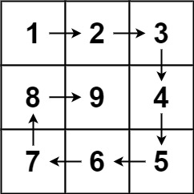

# 59. 螺旋矩阵 II

| 题目信息 | 内容 |
|---|---|
| 难度 | 中等 |
| 核心模式 | 模拟：维护上下左右四条边界，顺时针逐层填数 |
| 时间复杂度 | O(n²) |
| 空间复杂度 | O(1)（不计返回的 n×n 矩阵） |

## 题目与约束

给你一个正整数 `n` ，生成一个包含 `1` 到 `n2` 所有元素，且元素按顺时针顺序螺旋排列的 `n x n` 正方形矩阵 `matrix` 。

 

示例 1：



```
<strong>输入：</strong>n = 3
<strong>输出：</strong>[[1,2,3],[8,9,4],[7,6,5]]
```

示例 2：

```
<strong>输入：</strong>n = 1
<strong>输出：</strong>[[1]]
```

 

提示：

- `1 <= n <= 20`

[🔗 前往力扣原题验证 →](https://leetcode.cn/problems/spiral-matrix-ii/)

## 核心不变量

> 每填完当前最外圈，就把上边界下移、右边界左移、下边界上移、左边界右移，未填的始终是一个更小的矩形；按"上→右→下→左"的顺序遍历四个边界即可螺旋推进。

## 完整推导

### 思路推导

1. **直觉与痛点（怎么保证一路顺时针、不越界？）**

   如果只用一个坐标 `(r, c)` 加方向数组，判断"该不该转向"很容易写错。更稳的做法是：直接维护四条正在收缩的边界 `top / bottom / left / right`，每一圈只沿当前边界走。

2. **破局思路（四条边界，一圈四步）**

   把矩阵看成一个不断缩小的空心矩形，每转一圈依次做四件事：

   - 沿着上边界 `top`，从左到右填 `[left, right]`，填完 `top++`；
   - 沿着右边界 `right`，从上到下填 `[top, bottom]`，填完 `right--`；
   - 沿着下边界 `bottom`，从右到左填 `[right, left]`，填完 `bottom--`；
   - 沿着左边界 `left`，从下到上填 `[bottom, top]`，填完 `left++`。

   小例子 `n = 3`：第一圈填上排 `1 2 3`、右列 `4 5`、下排 `6 7`、左列 `8`，此时内层只剩正中一格，第二圈第一步就填 `9`，结束，得到 `[[1,2,3],[8,9,4],[7,6,5]]`。

3. **关键追问（奇数阶的正中心怎么处理？）**

   用 `while (num <= n*n)` 作为总循环条件，每圈四步即使某些方向已经"空跑"也没关系。`n` 为奇数时最后一圈四步里只有"填上边界"那一步真正写入中心格，其余三步区间为空自动跳过，正好把中心填满。

4. **收尾**：因为总共只填 `n²` 个数，循环一定在填满后退出，不会多写。

### Java 实现（generateMatrix）

```java
class Solution {
    public int[][] generateMatrix(int n) {
        int[][] matrix = new int[n][n];
        int top = 0, bottom = n - 1, left = 0, right = n - 1;
        int num = 1;
        int target = n * n;

        // 只要还没填满，就沿着当前这一圈的四个边界推进
        while (num <= target) {
            // 从左到右填上边界
            for (int j = left; j <= right; j++) {
                matrix[top][j] = num++;
            }
            top++;

            // 从上到下填右边界
            for (int i = top; i <= bottom; i++) {
                matrix[i][right] = num++;
            }
            right--;

            // 从右到左填下边界
            for (int j = right; j >= left; j--) {
                matrix[bottom][j] = num++;
            }
            bottom--;

            // 从下到上填左边界
            for (int i = bottom; i >= top; i--) {
                matrix[i][left] = num++;
            }
            left++;
        }

        return matrix;
    }
}
```

### 复杂度

- 时间：O(n²)。矩阵共 `n²` 个格子，每个格子恰好被赋值一次。
- 空间：O(1)。除返回的 `n×n` 矩阵外，只用了 `top/bottom/left/right/num` 等常数个变量（若计入返回矩阵则为 O(n²)）。

### 易错点与扩展（面试高频考点）

1. **边界收缩时机**：每填完一条边立刻更新对应边界（如填完上边界马上 `top++`），否则下一方向会重复填到刚填过的格子。
2. **循环条件用 `num <= n*n`**：若用 `while (left <= right && top <= bottom)` 再加四步，需要在每个方向前加 `if (left <= right)` 之类的判空，否则奇数阶会多写或越界；`num <= target` 的写法更简单不易错。
3. **下标方向别搞反**：下边界是 `j` 从 `right` 递减到 `left`，左边界是 `i` 从 `bottom` 递减到 `top`。
4. **扩展——螺旋矩阵（LeetCode 54）**：那是"读"一个已存在的矩阵，框架完全一样，只是把"填数"换成"收集数"，同样要靠收缩边界避免重复访问。
5. **扩展——方向数组写法**：也可用 `(dr, dc)` 方向数组加"撞墙或撞已填就右转"的判据，但需要额外判断越界和已访问，边界法更直观。

## 力扣原题

[59. 螺旋矩阵 II](https://leetcode.cn/problems/spiral-matrix-ii/)

### C++ 实现

```cpp
#include <vector>
using namespace std;

class Solution {
public:
    vector<vector<int>> generateMatrix(int n) {
        vector<vector<int>> matrix(n, vector<int>(n, 0));
        int top = 0, bottom = n - 1, left = 0, right = n - 1;
        int num = 1, target = n * n;

        while (num <= target) {
            // 上边界：左 -> 右
            for (int j = left; j <= right; j++) matrix[top][j] = num++;
            top++;
            // 右边界：上 -> 下
            for (int i = top; i <= bottom; i++) matrix[i][right] = num++;
            right--;
            // 下边界：右 -> 左
            for (int j = right; j >= left; j--) matrix[bottom][j] = num++;
            bottom--;
            // 左边界：下 -> 上
            for (int i = bottom; i >= top; i--) matrix[i][left] = num++;
            left++;
        }
        return matrix;
    }
};
```

### Python 实现

```python
class Solution:
    def generateMatrix(self, n: int) -> list[list[int]]:
        matrix = [[0] * n for _ in range(n)]
        top, bottom, left, right = 0, n - 1, 0, n - 1
        num, target = 1, n * n

        while num <= target:
            # 上边界：左 -> 右
            for j in range(left, right + 1):
                matrix[top][j] = num
                num += 1
            top += 1
            # 右边界：上 -> 下
            for i in range(top, bottom + 1):
                matrix[i][right] = num
                num += 1
            right -= 1
            # 下边界：右 -> 左
            for j in range(right, left - 1, -1):
                matrix[bottom][j] = num
                num += 1
            bottom -= 1
            # 左边界：下 -> 上
            for i in range(bottom, top - 1, -1):
                matrix[i][left] = num
                num += 1
            left += 1

        return matrix
```
