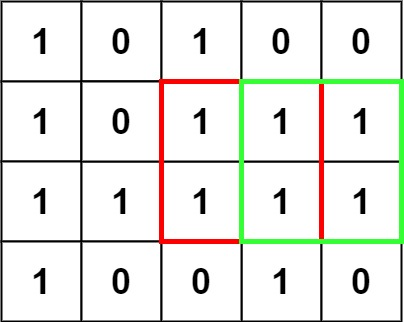
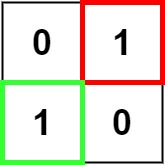

# 221. 最大正方形

| 题目信息 | 内容 |
|---|---|
| 难度 | 中等 |
| 核心模式 | 二维 DP：以 (i,j) 为右下角的最大正方形边长 |
| 时间复杂度 | O(m·n) |
| 空间复杂度 | O(n) |

## 题目与约束

在一个由 `'0'` 和 `'1'` 组成的二维矩阵内，找到只包含 `'1'` 的最大正方形，并返回其面积。

 

示例 1：



输入：matrix = [["1","0","1","0","0"],["1","0","1","1","1"],["1","1","1","1","1"],["1","0","0","1","0"]]  
输出：4

示例 2：



输入：matrix = [["0","1"],["1","0"]]  
输出：1

示例 3：

输入：matrix = [["0"]]  
输出：0

 

提示：

- `m == matrix.length`

- `n == matrix[i].length`

- `1 <= m, n <= 300`

- `matrix[i][j]` 为 `'0'` 或 `'1'`

[🔗 前往力扣原题验证 →](https://leetcode.cn/problems/maximal-square/)

## 核心不变量

> `dp[i][j]` 表示以 `(i,j)` 为**右下角**、且全部由 `'1'` 组成的最大正方形边长。

## 完整推导

### 思路推导

1. **直觉与痛点**：如果对每个 `'1'` 都向四周暴力扩展检查正方形，最坏是 O((mn)·min(m,n))，太慢。我们希望复用"已经算过的较小正方形"的信息。

2. **状态定义**：设 `dp[i][j]` 为以格子 `(i,j)` 作为右下角时，能构成的最大全 `'1'` 正方形边长。若 `matrix[i][j] == '0'`，显然 `dp[i][j] = 0`。

3. **转移方程**：若 `matrix[i][j] == '1'`，则
   `dp[i][j] = min(dp[i-1][j], dp[i][j-1], dp[i-1][j-1]) + 1`。
   含义很直观：一个边长 `s` 的正方形要求它的上方、左方、左上三个方向都能撑起 `s-1` 的正方形，三者取最小再 +1。

   小例子：某格子上方能撑 2、左方能撑 3、左上方能撑 2，则当前最多撑 `min(2,3,2)+1 = 3`。

4. **答案**：遍历过程中记录最大的 `dp` 值 `maxSide`，最终面积就是 `maxSide * maxSide`。

### Java 实现（滚动一维 DP）

```java
class Solution {
    public int maximalSquare(char[][] matrix) {
        int m = matrix.length, n = matrix[0].length;
        int[] dp = new int[n + 1];   // dp[j] 等价于 dp[i][j]
        int maxSide = 0;
        for (int i = 1; i <= m; i++) {
            int diagonal = 0;        // 保存 dp[i-1][j-1]
            for (int j = 1; j <= n; j++) {
                int up = dp[j];      // 覆盖前的 dp[j] 就是 dp[i-1][j]
                if (matrix[i - 1][j - 1] == '1') {
                    dp[j] = Math.min(Math.min(up, dp[j - 1]), diagonal) + 1;
                    maxSide = Math.max(maxSide, dp[j]);
                } else {
                    dp[j] = 0;       // 该格为 '0'，不能作为正方形右下角
                }
                diagonal = up;       // 为下一列准备 dp[i-1][j-1]
            }
        }
        return maxSide * maxSide;
    }
}
```

### 复杂度

- 时间：O(m·n)，每个格子只做常数次比较。
- 空间：O(n)，滚动一维数组；若不优化则为 O(m·n)。

### 易错点与扩展（面试高频考点）

1. **返回的是面积不是边长**：题目要面积，记得 `maxSide * maxSide`。
2. **一维滚动时 `diagonal` 的更新时机**：必须在用 `up` 覆盖 `dp[j]` 前把旧的 `dp[j]`（即 `dp[i-1][j]`）存进 `up`，循环末尾再把它赋给 `diagonal` 供下一列使用，顺序错了就会用到被污染的值。
3. **字符是 `'0'/'1'` 不是数字**：比较要用 `== '1'`，别写成 `== 1`。
4. **初值**：`dp` 多开一列（下标 0 处恒为 0）作为哨兵，避免处理边界。
5. **扩展**：本题求最大正方形；若改成"最大矩形"，则需要对每一行做柱状图 + 单调栈（LeetCode 85）。

## 力扣原题

[221. 最大正方形](https://leetcode.cn/problems/maximal-square/)

### C++ 实现

```cpp
#include <vector>
#include <algorithm>
using namespace std;

class Solution {
public:
    int maximalSquare(vector<vector<char>>& matrix) {
        int m = matrix.size(), n = matrix[0].size();
        vector<int> dp(n + 1, 0);
        int maxSide = 0;
        for (int i = 1; i <= m; i++) {
            int diagonal = 0;
            for (int j = 1; j <= n; j++) {
                int up = dp[j];
                if (matrix[i - 1][j - 1] == '1') {
                    dp[j] = min(min(up, dp[j - 1]), diagonal) + 1;
                    maxSide = max(maxSide, dp[j]);
                } else {
                    dp[j] = 0;
                }
                diagonal = up;
            }
        }
        return maxSide * maxSide;
    }
};
```

### Python 实现

```python
class Solution:
    def maximalSquare(self, matrix: list[list[str]]) -> int:
        m, n = len(matrix), len(matrix[0])
        dp = [0] * (n + 1)
        max_side = 0
        for i in range(1, m + 1):
            diagonal = 0            # dp[i-1][j-1]
            for j in range(1, n + 1):
                up = dp[j]          # 覆盖前即 dp[i-1][j]
                if matrix[i - 1][j - 1] == '1':
                    dp[j] = min(up, dp[j - 1], diagonal) + 1
                    max_side = max(max_side, dp[j])
                else:
                    dp[j] = 0
                diagonal = up
        return max_side * max_side
```
