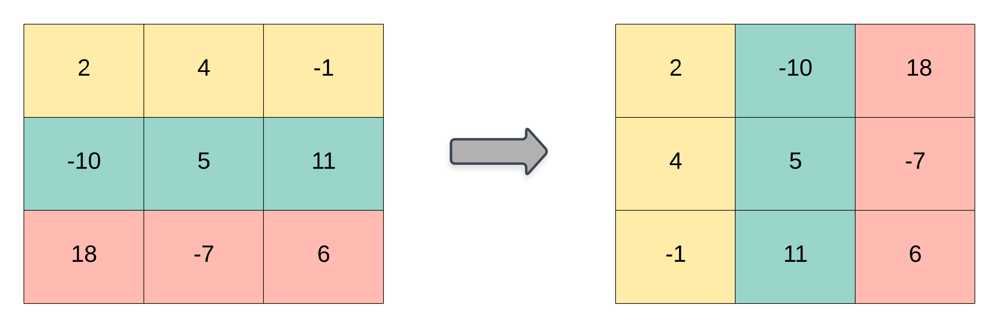

# 867. 转置矩阵

| 题目信息 | 内容 |
|---|---|
| 难度 | 简单 |
| 核心模式 | 模拟：新建 n×m 矩阵，按 res[j][i] = matrix[i][j] 填充 |
| 时间复杂度 | O(m·n) |
| 空间复杂度 | O(m·n) |

## 题目与约束

给你一个二维整数数组 `matrix`， 返回 `matrix` 的 转置矩阵 。

矩阵的 转置 是指将矩阵的主对角线翻转，交换矩阵的行索引与列索引。



 

示例 1：

输入：matrix = [[1,2,3],[4,5,6],[7,8,9]]  
输出：[[1,4,7],[2,5,8],[3,6,9]]

示例 2：

输入：matrix = [[1,2,3],[4,5,6]]  
输出：[[1,4],[2,5],[3,6]]

 

提示：

- `m == matrix.length`

- `n == matrix[i].length`

- `1 <= m, n <= 1000`

- `1 <= m * n <= 105`

- `-109 <= matrix[i][j] <= 109`

[🔗 前往力扣原题验证 →](https://leetcode.cn/problems/transpose-matrix/)

## 核心不变量

> 转置后矩阵尺寸由 m×n 变为 n×m，且对任意 i、j 恒有 `res[j][i] == matrix[i][j]`。

## 完整推导

### 思路推导

1. **看清维度变化（不是简单旋转）**

   原矩阵 m 行 n 列。转置后变成 n 行 m 列。第 i 行第 j 列的元素，会跑到第 j 行第 i 列去。所以结果要先申请 `n` 行、每行 `m` 列。

2. **直接双重循环搬元素**

   遍历原矩阵的每个 `matrix[i][j]`，把它写到 `res[j][i]`。一次遍历即可，顺序无关。

3. **小例子（示例 2）**

   `matrix = [[1,2,3],[4,5,6]]`，m=2, n=3。结果应是 3 行 2 列：
   - `res[0][0]=1, res[0][1]=4`
   - `res[1][0]=2, res[1][1]=5`
   - `res[2][0]=3, res[2][1]=6`

   得 `[[1,4],[2,5],[3,6]]`，与示例一致。

4. **为什么不能原地交换**

   只有当矩阵是方阵（m==n）时，交换 `matrix[i][j]` 与 `matrix[j][i]` 才可行。本题 m 与 n 可以不相等，尺寸都会变，所以必须新建矩阵。

### Java 实现（transpose）

```java
class Solution {
    public int[][] transpose(int[][] matrix) {
        int m = matrix.length;      // 原行数
        int n = matrix[0].length;   // 原列数

        // 转置后为 n 行 m 列
        int[][] res = new int[n][m];

        for (int i = 0; i < m; i++) {
            for (int j = 0; j < n; j++) {
                res[j][i] = matrix[i][j];
            }
        }
        return res;
    }
}
```

### 复杂度

- 时间：O(m·n)，需要访问原矩阵的每个元素恰好一次。
- 空间：O(m·n)，用于存放结果矩阵（必须新建，无法在原矩阵上完成）。

### 易错点与扩展（面试高频考点）

1. **行列写反**：结果尺寸是 `new int[n][m]`，索引是 `res[j][i]`，两处都容易写颠倒。
2. **误用原地交换**：`matrix[i][j]` 与 `matrix[j][i]` 交换只适用于方阵；本题矩形可能越界或丢元素。
3. **边界**：题目保证 m,n ≥ 1，无需处理空矩阵，但严谨实现可加 `if (matrix.length == 0) return new int[0][0];`。
4. **扩展（原地转置方阵）**：若题目限定方阵并要求原地，则用 `for i, for j>i` 交换对称元素即可，空间 O(1)。
5. **扩展（旋转 90°）**：若是"顺时针旋转 90°"，需先转置再左右翻转每一行，注意与纯转置区分。

## 力扣原题

[867. 转置矩阵](https://leetcode.cn/problems/transpose-matrix/)

### C++ 实现

```cpp
class Solution {
public:
    vector<vector<int>> transpose(vector<vector<int>>& matrix) {
        int m = matrix.size();
        int n = matrix[0].size();

        // 结果 n 行 m 列
        vector<vector<int>> res(n, vector<int>(m));
        for (int i = 0; i < m; ++i) {
            for (int j = 0; j < n; ++j) {
                res[j][i] = matrix[i][j];
            }
        }
        return res;
    }
};
```

### Python 实现

```python
class Solution:
    def transpose(self, matrix: list[list[int]]) -> list[list[int]]:
        m, n = len(matrix), len(matrix[0])
        # 结果 n 行 m 列
        res = [[0] * m for _ in range(n)]
        for i in range(m):
            for j in range(n):
                res[j][i] = matrix[i][j]
        return res
```
