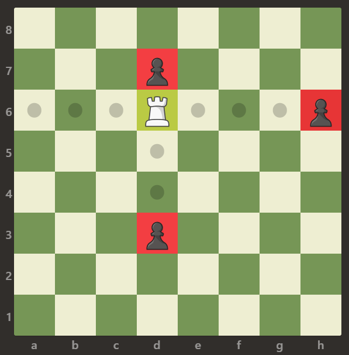
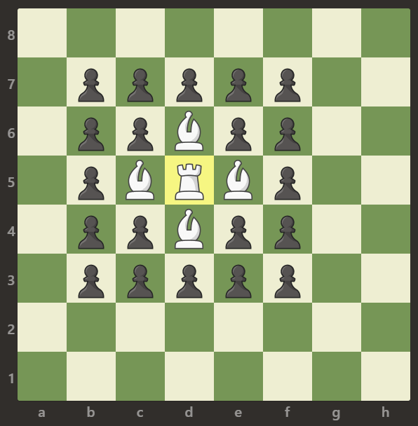
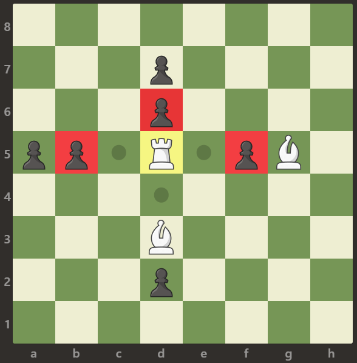

# 999. 可以被一步捕获的棋子数

| 题目信息 | 内容 |
|---|---|
| 难度 | 简单 |
| 核心模式 | 找到白车后向四个方向直线扫描，遇到第一个棋子即停 |
| 时间复杂度 | O(64) = O(1) |
| 空间复杂度 | O(1) |

## 题目与约束

给定一个 `8 x 8` 的棋盘，只有一个 白色的车，用字符 `'R'` 表示。棋盘上还可能存在白色的象 `'B'` 以及黑色的卒 `'p'`。空方块用字符 `'.'` 表示。

车可以按水平或竖直方向（上，下，左，右）移动任意个方格直到它遇到另一个棋子或棋盘的边界。如果它能够在一次移动中移动到棋子的方格，则能够 吃掉 棋子。

注意：车不能穿过其它棋子，比如象和卒。这意味着如果有其它棋子挡住了路径，车就不能够吃掉棋子。

返回白车 攻击 范围内 兵的数量。

 

示例 1：



```
<strong>输入：</strong>[[".",".",".",".",".",".",".","."],[".",".",".","p",".",".",".","."],[".",".",".","R",".",".",".","p"],[".",".",".",".",".",".",".","."],[".",".",".",".",".",".",".","."],[".",".",".","p",".",".",".","."],[".",".",".",".",".",".",".","."],[".",".",".",".",".",".",".","."]]
<strong>输出：</strong>3
<strong>解释：
</strong>在本例中，车能够吃掉所有的卒。
```

示例 2：



```
<strong>输入：</strong>[[".",".",".",".",".",".",".","."],[".","p","p","p","p","p",".","."],[".","p","p","B","p","p",".","."],[".","p","B","R","B","p",".","."],[".","p","p","B","p","p",".","."],[".","p","p","p","p","p",".","."],[".",".",".",".",".",".",".","."],[".",".",".",".",".",".",".","."]]
<strong>输出：</strong>0
<strong>解释：
</strong>象阻止了车吃掉任何卒。
```

示例 3：



```
<strong>输入：</strong>[[".",".",".",".",".",".",".","."],[".",".",".","p",".",".",".","."],[".",".",".","p",".",".",".","."],["p","p",".","R",".","p","B","."],[".",".",".",".",".",".",".","."],[".",".",".","B",".",".",".","."],[".",".",".","p",".",".",".","."],[".",".",".",".",".",".",".","."]]
<strong>输出：</strong>3
<strong>解释： </strong>
车可以吃掉位置 b5，d6 和 f5 的卒。
```

 

提示：

- `board.length == 8`

- `board[i].length == 8`

- `board[i][j]` 可以是 `'R'`，`'.'`，`'B'` 或 `'p'`

- 只有一个格子上存在 `board[i][j] == 'R'`

[🔗 前往力扣原题验证 →](https://leetcode.cn/problems/available-captures-for-rook/)

## 核心不变量

> 车沿某个方向直线扫描时，遇到的第一个棋子决定该方向的结局：若是卒 `'p'` 则可吃并计数、随即停止；若是象 `'B'` 则被挡住、停止且不计数。无论遇到哪种棋子，该方向都不能再继续往深处走。

## 完整推导

### 思路推导

1. **直觉与痛点（棋盘很小，但要算清"挡住"）**
   棋盘固定 8×8，规模极小，最直接的做法就是模拟。关键不是效率，而是正确处理"车不能穿过棋子"——它只能吃到自己所在行或列上、且中间没有其它棋子的第一个炮子。

2. **破局思路（定位 + 四方向扫描）**
   - 先遍历棋盘找到白车 `'R'` 的行列坐标 `(r, c)`。
   - 从 `(r, c)` 出发，沿上、下、左、右四个方向一格一格走：遇到 `'.'` 继续走；遇到 `'p'` 计数 `+1` 并结束该方向；遇到 `'B'` 直接结束该方向；走出边界也结束。

3. **为什么"遇到第一个棋子就停"是对的**
   车不能穿过任何棋子。所以每个方向上它最多只能吃到最靠近自己的那一个棋子；一旦这个棋子是象，就完全吃不到该方向更远的卒；若这个棋子是卒，吃掉后后面被"隔开"的卒也不在此次一步之内。因此每个方向只判断第一个非空格子即可。

   小例子（示例 3）：车在 `(3,3)`。向上扫到 `(2,3)`、`(1,3)` 都是 `'p'`，第一个是 `(2,3)` 的卒 → 计 1 后停止；向下扫到 `(5,3)` 是 `'B'` → 停止、不计数；向左扫到 `(3,1)` 是卒 → 计 1；向右扫到 `(3,5)` 是卒 → 计 1，再往右是 `'B'`。合计 3。

4. **收尾**
   四个方向累计得到的就是答案。

### Java 实现（numRookCaptures）

```java
class Solution {
    public int numRookCaptures(char[][] board) {
        int n = 8;
        int r = -1, c = -1;
        // 1. 定位白车
        for (int i = 0; i < n && r == -1; i++) {
            for (int j = 0; j < n; j++) {
                if (board[i][j] == 'R') {
                    r = i;
                    c = j;
                    break;
                }
            }
        }

        int count = 0;
        int[][] dirs = {{-1, 0}, {1, 0}, {0, -1}, {0, 1}}; // 上、下、左、右
        // 2. 四个方向直线扫描
        for (int[] d : dirs) {
            int x = r + d[0], y = c + d[1];
            while (x >= 0 && x < n && y >= 0 && y < n) {
                if (board[x][y] == 'p') {        // 第一个棋子是卒：可吃并停止
                    count++;
                    break;
                } else if (board[x][y] == 'B') { // 第一个棋子是象：被挡住
                    break;
                }
                x += d[0];
                y += d[1];
            }
        }
        return count;
    }
}
```

### 复杂度

- 时间：O(64) = O(1)。棋盘固定 8×8；定位车 O(64)，四个方向合计最多扫描 8×4 个格子，都是常数。
- 空间：O(1)。只使用若干整型变量与固定的方向数组。

### 易错点与扩展（面试高频考点）

1. **四个方向都要扫**：漏掉任意一个方向都会少算；建议用统一的方向数组遍历，避免手写四段重复代码出错。
2. **遇到第一个棋子就停**：只判断"第一个非空格子"。若直接找同方向的第一个 `'p'` 而忽略中间的 `'B'`，就会出现"穿过象吃到卒"的错误。
3. **边界判断**：`while` 里要四个边界都判断（`x>=0 && x<n && y>=0 && y<n`），尤其别漏 `x`/`y` 的下界。
4. **计数只针对卒**：`'B'` 是己方的象，不能计入攻击数；空方格 `'.'` 只表示可以继续前进。
5. **扩展**：若是"八方向皇后/主教"或"判断车能否在一步内攻击到某目标"，思路仍是"沿方向直到第一个棋子"；把方向数组换成八方向、把停止条件改为"遇到目标即返回"即可。

## 力扣原题

[999. 可以被一步捕获的棋子数](https://leetcode.cn/problems/available-captures-for-rook/)

### C++ 实现

```cpp
#include <vector>
using namespace std;

class Solution {
public:
    int numRookCaptures(vector<vector<char>>& board) {
        int n = 8, r = -1, c = -1;
        // 定位白车
        for (int i = 0; i < n && r == -1; i++) {
            for (int j = 0; j < n; j++) {
                if (board[i][j] == 'R') { r = i; c = j; break; }
            }
        }
        int cnt = 0;
        int dirs[4][2] = {{-1, 0}, {1, 0}, {0, -1}, {0, 1}}; // 上、下、左、右
        for (auto& d : dirs) {
            int x = r + d[0], y = c + d[1];
            while (x >= 0 && x < n && y >= 0 && y < n) {
                if (board[x][y] == 'p') { cnt++; break; } // 第一个是卒：吃并停止
                if (board[x][y] == 'B') break;            // 第一个是象：被挡
                x += d[0];
                y += d[1];
            }
        }
        return cnt;
    }
};
```

### Python 实现

```python
from typing import List

class Solution:
    def numRookCaptures(self, board: List[List[str]]) -> int:
        n = 8
        r = c = -1
        # 定位白车
        for i in range(n):
            for j in range(n):
                if board[i][j] == 'R':
                    r, c = i, j
                    break
            if r != -1:
                break

        count = 0
        for dx, dy in ((-1, 0), (1, 0), (0, -1), (0, 1)):  # 上、下、左、右
            x, y = r + dx, c + dy
            while 0 <= x < n and 0 <= y < n:
                if board[x][y] == 'p':   # 第一个是卒：吃并停止
                    count += 1
                    break
                if board[x][y] == 'B':   # 第一个是象：被挡
                    break
                x += dx
                y += dy
        return count
```
