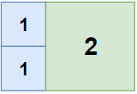
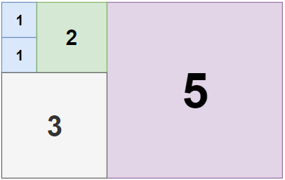
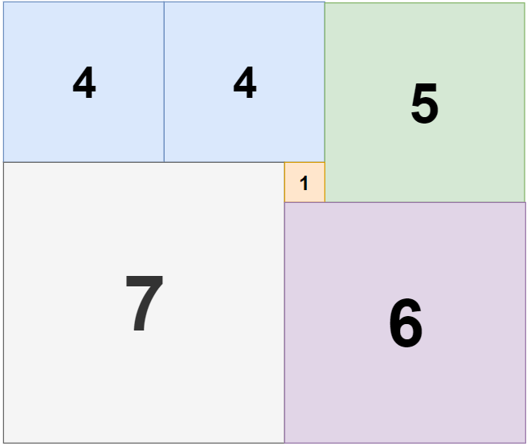

# 1240. 铺瓷砖

| 题目信息 | 内容 |
|---|---|
| 难度 | 困难 |
| 核心模式 | 回溯 + 剪枝：以「首个空格」为左上角枚举正方形 |
| 时间复杂度 | 指数级（`n, m <= 13`，靠最优值剪枝收敛） |
| 空间复杂度 | O(n · m) |

## 题目与约束

给定一个大小为 `n` x `m` 的长方形，返回贴满矩形所需的整数边正方形的最小数量。

 

示例 1：



```
<strong>输入：</strong>n = 2, m = 3
<strong>输出：</strong>3
<strong>解释：</strong>需要<strong> </strong>3 个正方形来覆盖长方形。
     2 个 1x1 的正方形
     1 个 2x2 的正方形
```

示例 2：



```
<strong>输入：</strong>n = 5, m = 8
<strong>输出：</strong>5
```

示例 3：



```
<strong>输入：</strong>n = 11, m = 13
<strong>输出：</strong>6
```

 

提示：

- `1 <= n, m <= 13`

[🔗 前往力扣原题验证 →](https://leetcode.cn/problems/tiling-a-rectangle-with-the-fewest-squares/)

## 核心不变量

> 按行优先扫到的第一个未覆盖格子，必然是某个正方形的左上角；枚举以它为左上角的所有可行边长并能完整覆盖，就等价于枚举了所有合法铺法。

## 完整推导

### 思路推导

1. **为什么不能贪心**

   每次「尽量放一个最大的正方形」在局部看很划算，但剩余区域的形状会反过来影响后续能放多大的方块，局部最优未必是全局最优。尺寸之间存在耦合，必须搜索所有铺法才能保证得到最少块数。

2. **抓住「第一个空格」消除重复枚举**

   把所有格子看成待覆盖区域。按行优先（先第一行、再第二行……）找到第一个还没被覆盖的格子 `(r, c)`。由于它之前的格子都已被覆盖，任何覆盖 `(r, c)` 的正方形，其左上角不可能在 `(r, c)` 的左方或上方（否则会压到已覆盖格），所以**左上角只能是 `(r, c)`**。这一观察让我们不必枚举正方形的摆放位置，只需枚举边长 `s`。

3. **回溯框架**

   以 `(r, c)` 为左上角，边长 `s` 从 `min(rows - r, cols - c)` 递减到 1：若 `s x s` 区域全部为空，就把它铺上（置为已覆盖），`count + 1` 后递归处理下一个空格；递归返回后再撤销。找到第一个空格之前若已铺满，就用当前 `count` 更新最优答案。

4. **剪枝与特判**

   - 用一个 `best` 记录当前最优（初始可设为 `rows * cols`，即全用 1x1 的可行方案）。若 `count + 1 >= best`，再放一块都不可能更优，直接剪枝。
   - `n == m` 时整块就是正方形，答案 1。
   - `11 x 13` 的最优解是著名的 **6 块非「刀切」式铺法**，纯搜索会非常极端，直接返回 6。

   小例子 `n = 2, m = 3`：首个空格 `(0,0)`，放 `2x2` 后剩下 `2x1` 一条，只能用两个 `1x1`，合计 3；若 `(0,0)` 只放 `1x1`，剩余区域至少还要 2 块，也不会更优，故答案为 3。

### Java 实现（回溯 + 剪枝）

```java
class Solution {
    private int rows, cols, best;
    private boolean[][] filled;

    public int tilingRectangle(int n, int m) {
        if (n == m) return 1;                          // 本身是正方形
        // 11x13 的著名最优解为 6（存在非「刀切」式铺法），直接返回以避开极端搜索
        if ((n == 11 && m == 13) || (n == 13 && m == 11)) return 6;

        rows = Math.min(n, m);
        cols = Math.max(n, m);                         // 固定 rows <= cols，减小搜索宽度
        best = rows * cols;                            // 上界：全部用 1x1
        filled = new boolean[rows][cols];
        dfs(0);
        return best;
    }

    private void dfs(int count) {
        if (count >= best) return;                     // 已不可能更优

        // 行优先寻找第一个未覆盖的格子
        int r = -1, c = -1;
        outer:
        for (int i = 0; i < rows; i++) {
            for (int j = 0; j < cols; j++) {
                if (!filled[i][j]) { r = i; c = j; break outer; }
            }
        }
        if (r == -1) {                                 // 全部铺满
            best = count;
            return;
        }

        int maxSide = Math.min(rows - r, cols - c);
        for (int s = maxSide; s >= 1; s--) {           // 边长从大到小尝试
            if (count + 1 >= best) break;              // 再放一块也无法更优
            if (!canPlace(r, c, s)) continue;
            fill(r, c, s, true);
            dfs(count + 1);
            fill(r, c, s, false);                      // 撤销
        }
    }

    private boolean canPlace(int r, int c, int s) {
        for (int i = r; i < r + s; i++)
            for (int j = c; j < c + s; j++)
                if (filled[i][j]) return false;
        return true;
    }

    private void fill(int r, int c, int s, boolean v) {
        for (int i = r; i < r + s; i++)
            for (int j = c; j < c + s; j++)
                filled[i][j] = v;
    }
}
```

### 复杂度

- 时间：**指数级**。设搜索状态数为 `S`，每次至多尝试 `min(rows, cols)` 种边长，复杂度约为 `O(S · min(rows, cols))`；最坏可达 `4^{n·m}` 量级。得益于 `best` 上界剪枝与「从大到小」的尝试顺序，`n, m <= 13` 时实际可迅速收敛。
- 空间：`O(n · m)`。`filled` 布尔矩阵占 `O(rows · cols)`；递归深度最多等于正方形块数（不超过格子数），即 `O(n · m)`。

### 易错点与扩展（面试高频考点）

1. **误用贪心**：每次放最大正方形并不是最优策略，必须回溯枚举所有边长。面试中要能说清「局部最大 ≠ 全局最少」。
2. **枚举位置导致重复**：不要枚举正方形放在哪个坐标，而应以「行优先第一个空格」为左上角，这样每种铺法只被枚举一次，也不会漏解。
3. **剪枝条件写错**：`count + 1 >= best` 表示「即使立刻只加这一块也追不平最优」，可以剪；注意是 `>=` 而非 `>`，否则会做无用功。`best` 必须是一个真实可达的上界（`rows*cols` 的全 1x1 方案满足）。
4. **`11 x 13` 的特殊性**：它的最优解是 6 块，且不是简单的「先切大刀」结构；朴素回溯在此会爆炸或被剪枝误杀，需要特判。这是本题最有名的坑，面试值得主动提及。
5. **对称与边界**：矩形旋转等价，可令 `rows = min(n, m)` 缩小搜索宽度；`n == m` 直接返回 1；递归里 `maxSide = min(rows - r, cols - c)` 保证不越界。

## 力扣原题

[1240. 铺瓷砖](https://leetcode.cn/problems/tiling-a-rectangle-with-the-fewest-squares/)

### C++ 实现

```cpp
#include <vector>
#include <algorithm>
using namespace std;

class Solution {
    int rows, cols, best;
    vector<vector<bool>> filled;

    void fill(int r, int c, int s, bool v) {
        for (int i = r; i < r + s; i++)
            for (int j = c; j < c + s; j++)
                filled[i][j] = v;
    }

    bool canPlace(int r, int c, int s) {
        for (int i = r; i < r + s; i++)
            for (int j = c; j < c + s; j++)
                if (filled[i][j]) return false;
        return true;
    }

    void dfs(int count) {
        if (count >= best) return;

        int r = -1, c = -1;
        for (int i = 0; i < rows && r == -1; i++) {
            for (int j = 0; j < cols; j++) {
                if (!filled[i][j]) { r = i; c = j; break; }
            }
        }
        if (r == -1) { best = count; return; }

        int maxSide = min(rows - r, cols - c);
        for (int s = maxSide; s >= 1; s--) {
            if (count + 1 >= best) break;
            if (!canPlace(r, c, s)) continue;
            fill(r, c, s, true);
            dfs(count + 1);
            fill(r, c, s, false);
        }
    }

public:
    int tilingRectangle(int n, int m) {
        if (n == m) return 1;
        if ((n == 11 && m == 13) || (n == 13 && m == 11)) return 6;

        rows = min(n, m);
        cols = max(n, m);
        best = rows * cols;
        filled.assign(rows, vector<bool>(cols, false));
        dfs(0);
        return best;
    }
};
```

### Python 实现

```python
class Solution:
    def tilingRectangle(self, n: int, m: int) -> int:
        if n == m:
            return 1
        if (n == 11 and m == 13) or (n == 13 and m == 11):
            return 6

        rows, cols = min(n, m), max(n, m)
        filled = [[False] * cols for _ in range(rows)]
        best = rows * cols

        def can_place(r: int, c: int, s: int) -> bool:
            for i in range(r, r + s):
                for j in range(c, c + s):
                    if filled[i][j]:
                        return False
            return True

        def fill(r: int, c: int, s: int, v: bool) -> None:
            for i in range(r, r + s):
                for j in range(c, c + s):
                    filled[i][j] = v

        def dfs(count: int) -> None:
            nonlocal best
            if count >= best:
                return

            r = c = -1
            found = False
            for i in range(rows):
                for j in range(cols):
                    if not filled[i][j]:
                        r, c, found = i, j, True
                        break
                if found:
                    break
            if not found:
                best = count
                return

            max_side = min(rows - r, cols - c)
            for s in range(max_side, 0, -1):
                if count + 1 >= best:
                    break
                if not can_place(r, c, s):
                    continue
                fill(r, c, s, True)
                dfs(count + 1)
                fill(r, c, s, False)

        dfs(0)
        return best
```
