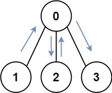
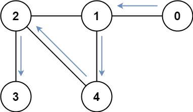

# 847. 访问所有节点的最短路径

| 题目信息 | 内容 |
|---|---|
| 难度 | 困难 |
| 核心模式 | 状态压缩 BFS：状态 = (当前节点, 已访问集合) |
| 时间复杂度 | O(n² · 2ⁿ) |
| 空间复杂度 | O(n · 2ⁿ) |

## 题目与约束

存在一个由 `n` 个节点组成的无向连通图，图中的节点按从 `0` 到 `n - 1` 编号。

给你一个数组 `graph` 表示这个图。其中，`graph[i]` 是一个列表，由所有与节点 `i` 直接相连的节点组成。

返回能够访问所有节点的最短路径的长度。你可以在任一节点开始和停止，也可以多次重访节点，并且可以重用边。

 

示例 1：



输入：graph = [[1,2,3],[0],[0],[0]]  
输出：4  
解释：一种可能的路径为 [1,0,2,0,3]

示例 2：



输入：graph = [[1],[0,2,4],[1,3,4],[2],[1,2]]  
输出：4  
解释：一种可能的路径为 [0,1,4,2,3]

 

提示：

- `n == graph.length`

- `1 <= n <= 12`

- `0 <= graph[i].length < n`

- `graph[i]` 不包含 `i`

- 如果 `graph[a]` 包含 `b` ，那么 `graph[b]` 也包含 `a`

- 输入的图总是连通图

[🔗 前往力扣原题验证 →](https://leetcode.cn/problems/shortest-path-visiting-all-nodes/)

## 核心不变量

> 一条“访问了哪些节点”的走法，只由「当前停在哪」和「已经访问过的节点集合（位掩码）」共同决定；同一 `(节点, 掩码)` 状态重复到达时，步数更多的到达毫无价值，因此按步数做广度优先，首次抵达满掩码即为最优。

## 完整推导

### 思路推导

1. **为什么不能直接 BFS 求最短路？** 普通 BFS 只记录“当前在哪个点”。但这道题允许重访、起点任选，真正影响端点的不是“位置”而是“还差哪些点没走到”。只看位置会丢失信息，导致无法判断是否已经覆盖全部节点。

2. **把“进度”也塞进状态。** 用一个 `n` 位二进制数 `mask` 表示已访问集合，第 `k` 位为 1 表示节点 `k` 访问过。于是状态升级为 `(node, mask)`。起点可以是任一点 `i`，初态为 `(i, 1<<i)`，全部节点入队；目标状态是 `mask == (1<<n) - 1`（满掩码）。

3. **在状态图上做 BFS。** 从 `(node, mask)` 出发，走到邻居 `nxt`，新状态是 `(nxt, mask | (1<<nxt))`，步数加一。因为边权都是 1（走一步算一次），用 BFS 逐层扩展，第一次遇到满掩码时的层数就是最短路径长度。

4. **小例子。** `graph = [[1,2,3],[0],[0],[0]]`，`n=4`。从节点 1 出发（mask=0010），可以 1→0（mask=0011）、0→2（0111）、2→0（仍 0111）、0→3（1111），共 4 步达到满掩码，答案 4，与示例路径 `[1,0,2,0,3]` 对应。

5. **规模为何能接受？** `n ≤ 12`，状态总数 `n · 2ⁿ ≤ 12 × 4096 ≈ 5×10⁴`，BFS 完全够用。

### Java 实现（状态压缩 BFS）

```java
import java.util.LinkedList;
import java.util.Queue;

class Solution {
    public int shortestPathLength(int[][] graph) {
        int n = graph.length;
        int full = (1 << n) - 1;                       // 全部访问的掩码
        boolean[][] visited = new boolean[n][1 << n];  // visited[node][mask]
        Queue<int[]> queue = new LinkedList<>();

        // 任意节点都可以作为起点
        for (int i = 0; i < n; i++) {
            queue.offer(new int[]{i, 1 << i});
            visited[i][1 << i] = true;
        }

        int steps = 0;
        while (!queue.isEmpty()) {
            int size = queue.size();
            for (int s = 0; s < size; s++) {
                int[] cur = queue.poll();
                int node = cur[0], mask = cur[1];
                if (mask == full) {
                    return steps;                      // 首次到达满掩码即最短
                }
                for (int nxt : graph[node]) {
                    int nextMask = mask | (1 << nxt);
                    if (!visited[nxt][nextMask]) {
                        visited[nxt][nextMask] = true;
                        queue.offer(new int[]{nxt, nextMask});
                    }
                }
            }
            steps++;                                   // 一整层扩展完毕，步数加一
        }
        return -1;
    }
}
```

### 复杂度

- 时间：O(n² · 2ⁿ)。共 `n · 2ⁿ` 个状态，每个状态沿其邻接边扩展，邻接边总数乘以状态规模即上界；`n ≤ 12` 时可轻松通过。
- 空间：O(n · 2ⁿ)。`visited` 表与 BFS 队列都以状态数为规模。

### 易错点与扩展（面试高频考点）

1. **忘了设置多源起点。** 题目允许从任意节点出发，必须把所有 `(i, 1<<i)` 都作为初始状态入队，只从 0 出发会得到偏大答案。
2. **误把 `visited` 只按节点维度记录。** 必须按 `(node, mask)` 二维去重，否则同一节点在不同进度下会被错误地剪掉。
3. **步数与层数的对应。** BFS 按“层”推进，`steps` 应在整层处理完后自增；若在弹出时自增会差一。
4. **扩展：等价于求「最短哈密顿路径」的松弛版。** 因为允许重访，可先用 BFS 求出两两最短路，再在 `2ⁿ` 上做状压 DP（TSP 式）求最短覆盖路径；本解法直接在原图上做状态 BFS，避免额外建距离矩阵，实现更短。
5. **边界：`n == 1`。** 起点即满掩码，答案 0，代码在初始入队后第一次弹出就返回 0。

## 力扣原题

[847. 访问所有节点的最短路径](https://leetcode.cn/problems/shortest-path-visiting-all-nodes/)

### C++ 实现

```cpp
#include <vector>
#include <queue>
#include <utility>
using namespace std;

class Solution {
public:
    int shortestPathLength(vector<vector<int>>& graph) {
        int n = graph.size();
        int full = (1 << n) - 1;
        vector<vector<bool>> visited(n, vector<bool>(1 << n, false));
        queue<pair<int, int>> q; // (node, mask)

        for (int i = 0; i < n; i++) {
            q.push({i, 1 << i});
            visited[i][1 << i] = true;
        }

        int steps = 0;
        while (!q.empty()) {
            int sz = q.size();
            for (int s = 0; s < sz; s++) {
                pair<int, int> cur = q.front(); q.pop();
                int node = cur.first, mask = cur.second;
                if (mask == full) return steps;
                for (int nxt : graph[node]) {
                    int nm = mask | (1 << nxt);
                    if (!visited[nxt][nm]) {
                        visited[nxt][nm] = true;
                        q.push({nxt, nm});
                    }
                }
            }
            steps++;
        }
        return -1;
    }
};
```

### Python 实现

```python
from typing import List
from collections import deque

class Solution:
    def shortestPathLength(self, graph: List[List[int]]) -> int:
        n = len(graph)
        full = (1 << n) - 1
        visited = [[False] * (1 << n) for _ in range(n)]
        q = deque()

        for i in range(n):
            q.append((i, 1 << i))
            visited[i][1 << i] = True

        steps = 0
        while q:
            for _ in range(len(q)):
                node, mask = q.popleft()
                if mask == full:
                    return steps
                for nxt in graph[node]:
                    nm = mask | (1 << nxt)
                    if not visited[nxt][nm]:
                        visited[nxt][nm] = True
                        q.append((nxt, nm))
            steps += 1
        return -1
```
