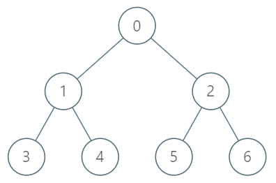

# 1483. 树节点的第 K 个祖先

| 题目信息 | 内容 |
|---|---|
| 难度 | 困难 |
| 核心模式 | 倍增（Binary Lifting）：预处理 2^j 级祖先表，按 k 的二进制位跳跃 |
| 时间复杂度 | 预处理 O(n log n)，单次查询 O(log n) |
| 空间复杂度 | O(n log n) |

## 题目与约束

给你一棵树，树上有 `n` 个节点，按从 `0` 到 `n-1` 编号。树以父节点数组的形式给出，其中 `parent[i]` 是节点 `i` 的父节点。树的根节点是编号为 `0` 的节点。

树节点的第 `k` 个祖先节点是从该节点到根节点路径上的第 `k` 个节点。

实现 `TreeAncestor` 类：

- `TreeAncestor（int n， int[] parent）` 对树和父数组中的节点数初始化对象。

- `getKthAncestor``(int node, int k)` 返回节点 `node` 的第 `k` 个祖先节点。如果不存在这样的祖先节点，返回 `-1` 。

 

示例 1：



输入：  
["TreeAncestor","getKthAncestor","getKthAncestor","getKthAncestor"]  
[[7,[-1,0,0,1,1,2,2]],[3,1],[5,2],[6,3]]  
输出：  
[null,1,0,-1]  
解释：  
TreeAncestor treeAncestor = new TreeAncestor(7, [-1, 0, 0, 1, 1, 2, 2]);  
treeAncestor.getKthAncestor(3, 1);  // 返回 1 ，它是 3 的父节点  
treeAncestor.getKthAncestor(5, 2);  // 返回 0 ，它是 5 的祖父节点  
treeAncestor.getKthAncestor(6, 3);  // 返回 -1 因为不存在满足要求的祖先节点

 

提示：

- `1 <= k <= n <= 5 * 104`

- `parent[0] == -1` 表示编号为 `0` 的节点是根节点。

- 对于所有的 `0 < i < n` ，`0 <= parent[i] < n` 总成立

- `0 <= node < n`

- 至多查询 `5 * 104` 次

[🔗 前往力扣原题验证 →](https://leetcode.cn/problems/kth-ancestor-of-a-tree-node/)

## 核心不变量

> 用 `up[j][v]` 表示节点 `v` 的「向上 `2^j` 步」祖先（不存在则 `-1`）。它满足递推 `up[j][v] = up[j-1][ up[j-1][v] ]`：先走 `2^(j-1)` 步，再走 `2^(j-1)` 步，合计 `2^j` 步。任何 `k` 都能拆成二进制位之和，故查询只需逐位跳跃。

## 完整推导

### 思路推导

1. **朴素的向上走为何慢**
   每次查询都沿着父指针一步步上行，单次 O(k)，最坏 O(n)。若查询达 5×10⁴ 次，最坏 O(n·q) 会超时。需要把「向上跳」加速。

2. **二进制拆分的思想**
   任何整数 `k` 都能写成若干个 2 的幂之和，例如 `k = 13 = 8+4+1`。如果预先知道每个节点「向上 1、2、4、8、… 步」分别是谁，就能用 `k` 的二进制位，在 O(log k) 次跳跃内到达第 `k` 个祖先。

3. **预处理倍增表**
   令 `up[0][v] = parent[v]`（向上 1 步）。更高层用递推：
   `up[j][v] = up[j-1][ up[j-1][v] ]`（若中间为 -1 则结果 -1）。
   层数 `LOG` 取满足 `2^LOG > n` 的最小值（n≤5×10⁴ 时 `LOG≈16`）。小例子：父数组 `[-1,0,0,1,1,2,2]`，则 `up[0]=[-1,0,0,1,1,2,2]`；`up[1][3]=up[0][up[0][3]]=up[0][1]=0`，即节点 3 向上 2 步是 0。

4. **查询**
   遍历 `k` 的每一位 `j`，若第 `j` 位为 1，就 `node = up[j][node]`；一旦 `node` 变成 `-1` 立即返回 `-1`。全部跳完返回 `node`。例如查询 `(5,2)`：`2 = 10₂`，只跳第 1 位，`up[1][5] = up[0][up[0][5]] = up[0][2] = 0`，结果为 0。

### Java 实现（TreeAncestor 倍增）

```java
class TreeAncestor {
    private final int LOG;      // 倍增层数
    private final int[][] up;   // up[j][v] = v 向上 2^j 步的祖先

    public TreeAncestor(int n, int[] parent) {
        int log = 1;
        while ((1 << log) <= n) log++; // 保证 2^LOG > n，足以表示任意 k <= n
        LOG = log;
        up = new int[LOG][n];
        up[0] = parent.clone();        // 向上 1 步即父节点
        for (int j = 1; j < LOG; j++) {
            for (int v = 0; v < n; v++) {
                int mid = up[j - 1][v];
                up[j][v] = (mid == -1) ? -1 : up[j - 1][mid];
            }
        }
    }

    public int getKthAncestor(int node, int k) {
        for (int j = 0; j < LOG; j++) {
            if (((k >> j) & 1) == 1) {   // k 的第 j 位为 1，向上跳 2^j 步
                node = up[j][node];
                if (node == -1) return -1; // 已经越过根
            }
        }
        return node;
    }
}
```

### 复杂度

- 时间：初始化 O(n log n)（填充倍增表）；每次 `getKthAncestor` 为 O(log k) ≤ O(log n)。
- 空间：O(n log n)。倍增表共 `LOG × n` 个整数。

### 易错点与扩展（面试高频考点）

1. **层数 `LOG` 要够**：必须保证最高位能覆盖 `k` 的最大值（`2^LOG > n`）。取少了会漏跳最高位，导致答案偏小；用 `while ((1 << LOG) <= n) LOG++` 最稳妥。
2. **`-1` 的传播**：递推和查询时都要判空。若 `mid == -1`，则 `up[j][v] = -1`；查询中一旦跳到 `-1`，后面再跳也无效，可提前返回。
3. **`k` 逐位判断的方向**：从低位 `j=0` 开始判断 `(k >> j) & 1`，每一位对应跳 `2^j` 步，顺序不影响结果（因为祖先关系可交换结合），但务必覆盖到 `LOG-1`。
4. **根节点的父是 `-1`**：`up[0][0] = -1`，任何从根继续上跳都会得到 `-1`，符合「不存在祖先」的语义。
5. **扩展**：倍增法还常用于「最近公共祖先 LCA」（在倍增表基础上按深度对齐后一起上跳）、「树上第 k 个祖先」、「区间查询的稀疏表（Sparse Table）」。它与「按深度 DFS + 记录路径」的 O(k) 暴力形成鲜明对比，是面试中体现算法功底的高频考点。

## 力扣原题

[1483. 树节点的第 K 个祖先](https://leetcode.cn/problems/kth-ancestor-of-a-tree-node/)

### C++ 实现

```cpp
#include <vector>
using namespace std;

class TreeAncestor {
    int LOG;
    vector<vector<int>> up; // up[j][v] = v 向上 2^j 步的祖先
public:
    TreeAncestor(int n, vector<int>& parent) {
        LOG = 1;
        while ((1 << LOG) <= n) LOG++;
        up.assign(LOG, vector<int>(n, -1));
        up[0] = parent; // 向上 1 步
        for (int j = 1; j < LOG; j++) {
            for (int v = 0; v < n; v++) {
                int mid = up[j - 1][v];
                up[j][v] = (mid == -1) ? -1 : up[j - 1][mid];
            }
        }
    }

    int getKthAncestor(int node, int k) {
        for (int j = 0; j < LOG; j++) {
            if ((k >> j) & 1) {
                node = up[j][node];
                if (node == -1) return -1;
            }
        }
        return node;
    }
};
```

### Python 实现

```python
from typing import List

class TreeAncestor:
    def __init__(self, n: int, parent: List[int]):
        log = 1
        while (1 << log) <= n:
            log += 1
        self.LOG = log
        self.up = [parent[:]]  # up[0] 为父节点
        for j in range(1, log):
            prev = self.up[j - 1]
            cur = [-1] * n
            for v in range(n):
                mid = prev[v]
                cur[v] = -1 if mid == -1 else prev[mid]
            self.up.append(cur)

    def getKthAncestor(self, node: int, k: int) -> int:
        for j in range(self.LOG):
            if (k >> j) & 1:
                node = self.up[j][node]
                if node == -1:
                    return -1
        return node
```
