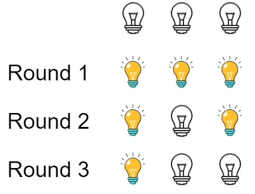

# 319. 灯泡开关

| 题目信息 | 内容 |
|---|---|
| 难度 | 中等 |
| 核心模式 | 数学规律（完全平方数的个数） |
| 时间复杂度 | O(1) |
| 空间复杂度 | O(1) |

## 题目与约束

初始时有 `n` 个灯泡处于关闭状态。第一轮，你将会打开所有灯泡。接下来的第二轮，你将会每两个灯泡关闭第二个。

第三轮，你每三个灯泡就切换第三个灯泡的开关（即，打开变关闭，关闭变打开）。第 `i` 轮，你每 `i` 个灯泡就切换第 `i` 个灯泡的开关。直到第 `n` 轮，你只需要切换最后一个灯泡的开关。

找出并返回 `n` 轮后有多少个亮着的灯泡。

 

示例 1：



输入：n = 3  
输出：1  
解释：  
初始时, 灯泡状态 [关闭, 关闭, 关闭].  
第一轮后, 灯泡状态 [开启, 开启, 开启].  
第二轮后, 灯泡状态 [开启, 关闭, 开启].  
第三轮后, 灯泡状态 [开启, 关闭, 关闭].  
你应该返回 1，因为只有一个灯泡还亮着。

示例 2：

输入：n = 0  
输出：0

示例 3：

输入：n = 1  
输出：1

 

提示：

- `0 <= n <= 109`

[🔗 前往力扣原题验证 →](https://leetcode.cn/problems/bulb-switcher/)

## 核心不变量

> 第 `i` 个灯泡最终亮着，当且仅当 `i` 的因数个数为奇数，即 `i` 是完全平方数；答案就是 `⌊√n⌋`。

## 完整推导

### 思路推导

1. **直觉与痛点（暴力模拟会爆）**

   最直白的做法是模拟每一轮，把所有灯泡状态写成一个数组，每轮翻转若干个。但 `n` 最大到 `10^9`，轮数也是 `n`，模拟是 `O(n²)` 甚至 `O(n log n)`，完全跑不动。必须找规律。

2. **换个视角（每个灯泡被切换几次？）**

   不要顺着"轮次"看，而是盯住"第 `i` 个灯泡"。它会在哪些轮被切换？只有当轮数 `d` 整除 `i` 时（第 `d` 轮每 `d` 个切换第 `d` 个），第 `i` 个灯泡才会被切换。所以第 `i` 个灯泡被切换的次数，正好等于 `i` 的**因数个数**。

3. **奇偶定生死（为什么只剩完全平方数？）**

   灯泡从"关闭"出发，被切换奇数次最终亮，偶数次最终灭。因数总是成对出现的（`d` 与 `i/d` 配对），唯独当 `i` 是完全平方数时，`√i` 这个因数和自己配对，落单了——于是因数个数为奇数。因此只有编号为 `1, 4, 9, 16, …` 的灯泡最终亮着。

4. **数个数（答案即开方）**

   `1², 2², …, k²` 是 `[1, n]` 内所有完全平方数，最大的 `k` 满足 `k² ≤ n`，即 `k = ⌊√n⌋`。例如 `n = 3`，`⌊√3⌋ = 1`，与示例一致。

### Java 实现（数学直接求解）

```java
class Solution {
    public int bulbSwitch(int n) {
        // 亮着的灯泡数 = [1, n] 中完全平方数的个数 = floor(sqrt(n))
        // n <= 1e9，Math.sqrt 的 double 精度在此范围内足以精确取整
        return (int) Math.sqrt(n);
    }
}
```

### 复杂度

- 时间：`O(1)`。只需一次开方运算，与 `n` 的大小无关。
- 空间：`O(1)`。只用了常数个变量。

### 易错点与扩展（面试高频考点）

1. **千万不要写模拟**：看到 `n ≤ 10^9` 就该立刻意识到这是数学题，`O(n)` 以上的做法全部超时。
2. **"切换"与"因数个数"的对应关系**：第 `i` 个灯泡只在 `i` 的因数为轮数时被切换，次数等于因数个数，这是整题的题眼，面试时要能一句话讲清。
3. **为什么只有完全平方数**：因数成对出现，只有完全平方数的平方根是"落单"的那个因数，导致个数为奇数——这是解释的核心逻辑。
4. **`Math.sqrt` 的取整陷阱**：直接 `(int) Math.sqrt(n)` 是向下取整，符合 `⌊√n⌋`；不要四舍五入（`Math.round`），否则 `n = 3` 会错成 2。
5. **扩展**：若把题目改成"每 `i` 轮切换所有编号是 `i` 的倍数的灯泡"，本质相同；若允许每轮切换不同规则，则需重新分析每个灯泡的翻转次数奇偶性。

## 力扣原题

[319. 灯泡开关](https://leetcode.cn/problems/bulb-switcher/)

### C++ 实现

```cpp
#include <cmath>
using namespace std;

class Solution {
public:
    int bulbSwitch(int n) {
        // 亮着的灯泡数等于 [1, n] 内完全平方数的个数 floor(sqrt(n))
        return (int) sqrt((double) n);
    }
};
```

### Python 实现

```python
class Solution:
    def bulbSwitch(self, n: int) -> int:
        # math.isqrt 返回精确的整数平方根（向下取整），避免浮点误差
        import math
        return math.isqrt(n)
```
