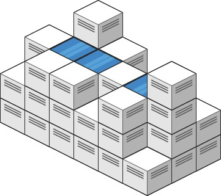
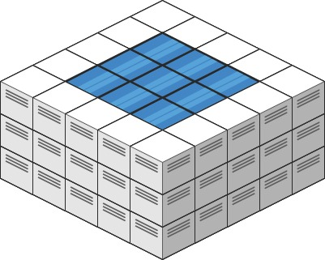

# 407. 接雨水 II

| 题目信息 | 内容 |
|---|---|
| 难度 | 困难 |
| 核心模式 | 最小堆 + BFS，从边界由外向内「削峰填谷」 |
| 时间复杂度 | O(m·n·log(m·n)) |
| 空间复杂度 | O(m·n) |

## 题目与约束

给你一个 `m x n` 的矩阵，其中的值均为非负整数，代表二维高度图每个单元的高度，请计算图中形状最多能接多少体积的雨水。

 

示例 1:



输入: heightMap = [[1,4,3,1,3,2],[3,2,1,3,2,4],[2,3,3,2,3,1]]  
输出: 4  
解释: 下雨后，雨水将会被上图蓝色的方块中。总的接雨水量为1+2+1=4。

示例 2:



输入: heightMap = [[3,3,3,3,3],[3,2,2,2,3],[3,2,1,2,3],[3,2,2,2,3],[3,3,3,3,3]]  
输出: 10

 

提示:

- `m == heightMap.length`

- `n == heightMap[i].length`

- `1 <= m, n <= 200`

- `0 <= heightMap[i][j] <= 2 * 104`

[🔗 前往力扣原题验证 →](https://leetcode.cn/problems/trapping-rain-water-ii/)

## 核心不变量

> 一个格子能接的水量，由「从它出发到矩阵边界的所有路径中，最高格子的最小值」决定；用最小堆从边界向内扩张，就能保证当前弹出的高度就是该位置的水位上限。

## 完整推导

### 思路推导

1. **一维到二维的困境**：接雨水 I 里，一个位置的水位由「左边最高」和「右边最高」中较小者决定。二维里「挡水的边界」不再是左右两条，而是四面八方的外围格子，无法简单地从某个方向枚举。

2. **换一个视角——木桶效应**：一个格子里的水能蓄多高，取决于它能「漏」向边界的最低那条通道。想象矩阵四周是它天然的围墙。我们从边界开始向内「洪水漫灌」：水位由外圈最矮的地方决定。边界上的格子不可能存水（水直接流走），它们是已知的「围墙」。

3. **最小堆 + BFS 扩张**：把所有边界格子按高度放进**最小堆**。每次弹出当前最矮的边界格子作为「当前水位 `h`」，去看它尚未访问的邻居：如果邻居比 `h` 矮，就能存 `h - 邻居高度` 的水；然后这个邻居也变成新的围墙，其有效高度更新为 `max(h, 邻居高度)`，入堆。由于堆始终先处理最矮的围墙，任何时刻弹出的 `h` 就是该方向的最优水位，不会漏算。

4. **为什么要 `max`？** 邻居自身的实际高度可能比水位还高，此时它成为新的墙，能挡住更高的水，所以要以 `max(h, 邻居高度)` 的身份继续向外扩张。

小例子：示例 2 的正中心高度 1 被一圈高度 2 包围，外围是 3。中心注入水位 2，能蓄 `2 - 1 = 1`；四个方向各一条沟，累计得 10，正是答案。

### Java 实现（最小堆 + BFS）

```java
class Solution {
    public int trapRainWater(int[][] heightMap) {
        if (heightMap == null || heightMap.length == 0 || heightMap[0].length == 0) {
            return 0;
        }
        int m = heightMap.length, n = heightMap[0].length;
        boolean[][] visited = new boolean[m][n];

        // 最小堆：元素为 {row, col, 该位置的有效围墙高度}，按高度升序
        PriorityQueue<int[]> pq = new PriorityQueue<>((a, b) -> a[2] - b[2]);

        // 1. 把所有边界格子作为初始围墙入堆
        for (int i = 0; i < m; i++) {
            for (int j = 0; j < n; j++) {
                if (i == 0 || i == m - 1 || j == 0 || j == n - 1) {
                    pq.offer(new int[]{i, j, heightMap[i][j]});
                    visited[i][j] = true;
                }
            }
        }

        int water = 0;
        int[][] dirs = {{-1, 0}, {1, 0}, {0, -1}, {0, 1}};

        // 2. 从最矮的围墙开始，向内一圈圈扩张
        while (!pq.isEmpty()) {
            int[] cur = pq.poll();
            int r = cur[0], c = cur[1], h = cur[2];
            for (int[] d : dirs) {
                int nr = r + d[0], nc = c + d[1];
                // 越界或已访问则跳过
                if (nr < 0 || nr >= m || nc < 0 || nc >= n || visited[nr][nc]) {
                    continue;
                }
                visited[nr][nc] = true;
                // 邻居比当前水位矮，就能蓄水
                if (heightMap[nr][nc] < h) {
                    water += h - heightMap[nr][nc];
                }
                // 邻居成为新的围墙，有效高度取其自身与当前水位的较大者
                pq.offer(new int[]{nr, nc, Math.max(h, heightMap[nr][nc])});
            }
        }
        return water;
    }
}
```

### 复杂度

- 时间：O(m·n·log(m·n))，每个格子最多入堆一次、出堆一次，堆操作是 O(log(m·n))。
- 空间：O(m·n)，`visited` 数组与堆的规模都是格子数量级。

### 易错点与扩展（面试高频考点）

1. **把「边界」只当成上下两行**：二维接雨水的边界是**整个外围四边形**（首行、末行、首列、末列），漏掉任意一条边都会让水从缺口「漏出去」，答案偏小。

2. **忘记用 `max(h, heightMap[nr][nc])` 更新围墙高度**：如果直接拿邻居自身高度入堆，遇到邻居比水位高时会错误地降低围墙，导致后续水位计算失真。

3. **用普通 BFS 的队列而不是优先队列**：必须每次先处理最矮的墙（木桶最短板原理）。用普通队列（FIFO）无法保证弹出顺序，结果会错。

4. **越界与访问标记顺序**：一定要先判断「越界 / 已访问」再标记 `visited`，否则会把访问标记写到非法下标上。

5. **扩展与对比**：本题是「接雨水 I（双指针 / 单调栈）」的二维升级版，思路核心都是「水位由最矮的边界决定」；此外也可用并查集按高度从低到高合并来求解，但最小堆 BFS 是最直观的模板。

## 力扣原题

[407. 接雨水 II](https://leetcode.cn/problems/trapping-rain-water-ii/)

### C++ 实现

```cpp
class Solution {
public:
    int trapRainWater(vector<vector<int>>& heightMap) {
        if (heightMap.empty() || heightMap[0].empty()) {
            return 0;
        }
        int m = heightMap.size(), n = heightMap[0].size();
        vector<vector<bool>> visited(m, vector<bool>(n, false));

        // 小顶堆：存储 {有效高度, 行, 列}
        priority_queue<tuple<int, int, int>,
                       vector<tuple<int, int, int>>,
                       greater<tuple<int, int, int>>> pq;

        // 边界格子入堆
        for (int i = 0; i < m; i++) {
            for (int j = 0; j < n; j++) {
                if (i == 0 || i == m - 1 || j == 0 || j == n - 1) {
                    pq.emplace(heightMap[i][j], i, j);
                    visited[i][j] = true;
                }
            }
        }

        int water = 0;
        int dirs[4][2] = {{-1, 0}, {1, 0}, {0, -1}, {0, 1}};

        while (!pq.empty()) {
            auto [h, r, c] = pq.top();
            pq.pop();
            for (auto& d : dirs) {
                int nr = r + d[0], nc = c + d[1];
                if (nr < 0 || nr >= m || nc < 0 || nc >= n || visited[nr][nc]) {
                    continue;
                }
                visited[nr][nc] = true;
                water += max(0, h - heightMap[nr][nc]);
                pq.emplace(max(h, heightMap[nr][nc]), nr, nc);
            }
        }
        return water;
    }
};
```

### Python 实现

```python
import heapq

class Solution:
    def trapRainWater(self, heightMap: List[List[int]]) -> int:
        if not heightMap or not heightMap[0]:
            return 0
        m, n = len(heightMap), len(heightMap[0])
        visited = [[False] * n for _ in range(m)]

        # 最小堆，元素为 (有效高度, 行, 列)
        heap = []
        for i in range(m):
            for j in range(n):
                if i == 0 or i == m - 1 or j == 0 or j == n - 1:
                    heapq.heappush(heap, (heightMap[i][j], i, j))
                    visited[i][j] = True

        water = 0
        dirs = [(-1, 0), (1, 0), (0, -1), (0, 1)]

        while heap:
            h, r, c = heapq.heappop(heap)
            for dr, dc in dirs:
                nr, nc = r + dr, c + dc
                if 0 <= nr < m and 0 <= nc < n and not visited[nr][nc]:
                    visited[nr][nc] = True
                    water += max(0, h - heightMap[nr][nc])
                    heapq.heappush(heap, (max(h, heightMap[nr][nc]), nr, nc))

        return water
```
