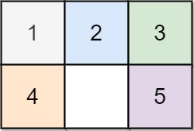
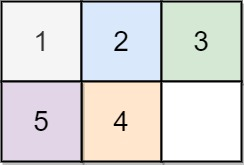
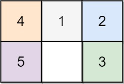

# 773. 滑动谜题

| 题目信息 | 内容 |
|---|---|
| 难度 | 困难 |
| 核心模式 | BFS 在状态图上求最短步数 |
| 时间复杂度 | O(6! × 6) |
| 空间复杂度 | O(6! × 6) |

## 题目与约束

在一个 `2 x 3` 的板上（`board`）有 5 块砖瓦，用数字 `1~5` 来表示, 以及一块空缺用 `0` 来表示。一次 移动 定义为选择 `0` 与一个相邻的数字（上下左右）进行交换.

最终当板 `board` 的结果是 `[[1,2,3],[4,5,0]]` 谜板被解开。

给出一个谜板的初始状态 `board` ，返回最少可以通过多少次移动解开谜板，如果不能解开谜板，则返回 `-1` 。

 

示例 1：



输入：board = [[1,2,3],[4,0,5]]  
输出：1  
解释：交换 0 和 5 ，1 步完成

示例 2:



输入：board = [[1,2,3],[5,4,0]]  
输出：-1  
解释：没有办法完成谜板

示例 3:



输入：board = [[4,1,2],[5,0,3]]  
输出：5  
解释：  
最少完成谜板的最少移动次数是 5 ，  
一种移动路径:  
尚未移动: [[4,1,2],[5,0,3]]  
移动 1 次: [[4,1,2],[0,5,3]]  
移动 2 次: [[0,1,2],[4,5,3]]  
移动 3 次: [[1,0,2],[4,5,3]]  
移动 4 次: [[1,2,0],[4,5,3]]  
移动 5 次: [[1,2,3],[4,5,0]]

 

提示：

- `board.length == 2`

- `board[i].length == 3`

- `0 <= board[i][j] <= 5`

- `board[i][j]` 中每个值都 不同

[🔗 前往力扣原题验证 →](https://leetcode.cn/problems/sliding-puzzle/)

## 核心不变量

> 把所有棋盘状态看成一个图，相邻状态相差一次移动；BFS 第一次到达目标状态时所经过的层数，就是最少移动次数。

## 完整推导

### 思路推导

1. **把状态当成节点**：一块 2×3 的板只有 6 个格子，把数字按行优先读成一个长度 6 的字符串（如 `"123450"`）就能唯一表示一个状态。目标状态固定为 `"123450"`。

2. **把移动当成边**：`0` 只能和相邻格子交换。把 6 个下标在板上的邻居关系预先写死：
   - 0 的邻居：1、3
   - 1 的邻居：0、2、4
   - 2 的邻居：1、5
   - 3 的邻居：0、4
   - 4 的邻居：1、3、5
   - 5 的邻居：2、4

3. **BFS 求最短路**：从初始状态入队，每一层代表同样步数的所有状态。对队头状态的 `0` 位置，尝试与每个邻居交换生成新状态；若等于目标就立即返回当前层数 +1；否则用集合去重后入队。队列清空仍未到达目标则返回 `-1`。

4. **为什么不会爆**：6 个数字的全排列只有 `6! = 720` 种状态（真正可达的更少），状态空间很小，BFS 完全够用。

### Java 实现（BFS 状态搜索）
```java
import java.util.*;

class Solution {
    public int slidingPuzzle(int[][] board) {
        // 1. 把二维板编码成字符串，如 "123450"
        StringBuilder sb = new StringBuilder();
        for (int[] row : board) {
            for (int v : row) sb.append(v);
        }
        String start = sb.toString();
        String target = "123450";
        if (start.equals(target)) return 0;

        // 2. 预存每个格子（下标）的相邻格子
        int[][] neighbors = {
            {1, 3}, {0, 2, 4}, {1, 5},
            {0, 4}, {1, 3, 5}, {2, 4}
        };

        Queue<String> queue = new ArrayDeque<>();
        Set<String> visited = new HashSet<>();
        queue.offer(start);
        visited.add(start);

        int steps = 0;
        // 3. 逐层 BFS
        while (!queue.isEmpty()) {
            int size = queue.size();
            for (int i = 0; i < size; i++) {
                String cur = queue.poll();
                int zero = cur.indexOf('0');
                for (int nb : neighbors[zero]) {
                    char[] arr = cur.toCharArray();
                    // 交换 0 与相邻格子
                    char tmp = arr[zero];
                    arr[zero] = arr[nb];
                    arr[nb] = tmp;
                    String next = new String(arr);

                    if (next.equals(target)) return steps + 1;
                    if (visited.add(next)) {
                        queue.offer(next);
                    }
                }
            }
            steps++;
        }
        return -1;
    }
}
```

### 复杂度
- 时间：`O(6! × 6)`。状态总数最多 720，每个状态需 O(6) 构造字符串并尝试常数个邻居，均为常数级，实际远小于此上限。
- 空间：`O(6! × 6)`。visited 集合最多存 720 个长度 6 的字符串，队列同理。

### 易错点与扩展（面试高频考点）

1. **编码不一致**：二维板与字符串之间的行列映射必须固定（行优先），否则 `0` 的邻居下标会错位。
2. **忘记去重**：不去重会导致同一状态被反复入队，BFS 退化甚至死循环；必须用 `visited` 集合。
3. **把步数算错**：判断"生成后是否等于目标"应在交换后立即判断并返回 `steps + 1`，而不是等出队时再算。
4. **忽略已解情况**：初始就是目标时应返回 0，否则会多算一步。
5. **扩展——双向 BFS / A\***：从起点和终点同时搜索可显著减少扩展量；也可用曼哈顿距离做 A* 启发式，本题状态小，普通 BFS 已足够。

## 力扣原题

[773. 滑动谜题](https://leetcode.cn/problems/sliding-puzzle/)

### C++ 实现
```cpp
#include <string>
#include <vector>
#include <queue>
#include <unordered_set>
using namespace std;

class Solution {
public:
    int slidingPuzzle(vector<vector<int>>& board) {
        string start;
        for (auto& row : board)
            for (int v : row) start += to_string(v);
        string target = "123450";
        if (start == target) return 0;

        // 每个下标的相邻格子，-1 表示结束
        int neighbors[6][4] = {
            {1, 3, -1, -1}, {0, 2, 4, -1}, {1, 5, -1, -1},
            {0, 4, -1, -1}, {1, 3, 5, -1}, {2, 4, -1, -1}
        };

        queue<string> q;
        unordered_set<string> visited{start};
        q.push(start);
        int steps = 0;

        while (!q.empty()) {
            int size = q.size();
            while (size--) {
                string cur = q.front(); q.pop();
                int zero = cur.find('0');
                for (int k = 0; k < 4 && neighbors[zero][k] != -1; k++) {
                    int nb = neighbors[zero][k];
                    string next = cur;
                    swap(next[zero], next[nb]);
                    if (next == target) return steps + 1;
                    if (visited.insert(next).second) q.push(next);
                }
            }
            steps++;
        }
        return -1;
    }
};
```

### Python 实现
```python
from collections import deque


class Solution:
    def slidingPuzzle(self, board: list[list[int]]) -> int:
        start = "".join(str(x) for row in board for x in row)
        target = "123450"
        if start == target:
            return 0

        # 每个下标的相邻格子
        neighbors = [
            [1, 3], [0, 2, 4], [1, 5],
            [0, 4], [1, 3, 5], [2, 4]
        ]

        visited = {start}
        q = deque([(start, 0)])

        while q:
            cur, steps = q.popleft()
            zero = cur.index('0')
            for nb in neighbors[zero]:
                lst = list(cur)
                lst[zero], lst[nb] = lst[nb], lst[zero]
                nxt = "".join(lst)
                if nxt == target:
                    return steps + 1
                if nxt not in visited:
                    visited.add(nxt)
                    q.append((nxt, steps + 1))

        return -1
```
