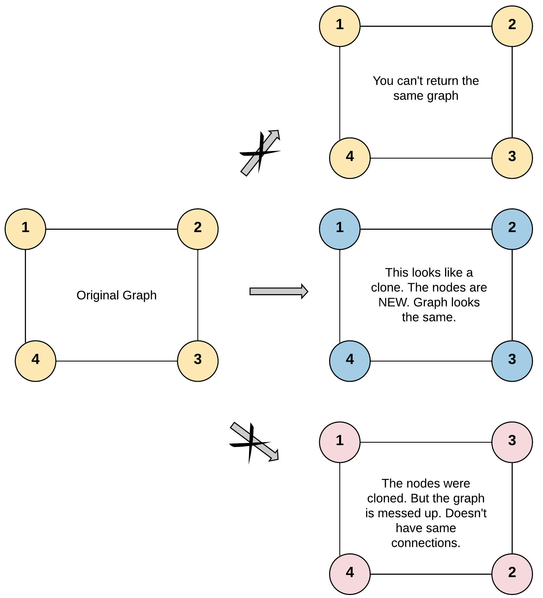
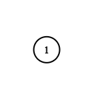

# 133. 克隆图

| 题目信息 | 内容 |
|---|---|
| 难度 | 中等 |
| 核心模式 | 图的 DFS/BFS 深拷贝，哈希表记录「原节点 → 克隆节点」 |
| 时间复杂度 | O(N+E) |
| 空间复杂度 | O(N) |

## 题目与约束

给你无向 连通 图中一个节点的引用，请你返回该图的 深拷贝（克隆）。

图中的每个节点都包含它的值 `val`（`int`） 和其邻居的列表（`list[Node]`）。

```
class Node {
    public int val;
    public List<Node> neighbors;
}
```

 

测试用例格式：

简单起见，每个节点的值都和它的索引相同。例如，第一个节点值为 1（`val = 1`），第二个节点值为 2（`val = 2`），以此类推。该图在测试用例中使用邻接列表表示。

邻接列表 是用于表示有限图的无序列表的集合。每个列表都描述了图中节点的邻居集。

给定节点将始终是图中的第一个节点（值为 1）。你必须将 给定节点的拷贝 作为对克隆图的引用返回。

 

示例 1：



```
<strong>输入：</strong>adjList = [[2,4],[1,3],[2,4],[1,3]]
<strong>输出：</strong>[[2,4],[1,3],[2,4],[1,3]]
<strong>解释：
</strong>图中有 4 个节点。
节点 1 的值是 1，它有两个邻居：节点 2 和 4 。
节点 2 的值是 2，它有两个邻居：节点 1 和 3 。
节点 3 的值是 3，它有两个邻居：节点 2 和 4 。
节点 4 的值是 4，它有两个邻居：节点 1 和 3 。
```

示例 2：



```
<strong>输入：</strong>adjList = [[]]
<strong>输出：</strong>[[]]
<strong>解释：</strong>输入包含一个空列表。该图仅仅只有一个值为 1 的节点，它没有任何邻居。
```

示例 3：

```
<strong>输入：</strong>adjList = []
<strong>输出：</strong>[]
<strong>解释：</strong>这个图是空的，它不含任何节点。
```

 

提示：

- 这张图中的节点数在 `[0, 100]` 之间。

- `1 <= Node.val <= 100`

- 每个节点值 `Node.val` 都是唯一的，

- 图中没有重复的边，也没有自环。

- 图是连通图，你可以从给定节点访问到所有节点。

[🔗 前往力扣原题验证 →](https://leetcode.cn/problems/clone-graph/)

## 核心不变量

> 哈希表 `visited` 保证每个原节点只被克隆一次；只要先登记「原节点 → 新节点」再递归邻居，环也能被正确构造而不会无限递归。

## 完整推导

### 思路推导

1. **为什么不能简单复制**

   图有环：节点 1 的邻居 2 又指回 1。如果只是 `new Node(cur.val)` 然后递归拷贝邻居，就会在环上无限递归、爆栈。必须记录「已经克隆过谁」。

2. **哈希表去重**

   用 `Map<原节点, 克隆节点>`。克隆某个节点时，**先生成新节点并立刻放进 map**，再去处理它的邻居。这样当邻居又指回自己时，直接从 map 取到那个已经创建好的克隆节点，环被正确连接。

3. **DFS 三条分支**

   - 节点为空：返回空；
   - 该节点已在 map 中：直接返回它的克隆；
   - 否则：新建克隆、登记入 map、递归克隆每个邻居并挂到克隆节点的邻居列表上。

4. **小例子（示例 1）**

   从 1 出发新建克隆 1' 并登记；遍历邻居 2、4，分别克隆出 2'、4'；2' 的邻居 1 已在 map 中直接取 1'，3 克隆出 3'；最终得到与原来结构一致、但节点全新的图。

### Java 实现（cloneGraph）

```java
/*
// Definition for a Node.
class Node {
    public int val;
    public List<Node> neighbors;
    public Node() {
        val = 0;
        neighbors = new ArrayList<Node>();
    }
    public Node(int _val) {
        val = _val;
        neighbors = new ArrayList<Node>();
    }
    public Node(int _val, ArrayList<Node> _neighbors) {
        val = _val;
        neighbors = _neighbors;
    }
}
*/
import java.util.ArrayList;
import java.util.HashMap;
import java.util.List;
import java.util.Map;

class Solution {
    // 原节点 -> 克隆节点
    private Map<Node, Node> visited = new HashMap<>();

    public Node cloneGraph(Node node) {
        if (node == null) {
            return null;
        }
        // 已经克隆过，直接返回，避免环上重复递归
        if (visited.containsKey(node)) {
            return visited.get(node);
        }

        // 先创建克隆节点并登记，再处理邻居（顺序很关键）
        Node clone = new Node(node.val);
        visited.put(node, clone);

        for (Node neighbor : node.neighbors) {
            clone.neighbors.add(cloneGraph(neighbor));
        }
        return clone;
    }
}
```

### 复杂度

- 时间：O(N+E)，N 为节点数、E 为边数；每个节点克隆一次，每条邻接边处理一次。
- 空间：O(N)，哈希表存 N 对映射，递归栈最坏 O(N)。

### 易错点与扩展（面试高频考点）

1. **先登记再递归邻居**：必须在递归邻居之前把 `visited.put(node, clone)` 做好，否则遇到环会重复创建节点、甚至栈溢出。
2. **必须使用「原节点」作 key**：映射的键是原图节点引用，不是 `val`；虽然本题 `val` 唯一，但用对象引用才是通用正确做法。
3. **空图处理**：`node == null` 直接返回 `null`（示例 3）。
4. **自环/重边**：题目保证无自环无重边，但算法本身能正确处理自环，因为克隆节点已先登记。
5. **BFS 替代**：也可用队列做 BFS——出队时遍历邻居，未克隆的先克隆入队，已克隆的直接加入当前克隆节点的邻居列表；与 DFS 等价。

## 力扣原题

[133. 克隆图](https://leetcode.cn/problems/clone-graph/)

### C++ 实现

```cpp
/*
// Definition for a Node.
class Node {
public:
    int val;
    vector<Node*> neighbors;
    Node() {
        val = 0;
        neighbors = vector<Node*>();
    }
    Node(int _val) {
        val = _val;
        neighbors = vector<Node*>();
    }
    Node(int _val, vector<Node*> _neighbors) {
        val = _val;
        neighbors = _neighbors;
    }
};
*/
class Solution {
    unordered_map<Node*, Node*> visited;
public:
    Node* cloneGraph(Node* node) {
        if (!node) return nullptr;

        auto it = visited.find(node);
        if (it != visited.end()) return it->second;

        // 先创建克隆并登记，再递归邻居
        Node* clone = new Node(node->val);
        visited[node] = clone;

        for (Node* neighbor : node->neighbors) {
            clone->neighbors.push_back(cloneGraph(neighbor));
        }
        return clone;
    }
};
```

### Python 实现

```python
"""
# Definition for a Node.
class Node:
    def __init__(self, val = 0, neighbors = None):
        self.val = val
        self.neighbors = neighbors if neighbors is not None else []
"""

class Solution:
    def cloneGraph(self, node: Optional['Node']) -> Optional['Node']:
        visited = {}

        def dfs(cur):
            if cur is None:
                return None
            if cur in visited:
                return visited[cur]

            # 先创建克隆并登记，再递归邻居
            clone = Node(cur.val)
            visited[cur] = clone
            for nei in cur.neighbors:
                clone.neighbors.append(dfs(nei))
            return clone

        return dfs(node)
```
