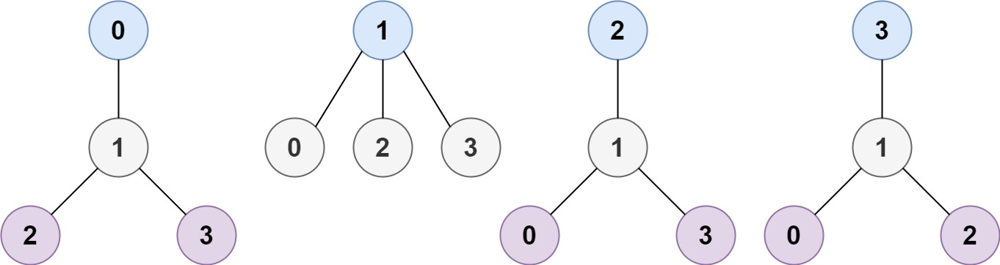
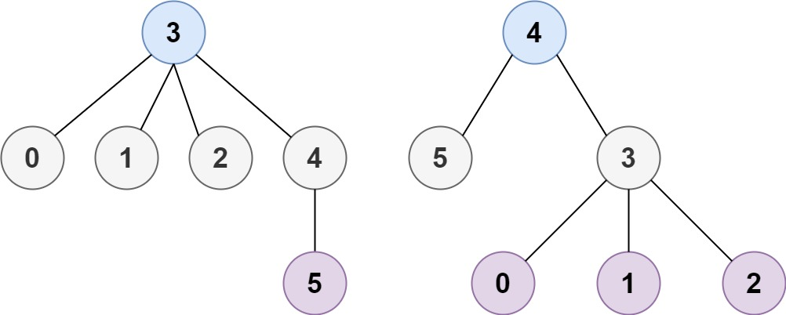

# 310. 最小高度树

| 题目信息 | 内容 |
|---|---|
| 难度 | 中等 |
| 核心模式 | 拓扑剥离（逐层删除叶子节点），最后剩下的 1~2 个节点即答案 |
| 时间复杂度 | O(n) |
| 空间复杂度 | O(n) |

## 题目与约束

树是一个无向图，其中任何两个顶点只通过一条路径连接。 换句话说，任何一个没有简单环路的连通图都是一棵树。

给你一棵包含 `n` 个节点的树，标记为 `0` 到 `n - 1` 。给定数字 `n` 和一个有 `n - 1` 条无向边的 `edges` 列表（每一个边都是一对标签），其中 `edges[i] = [ai, bi]` 表示树中节点 `ai` 和 `bi` 之间存在一条无向边。

可选择树中任何一个节点作为根。当选择节点 `x` 作为根节点时，设结果树的高度为 `h` 。在所有可能的树中，具有最小高度的树（即，`min(h)`）被称为 最小高度树 。

请你找到所有的 最小高度树 并按 任意顺序 返回它们的根节点标签列表。

树的 高度 是指根节点和叶子节点之间最长向下路径上边的数量。

 

示例 1：



```
<strong>输入：</strong>n = 4, edges = [[1,0],[1,2],[1,3]]
<strong>输出：</strong>[1]
<strong>解释：</strong>如图所示，当根是标签为 1 的节点时，树的高度是 1 ，这是唯一的最小高度树。
```

示例 2：



```
<strong>输入：</strong>n = 6, edges = [[3,0],[3,1],[3,2],[3,4],[5,4]]
<strong>输出：</strong>[3,4]
```

 

提示：

- `1 <= n <= 2 * 104`

- `edges.length == n - 1`

- `0 <= ai, bi < n`

- `ai != bi`

- 所有 `(ai, bi)` 互不相同

- 给定的输入 保证 是一棵树，并且 不会有重复的边

[🔗 前往力扣原题验证 →](https://leetcode.cn/problems/minimum-height-trees/)

## 核心不变量

> 最小高度树的根一定在整棵树的“中心”附近：不断把当前所有度为 1 的叶子剥掉，最后剩下的 1 个或 2 个节点就是所有最小高度树的根。

## 完整推导

### 思路推导

1. **从直径看问题**：一棵树的高度由它最长路径（直径）决定。把根放在直径的**中点**上，能让到两端的最远距离尽量小，所以最小高度树的根必然在直径中心。直径长度为偶数时中心是 1 个节点，为奇数时是 2 个相邻节点。

2. **不真去求直径的做法**：与其找直径，不如“从外向内一层层剥叶子”。这等价于同时从直径两端向中间收缩，最后停下的位置就是中心。

3. **小例子（示例 2）**：`edges = [[3,0],[3,1],[3,2],[3,4],[5,4]]`。度为 1 的叶子是 `0,1,2,5`；剥掉后 `3` 的度变为 1、`4` 的度变为 1（`3-4` 相连）；再剥一轮后只剩 `3、4` 两个节点 → 答案 `[3,4]`。

4. **为什么最后剩 1 或 2 个**：每一步至少删掉一层叶子，树规模严格减小；当剩余节点数 `<= 2` 时它们就是中心，无需再删。

### Java 实现（拓扑剥离 / BFS 删叶）

```java
import java.util.ArrayList;
import java.util.LinkedList;
import java.util.List;
import java.util.Queue;

class Solution {
    public List<Integer> findMinHeightTrees(int n, int[][] edges) {
        List<Integer> res = new ArrayList<>();
        if (n == 1) {
            res.add(0);              // 只有一个节点，它就是唯一答案
            return res;
        }

        List<List<Integer>> g = new ArrayList<>();
        for (int i = 0; i < n; i++) g.add(new ArrayList<>());
        int[] deg = new int[n];

        for (int[] e : edges) {
            g.get(e[0]).add(e[1]);
            g.get(e[1]).add(e[0]);
            deg[e[0]]++;
            deg[e[1]]++;
        }

        Queue<Integer> queue = new LinkedList<>();
        for (int i = 0; i < n; i++) {
            if (deg[i] == 1) queue.offer(i);   // 初始叶子入队
        }

        int remaining = n;
        while (remaining > 2) {
            int size = queue.size();
            remaining -= size;                  // 这一层叶子即将被删除
            for (int i = 0; i < size; i++) {
                int leaf = queue.poll();
                for (int nb : g.get(leaf)) {
                    if (--deg[nb] == 1) {       // 邻居度减一，若变叶子则入队
                        queue.offer(nb);
                    }
                }
            }
        }

        while (!queue.isEmpty()) res.add(queue.poll());
        return res;
    }
}
```

### 复杂度

- 时间：O(n)，每条边被访问常数次，每个节点最多入队/出队一次。
- 空间：O(n)，邻接表、度数组与队列均为线性规模。

### 易错点与扩展（面试高频考点）

1. **`n == 1` 特判**：此时没有边，直接返回 `[0]`，否则度数组为空会出错。
2. **删除时机**：每轮只删除“当前这一层”的叶子，用 `size = queue.size()` 固定本层数量，避免把新产生的叶子混进本轮。
3. **不用真的修改图**：只需把邻居的度 `--`，度降到 1 就视为新叶子，无需删边。
4. **为什么答案最多两个**：直径中心的性质决定；若返回超过 2 个，说明剥离层数判断有误。
5. **扩展**：也可两次 BFS/DFS 求出直径再取中点；两者复杂度同为 O(n)，但删叶法更直观、常数更小。

## 力扣原题

[310. 最小高度树](https://leetcode.cn/problems/minimum-height-trees/)

### C++ 实现

```cpp
class Solution {
public:
    vector<int> findMinHeightTrees(int n, vector<vector<int>>& edges) {
        if (n == 1) return {0};

        vector<vector<int>> g(n);
        vector<int> deg(n, 0);
        for (auto& e : edges) {
            g[e[0]].push_back(e[1]);
            g[e[1]].push_back(e[0]);
            deg[e[0]]++;
            deg[e[1]]++;
        }

        queue<int> q;
        for (int i = 0; i < n; i++) {
            if (deg[i] == 1) q.push(i);
        }

        int remaining = n;
        while (remaining > 2) {
            int sz = q.size();
            remaining -= sz;
            for (int i = 0; i < sz; i++) {
                int leaf = q.front();
                q.pop();
                for (int nb : g[leaf]) {
                    if (--deg[nb] == 1) q.push(nb);
                }
            }
        }

        vector<int> res;
        while (!q.empty()) {
            res.push_back(q.front());
            q.pop();
        }
        return res;
    }
};
```

### Python 实现

```python
class Solution:
    def findMinHeightTrees(self, n: int, edges: List[List[int]]) -> List[int]:
        if n == 1:
            return [0]

        g = [[] for _ in range(n)]
        deg = [0] * n
        for a, b in edges:
            g[a].append(b)
            g[b].append(a)
            deg[a] += 1
            deg[b] += 1

        leaves = [i for i in range(n) if deg[i] == 1]
        remaining = n
        while remaining > 2:
            remaining -= len(leaves)
            new_leaves = []
            for leaf in leaves:
                for nb in g[leaf]:
                    deg[nb] -= 1
                    if deg[nb] == 1:
                        new_leaves.append(nb)
            leaves = new_leaves
        return leaves
```
