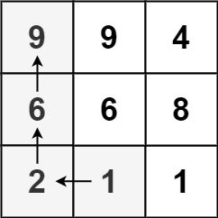
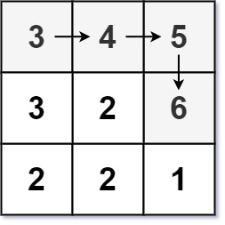

# 329. 矩阵中的最长递增路径

| 题目信息 | 内容 |
|---|---|
| 难度 | 困难 |
| 核心模式 | DFS + 记忆化（等价于 DAG 上的 DP） |
| 时间复杂度 | O(m·n) |
| 空间复杂度 | O(m·n) |

## 题目与约束

给定一个 `m x n` 整数矩阵 `matrix` ，找出其中 最长递增路径 的长度。

对于每个单元格，你可以往上，下，左，右四个方向移动。 你 不能 在 对角线 方向上移动或移动到 边界外（即不允许环绕）。

 

示例 1：



输入：matrix = [[9,9,4],[6,6,8],[2,1,1]]  
输出：4  
解释：最长递增路径为 [1, 2, 6, 9]。

示例 2：



输入：matrix = [[3,4,5],[3,2,6],[2,2,1]]  
输出：4  
解释：最长递增路径是 [3, 4, 5, 6]。注意不允许在对角线方向上移动。

示例 3：

输入：matrix = [[1]]  
输出：1

 

提示：

- `m == matrix.length`

- `n == matrix[i].length`

- `1 <= m, n <= 200`

- `0 <= matrix[i][j] <= 231 - 1`

[🔗 前往力扣原题验证 →](https://leetcode.cn/problems/longest-increasing-path-in-a-matrix/)

## 核心不变量

> 记 `dp[i][j]` 为"以 `(i, j)` 为起点"的最长递增路径长度；由于严格递增使得移动方向构成有向无环图，`dp[i][j] = 1 + max(dp[邻居])`（仅当邻居值更大），每个格子只算一次。

## 完整推导

### 思路推导

1. **痛点（暴力 DFS 会指数爆炸）**

   从每个格子出发做四方向 DFS 找最长递增路径，思路很自然，但同一个格子会被不同起点反复搜索，指数级重复计算，`200×200` 直接超时。

2. **发现重复子问题（记忆化）**

   关键观察：`(i, j)` 往后的最长路径，只取决于它自己以及比它大的邻居，和"从哪条路走到这里"无关。这就是重叠子问题。于是用一个 `memo[i][j]` 记录"以 `(i, j)` 为起点的最长长度"，第一次算完就缓存，之后直接返回。

3. **为什么不会有环（无后效性）**

   路径要求**严格递增**，所以每一步都走向更大的值，不可能绕回来形成环。整个状态图是一张有向无环图（DAG），记忆化 DFS 天然正确，无需 visited 标记。

4. **小例子**

   `[[9,9,4],[6,6,8],[2,1,1]]`：从 `9`（左上）出发无更大邻居，`dp=1`；从 `1`（底部）出发可走向 `2` 再到 `6` 再到 `9`，`dp=4`。对所有格子取最大值即答案。

### Java 实现（记忆化 DFS）

```java
class Solution {
    private int[][] memo;              // memo[i][j] = 以 (i,j) 为起点的最长递增路径
    private int m, n;
    private static final int[][] DIRS = {{1, 0}, {-1, 0}, {0, 1}, {0, -1}};

    public int longestIncreasingPath(int[][] matrix) {
        if (matrix == null || matrix.length == 0 || matrix[0].length == 0) {
            return 0;
        }
        m = matrix.length;
        n = matrix[0].length;
        memo = new int[m][n];          // 0 表示尚未计算

        int best = 0;
        for (int i = 0; i < m; i++) {
            for (int j = 0; j < n; j++) {
                best = Math.max(best, dfs(matrix, i, j));
            }
        }
        return best;
    }

    private int dfs(int[][] matrix, int i, int j) {
        if (memo[i][j] != 0) {
            return memo[i][j];         // 命中缓存
        }
        int best = 1;                  // 至少包含自己
        for (int[] d : DIRS) {
            int ni = i + d[0], nj = j + d[1];
            // 只有在界内且邻居更大时才能走过去
            if (ni >= 0 && ni < m && nj >= 0 && nj < n && matrix[ni][nj] > matrix[i][j]) {
                best = Math.max(best, 1 + dfs(matrix, ni, nj));
            }
        }
        memo[i][j] = best;             // 写回缓存
        return best;
    }
}
```

### 复杂度

- 时间：`O(m·n)`。每个格子的 `dfs` 只真正计算一次，之后命中缓存；每次计算检查 4 个邻居，均摊常数。
- 空间：`O(m·n)`。`memo` 表占 `O(m·n)`；递归栈最坏深度不超过格子总数，也是 `O(m·n)`。

### 易错点与扩展（面试高频考点）

1. **必须严格递增**：邻居判断用 `>` 而非 `>=`。若用 `>=`，相等格子会互相可达形成环，记忆化就不成立（会死循环或答案错误）。
2. **缓存值标记**：用 `0` 表示"未计算"，因为合法路径长度至少为 1，`0` 不会与真实值冲突。
3. **起点要遍历所有格子**：不能只从最小值出发——不同连通分量/分支都可能产生最长路径，必须对所有 `(i, j)` 取最大。
4. **递归深度风险**：极端情况下（如蛇形递增的 `200×200` 矩阵）递归深度可达 `m·n`，某些语言可能栈溢出，可改为显式栈或按值排序后做拓扑 DP。
5. **扩展**：本题是 DAG 上最长路的经典模型，也可用"按值从小到大排序 + 拓扑序 DP"实现（多关键字 BFS / Kahn 算法），思想与记忆化一致，面试中常被要求给出拓扑排序版本。

## 力扣原题

[329. 矩阵中的最长递增路径](https://leetcode.cn/problems/longest-increasing-path-in-a-matrix/)

### C++ 实现

```cpp
#include <vector>
#include <algorithm>
using namespace std;

class Solution {
    int m, n;
    vector<vector<int>> memo;
    int dirs[4][2] = {{1, 0}, {-1, 0}, {0, 1}, {0, -1}};

    int dfs(vector<vector<int>>& matrix, int i, int j) {
        if (memo[i][j] != 0) return memo[i][j];
        int best = 1;
        for (auto& d : dirs) {
            int ni = i + d[0], nj = j + d[1];
            if (ni >= 0 && ni < m && nj >= 0 && nj < n && matrix[ni][nj] > matrix[i][j]) {
                best = max(best, 1 + dfs(matrix, ni, nj));
            }
        }
        return memo[i][j] = best;
    }

public:
    int longestIncreasingPath(vector<vector<int>>& matrix) {
        if (matrix.empty() || matrix[0].empty()) return 0;
        m = matrix.size();
        n = matrix[0].size();
        memo.assign(m, vector<int>(n, 0));
        int best = 0;
        for (int i = 0; i < m; ++i) {
            for (int j = 0; j < n; ++j) {
                best = max(best, dfs(matrix, i, j));
            }
        }
        return best;
    }
};
```

### Python 实现

```python
class Solution:
    def longestIncreasingPath(self, matrix: list[list[int]]) -> int:
        if not matrix or not matrix[0]:
            return 0
        m, n = len(matrix), len(matrix[0])
        memo = [[0] * n for _ in range(m)]      # 0 表示未计算
        dirs = ((1, 0), (-1, 0), (0, 1), (0, -1))

        def dfs(i, j):
            if memo[i][j] != 0:
                return memo[i][j]
            best = 1
            for di, dj in dirs:
                ni, nj = i + di, j + dj
                if 0 <= ni < m and 0 <= nj < n and matrix[ni][nj] > matrix[i][j]:
                    best = max(best, 1 + dfs(ni, nj))
            memo[i][j] = best
            return best

        ans = 0
        for i in range(m):
            for j in range(n):
                ans = max(ans, dfs(i, j))
        return ans
```
