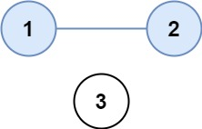
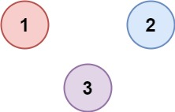

# 547. 省份数量

| 题目信息 | 内容 |
|---|---|
| 难度 | 中等 |
| 核心模式 | 邻接矩阵上数连通分量 |
| 时间复杂度 | O(n²) |
| 空间复杂度 | O(n) |

## 题目与约束

有 `n` 个城市，其中一些彼此相连，另一些没有相连。如果城市 `a` 与城市 `b` 直接相连，且城市 `b` 与城市 `c` 直接相连，那么城市 `a` 与城市 `c` 间接相连。

省份 是一组直接或间接相连的城市，组内不含其他没有相连的城市。

给你一个 `n x n` 的矩阵 `isConnected` ，其中 `isConnected[i][j] = 1` 表示第 `i` 个城市和第 `j` 个城市直接相连，而 `isConnected[i][j] = 0` 表示二者不直接相连。

返回矩阵中 省份 的数量。

 

示例 1：



输入：isConnected = [[1,1,0],[1,1,0],[0,0,1]]  
输出：2

示例 2：



输入：isConnected = [[1,0,0],[0,1,0],[0,0,1]]  
输出：3

 

提示：

- `1 <= n <= 200`

- `n == isConnected.length`

- `n == isConnected[i].length`

- `isConnected[i][j]` 为 `1` 或 `0`

- `isConnected[i][i] == 1`

- `isConnected[i][j] == isConnected[j][i]`

[🔗 前往力扣原题验证 →](https://leetcode.cn/problems/number-of-provinces/)

## 核心不变量

> 省份数量等于无向图的连通分量个数：每从一个未访问城市出发做一次遍历，就恰好数完一个完整省份。

## 完整推导

### 思路推导

1. **建模（把矩阵看成图）**：`n` 个城市是图上的 `n` 个节点，`isConnected[i][j] == 1` 表示节点 `i`、`j` 之间有一条边（矩阵对称、对角线为 1）。题目所求「省份」就是 **连通分量**。

2. **破局思路（染色 + 计数）**：维护一个 `visited` 数组。从左到右扫描每个城市：只要它是未访问的，说明发现了一个新省份，答案 `+1`，然后从这个城市出发，用 DFS/BFS 把与它连通的所有城市一次性标记为已访问。之后再扫到这些城市时会被跳过。

3. **为什么对**：一次遍历只会在当前连通分量内部递归，不会跨越到别的分量；因此每触发一次「新起点」就对应一个、且仅对应一个独立省份。示例 1 中城市 0、1 互相连通，城市 2 孤立，答案为 `2`。

### Java 实现（DFS 染色）

```java
class Solution {
    public int findCircleNum(int[][] isConnected) {
        int n = isConnected.length;
        boolean[] visited = new boolean[n];
        int provinces = 0;

        for (int i = 0; i < n; i++) {
            if (!visited[i]) {          // 发现一个新的连通分量
                dfs(isConnected, visited, i);
                provinces++;
            }
        }
        return provinces;
    }

    // 从城市 i 出发，把整个连通分量标记为已访问
    private void dfs(int[][] g, boolean[] visited, int i) {
        visited[i] = true;
        for (int j = 0; j < g.length; j++) {
            // 有边且邻居未访问，则继续深入
            if (g[i][j] == 1 && !visited[j]) {
                dfs(g, visited, j);
            }
        }
    }
}
```

### 复杂度

- 时间：O(n²)，每个城市最多被访问一次，但每次 DFS 都要扫描一整行（长度 `n`），累计扫描整个矩阵。
- 空间：O(n)，`visited` 数组占 `O(n)`，递归栈最深 `O(n)`。

### 易错点与扩展（面试高频考点）

1. **对角线 `isConnected[i][i] == 1`**：扫描时 `j == i` 会命中自己，靠 `!visited[j]`（`i` 已被标记）自然避免自环死循环，不必特判。
2. **计数时机**：`provinces++` 必须放在「发现未访问起点」时，而不是 DFS 内部，否则会重复计数。
3. **DFS vs BFS vs 并查集**：三者都可行。BFS 用队列、并查集按「初始 `n` 个集合，每次合并 `-1`」统计，面试可主动给出并查集版本展示广度。
4. **空间权衡**：`visited` 可用矩阵本身的某一位标记来省空间，但会改动输入，一般不推荐。
5. **举一反三**：与 200 岛屿数量、1319 连通网络操作次数同属「连通分量」家族，模板一致。

## 力扣原题

[547. 省份数量](https://leetcode.cn/problems/number-of-provinces/)

### C++ 实现

```cpp
class Solution {
public:
    int findCircleNum(vector<vector<int>>& isConnected) {
        int n = isConnected.size();
        vector<bool> visited(n, false);
        int provinces = 0;
        for (int i = 0; i < n; i++) {
            if (!visited[i]) {          // 发现新的连通分量
                dfs(isConnected, visited, i);
                provinces++;
            }
        }
        return provinces;
    }

private:
    void dfs(vector<vector<int>>& g, vector<bool>& visited, int i) {
        visited[i] = true;
        for (int j = 0; j < (int)g.size(); j++) {
            if (g[i][j] == 1 && !visited[j]) {
                dfs(g, visited, j);
            }
        }
    }
};
```

### Python 实现

```python
class Solution:
    def findCircleNum(self, isConnected: List[List[int]]) -> int:
        n = len(isConnected)
        visited = [False] * n
        provinces = 0

        def dfs(i: int) -> None:
            visited[i] = True
            for j in range(n):
                if isConnected[i][j] == 1 and not visited[j]:
                    dfs(j)

        for i in range(n):
            if not visited[i]:          # 发现新的连通分量
                dfs(i)
                provinces += 1
        return provinces
```
