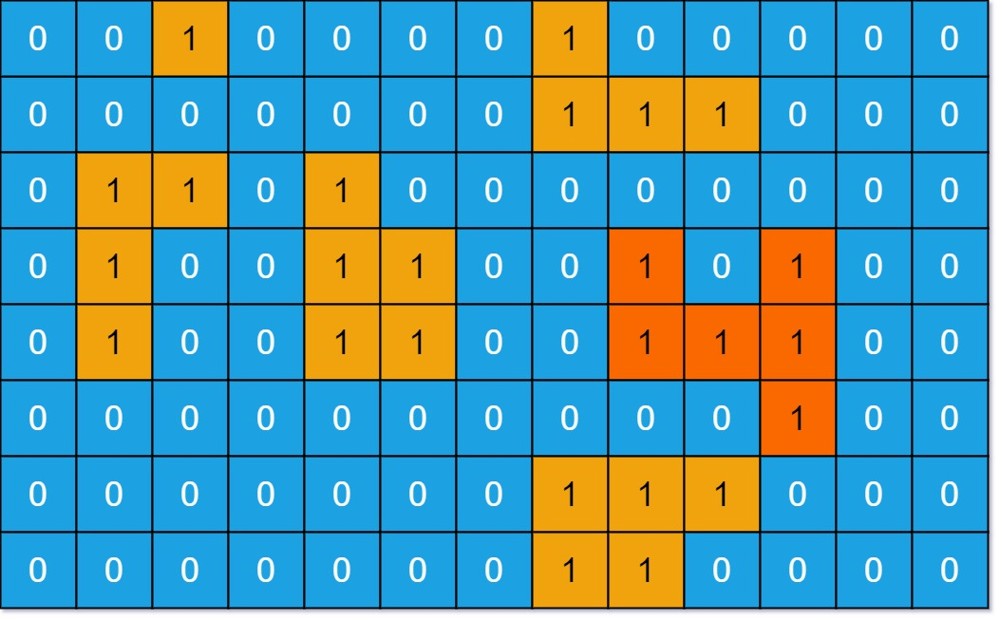

# 695. 岛屿的最大面积

| 题目信息 | 内容 |
|---|---|
| 难度 | 中等 |
| 核心模式 | DFS 洪泛求最大连通块面积 |
| 时间复杂度 | O(m·n) |
| 空间复杂度 | O(m·n) |

## 题目与约束

给你一个大小为 `m x n` 的二进制矩阵 `grid` 。

岛屿 是由一些相邻的 `1` (代表土地) 构成的组合，这里的「相邻」要求两个 `1` 必须在 水平或者竖直的四个方向上 相邻。你可以假设 `grid` 的四个边缘都被 `0`（代表水）包围着。

岛屿的面积是岛上值为 `1` 的单元格的数目。

计算并返回 `grid` 中最大的岛屿面积。如果没有岛屿，则返回面积为 `0` 。

 

示例 1：



输入：grid = [[0,0,1,0,0,0,0,1,0,0,0,0,0],[0,0,0,0,0,0,0,1,1,1,0,0,0],[0,1,1,0,1,0,0,0,0,0,0,0,0],[0,1,0,0,1,1,0,0,1,0,1,0,0],[0,1,0,0,1,1,0,0,1,1,1,0,0],[0,0,0,0,0,0,0,0,0,0,1,0,0],[0,0,0,0,0,0,0,1,1,1,0,0,0],[0,0,0,0,0,0,0,1,1,0,0,0,0]]  
输出：6  
解释：答案不应该是 11 ，因为岛屿只能包含水平或垂直这四个方向上的 1 。

示例 2：

输入：grid = [[0,0,0,0,0,0,0,0]]  
输出：0

 

提示：

- `m == grid.length`

- `n == grid[i].length`

- `1 <= m, n <= 50`

- `grid[i][j]` 为 `0` 或 `1`

[🔗 前往力扣原题验证 →](https://leetcode.cn/problems/max-area-of-island/)

## 核心不变量

> 一次 DFS 能把一整块连通的 `1` 全部「淹没」，它返回的计数恰好就是该岛屿的面积。

## 完整推导

### 思路推导

1. **遍历所有格子**：双重循环扫描 `grid`，每遇到一个 `1`，说明发现了一座新岛屿，从它出发启动一次 DFS 求面积。

2. **DFS 求面积**：从 `(i, j)` 出发，若越界或当前格不是 `1` 就返回 `0`；否则把当前格置 `0`（淹没，防止回头重复访问），面积 = `1 + 上 + 下 + 左 + 右` 四方向递归结果之和。

3. **取全局最大**：每求完一座岛屿就用它更新最大值 `best`；若整个矩阵全为 `0`，`best` 始终为 `0`，正好符合题目要求。

   **小例子**：示例 1 中最大的一块是中间偏左的岛，由 6 个 `1` 上下左右相连组成，DFS 一路淹没后返回 6。

### Java 实现（maxAreaOfIsland）

```java
class Solution {
    private int m, n;

    public int maxAreaOfIsland(int[][] grid) {
        m = grid.length;
        n = grid[0].length;
        int best = 0;
        for (int i = 0; i < m; i++) {
            for (int j = 0; j < n; j++) {
                if (grid[i][j] == 1) {
                    best = Math.max(best, dfs(grid, i, j));
                }
            }
        }
        return best;
    }

    // 返回从 (i, j) 出发这座岛屿的面积，并把访问过的 1 淹没为 0
    private int dfs(int[][] g, int i, int j) {
        if (i < 0 || i >= m || j < 0 || j >= n || g[i][j] != 1) {
            return 0;
        }
        g[i][j] = 0; // 淹没，避免重复访问
        return 1
                + dfs(g, i + 1, j)
                + dfs(g, i - 1, j)
                + dfs(g, i, j + 1)
                + dfs(g, i, j - 1);
    }
}
```

### 复杂度

- 时间：O(m·n)，每个格子最多被访问一次，DFS 是常数次的四方向检查。
- 空间：O(m·n)，最坏情况整片都是陆地，递归栈深度可达 m·n。

### 易错点与扩展（面试高频考点）

1. **忘记置 0**：不把访问过的 `1` 标记为 `0`，会重复访问甚至无限递归、面积算虚高。
2. **只走四个方向**：对角线不算相邻，不要把 8 邻域写进来。
3. **全 0 或空网格**：`best` 初始化为 0，天然返回 0，不要漏掉没有岛屿的情况。
4. **递归深度**：m·n 最大 2500，递归通常安全；若追求稳健可改 BFS 或显式栈防爆栈。
5. **面积累加方式**：用 DFS 返回值 `1 + 四方向` 累加最简洁，避免用全局变量漏加或重复加。

## 力扣原题

[695. 岛屿的最大面积](https://leetcode.cn/problems/max-area-of-island/)

### C++ 实现

```cpp
class Solution {
    int m, n;

    int dfs(vector<vector<int>>& g, int i, int j) {
        if (i < 0 || i >= m || j < 0 || j >= n || g[i][j] != 1) return 0;
        g[i][j] = 0; // 淹没，避免重复访问
        return 1
             + dfs(g, i + 1, j)
             + dfs(g, i - 1, j)
             + dfs(g, i, j + 1)
             + dfs(g, i, j - 1);
    }

public:
    int maxAreaOfIsland(vector<vector<int>>& grid) {
        m = grid.size();
        n = grid[0].size();
        int best = 0;
        for (int i = 0; i < m; i++) {
            for (int j = 0; j < n; j++) {
                if (grid[i][j] == 1) {
                    best = max(best, dfs(grid, i, j));
                }
            }
        }
        return best;
    }
};
```

### Python 实现

```python
class Solution:
    def maxAreaOfIsland(self, grid: list[list[int]]) -> int:
        m, n = len(grid), len(grid[0])

        def dfs(i, j):
            if i < 0 or i >= m or j < 0 or j >= n or grid[i][j] != 1:
                return 0
            grid[i][j] = 0  # 淹没，避免重复访问
            return 1 + dfs(i + 1, j) + dfs(i - 1, j) + dfs(i, j + 1) + dfs(i, j - 1)

        best = 0
        for i in range(m):
            for j in range(n):
                if grid[i][j] == 1:
                    best = max(best, dfs(i, j))
        return best
```
