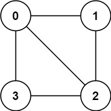
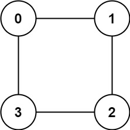

# 785. 判断二分图

| 题目信息 | 内容 |
|---|---|
| 难度 | 中等 |
| 核心模式 | 图染色 DFS，相邻节点必须异色 |
| 时间复杂度 | O(n + e) |
| 空间复杂度 | O(n) |

## 题目与约束

存在一个 无向图 ，图中有 `n` 个节点。其中每个节点都有一个介于 `0` 到 `n - 1` 之间的唯一编号。给你一个二维数组 `graph` ，其中 `graph[u]` 是一个节点数组，由节点 `u` 的邻接节点组成。形式上，对于 `graph[u]` 中的每个 `v` ，都存在一条位于节点 `u` 和节点 `v` 之间的无向边。该无向图同时具有以下属性：

- 不存在自环（`graph[u]` 不包含 `u`）。

- 不存在平行边（`graph[u]` 不包含重复值）。

- 如果 `v` 在 `graph[u]` 内，那么 `u` 也应该在 `graph[v]` 内（该图是无向图）

- 这个图可能不是连通图，也就是说两个节点 `u` 和 `v` 之间可能不存在一条连通彼此的路径。

二分图 定义：如果能将一个图的节点集合分割成两个独立的子集 `A` 和 `B` ，并使图中的每一条边的两个节点一个来自 `A` 集合，一个来自 `B` 集合，就将这个图称为 二分图 。

如果图是二分图，返回 `true` ；否则，返回 `false` 。

 

示例 1：



输入：graph = [[1,2,3],[0,2],[0,1,3],[0,2]]  
输出：false  
解释：不能将节点分割成两个独立的子集，以使每条边都连通一个子集中的一个节点与另一个子集中的一个节点。

示例 2：



输入：graph = [[1,3],[0,2],[1,3],[0,2]]  
输出：true  
解释：可以将节点分成两组: {0, 2} 和 {1, 3} 。

 

提示：

- `graph.length == n`

- `1 <= n <= 100`

- `0 <= graph[u].length < n`

- `0 <= graph[u][i] <= n - 1`

- `graph[u]` 不会包含 `u`

- `graph[u]` 的所有值 互不相同

- 如果 `graph[u]` 包含 `v`，那么 `graph[v]` 也会包含 `u`

[🔗 前往力扣原题验证 →](https://leetcode.cn/problems/is-graph-bipartite/)

## 核心不变量

> 每条边的两个端点必须染成不同颜色；只要在染色过程中发现某条边的两端颜色相同，就说明该图不是二分图。

## 完整推导

### 思路推导

1. **二分图 = 二染色**：给每个节点染成 0 或 1 两种颜色。二分图的要求恰好等价于"存在一种染色，使每条边的两端颜色不同"。

2. **DFS 染色**：从任意未染色节点出发染成 0，沿边扩散：若邻居未染色，染成相反颜色并继续 DFS；若邻居已染色且与当前节点同色，说明出现冲突，直接返回 `false`。

3. **处理非连通图**：图可能由多个连通分量组成，因此要对每个未染色的节点都作为新起点做一次 DFS；任意一个分量染色失败，整体就返回 `false`。

4. **小例验证**：`graph = [[1,2,3],[0,2],[0,1,3],[0,2]]`。给 0 染 0，则 1、2、3 都染 1；但 1 与 2 之间有边且同为 1，冲突，返回 `false`。

### Java 实现（DFS 二染色）
```java
import java.util.Arrays;

class Solution {
    public boolean isBipartite(int[][] graph) {
        int n = graph.length;
        int[] color = new int[n];
        Arrays.fill(color, -1);           // -1 表示未染色

        // 逐个连通分量染色，图可能不连通
        for (int i = 0; i < n; i++) {
            if (color[i] == -1) {
                if (!dfs(graph, color, i, 0)) {
                    return false;
                }
            }
        }
        return true;
    }

    private boolean dfs(int[][] graph, int[] color, int u, int c) {
        color[u] = c;                     // 给当前节点染色
        for (int v : graph[u]) {
            if (color[v] == -1) {
                // 邻居未染色，染相反颜色继续深入
                if (!dfs(graph, color, v, c ^ 1)) {
                    return false;
                }
            } else if (color[v] == c) {
                // 邻居已染色且与当前同色，冲突
                return false;
            }
        }
        return true;
    }
}
```

### 复杂度
- 时间：`O(n + e)`。每个节点染色一次，每条边在邻接表中被检查一次（无向边两端各计一次），其中 e 为边数。
- 空间：`O(n)`。`color` 数组占 O(n)，DFS 递归栈最坏深度 O(n)。

### 易错点与扩展（面试高频考点）

1. **只从一个节点开始染色**：图可能不连通，必须遍历所有节点，对每个未染色节点都发起一次 DFS，否则会漏判其他分量。
2. **染色冲突判断写反**：只有当"邻居已染色且与当前同色"才是冲突，邻居异色是正常的。
3. **颜色传递错误**：向下递归时颜色应取 `c ^ 1`（0↔1 互换），写成同一个 `c` 会导致相邻同色。
4. **用 0 表示未染色**：若用 0 同时表示"未染色"和"一种颜色"，会无法区分；应用 -1 表示未染色。
5. **扩展——BFS 与并查集**：BFS 分层染色同样可行；也可用并查集：把每个节点的所有邻居合并到一组，若某节点与自身邻居同组则不是二分图。

## 力扣原题

[785. 判断二分图](https://leetcode.cn/problems/is-graph-bipartite/)

### C++ 实现
```cpp
#include <vector>
using namespace std;

class Solution {
public:
    bool isBipartite(vector<vector<int>>& graph) {
        int n = graph.size();
        vector<int> color(n, -1);         // -1 表示未染色
        for (int i = 0; i < n; i++) {
            if (color[i] == -1) {
                if (!dfs(graph, color, i, 0)) return false;
            }
        }
        return true;
    }

private:
    bool dfs(vector<vector<int>>& graph, vector<int>& color, int u, int c) {
        color[u] = c;
        for (int v : graph[u]) {
            if (color[v] == -1) {
                if (!dfs(graph, color, v, c ^ 1)) return false;
            } else if (color[v] == c) {
                return false;
            }
        }
        return true;
    }
};
```

### Python 实现
```python
class Solution:
    def isBipartite(self, graph: list[list[int]]) -> bool:
        n = len(graph)
        color = [-1] * n                  # -1 表示未染色

        def dfs(u, c):
            color[u] = c
            for v in graph[u]:
                if color[v] == -1:
                    if not dfs(v, c ^ 1):
                        return False
                elif color[v] == c:
                    return False
            return True

        # 图可能不连通，需要遍历每个未染色节点
        for i in range(n):
            if color[i] == -1:
                if not dfs(i, 0):
                    return False
        return True
```
