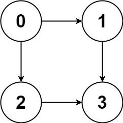
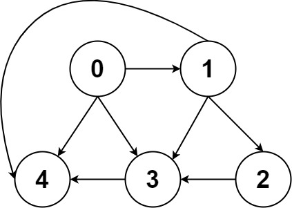

# 797. 所有可能的路径

| 题目信息 | 内容 |
|---|---|
| 难度 | 中等 |
| 核心模式 | DFS + 回溯枚举所有路径 |
| 时间复杂度 | O(n · 2^n) |
| 空间复杂度 | O(n) |

## 题目与约束

给你一个有 `n` 个节点的 有向无环图（DAG），请你找出从节点 `0` 到节点 `n-1` 的所有路径并输出（不要求按特定顺序）

 `graph[i]` 是一个从节点 `i` 可以访问的所有节点的列表（即从节点 `i` 到节点 `graph[i][j]`存在一条有向边）。

 

示例 1：



```
<strong>输入：</strong>graph = [[1,2],[3],[3],[]]
<strong>输出：</strong>[[0,1,3],[0,2,3]]
<strong>解释：</strong>有两条路径 0 -> 1 -> 3 和 0 -> 2 -> 3
```

示例 2：



```
<strong>输入：</strong>graph = [[4,3,1],[3,2,4],[3],[4],[]]
<strong>输出：</strong>[[0,4],[0,3,4],[0,1,3,4],[0,1,2,3,4],[0,1,4]]
```

 

提示：

- `n == graph.length`

- `2 <= n <= 15`

- `0 <= graph[i][j] < n`

- `graph[i][j] != i`（即不存在自环）

- `graph[i]` 中的所有元素 互不相同

- 保证输入为 有向无环图（DAG）

[🔗 前往力扣原题验证 →](https://leetcode.cn/problems/all-paths-from-source-to-target/)

## 核心不变量

> 由于是 DAG，从节点 0 出发沿任意有向边行走都不会回到走过的点，因此只需记录当前路径，走到 `n - 1` 即得到一条合法路径。

## 完整推导

### 思路推导

1. **为什么可以无脑深搜？** 题目保证输入是 DAG（无环），所以从 `0` 出发顺着边走永远不会回到已经访问过的节点，也就不需要 `visited` 数组去防环。这使得“一路走到黑”的 DFS 天然安全。

2. **用一个 path 记录当前走法。** 先把起点 `0` 放进 `path`。每到一个节点 `cur`，就遍历它的所有邻居 `next`：把 `next` 压入 `path`，继续从 `next` 深搜，回溯时把 `next` 弹出，恢复现场。这就是标准的回溯模板。

3. **到达终点就收割。** 当 `cur == n - 1` 时，说明当前 `path` 已经是一条从 `0` 到终点的完整路径，把 `path` 的**拷贝**放进答案，然后返回（终点没有出边，不必再往下走）。

4. **小例子。** `graph = [[1,2],[3],[3],[]]`：从 0 出发，先走 1 再走 3，得到 `[0,1,3]`；回溯后从 0 走 2 再走 3，得到 `[0,2,3]`。两条路径全部收集完毕。

### Java 实现（DFS 回溯）

```java
import java.util.ArrayList;
import java.util.List;

class Solution {
    public List<List<Integer>> allPathsSourceTarget(int[][] graph) {
        List<List<Integer>> res = new ArrayList<>();
        List<Integer> path = new ArrayList<>();
        path.add(0);                       // 路径从起点 0 开始
        dfs(graph, 0, graph.length - 1, path, res);
        return res;
    }

    private void dfs(int[][] graph, int cur, int target,
                     List<Integer> path, List<List<Integer>> res) {
        if (cur == target) {               // 到达终点，收割一条完整路径
            res.add(new ArrayList<>(path)); // 必须拷贝，否则后续回溯会改动同一列表
            return;
        }
        for (int next : graph[cur]) {      // 枚举所有出边
            path.add(next);                // 选择
            dfs(graph, next, target, path, res);
            path.remove(path.size() - 1);  // 撤销选择（回溯）
        }
    }
}
```

### 复杂度

- 时间：O(n · 2^n)。DAG 中从 0 到 n-1 的路径数量级可达 2^n，每条路径最长 n 个节点，全部枚举并拷贝的代价为路径数乘以路径长度。
- 空间：O(n)。递归栈深度与当前 `path` 长度都不超过节点数 n（不计答案占用的空间）。

### 易错点与扩展（面试高频考点）

1. **收割时忘记拷贝。** `res.add(path)` 只是加入引用，回溯后 `path` 被清空，答案会全变成空列表；必须 `new ArrayList<>(path)`（或 `path.copy()`）做快照。
2. **不加 `visited` 也不会死循环。** 这是 DAG 性质保证的；但若题目改成可能有环的图，就必须加访问标记，否则会无限递归。
3. **终点处理要提前 return。** 到达 `n-1` 后应立即收集并返回，避免继续展开不存在的出边。
4. **扩展：BFS 写法。** 也可用队列保存“当前路径”，逐层扩展，代码略长但同样可行；DFS 回溯在这里更简洁。

## 力扣原题

[797. 所有可能的路径](https://leetcode.cn/problems/all-paths-from-source-to-target/)

### C++ 实现

```cpp
#include <vector>
#include <functional>
using namespace std;

class Solution {
public:
    vector<vector<int>> allPathsSourceTarget(vector<vector<int>>& graph) {
        vector<vector<int>> res;
        vector<int> path{0};
        int target = graph.size() - 1;

        function<void(int)> dfs = [&](int cur) {
            if (cur == target) {          // 到达终点，记录一条路径
                res.push_back(path);
                return;
            }
            for (int nxt : graph[cur]) {  // 枚举出边
                path.push_back(nxt);      // 选择
                dfs(nxt);
                path.pop_back();          // 回溯
            }
        };

        dfs(0);
        return res;
    }
};
```

### Python 实现

```python
from typing import List

class Solution:
    def allPathsSourceTarget(self, graph: List[List[int]]) -> List[List[int]]:
        res = []
        path = [0]
        target = len(graph) - 1

        def dfs(cur: int) -> None:
            if cur == target:          # 到达终点，收割路径
                res.append(path.copy())  # 拷贝快照
                return
            for nxt in graph[cur]:     # 枚举出边
                path.append(nxt)       # 选择
                dfs(nxt)
                path.pop()             # 回溯

        dfs(0)
        return res
```
