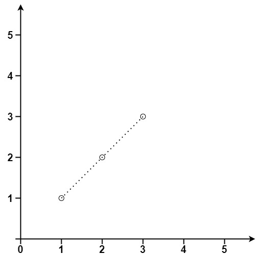
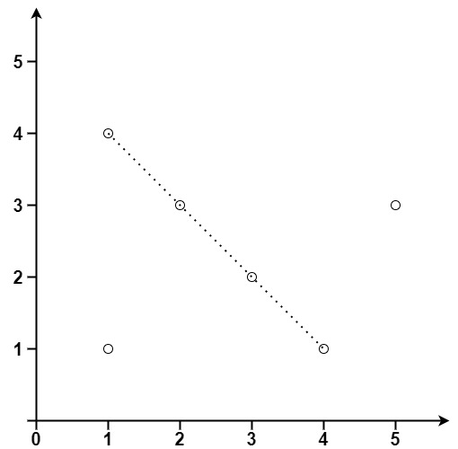

# 149. 直线上最多的点数

| 题目信息 | 内容 |
|---|---|
| 难度 | 困难 |
| 核心模式 | 枚举基准点 + 约分方向向量哈希计数共线点 |
| 时间复杂度 | O(n²) |
| 空间复杂度 | O(n) |

## 题目与约束

给你一个数组 `points` ，其中 `points[i] = [xi, yi]` 表示 X-Y 平面上的一个点。求最多有多少个点在同一条直线上。

 

示例 1：



```
<strong>输入：</strong>points = [[1,1],[2,2],[3,3]]
<strong>输出：</strong>3
```

示例 2：



```
<strong>输入：</strong>points = [[1,1],[3,2],[5,3],[4,1],[2,3],[1,4]]
<strong>输出：</strong>4
```

 

提示：

- `1 <= points.length <= 300`

- `points[i].length == 2`

- `-104 <= xi, yi <= 104`

- `points` 中的所有点 互不相同

[🔗 前往力扣原题验证 →](https://leetcode.cn/problems/max-points-on-a-line/)

## 核心不变量

> 经过某个基准点 i 的所有直线由"方向向量"唯一确定；把方向向量用最大公约数约分并统一符号后，同一方向上的点必定共线，计数出现最多的方向再加基准点本身即为答案。

## 完整推导

### 思路推导

1. **把"直线"拆成"一个点 + 一个方向"**

   一条直线可以由它经过的某个点 i 和它的方向唯一确定。于是枚举每个点作为基准点 i，统计"经过 i 的各个方向上分别有多少个其他点"，取最大值，再加 1（基准点自己），就是经过 i 的共线点数的最大值。对所有 i 取最大即可。

2. **怎么表示方向（关键：约分 + 统一符号）**

   对 i 之后每个点 j，算方向向量 `(dx, dy) = (x_j - x_i, y_j - y_i)`。直接用浮点算斜率会丢精度、且竖直线除零，所以改用整数对做键：

   - 先除以 `g = gcd(|dx|, |dy|)` 约分，得到最简整数比；
   - 再统一符号：若 `dx < 0` 就整体取反；若 `dx == 0` 把 `dy` 取正。

   这样 `(2,4)`、`(1,2)`、`(-1,-2)` 都会归一到 `(1,2)`，而竖直线统一为 `(0,1)`、水平线统一为 `(1,0)`。

3. **小例子（示例 1：`[[1,1],[2,2],[3,3]]`）**

   以 `(1,1)` 为基准：到 `(2,2)` 方向 `(1,1)`，到 `(3,3)` 方向 `(2,2)→(1,1)`，同一方向计数为 2，加基准点自身 = 3。答案 3。

4. **收尾**

   `n <= 2` 时答案就是 `n`；否则逐基准点统计并取全局最大。

### Java 实现（maxPoints）

```java
import java.util.HashMap;
import java.util.Map;

class Solution {
    public int maxPoints(int[][] points) {
        int n = points.length;
        if (n <= 2) {
            return n;
        }
        int res = 0;
        for (int i = 0; i < n; i++) {
            // 剪枝：剩余点（含 i 自身）最多 n - i 个，不可能超过当前答案
            if (res >= n - i) {
                break;
            }
            Map<String, Integer> slopeCount = new HashMap<>();
            int maxCount = 0; // 与 i 共线的其他点最大数量
            for (int j = i + 1; j < n; j++) {
                int dx = points[j][0] - points[i][0];
                int dy = points[j][1] - points[i][1];
                int g = gcd(Math.abs(dx), Math.abs(dy)); // 约分
                dx /= g;
                dy /= g;
                // 统一符号，保证相反方向映射到同一个键
                if (dx < 0) {
                    dx = -dx;
                    dy = -dy;
                } else if (dx == 0) {
                    dy = Math.abs(dy);
                }
                String key = dx + "," + dy;
                int cnt = slopeCount.getOrDefault(key, 0) + 1;
                slopeCount.put(key, cnt);
                maxCount = Math.max(maxCount, cnt);
            }
            res = Math.max(res, maxCount + 1); // +1 是基准点自身
        }
        return res;
    }

    private int gcd(int a, int b) {
        return b == 0 ? a : gcd(b, a % b);
    }
}
```

### 复杂度

- 时间：O(n²)，外层枚举 n 个基准点，内层枚举其后的点，每次做一次 O(log C) 的 gcd；n ≤ 300 可轻松通过。
- 空间：O(n)，每个基准点维护一个哈希表，最多存 n-1 个方向。

### 易错点与扩展（面试高频考点）

1. **用浮点斜率当键会出错**：`dy/dx` 用 `double` 既可能因精度丢失把不同直线误判为同一条，又会在竖直线 `dx=0` 时除零；必须用约分后的整数对做键。
2. **符号不统一导致漏计**：`(1,2)` 与 `(-1,-2)` 是同一条直线的两个方向，若不统一符号会被当成两种斜率，必须规定"`dx<0` 取反、`dx==0` 时 `dy` 取正"。
3. **gcd 未取绝对值**：对负数直接求 gcd 可能得到负值，约分后符号混乱；应先 `Math.abs` 再约分。
4. **忘记加基准点自身**：哈希表只统计了"其他点"，最终要 `maxCount + 1`；且每个基准点都要新建哈希表，不能复用。
5. **重复点问题**：本题保证点互不相同，所以无需额外处理重合点；若允许重复，需单独用 `same` 变量统计与 i 重合的点数并一起计入。

## 力扣原题

[149. 直线上最多的点数](https://leetcode.cn/problems/max-points-on-a-line/)

### C++ 实现

```cpp
#include <vector>
#include <map>
#include <algorithm>
#include <cstdlib>
using namespace std;

class Solution {
public:
    int maxPoints(vector<vector<int>>& points) {
        int n = points.size();
        if (n <= 2) {
            return n;
        }
        int res = 0;
        for (int i = 0; i < n; ++i) {
            if (res >= n - i) {
                break; // 剪枝
            }
            map<pair<int, int>, int> mp;
            int maxCount = 0;
            for (int j = i + 1; j < n; ++j) {
                int dx = points[j][0] - points[i][0];
                int dy = points[j][1] - points[i][1];
                int g = myGcd(abs(dx), abs(dy)); // 约分
                dx /= g;
                dy /= g;
                if (dx < 0) {
                    dx = -dx;
                    dy = -dy;
                } else if (dx == 0) {
                    dy = abs(dy);
                }
                int cnt = ++mp[{dx, dy}];
                maxCount = max(maxCount, cnt);
            }
            res = max(res, maxCount + 1);
        }
        return res;
    }

private:
    int myGcd(int a, int b) {
        return b == 0 ? a : myGcd(b, a % b);
    }
};
```

### Python 实现

```python
from typing import List
import math

class Solution:
    def maxPoints(self, points: List[List[int]]) -> int:
        n = len(points)
        if n <= 2:
            return n

        res = 0
        for i in range(n):
            if res >= n - i:
                break  # 剪枝
            slope_count = {}
            max_count = 0
            x1, y1 = points[i]
            for j in range(i + 1, n):
                dx = points[j][0] - x1
                dy = points[j][1] - y1
                g = math.gcd(abs(dx), abs(dy))  # 约分
                dx //= g
                dy //= g
                if dx < 0:
                    dx, dy = -dx, -dy
                elif dx == 0:
                    dy = abs(dy)
                key = (dx, dy)
                slope_count[key] = slope_count.get(key, 0) + 1
                max_count = max(max_count, slope_count[key])
            res = max(res, max_count + 1)  # +1 是基准点自身
        return res
```
