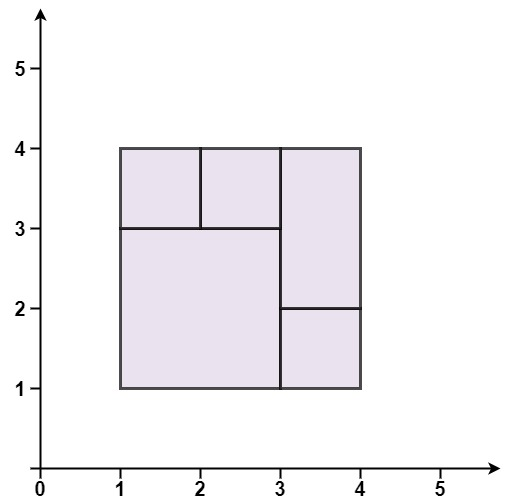
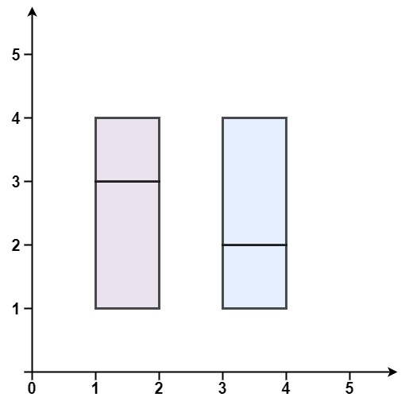
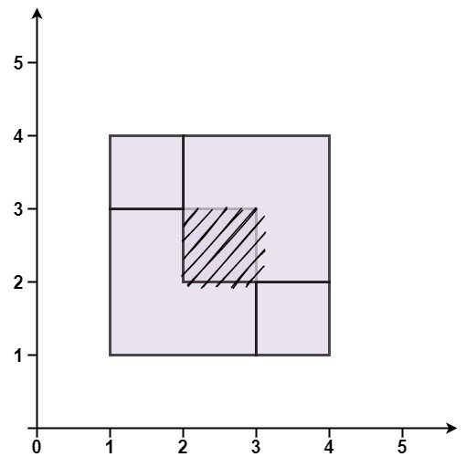

# 391. 完美矩形

| 题目信息 | 内容 |
|---|---|
| 难度 | 困难 |
| 核心模式 | 面积守恒 + 角点奇偶性（把角点集合按出现次数翻转） |
| 时间复杂度 | O(n log n) |
| 空间复杂度 | O(n) |

## 题目与约束

给你一个数组 `rectangles` ，其中 `rectangles[i] = [xi, yi, ai, bi]` 表示一个坐标轴平行的矩形。这个矩形的左下顶点是 `(xi, yi)` ，右上顶点是 `(ai, bi)` 。

如果所有矩形一起精确覆盖了某个矩形区域，则返回 `true` ；否则，返回 `false` 。

 

示例 1：



```
<strong>输入：</strong>rectangles = [[1,1,3,3],[3,1,4,2],[3,2,4,4],[1,3,2,4],[2,3,3,4]]
<strong>输出：</strong>true
<strong>解释：</strong>5 个矩形一起可以精确地覆盖一个矩形区域。 
```

示例 2：



```
<strong>输入：</strong>rectangles = [[1,1,2,3],[1,3,2,4],[3,1,4,2],[3,2,4,4]]
<strong>输出：</strong>false
<strong>解释：</strong>两个矩形之间有间隔，无法覆盖成一个矩形。
```

示例 3：



```
<strong>输入：</strong>rectangles = [[1,1,3,3],[3,1,4,2],[1,3,2,4],[2,2,4,4]]
<strong>输出：</strong>false
<strong>解释：</strong>因为中间有相交区域，虽然形成了矩形，但不是精确覆盖。
```

 

提示：

- `1 <= rectangles.length <= 2 * 104`

- `rectangles[i].length == 4`

- `-105 <= xi < ai <= 105`

- `-105 <= yi < bi <= 105`

[🔗 前往力扣原题验证 →](https://leetcode.cn/problems/perfect-rectangle/)

## 核心不变量

> 所有小矩形面积之和等于整体外接矩形的面积，且除外接矩形的 4 个顶点外，其余内部角点都必须成对出现（出现偶数次）。

## 完整推导

### 思路推导

1. **把「精确覆盖」拆成两个必要条件**

   若一堆矩形精确覆盖某个大矩形 `B`，则：(a) 所有小矩形面积之和等于 `B` 的面积；(b) 把每个小矩形的 4 个角点拿出来统计，内部接缝处每个点会被两个矩形共享而出现偶数次，最后只剩 `B` 的 4 个顶点各出现一次。

2. **用「集合翻转」实现奇偶性**

   遍历每个矩形，把它的 4 个角点往一个 `set` 里「翻转」：不在就加入，已在就删除（等价于按出现次数取模 2）。全部处理完后，若恰好完美覆盖，`set` 里应当正好剩下外接矩形的 4 个顶点。

3. **为什么面积 + 角点就够**

   面积相等排除了「总覆盖区域大于 B」的情形；角点奇偶性排除了「重叠」以及「空洞/裂缝」造成的边界不闭合。两者同时成立即为完美矩形的充要判据。

4. **小例子（示例 3）**

   四个矩形面积之和大于外接矩形面积（中间有重叠），面积判据直接返回 `false`；即便面积恰好相等，重叠区也会让部分角点出现 4 次而非 2 次，翻转后仍残留在集合里，角点判据同样会失败。

### Java 实现（isRectangleCover）

```java
import java.util.HashSet;
import java.util.Set;

class Solution {
    public boolean isRectangleCover(int[][] rectangles) {
        int minX = Integer.MAX_VALUE, minY = Integer.MAX_VALUE;
        int maxX = Integer.MIN_VALUE, maxY = Integer.MIN_VALUE;
        long area = 0;
        Set<String> corners = new HashSet<>();

        for (int[] r : rectangles) {
            int x1 = r[0], y1 = r[1], x2 = r[2], y2 = r[3];
            minX = Math.min(minX, x1); minY = Math.min(minY, y1);
            maxX = Math.max(maxX, x2); maxY = Math.max(maxY, y2);
            area += (long) (x2 - x1) * (y2 - y1);

            String[] pts = {
                x1 + "," + y1, x1 + "," + y2,
                x2 + "," + y1, x2 + "," + y2
            };
            // 出现偶数次的角点会两两抵消
            for (String p : pts) {
                if (!corners.add(p)) corners.remove(p);
            }
        }

        long bboxArea = (long) (maxX - minX) * (maxY - minY);
        if (area != bboxArea) return false;
        if (corners.size() != 4) return false;

        // set 中必须恰好是外接矩形的四个顶点
        return corners.contains(minX + "," + minY)
            && corners.contains(minX + "," + maxY)
            && corners.contains(maxX + "," + minY)
            && corners.contains(maxX + "," + maxY);
    }
}
```

### 复杂度

- 时间：O(n log n)，一次遍历，每个矩形的 4 个角点都要在 `set` 中插入/删除；C++ 用 `std::set<pair>`，每次操作 O(log n)，合计 O(n log n)。
- 空间：O(n)，最坏情况下角点集合规模与矩形数量同阶。

### 易错点与扩展（面试高频考点）

1. **面积必须用 long**：坐标差可达 2×10⁵，单个矩形面积可达 4×10^10，累加会溢出 int。
2. **只判面积不够**：面积相等仍可能是「重叠 + 空洞」互相抵消，必须再加角点奇偶判据。
3. **只判角点也不够**：个别重复覆盖也可能让角点集合恰好正确，面积与角点两者缺一不可。
4. **翻转的实现细节**：用「在则删、不在则加」，不要写成简单计数累加，否则最后还要额外清理。
5. **扩展：扫描线**。也可按 x 坐标做竖直扫描线并合并 y 区间来校验，这是 tag 中 Sweep Line 的思路，复杂度 O(n log n)，实现更繁琐。

## 力扣原题

[391. 完美矩形](https://leetcode.cn/problems/perfect-rectangle/)

### C++ 实现

```cpp
class Solution {
public:
    bool isRectangleCover(vector<vector<int>>& rectangles) {
        int minX = INT_MAX, minY = INT_MAX, maxX = INT_MIN, maxY = INT_MIN;
        long long area = 0;
        set<pair<int,int>> corners;

        for (auto& r : rectangles) {
            int x1 = r[0], y1 = r[1], x2 = r[2], y2 = r[3];
            minX = min(minX, x1); minY = min(minY, y1);
            maxX = max(maxX, x2); maxY = max(maxY, y2);
            area += 1LL * (x2 - x1) * (y2 - y1);

            pair<int,int> pts[4] = {{x1,y1},{x1,y2},{x2,y1},{x2,y2}};
            for (auto& p : pts) {
                if (corners.count(p)) corners.erase(p);
                else corners.insert(p);
            }
        }

        long long bboxArea = 1LL * (maxX - minX) * (maxY - minY);
        if (area != bboxArea) return false;
        if (corners.size() != 4) return false;

        return corners.count(make_pair(minX, minY)) && corners.count(make_pair(minX, maxY))
            && corners.count(make_pair(maxX, minY)) && corners.count(make_pair(maxX, maxY));
    }
};
```

### Python 实现

```python
class Solution:
    def isRectangleCover(self, rectangles: list[list[int]]) -> bool:
        min_x = min_y = float('inf')
        max_x = max_y = float('-inf')
        area = 0
        corners = set()

        for x1, y1, x2, y2 in rectangles:
            min_x = min(min_x, x1); min_y = min(min_y, y1)
            max_x = max(max_x, x2); max_y = max(max_y, y2)
            area += (x2 - x1) * (y2 - y1)

            for p in ((x1, y1), (x1, y2), (x2, y1), (x2, y2)):
                if p in corners:
                    corners.remove(p)
                else:
                    corners.add(p)

        bbox_area = (max_x - min_x) * (max_y - min_y)
        if area != bbox_area or len(corners) != 4:
            return False

        expect = {(min_x, min_y), (min_x, max_y), (max_x, min_y), (max_x, max_y)}
        return corners == expect
```
