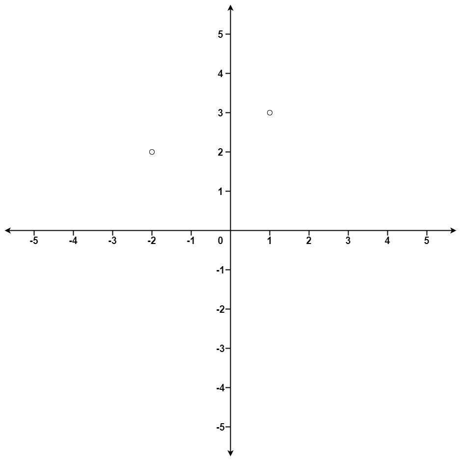

# 973. 最接近原点的 K 个点

| 题目信息 | 内容 |
|---|---|
| 难度 | 中等 |
| 核心模式 | 按到原点的距离平方排序，取前 k 个（或大顶堆维护 k 小） |
| 时间复杂度 | O(n log n) |
| 空间复杂度 | O(log n) |

## 题目与约束

给定一个数组 `points` ，其中 `points[i] = [xi, yi]` 表示 X-Y 平面上的一个点，并且是一个整数 `k` ，返回离原点 `(0,0)` 最近的 `k` 个点。

这里，平面上两点之间的距离是 欧几里德距离（ `√(x1 - x2)2 + (y1 - y2)2` ）。

你可以按 任何顺序 返回答案。除了点坐标的顺序之外，答案 确保 是 唯一 的。

 

示例 1：



输入：points = [[1,3],[-2,2]], k = 1  
输出：[[-2,2]]  
解释：  
(1, 3) 和原点之间的距离为 sqrt(10)，  
(-2, 2) 和原点之间的距离为 sqrt(8)，  
由于 sqrt(8) 示例 2：

输入：points = [[3,3],[5,-1],[-2,4]], k = 2  
输出：[[3,3],[-2,4]]  
（答案 [[-2,4],[3,3]] 也会被接受。）

 

提示：

- `1 <= k <= points.length <= 104`

- `-104 < xi, yi < 104`

[🔗 前往力扣原题验证 →](https://leetcode.cn/problems/k-closest-points-to-origin/)

## 核心不变量

> 点到原点距离的比较与距离平方的比较等价（距离平方是距离的单调递增函数），因此只需比较 `x² + y²`，无需开方。

## 完整推导

### 思路推导

1. **去掉开方**：距离是 `√(x² + y²)`，对所有点都开平方不改变相对大小，所以直接比较 `x² + y²` 即可，还能避免浮点误差。

2. **直接排序**：计算每个点的距离平方作为关键字，对整个数组升序排序，取前 `k` 个即为答案。这是最直观、最不容易写错的写法。

3. **小例子（示例 1）**：`(1,3)` → `1+9=10`，`(-2,2)` → `4+4=8`。排序后 `(-2,2)` 在前，取 `k=1` 得 `[[-2,2]]`。

4. **更优思路（可选）**：维护一个大小为 `k` 的**大顶堆**（堆顶是当前 k 个里最远的），遍历时若新点更近就替换堆顶。时间降到 `O(n log k)`，且无需整体排序。

### Java 实现（kClosest）

```java
import java.util.Arrays;

class Solution {
    public int[][] kClosest(int[][] points, int k) {
        // 按到原点的距离平方升序排序；用 long 防溢出
        Arrays.sort(points, (a, b) -> Long.compare(
                (long) a[0] * a[0] + (long) a[1] * a[1],
                (long) b[0] * b[0] + (long) b[1] * b[1]
        ));
        // 取前 k 个即为最近的 k 个点
        return Arrays.copyOfRange(points, 0, k);
    }
}
```

### 复杂度

- 时间：O(n log n)，瓶颈在排序；若改用大小为 `k` 的大顶堆则为 O(n log k)。
- 空间：O(log n)，排序递归栈开销；堆做法额外占 O(k)。

### 易错点与扩展（面试高频考点）

1. **溢出**：`x² + y²` 在坐标较大时应使用 `long` 计算，避免 `int` 相乘溢出。
2. **不必开方**：`Math.sqrt` 既慢又引入浮点误差，比较平方即可。
3. **返回顺序**：题目允许任意顺序，不要额外排序结果浪费时间。
4. **堆方向**：若用堆维护"最近的 k 个"，要用**大顶堆**（堆顶是候选里最远的），才方便淘汰最远者；用小顶堆会搞反。
5. **进阶**：快速选择（Quickselect）可在平均 O(n) 时间找到第 k 近，是本题更快的解法，但实现要注意随机化避免最坏 O(n²)。

## 力扣原题

[973. 最接近原点的 K 个点](https://leetcode.cn/problems/k-closest-points-to-origin/)

### C++ 实现

```cpp
class Solution {
public:
    vector<vector<int>> kClosest(vector<vector<int>>& points, int k) {
        // 按距离平方升序排序（long long 防溢出）
        sort(points.begin(), points.end(), [](const vector<int>& a, const vector<int>& b) {
            long long da = (long long)a[0] * a[0] + (long long)a[1] * a[1];
            long long db = (long long)b[0] * b[0] + (long long)b[1] * b[1];
            return da < db;
        });
        return vector<vector<int>>(points.begin(), points.begin() + k);
    }
};
```

### Python 实现

```python
from typing import List


class Solution:
    def kClosest(self, points: List[List[int]], k: int) -> List[List[int]]:
        # 按距离平方升序排序，取前 k 个
        points.sort(key=lambda p: p[0] * p[0] + p[1] * p[1])
        return points[:k]
```
