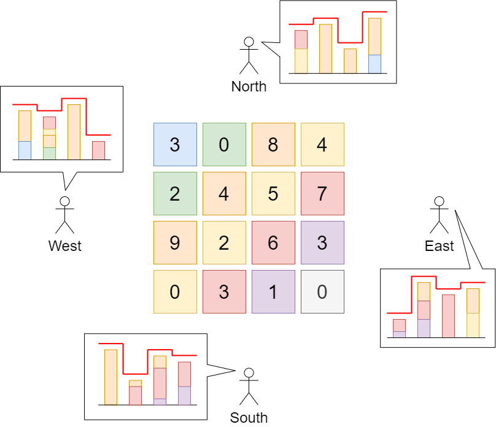

# 807. 保持城市天际线

| 题目信息 | 内容 |
|---|---|
| 难度 | 中等 |
| 核心模式 | 贪心：每格上限 = min(本行最大值, 本列最大值) |
| 时间复杂度 | O(n²) |
| 空间复杂度 | O(n) |

## 题目与约束

给你一座由 `n x n` 个街区组成的城市，每个街区都包含一座立方体建筑。给你一个下标从 0 开始的 `n x n` 整数矩阵 `grid` ，其中 `grid[r][c]` 表示坐落于 `r` 行 `c` 列的建筑物的 高度 。

城市的 天际线 是从远处观察城市时，所有建筑物形成的外部轮廓。从东、南、西、北四个主要方向观测到的 天际线 可能不同。

我们被允许为 任意数量的建筑物 的高度增加 任意增量（不同建筑物的增量可能不同） 。 高度为 `0` 的建筑物的高度也可以增加。然而，增加的建筑物高度 不能影响 从任何主要方向观察城市得到的 天际线 。

在 不改变 从任何主要方向观测到的城市 天际线 的前提下，返回建筑物可以增加的 最大高度增量总和 。

 

示例 1：



输入：grid = [[3,0,8,4],[2,4,5,7],[9,2,6,3],[0,3,1,0]]  
输出：35  
解释：建筑物的高度如上图中心所示。  
用红色绘制从不同方向观看得到的天际线。  
在不影响天际线的情况下，增加建筑物的高度：  
gridNew = [ [8, 4, 8, 7],  
[7, 4, 7, 7],  
[9, 4, 8, 7],  
[3, 3, 3, 3] ]

示例 2：

输入：grid = [[0,0,0],[0,0,0],[0,0,0]]  
输出：0  
解释：增加任何建筑物的高度都会导致天际线的变化。

 

提示：

- `n == grid.length`

- `n == grid[r].length`

- `2 <= n <= 50`

- `0 <= grid[r][c] <= 100`

[🔗 前往力扣原题验证 →](https://leetcode.cn/problems/max-increase-to-keep-city-skyline/)

## 核心不变量

> 从四个方向看天际线，本质只由每行的最大值和每列的最大值决定；因此每个格子能长到的最高高度恰为 `min(该行最大值, 该列最大值)`。

## 完整推导

### 思路推导

1. **天际线由谁决定？** 从东西方向看，每一行看到的高度就是该行最高建筑；从南北方向看，每一列看到的高度就是该列最高建筑。所以只要“每行的最大值”和“每列的最大值”都不变，四个方向的天际线就不会变。

2. **每个格子的上限。** 对格子 `(r, c)`，它不能超过本行最大值 `rowMax[r]`，否则会顶高该行天际线；也不能超过本列最大值 `colMax[c]`，否则会顶高该列天际线。因此它能达到的最高高度是 `min(rowMax[r], colMax[c])`。

3. **放心地把每格都顶到上限。** 把每格都抬到 `min(rowMax[r], colMax[c])` 后，行最大值、列最大值依旧分别是原来的 `rowMax`、`colMax`（因为每行至少有一个格子本来就在该行最大值处、列同理），天际线不变，且这是逐格可达的最大值，总增量自然最大。

4. **小例子。** 第 1 行最大值 8，第 1 列最大值 9，则 `grid[0][0] = 3` 最多升到 `min(8,9) = 8`，增量 5。把所有格子按此法累加，示例 1 的总增量即为 35。

### Java 实现（贪心行列最大值）

```java
class Solution {
    public int maxIncreaseKeepingSkyline(int[][] grid) {
        int n = grid.length;
        int[] rowMax = new int[n];   // 每行最大值
        int[] colMax = new int[n];   // 每列最大值

        // 第一次遍历：统计行、列最大值
        for (int r = 0; r < n; r++) {
            for (int c = 0; c < n; c++) {
                rowMax[r] = Math.max(rowMax[r], grid[r][c]);
                colMax[c] = Math.max(colMax[c], grid[r][c]);
            }
        }

        // 第二次遍历：每格可增高到 min(rowMax[r], colMax[c])
        int total = 0;
        for (int r = 0; r < n; r++) {
            for (int c = 0; c < n; c++) {
                total += Math.min(rowMax[r], colMax[c]) - grid[r][c];
            }
        }
        return total;
    }
}
```

### 复杂度

- 时间：O(n²)。需要两次遍历 `n x n` 矩阵，每次都是常数工作。
- 空间：O(n)。只额外保存长度为 n 的 `rowMax` 与 `colMax` 两个数组。

### 易错点与扩展（面试高频考点）

1. **把行列最大值算成“次大值”或弄混行列。** 天际线看的是每行/每列的最大值，`rowMax` 对应同一行所有列，`colMax` 对应同一列所有行，切勿写反下标。
2. **以为增高会影响其它格子。** 每格独立抬到上限即可，抬升后行、列最大值不会改变，不用担心连锁影响。
3. **返回值可能很大但不会溢出。** `n <= 50`、高度 `<= 100`，增量总和远在 `int` 范围内。
4. **扩展：为什么这一定最优？** 每个格子有硬上限 `min(rowMax, colMax)`，逐格取上限是“上界可达”，任何合法方案都不可能超过它，所以贪心即最优。

## 力扣原题

[807. 保持城市天际线](https://leetcode.cn/problems/max-increase-to-keep-city-skyline/)

### C++ 实现

```cpp
#include <vector>
#include <algorithm>
using namespace std;

class Solution {
public:
    int maxIncreaseKeepingSkyline(vector<vector<int>>& grid) {
        int n = grid.size();
        vector<int> rowMax(n, 0), colMax(n, 0);

        // 统计每行、每列最大值
        for (int r = 0; r < n; r++) {
            for (int c = 0; c < n; c++) {
                rowMax[r] = max(rowMax[r], grid[r][c]);
                colMax[c] = max(colMax[c], grid[r][c]);
            }
        }

        int total = 0;
        for (int r = 0; r < n; r++) {
            for (int c = 0; c < n; c++) {
                total += min(rowMax[r], colMax[c]) - grid[r][c];
            }
        }
        return total;
    }
};
```

### Python 实现

```python
from typing import List

class Solution:
    def maxIncreaseKeepingSkyline(self, grid: List[List[int]]) -> int:
        n = len(grid)
        row_max = [max(row) for row in grid]              # 每行最大值
        col_max = [max(grid[r][c] for r in range(n))      # 每列最大值
                   for c in range(n)]

        total = 0
        for r in range(n):
            for c in range(n):
                total += min(row_max[r], col_max[c]) - grid[r][c]
        return total
```
