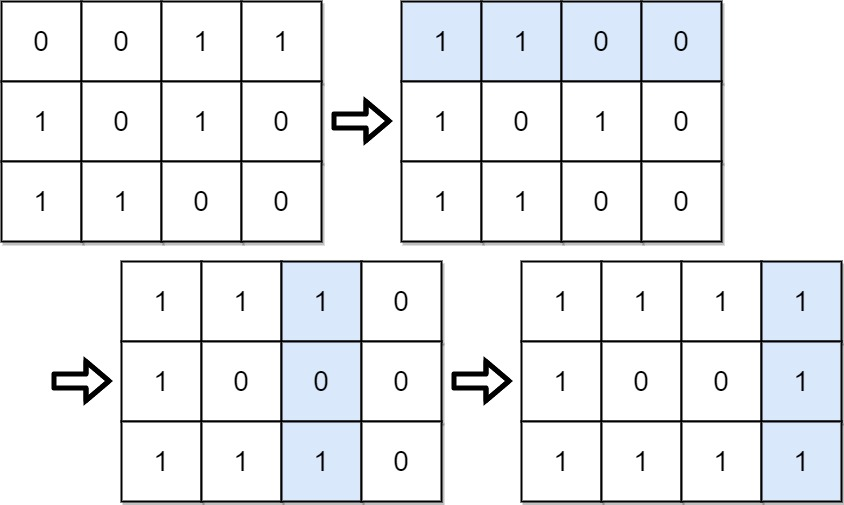

# 861. 翻转矩阵后的得分

| 题目信息 | 内容 |
|---|---|
| 难度 | 中等 |
| 核心模式 | 贪心：先确保每行首位为 1，再按列比较 0/1 数量决定是否翻转 |
| 时间复杂度 | O(m·n) |
| 空间复杂度 | O(1) |

## 题目与约束

给你一个大小为 `m x n` 的二元矩阵 `grid` ，矩阵中每个元素的值为 `0` 或 `1` 。

一次 移动 是指选择任一行或列，并转换该行或列中的每一个值：将所有 `0` 都更改为 `1`，将所有 `1` 都更改为 `0`。

在做出任意次数的移动后，将该矩阵的每一行都按照二进制数来解释，矩阵的 得分 就是这些数字的总和。

在执行任意次 移动 后（含 0 次），返回可能的最高分数。

 

示例 1：



```
<strong>输入：</strong>grid = [[0,0,1,1],[1,0,1,0],[1,1,0,0]]
<strong>输出：</strong>39
<strong>解释：</strong>0b1111 + 0b1001 + 0b1111 = 15 + 9 + 15 = 39
```

示例 2：

```
<strong>输入：</strong>grid = [[0]]
<strong>输出：</strong>1
```

 

提示：

- `m == grid.length`

- `n == grid[i].length`

- `1 <= m, n <= 20`

- `grid[i][j]` 为 `0` 或 `1`

[🔗 前往力扣原题验证 →](https://leetcode.cn/problems/score-after-flipping-matrix/)

## 核心不变量

> 每一行最高的位（第 0 列）权重是 `2^(n-1)`，超过该行其余所有位权重之和，故每行首位必须为 1；在首位已全为 1 的前提下，各列可独立翻转，使该列 1 的个数取 `max(ones, m - ones)` 即最优。

## 完整推导

### 思路推导

1. **最高位最值钱。** 一行的二进制值中，最左边一位权重 `2^(n-1)`，比其余位加起来还大。所以对每一行，只要首位是 0，就应**整行翻转**让它变成 1——这是任何最优方案的第一步，且不影响别的行。

2. **行列操作互不干扰地“定格”。** 行翻转完成后，第一列必然全是 1。此后任何列翻转都不应再动第 0 列（它已经全是 1，翻了反而变差），而第 `j` 列（`j ≥ 1`）的翻转只影响本列，不影响首位优势。

3. **每列独立贪心。** 对第 `j` 列，统计当前 1 的个数 `ones`。若不翻，本列贡献 `ones` 个 1；若翻，贡献 `m - ones` 个 1。取较大者即可，各列互不影响，逐列取最优即全局最优。

4. **直接算分，不必真的翻。** 翻转第 `j` 列等价于“取反后统计”，所以该列最终 1 的个数为 `max(ones, m - ones)`，其对总分的贡献是 `max(ones, m - ones) · 2^(n-1-j)`。把每列贡献相加即答案。

5. **小例子。** `grid = [[0,0,1,1],[1,0,1,0],[1,1,0,0]]`：第 0 行首位为 0，整行翻转后第 0 列全 1。再按列统计 1 的个数并取 `max(ones, m-ones)`，逐列加权求和即得 39。

### Java 实现（逐列贪心计数）

```java
class Solution {
    public int matrixScore(int[][] grid) {
        int m = grid.length, n = grid[0].length;
        int score = 0;

        for (int j = 0; j < n; j++) {
            int ones = 0;
            for (int i = 0; i < m; i++) {
                int bit = grid[i][j];
                // 若该行首位是 0，说明整行被翻转，本格实际值取反
                if (grid[i][0] == 0) {
                    bit ^= 1;
                }
                ones += bit;
            }
            // 本列可翻可不翻，取 1 更多的那种，再乘该列权重 2^(n-1-j)
            score += Math.max(ones, m - ones) * (1 << (n - 1 - j));
        }
        return score;
    }
}
```

### 复杂度

- 时间：O(m·n)。按列遍历整个矩阵一遍，每个格子常数工作。
- 空间：O(1)。只用了若干计数变量，没有额外矩阵。

### 易错点与扩展（面试高频考点）

1. **首位翻转的顺序。** 必须先让每行首位变 1，再考虑列；若先翻列再翻行，会破坏“首位全 1”。行翻转只需在逻辑上记录（用 `grid[i][0]==0` 判断），不必真的修改矩阵。
2. **不要把第 0 列再拿去“取 max”。** 第 0 列已经全 1（`ones == m`），取 `max` 天然不会翻它，但理解上要清楚：首位绝不能为了别的位置牺牲。
3. **权重计算别越界。** `n ≤ 20`，每行值最大约 `2^20`，`m ≤ 20`，总分上限约 `2×10^7`，`int` 足够；用 `1 << (n-1-j)` 时注意 `n-1-j` 非负。
4. **扩展：为什么“按列取多数”一定最优？** 各列贡献可加且相互独立，列内 1 越多贡献越大，翻或不翻只能二选一，取较多者即为该列上界，所有列同时取上界即全局最优。
5. **泛化。** 若把二进制换成任意进制、或每行权重不同，思路仍是“高位优先 + 列独立贪心”，只是权重需按新规则计算。

## 力扣原题

[861. 翻转矩阵后的得分](https://leetcode.cn/problems/score-after-flipping-matrix/)

### C++ 实现

```cpp
#include <vector>
#include <algorithm>
using namespace std;

class Solution {
public:
    int matrixScore(vector<vector<int>>& grid) {
        int m = grid.size(), n = grid[0].size();
        int score = 0;
        for (int j = 0; j < n; j++) {
            int ones = 0;
            for (int i = 0; i < m; i++) {
                int bit = grid[i][j];
                if (grid[i][0] == 0) bit ^= 1; // 该行首位为 0，整行翻转后取反
                ones += bit;
            }
            score += max(ones, m - ones) * (1 << (n - 1 - j));
        }
        return score;
    }
};
```

### Python 实现

```python
from typing import List

class Solution:
    def matrixScore(self, grid: List[List[int]]) -> int:
        m, n = len(grid), len(grid[0])
        score = 0
        for j in range(n):
            ones = 0
            for i in range(m):
                bit = grid[i][j]
                if grid[i][0] == 0:      # 该行首位为 0，整行翻转后取反
                    bit ^= 1
                ones += bit
            score += max(ones, m - ones) * (1 << (n - 1 - j))
        return score
```
