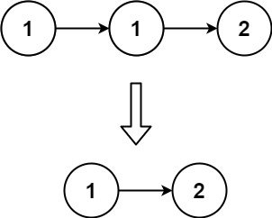
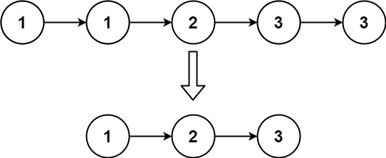

# 83. 删除排序链表中的重复元素

| 题目信息 | 内容 |
|---|---|
| 难度 | 简单 |
| 核心模式 | 单指针扫描原地去重（保留一个） |
| 时间复杂度 | O(n) |
| 空间复杂度 | O(1) |

## 题目与约束

给定一个已排序的链表的头 `head` ， 删除所有重复的元素，使每个元素只出现一次 。返回 已排序的链表 。

 

示例 1：



输入：head = [1,1,2]  
输出：[1,2]

示例 2：



输入：head = [1,1,2,3,3]  
输出：[1,2,3]

 

提示：

- 链表中节点数目在范围 `[0, 300]` 内

- `-100 <= Node.val <= 100`

- 题目数据保证链表已经按升序 排列

[🔗 前往力扣原题验证 →](https://leetcode.cn/problems/remove-duplicates-from-sorted-list/)

## 核心不变量

> 由于链表已排序，重复元素必然相邻；指针 `cur` 之前的链表部分永远已是"去重完毕"的结果，`cur` 只需比较自身与 `next`：相等就删掉 `next`，不等才前进。

## 完整推导

### 思路推导

1. **直觉与痛点（要不要额外空间？）**

   最直觉的做法是遍历一遍、把出现过的值放进哈希表，再重建链表，但这要 `O(n)` 额外空间。题目只要求"每值保留一个"，而链表**已排序**，相同值一定挨在一起，因此完全可以在原链表上就地删除，做到 `O(1)` 空间。

2. **破局思路（一个指针，比较相邻两点）**

   用 `cur` 从头扫描：

   - 若 `cur.val == cur.next.val`：说明 `cur.next` 是多余副本，直接 `cur.next = cur.next.next` 跳过它，`cur` 原地不动（因为新的 `cur.next` 可能还是同值）。
   - 若 `cur.val != cur.next.val`：这一段已经唯一，`cur = cur.next` 向前推进。

   以 `[1,1,2]` 为例：`cur` 在第一个 `1`，发现 `1==1`，删除第二个 `1`；此时 `cur.next` 变成 `2`，不相等，前进到 `2`，结束，得到 `[1,2]`。

3. **关键追问（删除后为什么不移动 `cur`？）**

   因为可能连着三个甚至更多相同值（如 `[1,1,1]`）。删掉一个后新的 `cur.next` 仍是同值，必须在同一位置反复比较，直到后继不同才能前进——所以删除分支里**不推进 `cur`**。

4. **收尾**

   返回 `head`。整条链表是原地修改的，头节点永远不会被删（第一个出现的值总要保留一个）。

### Java 实现（单指针原地去重）

```java
/**
 * Definition for singly-linked list.
 * public class ListNode {
 *     int val;
 *     ListNode next;
 *     ListNode() {}
 *     ListNode(int val) { this.val = val; }
 *     ListNode(int val, ListNode next) { this.val = val; this.next = next; }
 * }
 */
class Solution {
    public ListNode deleteDuplicates(ListNode head) {
        ListNode cur = head;
        // 注意 cur.next 可能为 null，循环条件要同时判空
        while (cur != null && cur.next != null) {
            if (cur.val == cur.next.val) {
                // 删除多余副本，cur 不移动，继续和新后继比较
                cur.next = cur.next.next;
            } else {
                // 当前值已唯一，前进
                cur = cur.next;
            }
        }
        return head;
    }
}
```

### 复杂度

- 时间：`O(n)`。`cur` 沿链表最多前进 `n` 步，每次删除只是改一次指针，整体线性。
- 空间：`O(1)`。只用一个 `cur` 指针原地修改，不申请额外容器。

### 易错点与扩展（面试高频考点）

1. **删除后错误地推进 `cur`**：连续多个相同值时会漏删，删除分支必须保持 `cur` 不动。
2. **循环条件只写 `cur != null`**：访问 `cur.next` 会空指针，必须写成 `cur != null && cur.next != null`。
3. **空链表/单节点**：`head == null` 或只有一个节点时循环不进入，直接返回 `head`，无需特判。
4. **与第 82 题混淆**：本题"重复值保留一个"，单指针即可；第 82 题"重复值一个都不留"，必须用哑结点 + 前驱整段删除。这是最常见的连环追问。
5. **扩展**：若要求"每个值最多保留两个"，可改用快慢指针，判据变为 `cur.val != slow.val`（参考第 80 题思路），本质仍是利用"有序即相邻"的性质。

## 力扣原题

[83. 删除排序链表中的重复元素](https://leetcode.cn/problems/remove-duplicates-from-sorted-list/)

### C++ 实现

```cpp
/**
 * Definition for singly-linked list.
 * struct ListNode {
 *     int val;
 *     ListNode *next;
 *     ListNode() : val(0), next(nullptr) {}
 *     ListNode(int x) : val(x), next(nullptr) {}
 *     ListNode(int x, ListNode *next) : val(x), next(next) {}
 * };
 */
class Solution {
public:
    ListNode* deleteDuplicates(ListNode* head) {
        ListNode* cur = head;
        while (cur != nullptr && cur->next != nullptr) {
            if (cur->val == cur->next->val) {
                // 删除多余副本，cur 不移动
                cur->next = cur->next->next;
            } else {
                cur = cur->next;
            }
        }
        return head;
    }
};
```

### Python 实现

```python
# Definition for singly-linked list.
# class ListNode:
#     def __init__(self, val=0, next=None):
#         self.val = val
#         self.next = next
class Solution:
    def deleteDuplicates(self, head: ListNode | None) -> ListNode | None:
        cur = head
        while cur and cur.next:
            if cur.val == cur.next.val:
                # 删除多余副本，cur 不移动
                cur.next = cur.next.next
            else:
                cur = cur.next
        return head
```
