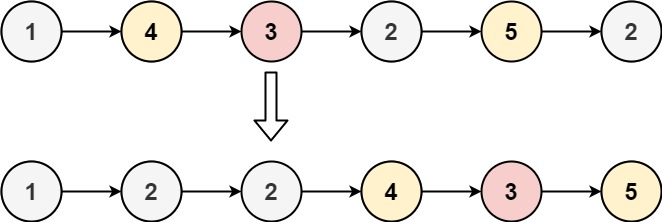

# 86. 分隔链表

| 题目信息 | 内容 |
|---|---|
| 难度 | 中等 |
| 核心模式 | 双哑结点拆分两条子链表再拼接 |
| 时间复杂度 | O(n) |
| 空间复杂度 | O(1) |

## 题目与约束

给你一个链表的头节点 `head` 和一个特定值 `x` ，请你对链表进行分隔，使得所有 小于 `x` 的节点都出现在 大于或等于 `x` 的节点之前。

你应当 保留 两个分区中每个节点的初始相对位置。

 

示例 1：



```
<strong>输入：</strong>head = [1,4,3,2,5,2], x = 3
<strong>输出</strong>：[1,2,2,4,3,5]
```

示例 2：

```
<strong>输入：</strong>head = [2,1], x = 2
<strong>输出</strong>：[1,2]
```

 

提示：

- 链表中节点的数目在范围 `[0, 200]` 内

- `-100 <= Node.val <= 100`

- `-200 <= x <= 200`

[🔗 前往力扣原题验证 →](https://leetcode.cn/problems/partition-list/)

## 核心不变量

> 用两条子链表分别收集"小于 `x`"与"大于等于 `x`"的节点，各自在尾部追加就能天然保持相对顺序；最后把 `small` 尾部接到 `large` 头部即可。

## 完整推导

### 思路推导

1. **直觉与痛点（原地交换指针可行吗？）**

   若试图在原链表上"就地交换"，节点分散且相对顺序要保持，指针操作极易乱套，还容易成环。题目允许 `O(n)` 时间、`O(1)` 额外空间，最省心的是"**拆成两条链再拼接**"。

2. **破局思路（两个哑结点，尾部追加）**

   建两个哑结点 `smallDummy`、`largeDummy`，各带一个尾指针 `small`、`large`：

   - 若 `cur.val < x`：把 `cur` 接到 `small` 后面，`small` 后移；
   - 否则：把 `cur` 接到 `large` 后面，`large` 后移。

   因为总是往各自尾部追加，两类节点内部的**相对顺序被自然保留**。

   以 `[1,4,3,2,5,2], x = 3` 为例：`small` 依次收 `1,2,2`，`large` 依次收 `4,3,5`；拼接后得到 `1→2→2→4→3→5`。

3. **关键追问（拼接时为什么要先 `large.next = null`？）**

   `large` 的最后一个节点原本可能还指向原链表中的某个节点，若直接拼接可能形成环或引入多余节点。把 `large.next` 置空，保证大链表干净收尾，再 `small.next = largeDummy.next` 完成拼接。

4. **收尾**

   返回 `smallDummy.next`。若没有小于 `x` 的节点，`small` 链为空，`smallDummy.next` 恰好指向 `large` 链的头，仍然正确；若没有大于等于 `x` 的节点，`largeDummy.next` 为 `null`，拼接后 `small` 链尾部自然指向 `null`。

### Java 实现（双哑结点拆分拼接）

```java
/**
 * Definition for singly-linked list.
 * public class ListNode {
 *     int val;
 *     ListNode next;
 *     ListNode() {}
 *     ListNode(int val) { this.val = val; }
 *     ListNode(int val, ListNode next) { this.val = val; this.next = next; }
 * }
 */
class Solution {
    public ListNode partition(ListNode head, int x) {
        ListNode smallDummy = new ListNode(0); // 小于 x 的链表头
        ListNode largeDummy = new ListNode(0); // 大于等于 x 的链表头
        ListNode small = smallDummy;
        ListNode large = largeDummy;

        ListNode cur = head;
        while (cur != null) {
            if (cur.val < x) {
                small.next = cur;
                small = small.next;
            } else {
                large.next = cur;
                large = large.next;
            }
            cur = cur.next;
        }

        large.next = null;          // 断开大链表尾部，避免成环
        small.next = largeDummy.next; // 小链表尾接大链表头
        return smallDummy.next;
    }
}
```

### 复杂度

- 时间：`O(n)`。只需一次遍历，每个节点做常数次指针操作。
- 空间：`O(1)`。只用两个哑结点和几个指针，节点原对象被复用，没有新建节点（哑结点为常量级）。

### 易错点与扩展（面试高频考点）

1. **忘记 `large.next = null`**：大链表尾部可能残留旧指向，拼接后可能成环或带出多余节点，是最常见的错误。
2. **用新建节点复制值而非复用原节点**：题目要求保持原有节点相对顺序，复用节点更省内存，也避免破坏原结构理解；本解法直接搬节点。
3. **边界：空链表 / 全部小于 x / 全部大于等于 x**：这几种情况下两条子链之一为空，靠哑结点能自动处理，无需特判。
4. **`< x` 与 `>= x` 的分界**：等于 `x` 的节点要归到**大**链表一侧，判断条件必须用严格 `< x`。
5. **扩展对比**：这是"链表分区"模板，类似思想可用于按奇偶、按正负拆分链表；核心都是"多个哑结点 + 尾指针追加 + 最后拼接"。

## 力扣原题

[86. 分隔链表](https://leetcode.cn/problems/partition-list/)

### C++ 实现

```cpp
/**
 * Definition for singly-linked list.
 * struct ListNode {
 *     int val;
 *     ListNode *next;
 *     ListNode() : val(0), next(nullptr) {}
 *     ListNode(int x) : val(x), next(nullptr) {}
 *     ListNode(int x, ListNode *next) : val(x), next(next) {}
 * };
 */
class Solution {
public:
    ListNode* partition(ListNode* head, int x) {
        ListNode smallDummy(0), largeDummy(0);
        ListNode* small = &smallDummy;
        ListNode* large = &largeDummy;

        ListNode* cur = head;
        while (cur != nullptr) {
            if (cur->val < x) {
                small->next = cur;
                small = small->next;
            } else {
                large->next = cur;
                large = large->next;
            }
            cur = cur->next;
        }

        large->next = nullptr;       // 断开大链表尾部
        small->next = largeDummy.next; // 拼接
        return smallDummy.next;
    }
};
```

### Python 实现

```python
# Definition for singly-linked list.
# class ListNode:
#     def __init__(self, val=0, next=None):
#         self.val = val
#         self.next = next
class Solution:
    def partition(self, head: ListNode | None, x: int) -> ListNode | None:
        small_dummy = ListNode(0)  # 小于 x 的链表头
        large_dummy = ListNode(0)  # 大于等于 x 的链表头
        small, large = small_dummy, large_dummy

        cur = head
        while cur:
            if cur.val < x:
                small.next = cur
                small = small.next
            else:
                large.next = cur
                large = large.next
            cur = cur.next

        large.next = None            # 断开大链表尾部，避免成环
        small.next = large_dummy.next  # 拼接
        return small_dummy.next
```
