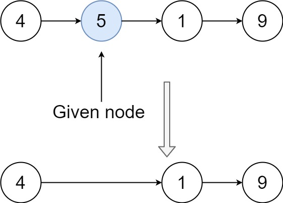
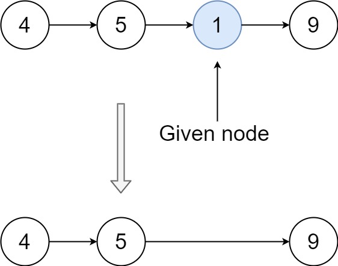

# 237. 删除链表中的节点

| 题目信息 | 内容 |
|---|---|
| 难度 | 中等 |
| 核心模式 | 复制后继节点的值并跳过其后继（原地删除） |
| 时间复杂度 | O(1) |
| 空间复杂度 | O(1) |

## 题目与约束

有一个单链表的 `head`，我们想删除它其中的一个节点 `node`。

给你一个需要删除的节点 `node` 。你将 无法访问 第一个节点  `head`。

链表的所有值都是 唯一的，并且保证给定的节点 `node` 不是链表中的最后一个节点。

删除给定的节点。注意，删除节点并不是指从内存中删除它。这里的意思是：

- 给定节点的值不应该存在于链表中。

- 链表中的节点数应该减少 1。

- `node` 前面的所有值顺序相同。

- `node` 后面的所有值顺序相同。

自定义测试：

- 对于输入，你应该提供整个链表 `head` 和要给出的节点 `node`。`node` 不应该是链表的最后一个节点，而应该是链表中的一个实际节点。

- 我们将构建链表，并将节点传递给你的函数。

- 输出将是调用你函数后的整个链表。

 

示例 1：



输入：head = [4,5,1,9], node = 5  
输出：[4,1,9]  
解释：指定链表中值为 5 的第二个节点，那么在调用了你的函数之后，该链表应变为 4 -> 1 -> 9

示例 2：



输入：head = [4,5,1,9], node = 1  
输出：[4,5,9]  
解释：指定链表中值为 1 的第三个节点，那么在调用了你的函数之后，该链表应变为 4 -> 5 -> 9

 

提示：

- 链表中节点的数目范围是 `[2, 1000]`

- `-1000 <= Node.val <= 1000`

- 链表中每个节点的值都是 唯一 的

- 需要删除的节点 `node` 是 链表中的节点 ，且 不是末尾节点

[🔗 前往力扣原题验证 →](https://leetcode.cn/problems/delete-node-in-a-linked-list/)

## 核心不变量

> 既然拿不到前驱，就让后继节点"顶替"自己：把 `node.next` 的值复制到 `node`，再跳过 `node.next`，等价于删除了 `node`。

## 完整推导

### 思路推导

1. **常规删除的痛点**：删除单链表某个节点，通常需要它的前驱 `prev`，执行 `prev.next = prev.next.next`。但本题只给你 `node` 本身，无法访问 `head`，也就永远找不到前驱，常规套路直接失效。

2. **偷梁换柱**：既然删不掉"自己"，那就让下一个节点替自己"消失"。把 `node.next.val` 复制到 `node.val`，此刻 `node` 在数值上就变成了原来的下一个节点。

3. **跳过后继**：再执行 `node.next = node.next.next`，把真正的后继节点从链表中摘掉。于是链表长度减 1，原本要删除的值也不复存在，且前后顺序保持不变。

4. **边界安全**：题目保证 `node` 不是末尾节点，所以 `node.next` 一定存在，两次访问都不会空指针。

### Java 实现（deleteNode）

```java
/**
 * Definition for singly-linked list.
 * public class ListNode {
 *     int val;
 *     ListNode next;
 *     ListNode(int x) { val = x; }
 * }
 */
class Solution {
    public void deleteNode(ListNode node) {
        // 1. 把后继节点的值复制到当前节点，让当前节点在“值”上变成后继
        node.val = node.next.val;
        // 2. 跳过真正的后继节点，等价于删除了当前节点
        node.next = node.next.next;
    }
}
```

### 复杂度

- 时间：O(1)，只做了两次指针/赋值操作，与链表长度无关。
- 空间：O(1)，没有使用任何额外空间。

### 易错点与扩展（面试高频考点）

1. **不要试图遍历找前驱**：本题根本拿不到 `head`，任何"从头找 prev"的写法都不可行，必须想到值覆盖。
2. **`node.next` 一定非空**：题设保证 `node` 不是末尾节点；若换到"可能删除尾节点"的变体，此方法会空指针，需要额外信息。
3. **不要真的去释放内存**：`node.next = node.next.next` 只是改变指向，题目只要求逻辑删除，不要求 `delete` 原后继对象。
4. **值唯一是重要前提**：正因为所有值唯一，"覆盖值"才不会误删其它同值节点。
5. **面试追问**：如果要删除的正是尾节点又无法访问 `head`，怎么办？答案是无法在 O(1) 内完成，需要额外信息（如双向链表、或允许遍历拿到前驱）。

## 力扣原题

[237. 删除链表中的节点](https://leetcode.cn/problems/delete-node-in-a-linked-list/)

### C++ 实现

```cpp
/**
 * Definition for singly-linked list.
 * struct ListNode {
 *     int val;
 *     ListNode *next;
 *     ListNode(int x) : val(x), next(nullptr) {}
 * };
 */
class Solution {
public:
    void deleteNode(ListNode* node) {
        node->val = node->next->val;    // 后继值覆盖当前节点
        node->next = node->next->next;  // 跳过后继节点，等价删除当前节点
    }
};
```

### Python 实现

```python
# Definition for singly-linked list.
# class ListNode:
#     def __init__(self, x):
#         self.val = x
#         self.next = None

class Solution:
    def deleteNode(self, node):
        """
        :type node: ListNode
        :rtype: void Do not return anything, modify node in-place instead.
        """
        node.val = node.next.val      # 后继值覆盖当前节点
        node.next = node.next.next    # 跳过后继节点，等价删除当前节点
```
