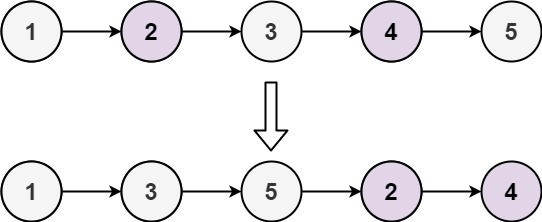
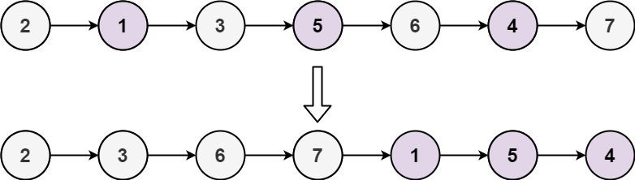

# 328. 奇偶链表

| 题目信息 | 内容 |
|---|---|
| 难度 | 中等 |
| 核心模式 | 双指针拆分奇偶两条链表再拼接 |
| 时间复杂度 | O(n) |
| 空间复杂度 | O(1) |

## 题目与约束

给定单链表的头节点 `head` ，将所有索引为奇数的节点和索引为偶数的节点分别分组，保持它们原有的相对顺序，然后把偶数索引节点分组连接到奇数索引节点分组之后，返回重新排序的链表。

第一个节点的索引被认为是 奇数 ， 第二个节点的索引为 偶数 ，以此类推。

请注意，偶数组和奇数组内部的相对顺序应该与输入时保持一致。

你必须在 `O(1)` 的额外空间复杂度和 `O(n)` 的时间复杂度下解决这个问题。

 

示例 1:



输入: head = [1,2,3,4,5]  
输出: [1,3,5,2,4]

示例 2:



输入: head = [2,1,3,5,6,4,7]  
输出: [2,3,6,7,1,5,4]

 

提示:

- `n == ` 链表中的节点数

- `0 <= n <= 104`

- `-106 <= Node.val <= 106`

[🔗 前往力扣原题验证 →](https://leetcode.cn/problems/odd-even-linked-list/)

## 核心不变量

> 用两个指针分别串起"奇数位链表"和"偶数位链表"，始终让 `odd` 指向奇数链表尾、`even` 指向偶数链表尾；遍历结束时把奇数链表尾接到偶数链表头，两条链的内部顺序天然保持。

## 完整推导

### 思路推导

1. **直觉（就地分流，不建新节点）**

   朴素做法是复制一份链表按奇偶分组，但那要 `O(n)` 额外空间，题目禁止。注意到节点的相对顺序不变，只是"路由"到两条链上，完全可以就地改 `next` 指针把原链拆成两条，再用 `O(1)` 指针完成。

2. **双指针并行前进**

   设 `odd = head`（第 1 个节点），`even = head.next`（第 2 个节点），并用 `evenHead` 记住偶数链头。每一步：让奇数节点跨过偶数节点指向下一个奇数节点（`odd.next = even.next`），推进 `odd`；再让偶数节点跨过新的奇数节点指向下一个偶数节点（`even.next = odd.next`），推进 `even`。如此两条链同步生长。

3. **为什么循环条件是 `even != null && even.next != null`**

   偶数节点总是"靠后"的那条链的探路者。只要 `even` 存在且它还有下一个节点，就说明后面还有奇数节点可接。一旦 `even` 或 `even.next` 为空，奇数链已到尾部，可以收尾。

4. **收尾拼接**

   循环结束后，`odd` 指向奇数链最后一个节点，把它接到 `evenHead`，整条链就变成"全部奇数位 + 全部偶数位"，返回 `head` 即可。

   以 `[1,2,3,4,5]` 为例：奇链 `1→3→5`，偶链 `2→4`，拼接得 `1→3→5→2→4`。

### Java 实现（双指针就地拆分）

```java
/**
 * Definition for singly-linked list.
 * public class ListNode {
 *     int val;
 *     ListNode next;
 *     ListNode() {}
 *     ListNode(int val) { this.val = val; }
 *     ListNode(int val, ListNode next) { this.val = val; this.next = next; }
 * }
 */
class Solution {
    public ListNode oddEvenList(ListNode head) {
        // 空链表或只有一个节点，无需调整
        if (head == null || head.next == null) {
            return head;
        }

        ListNode odd = head;          // 奇数位链表当前尾（初始为第 1 个节点）
        ListNode even = head.next;    // 偶数位链表当前尾（初始为第 2 个节点）
        ListNode evenHead = even;     // 记住偶数链表头，最后要接到奇数链表尾

        // 只要偶数节点后面还有节点，就继续交错推进
        while (even != null && even.next != null) {
            odd.next = even.next;     // 奇数位 → 下一个奇数位
            odd = odd.next;           // 推进奇数位指针
            even.next = odd.next;     // 偶数位 → 下一个偶数位
            even = even.next;         // 推进偶数位指针
        }

        odd.next = evenHead;          // 奇数链表尾 接到 偶数链表头
        return head;
    }
}
```

### 复杂度

- 时间：`O(n)`。每个节点被访问常数次，指针沿链表走一遍。
- 空间：`O(1)`。只用了 `odd`、`even`、`evenHead` 三个指针，没有新建节点。

### 易错点与扩展（面试高频考点）

1. **忘记保存 `evenHead`**：偶数链头一旦被后续指针改动就找不回来了，必须在最开始就存下来，最后才能拼接。
2. **循环条件写成 `even != null`**：只判 `even` 会在 `even.next == null` 时访问空指针（`even.next.next` 形式），必须同时判 `even.next != null`。
3. **空链表/单节点边界**：`head == null` 与 `head.next == null` 要提前返回，否则 `head.next` 取值就会出错。
4. **不要新建节点**：题目要求 `O(1)` 额外空间，凡是用数组/新链表收集再重建的做法都违反要求。
5. **扩展**：同类"按某种规则重排链表"的题还有 86 题"分隔链表"（按值分两段）、143 题"重排链表"（首尾交替），套路都是"拆成两条链再拼"，可一并掌握。

## 力扣原题

[328. 奇偶链表](https://leetcode.cn/problems/odd-even-linked-list/)

### C++ 实现

```cpp
/**
 * Definition for singly-linked list.
 * struct ListNode {
 *     int val;
 *     ListNode *next;
 *     ListNode() : val(0), next(nullptr) {}
 *     ListNode(int x) : val(x), next(nullptr) {}
 *     ListNode(int x, ListNode *next) : val(x), next(next) {}
 * };
 */
class Solution {
public:
    ListNode* oddEvenList(ListNode* head) {
        if (head == nullptr || head->next == nullptr) {
            return head;
        }
        ListNode* odd = head;             // 奇数位链表尾
        ListNode* even = head->next;      // 偶数位链表尾
        ListNode* evenHead = even;        // 偶数位链表头
        while (even != nullptr && even->next != nullptr) {
            odd->next = even->next;       // 奇数位接下一个奇数位
            odd = odd->next;
            even->next = odd->next;       // 偶数位接下一个偶数位
            even = even->next;
        }
        odd->next = evenHead;             // 奇数链表尾接到偶数链表头
        return head;
    }
};
```

### Python 实现

```python
# Definition for singly-linked list.
# class ListNode:
#     def __init__(self, val=0, next=None):
#         self.val = val
#         self.next = next
class Solution:
    def oddEvenList(self, head: "ListNode | None") -> "ListNode | None":
        # 空链表或只有一个节点直接返回
        if not head or not head.next:
            return head

        odd = head          # 奇数位链表尾
        even = head.next    # 偶数位链表尾
        even_head = even    # 偶数位链表头

        while even and even.next:
            odd.next = even.next    # 奇数位接下一个奇数位
            odd = odd.next
            even.next = odd.next    # 偶数位接下一个偶数位
            even = even.next

        odd.next = even_head        # 奇数链表尾接到偶数链表头
        return head
```
