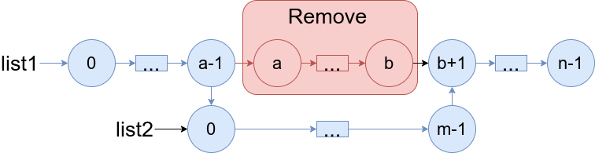
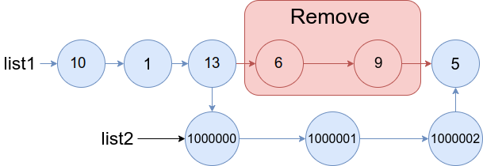
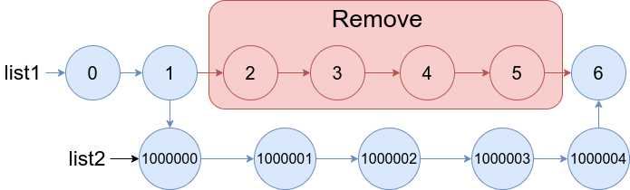

# 1669. 合并两个链表

| 题目信息 | 内容 |
|---|---|
| 难度 | 中等 |
| 核心模式 | 链表定位 + 断链拼接（哑节点思想） |
| 时间复杂度 | O(n + m) |
| 空间复杂度 | O(1) |

## 题目与约束

给你两个链表 `list1` 和 `list2` ，它们包含的元素分别为 `n` 个和 `m` 个。

请你将 `list1` 中下标从 `a` 到 `b` 的全部节点都删除，并将`list2` 接在被删除节点的位置。

下图中蓝色边和节点展示了操作后的结果：



请你返回结果链表的头指针。

 

示例 1：



输入：list1 = [10,1,13,6,9,5], a = 3, b = 4, list2 = [1000000,1000001,1000002]  
输出：[10,1,13,1000000,1000001,1000002,5]  
解释：我们删除 list1 中下标为 3 和 4 的两个节点，并将 list2 接在该位置。上图中蓝色的边和节点为答案链表。

示例 2：



输入：list1 = [0,1,2,3,4,5,6], a = 2, b = 5, list2 = [1000000,1000001,1000002,1000003,1000004]  
输出：[0,1,1000000,1000001,1000002,1000003,1000004,6]  
解释：上图中蓝色的边和节点为答案链表。

 

提示：

- `3 <= list1.length <= 104`

- `1 <= a <= b < list1.length - 1`

- `1 <= list2.length <= 104`

[🔗 前往力扣原题验证 →](https://leetcode.cn/problems/merge-in-between-linked-lists/)

## 核心不变量

> 删除区间 `[a, b]` 后，只需让「下标 `a-1` 的节点」的下一个指向 `list2` 的头，并让 `list2` 的尾节点指向「下标 `b+1` 的节点」；由于 `a >= 1` 且 `b < list1.length - 1`，这两个"接缝节点"一定存在。

## 完整推导

### 思路推导

1. **直觉与痛点（链表不能按下标随机访问）**

   数组可以直接 `arr[a-1]`、`arr[b+1]`，但链表只能从头走。好在 `list1` 长度至多 `10^4`，两次线性遍历即可定位两个接缝节点，代价很低。

2. **定位两端的接缝节点**

   - `prev`：从 `list1` 头出发走 `a - 1` 步，停在下标 `a-1`，它就是删除区间的「前驱」；
   - `after`：从 `list1` 头出发走 `b + 1` 步，停在下标 `b+1`，它就是删除区间的「后继」。

   小例子（示例 1，`a=3, b=4`）：`prev` 是下标 2 的节点（值 `13`），`after` 是下标 5 的节点（值 `5`）。

3. **断链 + 拼接**

   - 先 `prev.next = list2`，把 `list1` 前半段接到 `list2` 头上；
   - 再遍历 `list2` 找到它的尾节点 `tail`，令 `tail.next = after`，把 `list2` 的尾巴接到 `list1` 后半段上。

   注意顺序：必须先让 `prev.next` 指向 `list2`，再处理 `list2` 的尾巴，否则原有的 `prev.next`（被删区间的头）就丢了引用。其实由于我们先保存了 `after`，`prev.next` 无论何时覆盖都不影响 `after`，但保持清晰顺序更好。

4. **边界放心**

   题目保证 `b < list1.length - 1`，所以 `after` 一定不是 `null`，拼接后尾巴总能闭合；`a >= 1` 保证 `prev` 存在，不需要哑节点。

### Java 实现（mergeInBetween）

```java
/**
 * Definition for singly-linked list.
 * public class ListNode {
 *     int val;
 *     ListNode next;
 *     ListNode() {}
 *     ListNode(int val) { this.val = val; }
 *     ListNode(int val, ListNode next) { this.val = val; this.next = next; }
 * }
 */
class Solution {
    public ListNode mergeInBetween(ListNode list1, int a, int b, ListNode list2) {
        // 1. prev 指向下标 a-1 的节点（删除区间的前驱）
        ListNode prev = list1;
        for (int i = 0; i < a - 1; i++) {
            prev = prev.next;
        }

        // 2. after 指向下标 b+1 的节点（删除区间的后继）
        ListNode after = list1;
        for (int i = 0; i < b + 1; i++) {
            after = after.next;
        }

        // 3. 前驱接到 list2 的头
        prev.next = list2;

        // 4. 找到 list2 的尾节点，接到 after
        ListNode tail = list2;
        while (tail.next != null) {
            tail = tail.next;
        }
        tail.next = after;

        return list1;
    }
}
```

### 复杂度

- 时间：O(n + m)，在 `list1` 上定位两节点最多走 `b+1` 步（`O(n)`），再遍历 `list2` 找尾（`O(m)`）。
- 空间：O(1)，只用了 `prev`、`after`、`tail` 等常数个指针。

### 易错点与扩展（面试高频考点）

1. **下标要减一 / 加一**：`prev` 停在下标 `a-1`、`after` 停在下标 `b+1`，写成 `a`、`b` 会错位。
2. **`after` 可能是链表尾部**：虽然本题保证 `b < list1.length - 1`，但通用写法应考虑 `after == null` 的情况（此时 `tail.next = null` 收尾）。
3. **`list2` 的尾节点必须遍历找**：`list2` 是单链表，不能直接拿尾，必须走到 `next == null`。
4. **先断后接的顺序**：先保存 `after` 再改 `prev.next`，避免丢失后半段入口。
5. **返回 `list1` 的头**：删除的是中间段，头节点不会变，直接返回 `list1`。

## 力扣原题

[1669. 合并两个链表](https://leetcode.cn/problems/merge-in-between-linked-lists/)

### C++ 实现

```cpp
/**
 * Definition for singly-linked list.
 * struct ListNode {
 *     int val;
 *     ListNode *next;
 *     ListNode() : val(0), next(nullptr) {}
 *     ListNode(int x) : val(x), next(nullptr) {}
 *     ListNode(int x, ListNode *next) : val(x), next(next) {}
 * };
 */
class Solution {
public:
    ListNode* mergeInBetween(ListNode* list1, int a, int b, ListNode* list2) {
        // prev 指向下标 a-1，after 指向下标 b+1
        ListNode* prev = list1;
        for (int i = 0; i < a - 1; i++) {
            prev = prev->next;
        }
        ListNode* after = list1;
        for (int i = 0; i < b + 1; i++) {
            after = after->next;
        }

        // 前驱接 list2，list2 尾部接 after
        prev->next = list2;
        ListNode* tail = list2;
        while (tail->next != nullptr) {
            tail = tail->next;
        }
        tail->next = after;

        return list1;
    }
};
```

### Python 实现

```python
# Definition for singly-linked list.
# class ListNode:
#     def __init__(self, val=0, next=None):
#         self.val = val
#         self.next = next
class Solution:
    def mergeInBetween(self, list1: "ListNode", a: int, b: int, list2: "ListNode") -> "ListNode":
        # prev 指向下标 a-1
        prev = list1
        for _ in range(a - 1):
            prev = prev.next

        # after 指向下标 b+1
        after = list1
        for _ in range(b + 1):
            after = after.next

        # 前驱接 list2 的头
        prev.next = list2

        # 找 list2 的尾节点，接到 after
        tail = list2
        while tail.next:
            tail = tail.next
        tail.next = after

        return list1
```
