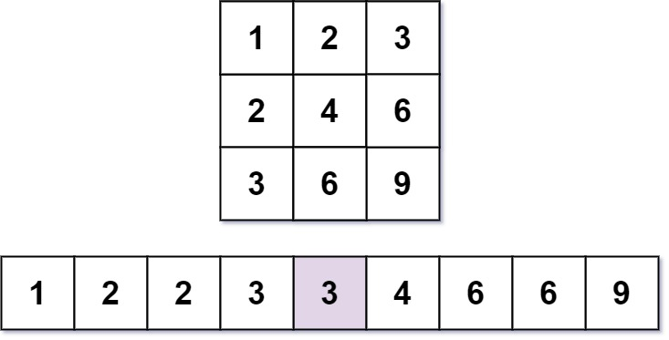
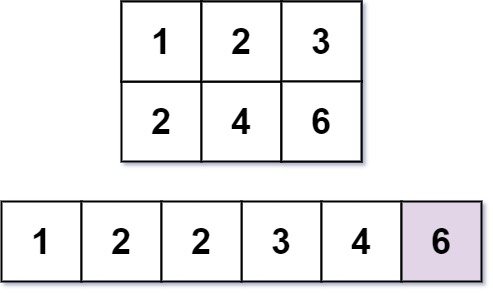

# 668. 乘法表中第k小的数

| 题目信息 | 内容 |
|---|---|
| 难度 | 困难 |
| 核心模式 | 二分答案 + 逐行计数 |
| 时间复杂度 | O(min(m,n) · log(mn)) |
| 空间复杂度 | O(1) |

## 题目与约束

几乎每一个人都用 乘法表。但是你能在乘法表中快速找到第 `k` 小的数字吗？

乘法表是大小为 `m x n` 的一个整数矩阵，其中 `mat[i][j] == i * j`（下标从 1 开始）。

给你三个整数 `m`、`n` 和 `k`，请你在大小为 `m x n` 的乘法表中，找出并返回第 `k` 小的数字。

 

示例 1：



输入：m = 3, n = 3, k = 5  
输出：3  
解释：第 5 小的数字是 3 。

示例 2：



输入：m = 2, n = 3, k = 6  
输出：6  
解释：第 6 小的数字是 6 。

 

提示：

- `1 <= m, n <= 3 * 104`

- `1 <= k <= m * n`

[🔗 前往力扣原题验证 →](https://leetcode.cn/problems/kth-smallest-number-in-multiplication-table/)

## 核心不变量

> 记 `count(x)` 为乘法表中小于等于 `x` 的元素个数，则 `count(x)` 关于 `x` 单调不减；第 `k` 小的数就是使 `count(x) >= k` 成立的最小 `x`。

## 完整推导

### 思路推导

1. **痛点：矩阵太大，不能真的生成再排序**。`m, n` 可达 `3*10^4`，乘法表最多 `9*10^8` 个元素，全部生成排序必然超时超内存。

2. **换个视角看「第 k 小」**。与其去找，不如问：给定一个数 `x`，乘法表里有多少个数 **小于等于** `x`？这个计数函数 `count(x)` 随 `x` 增大而单调不减。于是「第 `k` 小的数」= 使 `count(x) >= k` 成立的 **最小** `x`，可以在值域上二分。

3. **O(m) 计算 count(x)**。第 `i` 行是 `i, 2i, 3i, …, n*i`，其中不超过 `x` 的个数为 `min(n, x // i)`。对 `i = 1..m` 累加，即 `count(x) = Σ min(n, x // i)`。列方向同理，所以可令 `m <= n`，只枚举较小的那一维，复杂度更优。

4. **二分答案**。值域 `[1, m*n]`，每次取 `mid`，若 `count(mid) >= k` 则答案不超过 `mid`（收缩右界），否则答案更大（左界右移）。结束时 `lo` 即答案。

小例子：`m = 3, n = 3`，`x = 3` 时 `count = min(3,3/1)+min(3,3/2)+min(3,3/3) = 3+1+1 = 5`，达到 `k = 5`，而 `x = 2` 时 `count = 2+1+0 = 3 < 5`，故答案是 3 ✓。

### Java 实现（二分答案）

```java
class Solution {
    public int findKthNumber(int m, int n, int k) {
        // 让 m 成为较小维度，减少每次计数的枚举量
        if (m > n) {
            int t = m;
            m = n;
            n = t;
        }
        int lo = 1, hi = m * n;
        while (lo < hi) {
            int mid = lo + (hi - lo) / 2;
            if (count(m, n, mid) >= k) {
                hi = mid;            // 答案在 [lo, mid]
            } else {
                lo = mid + 1;        // 答案在 [mid+1, hi]
            }
        }
        return lo;
    }

    // 统计乘法表中 <= x 的元素个数
    private int count(int m, int n, int x) {
        int cnt = 0;
        for (int i = 1; i <= m; i++) {
            cnt += Math.min(n, x / i);
        }
        return cnt;
    }
}
```

### 复杂度

- 时间：O(min(m,n) · log(mn))。二分约 `log2(mn)` 轮，每轮枚举较小维度 O(min(m,n)) 行。
- 空间：O(1)。只用了常数个整型变量。

### 易错点与扩展（面试高频考点）

1. **边界取 `lo < hi` 而非 `<=`**：这是「找最小可行值」的二分模板，返回 `lo`；若写成 `<=` 需要另设结果变量，容易出错。
2. **`count` 用除法而非乘法**：`x / i` 直接得到第 `i` 行不超过 `x` 的个数，再与 `n` 取 `min`，注意乘法 `i * n` 可能溢出而除法不会。
3. **未交换 m、n**：不交换也能过，但枚举了较大维度；交换后每轮计数更省。
4. **溢出**：`hi = m * n <= 9*10^8`，`count` 累加不超过 `m*n`，都在 32 位有符号整数范围内，但中间量建议留意不要额外相乘。
5. **本质是「第 k 小 + 单调计数」**：同类题如「有序矩阵中第 k 小的元素」「分割数组的最大值」都用二分答案 + 计数/可行性判定，是重要模板。

## 力扣原题

[668. 乘法表中第k小的数](https://leetcode.cn/problems/kth-smallest-number-in-multiplication-table/)

### C++ 实现

```cpp
#include <algorithm>
using namespace std;

class Solution {
public:
    int findKthNumber(int m, int n, int k) {
        if (m > n) swap(m, n); // 枚举较小维度
        int lo = 1, hi = m * n;
        while (lo < hi) {
            int mid = lo + (hi - lo) / 2;
            long long cnt = 0;
            for (int i = 1; i <= m; ++i) {
                cnt += min(n, mid / i);
            }
            if (cnt >= k) hi = mid;
            else lo = mid + 1;
        }
        return lo;
    }
};
```

### Python 实现

```python
class Solution:
    def findKthNumber(self, m: int, n: int, k: int) -> int:
        if m > n:
            m, n = n, m  # 枚举较小维度
        lo, hi = 1, m * n
        while lo < hi:
            mid = (lo + hi) // 2
            cnt = 0
            for i in range(1, m + 1):
                cnt += min(n, mid // i)
            if cnt >= k:
                hi = mid
            else:
                lo = mid + 1
        return lo
```
