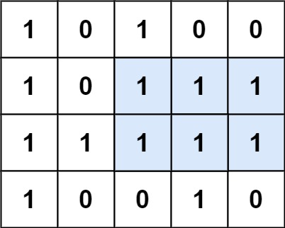

# 85. 最大矩形

| 题目信息 | 内容 |
|---|---|
| 难度 | 困难 |
| 核心模式 | 逐行转柱状图 + 单调栈求最大矩形 |
| 时间复杂度 | O(rows × cols) |
| 空间复杂度 | O(cols) |

## 题目与约束

给定一个仅包含 `0` 和 `1` 、大小为 `rows x cols` 的二维二进制矩阵，找出只包含 `1` 的最大矩形，并返回其面积。

 

示例 1：



输入：matrix = [["1","0","1","0","0"],["1","0","1","1","1"],["1","1","1","1","1"],["1","0","0","1","0"]]  
输出：6  
解释：最大矩形如上图所示。

示例 2：

输入：matrix = [["0"]]  
输出：0

示例 3：

输入：matrix = [["1"]]  
输出：1

 

提示：

- `rows == matrix.length`

- `cols == matrix[0].length`

- `1 <= rows, cols <= 200`

- `matrix[i][j]` 为 `'0'` 或 `'1'`

[🔗 前往力扣原题验证 →](https://leetcode.cn/problems/maximal-rectangle/)

## 核心不变量

> 逐行维护 `heights[j]`：以当前第 `i` 行为底时，第 `j` 列向上连续 `'1'` 的高度；于是"以第 `i` 行为底的最大矩形面积"就等价于"以 `heights` 为柱高的柱状图中的最大矩形面积"。

## 完整推导

### 思路推导

1. **直觉与痛点（二维直接枚举太贵）**

   直接枚举矩形的上下左右边界是 `O(n^2 m^2)` 甚至更高，无法接受。矩形面积 = 底 × 高，关键是能否把二维问题"压"成一维。

2. **破局思路（把每一行当作柱状图的底）**

   固定某一行 `i` 作为矩形底边，定义 `heights[j]` 为第 `j` 列从第 `i` 行向上数连续 `'1'` 的个数：

   - 若 `matrix[i][j] == '1'`，则 `heights[j] += 1`；
   - 若为 `'0'`，则 `heights[j] = 0`（柱子被截断）。

   这样每一行都对应一个"柱状图"，问题就变成「柱状图中最大的矩形」（LeetCode 84），用**单调栈**在 `O(cols)` 内求出。

   以示例 1 为例：逐行累加后，第 3 行的 `heights = [3,1,3,2,2]`，其最大矩形为高度 1 宽 5 或高度 2 宽 3 等，整体最大面积为 6。

3. **关键追问（单调栈怎么求柱状图最大矩形？）**

   维护一个**下标单调递增**（对应高度单调递增）的栈。遍历到柱高 `curHeight` 时，凡是栈顶柱高 `> curHeight` 的柱子，其"向右扩展"到此为止，可以确定以它为高的最大矩形：高度取该柱高，宽度 = `i - 栈中前一个下标 - 1`（栈空则宽度为 `i`）。为了统一收尾，在末尾追加一个高度为 `0` 的哨兵，强制把栈中剩余柱子全部结算。

4. **收尾**

   把每一行算出的最大面积取全局最大即可。空矩阵直接返回 `0`。

### Java 实现（逐行柱状图 + 单调栈）

```java
import java.util.ArrayDeque;
import java.util.Deque;

class Solution {
    public int maximalRectangle(char[][] matrix) {
        if (matrix == null || matrix.length == 0 || matrix[0].length == 0) {
            return 0;
        }
        int rows = matrix.length, cols = matrix[0].length;
        int[] heights = new int[cols];
        int maxArea = 0;

        for (int i = 0; i < rows; i++) {
            // 更新以第 i 行为底的柱状图高度
            for (int j = 0; j < cols; j++) {
                heights[j] = (matrix[i][j] == '1') ? heights[j] + 1 : 0;
            }
            // 把当前行看作柱状图，求其最大矩形
            maxArea = Math.max(maxArea, largestRectangleArea(heights));
        }
        return maxArea;
    }

    // 单调栈求柱状图中最大矩形（对应 LeetCode 84）
    private int largestRectangleArea(int[] heights) {
        int n = heights.length;
        int maxArea = 0;
        Deque<Integer> stack = new ArrayDeque<>(); // 存下标，对应高度单调递增
        for (int i = 0; i <= n; i++) {
            // i == n 时用高度 0 作哨兵，结算栈中残留柱子
            int curHeight = (i == n) ? 0 : heights[i];
            while (!stack.isEmpty() && heights[stack.peek()] > curHeight) {
                int h = heights[stack.pop()];
                // 栈空说明该柱可以延伸到最左，宽度为 i；
                // 否则左边界是栈中新的栈顶下标 + 1
                int width = stack.isEmpty() ? i : i - stack.peek() - 1;
                maxArea = Math.max(maxArea, h * width);
            }
            stack.push(i);
        }
        return maxArea;
    }
}
```

### 复杂度

- 时间：`O(rows × cols)`。每一行更新高度是 `O(cols)`，柱状图单调栈也是 `O(cols)`（每个下标至多入栈、出栈一次），总共 `rows × O(cols)`。
- 空间：`O(cols)`。`heights` 数组和单调栈的长度都不超过列数 `cols`，与行数无关。

### 易错点与扩展（面试高频考点）

1. **高度累加与归零写错**：遇到 `'0'` 必须把 `heights[j]` 置 `0`（柱子断掉），否则会把不连续的 `'1'` 误算成同一块。
2. **单调栈宽度公式写反**：弹栈后宽度应为 `i - stack.peek() - 1`（栈空则为 `i`），不是 `i - 弹栈下标`，差一错误最常见。
3. **忘记末尾哨兵**：不追加高度 `0`，栈里剩下的柱子不会被结算，结果偏小。可在循环用 `i <= n` 且 `i == n` 时取高度 `0` 实现。
4. **字符比较**：`matrix` 元素是 `char` 的 `'1'`/`'0'`，不是整数 `1`/`0`，写成 `matrix[i][j] == 1` 会恒为假。
5. **与 LeetCode 84 的关系**：本题等价于"对每一行调用一次 84 题的柱状图最大矩形"，把 84 题吃透后本题只是加一层外层循环；若用暴力枚举高度会退化到 `O(rows² × cols)`，面试中要主动指出单调栈的优化。

## 力扣原题

[85. 最大矩形](https://leetcode.cn/problems/maximal-rectangle/)

### C++ 实现

```cpp
#include <vector>
#include <stack>
#include <algorithm>
using namespace std;

class Solution {
public:
    int maximalRectangle(vector<vector<char>>& matrix) {
        if (matrix.empty() || matrix[0].empty()) return 0;
        int rows = matrix.size(), cols = matrix[0].size();
        vector<int> heights(cols, 0);
        int maxArea = 0;

        for (int i = 0; i < rows; i++) {
            for (int j = 0; j < cols; j++) {
                heights[j] = (matrix[i][j] == '1') ? heights[j] + 1 : 0;
            }
            maxArea = max(maxArea, largestRectangleArea(heights));
        }
        return maxArea;
    }

private:
    int largestRectangleArea(vector<int>& heights) {
        int n = heights.size();
        int maxArea = 0;
        stack<int> st; // 单调递增栈，存下标
        for (int i = 0; i <= n; i++) {
            int curHeight = (i == n) ? 0 : heights[i]; // 末尾哨兵
            while (!st.empty() && heights[st.top()] > curHeight) {
                int h = heights[st.top()];
                st.pop();
                int width = st.empty() ? i : i - st.top() - 1;
                maxArea = max(maxArea, h * width);
            }
            st.push(i);
        }
        return maxArea;
    }
};
```

### Python 实现

```python
class Solution:
    def maximalRectangle(self, matrix: list[list[str]]) -> int:
        if not matrix or not matrix[0]:
            return 0
        cols = len(matrix[0])
        heights = [0] * cols
        max_area = 0

        for row in matrix:
            for j in range(cols):
                # 遇到 '1' 累加高度，遇到 '0' 归零
                heights[j] = heights[j] + 1 if row[j] == '1' else 0
            max_area = max(max_area, self._largest_rectangle_area(heights))
        return max_area

    def _largest_rectangle_area(self, heights: list[int]) -> int:
        n = len(heights)
        max_area = 0
        stack = []  # 单调递增栈，存下标
        for i in range(n + 1):
            cur_height = 0 if i == n else heights[i]  # 末尾哨兵
            while stack and heights[stack[-1]] > cur_height:
                h = heights[stack.pop()]
                width = i if not stack else i - stack[-1] - 1
                max_area = max(max_area, h * width)
            stack.append(i)
        return max_area
```
