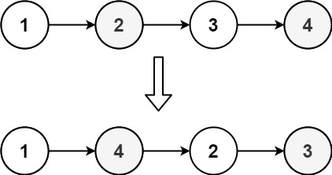
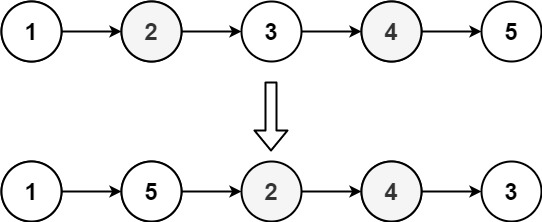

# 143. 重排链表

| 题目信息 | 内容 |
|---|---|
| 难度 | 中等 |
| 核心模式 | 快慢指针找中点 + 反转后半段 + 交叉合并 |
| 时间复杂度 | O(n) |
| 空间复杂度 | O(1) |

## 题目与约束

给定一个单链表 `L` 的头节点 `head` ，单链表 `L` 表示为：

```
L<sub>0</sub> → L<sub>1</sub> → … → L<sub>n - 1</sub> → L<sub>n</sub>
```

请将其重新排列后变为：

```
L<sub>0</sub> → L<sub>n</sub> → L<sub>1</sub> → L<sub>n - 1</sub> → L<sub>2</sub> → L<sub>n - 2</sub> → …
```

不能只是单纯的改变节点内部的值，而是需要实际的进行节点交换。

 

示例 1：



输入：head = [1,2,3,4]  
输出：[1,4,2,3]

示例 2：



输入：head = [1,2,3,4,5]  
输出：[1,5,2,4,3]

 

提示：

- 链表的长度范围为 `[1, 5 * 104]`

- `1 <= node.val <= 1000`

[🔗 前往力扣原题验证 →](https://leetcode.cn/problems/reorder-list/)

## 核心不变量

> 重排后的序列正是"前半段（原顺序）"与"后半段（逆序）"交替拼接；只要把后半段原地反转，再与前段逐节点交叉相连，就得到目标排列。

## 完整推导

### 思路推导

1. **直觉与痛点（不能交换值，只能改指针）**

   题目要求真正的节点交换。若用数组临时存下所有节点再按下标重连，需要 `O(n)` 额外空间；我们希望在 `O(1)` 额外空间内完成。

2. **破局思路（拆成三步独立操作）**

   把"重排"拆成三个各自都很简单的子问题：

   - **找中点**：用快慢指针，`slow` 每次走一步、`fast` 每次走两步。当 `fast` 走到末尾时，`slow` 恰好停在前半段的最后一个节点（偶数取前半段尾，奇数取正中间）。
   - **反转后半段**：从 `slow.next` 开始把后半段链表原地反转，得到一个从原尾节点开头的逆序链表。
   - **交叉合并**：用两个指针分别指向前半段头 `head` 和反转后的后半段头，交替取出各一个节点接在新链上，直到后半段用完为止。

3. **关键追问（为什么合并到后半段耗尽就停？）**

   因为后半段长度 ≤ 前半段长度。以 `[1,2,3,4]` 为例，`slow` 停在 2，后半段是 `[4,3]`（反转后），前半段 `[1,2]`。合并得 `1→4→2→3`，正好是答案。以 `[1,2,3,4,5]` 为例，`slow` 停在 3，后半段 `[5,4]`（反转后），合并得 `1→5→2→4→3`，中间节点 3 自然留在末尾。后半段一旦取完，前半段剩余部分（若有）已经在正确位置，无需再动。

   **指针收尾要断开**：反转前要把 `slow.next` 置空，否则前半段尾部仍指向后半段首，会形成环。

### Java 实现（三步法）

```java
/**
 * Definition for singly-linked list.
 * public class ListNode {
 *     int val;
 *     ListNode next;
 *     ListNode() {}
 *     ListNode(int val) { this.val = val; }
 *     ListNode(int val, ListNode next) { this.val = val; this.next = next; }
 * }
 */
class Solution {
    public void reorderList(ListNode head) {
        if (head == null || head.next == null) {
            return;                       // 0 或 1 个节点无需重排
        }

        // 1. 快慢指针找中点，slow 停在前半段最后一个节点
        ListNode slow = head, fast = head;
        while (fast.next != null && fast.next.next != null) {
            slow = slow.next;
            fast = fast.next.next;
        }

        // 2. 反转后半段（从 slow.next 开始）
        ListNode second = slow.next;
        slow.next = null;                 // 断开前后两段，防止成环
        ListNode prev = null;
        while (second != null) {
            ListNode nxt = second.next;
            second.next = prev;
            prev = second;
            second = nxt;
        }
        ListNode right = prev;            // 反转后的后半段头

        // 3. 交叉合并两段
        ListNode left = head;
        while (right != null) {
            ListNode lNext = left.next;
            ListNode rNext = right.next;
            left.next = right;            // 左 -> 右
            right.next = lNext;           // 右 -> 左的下一个
            left = lNext;
            right = rNext;
        }
    }
}
```

### 复杂度

- 时间：`O(n)`。找中点、反转、合并各遍历一次链表，常数次线性扫描。
- 空间：`O(1)`。只使用了若干指针变量，没有借助额外数据结构。

### 易错点与扩展（面试高频考点）

1. **忘记断开 `slow.next = null`**：不置空会让前半段尾部仍指向后半段，反转与合并后形成环，遍历会死循环。
2. **快慢指针循环条件写错**：用 `while (fast.next != null && fast.next.next != null)` 才能保证 `slow` 停在前半段最后一个节点；直接 `while (fast != null && fast.next != null)` 会多走一步。
3. **合并循环用 `right != null` 而非 `left != null`**：后半段更短（或等长），以后半段为终止条件可避免访问空指针；奇数长度时中间节点自然留在前段末尾。
4. **不要真的交换节点值**：题目明确要求节点交换，改值虽然能过部分用例但不符合要求，面试会被追问。
5. **扩展——其他解法**：可用栈把所有节点压栈再交替弹出（`O(n)` 空间，契合本题 Stack 标签），或递归处理；但"找中点 + 反转 + 合并"是空间最优且最常考的标准解。

## 力扣原题

[143. 重排链表](https://leetcode.cn/problems/reorder-list/)

### C++ 实现

```cpp
/**
 * Definition for singly-linked list.
 * struct ListNode {
 *     int val;
 *     ListNode *next;
 *     ListNode() : val(0), next(nullptr) {}
 *     ListNode(int x) : val(x), next(nullptr) {}
 *     ListNode(int x, ListNode *next) : val(x), next(next) {}
 * };
 */
class Solution {
public:
    void reorderList(ListNode* head) {
        if (!head || !head->next) return;

        // 1. 快慢指针找中点
        ListNode* slow = head;
        ListNode* fast = head;
        while (fast->next && fast->next->next) {
            slow = slow->next;
            fast = fast->next->next;
        }

        // 2. 反转后半段
        ListNode* second = slow->next;
        slow->next = nullptr;
        ListNode* prev = nullptr;
        while (second) {
            ListNode* nxt = second->next;
            second->next = prev;
            prev = second;
            second = nxt;
        }
        ListNode* right = prev;

        // 3. 交叉合并
        ListNode* left = head;
        while (right) {
            ListNode* lNext = left->next;
            ListNode* rNext = right->next;
            left->next = right;
            right->next = lNext;
            left = lNext;
            right = rNext;
        }
    }
};
```

### Python 实现

```python
# Definition for singly-linked list.
# class ListNode:
#     def __init__(self, val=0, next=None):
#         self.val = val
#         self.next = next
class Solution:
    def reorderList(self, head: ListNode) -> None:
        """
        Do not return anything, modify head in-place instead.
        """
        if not head or not head.next:
            return

        # 1. 快慢指针找中点，slow 为前半段最后一个节点
        slow, fast = head, head
        while fast.next and fast.next.next:
            slow = slow.next
            fast = fast.next.next

        # 2. 反转后半段
        second = slow.next
        slow.next = None
        prev = None
        while second:
            nxt = second.next
            second.next = prev
            prev = second
            second = nxt
        right = prev

        # 3. 交叉合并
        left = head
        while right:
            l_next = left.next
            r_next = right.next
            left.next = right
            right.next = l_next
            left = l_next
            right = r_next
```
