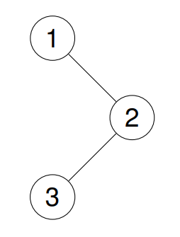
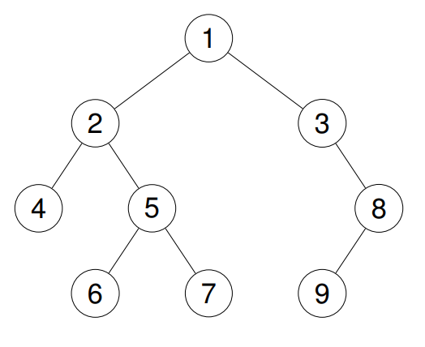

# 144. 二叉树的前序遍历

| 题目信息 | 内容 |
|---|---|
| 难度 | 简单 |
| 核心模式 | 前序 = 根 → 左 → 右，用栈模拟递归 |
| 时间复杂度 | O(n) |
| 空间复杂度 | O(h) |

## 题目与约束

给你二叉树的根节点 `root` ，返回它节点值的 前序 遍历。

 

示例 1：

输入：root = [1,null,2,3]

输出：[1,2,3]

解释：



示例 2：

输入：root = [1,2,3,4,5,null,8,null,null,6,7,9]

输出：[1,2,4,5,6,7,3,8,9]

解释：



示例 3：

输入：root = []

输出：[]

示例 4：

输入：root = [1]

输出：[1]

 

提示：

- 树中节点数目在范围 `[0, 100]` 内

- `-100 <= Node.val <= 100`

 

进阶：递归算法很简单，你可以通过迭代算法完成吗？

[🔗 前往力扣原题验证 →](https://leetcode.cn/problems/binary-tree-preorder-traversal/)

## 核心不变量

> 前序遍历恒为「根 → 左 → 右」；迭代时用栈把根先弹出记录，再依次压入右孩子、左孩子，保证左孩子先于右孩子被处理。

## 完整推导

### 思路推导

1. **递归的定义（天然契合）**

   前序遍历可以一句话定义：访问根，前序遍历左子树，前序遍历右子树。递归写法几乎是把这句话直接翻译成代码，是最直观的出发点。

2. **迭代的痛点（怎么用栈替代递归？）**

   递归的隐含动作是"把当前节点的左子树处理完再回头处理右子树"。要实现同样的顺序，就用一个显式的栈模拟调用栈：弹出栈顶即"访问"它，然后把它的孩子按 **右、左** 的顺序压栈。因为栈是后进先出，先压右再压左，下一轮弹出的就是左孩子，正好符合"根 → 左 → 右"。

3. **小例子（示例 1：`[1,null,2,3]`）**

   - 栈 `[1]` → 弹出 `1`，记录 `1`；左孩子为空、右孩子 `2` 入栈 → 栈 `[2]`
   - 弹出 `2`，记录 `2`；左孩子 `3` 入栈、右孩子为空 → 栈 `[3]`
   - 弹出 `3`，记录 `3` → 结束，结果 `[1,2,3]`

4. **收尾**

   空树直接返回空列表；否则循环到栈空为止，返回记录序列。

### Java 实现（preorderTraversal）

```java
import java.util.ArrayDeque;
import java.util.ArrayList;
import java.util.Deque;
import java.util.List;

/**
 * Definition for a binary tree node.
 * public class TreeNode {
 *     int val;
 *     TreeNode left;
 *     TreeNode right;
 *     TreeNode() {}
 *     TreeNode(int val) { this.val = val; }
 *     TreeNode(int val, TreeNode left, TreeNode right) {
 *         this.val = val;
 *         this.left = left;
 *         this.right = right;
 *     }
 * }
 */
class Solution {
    public List<Integer> preorderTraversal(TreeNode root) {
        List<Integer> res = new ArrayList<>();
        if (root == null) {
            return res;
        }
        Deque<TreeNode> stack = new ArrayDeque<>();
        stack.push(root);
        while (!stack.isEmpty()) {
            TreeNode node = stack.pop();
            res.add(node.val); // 弹出即访问（前序在“进入”时记录）
            // 先压右、再压左，保证左子树先被处理
            if (node.right != null) {
                stack.push(node.right);
            }
            if (node.left != null) {
                stack.push(node.left);
            }
        }
        return res;
    }
}
```

### 复杂度

- 时间：O(n)，每个节点恰好入栈、出栈各一次，访问操作为常数时间。
- 空间：O(h)，h 为树高，栈最多保存一条从根到叶路径上的节点；最坏情况（退化成链）为 O(n)。

### 易错点与扩展（面试高频考点）

1. **压栈顺序写反**：必须先压右孩子、再压左孩子；若先压左后压右，弹出顺序会变成"根 → 右 → 左"，那就成了后序的反向序列。
2. **访问时机**：前序在"弹出节点时"立即记录值，不能像后序那样留到最后反转。
3. **空树判断**：`root == null` 要提前返回空列表，否则 `stack.push(null)` 会在后续 `node.val` 处抛空指针。
4. **递归写法注意参数**：递归实现应把结果列表作为参数在递归中累积（`void dfs(TreeNode node, List<Integer> res)`），避免每层都新建列表。
5. **与中序/后序对照**：前序"进入即记录"，中序"左子树回调后记录"，后序"左右都完成后再记录"；面试常要求三种写法互相推导。

## 力扣原题

[144. 二叉树的前序遍历](https://leetcode.cn/problems/binary-tree-preorder-traversal/)

### C++ 实现

```cpp
#include <vector>
using namespace std;

/**
 * Definition for a binary tree node.
 * struct TreeNode {
 *     int val;
 *     TreeNode *left;
 *     TreeNode *right;
 *     TreeNode() : val(0), left(nullptr), right(nullptr) {}
 *     TreeNode(int x) : val(x), left(nullptr), right(nullptr) {}
 *     TreeNode(int x, TreeNode *left, TreeNode *right) : val(x), left(left), right(right) {}
 * };
 */
class Solution {
public:
    vector<int> preorderTraversal(TreeNode* root) {
        vector<int> res;
        dfs(root, res);
        return res;
    }

private:
    void dfs(TreeNode* node, vector<int>& res) {
        if (node == nullptr) {
            return;
        }
        res.push_back(node->val); // 根
        dfs(node->left, res);     // 左
        dfs(node->right, res);    // 右
    }
};
```

### Python 实现

```python
from typing import Optional, List

# Definition for a binary tree node.
# class TreeNode:
#     def __init__(self, val=0, left=None, right=None):
#         self.val = val
#         self.left = left
#         self.right = right
class Solution:
    def preorderTraversal(self, root: Optional[TreeNode]) -> List[int]:
        res = []

        def dfs(node: Optional[TreeNode]) -> None:
            if not node:
                return
            res.append(node.val)  # 根
            dfs(node.left)        # 左
            dfs(node.right)       # 右

        dfs(root)
        return res
```
