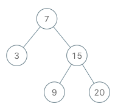

# 173. 二叉搜索树迭代器

| 题目信息 | 内容 |
|---|---|
| 难度 | 中等 |
| 核心模式 | 显式栈模拟中序遍历 |
| 时间复杂度 | O(1)（均摊），单次 next 均摊 O(1) |
| 空间复杂度 | O(h) |

## 题目与约束

实现一个二叉搜索树迭代器类`BSTIterator` ，表示一个按中序遍历二叉搜索树（BST）的迭代器：

- `BSTIterator(TreeNode root)` 初始化 `BSTIterator` 类的一个对象。BST 的根节点 `root` 会作为构造函数的一部分给出。指针应初始化为一个不存在于 BST 中的数字，且该数字小于 BST 中的任何元素。

- `boolean hasNext()` 如果向指针右侧遍历存在数字，则返回 `true` ；否则返回 `false` 。

- `int next()`将指针向右移动，然后返回指针处的数字。

注意，指针初始化为一个不存在于 BST 中的数字，所以对 `next()` 的首次调用将返回 BST 中的最小元素。

你可以假设 `next()` 调用总是有效的，也就是说，当调用 `next()` 时，BST 的中序遍历中至少存在一个下一个数字。

 

示例：



输入  
["BSTIterator", "next", "next", "hasNext", "next", "hasNext", "next", "hasNext", "next", "hasNext"]  
[[[7, 3, 15, null, null, 9, 20]], [], [], [], [], [], [], [], [], []]  
输出  
[null, 3, 7, true, 9, true, 15, true, 20, false]  
解释  
BSTIterator bSTIterator = new BSTIterator([7, 3, 15, null, null, 9, 20]);  
bSTIterator.next();    // 返回 3  
bSTIterator.next();    // 返回 7  
bSTIterator.hasNext(); // 返回 True  
bSTIterator.next();    // 返回 9  
bSTIterator.hasNext(); // 返回 True  
bSTIterator.next();    // 返回 15  
bSTIterator.hasNext(); // 返回 True  
bSTIterator.next();    // 返回 20  
bSTIterator.hasNext(); // 返回 False

 

提示：

- 树中节点的数目在范围 `[1, 105]` 内

- `0 <= Node.val <= 106`

- 最多调用 `105` 次 `hasNext` 和 `next` 操作

 

进阶：

- 你可以设计一个满足下述条件的解决方案吗？`next()` 和 `hasNext()` 操作均摊时间复杂度为 `O(1)` ，并使用 `O(h)` 内存。其中 `h` 是树的高度。

[🔗 前往力扣原题验证 →](https://leetcode.cn/problems/binary-search-tree-iterator/)

## 核心不变量

> 栈中自底向上恰好保存着「从根一路向左到当前节点」那条路径上所有尚未访问的节点，栈顶永远是下一个要访问的最小节点。

## 完整推导

### 思路推导

1. **直觉与痛点（为什么不能直接存数组？）**

   BST 的中序遍历天然是升序，把所有节点中序打成数组再逐个返回，能做对，但要额外 `O(n)` 空间。进阶要求只花 `O(h)`（树高）空间，等价于让我们「按需」产生下一个元素，而不是提前全算出来。

2. **破局思路（用栈模拟递归现场）**

   递归中序遍历的第一步是「一路向左递归到底」，第一个返回的就是最左节点。我们把这个递归的调用栈显式化成数据结构里的栈：初始化时从根出发，把根以及它一路向左的所有节点压栈。此时栈顶就是全树最小值，也是第一个 `next()` 的答案。

3. **关键追问（弹出一个后，怎么接上后面的？）**

   调用 `next()` 时先弹出栈顶并返回它——它就是当前最小。但这个节点可能有右子树，右子树的所有节点都比它大、却比栈中剩下的节点小。于是以它的右孩子为起点，再次「一路向左压栈」，把右子树的最小节点顶到栈顶。这样栈顶始终是「剩余节点中的最小者」。

4. **收尾**

   `hasNext()` 只需判断栈是否为空：非空就说明还有节点没访问。

### Java 实现（BSTIterator：栈模拟中序遍历）

```java
import java.util.ArrayDeque;
import java.util.Deque;

/**
 * Definition for a binary tree node.
 * public class TreeNode {
 *     int val;
 *     TreeNode left;
 *     TreeNode right;
 *     TreeNode() {}
 *     TreeNode(int val) { this.val = val; }
 *     TreeNode(int val, TreeNode left, TreeNode right) {
 *         this.val = val;
 *         this.left = left;
 *         this.right = right;
 *     }
 * }
 */
class BSTIterator {
    // 栈里存的是「尚未访问、且已按中序先后顺序排好」的一条左下路径
    private final Deque<TreeNode> stack = new ArrayDeque<>();

    public BSTIterator(TreeNode root) {
        pushLeftBranch(root);
    }

    // 把 node 及其一路向左的孩子全部压栈
    private void pushLeftBranch(TreeNode node) {
        while (node != null) {
            stack.push(node);
            node = node.left;
        }
    }

    public int next() {
        // 栈顶就是当前剩余节点里的最小值
        TreeNode node = stack.pop();
        // 该节点的右子树里可能存在「比栈中剩余节点更小」的节点，先把它顶上来
        pushLeftBranch(node.right);
        return node.val;
    }

    public boolean hasNext() {
        return !stack.isEmpty();
    }
}
```

### 复杂度

- 时间：`next()` 均摊 `O(1)`。整棵树每个节点恰好被压栈一次、弹栈一次，`n` 次 `next()` 总计 `O(n)`；`hasNext()` 是 `O(1)`。
- 空间：`O(h)`。栈的深度最多等于树高 `h`，最坏（链状树）为 `O(n)`，平衡树为 `O(log n)`，符合进阶要求的 `O(h)`。

### 易错点与扩展（面试高频考点）

1. **`pushLeftBranch` 的循环条件**：必须写 `while (node != null)`，进入循环后再移动 `node = node.left`，否则容易漏掉最左节点或多压一个空指针。
2. **`next()` 的顺序**：一定要「先 `pop`，再对 `node.right` 压栈」，不要先处理右子树；否则会把右子树节点错误地排到当前节点之前。
3. **空树/空指针防御**：虽然题目保证节点数 `>= 1`，但构造函数仍应能安全处理 `root == null`（`pushLeftBranch` 天然兼容）。
4. **不要用一次性中序数组**：那样空间是 `O(n)`，不满足进阶的 `O(h)`；面试官通常就是冲这一点追问。
5. **扩展（Morris 遍历代替栈）**：若连 `O(h)` 栈都不想用，可用 Morris 中序把空间降到 `O(1)`，但会临时修改树结构，且迭代器语义更难保证，实际工程中一般仍用显式栈版本。

## 力扣原题

[173. 二叉搜索树迭代器](https://leetcode.cn/problems/binary-search-tree-iterator/)

### C++ 实现

```cpp
#include <stack>

/**
 * Definition for a binary tree node.
 * struct TreeNode {
 *     int val;
 *     TreeNode *left;
 *     TreeNode *right;
 *     TreeNode() : val(0), left(nullptr), right(nullptr) {}
 *     TreeNode(int x) : val(x), left(nullptr), right(nullptr) {}
 *     TreeNode(int x, TreeNode *left, TreeNode *right) : val(x), left(left), right(right) {}
 * };
 */
class BSTIterator {
private:
    std::stack<TreeNode*> st;

    void pushLeftBranch(TreeNode* node) {
        while (node != nullptr) {
            st.push(node);
            node = node->left;
        }
    }

public:
    BSTIterator(TreeNode* root) {
        pushLeftBranch(root);
    }

    int next() {
        TreeNode* node = st.top();
        st.pop();
        pushLeftBranch(node->right);
        return node->val;
    }

    bool hasNext() {
        return !st.empty();
    }
};
```

### Python 实现

```python
# Definition for a binary tree node.
# class TreeNode:
#     def __init__(self, val=0, left=None, right=None):
#         self.val = val
#         self.left = left
#         self.right = right
class BSTIterator:

    def __init__(self, root: Optional[TreeNode]):
        self.stack = []
        self._push_left_branch(root)

    def _push_left_branch(self, node: Optional[TreeNode]) -> None:
        while node is not None:
            self.stack.append(node)
            node = node.left

    def next(self) -> int:
        node = self.stack.pop()
        self._push_left_branch(node.right)
        return node.val

    def hasNext(self) -> bool:
        return len(self.stack) > 0
```
