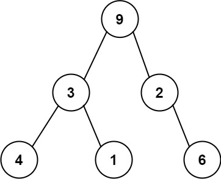

# 331. 验证二叉树的前序序列化

| 题目信息 | 内容 |
|---|---|
| 难度 | 中等 |
| 核心模式 | 槽位（度）计数：非空节点净 +1，空节点 -1 |
| 时间复杂度 | O(n) |
| 空间复杂度 | O(n) |

## 题目与约束

序列化二叉树的一种方法是使用 前序遍历 。当我们遇到一个非空节点时，我们可以记录下这个节点的值。如果它是一个空节点，我们可以使用一个标记值记录，例如 `#`。



例如，上面的二叉树可以被序列化为字符串 `"9,3,4,#,#,1,#,#,2,#,6,#,#"`，其中 `#` 代表一个空节点。

给定一串以逗号分隔的序列，验证它是否是正确的二叉树的前序序列化。编写一个在不重构树的条件下的可行算法。

保证 每个以逗号分隔的字符或为一个整数或为一个表示 `null` 指针的 `'#'` 。

你可以认为输入格式总是有效的

- 例如它永远不会包含两个连续的逗号，比如 `"1,,3"` 。

注意：不允许重建树。

 

示例 1:

输入: preorder = "9,3,4,#,#,1,#,#,2,#,6,#,#"  
输出: true

示例 2:

输入: preorder = "1,#"  
输出: false

示例 3:

输入: preorder = "9,#,#,1"  
输出: false

 

提示:

- `1 <= preorder.length <= 104`

- `preorder` 由以逗号 `“，”` 分隔的 `[0,100]` 范围内的整数和 `“#”` 组成

[🔗 前往力扣原题验证 →](https://leetcode.cn/problems/verify-preorder-serialization-of-a-binary-tree/)

## 核心不变量

> 把序列化看作「填空槽」：初始有 1 个待填槽位；非空节点消耗 1 个槽位又产生 2 个（净 +1），空节点 `#` 只消耗 1 个（净 -1）；合法序列要求遍历过程中槽位一旦归零就不能再有节点，且最终槽位恰好为 0。

## 完整推导

### 思路推导

1. **把问题翻译成「填空槽」**

   一棵二叉树的每个节点都"需要被填进一个槽"。整棵树只有一个根，所以一开始只有 **1 个槽位**等着被填。

2. **两种节点对槽位的不同影响**

   - 填入一个**非空节点**：它占掉这 1 个槽，同时自己又长出左、右两个子节点的槽位，所以槽数变化是 `-1 + 2 = +1`。
   - 填入一个**空节点 `#`**：它占掉这 1 个槽，但没有孩子，槽数变化是 `-1`。

3. **判定规则（两个条件缺一不可）**

   - 遍历过程中，**一旦槽位变为 0，就不能再出现任何 token**（说明根已被填满，多余的节点无处安放）；
   - 遍历结束后，**槽位必须恰好为 0**（所有槽都填满，既不能有剩、也不能欠）。

4. **小例子手推**

   - `"1,#"`：`1` 后槽数 `2`，`#` 后槽数 `1`，结尾非 0 → `false`（左子树空着）。
   - `"9,#,#,1"`：`9`→2，`#`→1，`#`→0，此时槽已空却还剩 `1` → `false`。
   - 示例 1 的 13 个 token 走完，槽数正好回到 0 → `true`。

### Java 实现（isValidSerialization）

```java
class Solution {
    public boolean isValidSerialization(String preorder) {
        String[] tokens = preorder.split(",");
        int slots = 1;                       // 根节点占用的 1 个槽位
        for (String token : tokens) {
            if (slots == 0) {
                return false;                // 槽位已耗尽却还有节点，非法
            }
            if (token.equals("#")) {
                slots -= 1;                  // 空节点消耗 1 个槽位
            } else {
                slots += 1;                  // 非空节点：消耗 1 个、产生 2 个，净 +1
            }
        }
        return slots == 0;                   // 结束时所有槽位必须填满
    }
}
```

### 复杂度

- 时间：O(n)，每个 token 处理一次，`split` 也是线性扫描。
- 空间：O(n)，`split` 得到的 token 数组；若用手写扫描器逐字符读取，可降到 O(1) 额外空间。

### 易错点与扩展（面试高频考点）

1. **中途提前归零必须判非法**：只在最后检查 `slots == 0` 是不够的。像 `"9,#,#,1"` 会在中途把槽用完，必须循环内就 `return false`。
2. **`#` 用 `equals` 而不是 `==`**：Java 里字符串比较必须用 `equals`，`==` 比较的是引用。
3. **另一种等价解法——栈消去**：用栈模拟，遇到数字压栈；遇到 `#` 时若栈顶已是 `#` 则不断弹出两个 `#` 并压入一个 `#`（把 `"#, #"` 折叠成一个空位）。遍历完栈中应恰剩一个 `#`。本质与槽位法相同。
4. **不要真的去建树**：题面明确禁止重建，槽位法/栈法都只用一个计数器或一个栈，天然满足。
5. **边界**：单节点 `"#"` 是合法的（空树），返回 `true`；`"1"` 非法（非空节点还有两个空槽没填）。

## 力扣原题

[331. 验证二叉树的前序序列化](https://leetcode.cn/problems/verify-preorder-serialization-of-a-binary-tree/)

### C++ 实现

```cpp
#include <string>
#include <sstream>

class Solution {
public:
    bool isValidSerialization(std::string preorder) {
        int slots = 1;                 // 根节点占用的 1 个槽位
        std::stringstream ss(preorder);
        std::string token;
        while (std::getline(ss, token, ',')) {
            if (slots == 0) return false;   // 槽已耗尽却还有节点
            if (token == "#") slots -= 1;   // 空节点消耗 1 个
            else slots += 1;                // 非空节点净 +1
        }
        return slots == 0;
    }
};
```

### Python 实现

```python
class Solution:
    def isValidSerialization(self, preorder: str) -> bool:
        slots = 1                       # 根节点占用的 1 个槽位
        for token in preorder.split(','):
            if slots == 0:              # 槽已耗尽却还有节点
                return False
            if token == '#':
                slots -= 1              # 空节点消耗 1 个
            else:
                slots += 1              # 非空节点净 +1
        return slots == 0
```
