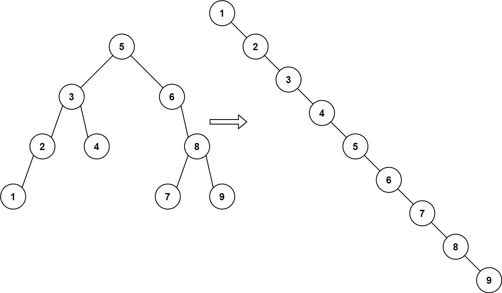
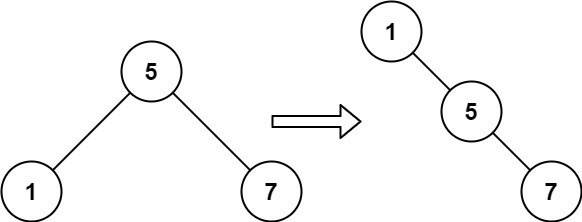

# 897. 递增顺序搜索树

| 题目信息 | 内容 |
|---|---|
| 难度 | 简单 |
| 核心模式 | BST 中序遍历 + 重建右链 |
| 时间复杂度 | O(n) |
| 空间复杂度 | O(h)（递归栈，最坏 O(n)） |

## 题目与约束

给你一棵二叉搜索树的 `root` ，请你 按中序遍历 将其重新排列为一棵递增顺序搜索树，使树中最左边的节点成为树的根节点，并且每个节点没有左子节点，只有一个右子节点。

 

示例 1：



```
<strong>输入：</strong>root = [5,3,6,2,4,null,8,1,null,null,null,7,9]
<strong>输出：</strong>[1,null,2,null,3,null,4,null,5,null,6,null,7,null,8,null,9]
```

示例 2：



```
<strong>输入：</strong>root = [5,1,7]
<strong>输出：</strong>[1,null,5,null,7]
```

 

提示：

- 树中节点数的取值范围是 `[1, 100]`

- `0 <= Node.val <= 1000`

[🔗 前往力扣原题验证 →](https://leetcode.cn/problems/increasing-order-search-tree/)

## 核心不变量

> 二叉搜索树的中序遍历是有序递增序列；把每个节点的左指针清空、并让「中序前驱」的右指针指向当前节点，就能把整棵树串成一条只有右指针的递增链。

## 完整推导

### 思路推导

1. **直觉与痛点**：题目要求新树「没有左孩子、只有右孩子」，本质上就是要把 BST 的中序序列 `1,2,3,...,n` 用一条右链依次连起来。关键在于遍历时的顺序必须严格是中序，才能保证值递增。

2. **重建的办法**：准备一个游标 `prev`，始终指向「已经串好的链表的最后一个节点」。每中序访问到一个节点 `node`：
   - 把 `node.left` 置空（新树不允许左孩子）；
   - 让 `prev.right = node`，把它接到链尾；
   - 然后 `prev = node`，游标后移。

3. **哨兵的妙用**：链表的第一个节点没有前驱，直接写会分情况讨论。用一个虚拟头节点 `dummy` 作为初始 `prev`，最后返回 `dummy.right` 即可统一处理。

4. **小例子**：`root = [5,1,7]`，中序为 `1,5,7`。访问 `1`：`dummy.right = 1`；访问 `5`：`1.right = 5`；访问 `7`：`5.right = 7`。得到 `1 → 5 → 7` 的右链，正好是答案。

### Java 实现（increasingBST）

```java
/**
 * Definition for a binary tree node.
 * public class TreeNode {
 *     int val;
 *     TreeNode left;
 *     TreeNode right;
 *     TreeNode() {}
 *     TreeNode(int val) { this.val = val; }
 *     TreeNode(int val, TreeNode left, TreeNode right) {
 *         this.val = val;
 *         this.left = left;
 *         this.right = right;
 *     }
 * }
 */
class Solution {
    // 指向已重建右链的最后一个节点
    private TreeNode prev;

    public TreeNode increasingBST(TreeNode root) {
        // 虚拟头节点，统一处理「第一个节点没有前驱」的边界
        TreeNode dummy = new TreeNode(0);
        prev = dummy;
        inorder(root);
        return dummy.right;
    }

    private void inorder(TreeNode node) {
        if (node == null) {
            return;
        }
        inorder(node.left);   // 先处理左子树

        // 处理当前节点：断开左孩子，接到链尾
        node.left = null;
        prev.right = node;
        prev = node;

        inorder(node.right);  // 再处理右子树
    }
}
```

### 复杂度

- 时间：O(n)，每个节点恰好被中序遍历访问一次，指针重接是 O(1)。
- 空间：O(h)，递归栈深度等于树高，最坏（链状树）为 O(n)，平衡树为 O(log n)。

### 易错点与扩展（面试高频考点）

1. **忘记清空 `node.left`**：只改了 `prev.right` 而没有把 `node.left` 置空，会残留旧左子树，破坏「无左孩子」的要求，甚至造成环。必须显式 `node.left = null`。
2. **先改指针再递归右子树的安全性**：能安全 `prev.right = node`，是因为中序前驱一定是当前节点左子树的最右节点，它本来就没有右孩子，不会覆盖未遍历的子树。理解这一点才敢放心写。
3. **递归顺序固定**：必须严格「左 → 处理当前 → 右」，任何调换都会破坏递增顺序。
4. **进阶 O(1) 空间**：可用 Morris 中序遍历，借助叶子空右指针回到祖先，避免递归栈；或在遍历中直接改写指针完成重建。
5. **返回值的选取**：返回 `dummy.right` 而不是 `root`，因为原 `root` 可能不是新树的头（最左节点才是）。

## 力扣原题

[897. 递增顺序搜索树](https://leetcode.cn/problems/increasing-order-search-tree/)

### C++ 实现

```cpp
/**
 * Definition for a binary tree node.
 * struct TreeNode {
 *     int val;
 *     TreeNode *left;
 *     TreeNode *right;
 *     TreeNode() : val(0), left(nullptr), right(nullptr) {}
 *     TreeNode(int x) : val(x), left(nullptr), right(nullptr) {}
 *     TreeNode(int x, TreeNode *left, TreeNode *right) : val(x), left(left), right(right) {}
 * };
 */
class Solution {
    TreeNode* prev = nullptr;

    void inorder(TreeNode* node) {
        if (!node) return;
        inorder(node->left);

        node->left = nullptr;   // 断开左孩子
        prev->right = node;     // 接到链尾
        prev = node;

        inorder(node->right);
    }

public:
    TreeNode* increasingBST(TreeNode* root) {
        TreeNode* dummy = new TreeNode(0);
        prev = dummy;
        inorder(root);
        return dummy->right;
    }
};
```

### Python 实现

```python
# Definition for a binary tree node.
# class TreeNode:
#     def __init__(self, val=0, left=None, right=None):
#         self.val = val
#         self.left = left
#         self.right = right
class Solution:
    def increasingBST(self, root: Optional[TreeNode]) -> Optional[TreeNode]:
        dummy = TreeNode(0)
        self.prev = dummy

        def inorder(node):
            if not node:
                return
            inorder(node.left)

            node.left = None          # 断开左孩子
            self.prev.right = node    # 接到链尾
            self.prev = node

            inorder(node.right)

        inorder(root)
        return dummy.right
```
