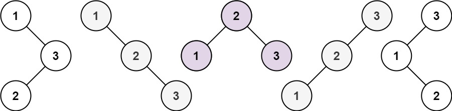

# 96. 不同的二叉搜索树

| 题目信息 | 内容 |
|---|---|
| 难度 | 中等 |
| 核心模式 | 按根节点划分左右子树的计数 DP（卡特兰数） |
| 时间复杂度 | O(n²) |
| 空间复杂度 | O(n) |

## 题目与约束

给你一个整数 `n` ，求恰由 `n` 个节点组成且节点值从 `1` 到 `n` 互不相同的 二叉搜索树 有多少种？返回满足题意的二叉搜索树的种数。

 

示例 1：



```
<strong>输入：</strong>n = 3
<strong>输出：</strong>5
```

示例 2：

```
<strong>输入：</strong>n = 1
<strong>输出：</strong>1
```

 

提示：

- `1 <= n <= 19`

[🔗 前往力扣原题验证 →](https://leetcode.cn/problems/unique-binary-search-trees/)

## 核心不变量

> 以 `j` 个节点作左子树、`i-1-j` 个节点作右子树，则 `dp[i] = Σ dp[j] * dp[i-1-j]`（`0 ≤ j ≤ i-1`），空树 `dp[0] = 1`。

## 完整推导

### 思路推导

1. **直觉与痛点（为什么不枚举树形？）**

   若真的去枚举每一棵 BST 的形状，数量会爆炸。但换个角度：BST 由「根节点」和「左右两棵子树」唯一确定，而树的种数与节点具体取值无关，只与节点**个数**有关。

2. **拆解子问题（固定根节点）**

   设有 `i` 个连续的值（如 `1..i`）。若选第 `j+1` 小的值作根，则左子树必含 `j` 个值、右子树含 `i-1-j` 个值。左右子树各自独立，因此这种情况的种数是 `dp[j] * dp[i-1-j]`。

3. **小例子（n = 3）**

   - 根为 1：左 0 个、右 2 个 → `dp[0]*dp[2] = 1*2 = 2`
   - 根为 2：左 1 个、右 1 个 → `dp[1]*dp[1] = 1*1 = 1`
   - 根为 3：左 2 个、右 0 个 → `dp[2]*dp[0] = 2*1 = 2`

   合计 `2+1+2 = 5`，正是答案。

4. **自底向上（滚动求解）**

   从小到大计算 `dp[1..n]`，每个 `dp[i]` 都依赖比它更小的值，因此一维数组按序递推即可。这便是经典的卡特兰数。

### Java 实现（numTrees）

```java
class Solution {
    public int numTrees(int n) {
        // dp[i] 表示由 i 个节点组成的二叉搜索树种数
        int[] dp = new int[n + 1];
        dp[0] = 1; // 空树算一种，这是递推的基石
        dp[1] = 1;

        for (int i = 2; i <= n; i++) {
            // 枚举左子树的节点个数 j，右子树自然为 i-1-j
            for (int j = 0; j <= i - 1; j++) {
                dp[i] += dp[j] * dp[i - 1 - j];
            }
        }
        return dp[n];
    }
}
```

### 复杂度

- 时间：O(n²)，外层 `i` 从 2 到 n，内层枚举 j 共 i 种，总计约 n²/2 次乘法。
- 空间：O(n)，仅需长度为 `n+1` 的 DP 数组。

### 易错点与扩展（面试高频考点）

1. **忘记 `dp[0] = 1`**：空树必须算作「一种合法构造」，否则所有乘积都会变成 0。这是本题第一大坑。
2. **`dp[1]` 该不该显式赋值**：其实递推式在 `i=1` 时也能推出 1（`dp[0]*dp[0]`），但显式初始化更安全、可读。
3. **会不会整型溢出**：`n = 19` 时卡特兰数 `C₁₉ = 1767263190 < 2³¹-1`，恰好能装进 `int`，无需 `long`；但若题目把 `n` 放大就需换成 `long` 或取模。
4. **数列本质**：本题答案就是卡特兰数 `Cₙ = C(2n,n)/(n+1)`，面试可顺口点出，体现数学功底。
5. **同类变体**：括号生成、n 个节点构成的不同二叉树个数、凸多边形三角剖分数，都是同一递推。

## 力扣原题

[96. 不同的二叉搜索树](https://leetcode.cn/problems/unique-binary-search-trees/)

### C++ 实现

```cpp
class Solution {
public:
    int numTrees(int n) {
        vector<int> dp(n + 1, 0);
        dp[0] = 1; // 空树算一种
        for (int i = 1; i <= n; ++i) {
            for (int j = 0; j < i; ++j) {
                dp[i] += dp[j] * dp[i - 1 - j];
            }
        }
        return dp[n];
    }
};
```

### Python 实现

```python
class Solution:
    def numTrees(self, n: int) -> int:
        dp = [0] * (n + 1)
        dp[0] = 1  # 空树算一种
        for i in range(1, n + 1):
            for j in range(i):
                dp[i] += dp[j] * dp[i - 1 - j]
        return dp[n]
```
