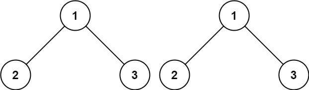
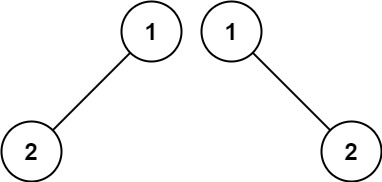
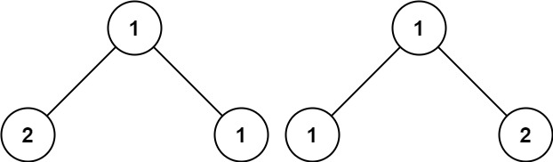

# 100. 相同的树

| 题目信息 | 内容 |
|---|---|
| 难度 | 简单 |
| 核心模式 | 双树同步递归比较 |
| 时间复杂度 | O(n) |
| 空间复杂度 | O(h) |

## 题目与约束

给你两棵二叉树的根节点 `p` 和 `q` ，编写一个函数来检验这两棵树是否相同。

如果两个树在结构上相同，并且节点具有相同的值，则认为它们是相同的。

 

示例 1：



输入：p = [1,2,3], q = [1,2,3]  
输出：true

示例 2：



输入：p = [1,2], q = [1,null,2]  
输出：false

示例 3：



输入：p = [1,2,1], q = [1,1,2]  
输出：false

 

提示：

- 两棵树上的节点数目都在范围 `[0, 100]` 内

- `-104 <= Node.val <= 104`

[🔗 前往力扣原题验证 →](https://leetcode.cn/problems/same-tree/)

## 核心不变量

> 两棵树相同 ⟺ 根节点同时为空，或「都非空、根值相等、且左右子树分别相同」。

## 完整推导

### 思路推导

1. **直觉（如何证明"相同"？）**

   树是递归结构，"相同"也必须递归定义：根相同 + 左子树相同 + 右子树相同。任何一处不满足就整体不同。

2. **递归出口（三种情形）**

   - `p`、`q` 都为 `null` → 相同，返回 `true`。
   - 只有一方为 `null`（结构不一致）→ 不同，返回 `false`。
   - 都非空但 `p.val != q.val` → 不同，返回 `false`。

3. **小例子（示例 2：p=[1,2], q=[1,null,2]）**

   根都是 1，相同；但 `p` 的左孩子是 2，`q` 的左孩子为 `null`，在左子树处出现"一方空一方非空"，立刻返回 `false`。

4. **收尾（合并左右）**

   根被确认相同后，只需 `isSameTree(p.left, q.left) && isSameTree(p.right, q.right)`，两边都为真才相同。

### Java 实现（isSameTree）

```java
class Solution {
    public boolean isSameTree(TreeNode p, TreeNode q) {
        // 都为空：相同
        if (p == null && q == null) return true;
        // 一方为空、一方非空：结构不同
        if (p == null || q == null) return false;
        // 值不同
        if (p.val != q.val) return false;
        // 根相同，继续同步比较左右子树
        return isSameTree(p.left, q.left) && isSameTree(p.right, q.right);
    }
}
```

### 复杂度

- 时间：O(n)，n 为较小 / 任一树节点数，每个节点最多访问一次；一旦不同可提前短路。
- 空间：O(h)，递归栈深度为树高，最坏链状树 O(n)。

### 易错点与扩展（面试高频考点）

1. **空指针判断顺序**：必须先判 `p == null && q == null`，再判 `p == null || q == null`，顺序颠倒会漏掉"都为空"的正确情形。
2. **提前短路**：值不同即可 `return false`，不必继续递归，能显著减少无谓比较。
3. **迭代写法（BFS/DFS + 栈）**：用队列成对入队 `(p.left, q.left)`、`(p.right, q.right)`，每轮取出比较，效果相同且避免深递归爆栈。
4. **与「对称二叉树」的区别**：对称是左子树对右子树（`p.left` 对 `q.right`），相同树是同向对比（`p.left` 对 `q.left`），面试常被拿来对照提问。
5. **值域无需特殊处理**：`-10⁴ ~ 10⁴` 均落在 `int` 范围，直接比较即可。

## 力扣原题

[100. 相同的树](https://leetcode.cn/problems/same-tree/)

### C++ 实现

```cpp
class Solution {
public:
    bool isSameTree(TreeNode* p, TreeNode* q) {
        if (!p && !q) return true;
        if (!p || !q) return false;
        if (p->val != q->val) return false;
        return isSameTree(p->left, q->left) && isSameTree(p->right, q->right);
    }
};
```

### Python 实现

```python
class Solution:
    def isSameTree(self, p: Optional[TreeNode], q: Optional[TreeNode]) -> bool:
        if p is None and q is None:
            return True
        if p is None or q is None:
            return False
        if p.val != q.val:
            return False
        return self.isSameTree(p.left, q.left) and self.isSameTree(p.right, q.right)
```
