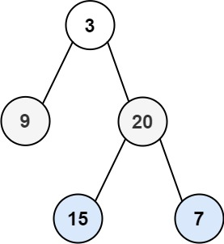

# 103. 二叉树的锯齿形层序遍历

| 题目信息 | 内容 |
|---|---|
| 难度 | 中等 |
| 核心模式 | BFS 分层 + 按层奇偶决定正序/逆序收集 |
| 时间复杂度 | O(n) |
| 空间复杂度 | O(w) |

## 题目与约束

给你二叉树的根节点 `root` ，返回其节点值的 锯齿形层序遍历 。（即先从左往右，再从右往左进行下一层遍历，以此类推，层与层之间交替进行）。

 

示例 1：



```
<strong>输入：</strong>root = [3,9,20,null,null,15,7]
<strong>输出：</strong>[[3],[20,9],[15,7]]
```

示例 2：

```
<strong>输入：</strong>root = [1]
<strong>输出：</strong>[[1]]
```

示例 3：

```
<strong>输入：</strong>root = []
<strong>输出：</strong>[]
```

 

提示：

- 树中节点数目在范围 `[0, 2000]` 内

- `-100 <= Node.val <= 100`

[🔗 前往力扣原题验证 →](https://leetcode.cn/problems/binary-tree-zigzag-level-order-traversal/)

## 核心不变量

> 每轮处理前先固定队列长度 = 当前层节点数；偶数层（从 0 计）从左到右收集，奇数层从右到左收集，层间方向交替。

## 完整推导

### 思路推导

1. **直觉（与普通层序遍历的关系）**

   锯齿形层序遍历就是普通层序遍历（BFS 逐层）加一个"方向翻转"：第 0 层左→右，第 1 层右→左，第 2 层左→右……

2. **关键点（怎么分层？）**

   用队列做 BFS，每轮进入 `while` 前先记录 `size = queue.size()`，这个数字就是当前层的节点数。只弹出 `size` 次，新入队的下一层孩子便不会混入本层。

3. **小例子（示例 1）**

   - 第 0 层：`[3]`，正序 → `[3]`
   - 第 1 层弹出顺序 `9, 20`，逆序 → `[20, 9]`
   - 第 2 层弹出顺序 `15, 7`，正序 → `[15, 7]`

   结果 `[[3],[20,9],[15,7]]`。

4. **实现细节（方向翻转两种写法）**

   一种是每层用 `LinkedList` 的 `addFirst/addLast` 按方向插入；另一种更省心——正常收集后，若当前层为奇数就 `Collections.reverse` 一下。

### Java 实现（zigzagLevelOrder）

```java
import java.util.ArrayList;
import java.util.Collections;
import java.util.LinkedList;
import java.util.List;
import java.util.Queue;

class Solution {
    public List<List<Integer>> zigzagLevelOrder(TreeNode root) {
        List<List<Integer>> res = new ArrayList<>();
        if (root == null) return res;

        Queue<TreeNode> queue = new LinkedList<>();
        queue.offer(root);
        boolean leftToRight = true; // 第 0 层从左到右

        while (!queue.isEmpty()) {
            int size = queue.size(); // 锁定当前层节点数
            List<Integer> level = new ArrayList<>(size);

            for (int i = 0; i < size; i++) {
                TreeNode node = queue.poll();
                level.add(node.val);
                if (node.left != null) queue.offer(node.left);
                if (node.right != null) queue.offer(node.right);
            }

            // 奇数层需要逆序（翻转当前层）
            if (!leftToRight) {
                Collections.reverse(level);
            }
            res.add(level);
            leftToRight = !leftToRight; // 方向交替
        }
        return res;
    }
}
```

### 复杂度

- 时间：O(n)，每个节点进出队列各一次；每层逆序总代价不超过该层节点数，整体仍为 O(n)。
- 空间：O(w)，w 为树的最大宽度，队列最多同时容纳一层节点；最坏满二叉树底层约 n/2。

### 易错点与扩展（面试高频考点）

1. **动态 `queue.size()` 陷阱**：绝不能在 `for` 条件里直接写 `i < queue.size()`，因为入队孩子会改变它；必须先存 `int size`。
2. **方向标记的初值与翻转时机**：`leftToRight` 初始为 `true`，收集完当前层后再取反，顺序写错会导致第一层就反了。
3. **`Collections.reverse` 的位置**：逆序要作用在"本层收集结果"上，不能反过来影响子节点入队顺序（入队始终保持左后右，方向只影响输出）。
4. **空树**：`root == null` 直接返回空列表，避免对空队列操作。
5. **进阶问法**：也可用 DFS 带 `level` 参数，按层放入不同列表，再对奇数层反转，与 BFS 等价。

## 力扣原题

[103. 二叉树的锯齿形层序遍历](https://leetcode.cn/problems/binary-tree-zigzag-level-order-traversal/)

### C++ 实现

```cpp
class Solution {
public:
    vector<vector<int>> zigzagLevelOrder(TreeNode* root) {
        vector<vector<int>> res;
        if (!root) return res;

        queue<TreeNode*> q;
        q.push(root);
        bool leftToRight = true;

        while (!q.empty()) {
            int size = q.size();
            vector<int> level(size);

            for (int i = 0; i < size; ++i) {
                TreeNode* node = q.front();
                q.pop();
                // 依据方向决定放在本层数组的头还是尾
                int idx = leftToRight ? i : size - 1 - i;
                level[idx] = node->val;
                if (node->left) q.push(node->left);
                if (node->right) q.push(node->right);
            }

            res.push_back(level);
            leftToRight = !leftToRight;
        }
        return res;
    }
};
```

### Python 实现

```python
import collections

class Solution:
    def zigzagLevelOrder(self, root: Optional[TreeNode]) -> List[List[int]]:
        if not root:
            return []

        res = []
        queue = collections.deque([root])
        left_to_right = True

        while queue:
            size = len(queue)
            level = collections.deque()
            for _ in range(size):
                node = queue.popleft()
                if left_to_right:
                    level.append(node.val)
                else:
                    level.appendleft(node.val)
                if node.left:
                    queue.append(node.left)
                if node.right:
                    queue.append(node.right)
            res.append(list(level))
            left_to_right = not left_to_right

        return res
```
