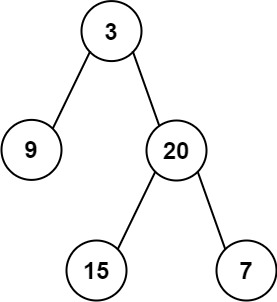

# 106. 从中序与后序遍历序列构造二叉树

| 题目信息 | 内容 |
|---|---|
| 难度 | 中等 |
| 核心模式 | 分治递归 + 哈希定位根节点 |
| 时间复杂度 | O(n) |
| 空间复杂度 | O(n) |

## 题目与约束

给定两个整数数组 `inorder` 和 `postorder` ，其中 `inorder` 是二叉树的中序遍历， `postorder` 是同一棵树的后序遍历，请你构造并返回这颗 二叉树 。

 

示例 1:



```
<b>输入：</b>inorder = [9,3,15,20,7], postorder = [9,15,7,20,3]
<b>输出：</b>[3,9,20,null,null,15,7]
```

示例 2:

```
<b>输入：</b>inorder = [-1], postorder = [-1]
<b>输出：</b>[-1]
```

 

提示:

- `1 <= inorder.length <= 3000`

- `postorder.length == inorder.length`

- `-3000 <= inorder[i], postorder[i] <= 3000`

- `inorder` 和 `postorder` 都由 不同 的值组成

- `postorder` 中每一个值都在 `inorder` 中

- `inorder` 保证是树的中序遍历

- `postorder` 保证是树的后序遍历

[🔗 前往力扣原题验证 →](https://leetcode.cn/problems/construct-binary-tree-from-inorder-and-postorder-traversal/)

## 核心不变量

> 后序遍历的最后一个元素一定是当前子树的根；用它去中序遍历里切一刀，左边是左子树、右边是右子树，规模严格缩小。

## 完整推导

### 思路推导

1. **直觉与痛点（根在哪里？）**

   两种遍历各自把树的形状“打散”了，单看任何一个都还原不出结构。但后序遍历的顺序是「左 → 右 → 根」，所以**后序数组的最后一个元素必然是整棵树的根**。拿到根之后，还需要知道左右子树各有哪些节点，这就要借助中序遍历「左 → 根 → 右」的分隔性质。

2. **破局思路（中序切刀，定位子树规模）**

   假设根的值是 `rootVal`，在 `inorder` 里找到它的位置 `mid`。由于中序是「左-根-右」，那么：

   - `inorder[0 .. mid-1]` 就是左子树的全部节点；
   - `inorder[mid+1 .. end]` 就是右子树的全部节点。

   由此还能推出左子树的节点个数 `leftSize = mid - inLeft`，右子树节点个数也随之确定。后序数组对应地也能切成两段，问题就拆成了两个同构的子问题。

3. **关键追问（递归时后序下标怎么走？）**

   后序是「左-右-根」，根在最后。所以在后序数组里**从右往左**依次弹出，一定是「根 → 右子树的根 → … → 左子树的根」。因此递归时应**先建右子树、再建左子树**，用一个全局的 `postIndex` 从 `postorder.length-1` 开始每取一个根就减一，配合中序区间 `[inLeft, inRight]`，就能不重不漏地还原整棵树。

   小例子：`inorder = [9,3,15,20,7]`、`postorder = [9,15,7,20,3]`。后序末位 `3` 是根，中序中 `3` 左侧 `[9]` 是左子树，右侧 `[15,20,7]` 是右子树；后序里对应的右段 `[15,7,20]` 末位 `20` 就是右子树的根，继续递归即可。

### Java 实现（buildTree）

```java
import java.util.HashMap;
import java.util.Map;

/**
 * Definition for a binary tree node.
 * public class TreeNode {
 *     int val;
 *     TreeNode left;
 *     TreeNode right;
 *     TreeNode() {}
 *     TreeNode(int val) { this.val = val; }
 *     TreeNode(int val, TreeNode left, TreeNode right) {
 *         this.val = val;
 *         this.left = left;
 *         this.right = right;
 *     }
 * }
 */
class Solution {
    private int[] postorder;
    // 值 -> 在中序数组中的下标，O(1) 定位根
    private Map<Integer, Integer> indexMap = new HashMap<>();
    // 后序数组从右往左取根
    private int postIndex;

    public TreeNode buildTree(int[] inorder, int[] postorder) {
        this.postorder = postorder;
        this.postIndex = postorder.length - 1;
        for (int i = 0; i < inorder.length; i++) {
            indexMap.put(inorder[i], i);
        }
        return build(0, inorder.length - 1);
    }

    // 依据中序区间 [inLeft, inRight] 建树
    private TreeNode build(int inLeft, int inRight) {
        if (inLeft > inRight) {
            return null; // 空区间，说明没有节点
        }
        int rootVal = postorder[postIndex--]; // 后序末位即当前根
        TreeNode root = new TreeNode(rootVal);
        int mid = indexMap.get(rootVal);      // 根在中序中的位置

        // 后序逆序为「根 → 右 → 左」，故必须先建右子树再建左子树
        root.right = build(mid + 1, inRight);
        root.left = build(inLeft, mid - 1);
        return root;
    }
}
```

### 复杂度

- 时间：`O(n)`，每个节点恰好被创建一次，哈希表把每次“找根下标”从 `O(n)` 降到 `O(1)`。
- 空间：`O(n)`，哈希表占 `O(n)`；递归栈最深 `O(h)`，最坏（链状树）为 `O(n)`。

### 易错点与扩展（面试高频考点）

1. **忘配哈希表导致 `O(n²)`**：每层都线性扫描 `inorder` 找根，链状树会退化成平方复杂度；面试务必先用 `HashMap` 建索引。
2. **递归顺序写反**：后序逆序是「根 → 右 → 左」，必须先建右子树，否则 `postIndex` 会错位，整棵树都乱。
3. **区间边界写错**：左子树区间是 `[inLeft, mid-1]`，右子树是 `[mid+1, inRight]`；`mid` 本身是根要跳过。
4. **不校验非法输入**：题目保证数组有效且值互不相同，实际工程中要额外判空与长度一致。
5. **举一反三**：由「前序 + 中序」构造树同理——前序首位是根，切完后**先建左再建右**；但「前序 + 后序」无法唯一确定一棵树，这是高频辨析题。

## 力扣原题

[106. 从中序与后序遍历序列构造二叉树](https://leetcode.cn/problems/construct-binary-tree-from-inorder-and-postorder-traversal/)

### C++ 实现

```cpp
#include <vector>
#include <unordered_map>
using namespace std;

/**
 * Definition for a binary tree node.
 * struct TreeNode {
 *     int val;
 *     TreeNode *left;
 *     TreeNode *right;
 *     TreeNode() : val(0), left(nullptr), right(nullptr) {}
 *     TreeNode(int x) : val(x), left(nullptr), right(nullptr) {}
 *     TreeNode(int x, TreeNode *left, TreeNode *right) : val(x), left(left), right(right) {}
 * };
 */
class Solution {
public:
    TreeNode* buildTree(vector<int>& inorder, vector<int>& postorder) {
        this->postorder = postorder;
        postIndex = postorder.size() - 1;
        for (int i = 0; i < (int)inorder.size(); i++) {
            indexMap[inorder[i]] = i;
        }
        return build(0, inorder.size() - 1);
    }

private:
    vector<int> postorder;
    unordered_map<int, int> indexMap;
    int postIndex;

    TreeNode* build(int inLeft, int inRight) {
        if (inLeft > inRight) return nullptr;
        int rootVal = postorder[postIndex--];
        TreeNode* root = new TreeNode(rootVal);
        int mid = indexMap[rootVal];
        // 后序逆序：根 → 右 → 左
        root->right = build(mid + 1, inRight);
        root->left = build(inLeft, mid - 1);
        return root;
    }
};
```

### Python 实现

```python
from typing import List, Optional
from collections import defaultdict

# Definition for a binary tree node.
# class TreeNode:
#     def __init__(self, val=0, left=None, right=None):
#         self.val = val
#         self.left = left
#         self.right = right

class Solution:
    def buildTree(self, inorder: List[int], postorder: List[int]) -> Optional[TreeNode]:
        index_map = {val: i for i, val in enumerate(inorder)}
        self.post_index = len(postorder) - 1

        def build(in_left: int, in_right: int) -> Optional[TreeNode]:
            if in_left > in_right:
                return None
            root_val = postorder[self.post_index]
            self.post_index -= 1
            root = TreeNode(root_val)
            mid = index_map[root_val]
            # 后序逆序：根 → 右 → 左
            root.right = build(mid + 1, in_right)
            root.left = build(in_left, mid - 1)
            return root

        return build(0, len(inorder) - 1)
```
