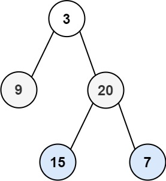

# 107. 二叉树的层序遍历 II

| 题目信息 | 内容 |
|---|---|
| 难度 | 中等 |
| 核心模式 | BFS 分层 + 结果反转 |
| 时间复杂度 | O(n) |
| 空间复杂度 | O(w) |

## 题目与约束

给你二叉树的根节点 `root` ，返回其节点值 自底向上的层序遍历 。 （即按从叶子节点所在层到根节点所在的层，逐层从左向右遍历）

 

示例 1：



输入：root = [3,9,20,null,null,15,7]  
输出：[[15,7],[9,20],[3]]

示例 2：

输入：root = [1]  
输出：[[1]]

示例 3：

输入：root = []  
输出：[]

 

提示：

- 树中节点数目在范围 `[0, 2000]` 内

- `-1000 <= Node.val <= 1000`

[🔗 前往力扣原题验证 →](https://leetcode.cn/problems/binary-tree-level-order-traversal-ii/)

## 核心不变量

> 与普通层序遍历完全一致地逐层采集，唯一区别是最后把整个二维结果**整体反转**（或每层插到最前面）。

## 完整推导

### 思路推导

1. **直觉与痛点（自底向上怎么来？）**

   如果从叶子开始向上遍历，天然的 BFS 是从根往下走的，方向正好相反。直接“从底往上”遍历需要先知道最深是哪一层，比较别扭。

2. **破局思路（先正着收集，再整体翻转）**

   先老老实实做一次**标准层序遍历**，把每一层装进一个列表，依次得到 `[[3],[9,20],[15,7]]`。然后把这个二维列表**逆序**，就得到 `[[15,7],[9,20],[3]]`，正好是自底向上。等价地在每层收集完后把该层插到结果列表的**头部**，也能达到同样效果。

3. **关键追问（怎么保证每层不串味？）**

   和普通层序遍历一样，进入某一层前先用 `levelSize = queue.size()` 固定当前层节点数，然后严格执行 `levelSize` 次出队。期间新压入的孩子节点都会排在队尾，留给下一轮，从而保证每层界线清晰。

### Java 实现（levelOrderBottom）

```java
import java.util.ArrayList;
import java.util.Collections;
import java.util.LinkedList;
import java.util.List;
import java.util.Queue;

/**
 * Definition for a binary tree node.
 * public class TreeNode {
 *     int val;
 *     TreeNode left;
 *     TreeNode right;
 *     TreeNode() {}
 *     TreeNode(int val) { this.val = val; }
 *     TreeNode(int val, TreeNode left, TreeNode right) {
 *         this.val = val;
 *         this.left = left;
 *         this.right = right;
 *     }
 * }
 */
class Solution {
    public List<List<Integer>> levelOrderBottom(TreeNode root) {
        List<List<Integer>> res = new ArrayList<>();
        if (root == null) {
            return res;
        }

        Queue<TreeNode> queue = new LinkedList<>();
        queue.offer(root);

        while (!queue.isEmpty()) {
            int levelSize = queue.size(); // 固定当前层节点数
            List<Integer> level = new ArrayList<>();
            for (int i = 0; i < levelSize; i++) {
                TreeNode node = queue.poll();
                level.add(node.val);
                if (node.left != null) {
                    queue.offer(node.left);
                }
                if (node.right != null) {
                    queue.offer(node.right);
                }
            }
            res.add(level);
        }

        // 关键：整体反转，得到自底向上的顺序
        Collections.reverse(res);
        return res;
    }
}
```

### 复杂度

- 时间：`O(n)`，每个节点入队出队各一次，最后反转一层一层共 `O(n)`。
- 空间：`O(w)`，`w` 为树的最大宽度；队列同时存放的最多就是最宽一层的节点数，最坏为 `O(n)`。

### 易错点与扩展（面试高频考点）

1. **忘记反转**：直接返回 BFS 结果就是自上而下，审题时一定圈出“自底向上”。
2. **动态读取 `queue.size()`**：`for` 循环里不要用 `queue.size()` 当上界，必须锁死成 `levelSize`，否则父子层混在一起。
3. **插入方向选一种就好**：用 `Collections.reverse` 或 `LinkedList.addFirst(level)` 二者取其一，不要既反转又头插，相当于还原了。
4. **空树处理**：`root == null` 直接返回空列表，反转空列表也安全，但显式判空更清晰。
5. **扩展**：若要求“自底向上但每层从右往左”，可在收集每层时先右孩子后左孩子，再整体反转，属于同一模板的变形。

## 力扣原题

[107. 二叉树的层序遍历 II](https://leetcode.cn/problems/binary-tree-level-order-traversal-ii/)

### C++ 实现

```cpp
#include <vector>
#include <queue>
#include <algorithm>
using namespace std;

/**
 * Definition for a binary tree node.
 * struct TreeNode {
 *     int val;
 *     TreeNode *left;
 *     TreeNode *right;
 *     TreeNode() : val(0), left(nullptr), right(nullptr) {}
 *     TreeNode(int x) : val(x), left(nullptr), right(nullptr) {}
 *     TreeNode(int x, TreeNode *left, TreeNode *right) : val(x), left(left), right(right) {}
 * };
 */
class Solution {
public:
    vector<vector<int>> levelOrderBottom(TreeNode* root) {
        vector<vector<int>> res;
        if (root == nullptr) return res;

        queue<TreeNode*> que;
        que.push(root);
        while (!que.empty()) {
            int levelSize = que.size(); // 固定当前层节点数
            vector<int> level;
            for (int i = 0; i < levelSize; i++) {
                TreeNode* node = que.front();
                que.pop();
                level.push_back(node->val);
                if (node->left) que.push(node->left);
                if (node->right) que.push(node->right);
            }
            res.push_back(level);
        }

        reverse(res.begin(), res.end()); // 自底向上
        return res;
    }
};
```

### Python 实现

```python
from typing import List, Optional
from collections import deque

# Definition for a binary tree node.
# class TreeNode:
#     def __init__(self, val=0, left=None, right=None):
#         self.val = val
#         self.left = left
#         self.right = right

class Solution:
    def levelOrderBottom(self, root: Optional[TreeNode]) -> List[List[int]]:
        if not root:
            return []
        res = []
        queue = deque([root])
        while queue:
            level = []
            for _ in range(len(queue)):  # 当前层节点数
                node = queue.popleft()
                level.append(node.val)
                if node.left:
                    queue.append(node.left)
                if node.right:
                    queue.append(node.right)
            res.append(level)
        # 整体反转，得到自底向上
        return res[::-1]
```
