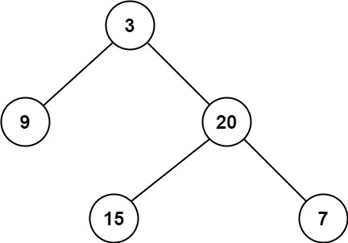

# 111. 二叉树的最小深度

| 题目信息 | 内容 |
|---|---|
| 难度 | 简单 |
| 核心模式 | DFS 递归（区分叶子节点） |
| 时间复杂度 | O(n) |
| 空间复杂度 | O(h) |

## 题目与约束

给定一个二叉树，找出其最小深度。

最小深度是从根节点到最近叶子节点的最短路径上的节点数量。

说明：叶子节点是指没有子节点的节点。

 

示例 1：



```
<strong>输入：</strong>root = [3,9,20,null,null,15,7]
<strong>输出：</strong>2
```

示例 2：

```
<strong>输入：</strong>root = [2,null,3,null,4,null,5,null,6]
<strong>输出：</strong>5
```

 

提示：

- 树中节点数的范围在 `[0, 105]` 内

- `-1000 <= Node.val <= 1000`

[🔗 前往力扣原题验证 →](https://leetcode.cn/problems/minimum-depth-of-binary-tree/)

## 核心不变量

> 最小深度只认“叶子”，当某节点只有一侧孩子时，必须继续往有孩子的那侧走，绝不能把空的那侧当成深度 0 参与取最小。

## 完整推导

### 思路推导

1. **直觉与痛点（能不能直接 `min(左, 右)+1`？）**

   如果照搬求最大深度的写法，直接 `min(minDepth(left), minDepth(right)) + 1`，会遇到陷阱：当一个节点只有左孩子、右孩子为空时，`minDepth(右)` 返回 0，于是结果变成 `0 + 1 = 1`，把“只有一侧孩子”的节点误判成叶子。可它并不是叶子。

2. **破局思路（分三种情况讨论）**

   - 节点为空 → 深度 0；
   - 左孩子为空 → 只能往右走，返回 `minDepth(right) + 1`；
   - 右孩子为空 → 只能往左走，返回 `minDepth(left) + 1`；
   - 两个孩子都在 → 两边都可能是最近叶子，返回 `min(minDepth(left), minDepth(right)) + 1`。

   这样“只有一侧孩子”的情况被单独处理，不会把空子树当成叶子。

3. **关键追问（能不能更快？）**

   可以用 **BFS** 逐层扫描：第一个遇到的叶子节点所在层就是最小深度，无需遍历完整棵树，平均更快；而 DFS 最坏仍需 `O(n)`。面试可两种都讲。

   小例子：`[2,null,3,null,4,...]` 是一条只有右孩子的链，按上面规则会一路沿右子树往下，深度为 5，而非误判成 1。

### Java 实现（minDepth）

```java
/**
 * Definition for a binary tree node.
 * public class TreeNode {
 *     int val;
 *     TreeNode left;
 *     TreeNode right;
 *     TreeNode() {}
 *     TreeNode(int val) { this.val = val; }
 *     TreeNode(int val, TreeNode left, TreeNode right) {
 *         this.val = val;
 *         this.left = left;
 *         this.right = right;
 *     }
 * }
 */
class Solution {
    public int minDepth(TreeNode root) {
        if (root == null) {
            return 0;
        }
        // 只有右孩子：必须继续往右走，空左子树不算叶子
        if (root.left == null) {
            return minDepth(root.right) + 1;
        }
        // 只有左孩子：必须继续往左走
        if (root.right == null) {
            return minDepth(root.left) + 1;
        }
        // 两个孩子都在：取较小的一侧
        return Math.min(minDepth(root.left), minDepth(root.right)) + 1;
    }
}
```

### 复杂度

- 时间：`O(n)`，最坏需访问每个节点一次（BFS 版本可在首个叶子处提前结束）。
- 空间：`O(h)`，递归栈深度等于树高；最坏（链状）为 `O(n)`。

### 易错点与扩展（面试高频考点）

1. **直接 `min(左,右)+1` 是最大陷阱**：单侧孩子的节点会被误算成深度 1，务必按“左空/右空/都有”三种情况分别处理。
2. **与最大深度混淆**：最大深度里“空子树深度 0”恰好不影响取 `max`，但最小深度取 `min` 就会出错，这是二者最关键的区别。
3. **叶子定义**：叶子是“左右都为空”的节点，不是“某一侧为空”。
4. **BFS 优化**：逐层 BFS，遇到第一个 `left == null && right == null` 的节点立即返回当前层数，对浅树更高效。
5. **空树返回 0**：`root == null` 时深度为 0，别返回 1。

## 力扣原题

[111. 二叉树的最小深度](https://leetcode.cn/problems/minimum-depth-of-binary-tree/)

### C++ 实现

```cpp
#include <algorithm>
using namespace std;

/**
 * Definition for a binary tree node.
 * struct TreeNode {
 *     int val;
 *     TreeNode *left;
 *     TreeNode *right;
 *     TreeNode() : val(0), left(nullptr), right(nullptr) {}
 *     TreeNode(int x) : val(x), left(nullptr), right(nullptr) {}
 *     TreeNode(int x, TreeNode *left, TreeNode *right) : val(x), left(left), right(right) {}
 * };
 */
class Solution {
public:
    int minDepth(TreeNode* root) {
        if (root == nullptr) return 0;
        // 只有右孩子
        if (root->left == nullptr) return minDepth(root->right) + 1;
        // 只有左孩子
        if (root->right == nullptr) return minDepth(root->left) + 1;
        // 两个孩子都在
        return min(minDepth(root->left), minDepth(root->right)) + 1;
    }
};
```

### Python 实现

```python
from typing import Optional

# Definition for a binary tree node.
# class TreeNode:
#     def __init__(self, val=0, left=None, right=None):
#         self.val = val
#         self.left = left
#         self.right = right

class Solution:
    def minDepth(self, root: Optional[TreeNode]) -> int:
        if not root:
            return 0
        # 只有右孩子
        if not root.left:
            return self.minDepth(root.right) + 1
        # 只有左孩子
        if not root.right:
            return self.minDepth(root.left) + 1
        # 两个孩子都在
        return min(self.minDepth(root.left), self.minDepth(root.right)) + 1
```
