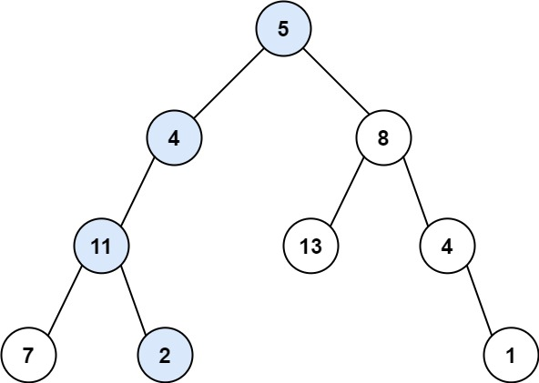
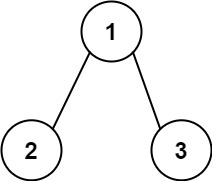

# 112. 路径总和

| 题目信息 | 内容 |
|---|---|
| 难度 | 简单 |
| 核心模式 | DFS 递归（目标值递减） |
| 时间复杂度 | O(n) |
| 空间复杂度 | O(h) |

## 题目与约束

给你二叉树的根节点 `root` 和一个表示目标和的整数 `targetSum` 。判断该树中是否存在 根节点到叶子节点 的路径，这条路径上所有节点值相加等于目标和 `targetSum` 。如果存在，返回 `true` ；否则，返回 `false` 。

叶子节点 是指没有子节点的节点。

 

示例 1：



输入：root = [5,4,8,11,null,13,4,7,2,null,null,null,1], targetSum = 22  
输出：true  
解释：等于目标和的根节点到叶节点路径如上图所示。

示例 2：



输入：root = [1,2,3], targetSum = 5  
输出：false  
解释：树中存在两条根节点到叶子节点的路径：  
(1 --> 2): 和为 3  
(1 --> 3): 和为 4  
不存在 sum = 5 的根节点到叶子节点的路径。

示例 3：

输入：root = [], targetSum = 0  
输出：false  
解释：由于树是空的，所以不存在根节点到叶子节点的路径。

 

提示：

- 树中节点的数目在范围 `[0, 5000]` 内

- `-1000 <= Node.val <= 1000`

- `-1000 <= targetSum <= 1000`

[🔗 前往力扣原题验证 →](https://leetcode.cn/problems/path-sum/)

## 核心不变量

> 递归向下时把“还需要的和”减去当前节点值，只有当抵达叶子时剩余目标恰好等于叶子值，路径才成立。

## 完整推导

### 思路推导

1. **直觉与痛点（路径为什么不能中途判定？）**

   题目要求的是“根到叶子”的整条链，而不是任意一段路径。所以即使某个中间节点之前的累加和恰好等于目标，也不能算数——后面还挂着孩子，这条路径还没结束。

2. **破局思路（把“求和”改写成“减法”）**

   与其一路累加再和目标比较，不如带着一个“还差多少”的剩余目标往下走。走到节点 `node` 时，问题就变成：它的子树能否凑出 `targetSum - node.val`。这样每一层只做一次减法，状态清晰。

3. **终止条件**

   - 节点为空：这条分支走不通，返回 `false`；
   - 节点是叶子（左右都空）：此时路径完整，判断剩余目标是否正好等于该叶子值。

4. **小例子**

   `targetSum = 22`，路径 `5 → 4 → 11 → 2`：`22-5=17`，`17-4=13`，`13-11=2`，叶子值恰为 `2`，返回 `true`。

### Java 实现（hasPathSum）

```java
/**
 * Definition for a binary tree node.
 * public class TreeNode {
 *     int val;
 *     TreeNode left;
 *     TreeNode right;
 *     TreeNode() {}
 *     TreeNode(int val) { this.val = val; }
 *     TreeNode(int val, TreeNode left, TreeNode right) {
 *         this.val = val;
 *         this.left = left;
 *         this.right = right;
 *     }
 * }
 */
class Solution {
    public boolean hasPathSum(TreeNode root, int targetSum) {
        if (root == null) {
            return false;
        }
        // 叶子节点：此时路径已完整，判断剩余目标是否恰好等于叶子值
        if (root.left == null && root.right == null) {
            return targetSum == root.val;
        }
        // 非叶子：把剩余目标减去当前值，交给左右子树去判断
        return hasPathSum(root.left, targetSum - root.val)
                || hasPathSum(root.right, targetSum - root.val);
    }
}
```

### 复杂度

- 时间：`O(n)`，最坏情况下每个节点被访问一次。
- 空间：`O(h)`，递归栈深度等于树高；最坏（链状树）退化为 `O(n)`。

### 易错点与扩展（面试高频考点）

1. **必须走到叶子**：非叶子节点即使累加和已经等于目标，也不能提前返回 `true`，否则会误判。
2. **目标可以为负、节点值可以为负**：不能用 `targetSum < 0` 之类做剪枝，负数会让“贪心剪枝”失效。
3. **空树返回 `false`**：即使 `targetSum == 0`，空树也没有根到叶路径，不能返回 `true`。
4. **减法与累加法等价**：另一种写法是向下传累计和，到叶子再比较；两种都可以，注意别把当前值重复加减。
5. **BFS 替代方案**：把 `(节点, 剩余和)` 一起入队做层序遍历，同样正确，只是多占队列空间。

## 力扣原题

[112. 路径总和](https://leetcode.cn/problems/path-sum/)

### C++ 实现

```cpp
/**
 * Definition for a binary tree node.
 * struct TreeNode {
 *     int val;
 *     TreeNode *left;
 *     TreeNode *right;
 *     TreeNode() : val(0), left(nullptr), right(nullptr) {}
 *     TreeNode(int x) : val(x), left(nullptr), right(nullptr) {}
 *     TreeNode(int x, TreeNode *left, TreeNode *right) : val(x), left(left), right(right) {}
 * };
 */
class Solution {
public:
    bool hasPathSum(TreeNode* root, int targetSum) {
        if (root == nullptr) return false;
        // 叶子节点：判断剩余目标是否恰好等于叶子值
        if (root->left == nullptr && root->right == nullptr) {
            return targetSum == root->val;
        }
        // 非叶子：剩余目标减去当前值后交给子树
        return hasPathSum(root->left, targetSum - root->val) ||
               hasPathSum(root->right, targetSum - root->val);
    }
};
```

### Python 实现

```python
from typing import Optional

# Definition for a binary tree node.
# class TreeNode:
#     def __init__(self, val=0, left=None, right=None):
#         self.val = val
#         self.left = left
#         self.right = right

class Solution:
    def hasPathSum(self, root: Optional[TreeNode], targetSum: int) -> bool:
        if not root:
            return False
        # 叶子节点：判断剩余目标是否等于叶子值
        if not root.left and not root.right:
            return targetSum == root.val
        # 非叶子：剩余目标减去当前值后分别尝试左右子树
        return (self.hasPathSum(root.left, targetSum - root.val)
                or self.hasPathSum(root.right, targetSum - root.val))
```
