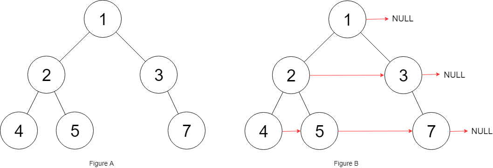

# 117. 填充每个节点的下一个右侧节点指针 II

| 题目信息 | 内容 |
|---|---|
| 难度 | 中等 |
| 核心模式 | dummy 哑节点 + tail 逐层串接（O(1) 空间） |
| 时间复杂度 | O(n) |
| 空间复杂度 | O(1) |

## 题目与约束

给定一个二叉树：

```
struct Node {
  int val;
  Node *left;
  Node *right;
  Node *next;
}
```

填充它的每个 next 指针，让这个指针指向其下一个右侧节点。如果找不到下一个右侧节点，则将 next 指针设置为 `NULL` 。

初始状态下，所有 next 指针都被设置为 `NULL` 。

 

示例 1：



```
<strong>输入</strong>：root = [1,2,3,4,5,null,7]
<strong>输出：</strong>[1,#,2,3,#,4,5,7,#]
<strong>解释：</strong>给定二叉树如图 A 所示，你的函数应该填充它的每个 next 指针，以指向其下一个右侧节点，如图 B 所示。序列化输出按层序遍历顺序（由 next 指针连接），'#' 表示每层的末尾。
```

示例 2：

```
<strong>输入：</strong>root = []
<strong>输出：</strong>[]
```

 

提示：

- 树中的节点数在范围 `[0, 6000]` 内

- `-100 <= Node.val <= 100`

进阶：

- 你只能使用常量级额外空间。

- 使用递归解题也符合要求，本题中递归程序的隐式栈空间不计入额外空间复杂度。

[🔗 前往力扣原题验证 →](https://leetcode.cn/problems/populating-next-right-pointers-in-each-node-ii/)

## 核心不变量

> 用一个 `dummy` 哑节点加 `tail` 指针，在横向遍历当前层的同时，把下一层节点按出现顺序串成一条 `next` 链。

## 完整推导

### 思路推导

1. **与 116 的关键差别**

   本题是 **任意二叉树**，父节点可能只有左孩子、只有右孩子，甚至没有孩子。116 里“`head.left` 一定存在、左右成对”的前提不再成立，不能再直接写 `head.left.next = head.right`。

2. **仍然想 O(1) 空间横向遍历**

   当前层已经有一条通过 `next` 建好的链，可以顺着它从左到右扫。但下一层的节点数量、位置都不确定，怎么把它们串起来？答案是 **哑节点**。

3. **dummy + tail 技巧**

   为下一层新建一个虚拟头 `dummy`，`tail` 从 `dummy` 出发。扫描当前层每个节点 `cur`：
   - 若 `cur.left` 存在，接到 `tail.next`，`tail` 后移；
   - 若 `cur.right` 存在，同样接到 `tail.next`，`tail` 后移。
   
   扫完整层后，`dummy.next` 就是下一层的第一个真实节点。

4. **逐层下沉**

   `cur = dummy.next` 进入下一层；当 `cur` 变为空，说明所有层都处理完毕，循环结束。

### Java 实现（connect）

```java
/*
// Definition for a Node.
class Node {
    public int val;
    public Node left;
    public Node right;
    public Node next;

    public Node() {}
    public Node(int _val) { val = _val; }
    public Node(int _val, Node _left, Node _right, Node _next) {
        val = _val;
        left = _left;
        right = _right;
        next = _next;
    }
};
*/
class Solution {
    public Node connect(Node root) {
        Node cur = root;
        // cur 逐层下移，代表当前层最左侧可用的节点
        while (cur != null) {
            // dummy 作为下一层链表的虚拟头，tail 负责串接
            Node dummy = new Node(0);
            Node tail = dummy;
            // 借助当前层已建好的 next 链横向遍历
            while (cur != null) {
                if (cur.left != null) {
                    tail.next = cur.left;
                    tail = tail.next;
                }
                if (cur.right != null) {
                    tail.next = cur.right;
                    tail = tail.next;
                }
                cur = cur.next;
            }
            // 跳到下一层的第一个真实节点
            cur = dummy.next;
        }
        return root;
    }
}
```

### 复杂度

- 时间：`O(n)`，每个节点都被扫描一次并接入下一层链表。
- 空间：`O(1)`，只有 `dummy`、`tail`、`cur` 等常数个指针，未使用队列。

### 易错点与扩展（面试高频考点）

1. **必须判孩子是否存在**：任意树里 `cur.left`、`cur.right` 都可能为空，绝不能像 116 那样默认成对出现。
2. **dummy 每层新建**：`tail` 从 `dummy` 开始，`dummy.next` 才是下一层头；用 `dummy` 本身当层头会多出一个假节点。
3. **`cur` 的推进依赖 `next`**：内层用 `cur = cur.next` 横向走，外层用 `cur = dummy.next` 下沉，两个含义不同，别混用。
4. **空树返回 `root`（null）**：循环条件天然处理，无需特殊分支。
5. **不能用队列**：BFS 队列空间 `O(w)` 不满足“常量级额外空间”进阶；dummy 技巧正是为省空间设计的。

## 力扣原题

[117. 填充每个节点的下一个右侧节点指针 II](https://leetcode.cn/problems/populating-next-right-pointers-in-each-node-ii/)

### C++ 实现

```cpp
/*
// Definition for a Node.
class Node {
public:
    int val;
    Node* left;
    Node* right;
    Node* next;

    Node() : val(0), left(NULL), right(NULL), next(NULL) {}
    Node(int _val) : val(_val), left(NULL), right(NULL), next(NULL) {}
    Node(int _val, Node* _left, Node* _right, Node* _next)
        : val(_val), left(_left), right(_right), next(_next) {}
};
*/
class Solution {
public:
    Node* connect(Node* root) {
        Node* cur = root;
        while (cur != nullptr) {
            // dummy 是下一层链表的虚拟头，tail 负责串接
            Node dummy(0);
            Node* tail = &dummy;
            while (cur != nullptr) {
                if (cur->left != nullptr) {
                    tail->next = cur->left;
                    tail = tail->next;
                }
                if (cur->right != nullptr) {
                    tail->next = cur->right;
                    tail = tail->next;
                }
                cur = cur->next;
            }
            // 下沉到下一层第一个真实节点
            cur = dummy.next;
        }
        return root;
    }
};
```

### Python 实现

```python
"""
# Definition for a Node.
class Node:
    def __init__(self, val: int = 0, left: 'Node' = None, right: 'Node' = None, next: 'Node' = None):
        self.val = val
        self.left = left
        self.right = right
        self.next = next
"""

class Solution:
    def connect(self, root: 'Node') -> 'Node':
        cur = root
        while cur:
            # dummy 是下一层链表的虚拟头，tail 负责串接
            dummy = Node(0)
            tail = dummy
            while cur:
                if cur.left:
                    tail.next = cur.left
                    tail = tail.next
                if cur.right:
                    tail.next = cur.right
                    tail = tail.next
                cur = cur.next
            # 下沉到下一层第一个真实节点
            cur = dummy.next
        return root
```
