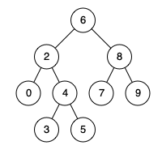

# 235. 二叉搜索树的最近公共祖先

| 题目信息 | 内容 |
|---|---|
| 难度 | 中等 |
| 核心模式 | 利用 BST 有序性，沿分叉点向下查找 |
| 时间复杂度 | O(h)（h 为树高） |
| 空间复杂度 | O(1) |

## 题目与约束

给定一个二叉搜索树, 找到该树中两个指定节点的最近公共祖先。

百度百科中最近公共祖先的定义为：“对于有根树 T 的两个结点 p、q，最近公共祖先表示为一个结点 x，满足 x 是 p、q 的祖先且 x 的深度尽可能大（一个节点也可以是它自己的祖先）。”

例如，给定如下二叉搜索树:  root = [6,2,8,0,4,7,9,null,null,3,5]



 

示例 1:

输入: root = [6,2,8,0,4,7,9,null,null,3,5], p = 2, q = 8  
输出: 6  
解释: 节点 2 和节点 8 的最近公共祖先是 6。

示例 2:

输入: root = [6,2,8,0,4,7,9,null,null,3,5], p = 2, q = 4  
输出: 2  
解释: 节点 2 和节点 4 的最近公共祖先是 2, 因为根据定义最近公共祖先节点可以为节点本身。

 

说明:

- 所有节点的值都是唯一的。

- p、q 为不同节点且均存在于给定的二叉搜索树中。

[🔗 前往力扣原题验证 →](https://leetcode.cn/problems/lowest-common-ancestor-of-a-binary-search-tree/)

## 核心不变量

> 最近公共祖先就是 p、q 在 BST 中「分道扬镳」的那个节点（含其中一个本身就是答案的情况）。

## 完整推导

### 思路推导

1. **BST 的有序性。** 二叉搜索树满足：左子树所有节点值 < 根节点值 < 右子树所有节点值。这意味着从根往下走时，每个节点的值都能告诉我们目标应该往哪边去。
2. **从根出发做「分叉判断」。** 比较 `p`、`q` 与当前节点 `cur`：
   - 若 `p`、`q` 的值都小于 `cur`，说明二者都在左子树，最近公共祖先一定在左子树里，往左走；
   - 若都大于 `cur`，说明都在右子树，往右走；
   - 否则（一个在左、一个在右，或其中一个就等于 `cur`），说明它们在此处「分开」，或者其中一个就是当前节点 —— 这个 `cur` 就是最近公共祖先。
3. **小例子。** `root=6`，`p=2, q=8`：`2 < 6 < 8` 分居两侧 → 返回 `6`。再看 `p=2, q=4`：两者都 `< 6`，往左到节点 `2`；此时 `p` 恰好等于 `cur=2`，命中「等于自身」的情况 → 返回 `2`。✅
4. **为什么可以不用递归。** 每次比较后只会朝一个方向走，顺着一条路径往下即可，用一个 `while` 循环就把递归改写成迭代，额外空间 O(1)。

### Java 实现（利用 BST 性质迭代）
```java
class Solution {
    public TreeNode lowestCommonAncestor(TreeNode root, TreeNode p, TreeNode q) {
        TreeNode cur = root;
        while (cur != null) {
            if (p.val < cur.val && q.val < cur.val) {
                // 两个目标都在左子树
                cur = cur.left;
            } else if (p.val > cur.val && q.val > cur.val) {
                // 两个目标都在右子树
                cur = cur.right;
            } else {
                // 分居两侧，或其中一个就是当前节点：当前节点即最近公共祖先
                return cur;
            }
        }
        return null;
    }
}
```

### 复杂度
- 时间：O(h)，h 为树高。每次只朝一个方向下降一层，最坏走到叶子；平衡 BST 下 h ≈ log n，退化成链时 h = n。
- 空间：O(1)，只用了一个 `cur` 指针迭代，没有递归栈开销。

### 易错点与扩展（面试高频考点）

1. **别用普通二叉树的 O(n) 递归。** 那是 236 题（一般二叉树）的解法；本题是 BST，必须利用值的大小关系剪枝，才能做到 O(h)。
2. **「其中一个就是祖先」必须在 `else` 里返回。** 当 `cur.val` 等于 `p.val` 或 `q.val` 时，不再满足「都小于 / 都大于」，会落入 `else` 并正确返回当前节点。
3. **迭代写法天然 O(1) 空间。** 递归写法虽然简洁，但栈深度是 O(h)；面试若追问空间优化，给出迭代版本更稳。
4. **前提是「值唯一」。** 题目保证所有节点值唯一，比较才不会产生歧义；若值可重复，就比较的是节点引用而非值。
5. **扩展：一般二叉树的 LCA（236 题）。** 没有 BST 性质时，需要用后序遍历：左右子树是否分别能找到 p、q，第一个「左右都命中或自身命中」的节点即为答案，时间 O(n)。

## 力扣原题

[235. 二叉搜索树的最近公共祖先](https://leetcode.cn/problems/lowest-common-ancestor-of-a-binary-search-tree/)

### C++ 实现
```cpp
class Solution {
public:
    TreeNode* lowestCommonAncestor(TreeNode* root, TreeNode* p, TreeNode* q) {
        TreeNode* cur = root;
        while (cur != nullptr) {
            if (p->val < cur->val && q->val < cur->val) {
                cur = cur->left;   // 都在左子树
            } else if (p->val > cur->val && q->val > cur->val) {
                cur = cur->right;  // 都在右子树
            } else {
                return cur;        // 分叉点即最近公共祖先
            }
        }
        return nullptr;
    }
};
```

### Python 实现
```python
class Solution:
    def lowestCommonAncestor(self, root, p, q):
        cur = root
        while cur:
            if p.val < cur.val and q.val < cur.val:
                cur = cur.left          # 都在左子树
            elif p.val > cur.val and q.val > cur.val:
                cur = cur.right         # 都在右子树
            else:
                return cur              # 分叉点即最近公共祖先
        return None
```
