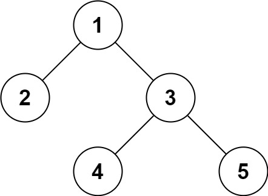

# 297. 二叉树的序列化与反序列化

| 题目信息 | 内容 |
|---|---|
| 难度 | 困难 |
| 核心模式 | 先序 DFS 序列化（空节点用 `#` 占位）+ 同序消费 tokens 反序列化 |
| 时间复杂度 | O(n) |
| 空间复杂度 | O(n) |

## 题目与约束

序列化是将一个数据结构或者对象转换为连续的比特位的操作，进而可以将转换后的数据存储在一个文件或者内存中，同时也可以通过网络传输到另一个计算机环境，采取相反方式重构得到原数据。

请设计一个算法来实现二叉树的序列化与反序列化。这里不限定你的序列 / 反序列化算法执行逻辑，你只需要保证一个二叉树可以被序列化为一个字符串并且将这个字符串反序列化为原始的树结构。

提示: 输入输出格式与 LeetCode 目前使用的方式一致，详情请参阅 LeetCode 序列化二叉树的格式。你并非必须采取这种方式，你也可以采用其他的方法解决这个问题。

 

示例 1：



```
<strong>输入：</strong>root = [1,2,3,null,null,4,5]
<strong>输出：</strong>[1,2,3,null,null,4,5]
```

示例 2：

```
<strong>输入：</strong>root = []
<strong>输出：</strong>[]
```

示例 3：

```
<strong>输入：</strong>root = [1]
<strong>输出：</strong>[1]
```

示例 4：

```
<strong>输入：</strong>root = [1,2]
<strong>输出：</strong>[1,2]
```

 

提示：

- 树中结点数在范围 `[0, 104]` 内

- `-1000 <= Node.val <= 1000`

[🔗 前往力扣原题验证 →](https://leetcode.cn/problems/serialize-and-deserialize-binary-tree/)

## 核心不变量

> 序列化时每个空指针都写入占位符 `#`，使树结构被完整记录；反序列化按同一遍历顺序逐个消费 token，读到 `#` 就返回空，因此能唯一地重建原树。

## 完整推导

### 思路推导

1. **单靠一种顺序为什么不够？** 只写 `[1,2,3]` 的先序结果无法区分“2 是 1 的左孩子”还是“3 是右孩子”等结构差异。补上**空指针占位**后，遍历骨架就被唯一确定了。

2. **先序 + `#` 占位（小例子）** 对 `[1,2,3,null,null,4,5]` 做先序 DFS，遇到空就写 `#`：

   ```
   1, 2, #, #, 3, 4, #, #, 5, #, #
   ```

   每个节点都有两个“孩子位置”的记录，结构信息一个不漏。

3. **反序列化就是“照着剧本往下读”**：指针 `i` 从头开始，读到一个数字就建当前节点，然后**递归**先建左子树、再建右子树；读到 `#` 立即返回 `null`。因为序列化写出的顺序和反序列化消费的顺序完全一致，所以能一一对应。

4. **为什么是 O(n)？** 序列化访问每个节点一次；反序列化每个 token 恰好消费一次，互不重复。

### Java 实现（先序 DFS + 索引消费）

```java
/**
 * Definition for a binary tree node.
 * public class TreeNode {
 *     int val;
 *     TreeNode left;
 *     TreeNode right;
 *     TreeNode(int x) { val = x; }
 * }
 */
public class Codec {

    // Encodes a tree to a single string.
    public String serialize(TreeNode root) {
        StringBuilder sb = new StringBuilder();
        dfs(root, sb);
        return sb.toString();
    }

    private void dfs(TreeNode node, StringBuilder sb) {
        if (node == null) {
            sb.append("#,");          // 空节点也要留痕，否则结构无法还原
            return;
        }
        sb.append(node.val).append(',');
        dfs(node.left, sb);
        dfs(node.right, sb);
    }

    // Decodes your encoded data to tree.
    public TreeNode deserialize(String data) {
        String[] tokens = data.split(",");
        int[] idx = {0};                       // 用一个元素数组充当可变下标
        return build(tokens, idx);
    }

    private TreeNode build(String[] tokens, int[] idx) {
        String tok = tokens[idx[0]++];
        if (tok.equals("#")) {
            return null;                       // 空位置，直接回溯
        }
        TreeNode node = new TreeNode(Integer.parseInt(tok));
        node.left = build(tokens, idx);        // 先还原左子树
        node.right = build(tokens, idx);       // 再还原右子树
        return node;
    }
}
```

### 复杂度

- 时间：O(n)，序列化与反序列化都只遍历每个节点/token 一次，字符串拼接为线性。
- 空间：O(n)，递归栈深度最坏为 n（链状树），序列化字符串与 token 数组也都是 O(n)。

### 易错点与扩展（面试高频考点）

1. **空节点必须占位**：不写 `#` 就丢失结构信息，例如 `[1,2]` 与 `[1,null,2]` 会无法区分。
2. **分隔符要选不会与数值冲突的字符**：逗号分隔即可，但要注意末位逗号导致 `split` 产生空串，用“跳过空串”或统一按“每个节点都带逗号”处理。
3. **不要只用中序**：单一中序遍历无法唯一确定一棵二叉树；先序/后序 + 空占位或层序 + 空占位才可行。
4. **下标要能递增**：Java 中基本类型按值传递，递归里要用 `int[]`、成员变量或返回索引的方式维护消费位置。
5. **扩展**：可换成 BFS 层序序列化（同样用 `#` 占位），思路一致，只是用队列而不是递归。

## 力扣原题

[297. 二叉树的序列化与反序列化](https://leetcode.cn/problems/serialize-and-deserialize-binary-tree/)

### C++ 实现

```cpp
/**
 * Definition for a binary tree node.
 * struct TreeNode {
 *     int val;
 *     TreeNode *left;
 *     TreeNode *right;
 *     TreeNode(int x) : val(x), left(NULL), right(NULL) {}
 * };
 */
class Codec {
public:
    string serialize(TreeNode* root) {
        string out;
        dfs(root, out);
        return out;
    }

    TreeNode* deserialize(string data) {
        istringstream is(data);
        return build(is);
    }

private:
    void dfs(TreeNode* node, string& out) {
        if (!node) {
            out += "#,";
            return;
        }
        out += to_string(node->val) + ",";
        dfs(node->left, out);
        dfs(node->right, out);
    }

    TreeNode* build(istringstream& is) {
        string tok;
        getline(is, tok, ',');          // 按逗号切出一个 token
        if (tok == "#") return nullptr;
        TreeNode* node = new TreeNode(stoi(tok));
        node->left = build(is);
        node->right = build(is);
        return node;
    }
};
```

### Python 实现

```python
import sys
sys.setrecursionlimit(20000)  # 链状树深度可达 10^4，超出默认 1000

# Definition for a binary tree node.
# class TreeNode(object):
#     def __init__(self, x):
#         self.val = x
#         self.left = None
#         self.right = None

class Codec:
    def serialize(self, root):
        # 共享 tokens 列表逐项 append，避免每层列表拼接导致 O(n²)
        tokens = []

        def dfs(node):
            if not node:
                tokens.append("#")
                return
            tokens.append(str(node.val))
            dfs(node.left)
            dfs(node.right)

        dfs(root)
        return ",".join(tokens)

    def deserialize(self, data):
        tokens = data.split(",")
        self.i = 0

        def build():
            tok = tokens[self.i]
            self.i += 1
            if tok == "#":
                return None
            node = TreeNode(int(tok))
            node.left = build()
            node.right = build()
            return node

        return build()
```
