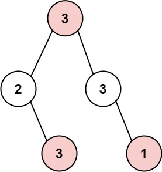
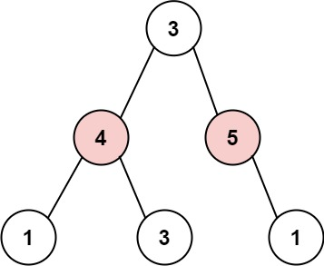

# 337. 打家劫舍 III

| 题目信息 | 内容 |
|---|---|
| 难度 | 中等 |
| 核心模式 | 树形 DP：后序遍历返回「偷 / 不偷」二元状态 |
| 时间复杂度 | O(n) |
| 空间复杂度 | O(h) |

## 题目与约束

小偷又发现了一个新的可行窃的地区。这个地区只有一个入口，我们称之为 `root` 。

除了 `root` 之外，每栋房子有且只有一个“父“房子与之相连。一番侦察之后，聪明的小偷意识到“这个地方的所有房屋的排列类似于一棵二叉树”。 如果 两个直接相连的房子在同一天晚上被打劫 ，房屋将自动报警。

给定二叉树的 `root` 。返回 在不触动警报的情况下 ，小偷能够盗取的最高金额 。

 

示例 1:



```
<strong>输入: </strong>root = [3,2,3,null,3,null,1]
<strong>输出:</strong> 7 
<strong>解释:</strong> 小偷一晚能够盗取的最高金额 3 + 3 + 1 = 7
```

示例 2:



```
<strong>输入: </strong>root = [3,4,5,1,3,null,1]
<strong>输出:</strong> 9
<strong>解释:</strong> 小偷一晚能够盗取的最高金额 4 + 5 = 9
```

 

提示：

- 树的节点数在 `[1, 104]` 范围内

- `0 <= Node.val <= 104`

[🔗 前往力扣原题验证 →](https://leetcode.cn/problems/house-robber-iii/)

## 核心不变量

> 对每个节点，返回两个值——「偷这个节点时其子树的最大收益」与「不偷这个节点时其子树的最大收益」；父节点的最优决策只依赖子节点这两个值。

## 完整推导

### 思路推导

1. **相邻父子不能同时偷**

   这是一条树上的"相邻不共存"约束，天然适合「每个节点做一个 偷 / 不偷 的决策」。树形 DP 的关键是：把**子树的答案**先算好，再合并到父节点。

2. **为什么必须自底向上（后序）**

   当前节点怎么选，取决于左右子树分别"偷没偷它自己"，所以要先把左右子树的结果拿到手。后序遍历（左→右→根）正好满足。

3. **两种状态、两个转移式子**

   - 设 `rob` = 偷当前节点：则两个孩子都不能偷，`rob = node.val + 左.不偷 + 右.不偷`；
   - 设 `notRob` = 不偷当前节点：两个孩子各自取「偷/不偷」中的较大者，`notRob = max(左.偷, 左.不偷) + max(右.偷, 右.不偷)`。

4. **小例子（示例 1：`[3,2,3,null,3,null,1]`）**

   节点 3（左子树右孩子，叶子）返回 `(3,0)`；节点 2 得 `rob=2`、`notRob=3` → `(2,3)`；右侧节点 3 有右孩子 1，得 `(3,1)`。根 3：`rob = 3 + 3(左不偷) + 1(右不偷) = 7`，`notRob = max(2,3) + max(3,1) = 6`，取 `max = 7`，与答案一致。

### Java 实现（rob）

```java
class Solution {
    public int rob(TreeNode root) {
        int[] res = dfs(root);
        return Math.max(res[0], res[1]);
    }

    // 返回 int[]{偷当前节点的最大收益, 不偷当前节点的最大收益}
    private int[] dfs(TreeNode node) {
        if (node == null) {
            return new int[]{0, 0};                 // 空节点两种状态都是 0
        }
        int[] left = dfs(node.left);
        int[] right = dfs(node.right);

        // 偷当前：孩子都不能偷
        int robThis = node.val + left[1] + right[1];
        // 不偷当前：孩子各自取偷/不偷的较大值
        int notRobThis = Math.max(left[0], left[1]) + Math.max(right[0], right[1]);

        return new int[]{robThis, notRobThis};
    }
}
```

### 复杂度

- 时间：O(n)，每个节点只被访问一次，后序合并是常数操作。
- 空间：O(h)，递归栈深度等于树高；最坏链状树为 O(n)，平衡树为 O(log n)。

### 易错点与扩展（面试高频考点）

1. **朴素递归会指数级重复计算**：若写成 `rob(root) = max(root.val + rob(root.left.left) + ... , rob(root.left) + rob(root.right))`，同一个节点会被反复进入，规模退化到接近指数级。正确做法是后序一次返回两个状态（或用 `HashMap` 记忆化）。
2. **返回值顺序别写反**：约定 `[0]=偷、[1]=不偷`，`robThis` 依赖孩子的 `[1]`（不偷），`notRobThis` 用到两个值取 max，写反结果必错。
3. **空节点返回 `(0, 0)`**：这是递归的基准情形，不要遗漏。
4. **`node.val` 可以为 0**：不能拿"收益为 0"当空节点或结束标记，判断一律用 `== null`。
5. **两种解法对比**：记忆化搜索（自顶向下）与后序 DP（自底向上）复杂度相同都是 O(n)，但后者不用哈希表、常数更小，面试中更受青睐。

## 力扣原题

[337. 打家劫舍 III](https://leetcode.cn/problems/house-robber-iii/)

### C++ 实现

```cpp
#include <algorithm>
#include <utility>

class Solution {
public:
    int rob(TreeNode* root) {
        auto res = dfs(root);
        return std::max(res.first, res.second);
    }

private:
    // 返回 {偷当前节点的最大收益, 不偷当前节点的最大收益}
    std::pair<int, int> dfs(TreeNode* node) {
        if (node == nullptr) return {0, 0};

        auto left = dfs(node->left);
        auto right = dfs(node->right);

        int robThis = node->val + left.second + right.second;   // 偷当前，孩子不偷
        int notRobThis = std::max(left.first, left.second)
                       + std::max(right.first, right.second);   // 不偷当前

        return {robThis, notRobThis};
    }
};
```

### Python 实现

```python
class Solution:
    def rob(self, root: Optional[TreeNode]) -> int:
        # 返回 (偷当前节点的最大收益, 不偷当前节点的最大收益)
        def dfs(node):
            if node is None:
                return (0, 0)
            l_rob, l_not = dfs(node.left)
            r_rob, r_not = dfs(node.right)

            rob_this = node.val + l_not + r_not        # 偷当前，孩子不偷
            not_rob = max(l_rob, l_not) + max(r_rob, r_not)  # 不偷当前

            return (rob_this, not_rob)

        return max(dfs(root))
```
