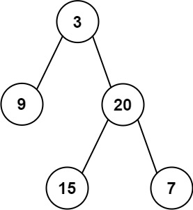

# 404. 左叶子之和

| 题目信息 | 内容 |
|---|---|
| 难度 | 简单 |
| 核心模式 | DFS 遍历携带「是否为左孩子」标记 |
| 时间复杂度 | O(n) |
| 空间复杂度 | O(h) |

## 题目与约束

给定二叉树的根节点 `root` ，返回所有左叶子之和。

 

示例 1：



```
<strong>输入:</strong> root = [3,9,20,null,null,15,7] 
<strong>输出:</strong> 24 
<strong>解释:</strong> 在这个二叉树中，有两个左叶子，分别是 9 和 15，所以返回 24
```

示例 2:

```
<strong>输入:</strong> root = [1]
<strong>输出:</strong> 0
```

 

提示:

- 节点数在 `[1, 1000]` 范围内

- `-1000 <= Node.val <= 1000`

[🔗 前往力扣原题验证 →](https://leetcode.cn/problems/sum-of-left-leaves/)

## 核心不变量

> 一个节点只有在「它是父节点的左孩子」且「它自己没有孩子」时，才把它的值累加进答案。

## 完整推导

### 思路推导

1. **拆解「左叶子」的定义**：这是整题的胜负手。新手常犯的错误是「只要在左子树上找到叶子就加」——但一个左子树内部还可能挂着右孩子。真正要判断的是两件事同时成立：① 该节点没有孩子（是叶子）；② 它来自父节点的 `left` 指针。

2. **如何把「它是左孩子」这个身份传下去？** 父节点在递归时可以主动把「左孩子」的身份告诉孩子，而不是让孩子自己猜。于是递归函数多带一个布尔参数 `isLeft`：从 `root` 出发统一视为 `false`，走到左孩子时传 `true`，走到右孩子时传 `false`。

3. **终止与累加**：遇到 `null` 返回 0；遇到叶子节点时，若 `isLeft` 为真就返回 `node.val`，否则返回 0。非叶子节点则把左右子树的结果相加。

小例子：对 `[3,9,20,null,null,15,7]`，节点 9 是 3 的左孩子且为叶子 → 计入 9；节点 15 是 20 的左孩子且为叶子 → 计入 15；右叶子 7 不算。合计 24。

### Java 实现（DFS 传递 isLeft 标记）

```java
/**
 * Definition for a binary tree node.
 * public class TreeNode {
 *     int val;
 *     TreeNode left;
 *     TreeNode right;
 *     TreeNode() {}
 *     TreeNode(int val) { this.val = val; }
 *     TreeNode(int val, TreeNode left, TreeNode right) {
 *         this.val = val;
 *         this.left = left;
 *         this.right = right;
 *     }
 * }
 */
class Solution {
    public int sumOfLeftLeaves(TreeNode root) {
        // 根节点没有父节点，统一视为「非左孩子」
        return dfs(root, false);
    }

    private int dfs(TreeNode node, boolean isLeft) {
        if (node == null) {
            return 0;
        }
        // 叶子判定：左右孩子都为空
        if (node.left == null && node.right == null) {
            return isLeft ? node.val : 0;
        }
        // 左孩子标记为 true，右孩子标记为 false
        return dfs(node.left, true) + dfs(node.right, false);
    }
}
```

### 复杂度

- 时间：O(n)，每个节点恰好访问一次，做常数时间判断。
- 空间：O(h)，递归栈深度等于树高；最坏（链状树）为 O(n)，最好（平衡树）为 O(log n)。

### 易错点与扩展（面试高频考点）

1. **误把「左子树上的叶子」都算进去**：必须用「它是不是父节点的左孩子」来判定，而不是「它是否位于左子树」。左子树里完全可能存在右叶子，比如 `3 -> 左 9、右 20 -> 左 15、右 7` 中的 7 就是右叶子，不能计入。

2. **把根节点当成左孩子**：递归入口必须传 `false`，否则单节点树 `[1]` 会错误返回 1 而不是 0。

3. **BFS 写法对照**：也可以用队列层序遍历，入队时给每个节点附带 `isLeft` 标记，出队时若是叶子且 `isLeft` 则累加，效果等价，写法适合不习惯递归的面试者。

4. **扩展：求「右叶子之和」**：只需把标记语义反过来，或在叶子判定处改成 `isLeft ? 0 : node.val` 即可，说明这类题的通用套路是「用额外状态描述节点身份」。

5. **边界**：题目保证节点数 ≥ 1，但仍建议把 `root == null` 的防御写在最前面，保持模板健壮。

## 力扣原题

[404. 左叶子之和](https://leetcode.cn/problems/sum-of-left-leaves/)

### C++ 实现

```cpp
/**
 * Definition for a binary tree node.
 * struct TreeNode {
 *     int val;
 *     TreeNode *left;
 *     TreeNode *right;
 *     TreeNode() : val(0), left(nullptr), right(nullptr) {}
 *     TreeNode(int x) : val(x), left(nullptr), right(nullptr) {}
 *     TreeNode(int x, TreeNode *left, TreeNode *right) : val(x), left(left), right(right) {}
 * };
 */
class Solution {
public:
    int sumOfLeftLeaves(TreeNode* root) {
        return dfs(root, false);
    }

private:
    int dfs(TreeNode* node, bool isLeft) {
        if (node == nullptr) {
            return 0;
        }
        if (node->left == nullptr && node->right == nullptr) {
            return isLeft ? node->val : 0;
        }
        return dfs(node->left, true) + dfs(node->right, false);
    }
};
```

### Python 实现

```python
# Definition for a binary tree node.
# class TreeNode:
#     def __init__(self, val=0, left=None, right=None):
#         self.val = val
#         self.left = left
#         self.right = right
class Solution:
    def sumOfLeftLeaves(self, root: Optional[TreeNode]) -> int:
        def dfs(node, is_left):
            if not node:
                return 0
            # 叶子节点：根据是否为左孩子决定是否累加
            if not node.left and not node.right:
                return node.val if is_left else 0
            return dfs(node.left, True) + dfs(node.right, False)

        return dfs(root, False)
```
