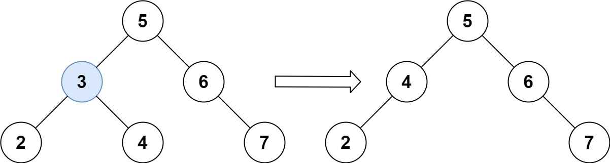

# 450. 删除二叉搜索树中的节点

| 题目信息 | 内容 |
|---|---|
| 难度 | 中等 |
| 核心模式 | BST 递归查找 + 用中序后继顶替被删节点 |
| 时间复杂度 | O(h) |
| 空间复杂度 | O(h) |

## 题目与约束

给定一个二叉搜索树的根节点 root 和一个值 key，删除二叉搜索树中的 key 对应的节点，并保证二叉搜索树的性质不变。返回二叉搜索树（有可能被更新）的根节点的引用。

一般来说，删除节点可分为两个步骤：

- 首先找到需要删除的节点；

- 如果找到了，删除它。

 

示例 1:



输入：root = [5,3,6,2,4,null,7], key = 3  
输出：[5,4,6,2,null,null,7]  
解释：给定需要删除的节点值是 3，所以我们首先找到 3 这个节点，然后删除它。  
一个正确的答案是 [5,4,6,2,null,null,7], 如下图所示。  
另一个正确答案是 [5,2,6,null,4,null,7]。

示例 2:

输入: root = [5,3,6,2,4,null,7], key = 0  
输出: [5,3,6,2,4,null,7]  
解释: 二叉树不包含值为 0 的节点

示例 3:

输入: root = [], key = 0  
输出: []

 

提示:

- 节点数的范围 `[0, 104]`.

- `-105 <= Node.val <= 105`

- 节点值唯一

- `root` 是合法的二叉搜索树

- `-105 <= key <= 105`

 

进阶： 要求算法时间复杂度为 O(h)，h 为树的高度。

[🔗 前往力扣原题验证 →](https://leetcode.cn/problems/delete-node-in-a-bst/)

## 核心不变量

> 找到了要删的节点后：若它最多只有一个孩子，直接用唯一的孩子顶替；若有两个孩子，就在右子树里找最小值（中序后继）覆盖它的值，再把「后继节点」按同样规则删掉。

## 完整推导

### 思路推导

1. **直觉与痛点（删除破坏 BST 结构）**

   查找很轻松：`key < root.val` 往左走，`key > root.val` 往右走。难点在「找到之后怎么删」——直接摘掉节点会让左右子树断开，或者破坏「左小右大」的性质。

2. **破局思路（按孩子数量分三种情况）**

   设要删的节点为 `node`：
   - **没有孩子**：直接返回 `null`，父节点对应指针变空即可。
   - **只有一个孩子**：返回那唯一的孩子，它天然满足与祖先的大小关系。
   - **有两个孩子**：不能简单删。要么用**左子树最大值（前驱）**，要么用**右子树最小值（中序后继）**来顶替 `node.val`。这里选后继：进入右子树一路向左找到最小值 `successor`，把 `node.val = successor.val`，问题转化为「在右子树里删掉这个后继」——而后继最多只有右孩子，退化回前两种简单情况。

3. **递归统一处理**

   把上述逻辑写成递归：`deleteNode(root, key)` 返回「删除后这棵子树的根」。往左或往右递归后，把返回值重新赋给 `root.left` 或 `root.right`，即可自动完成指针的替换与接续。以 `[5,3,6,2,4,null,7]` 删 3 为例：节点 3 有两个孩子，右子树最小值是 4，令 `3` 改成 `4`，再删除右子树中的 `4`，得到 `[5,4,6,2,null,null,7]`。

4. **为什么是 O(h)**

   查找沿一条路径走 `O(h)`；找到后继也只是在右子树沿左边一条链走，同样 `O(h)`；整体只在一条到两条路径上工作，不遍历全树。

### Java 实现（递归 + 中序后继）

```java
/**
 * Definition for a binary tree node.
 * public class TreeNode {
 *     int val;
 *     TreeNode left;
 *     TreeNode right;
 *     TreeNode() {}
 *     TreeNode(int val) { this.val = val; }
 *     TreeNode(int val, TreeNode left, TreeNode right) {
 *         this.val = val;
 *         this.left = left;
 *         this.right = right;
 *     }
 * }
 */
class Solution {
    public TreeNode deleteNode(TreeNode root, int key) {
        if (root == null) {
            return null;
        }

        if (key < root.val) {
            // 目标在左子树，递归删除后接回
            root.left = deleteNode(root.left, key);
        } else if (key > root.val) {
            // 目标在右子树
            root.right = deleteNode(root.right, key);
        } else {
            // 找到了目标节点，按孩子数量分情况删除
            if (root.left == null) {
                return root.right; // 无左孩子（含叶子），右孩子直接顶替
            }
            if (root.right == null) {
                return root.left; // 无右孩子，左孩子顶替
            }
            // 两个孩子：找右子树中的最小值（中序后继）
            TreeNode successor = root.right;
            while (successor.left != null) {
                successor = successor.left;
            }
            root.val = successor.val;                    // 用后继的值覆盖
            root.right = deleteNode(root.right, successor.val); // 再从右子树删掉后继
        }
        return root;
    }
}
```

### 复杂度

- 时间：`O(h)`，`h` 为树高。查找与找后继各沿一条路径下降，最坏（链状树）为 `O(n)`，平衡时为 `O(log n)`。
- 空间：`O(h)`，递归调用栈深度等于路径长度，最坏 `O(n)`。

### 易错点与扩展（面试高频考点）

1. **两个孩子的情况别写错方向**：用「右子树最小值」顶替时，删除后继的递归入口必须是 `root.right` 而不是 `root`，否则会把刚赋的值又删掉。
2. **单孩子时直接返回孩子**：不要只把 `node.left/right` 置空，否则整棵子树丢失。
3. **返回值要接回父节点**：递归写法里必须 `root.left = deleteNode(...)`，否则删除后指针没更新。
4. **面试追问——前驱 vs 后继**：用左子树最大值（前驱）同样正确，示例里 `[5,2,6,null,4,null,7]` 就是前驱方案的结果；两种都能保持 BST 性质，任选其一。
5. **扩展——迭代写法**：可先迭代找到目标及其父节点，再按三种情况改指针，空间可降到 `O(1)`，但代码分支更多、更易错，面试中递归版更稳妥。

## 力扣原题

[450. 删除二叉搜索树中的节点](https://leetcode.cn/problems/delete-node-in-a-bst/)

### C++ 实现

```cpp
/**
 * Definition for a binary tree node.
 * struct TreeNode {
 *     int val;
 *     TreeNode *left;
 *     TreeNode *right;
 *     TreeNode() : val(0), left(nullptr), right(nullptr) {}
 *     TreeNode(int x) : val(x), left(nullptr), right(nullptr) {}
 *     TreeNode(int x, TreeNode *left, TreeNode *right) : val(x), left(left), right(right) {}
 * };
 */
class Solution {
public:
    TreeNode* deleteNode(TreeNode* root, int key) {
        if (!root) return nullptr;

        if (key < root->val) {
            root->left = deleteNode(root->left, key);
        } else if (key > root->val) {
            root->right = deleteNode(root->right, key);
        } else {
            // 找到目标节点
            if (!root->left) return root->right;  // 无左孩子
            if (!root->right) return root->left;  // 无右孩子

            // 两个孩子：找右子树最小值（中序后继）
            TreeNode* successor = root->right;
            while (successor->left) {
                successor = successor->left;
            }
            root->val = successor->val;
            root->right = deleteNode(root->right, successor->val);
        }
        return root;
    }
};
```

### Python 实现

```python
# Definition for a binary tree node.
# class TreeNode:
#     def __init__(self, val=0, left=None, right=None):
#         self.val = val
#         self.left = left
#         self.right = right
from typing import Optional

class Solution:
    def deleteNode(self, root: Optional[TreeNode], key: int) -> Optional[TreeNode]:
        if not root:
            return None

        if key < root.val:
            root.left = self.deleteNode(root.left, key)
        elif key > root.val:
            root.right = self.deleteNode(root.right, key)
        else:
            # 找到目标节点
            if not root.left:
                return root.right  # 无左孩子
            if not root.right:
                return root.left   # 无右孩子

            # 两个孩子：用右子树最小值（中序后继）顶替
            successor = root.right
            while successor.left:
                successor = successor.left
            root.val = successor.val
            root.right = self.deleteNode(root.right, successor.val)

        return root
```
