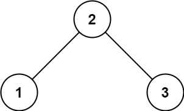
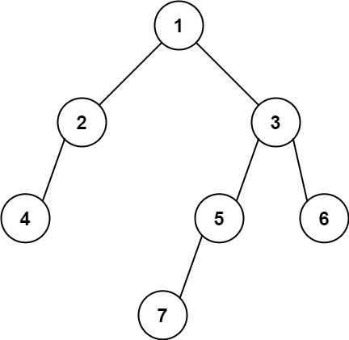

# 513. 找树左下角的值

| 题目信息 | 内容 |
|---|---|
| 难度 | 中等 |
| 核心模式 | BFS 逐层遍历，记录每层最左节点 |
| 时间复杂度 | O(n) |
| 空间复杂度 | O(w) |

## 题目与约束

给定一个二叉树的 根节点 `root`。

请找出该二叉树的 最底层 最左边 节点的值。

 

示例 1:



```
<strong>输入：</strong>root = [2,1,3]
<strong>输出：</strong>1
<strong>解释</strong><strong>：</strong>最后一行是 [1, 3]，因此最左边的值是 1。
```

示例 2:



```
<strong>输入：</strong>[1,2,3,4,null,5,6,null,null,7]
<strong>输出：</strong>7
<strong>解释：</strong>最后一层只有节点 7。
```

 

提示:

- 二叉树的节点个数的范围是 `[1, 104]`

- `-231 <= Node.val <= 231 - 1`

[🔗 前往力扣原题验证 →](https://leetcode.cn/problems/find-bottom-left-tree-value/)

## 核心不变量

> 按层（BFS）从左到右遍历，每一层的第一个节点就是该层最左节点；持续用最新一层的这个值覆盖答案，遍历结束后答案就是最底层最左节点的值。

## 完整推导

### 思路推导

1. **“最底层”与“最左边”分别对应什么？**

   “最底层”要求深度最大，“最左边”要求同层中最靠左。二者合起来，就是**最后一层、从左数第一个节点**。只要能在逐层遍历时抓住“每层第一个”，再让它随层数更新即可。

2. **为什么用 BFS 而不是 DFS？**

   BFS 天然按层推进，最后一轮循环处理的正好是最后一层，逻辑最直观。DFS 也能做（记录首次到达更深层时的节点，且先遍历左子树），但需要额外维护深度。

3. **关键动作：每层开始先记下队头**

   在每层循环开始前，队列的队头正是该层最左节点。可以在层内 `i == 0` 时把 `node.val` 记入 `result`；由于每进入新一层都会覆盖，最终 `result` 保留的就是最底层的最左值。

4. **小例子（[2,1,3]）**

   - 第 1 层：队头 `2`，`result = 2`；随后入队 `1, 3`。
   - 第 2 层：队头 `1`，`result = 1`；入队其子节点（无）。
   - 队列空结束，返回 `result = 1`，正确。

### Java 实现（findBottomLeftValue）

```java
import java.util.LinkedList;
import java.util.Queue;

class Solution {
    public int findBottomLeftValue(TreeNode root) {
        Queue<TreeNode> queue = new LinkedList<>();
        queue.offer(root);
        int result = root.val; // 保证初始有值

        while (!queue.isEmpty()) {
            int size = queue.size(); // 当前层节点数，固定后遍历
            for (int i = 0; i < size; i++) {
                TreeNode node = queue.poll();
                if (i == 0) {
                    result = node.val; // 本层最左节点，逐层覆盖
                }
                if (node.left != null) queue.offer(node.left);
                if (node.right != null) queue.offer(node.right);
            }
        }
        return result;
    }
}
```

### 复杂度

- 时间：O(n)，每个节点入队、出队各一次。
- 空间：O(w)，队列中最多同时存放一层的节点，`w` 为树的最大宽度；最坏（满二叉树底层）为 O(n)。

### 易错点与扩展（面试高频考点）

1. **把“最左”误解为“一直走左孩子”**：若某层最左节点是某个右孩子，一路向左会走偏；必须按层记录每层第一个节点。
2. **忘记每层重置**：`result` 要每层用 `i == 0` 覆盖，否则只记住第一层。
3. **动态 `queue.size()` 陷阱**：与层序遍历一样，必须先把本层大小存入局部变量再循环，边遍历边 `offer` 会让 `size` 变化。
4. **DFS 写法**：可用前序遍历、记录 `(depth, val)`，只有遇到**更深**的层才更新答案（`depth > maxDepth`），并且要保证先访问左子树，才能取到同层最左。
5. **空树**：题目保证节点数 `>= 1`，故可省略判空；通用实现可加 `if (root == null) return 0;`。

## 力扣原题

[513. 找树左下角的值](https://leetcode.cn/problems/find-bottom-left-tree-value/)

### C++ 实现

```cpp
class Solution {
public:
    int findBottomLeftValue(TreeNode* root) {
        queue<TreeNode*> que;
        que.push(root);
        int result = root->val;

        while (!que.empty()) {
            int size = que.size();
            for (int i = 0; i < size; i++) {
                TreeNode* node = que.front();
                que.pop();
                if (i == 0) result = node->val; // 本层最左
                if (node->left) que.push(node->left);
                if (node->right) que.push(node->right);
            }
        }
        return result;
    }
};
```

### Python 实现

```python
from collections import deque

class Solution:
    def findBottomLeftValue(self, root: Optional[TreeNode]) -> int:
        queue = deque([root])
        result = root.val
        while queue:
            size = len(queue)  # 固定本层节点数
            for i in range(size):
                node = queue.popleft()
                if i == 0:
                    result = node.val  # 本层最左节点
                if node.left:
                    queue.append(node.left)
                if node.right:
                    queue.append(node.right)
        return result
```
