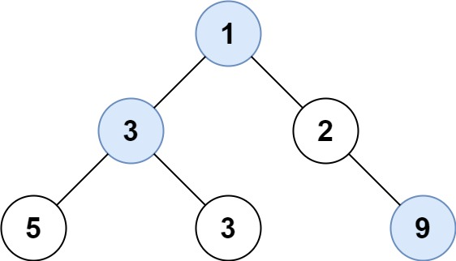

# 515. 在每个树行中找最大值

| 题目信息 | 内容 |
|---|---|
| 难度 | 中等 |
| 核心模式 | BFS 逐层遍历，取每层最大值 |
| 时间复杂度 | O(n) |
| 空间复杂度 | O(w) |

## 题目与约束

给定一棵二叉树的根节点 `root` ，请找出该二叉树中每一层的最大值。

 

示例1：



输入: root = [1,3,2,5,3,null,9]  
输出: [1,3,9]

示例2：

输入: root = [1,2,3]  
输出: [1,3]

 

提示：

- 二叉树的节点个数的范围是 `[0,104]`

- `-231 <= Node.val <= 231 - 1`

[🔗 前往力扣原题验证 →](https://leetcode.cn/problems/find-largest-value-in-each-tree-row/)

## 核心不变量

> 按层（BFS）遍历时，同一轮处理的恰好是同一层的全部节点；在该轮内取最大值即可得到这一层的最大值，逐层收集构成答案。

## 完整推导

### 思路推导

1. **问题拆解**

   题目要求“每一层一个最大值”，本质是二维结果、一维收集。只要能把节点按层分组，再对每组求最大值即可，而 BFS 的层序遍历正是天然的按层分组工具。

2. **层序遍历的固定套路**

   每轮循环先用 `size = queue.size()` 锁定当前层节点数，然后严格弹出 `size` 个节点，一边取值一边把它们的左右孩子入队。这样本层与下一层绝不混淆。

3. **层内求最大**

   在弹本层节点的过程中维护一个 `max`（初值取 `Integer.MIN_VALUE`），每弹一个就 `max = Math.max(max, node.val)`，本层结束后把 `max` 加入结果。因为节点值可能为负，初值必须用最小整数而**不能**用 `0`。

4. **小例子（[1,3,2,5,3,null,9]）**

   - 第 1 层：节点 `1` → `max = 1`。
   - 第 2 层：节点 `3, 2` → `max = 3`。
   - 第 3 层：节点 `5, 3, 9` → `max = 9`。
   - 结果 `[1, 3, 9]`，与示例一致。

### Java 实现（largestValues）

```java
import java.util.ArrayList;
import java.util.LinkedList;
import java.util.List;
import java.util.Queue;

class Solution {
    public List<Integer> largestValues(TreeNode root) {
        List<Integer> res = new ArrayList<>();
        if (root == null) {
            return res; // 空树返回空列表
        }

        Queue<TreeNode> queue = new LinkedList<>();
        queue.offer(root);

        while (!queue.isEmpty()) {
            int size = queue.size();            // 锁定当前层节点数
            int max = Integer.MIN_VALUE;        // 注意：值可能为负，不能用 0
            for (int i = 0; i < size; i++) {
                TreeNode node = queue.poll();
                max = Math.max(max, node.val);  // 层内更新最大值
                if (node.left != null) queue.offer(node.left);
                if (node.right != null) queue.offer(node.right);
            }
            res.add(max);                       // 收集本层最大值
        }
        return res;
    }
}
```

### 复杂度

- 时间：O(n)，每个节点入队、出队各一次，比较取值均为常数时间。
- 空间：O(w)，队列最多存放一层节点，`w` 为树的最大宽度；最坏 O(n)。

### 易错点与扩展（面试高频考点）

1. **`max` 初值用 0**：当某层全是负数（如 `[-5,-3]`）时会错误返回 0；必须用 `Integer.MIN_VALUE` / `-inf`。
2. **队列大小动态变化**：边遍历边 `offer` 会使 `queue.size()` 变大，务必先把本层 `size` 存到局部变量。
3. **空树处理**：题目允许 `root` 为空（节点数可为 0），要返回空列表而非抛异常。
4. **DFS 扩展写法**：也可用前序遍历 + 深度参数，用一个 `List` 按层更新 `res.set(depth, max(res.get(depth), val))`，效果相同，但代码更绕。
5. **同族题目**：与「二叉树的层序遍历」「找树左下角的值」共用 BFS 逐层模板，区别只在层内是“收集全部 / 取第一个 / 取最大值”，掌握模板即可一通百通。

## 力扣原题

[515. 在每个树行中找最大值](https://leetcode.cn/problems/find-largest-value-in-each-tree-row/)

### C++ 实现

```cpp
class Solution {
public:
    vector<int> largestValues(TreeNode* root) {
        vector<int> res;
        if (!root) return res;

        queue<TreeNode*> que;
        que.push(root);
        while (!que.empty()) {
            int size = que.size();
            int mx = INT_MIN; // 值可能为负
            for (int i = 0; i < size; i++) {
                TreeNode* node = que.front();
                que.pop();
                mx = max(mx, node->val);
                if (node->left) que.push(node->left);
                if (node->right) que.push(node->right);
            }
            res.push_back(mx);
        }
        return res;
    }
};
```

### Python 实现

```python
from collections import deque

class Solution:
    def largestValues(self, root: Optional[TreeNode]) -> list[int]:
        res = []
        if not root:
            return res

        queue = deque([root])
        while queue:
            size = len(queue)  # 固定本层节点数
            mx = float("-inf")  # 值可能为负
            for _ in range(size):
                node = queue.popleft()
                mx = max(mx, node.val)
                if node.left:
                    queue.append(node.left)
                if node.right:
                    queue.append(node.right)
            res.append(mx)
        return res
```
